# Architecture

CrowdPoll is one Node.js web service that serves a JSON API, its own browser client, a set of
background sweeps and a vote writer from a single process. There is no client framework and
no second build; the process is stateless, so the fleet grows and shrinks by adding and
removing identical instances that share a database, a cache and a queue.

## Deployment

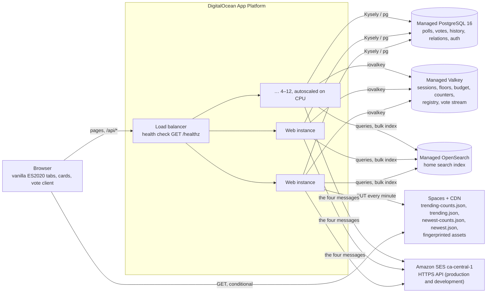

Every durable fact is in PostgreSQL; everything transient and shared — the session cache,
the per-visitor floors, the request budget, the live vote counters, the Live Results
registry and the vote stream — is in Valkey. OpenSearch and Spaces are optional: without
them the instances answer searches from PostgreSQL full-text search and serve the TRENDING
objects and assets themselves. Development needs PostgreSQL alone; the cache and queue are an
in-process implementation of the same interface. Configuration arrives entirely through
`ENV_*` variables, validated once at start-up.

## Start-up and shutdown

```mermaid
sequenceDiagram
  participant S as server.ts
  participant PG as PostgreSQL
  participant VK as Valkey
  participant OS as OpenSearch
  S->>S: loadConfig (fails fast, names the variable; a partial sign-in provider stops it; records each default used)
  S->>S: log each setting left at its default ([config] … was not found, using default value: …)
  S->>S: log sign-in mode and providers; sign Apple's client secret (renewed every 30 days)
  S->>PG: migrateToLatest (abort on failure)
  S->>VK: connect, XGROUP CREATE votes writers
  S->>OS: ensureIndex + health probe (fallback to PostgreSQL FTS on failure)
  S->>S: mount /healthz, compression, in-flight counter, the provider sign-in routes (oauth/both), dynamic routers, other-shedding, pages, API
  S->>VK: heartbeat instance:<id> every 10 s
  S->>S: start sweeps (advisory-locked) and the vote consumer
  S->>S: listen
  Note over S: SIGTERM: stop accepting → consumer finishes and acks its batch → sweeps stop → pools close
```

The PostgreSQL pool (`db/client.ts`, up to 20 connections) keeps its sockets alive with TCP
keep-alives and listens for errors on idle clients: a backend that PostgreSQL terminates, or a
socket reset while the machine slept, is logged as `[db]` and discarded, and the next query opens
a fresh connection — the process never sees it as an uncaught exception.

## Runtime components

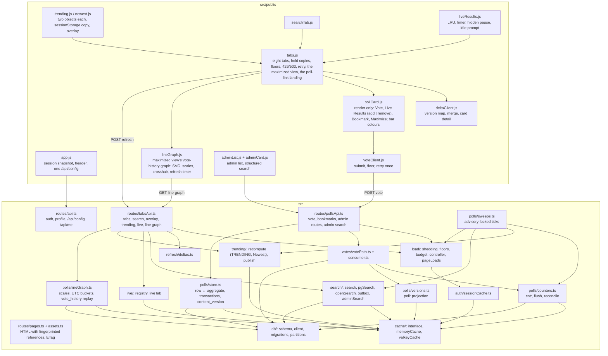

## Patterns in use

| Pattern | Where, and why |
|---|---|
| Layered architecture | Routes → services → store; business rules stay testable without HTTP |
| One interface, two implementations | `cache/cache.ts` is implemented by `memoryCache.ts` (tests, development) and `valkeyCache.ts` (production); `search/search.ts` selects OpenSearch or PostgreSQL full-text search by health. The tests need no services and the queue adapter is the only file that changes if the technology does |
| Cache-aside | Sessions (`sess:<sha256(token)>`), poll projections (`poll:<pid>`), roster sets, search results and the voted-set are read from the cache and filled from PostgreSQL on a miss; the cache is never the system of record |
| Command-query split for counts | Votes increment counters in the cache; a flush sweep writes the rows every two seconds; every client-facing read uses the live sequence, never the row |
| Producer / consumer with a queue | The vote route validates, counts and enqueues (`XADD`); a consumer group on every instance writes votes in idempotent batches and acknowledges them |
| Version-keyed deltas | A refresh sends what the client holds (`[contentVersion, countsVersion]` per poll and a membership version) and receives only what moved, or `304` |
| Publish–subscribe by objects | TRENDING and Newest are two published objects each: counts every recompute, cards only when a poll joins, leaves or changes content (`cardsVersion`, a hash of the sorted `pid:contentVersion` lines; `membershipVersion` stays a hash of the ids) |
| Leader per sweep | Each sweep tick takes a PostgreSQL advisory lock; one instance runs it, the others return |
| Server-authoritative capabilities | `capabilitiesFor()` returns the booleans the admin list renders; the client derives no state rule |
| Stored-as-displayed enumerations | Visibility, sharing mode, anonymity, choice mode, vote mutability and poll state are stored in the exact words shown |

## Data

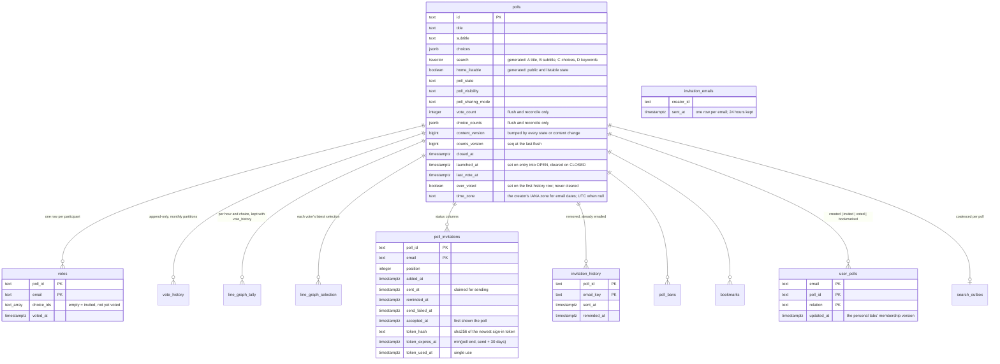

The authentication tables (`user`, `session`, `account`, `verification`, `rateLimit`,
`email_change_requests`) are owned by BetterAuth on the same database. `user` also holds
`permissions`, `terms_version` and `terms_accepted_at`, which BetterAuth does not know about;
the session cache reads them on a miss. Sessions store no IP address or user agent. Migrations run at
boot from `src/db/migrations/`; a failing migration stops the process. Before running any, Kysely checks its
record (`kysely_migration`) against the folder: a recorded name the folder lacks, or recorded names out of the folder's
order, stops the process with `Migration check failed: corrupted migrations: …` and a line naming
`npm run fix-migrations`. That happens in development, where every branch folder shares one database; the script
(`devScripts/fix-migrations.ts`, local databases only) renames, rolls back or applies migrations in one transaction under
Kysely's migration lock until the check passes (`devScripts/MIGRATIONS-HOWTO.md`).

### Cache keys

| Key | Holds | Written by |
|---|---|---|
| `sess:<sha256(token)>` | a session, bounded by its own expiry | session cache-aside; deleted on logout, rename, sign-in elsewhere |
| `floor:<kind>:<session\|ip>` | that kind's token bucket, refilled once per floor (× k for search and refresh) | every dynamic request |
| `tabs:v:<emailKey>`, `tabs:seen:<emailKey>:<tab>` | the user's list version (24 h); a personal tab's last full answer (5 min) | a full personal-tab answer; the version is deleted after commit by every write to the user's relations, invitations or bans |
| `stats:tabs:fast`, `stats:tabs:full`, `stats:floor:stretched` | counts since the last `[controller]` line (10 min) | the personal-tab routes and the floors; read and cleared by the controller |
| `budget:<sec>`, `budget:live:<sec>`, `search-budget:<sec>` | requests, live requests and engine queries per second | every dynamic request |
| `instance:<id>` | a heartbeat (30 s) | each instance every 10 s |
| `k:search`, `k:refresh`, `k:live` | the current multipliers | the controller |
| `cnt:<pid>` | `{ choiceId: n, total, seq }` | the vote path; seeded from the row on a miss |
| `dirty`, `dirty:day:<date>` | polls to flush / to reconcile | the vote path |
| `trend:<bucket>` | votes per poll per five minutes | the vote path |
| `poll:<pid>` | the card projection with `contentVersion` | every content write; a listing or search that finds it missing or stale; deleted with the poll |
| `invite:<pid>`, `ban:<pid>`, `voted:<session>`, `lastvote:<pid>:<email>` | roster sets, the session's voted polls, a voter's last choices | loaded on first use; rosters deleted on a roster change |
| `live:<session>`, `live:active` | a session's Live Results polls; every live session scored by its expiry | the Live Results routes |
| `listing:trending:*`, `listing:newest:*`, `search:<hash>` | the published TRENDING and Newest objects; a search's ids for ten seconds | the trending and newest sweeps; a search miss |
| `queue:lag`; stream `votes`, group `writers` | the writers' lag; the queue | the consumer; the vote path |
| `deleted-accounts` | addresses deleted in the last hour | account deletion; read by the consumer, which drops their queued votes |
| `line-graph:<pid>` | one poll's line-graph series for every available scale, for `ENV_LINE_GRAPH_REFRESH_INTERVAL` | a line-graph request that missed |

## The vote path

```mermaid
sequenceDiagram
  participant B as Browser
  participant R as vote route
  participant C as Valkey
  participant W as consumer (any instance)
  participant PG as PostgreSQL
  B->>R: POST /api/polls/:pid/vote
  R->>C: floor:vote (SET NX), votes-ip:<ip> (INCR)
  R->>C: poll:<pid>, ban/invite sets, voted:<session>
  Note over R: refusals keep their messages: banned, not invited, full, closed, editing, already voted
  R->>C: HINCRBY cnt:<pid> choice/total/seq, trend bucket, SADD dirty
  R->>C: XADD votes {pid, email, choices, votedAt, mutability}
  R-->>B: 200 { status, voteCount, choiceCounts, countsVersion, myChoiceIds, nextRefreshMs }
  loop every batch
    W->>C: XREADGROUP writers COUNT 500 BLOCK 1000 (+ XAUTOCLAIM idle entries)
    W->>PG: one transaction: votes upsert (last wins on Dynamic-Vote, first on Final-Vote), vote_history, user_polls
    W->>C: XACK; queue:lag sampled once a second
  end
  Note over C,PG: flush sweep every 10 s (ENV_COUNTER_FLUSH_SWEEP_INTERVAL): UPDATE polls … FROM (VALUES …) for the dirty set
```

A vote is never refused for load: the route touches the cache only, answers from the
counters it just moved, and the row work happens later in batches. A second vote on a
Final-Vote poll is refused even while the first is still queued, because the voted-set is
written at enqueue time.

## Refresh model and the three load bounds

Five mechanisms keep a page current, and they meet only through the cache and PostgreSQL:
**sweeps produce, refreshes read**. No refresh runs a sweep, and no sweep pushes anything to a
browser.

- **Sweeps** (one instance per tick, see *Sweeps*): flush the counters to poll rows, publish
  Trending and Newest, drain the search outbox, set `k:*`, apply schedules, send invitations.
- **The vote path and the consumer**: a vote moves `cnt:<pid>` at once; the consumer writes its
  rows in batches.
- **The Refresh button** in the tab bar.
- **Implicit refreshes**: a tab click or a return to the window with a copy older than the manual
  floor, a due bookmark confirmation, the overlay call.
- **The Live Results timer**, the only refresh that repeats without a user action.

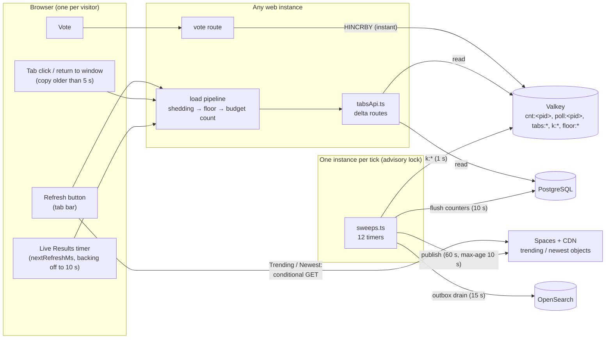

### Load at the default settings

The fleet's budget is 1,250 dynamic requests per second per live instance, capped at 15,000
(5,000/s at 4 instances).

| Mechanism | Who pays | Rate, at most | Cost of one |
|---|---|---|---|
| Sweeps (all twelve) | one instance per tick | fixed by their intervals | small bounded queries; grows with polls changed, never with visitors |
| Live Results timer | each open, visible, non-idle Live tab | 1 per 2 s × `k:live`, backing off to 1 per 10 s while unchanged | cache reads only (≤ 5 polls) |
| Refresh on a personal tab | one visitor | burst 5, then 1 per 5 s × `k:refresh` | unchanged list: cache reads only (the shortcut below); otherwise one indexed query (≤ 200 rows) |
| Refresh on Search | one visitor | burst 3, then 1 per 2 s × `k:search` | the 10 s search cache, or one engine query |
| Refresh on Trending / Newest | the CDN | once the copy is 10 s old, within the refresh bucket | 1–2 conditional GETs, no instance cost in production |
| Votes (for comparison) | one visitor | 1 per 2 s, never stretched | cache only; rows written later in batches |

Refreshes are the variable cost, and Live Results is the largest. That is why the controller sizes
`k:live` from the open Live tabs (`live:active`) and their measured activity.

### The three load bounds

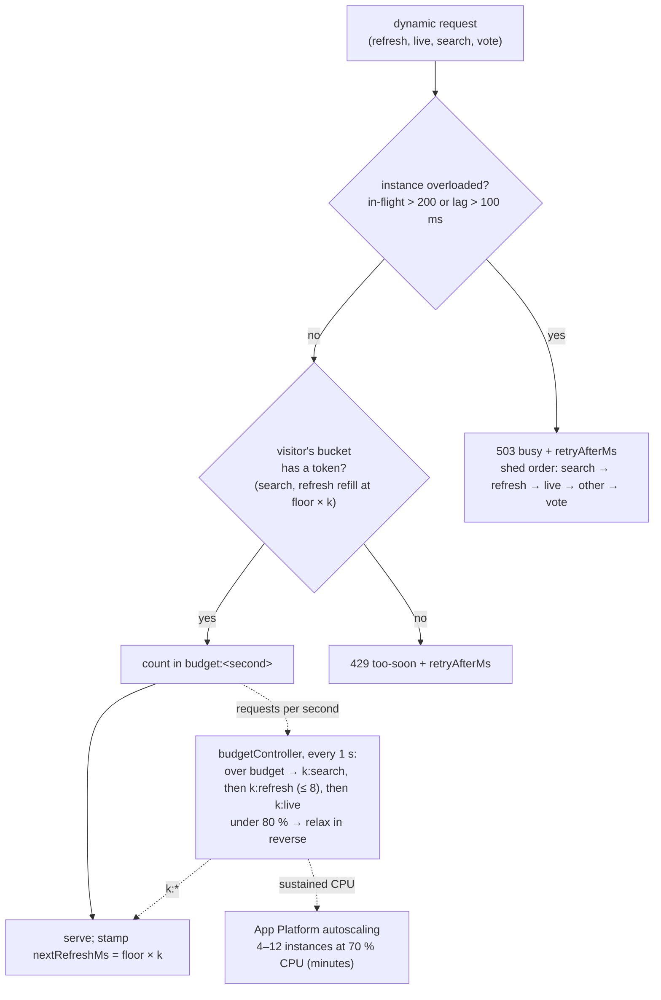

- **Per visitor, floors**: `floor:<kind>:<session|ip>` is a token bucket per kind (live 2 s,
  refresh 5 s with a burst of 5, search 2 s with a burst of 3, vote 2 s). Search and refresh
  buckets refill at the stretched interval `floor × k`, so a client that ignores `nextRefreshMs`
  is held to it too; a refusal that only the stretch caused counts `stats:floor:stretched`.
  Live Results and votes keep their plain floors.
- **Per instance, shedding**: `503 busy` past 200 requests in flight or 100 ms of event-loop lag.
- **Fleet, the budget controller**: raises `k:search`, then `k:refresh` (up to 8, a 40 s
  interval), then `k:live` while over budget, and relaxes them in reverse below 80 %. When it
  writes its line it appends, and clears, three counts since the previous line:
  `[controller] R=… B=… S=… V=… a=… k=s/r/l tabs=<fast>/<full> stretched=<n>`, where `fast` and
  `full` are personal-tab answers given by the shortcut and in full.

Every dynamic response carries `nextRefreshMs`; `429` and `503` carry `retryAfterMs`, and the
browser empties its bucket for that long.

### What the browser does

- **Refresh button**: `#refreshBtn` is never `disabled`; while a refresh is not allowed it has
  `aria-disabled="true"`, a click does nothing, and its title (the tooltip) reads
  `Refresh available in N s`, counted down every second. The wait is the larger of the tab's
  bucket wait and, on Trending and Newest, `refreshAvailableIn()`.
- **Tab clicks** render the copy the browser holds and send a request only when it is older than
  the manual floor.
- **Trending and Newest** are published with `max-age` = min(recompute interval, 10 s)
  (`listingMaxAgeMs`, sent as `trendingMaxAgeMs` / `newestMaxAgeMs` in `/api/config`); Refresh
  there is offered once the copy is that old. The session-storage copy keeps the recompute
  interval as its lifetime for a page load. Without a CDN the instance serves the objects with
  the same `max-age`. The 10 s wait on these two tabs is enforced in the browser only, by design:
  the objects cost no instance work in production.
- **Live Results** asks every `nextRefreshMs`, and after each `304` doubles its wait from twice
  that interval up to 10 s (2 → 4 → 8 → 10 s at the defaults), never below `nextRefreshMs`. A
  `200`, a vote in the tab, adding or removing a poll, or the page becoming visible
  (`visibilitychange`, not window `focus`) starts again from the interval; a `429` or `503` keeps
  the refusal's wait and resets the back-off. The registration (`live:active`) lasts
  `nextRefreshMs` plus the idle allowance, so a backed-off tab stays registered.

### The personal-tab shortcut

An unchanged personal tab (Your Polls, Shared With You, Your Votes, Watching) is answered from
the cache without touching PostgreSQL:

- `tabs:v:<emailKey>` is the user's list version (an opaque value, 24 h), created on a full
  answer and **deleted** (`forgetTabs`) after commit by every write to that user's `user_polls`,
  `poll_invitations` or `poll_bans` rows: votes written by the consumer, bookmarks (and their
  expiry), poll creation and edits (invitees, bans, removed votes), invitation rosters and
  adoption, and the shared-link view. Sending, reminding or accepting an invitation does not
  signal, since none of them changes what a tab lists.
- `tabs:seen:<emailKey>:<tab>` (5 min) records the last full answer: the version read before its
  queries, the membership version and order sent, and for every row loaded before narrowing its
  row `content_version` and the content version sent (0 for a "not published" placeholder).
  Your Votes, Watching and Shared With You narrow by access after loading, so a poll hidden by
  narrowing that regains access through its own content change is still checked.
- A refresh takes the shortcut when the version still equals the record, the request holds the
  recorded membership and ids, every recorded row's cached `poll:<pid>` projection has the
  recorded `content_version`, and every held card has the version sent. It then answers with the
  live counts only (`304` or the moved counters) and runs no adoption or acceptance. Anything
  else, or any cache error, builds the full answer.
- A deleted poll (`deletePoll`, or with its creator's account) deletes its `poll:<pid>`, so a
  tab that lists it fails the projection check and is rebuilt.
- Projections are read with one `getMany` and written with one `setMany`, only those missing or
  older than their row, for personal tabs and searches alike.
- The 5-minute record bounds the staleness should a write site ever forget to signal;
  `tests/tabs-refresh-signals.test.ts` checks each signal.

### How fresh a refresh can be

- Counts are always live on every tab: they are read from `cnt:<pid>`.
- Trending and Newest are at most a recompute (60 s) plus 10 s of `max-age` old.
- Search returns identical results for 10 s, and a new or edited public poll is searchable after
  the outbox drain (up to 15 s).
- Poll rows' `vote_count` (admin pages, rankings, exports) trail the live counts by up to the
  flush interval (10 s).
- Scheduled starts and ends show after the next schedule sweep (up to 60 s).

## TRENDING, Newest and the personal tabs

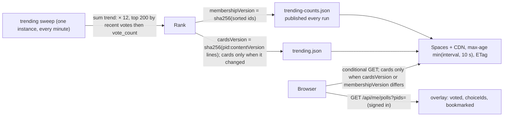

Newest is the same publication a second time with a different ranking key: `launched_at`, a
column `updatePoll` stamps whenever a poll enters OPEN (except on the return from an edit of an
open poll) and clears whenever it enters CLOSED, so a re-opened poll is newly launched and a
poll under edit keeps its place. The newest sweep (lock 10, its own interval, once at start) runs
one query — `launched_at desc, vote_count desc, id desc`, limit `ENV_MAX_NEWEST_POLLS` — as a
walk of the partial index `polls_home_launched` (`where home_listable and launched_at is not
null`), reads the live counters, and publishes `newest-counts.json` / `newest.json` through the
same publisher with its own object names. Without a CDN the instances serve them at
`/api/trending/newest-counts.json` and `/api/trending/newest.json` (`/api/trending/` is the one
base for every published listing), answering `503 newest-not-ready` before the first tick.
`newest.js` is `trending.js`'s twin: session-storage copy (`newest:copy`), a browser bucket of
its own on the refresh floor, the cards object only when `cardsVersion` or the membership changes, one overlay call for
a member. No backfill: polls open before the column existed enter Newest when they next open.

The personal tabs are one indexed query each over `user_polls` (`email, updated_at desc`),
joined to `polls`, with the visitor's overlay inline; the membership version is the newest
`updated_at`. Each tab is one relation set: Your Polls `created`; Shared With You `invited` and
`linked` (private polls the user did not create, an Invitation Only poll only while the user is on
its invite list); Your Votes `voted`; Watching `bookmarked`, narrowed by `mayWatch` so a poll the
user can no longer reach is neither sent nor deleted. A poll that has not launched is sent to
anyone but its creator as a redacted placeholder (the sharer's name only), built before any
projection or count is read. The Live Results tab reads `poll:<pid>` and `cnt:<pid>` only.

A poll link, `/?PID=<uuid>`, is decided on the server while the home page is served
(`decideSharedLink`, then `resolveSharedLink` records the view as a `linked` relation, at most
once a minute). A guest is redirected to `/login?PID=` before any lookup; the id then rides the
sign-in URLs, the request body and the emailed link, never a cookie or browser storage, and a
successful verify lands on `/?PID=` again. A signed-in visitor is redirected to `/` with one of a
fixed set of landings (`open`, `tab`, `notice`), which the page applies; a poll no list holds is
fetched from `GET /api/me/polls/:pid` and mounted as a retained maximized card.

The card's bottom-row **Live Results** link is one control in two forms. Where the tab supplies no
remove handler it shows three animated bars, reads "Add to Live Results" and adds the poll; on the
Live Results tab, whose grid supplies one, it shows a plain X, reads "Remove from Live Results"
and sends `DELETE /api/live/:pid`. The form is chosen by the handler's presence, because every
grid is given the add handler centrally. In remove form the link is shown for every poll on the
tab — a closed or being-edited poll keeps it, so a poll that closes while it is watched can still
be taken off — while in add form those states hide it, since neither may be added. Enter and Space
activate it as a click does, and after a removal the focus moves to the link of the card that
takes the vacated position, of the previous card when the last one went, or to the tab's
empty-state line; the grid moves a card only when its position actually changed, so a refresh
never steals the focus.

### The maximized card

Any card can be shown on its own, in the tab it belongs to: a click on its title, its subtitle or
the maximize button at the right of its title row, on either face. The tab's grid (`createGrid` in `tabs.js`) moves **the same
card instance** out of its `.card-grid` into a `.maximized-card-grid` cloned from the page's
`<template id="maximizedCardGrid">`, beside the hidden grid, with the vote-history line graph
(below) in the column beside it. While the card is maximized, its maximize buttons show a minimize
icon and close the view. Nothing is copied or fetched: the card stays in the grid's mounted
map, so refreshes, votes and bookmarks keep reaching it, and its face and unsubmitted selection go
with it. The card's `setMaximized(true)` adds `maximized-card-viewport` / `maximized-card-flip`
beside its own classes and swaps its bar layout: instead of fitting bars to the space it has
(`computeBarLayout`, which scrolls when they do not fit), it sizes them by choice count alone — 50 px
at `ENV_MIN_CHOICES` falling linearly to 25 px at `ENV_MAX_CHOICES`, 2 px apart — and five CSS
overrides put the bars back in flow so the card grows and the page scrolls.

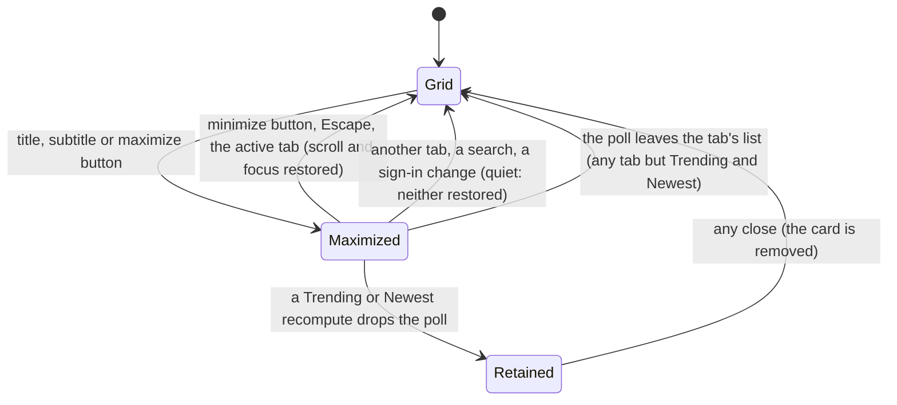

One page holds at most one maximized card (`maximized` in `tabs.js`), and every way out runs one
`restore`. Trending and Newest pass `retainMaximized`: they receive only a new list, so the
browser cannot tell a recompute from a deletion, and a dropped poll stays shown until it is
closed; its own votes and bookmarks are applied to it by `patchRetained`. Every other tab closes
the view at once when its poll leaves. The address and the browser history are never changed.

### The vote-history line graph

The maximized view's right column shows how each choice's share moved over time. `tabs.js` calls
`window.PollLineGraph?.mount(column, { pid, title, subtitle, card })` after `setMaximized(true)`,
and `restore()`, the one way out, calls `unmount()`, which also stops the refresh timer.

`GET /api/polls/:pid/line-graph` sits behind `...dynamic("refresh")` (shedding,
the refresh floor and the budget) with no `requireSession`. Access is `mayViewResults` in
`polls/access.ts`: a published public poll for anyone, guests included, or a private poll the
caller can reach; a ban does not hide it. Every refusal, including a malformed id, is
`404 { error: "Not found" }`, and access is checked before the cache. It takes no query: one answer
carries every available scale, so switching scales in the browser sends no request and cannot meet
the refresh floor.

The graph never reads a poll's history at request time: a populated poll with 15 million
`vote_history` rows would exhaust the server's memory. Instead the replay happens as votes are
written. Every `vote_history` insert (`writeBatch`, `recordVote`, `insertVoteHistory`) calls
`recordLineGraphTally` (`polls/lineGraphTally.ts`) in the same transaction. It replaces the
address's previous selection in `line_graph_selection` and adds the change to `line_graph_tally`
(per poll, hour and choice, with the voter count under the reserved id `""`), in the first hour
boundary at or after the vote. A vote older than the address's latest one changes nothing. Migration
`012-line-graph-tally` backfilled both tables from the history, and the populate script rebuilds a
poll's tally after deleting its test votes (`rebuildLineGraphTally`). The tally is not subject to
retention, so a graph keeps its history after the partitions it came from are dropped.

`serveLineGraph` (`polls/lineGraph.ts`) reads the poll's first `vote_history` row (an index probe)
to learn its span, and so which scales are offered: 1 Day always, 1 Week from one day of history,
1 Month from seven days, 1 Year from 31 days; the default is the largest. It then reads
`line-graph:<pid>`, and only on a miss sums the tally into each available scale's buckets, one grouped
query per scale, at most buckets × choices rows each. Points are taken at UTC bucket boundaries (hourly for 1 Day
and 1 Week, daily for 1 Month and 1 Year), from the first boundary after the window start or the
first vote, whichever is later, plus a final point at "now", so the newest point and `totalVoted`
equal the bar graph. A point counts every vote at or before its boundary, each address's latest
selection winning, and uses `computeResults`'s formula (voters on a single-choice poll, selections
on a multiple-choice one, rounded). A choice is drawn when its current share is above
`ENV_LINE_GRAPH_MIN_VOTE_PERCENTAGE` (`0` draws all), and then across the whole window. The answer
is cached for `ENV_LINE_GRAPH_REFRESH_INTERVAL` (clamped up to the live floor), so every viewer of a
poll shares one computation per interval. A deleted account's anonymized votes count once per poll,
because deletion gives each poll one placeholder address, in `line_graph_selection` too.

`lineGraph.js` draws hand-rolled SVG: title, subtitle, a legend with each line's current share and
the vote total, the plot, and an M3 segmented button of the available scales. A line's colour is the
choice's manual hex from the response, else the colour the card itself assigned (`card.resultColors()`),
so lines and bars never disagree in hue; `PollCard.lineColorOn` shades a colour under 3:1 against the
panel's computed background to the nearest same-hue shade that reaches it, and a
`prefers-color-scheme` change redraws. A pointer over the plot places a crosshair, ringed markers and
a rich tooltip at the nearest bucket with every line's share and the time (with the hour on hourly
scales), formatted in the viewer's locale and time zone; a touch reading stays until a press outside
the plot. The plot is one Tab stop: focus shows the newest point, the arrow keys, Home and End move
it, and a polite live region reads each point. A refresh or resize keeps the crosshair at the same
bucket time. A scale click redraws from the held response; a timer refetches it every
`lineGraphRefreshIntervalMs` from `/api/config` and keeps the chosen scale. Fewer than two points shows "Not enough voting data to graph yet"; a `404` shows
"Results are not available yet" and stops the timer; a failed first load shows "Graph unavailable
right now", and a failed refresh keeps the last graph and tries again on the next tick. Its chrome
is Material 3 tokens in `line-graph-m3.css`.

### Result bar percentages

A bar's percentage is its choice's count divided by a denominator, rounded. On a single-choice poll the
denominator is the number of voters (`voteCount`, which grows only on a voter's first vote). On a
multiple-choice poll it is the sum of the choice counts, that is, the number of selections, so the
percentages add up to 100 apart from rounding. The rule is in three places that must agree:
`DeltaClient.percentDenominator` (used by `toPollDetail` and by `patchRetained` in `tabs.js`) for the
cards, and `computeResults` for the results page and the exports.

### Result bar colours

Every card, maximized or not, colours its result bars from a palette built from a short base list
(`RESULTS_PALETTE_ENTRIES`, 14 colours). `expandPalette` repeats that list until the palette holds one
entry per choice a poll may have (`choiceBounds.maxChoices`, that is `ENV_MAX_CHOICES`, 50 by default),
adding one entry when the last would equal the first, so no two neighbouring entries, the wrap included,
are the same colour and raising the limit grows the palette. Each card starts at its own entry,
`paletteOffsetFor(pid, palette.length)`: FNV-1a of the poll id, modulo the palette's length, computed
once in `initPollCard`. The bars then take consecutive entries from there in display order, wrapping
from the last entry to the first, so a poll shows the same colours on every tab, in both views and for
every user. A label that reads as Yes or No takes `#006120` or `#F91010` instead, and uses up no palette colour. Every bar is drawn the same way:
- **The rest of the bar:** a tint of the fill, 90% of the way to white, for every colour: palette,
  Yes/No and manual.
- **The label and percentage:** drawn with no shadow, in the tint's dark shade (`darkShadeOf`: the
  same hue, lightness stepped down until the pair reaches 7:1).
- **Over the fill:** a copy of the text, clipped to the fill's width and animated with it
  (`setFillWidth`). It is white or black (`inkOnFillFor`): the colour
  listed for that fill in `TEXT_ON_FILL_OVERRIDES` (chosen by eye on a monitor and a phone), else whichever of the two
  contrasts more. The same for Yes/No as for any other colour. Dark mode keeps its 80% tint over the dark surface.

Every bar's tint and text colours are computed once, at load, into one map (`BAR_COLORS`), and
their dark-scheme counterparts into a second (`BAR_COLORS_DARK`: the track mixed toward the dark
card surface by the same amount, and its text raised in lightness until it reaches 7:1). A row's
track and text colours are not inline `background` / `color`: `applyBarColors` writes four custom
properties (`--bar-track`, `--bar-ink`, `--bar-track-dark`, `--bar-ink-dark`), and
`pollCard-m3.css` picks the pair for the scheme, so a scheme change needs no re-render. The fill
and the clipped copy stay inline. The in-place update path re-applies fills, tints and copies on
every refresh, because a reorder puts a different choice in each row.

A choice can also carry a colour chosen by hand: an optional `color` (a palette hex code) on its
element of the `polls.choices` jsonb array, absent for Automatic, so there is no column and no
migration. When `assignResultColors` sees a valid `#RRGGBB` on a choice, that colour is the fill,
in preference to the Yes/No colours and the palette. Every choice that does not read as yes or no
still advances the palette index, coloured or not, so setting a colour on one choice never moves
an Automatic bar; a yes or no choice never advances it. A stored value that is not a six-digit hex
is drawn as Automatic. `barColorsOf(hex)` reads the two maps above and, for a colour outside the 50
automatic ones, derives its tint and text colours with the same functions and caches them, so any
hex can be drawn. The colour reaches the card through the cached projection and the delta path
like any other choice property, and `deltaClient.js` copies it into the card's choices.

### Material 3 layers

The look is Material 3, added as layers over the production stylesheets rather than as a rewrite.

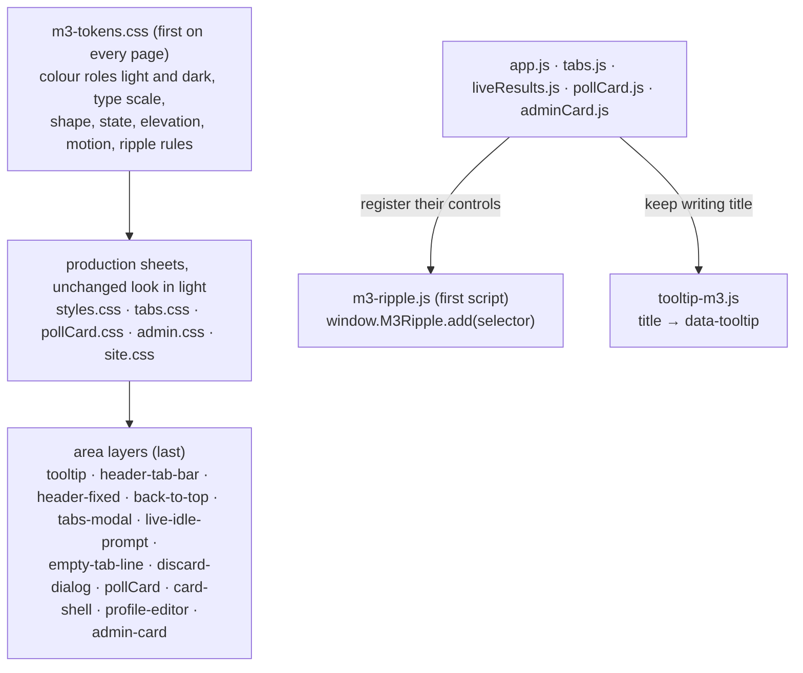

- **Tokens.** `m3-tokens.css` holds every `--md-sys-*` value. In light the production tokens
  (`--ink`, `--paper`, `--moss` …) keep their values; in dark they are restated as Material 3
  roles, so every production rule follows the scheme.
- **Scheme.** Dark applies under `@media (prefers-color-scheme: dark)` to
  `:root:not([data-theme="light"])`, and to `:root[data-theme="dark"]`. `data-theme` is a
  development and test hook, with one production use: `admin.html` and `admin-results.html`
  carry `data-theme="light"` until their content is restyled.
- **Ripple.** `m3-ripple.js` installs one delegated `pointerdown` listener. Each script registers
  the controls it owns with `window.M3Ripple?.add(selector)`. A vote row's ripple is hosted over
  the row, because the click that follows rebuilds it. No ripple plays under reduced motion or on
  a disabled control.
- **Tooltips.** `tooltip-m3.js` moves every `title`, present or added later, to `data-tooltip`, so
  the browser's own tooltip never shows. One `position:fixed` tooltip on `<body>` shows the text
  on hover (500 ms), on keyboard focus, and on a 500 ms touch press, which does not click. Result
  and vote rows show theirs only while the label is cut off.
- **Dialogs.** `Tabs.modal` is named by its message and keeps Tab on OK. The admin page's
  Not Saved dialog (`confirmDiscard()` in `adminCard.js`) returns a `Promise<boolean>`; Cancel and
  the back link await it.
- **Fixed chrome.** `fixedChrome.js` measures `#site-header` and, on the home page,
  `.tab-bar-wrap`, and writes their height to two custom properties (`--fixed-chrome-height-header`,
  `--fixed-chrome-height`) that `header-fixed-m3.css` uses to pin both to the top of the viewport
  and to reserve matching space in `.container`'s padding; `window.FixedChrome.height()` lets
  `floatingActions.js` and `tabs.js` keep the guest buttons and a maximized card from landing
  underneath it. `backToTopFab.js` injects one button, shown past 600px of scroll and hidden again
  below 400px, that returns the page to the top (instantly under reduced motion).

The tab bar itself is eight buttons in `index.html` — Your Polls, Shared With You, Your Votes,
Trending, Newest, Watching, Live Results, Search — each with an inline SVG icon before its label
(the eye is a `<symbol>` defined once in the page and also used by the card's Watch control; the
animated bars and the magnifying glass are the same glyphs the card and header use; the Your
Polls icon is a copy of `avatar-default.svg`). A 2px rule under the row is a `::after` on the non-scrolling
`.tab-bar-wrap`, `100vw` wide, with `overflow-x:clip` on `.page` so it never adds a horizontal
scrollbar. Each tab registers its own controller with `Tabs.register`; `select()` ignores a tab
it cannot find.

Above 900px the home bar is Material 3's scrollable tabs (`header-tab-bar-m3.css`): a 24px icon
stacked over the label in a 64px tab, and a 24px edge mask where more tabs wait, driven by the
`has-tabs-before` / `has-tabs-after` classes `tabs.js` sets on `.tab-bar-wrap` from the row's
scroll position. Up to 900px one `@media (max-width: 900px)` block in `single-column-m3.css`
(the home page's last layer) restyles the same markup: each tab is a 16px icon beside an 11px label
(label-small), wrapped to its longest word (`width:min-content`) on at most two left-aligned lines
(`Shared With&nbsp;You` in the markup), in a tab at least 48px tall and as tall as the
tallest (48px; TWEAKS03 to TWEAKS06, the phone tab having no left padding and the bar no negative margin); a guest's floating Log In / Create Account pair
docks 8px right of Refresh; the mask reads its width from `--tab-fade`, which the block sets to
32px, and `scroll-padding` keeps a chosen tab clear of it. There are no scroll arrows. The row
scrolls with the browser's own touch scrolling (`touch-action:pan-x`, `overscroll-behavior-x:contain`,
no snapping) and `scroll-behavior:smooth` makes every programmatic move glide, except while a
drag is in progress (`#tabBar.is-dragging`) and under `prefers-reduced-motion`. `tabs.js` scrolls
the selected tab into view on every selection, and `moveTabFocus` focuses the next tab with
`preventScroll` before the same `scrollIntoView`, so the keyboard glides like a tap. `tabBarScroll.js`
has three concerns on this page: a drag for a mouse or pen (a touch pointer is left to the
browser, and the click that ends a drag selects nothing), a `wheel` handler that turns a vertical
wheel over the row into a sideways scroll while the row can still move at these widths (each tick
is added to the previous tick's target, cleared on `scrollend`, so a quick series lands in full
despite the smooth scroll) and otherwise lets the page scroll, and the All tabs menu, which lists
the tabs and clicks the chosen one. Under the bar, Refresh sits at the left and the All tabs
button at the right, with its menu beneath it; both are inset by `--tab-edge`, the card column's
edge computed from the container's padding and the 420 px card cap, so they line up with the
cards whether or not the tab holds one.

## Search

Home search is one interface, `search(scope, text, limit)`, with two engines: OpenSearch
(BM25 over `title^4, subtitle^3, choice_labels^2, keywords`, an AND pass, an OR pass and a
fuzzy pass) and PostgreSQL full-text search (the generated `search` tsvector with the same
three passes, each bounded to the 5,000 newest listable polls; the typo pass uses a trigram
index on the title). A health probe cached for five seconds selects the engine; a search
result is cached for ten seconds under a hash of the normalised words. Changed polls reach the
index through `search_outbox`, drained every fifteen seconds. The administrator's search is a
single parameterised statement over the admin indexes with day windows computed in the
administrator's time zone.

The Search view's form is `admin-search-m3.css`, the last of the admin page's Material 3 layers. The form
and the poll cards share one container rule in `admin.css` (a selector list, media queries included), so the
panel is exactly card-sized. Its controls keep every `name` that `readSearchForm()` reads, so the request is
unchanged. Visibility, choice mode and vote mutability are radio groups that keep the controls' `name`s and
values, with Any (`value=""`) chosen by default, so `FormData` carries what the selects sent; the panel's
radio rules are its own, since the card wizard's `.m3-radio` rules are scoped to the cards. The panel is
collapsed by `button#adminSearchToggle` above it (a `data-collapsed` attribute on the form, in memory only, set by
`adminList.js` after a user-run search leaves result cards on screen and never by the timed refresh). The Search view shows
no status message before a search. Each admin list row also carries `createdByName` (from `polls.created_by_name`)
and `createdByEmail` (one `creatorEmails()` query per page against the `user` table), which the read-only card shows
as `Created By: <username> (<email>)` above its dates.

## Sweeps

| Sweep | Interval | Lock |
|---|---|---|
| screening (approval) | `ENV_POLL_APPROVAL_SWEEP_INTERVAL` | 1 |
| schedule (+ next month's `vote_history` partition) | `ENV_POLL_DATE_CHECK_SWEEP_INTERVAL` | 2 |
| counter flush | `ENV_COUNTER_FLUSH_SWEEP_INTERVAL` | 3 |
| trending recompute + publish | `ENV_TRENDING_POLLS_RECOMPUTE_SWEEP_INTERVAL` | 4 |
| search outbox drain | `ENV_OUTBOX_DRAIN_SWEEP_INTERVAL` | 5 |
| bookmark removal | daily | 6 |
| nightly reconcile of yesterday's dirty polls | daily | 7 |
| budget controller | `ENV_BUDGET_CONTROLLER_SWEEP_INTERVAL` | 8 |
| stale editing session release | 2 × heartbeat | 9 |
| newest recompute + publish (also once at start) | `ENV_NEWEST_POLLS_RECOMPUTE_SWEEP_INTERVAL` | 10 |
| retention: expired sessions, links, email changes and rate-limit rows; `invitation_emails` older than 24 hours; `vote_history` partitions older than 12 months | daily | 11 |
| invitations: claim and send the pending invitations of every open Invitation Only poll | `ENV_INVITATION_SWEEP_INTERVAL` | 12 |

```mermaid
gantt
  title One minute of sweep ticks (defaults), fleet-wide
  dateFormat  ss
  axisFormat  %S s
  section every second
  budgetController        :a1, 00, 60s
  section 5 s
  approval                :a2, 00, 60s
  section 10 s
  counterFlushSweep       :a3, 00, 60s
  section 15 s
  outboxDrainSweep        :a4, 00, 60s
  section 20 s
  staleEditUpdateSweep    :a5, 00, 60s
  section 30 s
  invitationSweep         :a6, 00, 60s
  section 60 s
  schedule, trending, newest :milestone, a7, 59, 0s
```

Sweeps are a fixed background cost that does not grow with visitors. The counter flush runs every
10 s because nothing a visitor sees reads the poll rows' counts (the tabs read `cnt:<pid>`); the
invitation sweep runs every 30 s because saving an open poll sends its new invitations at once,
and the sweep only picks up the rest (a poll opening on schedule, the daily allowance freeing up).

Every tick runs under `pg_try_advisory_xact_lock`; a losing instance logs the skip and
returns. All sweeps and the consumer pause while the cache is unreachable and resume when it
returns. The vote consumer is not a sweep: one runs on every instance in the `writers` group.

## Poll administration and visibility

The administration page is a single column of cards with two faces: a read-only face and a
six-step wizard (Who can vote, Title & Tags, Choices, Colors, How to vote, When to vote). The
read-only face ends in a Settings Summary whose parts are links into the wizard, offered only
where the poll's edit mode (`EDIT` with no votes, `UPDATE` with votes) and its state let that
setting change. A poll takes the new-poll wizard (Cancel, Save, Publish) while its *worded*
state is `INITIALIZED` — an `EDITING` poll is worded as `pollStateBeforeEditUpdate`, which the
admin list row carries — and any other poll takes Cancel and Save changes. Save goes to
`POST /api/admin/polls/:pid/save`, which stores the answers and leaves the poll `INITIALIZED`;
Publish and Save changes go to `/publish`, which sends the poll to screening; it holds a poll
back as `INITIALIZED` for still having its starter choices only when the poll has not been
published, so a published poll always goes to screening. The list keeps the card of a poll
whose saved wizard progress it holds when that poll leaves the current view, so the progress
survives a switch of admin views.

The Settings Summary has a line for colors after the choices line (`buildColorsSummaryLine`): "Bar colors are assigned automatically.", or the number set by hand with one swatch per colored choice; its sentence opens Step 4. The Colors step (step 4) lists one row per line of the Choices box, each with a button that opens
one shared grid of swatches. The palette is a single ordered list of eighteen name and hex pairs in
`src/polls/barPalette.ts`; `/api/config` sends it as `barPalette`, and it is the only list a colour
is validated against. The card keeps its answers in a map keyed by label, because choice ids are
reissued on every save: reordering the lines keeps each colour, and renaming or removing a line
drops it. `save` and `publish` take a `colors` list beside `labels`, of the same length, whose
entries are a palette hex code, a colour the poll already stores, or `null`; the server pairs each
colour with its label before it drops empty labels, and a request with labels and no colours
replaces the choices with none coloured. Choices are frozen once a poll has votes, but colours are
not: `publish` in `UPDATE` mode accepts `colors`, and when colours are the only thing that changed
the card posts `POST /api/admin/polls/:pid/colors`. That route holds the same guard as the
edit-session release (the caller must hold the session's `clientGuid`), refuses a poll with no
votes, sets the colour on the existing choices by position, restores `pollStateBeforeEditUpdate`
and clears the session in one conditional write, and never sends the poll to screening.

```mermaid
sequenceDiagram
  participant C as Admin card
  participant E as POST /edit-session
  participant R as POST /colors
  participant PG as PostgreSQL
  participant VK as Valkey
  C->>E: clientGuid
  E-->>C: poll is EDITING, voting paused
  C->>R: colors list, clientGuid
  R->>PG: UPDATE choices, state = stashed state, clear session WHERE clientGuid matches
  R->>PG: bump content version
  R->>VK: refresh the poll's cached projection
  R-->>C: pollState, choices — voting resumes
  Note over VK: open cards receive the new colour on their next content refresh
``` Only the wizard
holds a server-side session with an owning tab id and a heartbeat, and the card in the wizard
is exempt from the list's periodic refresh. `keywords` is a poll field: comma-separated
lower-case words, stored only on a public poll, frozen with the other settings once the poll
has votes, and searched by both engines (weight D in the `search` column). A poll's audience is three
two-valued fields — `pollVisibility`, `pollSharingMode`, `voteAnonymity` — read through one
predicate, `isInvitationOnly(poll)`, and frozen once the poll has ever been voted on
(`vote_history` holds a row for it — asked as a semi-join, one index probe per poll that stops at
the first row, never a scan of the history). The `home_listable` generated column is the only place
the public scope is written: public polls in `WAITING TO OPEN`, `OPEN` or `CLOSED`, or under
edit after having been one of those.

### Invitations

An Invitation Only poll's list lives in `poll_invitations`, one row per address with five times: `added_at`, `sent_at`,
`reminded_at`, `send_failed_at` and `accepted_at`. Status is derived, never stored, in the order Voted (a `votes` row with
choices), Accepted, Not delivered, Invited, Not sent yet. `writeRoster` diffs the list instead of deleting and reinserting
it, so an edit through the wizard keeps every row's state (migration `010-invitations`).

`GET`/`POST /api/admin/polls/:pid/invitees` (`src/invitations/invitations.ts`, behind `requireOwnPoll`) lists the
invitees and takes exactly one of `add`, `remove` and `resend`. It never touches `pollState`, the edit session or the
review, so voting is never paused. An add checks each address in order (format, duplicate and ban by email key, voter limit,
allowlist) and writes the invitation, the `invited` `user_polls` row and the empty placeholder vote in one transaction.
The daily allowance refuses no add: on an open poll an address past it is marked `waiting` and stays `Not sent yet`. A removed address that had been emailed is remembered in
`invitation_history` by email key; adding it back restores its sent and reminded times, so it is not emailed again.
Removing a voter needs `confirmVoted` and reconciles the counters.

Emails are claimed, then sent. `sendPendingInvitations` (`src/invitations/sender.ts`), run by the route after an add on an
open poll and by `invitationSweep` (30 s, lock 12), takes a per-creator advisory lock, counts the creator's
`invitation_emails` rows of the last 24 hours against `ENV_MAX_INVITATIONS_PER_DAY`, and claims the oldest pending rows with
`update … set sent_at … where email in (select … for update skip locked)`, so the route and the sweep never send one row
twice. Only OPEN polls send; a resend is refused while the poll is not open. A failed send sets `send_failed_at`.

An invitation typed in another spelling of an account's address (Gmail dots, a `+tag`) is **adopted** by the account —
the invitation, its `invited` row and its placeholder vote take the account's address — at sign-in
(`session.create.after`), at the poll link and at the Shared With You tab, so every exact-match reader stays as it was. The
link and the tab also set `accepted_at` once. The admin list rows carry `acceptedCount`.

The card sends `timeZone` (the browser's IANA zone) on every write; `takeTimeZone` stores it as `polls.time_zone`
apart from the write, bumping no content version. `formatPollDate` writes each date in the email in that zone, naming
the zone in force on that date (EDT or EST).

**The invitation link signs the invitee in.** Each send issues a 32-byte token (`src/invitations/tokens.ts`); the row
keeps only `hashToken(token)`, an expiry of min(poll end, 30 days) and a used mark (migration `011-invitation-tokens`,
a unique partial index on the hash), so only the newest email's token signs in, once, and removing the address revokes
it with the row. The emailed link is `/invite?PID=<pid>&token=<token>` (in `oauth` mode, `/?PID=<pid>` with no token),
and the email says, under the button, whom the button signs in. `GET /invite` writes nothing — a token that cannot sign
in (replaced, used, expired, poll closed or no longer Invitation Only) falls back to `/?PID=<pid>`, an invalid `PID` to
`/login?error=invalid-link` — except for a browser already signed in as the invited address (by email key), which uses
the token up and goes straight to `/?PID=<pid>`. The card (`invite.html` + `inviteCard.js`, built on the sign-in cards)
reads `GET /api/invitations/link-info` (`no-store`, masked addresses) and posts `POST /api/invitations/redeem`, which
checks, in order: `Origin`, the token, the Terms box for a new address, the shared email rate limit
(`/redeem-invitation` — only presses that got this far count), the pre-launch allowlist, and a session for another
account (`signOut: true` ends it first, else `409 other-account`). It then creates the account if needed (agreement
recorded), mints a magic-link token server-side (`sendMagicLink` stores it in a map instead of emailing when
`metadata.mint` is set), marks the invitation token used with a conditional update, and consumes the minted token
through `completeSignIn`, so the address is confirmed and the session hooks run exactly as for an emailed link. A
landed poll is always maximized: `applyLanding` maximizes after `mountLinkedPoll` too.

### Grants

Each account stores its grants in `user.permissions`, a `text[]` limited by a `CHECK` to `View Polls`,
`Vote on Polls` and `Create Poll`; the column default gives every account all three. `Administrator`
is never stored: `isAdminEmail` derives it from `ENV_ADMINS` on every request, and it implies every
grant. BetterAuth does not know the column; the session cache reads it with the session on a cache
miss and caches it with the session, so a check costs nothing on a hit.

```mermaid
flowchart TD
    R["/admin* or /api/admin/* request"] --> S{"signed in?"}
    S -- no --> D403["403"]
    S -- yes --> A{"administrator?"}
    A -- yes --> OK["allowed, any poll"]
    A -- no --> C{"Create Poll and View Polls?"}
    C -- no --> D403
    C -- yes --> K{"route kind"}
    K -- "search, rescreen" --> D403
    K -- "page, list, create" --> OWN["allowed; the list holds only polls they created"]
    K -- ":pid route, results page" --> O{"polls.created_by_id = user.id?"}
    O -- yes --> OK2["allowed"]
    O -- no --> D404["404"]
```

One factory, `createRequireAdmin`, builds every gate. Its `allow` predicate is `isAdminEmail` for
search and rescreen and `canReachAdmin` for the rest. `createRequirePollOwner` follows it on per-poll
routes and answers `404` for a poll the caller did not create, so the poll's existence is never
revealed. Outside the admin routes, `holdsPermission` gates three actions: a vote (`403
no-vote-permission`), adding a bookmark, and adding a Live Results entry (`403 no-view-permission`).
Removing either is never gated. Without `View Polls`, a signed-in user sees no poll cards at all:
`createGrid` in `tabs.js` mounts none on any tab and each tab shows the reason, while the four
personal tabs and Live Results refresh answer as empty and Search answers `403`. Trending and
Newest are shared objects, so the page alone withholds them.
`GET /api/me` reports the effective grants, so the header's Create Poll link and the cards' vote
controls can follow them; the routes still enforce them.

A shared poll link is `/?PID=<id>`, decided by the server (see the personal tabs above): the
`View Polls` grant, the poll's state, bans and invitations all feed one decision, and every case
that is not shown gives the same landing, `/?notice=unavailable`. `POST /api/polls/:pid/bookmark`
asks `mayWatch` (`src/polls/access.ts`) — the grant, a published state, no ban, and a public poll or
a private one the user can reach — and answers `404` when it fails, the same as for an unknown
poll; removing a watch is never checked.

## File manifest script

`devScripts/file-manifest.ts` is a command-line script, run with `npm run file-manifest -- <project>`
through `tsx`. It is outside the web service: it shares no code with `src/`, reads a project's working
tree and writes only under that project's `manifests/` folder. It is one file made of exported pure
functions (the binary test, the line count, the comment scanner, the grouping and the table text) and a
thin shell that lists files, reads them and writes the reports.

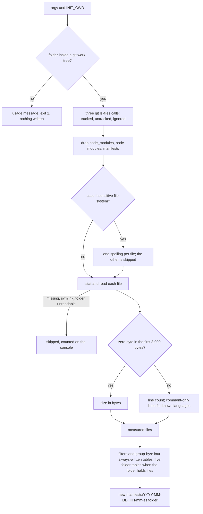

Git decides what is ignored (nested ignore files, the repository's own exclude file and the user's
global rules all apply), so the script never reads an ignore file. A relative project path is resolved
from `INIT_CWD`, because `npm run` starts a script in the package root. The run folder is created last
with a plain `mkdir`, so a second run in the same second gets `-2` instead of sharing a folder, and a
failure while measuring leaves nothing behind. The comment scanner is line based with one carried state
(inside a block comment or not); it does not parse strings or regular expressions.

## Populate-poll script

`devScripts/populate/populate-poll.ts <poll-data.json>`, run through `tsx`, creates or refreshes one
poll from a JSON time series and fills it with simulated votes. Unlike the file manifest, it is a client
of `src/`: it loads the server's configuration (`loadConfig`, `createDb`, `createCache`) and writes only
through the app's own paths, so no server code changes for it. It runs no migration and writes to
whatever database `ENV_DATABASE_URL` names, printing the target first.

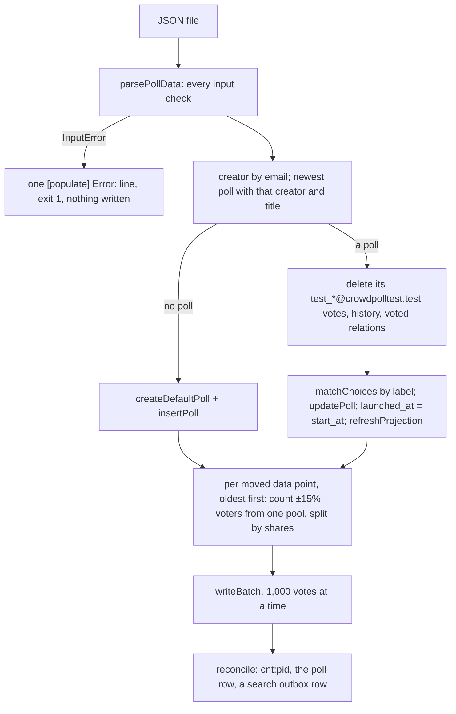

The pure steps (`parsePollData`, `shiftDates`, `voteCountFor`, `splitByShares`, `pickVoters`,
`voteTimesFor`, `matchChoices`) are exported for the tests, as is `populatePoll`, which takes
`{ db, cache, config }` and an injected `now` and `random`. Dates move by whole local calendar days, so a
daylight-saving change never shifts a vote onto the wrong day. Voters from one pool of
`ceil(1.15 × vote_count)` vote again on later dates, and writing oldest first makes each voter's latest vote their current
one, so the final bars follow the latest data point. `updatePoll` stamps `launched_at` only when a poll
enters OPEN, so a rerun writes `launched_at = start_at` itself.

## Email and sign-in links

All mail goes through `src/email/mailer.ts`. `createTransportFor` picks the transport from `ENV_EMAIL_TRANSPORT`:
nodemailer's own SES transport over `@aws-sdk/client-sesv2` (`ses`: production and the development templates, HTTPS
because DigitalOcean blocks SMTP), or SMTP, falling back to console logging without credentials (`smtp`, the code default,
kept for reference; the tests replace the transport altogether).
`loadConfig` refuses to start with `ses` unless `ENV_SES_REGION`, `ENV_SES_ACCESS_KEY_ID` and
`ENV_SES_SECRET_ACCESS_KEY` are all set, so a production deployment can never silently log instead of sending. Tests
replace the transport with `setTransport`. Every send is raced against `ENV_EMAIL_SEND_TIMEOUT` and logs its type, a
masked recipient and the provider's message id; a failure is a `MailError`, which the routes answer with `502`
(the change notice only logs it).

The messages (sign-in link, create-account invitation, email-change verification, change notice, account deleted, and
the poll invitation and its reminder from `invitationMessage`) are built by `src/email/templates.ts`: one table-based layout with inline styles, the hosted `/email-logo.png` (written by
`devScripts/favicon-ico.ts`), the site's green, a footer naming `support@crowdpoll.vote`, a plain-text part with the
same content, and every inserted value escaped. `layout()` takes an optional `headingLine2`, which the invitation
uses to put the poll title on its own line under the heading; every other message is unchanged. The create-account
invitation's link is `/create-account?token=…` (`src/auth/createAccountLinks.ts`): a single-use token whose hash is a
`verification` row of its own (`create-account:` identifier, a value that `supersedeLoginLinks` never matches, 15
minutes, the newest per address); `GET /api/auth/create-account/link-info` reads it, and the token form of
`POST /api/auth/create-account` (Origin, token, Terms, rate limit, allowlist) creates the account and signs in through
`mintLoginToken` and `completeSignIn`, as the invitation card does. Bounces and complaints are left to SES's account-level suppression
list; there is no delivery webhook.

```mermaid
sequenceDiagram
  autonumber
  participant B as Requesting browser
  participant S as CrowdPoll
  participant M as Mailbox
  participant O as Other browser
  B->>S: POST /api/auth/request-login-link {email, homepage:""}
  S->>S: honeypot empty, rate limit, issueLoginLink
  S-->>B: 200 + Set-Cookie signin_binding=v (Path=/api/auth, 15 min)
  S->>M: link …/api/auth/verify?token=t&bind=hash(v)
  alt opened in B (cookie matches bind)
    B->>S: GET verify (cookie v)
    S-->>B: 302 / + session_token, signin_binding cleared
  else opened anywhere else
    O->>S: GET verify (no or other cookie)
    S-->>O: 302 /confirm-signin (token not consumed; expired → /login?error=invalid-link)
    O->>S: GET /api/auth/link-info?token=t
    S-->>O: {email, requestedAt}
    O->>S: POST /api/auth/confirm-signin (same-origin only)
    S-->>O: {redirect} + session_token
  end
```

Both sign-in paths share `completeSignIn`, which consumes the token through BetterAuth and shapes the session cookie for
stay-signed-in and the shared poll. The binding stores nothing: the link carries `hashToken` of the cookie value, and
`link-info` reads the verification row by the same hash BetterAuth stores, without consuming it, so a mail scanner that
loads the link signs no one in. The confirm route checks `Origin` so another site cannot post a token of its own and sign
a visitor into its account.

The create-account, request-sign-in-link and email-change routes check a hidden `homepage` field first: when it is filled
they answer as on success, send nothing and leave the rate limit untouched. Create-account and email change compare
addresses by `emailKey` (`src/auth/emailKey.ts`, plus-tag dropped, Gmail dots removed), one SQL expression applied to both
sides and backed by the non-unique expression index of migration `008-email-key`; sign-in requests still match exactly,
and existing accounts that share a key keep working.

**Pre-launch allowlist.** While `ENV_ALLOWED_EMAILS` is set, `isAllowed` (`src/auth/allowlist.ts`) admits only the listed
addresses, compared by `emailKeyOf` (the TypeScript twin of `emailKey`), and the `ENV_ADMINS` addresses. Create-account,
request-sign-in-link and email change check it after the honeypot, validation and rate limit, and answer `403
{ error, code: "not-launched" }` without creating or sending anything; verify and confirm-signin check the link's address
before `completeSignIn`, so a refused link is not consumed; the email-change link checks the new address before applying
it. BetterAuth's `user.create.before` and `session.create.before` hooks refuse an unlisted address too, which covers the
provider sign-ins, whose refusals land on `/login?error=not-launched` (`onAPIError.errorURL`). Existing sessions are untouched.
Unset or empty, the list is off and every path behaves as before.

## Social sign-in

`ENV_SIGNIN_METHOD` is `native`, `oauth` or `both`; `loadConfig` derives `nativeSignin` and `oauthSignin`, which every
check uses (`nativeOnly` in `api.ts`, the `/create-account` and `/confirm-signin` guards, `/api/config`). The enabled
providers (`config.oauthProviders`, in the order Google, Apple, Microsoft, Amazon) are those whose `ENV_OAUTH_*` values
are all set. BetterAuth's `baseURL` and only trusted origin is `ENV_PUBLIC_ORIGIN`, so every redirect address is fixed.

- **Routes.** `server.ts` mounts `toNodeHandler(auth)` for exactly `POST /api/auth/sign-in/social`,
  `GET|POST /api/auth/callback/:provider`, `POST /api/auth/sign-in/oauth2` and `GET /api/auth/oauth2/callback/:providerId`,
  before the JSON parser; every other `/api/auth/*` path stays CrowdPoll's. Google, Apple and Microsoft are
  BetterAuth `socialProviders` (Microsoft with `tenantId: "common"`, no photo); Amazon is a `genericOAuth` entry whose
  `getUserInfo` reads `https://api.amazon.com/user/profile`. BetterAuth allows three sign-in starts per address per
  10 seconds.
- **Linking.** Each provider's `mapProfileToUser` swaps the provider's address for an existing account's stored address
  when their `emailKey` matches, so BetterAuth's exact lookup links the provider to that account. No provider is
  "trusted": BetterAuth links only when the provider reports the address verified (a personal Microsoft account counts
  as verified) and the local account has signed in before; otherwise `/login?error=account_not_linked`. A link is keyed by
  the provider's user id, so it survives an email change; the stored name and address are never overwritten. Deleting an
  account deletes its `account` rows by cascade.
- **New accounts** go through `user.create.before` like any other (allowlist, user name, default avatar, the provider's
  picture discarded) and start without agreement, so the terms gate asks for it on the first page.
- **Apple.** `src/auth/appleSecret.ts` signs the client secret (ES256 JWT, 180 days) with `node:crypto`;
  `startAppleSecretRefresh` re-signs it every 30 days into the provider's options object, which BetterAuth reads at each
  code exchange. Apple's `form_post` callback is answered with a redirect to the same address as a `GET`, so the
  `SameSite=Lax` state cookie is sent. `pages.ts` serves `/.well-known/apple-developer-domain-association.txt` from
  `src/public/.well-known/` (static serving skips dot-folders).
- **Refusals** redirect to `/login?error=<code>` (`onAPIError.errorURL`); the Login card maps `not-launched`,
  `access_denied`, `account_not_linked` and `email_not_found` to messages and anything else to a generic one. The card
  renders one button per `oauthProviders` entry with the provider's logo from `/oauth/`, with no Terms box (agreement
  is asked for afterwards by the terms gate's Accept Terms card, which greets a first acceptance, `termsFirstAcceptance`
  on `GET /api/me`), and posts to the start route with `callbackURL` `/` or `/?PID=…`; in `both` the email form follows a divider.
- **Cookie.** BetterAuth's state cookie is named `oauth_state` (httpOnly, secure, lax, 5 minutes) and listed in the
  Cookie Use table.

## Privacy, Terms and account deletion

- **The documents** are static pages, `privacy.html` and `terms.html`, served at `/privacy` and `/terms` to everyone.
  Both print `TERMS_VERSION` (`src/legal/version.ts`), which `/api/config` also sends. `app.js` appends the footer to
  every page; the cookie banner links to `/privacy#cookies`.
- **Agreement**: create-account refuses a request without `acceptedTerms` and the current `termsVersion` (`400
  terms-required`, before the rate limit) and stamps `terms_version` / `terms_accepted_at`. The terms gate
  (`src/legal/termsGate.ts`), mounted before every router, lets requests without a session cookie through at once; for an
  account whose `terms_version` is not current, `/api/*` answers `403 terms-required` except accept-terms, logout,
  `GET /api/me`, `GET /api/config` and the sign-in and link routes, and page routes redirect to
  `/accept-terms?next=…`. `POST /api/legal/accept-terms` (same-origin only) records the agreement and drops the cached
  sessions. A provider sign-in creates the account without agreement and the gate stops it until it accepts.
- **Deletion** (`DELETE /api/me`, same-origin, `{ confirm: "DELETE" }`, `src/legal/deleteAccount.ts`) runs in one
  transaction: the user's own polls are deleted with their history (and queued for removal from the search index), their
  votes on other polls are rewritten to a per-poll `deleted-<uuid>@deleted.invalid` and "Deleted user" (counts unchanged;
  the results page shows "Deleted user"), their invitations (by email key, with their invitation history), bookmarks, `user_polls` and sign-in links are deleted,
  bans are kept, and the user row goes, taking sessions with it. The address is added to `deleted-accounts` first and
  removed again if the transaction fails; afterwards the cached sessions, rosters and counters are dropped and the
  "account deleted" notice is sent.
- **Fonts** are served by CrowdPoll from `src/public/fonts/` (`/fonts/fonts.css`, which the page rewrite leaves on the
  instance); no page loads anything from another origin. `maskIp` masks the IP in the rate-limit and abuse log lines.
- **"Ever voted"** (which freezes a poll's fields) reads `polls.ever_voted`, set by every `vote_history` insert, so
  the retention sweep can drop old history partitions.

## Site icon

The site icon is two static files in `src/public/`, served like every other asset; no route serves them.
`favicon.svg` is the master drawing: the two figures of the header's brand logo, without its speech
bubble, on a transparent square. `favicon.ico` holds the same mark as 16, 32 and 48 px PNG images for
browsers that do not read SVG icons. Each of the seven pages links both, the SVG first, so a browser that
understands it never uses the ICO.

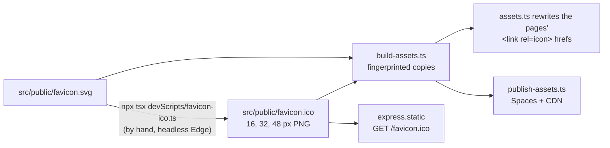

`build-assets.ts` fingerprints both files, `assets.ts` rewrites the pages' links to the immutable copies
(or the CDN), and `publish-assets.ts` uploads them with the other assets. The bare `/favicon.ico` that
browsers request for responses without links (JSON errors, plain-text `Not found`, the prototypes) is
answered by `express.static` from the un-fingerprinted copy, with an ETag.

`devScripts/favicon-ico.ts` is a hand-run developer script, like the file manifest script, and not part
of `npm run build`. It renders the SVG at each size with a headless Chromium-based browser
(`FAVICON_BROWSER`, or Microsoft Edge's install path), checks each PNG's size, and writes the ICO
container itself, so it needs no image library. A browser that is missing, fails, runs past 30 s or
writes no screenshot stops it with a `[favicon]` message before the ICO is touched. It also writes `email-logo.png`,
the 96 px logo of the email layout (rendered at 48 px and 2× scale, since a 96 px headless window comes out blank).
It is rerun, and the files committed together, whenever the drawing changes.

## Testing

Every suite runs on an embedded PostgreSQL started once per test run, with a fresh database
per suite and the in-process cache; the home page and the admin search form are exercised in
jsdom against the real routes. An `EXPLAIN` guard fails on any sequential scan of `polls` in a
listing, search pass or admin filter combination; a write-ownership test fails on any write of
the row counters outside the flush and the reconcile; a cache-outage test asserts no fallback
to PostgreSQL for floors, budgets, counters or votes. Load tests for a deployed fleet live in
`devScripts/load/`.
