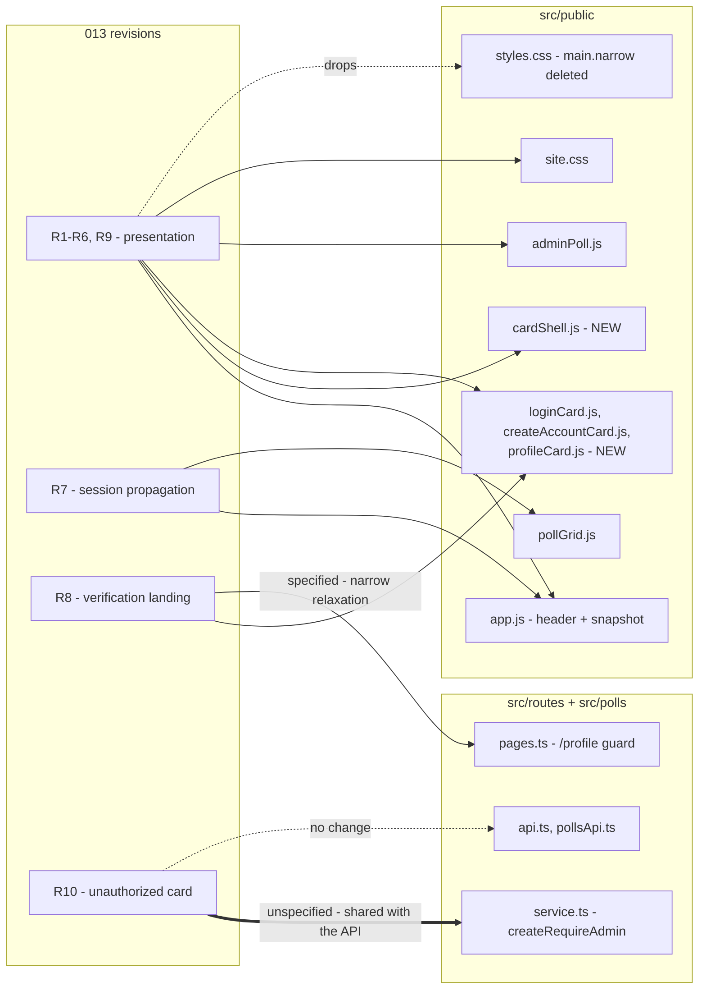
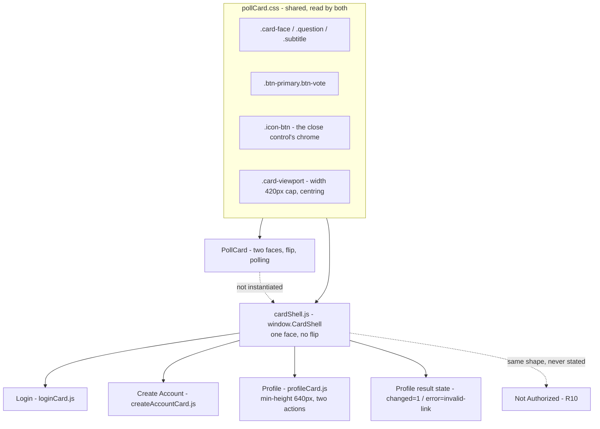
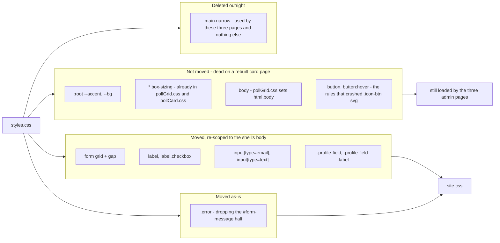
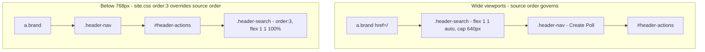
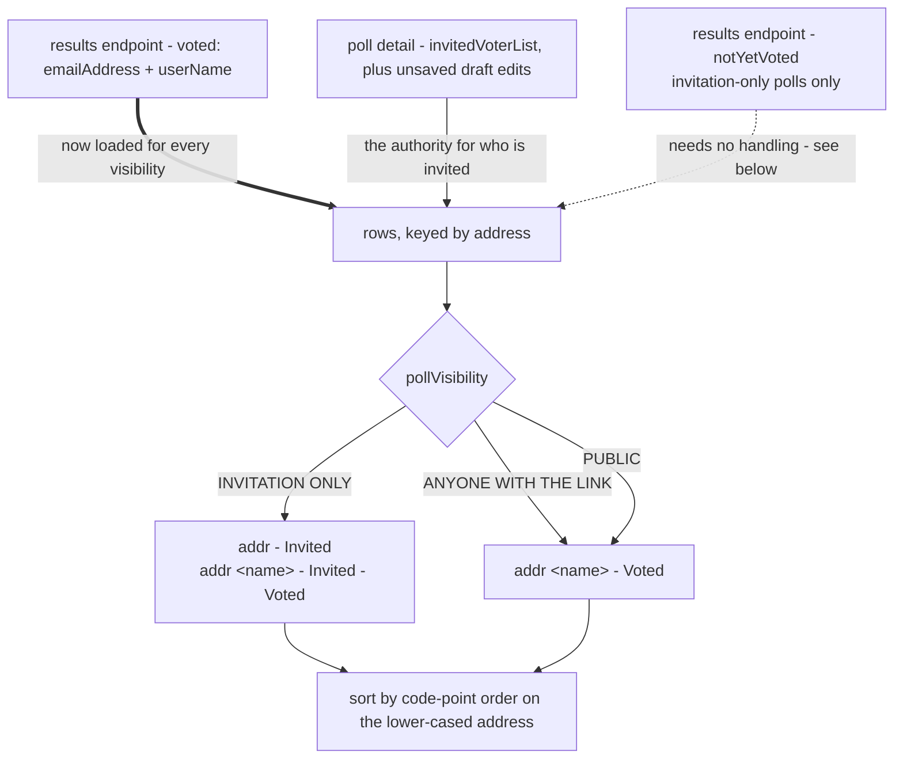
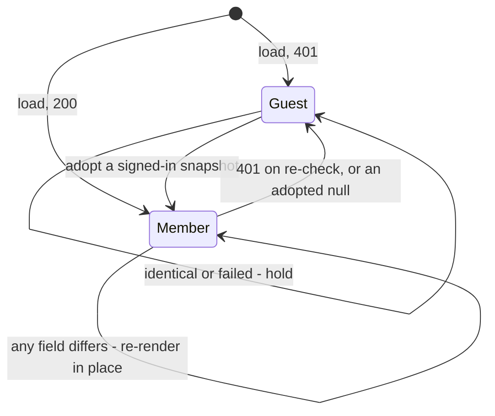
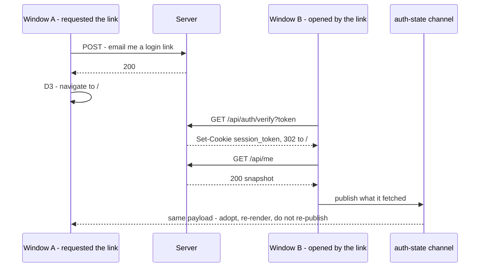
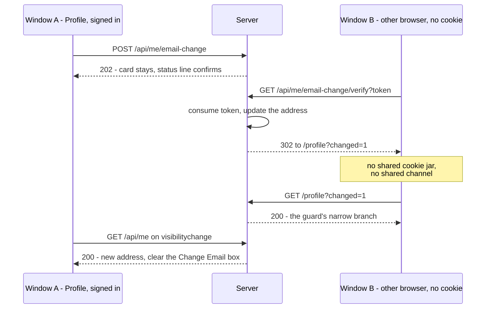
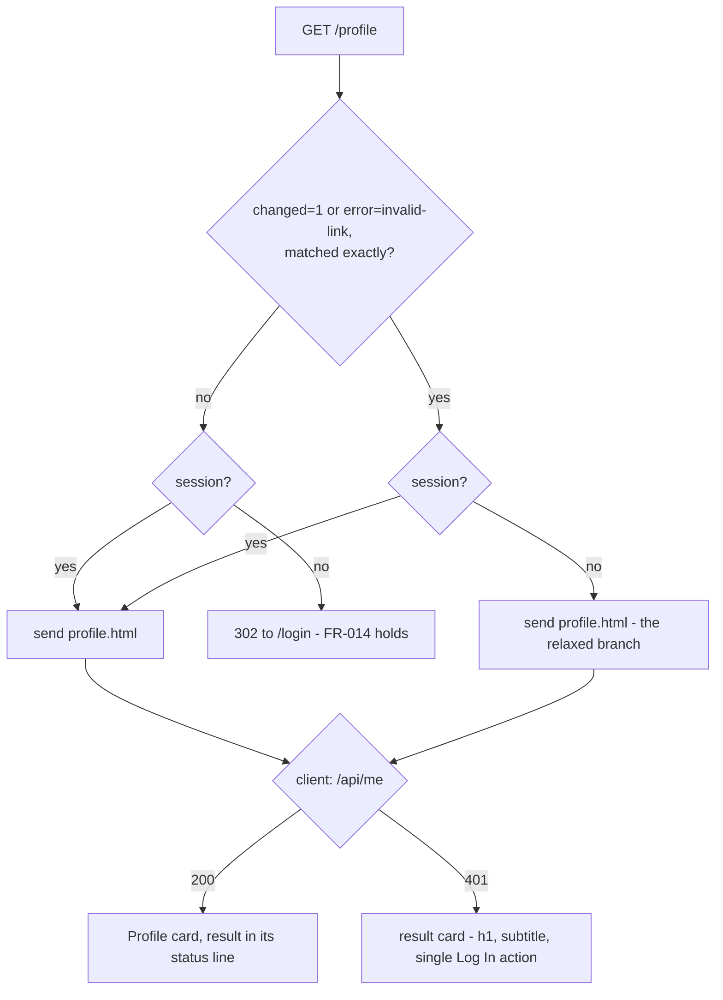
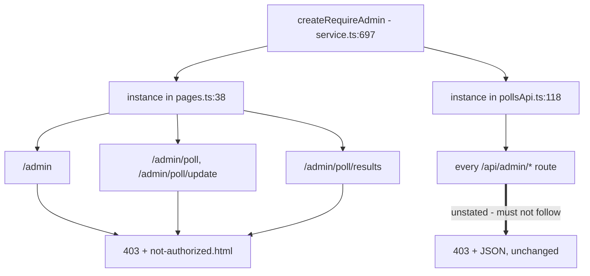

# 013 — UI/UX Revisions — Architecture

| | |
|---|---|
| **Requirements document** | `designDocs/013-high-level-requirements-UI-UX-revisions.md` — 689 lines |
| **Architecture directory** | `architecture/013-ui-ux-revisions` |
| **Mode** | REGENERATE |
| **Generated** | 2026-09-06 |
| **Previous run** | against the 290-line revision; that run's blocker is closed |

---

## 1. Overview and scope

013 is ten revisions to CrowdPoll's presentation layer, two of which carry a runtime
mechanism underneath them. Since the last architecture pass the document has more than
doubled, and almost all of the growth is answers: the card shell's home, the stylesheet
migration rule by rule, the close control's accessibility, the sign-in-mode switch, the
sort's collation, and — the previous run's one blocker — the page-route guard that makes
the verification landing reachable at all.

| ID | Revision | Depth | Server |
|---|---|---|---|
| R1 | Invited / Voted labels, merged roster, new row format, new sort | Data & render | none |
| R2 | "Add" → "Invite" | Markup | none |
| R3 | Header source order; brand becomes an anchor | Markup & CSS | none |
| R4 | Login card on the new shell | Page rebuild | none |
| R5 | Create Account card on the new shell | Page rebuild | none |
| R6 | Profile card on the new shell | Page rebuild | none |
| R7 | Session propagation across windows | Client mechanism | none |
| R8 | Verification landing without a session | Client state | **`pages.ts` guard** |
| R9 | Admin back arrow | Markup & CSS | none |
| **R10** | **Unauthorized-access card — NEW this revision** | Page + guard | **`requireAdmin`** |

Eight cross-cutting directives bind them. D1 (extract a shell, do not reuse
`POLL_CARD_TEMPLATE`), D2 (the stylesheet swap, now enumerated), D3 (await the response),
D4 (labels derived on the client), D5 (declared destinations, never history), and D6–D8
from R7 — one snapshot per page, the snapshot itself as the broadcast payload, and
event-driven re-checks only.

### 1.1 Change surface

*The solid edge into `pages.ts` is settled work. The thick edge into `createRequireAdmin`
is this revision's open problem: R10 asks a guard to render HTML, and that guard is shared
with every `/api/admin/*` route.*

---

## 2. The card shell and its four consumers

R10 makes the shell's consumer count four, not three. The requirements describe its card
in the same terms as the others — a title, a subtitle, an × that goes home, the standard
header — without saying it is the same shell.

Settled by this revision: the shell is `src/public/cardShell.js` exposing
`window.CardShell`, loaded `defer` after `app.js`; its rules join `site.css` rather than a
new sheet; each page gets its own deferred script in place of today's inline blocks, which
also removes an ordering trap, since an inline `<script>` runs before any deferred one and
could not see `window.CardShell`. The card's title is an `<h1>` carrying `.question`
styling — the poll card's `
` would silently delete the heading these three pages have
today. Width and centring come from `.card-viewport`; Login and Create Account drop the
inherited `min-height:420px`, Profile sets 640px.

The close control is named for its destination — `aria-label="Back to the home page"` —
matching the two back controls the app already has, rather than promising a dismissal it
does not perform. It sits after the title in markup, is the card's first focusable
element, takes a focus indicator the app does not currently define anywhere, and Escape
deliberately does nothing: these are pages, not dialogs.

---

## 3. Stylesheets

D2 is now enumerated rather than left to judgement, which was the feature's largest
regression surface.

*The rule that matters is the shape, not the list: **nothing element-level moves**. That is
checkable by reading a selector, where "did we bring everything?" is only checkable by
rendering three pages and looking.*

`index.html` is the one page whose exposure genuinely widens, because it loads `site.css`
and not `styles.css`. The admin pages keep `styles.css` as the element-level layer beneath
`admin.css`'s class rules; retiring it is a later feature's job, and half of it is already
inert there because `pollGrid.css` loads after it.

---

## 4. Header

*The reorder is a no-op below 768 px: `site.css` gives `.header-search` `order:3` there, so
the narrow arrangement is identical before and after. Harmless, and unstated — a later
reader could "fix" the media block without realising it is what makes R3 safe on phones.*

---

## 5. Participants

R1 grew the most. The roster is now one merged list per poll, not two list sources
selected by visibility.

Settled: both suffixes concatenate; the row format flips to `emailAddress <userName>` on
every poll type because the address is what the suffixes describe and what the sort keys
on; a display name is unknown only for an invited address that has not voted; and the
comparison is code-point order rather than `localeCompare`, so two admins reading the same
roster to each other see the same order regardless of browser locale. Case never varies —
addresses are lower-cased at all four entry points — so folding is a no-op that is
specified anyway.

The subset claim is now stated as a consequence rather than an assertion, and checking why
it holds changed the implementation note. On every save of an invitation-only poll the
server reconciles `currentVotes` to the invited list — banned voters' votes deleted, votes
from addresses no longer invited dropped, a placeholder added for every invited address
that has not voted — so a voter outside the invited list cannot occur. The results endpoint
then returns that reconciliation already split: `voted`, and, **for invitation-only polls
only**, `notYetVoted`.

Which means the client-side merge R1 originally described was partly reimplementing work
the server had already done. The rows come from the invited list held in the editor —
the only one of the three sources that reflects the current editing session, since an
address invited a moment ago is in the draft and in neither server field until save — and
`voted` decides the second suffix. `notYetVoted` needs no handling at all: an invited
address absent from `voted` has not voted, placeholder or not.

The Banned Voter List keeps its current rendering and takes the same sort rule, which is
already what it does. It gains no display name, because a banned address has none, and no
suffix, because banning removes the invitation and deletes the vote — so both would be
false on every row.

---

## 6. Session propagation

Four sources produce a snapshot — page load, `visibilitychange`, persisted `pageshow`, and
the page's own successful `PATCH` — and each is published. A received snapshot is never
re-published, so one change cannot echo. Comparison is by value over the whole body rather
than an enumerated tuple: enumerating invites the question of whether a given field belongs
and guarantees the next field is compared only if someone remembers. `status` cannot differ
within a session — it flips in the session-creation hook, before the session exists — so it
is compared because it is in the body, not because it is expected to change.

Adoption re-renders and does not navigate, with two exceptions: Login and Create Account go
home on `null` → signed-in, and a session-required page goes to `/login` on `null`.

### 6.1 Sign-in, same browser

### 6.2 Email change, different browser

Where `BroadcastChannel` is unavailable the signal degrades to a ping: a differing value
written to `authStateChangedAt`, which listeners answer by re-fetching `/api/me`. The key
carries no session data, so nothing identifying is stored on the device, and removing it —
which fires a `storage` event of its own — is how sign-out is published.

Sign-out is now a stated publish point rather than a side effect: the page publishes `null`
as soon as the logout request succeeds and before it navigates, so other windows drop to
guest at once instead of waiting for the signing-out window to finish loading.

---

## 7. The verification landing, and the guard

The previous run's blocker is closed. The requirements now state that there are two
redirects to `/login` — one in `profile.html`, one in `pages.ts` — and relax the second
one narrowly.

The exact match matters: a guard that accepted `changed` with any value would turn one
condition into an open door. The relaxed branch discloses nothing — it sends a static file,
`/api/me` still 401s, and the result card names no address. And under the narrow form the
existing guest-redirect test passes unchanged and becomes the guard on the relaxation
itself; the broad form would have required deleting it.

---

## 8. R10 — the unauthorized-access card

New this revision, and now specified to the level R1–R9 reached. Today `/admin` refuses a
non-admin with `{"error":"Not authorized"}` as JSON. R10 replaces that with a page.

*All four page routes answer with the card; every API route must keep its JSON. The
requirements say "the page routes' guard" and stop there.*

Settled by this revision:

- **Status.** `403` is kept; only the body and `Content-Type` change. A `200` would tell
  caches, crawlers and monitoring that the page loaded normally, and would break the two
  assertions in `tests/pages.test.ts`, which check status alone and so survive a
  403-with-HTML untouched.
- **Coverage.** All four page routes, because they share the guard — restricting it to
  `/admin` would mean adding a condition so the other three keep emitting JSON. On the
  three `PID`-bearing routes the guard runs before the poll lookup, so a refused visitor
  gets the card rather than a `404` for a poll they were never allowed to see.
- **Audience.** One card for guests and signed-in non-administrators alike. The subtitle
  names neither, so the page does not disclose whether signing in would help. Guests are
  not redirected to `/login`: `/admin` has refused them outright since 012, and a redirect
  would trade that assertion for a sign-in page that lands them on `/` rather than where
  they were going.
- **Markup.** A page of its own, `src/public/not-authorized.html`, whose head follows the
  card pages' precedent and which mounts the card through `CardShell.mount`. That makes it
  a fourth shell consumer and means its close control comes from the shell, so it cannot
  become the admin pages' `.admin-back-link` by hand. `admin.html` is untouched — the guard
  refuses before that file is ever sent, so it was never the page in question.

What is still unstated is the split the diagram's thick edge marks. `createRequireAdmin` is
one factory with two instances, and the requirements name only "the page routes' guard".
An implementer who edits the factory itself rewrites every `/api/admin/*` refusal into an
HTML page — which no client expects, and which no test would catch, since the admin API
suites assert status codes and JSON bodies on routes that would now return markup.

---

## 9. Findings

Every inconsistency, ambiguity and clarification the previous run raised is closed in the
text. What remains is four unspecified aspects, one of which is structural.

### 9.1 Inconsistencies

**None.** Both were stale entries in the requirements' own ASSUMPTIONS list — the oauth
branch described as "left hidden" where the body shows provider buttons instead, and a sort
rule stated as "case-insensitive" where the body specifies code-point order. The section
was removed once every entry in it had been superseded by body text, which closed both.

### 9.2 Ambiguities

**None.** R10's × was described as "in the style of the 'Back arrow' on the back-side of the
poll card" — the phrasing the other card sections had stopped using. It now points at "Card
Shell Rendering" like the rest, and the phrase "Back arrow" appears nowhere in the document,
so it cannot return by copy-paste.

R1's "the voted list is necessarily a subset of the Invited list" is now stated as a
consequence rather than an assertion, and checking why it holds surfaced something better:
the results endpoint already returns `notYetVoted` alongside `voted` for invitation-only
polls, so the client-side merge the requirement described was partly reimplementing work the
server does on every save.

### 9.3 Unspecified aspects

| # | Finding |
|---|---|
| **UNS-1** | **Which guard renders R10's card.** `createRequireAdmin` is one factory with two instances, `pages.ts:38` and `pollsApi.ts:118`. The requirements say "the page routes' guard" without saying that `/api/admin/*` refusals stay JSON — so editing the factory, the obvious way to implement R10, silently rewrites every admin API refusal into an HTML page. The admin API suites assert JSON bodies on those routes and would fail, but only after the change is made, not before it is chosen. |
| **UNS-2** | **The header's signed-out far right.** R3 describes "the user name and avatar at the far right"; signed out, that slot holds Log In and Create Account buttons, and the requirement does not say the arrangement is meant to hold for guests too. |
| **UNS-3** | **Source order below 768 px.** `site.css` gives `.header-search` `order:3` under `max-width:767.98px`, explicitly overriding source order. The outcome is identical before and after R3, so nothing breaks — but nothing records that the media block is what makes the reorder safe on phones. |
| **UNS-4** | **`pageshow` against the load fetch.** R7 re-checks only when `event.persisted` is true, which avoids a double fetch on an ordinary load, but does not say whether a re-check may overtake an in-flight load fetch. |

### 9.4 Needs clarification

**None.** All six are answered in the text: R10 keeps `403` with an HTML body; it covers all
four `/admin*` page routes; one card serves guests and signed-in non-administrators alike;
the card is mounted through `CardShell.mount` from `not-authorized.html`, leaving
`admin.html` untouched; the un-invited-voter row cannot occur; and the Banned Voter List
keeps its current rendering with the shared sort rule.

### 9.5 Breaking changes

| # | Change | Impact |
|---|---|---|
| BC-1 | `/profile` serves session-less requests carrying a result parameter | FR-014's stated behaviour; new tests required, existing guard test unchanged |
| BC-2 | Three pages drop `styles.css`; rules move to `site.css`; `main.narrow` deleted | `index.html` is the one page whose exposure widens |
| BC-3 | Header source order changes; `div.brand` becomes `a.brand` | Sibling-combinator CSS and markup assertions |
| BC-4 | Roster re-keys to email and flips to `emailAddress <userName>` | Visible reordering and reformatting of every roster |
| BC-5 | `pollGrid.js` stops closing over its session copy; `PATCH` re-renders every window | Card affordances change mid-session without a reload |
| BC-6 | Login and Create Account inline scripts become deferred modules | Anything asserting on inline page markup |
| **BC-7** | **`/admin*` page routes stop answering JSON** | Any consumer expecting `{"error":"Not authorized"}` from a page route. The two tests assert status only, so they survive a 403-with-HTML |

---

## 10. Assumptions

Only one remains. The other six were adopted into the requirements as stated rules during
this revision, and an assumption that the text now makes is a second source of truth rather
than a recorded default.

1. `createRequireAdmin` gains a parameter, or `pages.ts` gains its own handler, so that the
   page routes answer with `not-authorized.html` while every `/api/admin/*` route keeps
   answering `{"error":"Not authorized"}`. The requirements say "the page routes' guard" and
   leave the mechanism open; this is the reading that does not break the admin API.

---

## 11. Completion Report

| Item | Value |
|---|---|
| **Mode** | UPDATE-IN-PLACE |
| **Architecture directory** | `architecture/013-ui-ux-revisions` |
| **Main document** | `architecture/013-ui-ux-revisions/index.md` |
| **Source requirements** | 683 lines |
| **Software architecture diagrams** | 10 |
| **Inconsistencies** | 0 |
| **Ambiguities** | 0 |
| **Unspecified aspects** | 4 |
| **Needs Clarification items** | 0 |
| **Breaking changes** | 7 |

**Sections edited**: 5 (participants — the diagram gains `notYetVoted`, and the prose
records the server-side reconciliation and the banned-list rule), 8 (R10, rewritten around
the four settled decisions with its diagram re-drawn), 9 (findings), 10 (assumptions), 11
(this report). Sections 1–4, 6 and 7 were re-read against the requirements and left as they
stand.

**Against the previous run**: inconsistencies 2 → 0, ambiguities 2 → 0, unspecified 9 → 4,
clarifications 6 → 0. R10 arrived last revision at the maturity R1–R9 had two revisions ago
and has caught up: its status code, route coverage, audience and markup are all stated.

**Readiness for `/speckit-specify`**: **ready.** The four remaining unspecified aspects each
carry a default and none changes the shape of the work. UNS-1 is the one worth carrying
forward as a note into `/speckit-plan` rather than leaving to be discovered: R10's obvious
implementation — editing `createRequireAdmin` — is the wrong one, and nothing in the
requirements says so.
