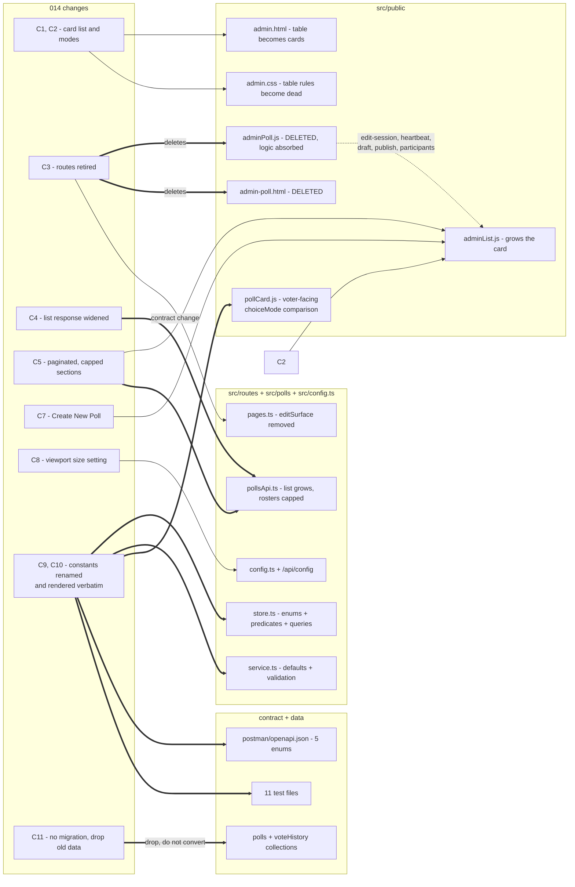
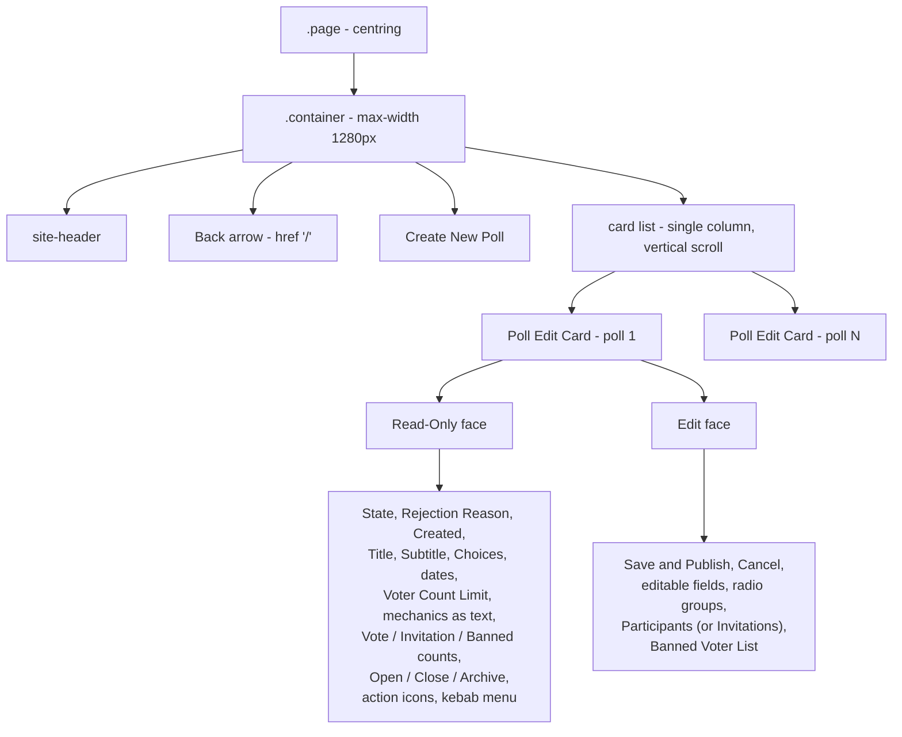
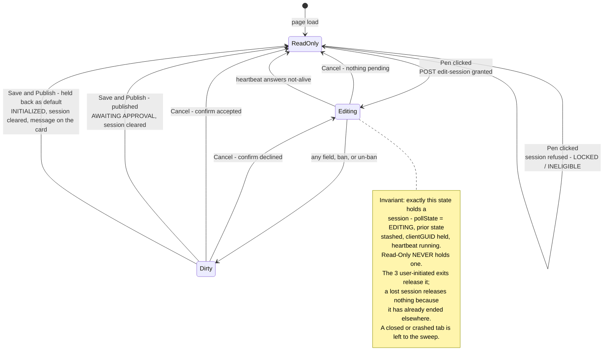
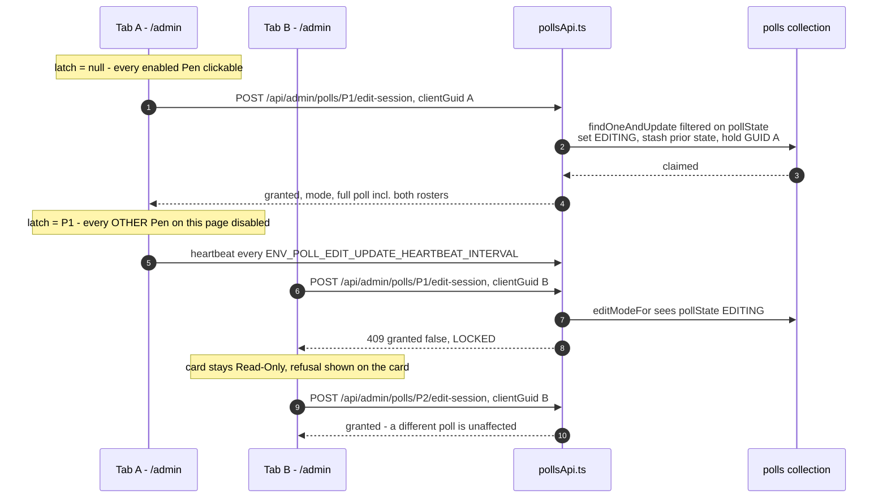
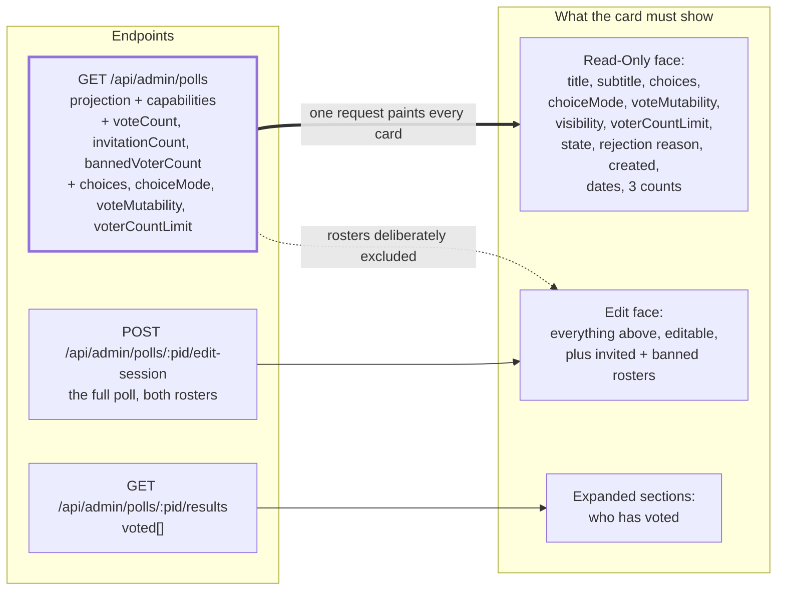
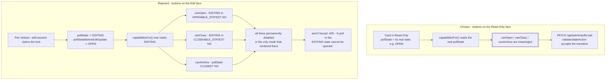
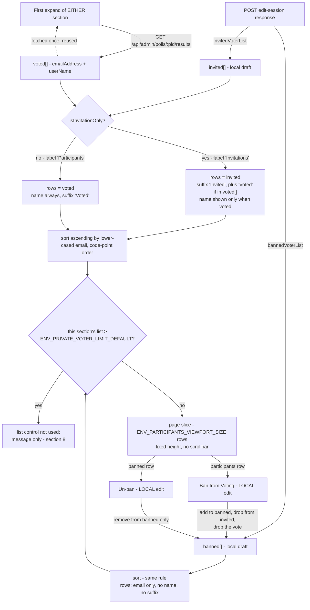
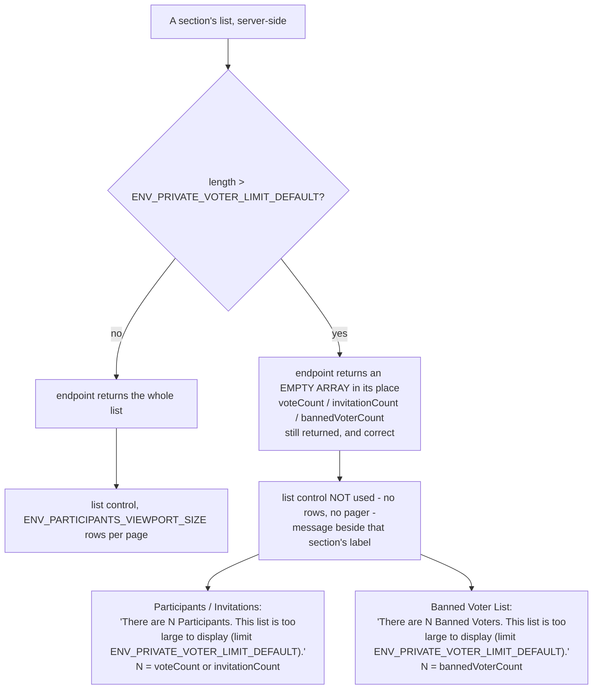
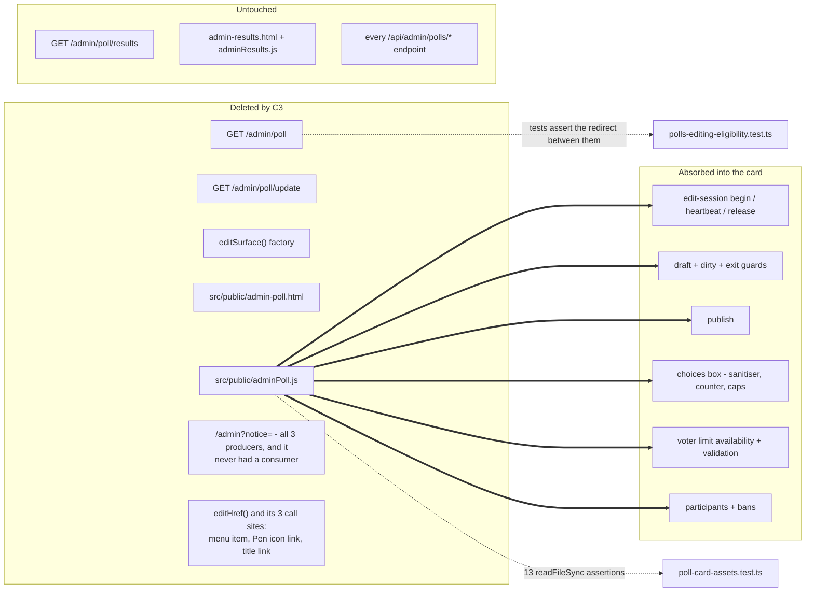

# 014 — Poll Edit Card — Architecture

| | |
|---|---|
| **Requirements document** | `designDocs/014-high-level-requirements-poll-edit-card.md` — 462 lines (`Discard` renamed `Cancel`) |
| **Mockup** | `designDocs/014-poll-edit-card-mockup.jpg` — layout only, explicitly not functionality |
| **Architecture directory** | `architecture/014-poll-edit-card` |
| **Main document** | `architecture/014-poll-edit-card/architecture.md` |
| **Mode** | UPDATE-IN-PLACE — verification pass over the 442-line document |
| **Generated** | 2026-09-10 |
| **Previous run** | REGENERATE against the 275-line revision, then 21 resolutions applied in session |

---

## 1. Overview and scope

014 collapses three admin surfaces into one and renames three stored enumerations. The
`/admin` table becomes a single column of **Poll Edit Cards**, each of which both *displays*
and *edits* its poll; the two editing routes behind it retire with their page and script.

| ID | Change | Layer | Server change |
|---|---|---|---|
| C1 | `/admin` becomes a card list, one card per poll, one column | Markup + CSS | none |
| C2 | Read-Only ⇄ Edit as a per-card mode, not a page navigation | Client state | none |
| C3 | `/admin/poll` and `/admin/poll/update` retired with their page and script | Routes + assets | **`pages.ts`** |
| C4 | List response widened by 3 counts + 4 config fields | Data + render | **`GET /api/admin/polls`** |
| C5 | Participants / Banned Voter List: collapsible, paginated, size-capped | Client control | **cap on the roster endpoints** |
| C6 | One fetch to enter Edit mode, not two | Client | none |
| C7 | `Create New Poll` inserts a card in Edit mode instead of navigating | Client | none |
| C8 | `ENV_PARTICIPANTS_VIEWPORT_SIZE` | Config | **`config.ts`** |
| C9 | `POLL_VISIBILITIES`, `ChoiceMode`, `VoteMutability` renamed to Title Case | Model + UI + tests | **`store.ts`, `service.ts`** |
| C10 | UI renders those constants verbatim — no label mapping anywhere | Markup + client | none |
| C11 | No data migration: old documents are deleted, not converted | Ops | none |

Four constraints run underneath and are what the rest of this document keeps returning to:

- **One request paints the page.** The list response carries the poll's settings *and* the
  three counts; the rosters stay off it.
- **The edit session is a server-side lock that rewrites `pollState`.** `EDITING` is a stored
  state, not a client flag, so entering Edit mode changes what every capability rule on that
  poll evaluates to — §6, still this document's blocker.
- **The size cap is all-or-nothing, not a truncation.** Settled this revision — §8.
- **The renamed constants are stored values, not display labels.** There is deliberately no
  code-to-label map, so a rename is a data change, a query change and a UI change at once — §10.

### 1.1 Change surface



*The thick edges are the irreversible ones. C9 is the widest: roughly 180 literal occurrences
across 20 files, 11 of them test suites.*

### 1.2 What changed since the previous revision

The whole delta is inside `List Control Maximum List Size Limit`, and it is almost entirely
repair.

| Previous finding | Status now |
|---|---|
| INC-1 — the cap described three ways: truncate / return nothing / display some | **Closed.** "The list control will not be used if there are more than `ENV_PRIVATE_VOTER_LIMIT_DEFAULT` participants" — unambiguously all-or-nothing |
| INC-2 — the banned-list message keyed on `isInvitationOnly()` | **Closed.** The bogus second message is gone; one message, attached to the `Participants` label |
| — | The `Banned Voter List`'s exemption from the cap, raised as INC-1 this run, is **closed**: the cap now governs both sections, measured per list |
| — | Typos repaired: "anyt endpoint" → "any endpoint", "return and empty array" → "an empty array" |
| INC-3/4/5, all ambiguities, all unspecified aspects, both clarifications | **Unchanged.** Carried forward, renumbered |
| INC-2 — `Open`/`Close`/`Archive` dead in Edit mode | **Closed this session.** The three buttons move to the `Read-Only` face; NC-1 closed with it |
| INC-3 — `Save and Publish` "same action" vs "returns to Read-Only" | **Closed this session.** Both outcomes end the session and return the card to `Read-Only` |
| INC-4 — actions menu pointing at deleted routes | **Closed this session.** The `Edit Poll`/`Update Poll` item and `editHref()` are removed; the rest of the menu is unchanged |
| AMB-1 — `Discard`'s enablement | **Closed this session.** The control is renamed `Cancel` and is always enabled |
| AMB-2 — the pager range overshooting a partial last page | **Closed this session.** The range is `i - j` with `j` clamped to `N` |
| AMB-3 — the scope of the single-editor constraint | **Closed this session.** Per open `/admin` page, not per user; the two mechanisms are named separately |
| AMB-4 — what `N` is in the over-cap message | **Closed this session.** `N` is the section's count field; the message wording no longer promises a partial list |
| AMB-5 — "valid page number" | **Closed this session.** Commits on Enter/blur, clamped to `[1, q]`, box always shows the rendered page |
| UNS-1 — does `Cancel` release the session | **Closed this session.** One invariant: exactly the card in `Edit` mode holds a session |
| UNS-2 — what `voteCount` counts | **Closed this session.** All three counts defined; `voteCount` is the voted count the voter ceiling is enforced against |
| UNS-3 — the periodic refresh against an open card | **Closed this session.** The editing card is exempt, and its row in the response is ignored |
| UNS-4 — the new setting reaching the browser | **Closed this session.** `/api/config` and `openapi.json` added to the variable's own plumbing list |
| UNS-5 — the Invite row | **Closed this session.** Carried forward unchanged, gated on visibility, collapsing with its section |
| UNS-6 — which endpoints the cap binds | **Closed this session.** `buildAdminPollDetail()` plus the `results` handler; `export.json` exempt |
| UNS-7 — `Create New Poll` against the latch | **Closed this session.** Disabled while a card is editing; the new card lands first and is scrolled to |
| UNS-8 — the empty section | **Closed this session.** Message in place of the list, pager suppressed — the same rule as the over-cap case |
| UNS-9 — what replaces `?notice=` | **Closed this session.** A status line on the card; the parameter is deleted as dead |
| UNS-10 — the `Refresh` icon and how counts update | **Closed this session.** No icon; the counts ride the periodic list refresh |
| NC-2 — scope of "delete all old data" | **Closed this session.** Scoped to `polls` and `voteHistory`; the auth collections are untouched |
| **This verification pass** | The 21 resolutions grew the requirements from 275 to 442 lines. Re-reading the whole document against itself found **three new items** no individual edit could see — INC-5, INC-6 and UNS-11. all three are closed |

---

## 2. The page after 014

The card's width comes from the same chain the table uses — `.page` centres, `.container`
caps at `--max-width` (1280 px) with responsive padding. The table's
`.admin-poll-list-wrap { overflow-x: auto }` escape hatch has no successor: a card reflows
where a ten-column row could not.



Selection and sort are unchanged: `find({}).sort({ createdAt: -1 })` — every poll, newest
first, no filter and no paging.

---

## 3. Card modes

Read-Only is the default for every card on every load. The Pen is the only way in; `Save and
Publish` and `Cancel` are the only ways out — which is why `Cancel` is always enabled: its
partner is disabled until the card is dirty.



The five solid transitions are stated. Both `Save and Publish` outcomes now end the editing
session and return the card to Read-Only — one rule, no exception — which is what the server
has always done on either branch.

The two remaining cases — a refused session and a dead heartbeat — are now specified. Both
report on the card itself, in a status line at the top: a refused session leaves the card in
Read-Only, and a dead heartbeat returns it to Read-Only, because without a session a
`Save and Publish` offered there would be certain to fail.

---

## 4. One editor per page, one editor per poll

Two mechanisms at two scopes; 014 adds only the first.



The requirements now name the two mechanisms separately, which is what closed AMB-3. **One
card per page** is the new client rule, scoped to one open `/admin` page and needing no server
support — an administrator with two tabs open may hold one card in Edit mode in each. **One
editor per poll** is the existing server lock: `editModeFor` refuses `EDITING`, and the claim
is one filtered `findOneAndUpdate`, so two simultaneous Pen clicks cannot both win.

Second-order effect: because the lock writes `pollState`, Tab B's next list refresh shows P1
as `EDITING` with every capability boolean false — so P1's Pen is already disabled there by
existing rules. The latch only stops Tab A opening a second card of its own.

---

## 5. What populates a card



| Field | Source | Cost |
|---|---|---|
| `voteCount` | `currentVotes` with a non-empty `choiceIds` — `computeResults().totalVoted` | already in memory |
| `invitationCount` | `invitedVoterList.length` | already in memory |
| `bannedVoterCount` | `bannedVoterList.length` | already in memory |
| `choices` | `poll.choices` | payload only |
| `choiceMode`, `voteMutability`, `voterCountLimit` | scalar fields | payload only |

The handler already loads whole documents (`find({})` with no MongoDB projection) and the
vote-history `distinct` is already one query for the page, so this is payload and nothing
else. The rosters stay off the response, which is what keeps the *Create New Poll* section's
argument true: the list still cannot populate Edit mode on its own.

C6 is settled: entering Edit mode is one `POST …/edit-session`, whose response *is* the poll.
Today's second `GET /api/admin/polls/:pid` is dropped.

---

## 6. Open, Close and Archive live on the Read-Only face

Settled this session. A state transition is not an edit, so the three buttons stay where the
table already put them — one click away, no editing session involved — and are hidden in Edit
mode. Every existing rule then applies unchanged.



The rejected branch is recorded because it is the reading the earlier drafts carried, and
because it fails silently at the design level rather than loudly at the code level: the
buttons render, the page looks right, and nothing is ever clickable.

Choosing the Read-Only face also avoids two mechanisms the alternative would have required —
a second capability source reading `pollStateBeforeEditUpdate`, and a release-then-PATCH click
path, without which a bare PATCH mid-session writes `pollState` while leaving
`pollEditUpdateClientGUID` set, after which the next heartbeat's filter misses and the card is
told its session died.

---

## 7. Participants and Banned Voter List

Both sections exist only in Edit mode, are collapsed by default, and paginate client-side over
lists already in the browser. The section label is `Invitations` when the poll is
invitation-only, `Participants` otherwise.



Everything except the cap and the label swap is behaviour 012/013 already implement in
`adminPoll.js`; 014 changes the *container*, not the rules.

The pager header sits right-justified against the section label **when expanded**:

| Pager element | Rule | Open question |
|---|---|---|
| Range `i - j` | `i` = first visible index, 1-based; `j = min(i + size - 1, N)` | settled |
| The whole pager | rendered only when the list can be shown as a list — suppressed when empty and when over the cap | settled |
| `(N items)` | total in the sorted list | settled |
| `Page [p] of [q]` | `q = ceil(N / size)`; commits on Enter/blur, clamped to `[1, q]` | settled |
| `<` / `>` | disabled at the ends | settled |
| Viewport | fixed height from `ENV_PARTICIPANTS_VIEWPORT_SIZE`, never a scrollbar | settled — governs both sections |

The `Invite` button and its email box are specified: rendered only when the poll is
invitation-only, living inside the section so they appear in Edit mode and collapse with it,
and feeding the local draft exactly as a ban does — validated, lower-cased, rejected if
already invited or currently banned, and sent to the server only by `Save and Publish`.

---

## 8. The list size cap

Settled. The rule is all-or-nothing — over the cap the list control **is not used at all**,
rather than truncated to the cap — and it governs both sections, each measured against its
own list.



Where the rule lands:

| Poll type | Participant list | Banned list | Can either trip the cap? |
|---|---|---|---|
| Private, invitation-only | the invited list | bans drawn from it | **No** — `voterCountLimit` ≤ `ENV_PRIVATE_VOTER_LIMIT_DEFAULT` bounds both |
| Private, anyone with the link | the voter list | bans drawn from it | **No** — same ceiling |
| **Public** | the voter list | unbounded | **Yes** — `effectiveVoterLimit()` returns `null`; this is the case the cap exists for |

That last row is why the banned list is capped rather than exempted: a public poll has no
`Voter Count Limit` at all, so nothing else bounds either of its lists. One predicate now
serves both sections, which is also what keeps them from drifting apart.

Two structural notes carried forward:

- **The "millions" case is not reachable today.** `currentVotes` is embedded in the poll
  document, and MongoDB caps a document at 16 MB, so a poll is bounded well below a million
  voters by the storage model rather than by this rule. The cap guards a future model, not
  present data — worth stating so nobody sizes other work around it.
- **The cap binds in two places, covering six endpoints.** `buildAdminPollDetail()` is the
  single shaper behind five of them — `edit-session`, both outcomes of `publish`,
  `GET /api/admin/polls/:pid` and `PATCH /api/admin/polls/:pid` — so capping there covers all
  five and any later endpoint built on it. The `results` handler is capped separately for
  `voted` and `notYetVoted`. `export.json` is deliberately exempt; `export.md` carries no
  roster at all.

---

## 9. Create New Poll

```mermaid
sequenceDiagram
  autonumber
  participant U as Administrator
  participant P as /admin page
  participant API as pollsApi.ts
  participant DB as polls

  Note over P: button DISABLED while any card holds Edit mode
  U->>P: Create New Poll
  P->>API: POST /api/admin/polls
  API->>DB: insert createDefaultPoll() - state INITIALIZED
  API-->>P: 201 pid
  P->>API: GET /api/admin/polls
  API-->>P: list - the new poll sorts first, createdAt desc
  P->>API: POST /api/admin/polls/{pid}/edit-session
  API-->>P: granted, mode EDIT, full poll
  Note over P: new card rendered at the top - createdAt desc -<br/>put into Edit mode and scrolled into view;<br/>page latch now held
  Note over U,DB: Abandonment already handled - isAllDefaults() holds back<br/>a poll still carrying DEFAULT_TITLE_RE / default choices
```

The persistence model is unchanged: the row is written before the admin types anything. A new
poll has never been voted on, so `editModeFor` always returns `EDIT` — the `UPDATE` branch is
unreachable here, which is why retiring `/admin/poll/update` costs this flow nothing.

---

## 10. The constant rename

C9 changes three stored enumerations from SHOUTING-KEBAB to Title Case. Because the project
deliberately has **no code-to-label map** — values are stored exactly as displayed, the
precedent `pollState` already sets — a rename is simultaneously a data change, a query change,
a validation change and a UI change.

```mermaid
flowchart TB
  REN["POLL_VISIBILITIES, ChoiceMode, VoteMutability<br/>renamed to Title Case"]

  REN --> PRED["store.ts predicates"]
  PRED --> P1["isPublicVisibility - equality on 'PUBLIC POLL'"]
  PRED --> P2["isInvitationOnly - SUBSTRING 'INVITATION ONLY'"]
  PRED --> P3["INVITATION_ONLY_VISIBILITIES - derived from P2"]

  REN --> QRY["store.ts queries"]
  QRY --> Q1["homeGridFilter - matches pollVisibility 'PUBLIC POLL'<br/>and $in INVITATION_ONLY_VISIBILITIES"]

  REN --> SVC["service.ts - 11 sites"]
  SVC --> S1["createDefaultPoll seeds all three"]
  SVC --> S2["validatePollFields accept-lists"]
  SVC --> S3["validateVoteSubmission - single-choice + final-vote rules"]

  REN --> UI["client"]
  UI --> U1["admin-poll.html - 14 radio values and labels<br/>(file deleted; the card inherits them)"]
  UI --> U2["adminPoll.js - 4 sites (file deleted; logic moves)"]
  UI --> U3["pollCard.js:1123 - VOTER-FACING single-choice comparison"]

  REN --> CON["postman/openapi.json - 5 enums"]
  REN --> TST["11 test files - roughly 100 literals"]
  REN --> DATA["every stored poll document"]
  DATA --> DROP["C11: drop polls + voteHistory, do not convert.<br/>user / session / verification /<br/>email_change_requests are NOT touched"]

  style U3 stroke-width:3px
  style P2 stroke-width:3px
  style DROP stroke-width:3px
```



Two sites fail *silently* rather than loudly, and are the ones to guard:

- **`pollCard.js:1123` is voter-facing.** `poll.choiceMode === 'SINGLE-CHOICE-POLL'` decides
  whether picking a choice deselects the previous one. A miss there makes a single-choice poll
  behave like a multiple-choice one, with no error anywhere.
- **`isInvitationOnly` is a substring test**, not an equality test. It survives only if the
  substring is re-cased to `"Invitation Only"`, and it is called from `pollsApi.ts`,
  `service.ts` and `adminPoll.js`. A missed re-casing makes every invitation-only poll behave
  as if it were not one — which changes who may vote.

C10 removes the remaining label mapping in the UI. Today the mechanics groups show a friendly
label when editable (`Single choice`, `Final vote`) and the raw constant when frozen
(`SINGLE-CHOICE-POLL`) — the same setting reading two ways on one page. After 014 both render
the constant verbatim: `Single-Choice Poll`, `Final-Vote Poll`.

C11 makes this affordable: the `Exclusions` section states that no migration is required and
old data may simply be deleted. That is what turns a renamed stored enumeration from a
migration project into an edit.

---

## 11. Retirement map, and the new setting



`ENV_PARTICIPANTS_VIEWPORT_SIZE` follows the path `ENV_PRIVATE_VOTER_LIMIT_DEFAULT` already
cut, and the requirements now enumerate all of it: an `intVar()` line in `config.ts`, a
`participantsViewportSize` field on `GET /api/config`, an entry in `postman/openapi.json`, a
row in CLAUDE.md, a README entry, and the four dev-tooling files. The `/api/config` hop is the
one that makes the setting work — the browser cannot read `process.env`, and the value's only
consumers are the page size and the list control's fixed height.
`ENV_PRIVATE_VOTER_LIMIT_DEFAULT`, which the over-cap message also needs, is already served
there as `privateVoterLimitDefault`.

---

## 12. Findings

Each item carries an empty checkbox. Mark `[X]` when the recommended resolution is applied,
`[-]` when resolved another way, then re-run `/speckit-mdd-architecture` to confirm.

### 12.1 Inconsistencies

- [X] **INC-1 — The `Banned Voter List` is exempted from the cap on a premise that fails for
  public polls.** *(Resolved 2026-09-10, Option A — the cap now governs both sections.)* The new text says the limit "will not affect `Banned Voter List` because
  there would be no way to ban more than `ENV_PRIVATE_VOTER_LIMIT_DEFAULT` voters, since the
  `Voter Count Limit` field is limited to a maximum of `ENV_PRIVATE_VOTER_LIMIT_DEFAULT`."
  That field does not apply to public polls: it is disabled and cleared for `PUBLIC POLL`, and
  `effectiveVoterLimit()` returns `null` there — no ceiling at all. Public polls are the only
  type this section exists for, so the exemption is justified by a bound that is absent in
  exactly the case that matters. A public poll's banned list is limited only by how many
  addresses an administrator has actually banned.
  - *Resolution applied*: the same all-or-nothing cap now governs both sections, each
    measured against its own list, and the requirements state why — a public poll has no
    `Voter Count Limit`, so nothing else bounds either of its lists. One shared predicate
    rather than two code paths that must be kept in step. The banned list gains the matching
    over-cap message, keyed on the section rather than on visibility.

- [X] **INC-2 — `Open` / `Close` / `Archive` are placed in the one mode where their stated
  enablement rule is always false.** *(Resolved 2026-09-10 — the three buttons move to the
  `Read-Only` face and are hidden in `Edit` mode; NC-1 closed with it.)* Hidden in Read-Only, rendered in Edit mode "according to
  the same logic used in the existing table code". That logic is `capabilitiesFor()`, which
  reads `pollState` — and entering Edit mode sets `pollState` to `EDITING`, which is in neither
  `OPENABLE_STATES` nor `CLOSEABLE_STATES` and is not `CLOSED`. All three are permanently
  disabled, and forcing the request does not help: `validateStateAction` answers 409.
  - *Resolution applied*: the three buttons render on the `Read-Only` face, enabled by the
    existing table logic, and are hidden in `Edit` mode. In Read-Only the poll carries its real
    `pollState`, so `capabilitiesFor()` and `validateStateAction` both work unchanged — no
    second capability source, no release-then-PATCH path, no orphaned session fields. The
    requirements carry a short section recording why the alternative cannot work, so the
    decision is not quietly reverted later.

- [X] **INC-3 — `Save and Publish` cannot both "perform the same action as before" and always
  return the card to Read-Only.** *(Resolved 2026-09-10, Option A — both outcomes end the
  session and return to `Read-Only`.)* The existing publish has two outcomes: the ordinary one
  publishes and clears the session; the other — `isAllDefaults()` true — saves the edits, forces
  the poll back to `INITIALIZED`, clears the session server-side, and returns a `message`
  instead of publishing. Today's page deliberately *stays* on the edit surface for that case.
  - *Resolution applied*: `Save and Publish` always ends the session. The requirements gain a
    `Save and Publish Outcomes` section stating both branches — published to
    `AWAITING APPROVAL`, or held back to `INITIALIZED` with the server's message shown on the
    card — and in both the card returns to `Read-Only` and the heartbeat stops. The claim of
    sameness is narrowed to what is actually shared: the request sent and the fields saved.
    This also repairs an existing defect rather than carrying it forward — today's page
    believes the session is still open on the held-back branch, keeps beating a heartbeat
    against a session the server has already cleared, and is thrown back to `/admin` within one
    heartbeat interval.

- [X] **INC-4 — The actions menu keeps "the same logic as the existing table code" while the
  routes that logic targets are deleted.** *(Resolved 2026-09-10, Option A — the
  `Edit Poll`/`Update Poll` item and `editHref()` are removed; nothing else changes.)* The menu's first item is `Edit Poll` / `Update Poll`,
  built by `editHref()` and pointing at `/admin/poll` or `/admin/poll/update`. The mockup's
  ACTION menu shows only Duplicate Poll, Copy Poll Link, View Results and Delete Poll.
  - *Resolution applied*: the requirements gain an `Action Icons and the Action Menu` section.
    The `Edit Poll` / `Update Poll` item is removed and `editHref()` with it — all three of its
    call sites lose their destination under the card design (the menu item, the Pen icon, which
    now flips mode rather than navigating, and the poll title, which becomes a field rather
    than a link). The menu's final membership is stated explicitly, the mockup's four items are
    explained as one poll in one state, and `Archive Poll` is kept alongside the new Archive
    button because 012 FR-041 makes the menu a complete mirror of the capability set.

- [X] **INC-6 — The Overview's stated scope is now narrower than the document.** *(Resolved
  2026-09-10 — the Overview names what the document actually changes.)* It still carried the
  sentence written for the 176-line draft, limiting scope to three routes, while the document had
  grown to change two API responses, three stored constants, `postman/openapi.json`, every poll
  document, and `pollCard.js` — the voter-facing card. The risk was not the prose but the test
  plan: a reader scoping verification from that sentence would test `/admin` and never open a
  poll as a voter.
  - *Resolution applied*: the sentence now reads "primary scope", followed by the two further
    areas — the two API responses with their `openapi.json` obligation, and the three renamed
    constants with their reach through `store.ts`, `service.ts`, the contract, the tests and the
    stored documents. `pollCard.js` is called out separately as the one voter-facing change,
    with the consequence of missing it stated at the point a reader meets it: a card still
    comparing the old value silently turns a single-choice poll into a multiple-choice one.
    Splitting the rename into its own requirements document was considered and rejected — C10
    couples it to the card's rendering, and the rename was added here deliberately.

- [X] **INC-5 — The exits from `Edit` mode are enumerated three times, with three different
  answers.** *(Resolved 2026-09-10 — user-initiated exits separated from the involuntary one;
  the session rule restated as an invariant.)* The resolutions to AMB-1, UNS-1 and UNS-9 each
  described the ways out from their own vantage point, and they had stopped agreeing:
  - `New Enable/Disable Functionality` says "the user can either click the `Save and Publish`
    button or the `Cancel` button", and the `Cancel` bullet asserts it "is one of **only two
    ways out** of `Edit` mode" — the load-bearing premise of the always-enabled argument.
  - `The Editing Session and the Card` lists **three**, adding navigation away from `/admin`.
  - `Messages and Refusals on a Card` adds a **fourth**: a heartbeat answering `alive: false`
    takes the card out of `Edit` mode with no user action at all.

  That same section also states "Every way out of `Edit` mode therefore ends the session and
  stops the heartbeat", which is false for the fourth case — on a lost session there is nothing
  left to end; the card is reacting to a session that is already gone.
  - *Resolution applied*: the session rule is now stated as an invariant about state rather
    than a claim about actions — *exactly the card in `Edit` mode holds a session; a card in
    `Read-Only` never holds one* — which is true in all four cases where the old wording was
    not. A card leaves `Edit` mode in one of four ways: three user-initiated, each of which ends
    the session and so maintains the invariant, and one involuntary, where the card releases
    nothing because the session has already ended elsewhere. AMB-1's argument survives unchanged
    because it was always about reachable controls: the Cancel bullet now says "one of only two
    **controls** that return the card to `Read-Only`", which stays exactly true, and the
    requirements state that navigating away leaves the page rather than returning the card, and
    that a lost session is not something a user can choose. Renumbering to "four ways out"
    everywhere was rejected — it would have destroyed the reason `Cancel` is always enabled.

### 12.2 Ambiguities

- [X] **AMB-1 — `Discard`'s enablement.** *(Resolved 2026-09-10 — always enabled, and the
  control keeps the name `Cancel`.)* It was "enabled or disabled according to the same logic
  used in the existing code", but there was no `Discard` in the existing code; its nearest
  ancestor, `Cancel`, was made *always* enabled by 012, deliberately.
  - *Resolution applied*: always enabled, and renamed back to `Cancel`. The deciding argument is
    not preference: `Save and Publish` is disabled until the card is dirty, so a `Cancel` that
    greyed out with nothing to discard would leave a card entered by mistake with no enabled
    exit **and** the server-side edit lock still held until the stale sweep reclaims it. The
    requirements also now record that this `Cancel` shares only the name with the previous
    route's — that one released the session and navigated to `/admin`, this one returns the card
    to `Read-Only` in place — and that the mockup's `Discard` label is superseded.

- [X] **AMB-2 — The range text on a partial last page.** *(Resolved 2026-09-10 — the upper
  bound is clamped.)* `"i - i+ENV_PARTICIPANTS_VIEWPORT_SIZE-1"` was a fixed-width window and
  overshot the total whenever the final page was partial — 505 items at a size of 10 rendered
  "501 - 510 (505 items)", naming five rows that do not exist beside the total that disproves
  them. The mockup never exposed it, being drawn at an exact multiple.
  - *Resolution applied*: the range is stated as `i - j`, with `j` defined as
    `i + ENV_PARTICIPANTS_VIEWPORT_SIZE - 1` or `N`, whichever is smaller. The requirements also
    record that clamping the label does not shrink the control: the list keeps its fixed height
    and shows empty row slots on a short last page, so the card's height does not change as the
    user pages through it.

- [X] **AMB-3 — The scope of "only one poll … for a user".** *(Resolved 2026-09-10 — per open
  `/admin` page.)* The original sentence carried both scopes at once — "on a single `/admin`
  page" and "for a user" — while the sentence after it permitted the same user to edit a
  different poll in another tab, which only holds under the per-page reading.
  - *Resolution applied*: the constraint reads "only one card per open `/admin` page may be in
    `Edit` mode at a time", "for a user" is gone, and the per-page scope is stated positively —
    two `/admin` tabs may hold one editing card each. The requirements now also separate the two
    mechanisms by name: **one card per page** is the new client-side rule, and **one editor per
    poll** is the existing server-side session, unchanged. The per-user alternative was
    rejected as needing new machinery — the lock records `pollEditUpdateClientGUID`, not the
    holder's identity, so enforcing it per user would mean new state and a new query on every
    Pen click.

- [X] **AMB-4 — What `N` is in the over-cap message.** *(Resolved 2026-09-10 — `N` is the
  section's count field from `GET /api/admin/polls`.)* Over the cap the endpoint returns an
  empty array, so the client could not derive `N` from the list it was given — and the pager's
  `(N items)`, defined as a length measured from that list, would have read 0 for the same
  section at the same moment.
  - *Resolution applied*: `N` is mapped per section — `voteCount` for `Participants`,
    `invitationCount` for `Invitations`, `bannedVoterCount` for `Banned Voter List` — which is
    the reason those counts are returned truthfully beside an empty list. The requirements also
    state that the two `N`s never appear together: over the cap the list control is not used,
    so the pager does not render at all and the message stands in its place. The message
    wording was corrected in the same edit: it read "No more than
    `ENV_PRIVATE_VOTER_LIMIT_DEFAULT` can be displayed", a leftover from the truncation reading,
    which told the reader 500 rows would appear when the all-or-nothing rule shows none. It now
    reads "This list is too large to display (limit `ENV_PRIVATE_VOTER_LIMIT_DEFAULT`)".

- [X] **AMB-5 — "Front-end logic ensures that the user enters a valid page number."**
  *(Resolved 2026-09-10 — commit on Enter or blur, clamp to `[1, q]`, revert anything
  unparseable.)* The sentence named a goal rather than a behaviour, and admitted prevention,
  clamping or rejection — three visibly different controls — while leaving the commit trigger
  and the malformed cases unstated.
  - *Resolution applied*: the entry commits on `Enter` or blur, never per keystroke (which
    would page the list through every prefix of the number being typed). On commit it is read
    as a whole number and clamped to `[1, q]`; anything that is not a whole number — empty,
    text, a decimal — makes no change and the box returns to the current page. After any commit
    the box shows the page actually rendered, so a clamped entry is visible rather than
    silently discarded, and `Next`/`Previous` update it too. The requirements also note that
    `min`/`max` attributes do not substitute for the rule: a browser does not stop an
    out-of-range number being typed into such a box.

### 12.3 Unspecified aspects

- [X] **UNS-1 — Whether `Cancel` releases the server-side edit session.** *(Resolved
  2026-09-10 — it does, and so does every other exit.)* It was described only as a local reset
  that "does not navigate away", which would have left the poll `EDITING` while its card showed
  `Read-Only` — and, because the page is still open and still beating, held for as long as the
  tab stayed open rather than being reclaimed by the sweep.
  - *Resolution applied*: the requirements gain an `The Editing Session and the Card` section
    stating the invariant — **exactly the card in `Edit` mode holds a session; a card in
    `Read-Only` never does** — and listing all three exits that end it: `Save and Publish`
    (server-side, on both outcomes), `Cancel` (`DELETE …/edit-session`, then re-render from the
    restored state), and navigating away including the `Back Arrow`. The invariant is what makes
    the state on screen and the state in the database the same thing. A closed or crashed tab
    cannot release anything — a browser will not reliably complete a request while unloading —
    so that case, and only that case, is left to `staleEditUpdateSweep`, now stated as the
    backstop rather than the normal path.

- [X] **UNS-2 — What `voteCount` counts.** *(Resolved 2026-09-10 — the voted count, not the
  record count.)* `currentVotes` is a list of participant records, not of votes: on an
  invitation-only poll it also holds an entry with an empty `choiceIds` for every invited
  address that has not yet voted, so the two readings differ on any such poll.
  - *Resolution applied*: all three counts are now defined in the requirements. `voteCount` is
    the entries with a non-empty `choiceIds` — the existing `computeResults().totalVoted` —
    `invitationCount` and `bannedVoterCount` are the lengths of their lists. The deciding
    argument is recorded with it: the `Voter Count Limit` is enforced against exactly this
    number in `validateVoteSubmission`, and the two fields sit on the same card, so any other
    definition would show an admin a poll at its ceiling that was still accepting votes. The
    requirements also state that the three counts are independent measures rather than a
    partition, and that none is the row count of the section below — which matches `voteCount`
    on an ordinary poll and `invitationCount` on an invitation-only one.
    `postman/openapi.json` gains all three (BC-4).

- [X] **UNS-3 — The periodic list refresh against a card in Edit mode.** *(Resolved
  2026-09-10 — the editing card is exempt, and its row is ignored.)* `loadList()` ends in
  `body.replaceChildren(...)`, rebuilding every row on each tick of
  `ENV_POLL_ADMIN_PAGE_REFRESH_INTERVAL` (5 s by default). Against an open editing card that
  would discard the text being typed, the caret and focus, and the expanded state and page
  position of both roster sections, roughly five seconds after the admin began.
  - *Resolution applied*: the requirements gain a `Page Refresh and the Card in Edit Mode`
    section. The refresh continues and still reconciles everything else — membership, sweep-driven
    state changes, counts, capability flags — but the card in `Edit` mode is neither re-rendered
    **nor** read from the response. The second half matters as much as the first: a poll being
    edited is in `EDITING`, so its row returns with every capability false, and a card repainted
    from it would render as a locked poll with all actions greyed. Nothing visible goes stale,
    because `State`, `Rejection Reason` and the three counts are hidden in Edit mode. The
    exemption is bounded by AMB-3 — at most one card per page. On leaving Edit mode the card
    repaints from fresh list data, so a save that changed the rosters cannot leave it showing
    counts its own save invalidated.

    Suspending the whole refresh was rejected: the sweeps are what drive most state changes here,
    so freezing the list for the length of an edit is exactly the staleness the refresh exists to
    prevent. Rebuild-and-restore was rejected as more fragile than the exemption — the choices box
    runs its input through a sanitiser, which is where replaying a saved value goes subtly wrong.

- [X] **UNS-4 — `ENV_PARTICIPANTS_VIEWPORT_SIZE` has no route to the browser.** *(Resolved
  2026-09-10 — `/api/config` and `openapi.json` added to the list.)* Every one of the eight
  places the requirements named was server-side or dev tooling, while the value's only
  consumers are in the browser and a browser cannot read `process.env`.
  - *Resolution applied*: two bullets added to the variable's own plumbing list — a
    `participantsViewportSize` field on `GET /api/config`, and its entry in
    `postman/openapi.json` — plus a note on why that hop is the one that makes the setting work
    at all. The client keeps the documented default of 10 as a fallback for the window before
    `/api/config` answers and for the case where it fails, following the `privateVoterLimitDefault`
    precedent. Timing is not tight: unlike the voter limit, which sets an input's `max` before
    first paint, this value is not needed until a section is first expanded. Hard-coding it in
    the client was rejected explicitly — that is the defect 012 FR-066 introduced this pattern to
    prevent, where an operator changes a setting and sees no effect.

- [X] **UNS-5 — The Invite row.** *(Resolved 2026-09-10 — carried forward unchanged.)* The
  mockup showed an `Invite` button and an email box; the Edit-mode field list never mentioned
  them, and "row content and the per-row actions are unchanged" speaks only to rows. The one
  means of inviting anyone to a poll was specified solely by a drawing the document says is
  layout, not functionality.
  - *Resolution applied*: a `The Invite Row` section carries the existing behaviour forward —
    gated on `isInvitationOnly()` alone (an invitation against any other visibility would have
    no effect, since `invitedVoterList` is only consulted for invitation-only polls), inside the
    section so it appears in Edit mode and collapses with the section body, and a local edit
    that reaches the server only via `Save and Publish`, with the existing validation, duplicate
    and banned-address checks. Two states the mockup could not answer are settled with it: the
    row hides when its section collapses, and the over-cap state cannot arise for it at all,
    because invitation-only polls are bounded by `Voter Count Limit` and can never trip the
    size cap.

- [X] **UNS-6 — Which endpoints the size cap binds.** *(Resolved 2026-09-10 — two enforcement
  points, one exemption.)* "No end-point will attempt to return more than
  `ENV_PRIVATE_VOTER_LIMIT_DEFAULT` rows" was absolute and named nothing, while the endpoints
  that actually carry these lists are wider than the two the card reads.
  - *Resolution applied*: the cap lives in `buildAdminPollDetail()` — the single shaper behind
    `edit-session`, both outcomes of `publish`, `GET /api/admin/polls/:pid` and
    `PATCH /api/admin/polls/:pid`, so one edit covers five endpoints and any later one built on
    the same shaper — and in the `GET …/results` handler for `voted` and `notYetVoted`. Capping
    only the card's two read paths was rejected: `publish` and `PATCH` return the same rosters to
    the same browser, and the publish response lands immediately after saving a card that may
    hold a large list. `export.json` is exempt, because an export exists to hand over the data
    the screen withholds and one that silently dropped `participants` would produce a file that
    looked complete and was not. Checking the code corrected an earlier note in this document:
    `export.md` carries no roster at all — `exportPollMarkdown()` emits title, subtitle, a
    choice/vote table and a total — so only the JSON export was ever in question. The
    voter-facing `GET /api/polls` and `GET /api/polls/:pid` have never carried these lists.

- [X] **UNS-7 — `Create New Poll` against the page latch, and where the new card lands.**
  *(Resolved 2026-09-10 — disabled while a card is editing; the new card lands first.)* The
  button now opens a card in Edit mode rather than navigating, so it collides with the
  one-card-per-page rule, and nothing said what it does when that slot is taken.
  - *Resolution applied*: `Create New Poll` obeys the same rule as the `Pen`, because it is
    another way of opening an editing card — while any card holds Edit mode the button is
    disabled, exactly as every other card's `Pen` is. Closing the open card from the Create
    button was rejected: it would raise an unsaved-changes prompt about a *different* card, and
    either leaves an empty `INITIALIZED` poll behind when the prompt is declined or makes one
    button do two unrelated things. On success the list reloads, the new poll sorts first under
    the existing `createdAt: -1`, and the card enters Edit mode and is scrolled into view. The
    requirements also record that Create-then-Cancel leaves an empty `INITIALIZED` poll — existing
    behaviour, not new, and already handled by `isAllDefaults()` holding it back from publication
    and `INITIALIZED` being a deletable state — so it is not mistaken later for a defect the card
    design introduced.

- [X] **UNS-8 — The empty section.** *(Resolved 2026-09-10 — message in place of the list,
  pager suppressed.)* With `N = 0` every pager value degenerates: `q = ceil(0 / size) = 0`, the
  range clamps to "1 - 0", and both arrows point nowhere. It is also the ordinary case rather
  than an edge one — the banned list is empty on almost every poll.
  - *Resolution applied*: an empty section shows a per-section message in the list area — "No
    participants yet.", "No invitations yet.", "No banned voters." — with the pager not rendered
    at all, and the list area keeping its fixed height so the card does not change size. This is
    deliberately **the same treatment as the over-cap case**, giving one rule — when a list
    cannot be shown as a list, a message stands in its place and the pager goes away — instead
    of two special cases behaving differently. It supersedes this item's earlier recommendation
    of a pager reading "Page 1 of 1", which predated the over-cap message and the Invite row.
    Disabling expansion on an empty section was rejected outright: the `Invite` row lives inside
    the `Invitations` section, so that would leave no way to invite the first participant.

- [X] **UNS-9 — What replaces `/admin?notice=`.** *(Resolved 2026-09-10 — a status line on the
  card; the parameter is deleted.)* All three producers are deleted with `editSurface()` and
  `adminPoll.js`, and the parameter never had a consumer — `adminList.js` has never read
  `location.search`, so every message sent through it was already being discarded.
  - *Resolution applied*: the requirements gain a `Messages and Refusals on a Card` section. A
    message about a poll is shown on that poll's card, in a status line at the top where the
    publish error and rejection reason already live — extending the existing rule that a refused
    state transition is reported on the row that asked. It covers three cases: a refused editing
    session (card stays Read-Only, shows the server's `message`), a lost editing session
    (heartbeat answers `alive: false`; the card returns to Read-Only, because without a session a
    `Save and Publish` offered there would be certain to fail, and the unsaved draft is lost —
    stated plainly, and no worse than today, where the page navigates away), and a refused state
    change. The `notice` parameter is removed as dead rather than rewired.

- [X] **UNS-10 — The `Refresh` icon's fate, and how the counts stay current.** *(Resolved
  2026-09-10 — no icon; the counts ride the periodic list refresh.)* An earlier revision gave
  the counts a `Refresh` icon and a section of their own; both were removed, leaving the icon
  drawn in the mockup and no statement anywhere of how the counts update.
  - *Resolution applied*: the requirements state that the counts arrive with
    `GET /api/admin/polls` and are refreshed with it, so a displayed count is never more than
    one `ENV_POLL_ADMIN_PAGE_REFRESH_INTERVAL` old — and that no separate control is needed,
    because the counts show only on Read-Only cards and those are exactly the cards the refresh
    reconciles, the editing card being exempt and hiding all three anyway. A second sentence
    says the mockup's `Refresh` icon is not part of the design and is not implemented; without
    it, someone builds the icon from the picture. Keeping the icon was rejected: at the default
    interval it would re-issue the request the page is about to make, and defining its scope —
    counts only, this card, or the whole list — is what produced the contradiction the earlier
    revision carried.

- [X] **UNS-11 — The card's status line and the rejection reason want the same place.**
  *(Resolved 2026-09-10 — two stacked elements, not one slot.)* The status line was described as
  sitting "where the publish error and the rejection reason are shown today", while `Read-Only`
  mode renders `Rejection Reason` as a standing field — and the mockup gives it a dedicated slot
  beside `State`, carrying either the awaiting-approval elapsed time or the rejection reason.
  - *Resolution applied*: they are two elements. The standing state-detail field beside `State`
    keeps the mockup's slot; the transient status line sits above that row and is cleared on the
    next successful action on the card. The requirements record the two cases that put both on
    screen at once, which is why a shared slot fails: a `REJECTED` poll is editable, so a refused
    `Pen` click lands on a card already showing its rejection reason; and a held-back publish on
    a previously rejected poll does the same, because that branch writes `pollState` and clears
    the session but — unlike the success branch — does not clear `pollRejectionReason`. In both,
    the administrator needs the two together, so neither may overwrite the other.

### 12.4 Needs clarification

- [X] **NC-1 — Do `Open` / `Close` / `Archive` belong in Edit mode at all?** *(Answered
  2026-09-10: no — they belong on the `Read-Only` face.)* The alternative to
  INC-2's workaround is to leave the three buttons in Read-Only, where the existing rule works
  unchanged and where they arguably belong — a state transition is not an edit, and today it is
  one click from the list with no session involved. Keeping them in Edit mode costs a capability
  source of its own and a release-then-PATCH click path.
  - *Resolution applied*: moved to Read-Only, beside the action icons. Every rule stays as it
    is, and the Pen is reserved for what actually is an edit — which is also how the existing
    table behaves, so this is continuity rather than a new convention.

- [X] **NC-2 — Is "delete all old data" acceptable against every environment, or only local
  dev?** *(Answered 2026-09-10 — deletion is accepted, and scoped.)* C11 declared that old data
  "in all collections" could simply be deleted, which is right in spirit for a developer
  database but broader than the rename requires, and CLAUDE.md records autodeploy from `dev` to
  a managed MongoDB.
  - *Resolution applied*: the deletion is scoped to the two collections the change actually
    affects — `polls`, whose every document holds all three renamed values, and `voteHistory`,
    which holds none of them but whose rows reference polls by `pid` and would be orphaned. The
    authentication collections `user`, `session`, `verification` and `email_change_requests` are
    explicitly **not** deleted: none of them contains a renamed constant, and dropping them
    would destroy every account and sign every user out for a change that does not touch them.
    The requirements also record why this must be a release step rather than an afterthought —
    the rename fails silently, not loudly. A stored `"PUBLIC POLL"` raises no error against a
    renamed `"Public Poll"`; `isPublicVisibility()` returns false, `isInvitationOnly()`'s
    substring test misses, and `homeGridFilter` matches nothing, so pre-existing polls quietly
    vanish from the home grid rather than failing visibly. With autodeploy from `dev` there is
    no later point at which the decision is revisited.

### 12.5 Breaking changes

Not failures — but each needs a task of its own.

| # | Change | Impact |
|---|---|---|
| BC-1 | `GET /admin/poll` and `GET /admin/poll/update` removed, with `editSurface()` | Bookmarks 404. `polls-editing-eligibility.test.ts` asserts the redirect *between* the two routes |
| BC-2 | `admin-poll.html` and `adminPoll.js` deleted | 13 `readFileSync` assertions across `poll-card-assets.test.ts` and `polls-editing-eligibility.test.ts` name them by path |
| BC-3 | `/admin` markup becomes a card list | The ten-column `<thead>`, per-row `<td>` structure, striping and `.admin-poll-list-wrap` all go; every `table.admin-poll-list` rule in `admin.css` becomes dead and must be removed, not left |
| BC-4 | `GET /api/admin/polls` grows seven fields | `postman/openapi.json` must change in the same commit; `openapi-contract.test.ts` guards it |
| **BC-5** | **`POLL_VISIBILITIES` values renamed** | `store.ts` (10 literals) incl. `isPublicVisibility` equality, `isInvitationOnly` substring and `homeGridFilter` queries; `service.ts`; `openapi.json` (3 enums, 16 literals); 9 test files. Every stored `pollVisibility` becomes invalid |
| **BC-6** | **`ChoiceMode` and `VoteMutability` renamed** | `service.ts` (9 literals: defaults, validation accept-lists, single-choice and final-vote rules); **`pollCard.js:1123`, voter-facing**; `openapi.json` (2 enums); 5 test files. Every stored value becomes invalid |
| **BC-7** | **All existing poll documents invalidated; `polls` and `voteHistory` dropped** | Per C11 — no migration, and scoped by NC-2. Deployed poll data is destroyed; `user`, `session`, `verification` and `email_change_requests` are untouched, so no account is lost and nobody is signed out |
| BC-8 | UI labels change | The mechanics radios stop reading "Single choice"/"Final vote" and read the constants verbatim; the mockup still shows the old labels |
| BC-9 | `editHref()` and the Edit/Update menu item removed | Any test or selector naming that item |
| BC-10 | `/admin?notice=` removed | All three producers deleted; it never had a consumer, so nothing observable is lost. Messages now render on the card |
| BC-11 | `ENV_PARTICIPANTS_VIEWPORT_SIZE` added | CLAUDE.md, README, `config.ts`, `/api/config`, `openapi.json`, `tests/helpers`, `launch.json`, `launch.json.example`, `launch-dev.ps1`, `setup-dev.ps1` |
| BC-12 | Either oversized roster returns `[]` | Applies to `buildAdminPollDetail()` (five endpoints) and `GET …/results`. A large public poll may answer with an empty `voted`, `invitedVoterList` or `bannedVoterList`. Any consumer that read them as complete is now wrong — including `adminResults.js`, which 014 otherwise leaves untouched. `export.json` is exempt; `export.md` carries no roster |
| BC-13 | The edit session's lifetime shortens | It used to span the life of the edit page; now Pen → Save/Cancel. `EDITING` becomes rarer and shorter, which changes what `isPubliclyListable()`'s EDITING branch compensates for |

---

## 13. Assumptions

Reasonable defaults adopted where the requirements are silent. Each is a *default*, not a
decision — drop any that a resolution above contradicts.

1. The card's width comes from `.container` (max-width 1280 px, responsive padding), which is
   what "the exact same rules that the existing table uses" resolves to; the table's
   `overflow-x: auto` wrapper is not carried over, because a card reflows.
2. Read-Only is re-entered by re-rendering the card from list data, not by reloading the page.
3. The Pen is *disabled*, not hidden, on other cards while the latch is held — matching 012's
   rule that a control which disappears makes the layout jump.
4. Refusals and errors are shown on the card that produced them, as the table showed row errors
   on their own row.
5. The unsaved-changes gate keeps both existing mechanisms: the in-application
   `confirm("Any edits will be lost. Continue?")` and the `beforeunload` prompt, armed on the
   first change and disarmed on save or discard.
6. `Vote Count`, `Invitation Count` and `Banned Voter Count` render as disabled inputs to match
   the mockup, carry no form value, and are never submitted.
7. The results fetch backing an expanded section is per card and cached for the life of that
   card's edit session; `Cancel` drops it with the rest of the session state.
8. Sorting inside both sections is the 013 rule — ascending, code-point order on the
   lower-cased address — and paging is applied after sorting, so a page number names the same
   rows every time.
9. `/admin/poll/results`, `admin-results.html` and `adminResults.js` are untouched, as stated,
   except that BC-12 changes what `results` may return.
10. The mockup is authoritative for layout only, as the document says. Where it shows the old
    constant labels, the old `Refresh` icon, a menu with four items, or a button labelled
    `Discard`, the text governs.
11. The renamed constants keep their existing storage rule: stored verbatim, displayed verbatim,
    with no mapping table introduced anywhere — that is the property C10 is protecting.

---

## 14. Completion Report

| Item | Value |
|---|---|
| **Mode** | UPDATE-IN-PLACE — verification pass; three findings opened and closed |
| **Architecture directory** | `architecture/014-poll-edit-card` |
| **Main document** | `architecture/014-poll-edit-card/architecture.md` |
| **Source requirements** | 462 lines |
| **Software architecture diagrams** | 11 |
| **Inconsistencies** | 6 — all resolved |
| **Ambiguities** | 5 — all resolved |
| **Unspecified aspects** | 11 — all resolved |
| **Needs Clarification items** | 2 — all answered |
| **Breaking changes** | 13 |

**Against the previous run**: the last REGENERATE ran against a 275-line document and raised
21 findings. All 21 were resolved in session, growing the requirements to 442 lines — almost
entirely answers rather than new scope, in twelve new sections covering the editing-session
invariant, the refresh exemption, the size cap's enforcement points, the empty and over-cap list
states, card-level messaging, the Invite row, the `Save and Publish` outcomes, and why the state
buttons live on the `Read-Only` face. This UPDATE-IN-PLACE pass re-read the whole document
against itself, found three items no individual edit could see, and closed those too.

**Readiness for `/speckit-specify`**: **ready.** All twenty-four findings are closed — six
inconsistencies, five ambiguities, eleven unspecified aspects and two clarifications. Thirteen
breaking changes remain documented; they are consequences of the feature, not defects in it, and
each needs a task of its own.

That this pass opened three new items is the reason for running it. Each of the twenty-one
earlier resolutions was correct in isolation; INC-5 existed precisely because three of them
described the same thing from three vantage points, and no single edit could see the other two.
A further pass is worth running only if the requirements change again.

The requirements grew from 176 lines at the first architecture pass to 442, and almost all of
that growth is answers rather than new scope: the editing-session invariant, the refresh
exemption, the size cap's enforcement points, the empty and over-cap list states, card-level
messaging, the Invite row, the `Save and Publish` outcomes, and why the state buttons live on
the Read-Only face.

Two items are worth carrying into `/speckit-plan` as notes rather than leaving to be
rediscovered. The constant rename (C9) has two sites that fail silently rather than loudly:
`pollCard.js:1123`, the only voter-facing one, where a missed rename makes a single-choice poll
behave as multiple-choice; and `isInvitationOnly`'s substring test, where a missed re-casing
changes who may vote. And the `polls`/`voteHistory` deletion (NC-2) is a release step, not a
cleanup task — autodeploy from `dev` means there is no later moment at which it gets decided.

INC-2, which blocked all three previous revisions, is closed: the three state-transition
buttons move to the `Read-Only` face, where the poll carries its real `pollState` and every
existing rule applies unchanged. That was the one finding whose obvious implementation would
have compiled, rendered, and been silently wrong. NC-1 is answered by the same decision.

NC-2 remains the item worth settling before implementation rather than after: C11 authorises
deleting every poll document, which is right for a developer database and expensive to get
wrong against a deployed one.

All four inconsistencies are now closed. The constant rename (C9) is
mechanically large — roughly 180 literals across 20 files — but not ambiguous; the two sites
worth guarding are `pollCard.js:1123`, the only voter-facing one, and `isInvitationOnly`'s
substring test, both of which fail silently rather than loudly.
