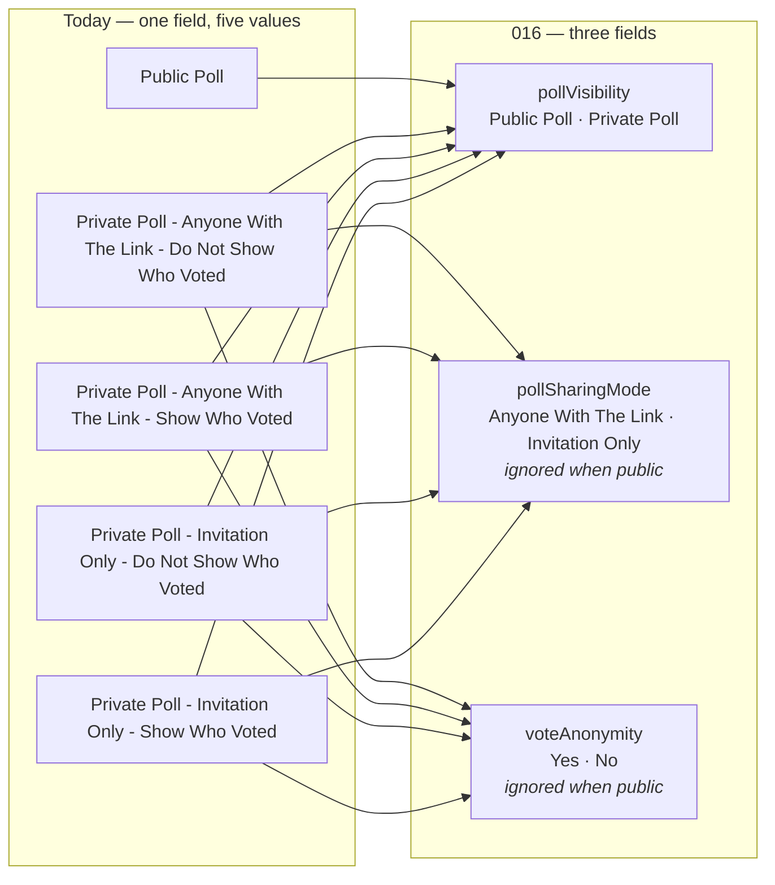
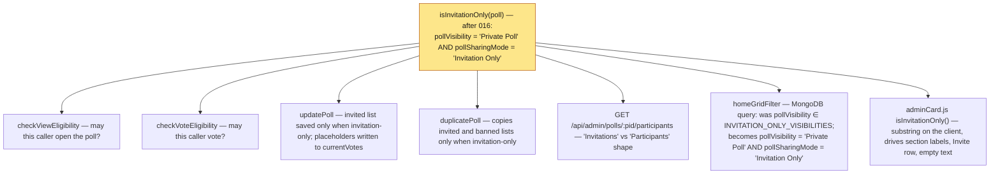
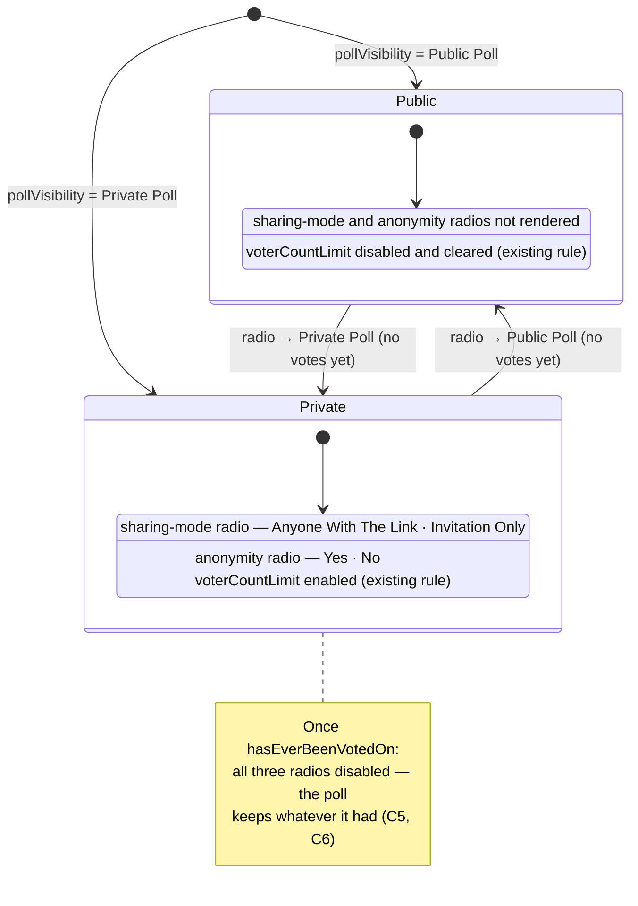

# 016 — Poll Settings Change — Architecture

| | |
|---|---|
| **Requirements document** | `designDocs/016-high-level-requirements-POLL-SETTINGS-CHANGE.md` — 92 lines (renamed from `015A-…`; carries the eleven resolutions of the previous run) |
| **Architecture directory** | `architecture/016-poll-settings-change` — reused: the recorded requirements file was renamed, not replaced, and its number now matches |
| **Main document** | `architecture/016-poll-settings-change/architecture.md` |
| **Mode** | REGENERATE — verification pass over the resolved document |
| **Generated** | 2026-09-14 |
| **Previous run** | REGENERATE against the 53-line `015A` document, then 11 resolutions applied in session |
| **Sequencing** | Implemented on MongoDB, **before** 017 (PostgreSQL + OpenSearch) |

---

## 1. Overview and scope

016 splits one five-valued setting into three. `pollVisibility` shrinks to `Public Poll` /
`Private Poll`; the two properties its four private values used to encode become fields of their
own — `pollSharingMode` (`Anyone With The Link` / `Invitation Only`) and `voteAnonymity`
(`Yes` / `No`). The admin card gains two radio groups that appear only for a private poll, and all
three controls freeze once the poll has received a vote.

| ID | Change | Layer | Server change |
|---|---|---|---|
| C1 | `POLL_VISIBILITIES` reduced to two values | Model + UI + tests | **`store.ts`, `service.ts`, `openapi.json`** |
| C2 | New stored field `pollSharingMode` — the "who may open it" half of the old value | Model | **`store.ts`, `service.ts`** |
| C3 | New stored field `voteAnonymity` — the "who may see who voted for what" half, now with defined semantics | Model | `store.ts`, `service.ts` |
| C4 | `isInvitationOnly()` and `INVITATION_ONLY_VISIBILITIES` re-based on `pollSharingMode` **and** privacy | Predicates + queries | **`store.ts` (`homeGridFilter`), `service.ts`, `pollsApi.ts`** |
| C5 | Admin card: visibility radio with two options; sharing-mode and anonymity radios shown only when private; all three disabled once voted | Client | none |
| C6 | Server rejects changes to the two new fields after a vote, as it already does for `pollVisibility` | Service | **`service.ts` update validation** |
| C7 | Admin API responses carry the two new fields; `openapi.json` follows | Contract | `GET /api/admin/polls`, poll detail |
| C8 | No data migration: existing poll documents are invalid and are dropped | Ops | none |

Two constraints run underneath:

- **Stored verbatim, no mapping.** As with 014's rename, the new values are stored and rendered
  exactly as written; there is no code-to-label table anywhere.
- **"Invitation only" is now a conjunction.** A poll is invitation-only when it is *private* **and**
  its sharing mode is `Invitation Only`. A public poll with a stale `Invitation Only` stored on it
  is public, full stop — the document says the field "will be ignored for public polls", and every
  predicate has to honour that, not just the UI.

### 1.1 The split



The arrows are conceptual: nothing converts an old value into new ones, because no document is
migrated (C8). What survives is the *meaning*: "Anyone With The Link" / "Invitation Only" becomes
`pollSharingMode`; "Do Not Show Who Voted" / "Show Who Voted" becomes `voteAnonymity` `Yes` /
`No`.

---

## 2. Where the old value is read today — the blast radius of C4

Today `isInvitationOnly(v)` is a **substring test** on the visibility string, and it is the only
thing that decides invitation gating everywhere. After 016 the string no longer contains the
words, so every consumer changes behaviour if the predicate is not re-based. The requirements now
state the rule ("for a public poll they are ignored by every rule that reads them"; duplication
"now meaning private **and** `Invitation Only`"), so this section is the checklist of where it lands.



`INVITATION_ONLY_VISIBILITIES` (a filtered list of visibility values) has no meaning once the
values are two; `homeGridFilter` must query the pair of fields instead. The client's own
`isInvitationOnly()` in `adminCard.js:543` is a second copy of the substring test and must change
with the server's.

---

## 3. The admin card — three controls, two rules



Visibility of the two new groups follows the *current radio selection* in the draft, not the
saved poll — switching to `Private Poll` reveals them immediately with the stored (or default)
values pre-selected; switching back hides them without clearing them (UNS-2). The existing
`voterCountLimit` availability rule keyed on `"Public Poll"` is unchanged.

---

## 4. Saving — the server holds the rule, the control only reflects it

```mermaid
sequenceDiagram
  participant C as adminCard.js (Edit mode)
  participant S as service.updatePoll
  participant M as MongoDB polls
  C->>S: PUT settings { pollVisibility?, pollSharingMode?, voteAnonymity?, … }
  alt poll hasEverBeenVotedOn and any of the three is present
    S-->>C: 409 "<field> cannot be changed after the poll has received a vote."
  else
    S->>S: validate each against its accept-list → 400 on an unknown value
    S->>S: effective visibility = $set.pollVisibility ?? poll.pollVisibility
    S->>S: if public → voterCountLimit = null (existing); sharing/anonymity stored as sent, ignored by predicates
    S->>S: if effective isInvitationOnly → reconcile invited list and placeholders (existing)
    S->>M: $set { … }
    S-->>C: 200 with the poll detail incl. the two new fields
  end
```

Today `pollVisibility` already gets the 409 after a vote; C6 extends the same guard to the two
new fields, so a hand-crafted request cannot do what the disabled radio prevents.

---

## 5. Who may see who voted for what

`voteAnonymity` is the first setting whose stated semantics name a **poll creator** — a role the
current implementation does not have (`createdBy` arrives with 015). This table is what the
document says; the last column is what exists to enforce it today.

| Viewer | `voteAnonymity = Yes` | `voteAnonymity = No` | Public poll | Enforced today by |
|---|---|---|---|---|
| Administrator (`ENV_ADMINS`) | sees who voted for what | sees who voted for what | sees | `requireAdmin` on results and participants routes — unchanged |
| Poll creator (non-admin) | totals only | sees who voted for what | *(field ignored)* — see NC-1 | **nothing** — no creator role, no non-admin results surface |
| Any other voter | totals only | totals only | totals only | no voter-facing route returns identities — unchanged |

Until a creator role and a creator-facing results surface exist, `voteAnonymity` is **stored and
edited but never consulted** — and the requirements now say so (NC-1, answered), which is what
keeps the next feature from assuming the enforcement is already there.

---

## 6. Findings

Each open item carries an empty checkbox; the recommended resolution is indented beneath it.

### 6.1 Inconsistencies

- [X] **INC-1 — The spec name on line 1 still says `015A-POLL-SETTINGS-CHANGE`.** *(Resolved 2026-09-14 — line 1 now names `016-POLL-SETTINGS-CHANGE`; the "mon goDB" typo fixed with it.)* The file was
  renumbered to `016-…` so that `/speckit-specify` allocates a matching `specs/016-…` directory,
  but the instruction it reads is the first line, which would create `specs/015A-POLL-SETTINGS-CHANGE`
  — a directory whose prefix the sequential numbering cannot parse, sitting beside
  `architecture/016-poll-settings-change`.
  - *Resolution*: change line 1 to ``Start a new spec for these requirements called `016-POLL-SETTINGS-CHANGE`.``
    (Optionally fix the "mon goDB" typo in the Overview at the same time.)

### 6.2 Ambiguities

- [X] **AMB-1 — "The MongoDB database is dropped".** *(Resolved 2026-09-14 — the drop is scoped to `polls` and `voteHistory`; the authentication collections are untouched. Requirements Exclusions rewritten.)* The Exclusions line is copied from 015, where
  the whole database is abandoned on the way to PostgreSQL. Here the change is implemented *on*
  MongoDB, before 015. Dropping the whole database now would destroy every account for a change
  that touches only poll documents — the exact scope 014 (NC-2) deliberately avoided.
  - *Resolution*: scope it as 014 did — drop `polls` and `voteHistory` (every poll document
    carries an invalid `pollVisibility`; history rows would be orphaned), leave `user`,
    `session`, `verification` and `email_change_requests` untouched. Reword the exclusion.

- [X] **AMB-2 — "Once the poll has received votes".** *(Resolved 2026-09-14 — `hasEverBeenVotedOn`, matching the existing `pollVisibility` rule; deleting votes does not unfreeze. Requirements state it.)* Today's rule for `pollVisibility` is
  `hasEverBeenVotedOn` — a vote that was later deleted still freezes the setting (011 FR-007).
  "Has received votes" could be read as "currently has votes".
  - *Resolution*: use `hasEverBeenVotedOn` for all three controls and the server guard, matching
    the existing `pollVisibility` behaviour; say so in the requirements.

- [X] **AMB-3 — `voteAnonymity: "Yes"` means the votes *are* anonymous.** *(Resolved 2026-09-14 — values kept; the card labels the group "Anonymous Votes" and the requirements state the polarity in one sentence.)* The option words are
  `Yes`/`No` under a field called anonymity, so `Yes` = the creator may **not** see who voted for
  what. Readers who map it onto the old "Show Who Voted" text invert it.
  - *Resolution*: keep the values (the project stores constants verbatim) but give the radio group
    the label **"Anonymous Votes"** and state in the requirements, in one line, that `Yes` hides
    voter identities from the creator and `No` reveals them.

### 6.3 Unspecified aspects

- [X] **UNS-1 — Defaults for a new poll.** *(Resolved 2026-09-14 — `"Anyone With The Link"` / `"Yes"`, always present; stated in the requirements.)* `createDefaultPoll()` sets `pollVisibility` to
  `Public Poll`; the two new fields have no stated default, yet they must be stored (a private
  poll needs values the moment the radio flips).
  - *Resolution*: `pollSharingMode = "Anyone With The Link"`, `voteAnonymity = "Yes"` — the
    analogue of today's first private option ("Anyone With The Link - Do Not Show Who Voted").
    Both are always present on a document, public or private.

- [X] **UNS-2 — Whether the two fields are stored for a public poll, and what happens on
  Public → Private → Public.** *(Resolved 2026-09-14 — always stored, never cleared, ignored when public; the card hides without clearing.)* "Ignored for public polls" can mean "not stored" or "stored but
  inert".
  - *Resolution*: always stored, never nulled; predicates ignore them when public. Switching to
    `Private Poll` reveals the radios pre-selected with the stored values; switching back hides
    them and leaves the values as they are. This is the simplest rule and the one that lets a
    mistaken flip be undone without loss.

- [X] **UNS-3 — Server-side enforcement of the freeze.** *(Resolved 2026-09-14 by the same AMB-2 edit — the requirements now say the server rejects a change to any of the three fields on a poll that has ever been voted on.)* The document specifies that the
  *controls* are disabled after a vote. The server today returns `409` for `pollVisibility`
  only.
  - *Resolution*: extend the `409` guard in `updatePoll` to `pollSharingMode` and
    `voteAnonymity`, and validate both against their accept-lists (`400` otherwise). Tests in
    `polls-admin-crud.test.ts` alongside the existing visibility case.

- [X] **UNS-4 — Which responses carry the new fields.** *(Resolved 2026-09-14 — admin responses only; voter-facing responses unchanged. New `API` section in the requirements.)* The admin list, the admin detail, the
  duplicate and the voter-facing detail all emit `pollVisibility` today; nothing says which of
  them gain the two fields.
  - *Resolution*: every **admin** response that carries `pollVisibility` gains both fields;
    voter-facing responses (`GET /api/polls`, `GET /api/polls/:pid`) do not — a voter has no
    use for either, and anonymity is a promise about what the creator sees, not a value the voter
    needs. `openapi.json` documents both, and the contract test guards them.

- [X] **UNS-5 — The Read-Only face of the card.** *(Resolved 2026-09-14 — displayed for private polls in the radios' position; no reflow on mode change. Stated in the requirements.)* 014's `Read-Only` mode displays the poll's
  settings; the document only describes the `Edit` controls.
  - *Resolution*: the Read-Only face shows `Poll Visibility`, and for a private poll also the
    sharing mode and anonymity values, in the same position the radios occupy in Edit mode, so
    the card does not reflow on mode change.

- [X] **UNS-6 — Labels and placement of the two radio groups.** *(Resolved 2026-09-14 — "Sharing Mode" and "Anonymous Votes", in the mechanics row after `Poll Visibility`. Stated in the requirements.)* The option texts are given; the
  group labels and where they sit in the card are not.
  - *Resolution*: `Sharing Mode` and `Anonymous Votes` (AMB-3), rendered in the mechanics row
    immediately after `Poll Visibility`, in that order.

- [X] **UNS-7 — Duplicate.** *(Resolved 2026-09-14 — both fields copied; roster copy keyed on the re-based predicate. New `Duplicate` section in the requirements.)* `duplicatePoll` copies the invited and banned lists only for an
  invitation-only source; whether the two new fields are copied is not stated.
  - *Resolution*: copied verbatim with the rest of the settings (a duplicate is the same poll
    with no votes), and the roster copy keyed on the re-based `isInvitationOnly()`.

### 6.4 Needs clarification

- [X] **NC-1 — Is `voteAnonymity` stored-only in this feature?** *(Answered 2026-09-14 — yes; enforcement lands with the creator role. Stated in the requirements.)* Its semantics are defined in
  terms of a "poll creator" who "can see who voted for which choice" when it is `No`. No creator
  role, no `createdBy` field and no non-admin results surface exist yet (they arrive with 015 /
  the deferred permissions document). As written, nothing in this feature can read the field.
  - *Resolution*: yes — store, edit, validate and expose it to admins now; state in the
    requirements that enforcement lands with the creator role, and that until then the only
    observable behaviour is the radio. If the product owner instead expects behaviour now, the
    feature needs a creator identity and a creator-facing results route, which is a different
    document.

### 6.5 Breaking changes

Not failures — but each needs a task of its own.

| # | Change | Impact |
|---|---|---|
| BC-1 | `POLL_VISIBILITIES` loses four values | `store.ts` (values, `INVITATION_ONLY_VISIBILITIES`), `service.ts` accept-list (`service.ts:507`), `adminCard.js:11–16`; `openapi.json` (3 `pollVisibility` sites); 7 test files name the old strings (`polls-discovery`, `polls-editing-lock`, `openapi-contract`, `polls-admin-participants`, `polls-admin-crud`, `polls-state-machine`, `polls-vote`) |
| BC-2 | `isInvitationOnly()` re-based from substring to a two-field conjunction | Six consumers in §2; a missed site silently changes who may open or vote on a poll |
| BC-3 | `homeGridFilter` query shape changes | `store.ts:111`; the MongoDB index set may want `(pollVisibility, pollSharingMode)` for the invited-visitor clause |
| BC-4 | Client `isInvitationOnly()` substring in `adminCard.js:543` | Section labels, Invite row, empty-state text on the card |
| BC-5 | Two new document fields on every poll | `Poll` interface, `createDefaultPoll`, `duplicatePoll`, `tests/helpers/poll-fixtures.ts`, seed scripts under `devScripts/populate/` |
| BC-6 | Admin responses gain two fields | `openapi.json`, `openapi-contract.test.ts` |
| BC-7 | `updatePoll` rejects two more fields after a vote | New `409` cases; existing tests that build private polls by visibility string must set `pollSharingMode` instead |
| BC-8 | Existing poll documents invalid; `polls` and `voteHistory` dropped (per AMB-1) | A release step, as in 014 — autodeploy from `dev` leaves no later moment to decide it |
| BC-9 | 017's `home_listable`, admin `Private` filter and search index assume the two-valued visibility | Downstream, not a regression — 017's requirements should be read against the new fields (`home_listable` still keys only on `pollVisibility`; the admin panel's `Private` becomes an equality) |

---

## 7. Assumptions

Reasonable defaults adopted where the requirements are silent. Each is a *default*, not a
decision — drop any that a resolution above contradicts.

1. `isPublicVisibility()` is unchanged (`v === "Public Poll"`); `isInvitationOnly()` becomes
   `!isPublicVisibility(v) && sharingMode === "Invitation Only"` and takes the poll (or both
   fields), not the visibility string alone.
2. The three radio groups share the existing `radioGroup()` helper and the existing `hasVotes`
   disable path in `adminCard.js`; hiding the two private-only groups uses `hidden`, following the
   document's "only visible" wording rather than 014's disable-not-hide preference.
3. `voteAnonymity` has no effect on exports (`export.json`, `export.md`) or the admin results page —
   the document grants administrators full visibility regardless.
4. The MongoDB `polls` and `voteHistory` drop is performed once per environment as a release step,
   using the same procedure 014 T002 used.
5. No `ENV_*` variable is added or changed.
6. Both new fields are validated against their two-value accept-lists on save (`400 Invalid
   pollSharingMode.` / `400 Invalid voteAnonymity.`), following the existing `pollVisibility`
   pattern in `updatePoll`; the requirements say "validated" for `voteAnonymity` and the same
   rule is assumed for `pollSharingMode`.

---

## 8. Completion Report

| Item | Value |
|---|---|
| **Mode** | REGENERATE — verification pass over the resolved, renamed document |
| **Architecture directory** | `architecture/016-poll-settings-change` (reused — see header) |
| **Main document** | `architecture/016-poll-settings-change/architecture.md` |
| **Source requirements** | 92 lines |
| **Software architecture diagrams** | 4 |
| **Inconsistencies** | 1 — resolved (found this pass) |
| **Ambiguities** | 3 — all resolved (previous run) |
| **Unspecified aspects** | 7 — all resolved (previous run) |
| **Needs Clarification items** | 1 — answered (previous run) |
| **Breaking changes** | 9 |

**Against the previous run**: the eleven resolutions applied in session all read consistently as a
whole. Re-reading the document cold, every rule the diagrams depend on is now stated in the text —
the two-field conjunction for "invitation only", the always-stored / never-cleared fields and their
defaults, the `hasEverBeenVotedOn` freeze with its server guard, the "Anonymous Votes" polarity, the
Read-Only face, captions and placement, the admin-only API surface, duplication, the scoped
collection drop, and `voteAnonymity` as stored-only until a creator role exists.

**Readiness for `/speckit-specify`**: **ready.** All twelve findings across both runs are closed —
one inconsistency, three ambiguities, seven unspecified aspects and one clarification. Nine
breaking changes remain documented; they are consequences of the feature, not defects in it.

The item to carry into `/speckit-plan` is unchanged: `isInvitationOnly()` is a substring test on
both the server (`store.ts:37`) and the client (`adminCard.js:543`), and after 016 the substring no
longer exists — every consumer in §2 keeps compiling while treating invitation-only polls as open
to anyone. BC-2 and BC-4 are the tasks to write first.
