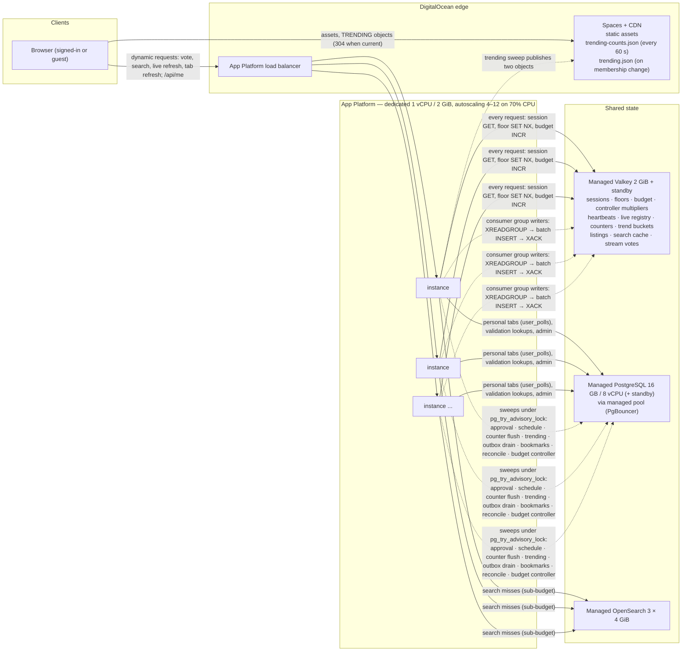
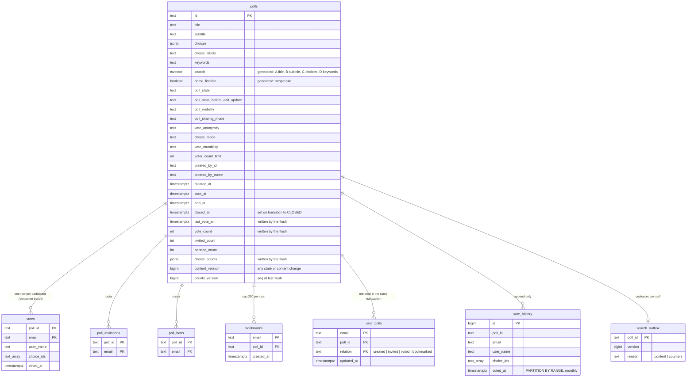
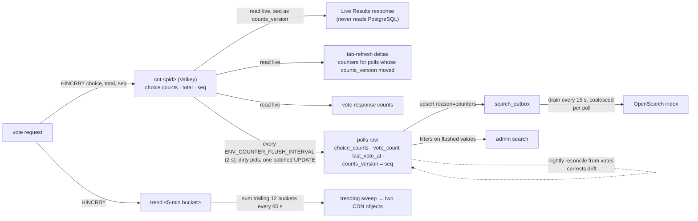
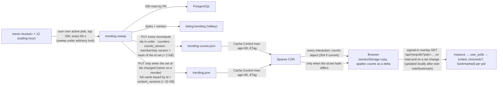
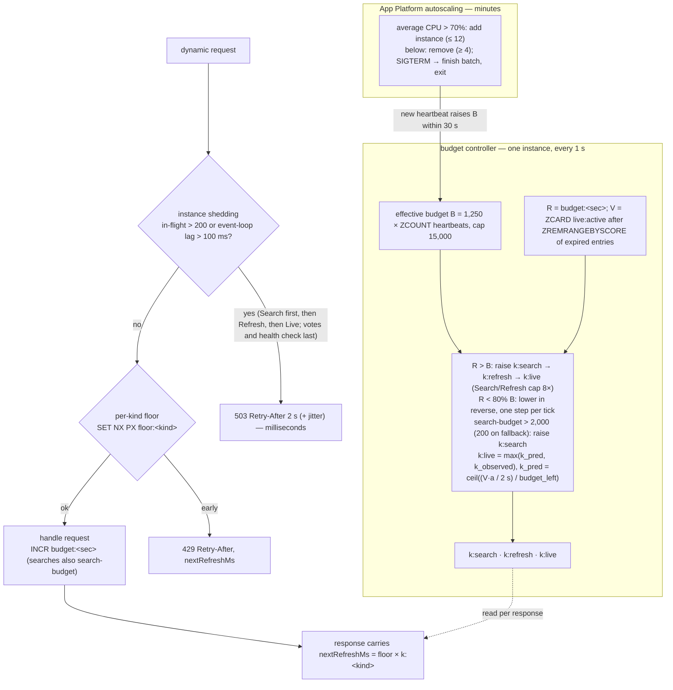
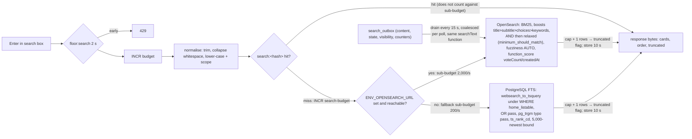
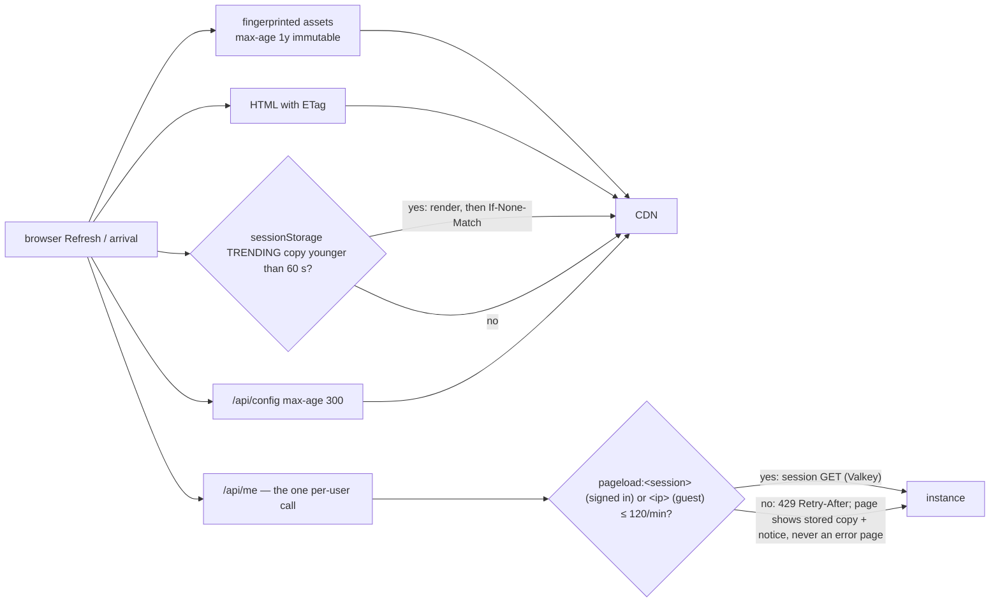

# Architecture: 017 — Search and Scalability Database

**Requirements**: `designDocs/017-high-level-requirements-SEARCH-AND-SCALABILITY-DATABASE-SCENARIO-2.md`
**Spec name**: `017-SEARCH-AND-SCALABILITY-DATABASE`
**Generated**: 2026-09-18 (REGENERATE — second pass, against the requirements as amended by the 15 resolutions of the first pass)

---

## 1. Overview and scope

This feature replaces MongoDB with DigitalOcean Managed PostgreSQL, adds a free-text home search
(OpenSearch in production, PostgreSQL full-text in development and as fallback) and a structured
`/admin` search, and rebuilds the home page's refresh model so that the application holds
**250,000 polls and 1,000,000 concurrently connected users** (50% signed in) on App Platform.

The design rests on seven rules the requirements state and every section below applies:

| # | Rule | Where it bites |
|---|---|---|
| 1 | Nothing reads the whole `polls` table on a request | every listing capped and indexed or cached |
| 2 | Anything identical for every visitor is built once and served as bytes | TRENDING on the CDN; `listing:*` in Valkey |
| 3 | Anything per user is one indexed query | `user_polls` |
| 4 | Counters accumulate in the cache and are flushed; live reads come from the cache | `cnt:<pid>`, the flush sweep |
| 5 | A request the server cannot afford is slowed, not failed | `nextRefreshMs`, `429`, `503`; the vote queue |
| 6 | Only changed data travels | version-keyed deltas; the two TRENDING objects |
| 7 | No instance holds state that matters | Valkey + PostgreSQL; autoscaling 4–12 |

**Card controls**: Vote on every card except search results; Live Results on every card except
in the Live Results tab (search results included); Bookmark on every card; guests are prompted to
sign in on all three, and see the three personal tabs disabled. The standalone poll page and the
single-poll view are retired in favour of Live Results; every other existing feature is preserved
unchanged on the new store.

**In scope**: datastore and schema; the Valkey cache/queue and its in-process twin; the five home
tabs and their queries; the refresh protocol; per-kind floors; the effective budget, its
controller and the search sub-budget; per-instance load shedding; the single-path vote queue and
its abuse bounds; home and admin search; page-load economics; deployment, autoscaling and the
environment variables; tests and load tests.

**Out of scope** (by the requirements' own exclusions): data migration; any push transport or Web
Push; semantic search and third-party search/queue services; edge rate limiting outside
DigitalOcean; topics; the UI/UX design of the tabbed page; total match counts.

---

## 2. System context and deployment

The figure shows every component the requirements name and the only paths a request can take.
The important property is what is *absent*: no arrow from a browser to an instance for TRENDING
(it goes to the CDN), and no arrow from a Live Results refresh to PostgreSQL.



**Deployment settings** (app spec, not `ENV_`): dedicated-CPU 1 vCPU / 2 GiB, `min_instance_count`
4, `max_instance_count` 12, CPU target 70%. Development: one instance, `ENV_VALKEY_URL`,
`ENV_OPENSEARCH_URL` and `ENV_SPACES_BUCKET` unset — the in-process cache/queue, PostgreSQL
full-text at the fallback sub-budget, and TRENDING served from `listing:trending`.

---

## 3. Data model



**Write ownership** (the rule a test asserts): `choice_counts`, `vote_count`, `last_vote_at` and
`counts_version` are written only by the counter flush and the nightly reconcile; `invited_count`
and `banned_count` by the roster transaction; `content_version` by any state or content change;
`user_polls` in the same transaction as the row it mirrors (`voted` in the consumer's batch);
`created_by_name` by the poll insert and by the profile route's rename transaction (which also
bumps `content_version` and queues the outbox).

**Bookmark removal** (daily sweep, batches of 10,000): poll `ARCHIVED`, or `CLOSED` with
`closed_at` older than six months, or `OPEN` with `COALESCE(last_vote_at, start_at, created_at)`
older than six months — the `COALESCE` is what keeps a never-voted poll from escaping the rule.

**Home scope** is one generated column, the only place the rule is written:

```sql
home_listable = poll_visibility = 'Public Poll' AND (
  poll_state IN ('OPEN','CLOSED','WAITING TO OPEN') OR
  (poll_state = 'EDITING' AND poll_state_before_edit_update IN ('OPEN','CLOSED','WAITING TO OPEN')))
```

**Indexes**: partial `GIN (search) WHERE home_listable` and `btree (created_at DESC, id DESC)
WHERE home_listable` for the home search; unfiltered `GIN (search)`, `btree (<enum>, created_at
DESC)` × 4, `GIN (created_by_name gin_trgm_ops)`, `btree (created_at DESC, id DESC)`, `btree
(start_at)`, `btree (end_at)`, `btree (vote_count)`, `btree (invited_count)`, `btree
(banned_count)` for the admin search; `btree (created_by_id)` for the creator-rename fan-out;
`user_polls (email, updated_at DESC)`; `bookmarks (poll_id)`.

---

## 4. Shared state in Valkey

Every instance is stateless; this table is the whole of the shared state and who touches it.

| Key | Written by | Read by | Expiry |
|---|---|---|---|
| `sess:<token-hash>` (stores the session's own expiry) | session helper (cache-aside; deleted by `endSession`, the sole revocation path) | every request | `ENV_SESSION_CACHE_TTL` 5 min, never past the session's expiry |
| `floor:<kind>:<session or ip>` | the request that wins `SET NX PX` | the next request of that kind | that kind's floor |
| `votes-ip:<ip>` | vote path | vote path | 60 s |
| `ban:<pid>`, `invite:<pid>` (sets) | loaded from the roster tables on first use; deleted by the roster transaction | vote validation | 1 h, refreshed on read |
| `voted:<session>` (set) | vote path at enqueue; rebuilt from `votes` on a miss | vote validation (already voted) | session TTL, refreshed on read |
| `budget:<second>`, `search-budget:<second>` | every dynamic request / every engine query | budget controller | 10 s |
| `k:search`, `k:refresh`, `k:live` | budget controller | every dynamic response (`nextRefreshMs`) | none |
| `instance:<id>` | each instance's heartbeat | budget controller (effective budget) | 30 s |
| `live:active` (sorted set, score = expiry) | every Live Results refresh (`ZADD` with expiry = now + `nextRefreshMs` + `ENV_MAX_IDLE_TIME`) | controller (`ZREMRANGEBYSCORE` then `ZCARD`); the live endpoint (registration check) | when its score has passed |
| `pageload:<session>` (signed in) / `pageload:<ip>` (guest) | page-load bucket | `/api/me`, non-CDN listings | 60 s |
| `cnt:<pid>` (choice counts, `total`, `seq`) | vote path (`HINCRBY`) | Live Results, deltas, vote response, flush | none |
| `trend:<bucket>` | vote path | trending sweep | 65 min |
| `listing:<name>` | trending sweep | instance-served TRENDING | recompute interval |
| `poll:<pid>` (content projection + `content_version`) | content changes, flush | Live Results, deltas | on content change |
| `search:<hash of normalised query + scope>` | search miss | search hit | `ENV_SEARCH_CACHE_TTL` 10 s |
| `lock:<sweep>` | listing rebuild single-flight | — | seconds |
| stream `votes`, group `writers` | vote path (`XADD`) | consumers on every instance (`XREADGROUP`, `XACK`) | trimmed after ack |

The same interface (`get/set/incr/hincrby/hgetall/zadd/zcard/expire/lock/xadd/xreadgroup/xack`)
has an in-process implementation used when `ENV_VALKEY_URL` is unset; the queue adapter is the
only file that changes if the queue technology is ever replaced.

---

## 5. The vote path

One path for every vote; the expensive step (the durable rows) is the only one taken off the
request. Nothing in the request path touches PostgreSQL except an eligibility cache miss.

```mermaid
sequenceDiagram
  autonumber
  participant C as Browser
  participant I as Instance
  participant V as Valkey
  participant PG as PostgreSQL
  participant W as Consumer (group writers, every instance)

  C->>I: POST vote {pid, choiceIds}
  I->>V: GET sess:<hash> · SET NX PX floor:vote:<session> (2 s) · INCR votes-ip:<ip> · INCR budget:<sec>
  alt floor or per-IP cap hit
    I-->>C: 429 Retry-After, nextRefreshMs (client keeps the vote pending, retries once)
  end
  I->>V: eligibility from cache: poll:&lt;pid&gt; state · SISMEMBER ban:&lt;pid&gt; / invite:&lt;pid&gt; · SISMEMBER voted:&lt;session&gt;
  opt cache miss
    I->>PG: load roster set / rebuild voted:&lt;session&gt; from votes
  end
  alt ineligible
    I-->>C: refusal with the existing message (never queued)
  end
  I->>V: HINCRBY cnt:<pid> <choice> 1 · total 1 · seq 1 · HINCRBY trend:<bucket> <pid> 1
  I->>V: XADD votes {pid, email, userName, choiceIds, ts} · SADD voted:&lt;session&gt; pid
  I->>V: HGETALL cnt:<pid> · XPENDING/lag of group writers
  I-->>C: 200 {voteCount, choiceCounts, counts_version=seq, status: recorded | queued (lag > 2 s), nextRefreshMs = ENV_MIN_VOTE_INTERVAL (never stretched)}

  loop every batch
    W->>V: XREADGROUP writers (up to 500 entries)
    W->>PG: one multi-row INSERT votes ON CONFLICT (poll_id,email) DO UPDATE | DO NOTHING per vote_mutability;<br/>vote_history rows; user_polls (voted) rows — one transaction
    W->>V: XACK (then XTRIM); XAUTOCLAIM entries pending > lag notice
  end
```

**Durability**: a Valkey node failure loses the unconsumed entries — about one second with the
consumer lag held under a second and the standby in place; accepted. The nightly reconcile
recomputes `vote_count` and `choice_counts` from `votes`, so a lost entry costs one row, never a
wrong tally. **Drain ceiling**: ≈ 20,000 votes/s sustained on the 16 GB node; above it the backlog
grows and `status` reports `"queued"`.

**Abuse bounds**: the vote floor is per session across all polls; `ENV_MAX_VOTES_PER_IP_PER_MINUTE`
(600 — an anomaly threshold that alerts, since a client IP is shared by NAT populations) per
address; account creation is bounded by the existing email rate limit.

---

## 6. Counters, the flush, and where each reader gets its numbers

This is the mechanism the requirements' rule 4 hinges on, and the one that most often goes wrong
in implementation: **two readers, two sources**. Live Results and the deltas read the live hash;
the database, the admin filters, TRENDING's recompute and the search index read the flushed row.



Consequences the diagram makes visible:

- `ENV_MIN_LIVE_REFRESH_INTERVAL` and `ENV_COUNTER_FLUSH_INTERVAL` are independent — the arrow from
  `cnt:<pid>` to Live Results does not pass through the flush.
- A counter is an absolute value with a sequence, never an increment, so a delta applied twice or
  out of order is harmless.
- `content_version` (state/content changes) and the live `seq` are the only two numbers the
  refresh protocol compares; the row's flushed `counts_version` never reaches a client.

---

## 7. Home page: tabs, floors, and the refresh protocol

### 7.1 What each tab costs

| Tab | Source | Cost per refresh | Refreshes |
|---|---|---|---|
| TRENDING (Public OPEN, or EDITING with prior state OPEN) | CDN objects (`trending-counts.json` every interaction; `trending.json` when the id set changes); `listing:trending` when the CDN is unset | zero on instances and PostgreSQL; not a dynamic request — client-enforced floor, CDN `max-age` as the bound | on click, Refresh, page load |
| My PRIVATE POLLS | `user_polls` where visibility = Private, joined to `polls`, cap 200 | one indexed query ≈ 1 ms | on click, Refresh |
| Favourites | `user_polls` relation ∈ {created, voted, bookmarked} and visibility = Public | one indexed query | on click, Refresh |
| Search | result cache → OpenSearch (S2) or PostgreSQL FTS (S1 fallback) | a cache hit, or one engine query against the sub-budget | on Enter (search kind); Refresh re-runs the last query as a Refresh click (manual floor, `k:refresh`), its miss still counted against the sub-budget |
| Live Results (≤ 5 polls, LRU; view eligibility checked when a poll is added and cached with the registration) | `poll:<pid>` + `cnt:<pid>` | ≈ 2 Valkey ops per poll | automatically, at `nextRefreshMs` ≥ 2 s; paused while hidden |

### 7.2 Per-kind floors

| Kind | Variable | Default | Key |
|---|---|---|---|
| automatic Live Results refresh | `ENV_MIN_LIVE_REFRESH_INTERVAL` | 2 s | `floor:live:<session>` |
| Refresh button, tab clicks | `ENV_MIN_MANUAL_REFRESH_INTERVAL` | 5 s | `floor:manual:<session or ip>` |
| search (Enter) | `ENV_MIN_SEARCH_INTERVAL` | 2 s | `floor:search:<session or ip>` |
| vote | `ENV_MIN_VOTE_INTERVAL` | 2 s | `floor:vote:<session>` |

An early request is answered `429` + `Retry-After` + `nextRefreshMs`; the client disables the
control for the floor. The `429` is a backstop: the client holds the last response per tab and
renders it on a tab click, requesting a refresh only when the held copy is older than the manual
floor, when none is held, or on Refresh after the floor — so a user switching tabs never sees a
`429`. Guests are keyed per IP and have only TRENDING, Search and Refresh. TRENDING
interactions are served by the CDN and are not dynamic requests: their manual floor is
client-enforced and the CDN's `max-age=60` is the bound; the overlay call that follows a signed-in
TRENDING render is a manual-kind dynamic request.

### 7.3 Version-keyed deltas

```mermaid
sequenceDiagram
  autonumber
  participant C as Browser (holds cards + versions)
  participant I as Instance
  participant V as Valkey

  C->>I: refresh tab {membershipVersion, versions: {pid: [content_version, counts_version]}}  (≈ 4 KB for 200 polls)
  I->>V: floor SET NX PX · budget INCR · session GET
  I->>V: pipelined read: poll:&lt;pid&gt; content_version and cnt:&lt;pid&gt; live seq for every pid in the tab (never the row's flushed counts_version); for personal tabs the membership version is MAX(user_polls.updated_at) from PostgreSQL
  alt nothing moved
    I-->>C: 304 Not Modified (+ nextRefreshMs)
  else only counts moved
    I-->>C: 200 {counters for those pids} (+ nextRefreshMs)
  else content moved / membership changed
    I-->>C: 200 {full cards for moved content, ordered id list, cards for ids the client lacks} (+ nextRefreshMs)
  end
  Note over I,V: computed from the cache; PostgreSQL is consulted only for the personal tabs' membership query
```

The same payload is what an SSE frame would carry, which is why the excluded push transport
remains a transport change rather than a data change.

### 7.4 TRENDING: recompute and the two-object publication



### 7.5 Live Results tab lifecycle

```mermaid
stateDiagram-v2
  [*] --> Empty
  Empty --> Watching : Live Results clicked from any tab incl. Search (view eligibility checked, registers in live:active)
  Watching --> Watching : refresh at nextRefreshMs (≥ 2 s) · ZADD live:active with expiry · one request for ≤ 5 polls
  Watching --> Watching : Live Results clicked again (move to top, or evict least recently added)
  Watching --> Paused : document.hidden
  Paused --> Watching : focus
  Watching --> Prompt : ENV_MAX_IDLE_TIME (30 min) without interaction
  Prompt --> Watching : Yes (timer restarts)
  Prompt --> Empty : Cancel (tab closed)
  Watching --> Expired : registry entry expired (last refresh + handed interval + 30 min; page never answered)
  Expired --> [*] : server stops serving the registration
  Prompt --> Expired : no answer
```



---

## 8. The three load bounds

The requirements bound load at three speeds. The figure shows where each acts on a single
request's path and what it hands the client.



- **Milliseconds** — shedding keeps an instance healthy instead of stalling; the health check
  (`GET /healthz`, registered before the shedding middleware, `200` regardless of dependency
  state) is never shed, so the load balancer never pulls a shedding instance. The same `503`
  path is what an instance uses while Valkey is unreachable (100 ms call timeouts): every
  dynamic request is shed, CDN page-load paths keep serving, votes are refused until the
  standby answers, and nothing falls back to PostgreSQL for floors, budgets, counters or the
  vote write.
- **Seconds** — the controller stretches intervals in the priority order; votes are never
  lengthened; the predictive `k:live` uses the registry count *V* so a surge of new live tabs is
  absorbed before their first refreshes arrive.
- **Minutes** — autoscaling on CPU works in both directions because the fleet is stateless; the
  effective budget follows the instance count.

---

## 9. Search



The **admin search** is one SQL statement over every poll with an indexed predicate per control
(free text `@@`, four enum equalities, `created_by_name ILIKE '%x%'` on the trigram index, three
UTC day windows computed in Node from the administrator's IANA zone, three counter comparisons),
`ORDER BY created_at DESC, id DESC LIMIT cap + 1`. An `EXPLAIN` test fails on any `Seq Scan`.

---

## 10. Page loads and browser refresh



A site-wide storm of a million refreshes in a minute is ≈ 17,000 Valkey reads/s on the instances
and CDN traffic that never reaches them.

---

## 11. Sweeps, consumers and instance lifecycle

```mermaid
sequenceDiagram
  participant I1 as Instance A
  participant I2 as Instance B (new, autoscaled)
  participant PG as PostgreSQL
  participant V as Valkey

  I2->>V: SET instance:&lt;id&gt; (heartbeat, 30 s) · join consumer group writers
  loop each sweep tick (approval, schedule, flush, trending, outbox, bookmarks, reconcile, controller)
    I1->>PG: pg_try_advisory_lock(sweep id)
    I2->>PG: pg_try_advisory_lock(sweep id)
    Note over I1,I2: exactly one wins; the other returns immediately
  end
  loop consumers run on every instance
    I1->>V: XREADGROUP writers
    I2->>V: XREADGROUP writers
  end
  Note over I2: SIGTERM (scale-down or deploy) — 30 s grace period
  I2->>I2: stop accepting requests
  I2->>PG: finish in-flight batch INSERT
  I2->>V: XACK batch · heartbeat expires within 30 s → effective budget falls
```

Connection arithmetic: 12 instances × 20 pooled connections + sweeps ≈ 260 of the 16 GB node's
397, behind the managed pool.

---

## 12. Environment variables (summary)

Removed: `ENV_MONGODB_NAME`, `ENV_MONGODB_URI`, `ENV_POLLING_INTERVAL`. Retained: the admin-page
refresh variables, the email rate-limit variables, everything else.

| Group | Variables (defaults) |
|---|---|
| Connections | `ENV_DATABASE_URL`; `ENV_VALKEY_URL` (unset → in-process); `ENV_OPENSEARCH_URL` (unset → PostgreSQL FTS); `ENV_SPACES_BUCKET`, `ENV_SPACES_CDN_URL` (unset → instance-served TRENDING) |
| Sessions | `ENV_SESSION_CACHE_TTL` 300000 |
| Caps | `ENV_MAX_POLLS_SEARCH_RESULTS` 200; `ENV_MAX_POLLS_ADMIN_SEARCH_RESULTS` 200; `ENV_MAX_TRENDING_POLLS` 200; `ENV_MAX_LIVE_RESULTS_PER_USER` 5; `ENV_MAX_BOOKMARKS_PER_USER` 200; `ENV_BOOKMARK_EXPIRY_MONTHS` 6 |
| Floors | `ENV_MIN_LIVE_REFRESH_INTERVAL` 2000; `ENV_MIN_MANUAL_REFRESH_INTERVAL` 5000; `ENV_MIN_SEARCH_INTERVAL` 2000; `ENV_MIN_VOTE_INTERVAL` 2000; `ENV_MAX_VOTES_PER_IP_PER_MINUTE` 600 (anomaly threshold); `ENV_PAGE_LOADS_PER_MINUTE` 120 (by session, or by IP for guests) |
| Budget | `ENV_SERVER_MAX_REFRESH_PER_INSTANCE_PER_SECOND` 1250; `ENV_SERVER_MAX_REFRESH_PER_SECOND` 15000; `ENV_SERVER_MAX_SEARCH_PER_SECOND` 2000; `ENV_SERVER_MAX_SEARCH_PER_SECOND_FALLBACK` 200; `ENV_BUDGET_CONTROLLER_INTERVAL` 1000; `ENV_MAX_STRETCH` 8; `ENV_BUDGET_LOWER_THRESHOLD_PERCENT` 80 |
| Shedding | `ENV_INSTANCE_MAX_INFLIGHT` 200; `ENV_INSTANCE_MAX_EVENT_LOOP_LAG` 100; `ENV_SHED_RETRY_AFTER` 2000 |
| Sweeps | `ENV_TRENDING_POLLS_RECOMPUTE_INTERVAL` 60000; `ENV_COUNTER_FLUSH_INTERVAL` 2000; `ENV_OUTBOX_DRAIN_INTERVAL` 15000; `ENV_MAX_IDLE_TIME` 1800000 |
| Queue / cache | `ENV_VOTE_BATCH_SIZE` 500; `ENV_VOTE_QUEUE_LAG_NOTICE` 2000; `ENV_SEARCH_CACHE_TTL` 10000 |

---

## 13. Findings

The first pass (2026-09-17) raised 15 findings; every one was resolved and its resolution written
into the requirements document (and mirrored in the source research-requirements). They are
listed here for traceability, then the findings of this pass against the amended text.

### 13.0 Resolved in the first pass (for traceability — no action)

| # | Was | Resolution now in the requirements |
|---|---|---|
| I-1 | TRENDING membership version defined as "set or order" — would republish the full object every recompute | Membership version = hash of the **set** of ids; order travels in the counts object |
| I-2 | TRENDING interactions classed as server-enforced dynamic requests although the CDN serves them | TRENDING interactions are not dynamic requests; client-enforced floor; CDN `max-age` is the bound; the overlay call is the server request |
| A-1 | "Idle expiry = idle time + one interval" — which interval | Registry scored by expiry = last refresh + the interval handed to that session + `ENV_MAX_IDLE_TIME` |
| A-2 | Which `counts_version` deltas compare | Every client-facing surface compares and returns the live `seq`; the flushed row value serves the database, admin filters, TRENDING and the index |
| A-3 | Tab click within the floor: `429` or held copy | Held copy rendered; request only when the copy is older than the floor, none is held, or Refresh after the floor |
| A-4 | The vote response's `nextRefreshMs` | Always `ENV_MIN_VOTE_INTERVAL`, unstretched |
| U-1 | Bookmark rule for a never-voted OPEN poll | Reference time `COALESCE(last_vote_at, start_at, created_at)` |
| U-2 | The TRENDING overlay unspecified | `GET /api/me/polls?pids=…` from `user_polls`; fetched on load and set change; updated locally after own actions; manual-kind dynamic request |
| U-3 | How `created_by_name` follows a rename | Profile route updates `polls`, bumps `content_version`, queues the outbox, in the rename transaction; `btree (created_by_id)` |
| U-4 | Health-check path and grace period | `GET /healthz`, before the shedding middleware, `200` regardless of dependency state; grace period 30 s |
| U-5 | Vote eligibility read PostgreSQL per vote | `ban:<pid>` / `invite:<pid>` sets invalidated by the roster transaction; `voted:<session>` written at enqueue |
| U-6 | Sessions ended other than by logout | One `endSession` path; entry stores the session's expiry; database-level removal honoured within the TTL |
| U-7 | Behaviour while Valkey is unreachable | Shed every dynamic request with `503`; CDN paths and `/healthz` keep serving; no PostgreSQL fallback for floors, budgets, counters or the vote write |
| NC-1 | Per-IP limits vs NAT populations | Vote cap 600/min as an alerting anomaly threshold; page-load bucket by session, by IP only for guests, 120/min; guest floors per IP accepted |
| NC-2 | Double vote inside the queue's lag window | Closed by `voted:<session>` written at enqueue |

### 13.1 Inconsistencies

None found in the amended requirements.

### 13.2 Ambiguities

- [X] **A-1 — The Refresh button on the Search tab: a Refresh click or a search?** *Resolved 2026-09-18: a Refresh click for the floor and multiplier (`floor:manual`, `k:refresh`); a resulting cache miss counts against the search sub-budget.* The Search tab
  section says the Refresh button "re-runs the last query through the result cache"; the Refresh
  rules make a Refresh click a manual-kind dynamic request (floor 5 s, `k:refresh`), while a search
  is a search-kind request (floor 2 s, `k:search`, and — on a cache miss — the search sub-budget).
  The requirements do not say which floor, which multiplier and which budget a Search-tab Refresh
  is subject to. Both readings are defensible and they differ in what `nextRefreshMs` the response
  carries and whether a miss counts against `ENV_SERVER_MAX_SEARCH_PER_SECOND`.
  - *Recommended resolution*: a Search-tab Refresh is a **Refresh click** for the per-user floor
    and the multiplier (`floor:manual`, `nextRefreshMs = 5 s × k:refresh`), because that is the
    control the user pressed and the floor the button's disabled state already follows; if it
    misses the result cache, the engine query it causes counts against the search sub-budget like
    any other miss, since the sub-budget measures engine load, not user intent. One sentence in the
    Search tab section.

### 13.3 Unspecified aspects

None found in the amended requirements.

### 13.4 Needs clarifications

None.

### 13.5 Breaking changes

These are documented, not failures; they follow from the requirements' own decisions.

| # | Change | What breaks |
|---|---|---|
| BC-1 | MongoDB removed; PostgreSQL is the only database | Every existing document, including accounts; users re-register. `mongodb-memory-server` tests replaced by `embedded-postgres` |
| BC-2 | `ENV_MONGODB_NAME`, `ENV_MONGODB_URI`, `ENV_POLLING_INTERVAL` removed; ~35 variables added | Local `launch.json`, `launch-dev.ps1`, App Platform env; the CLAUDE.md table |
| BC-3 | The home grid's `GET /api/polls` full listing with per-caller fields is replaced by per-tab delta endpoints, the two CDN TRENDING objects and `GET /api/me/polls?pids=…` | `pollGrid.js` / `pollCard.js` polling loops; `openapi.json` |
| BC-4 | Standalone `GET /api/polls/:pid` polling every 5 s is replaced by the Live Results tab protocol | The `?PID=` view's refresh; any client relying on the old shape |
| BC-5 | The vote response gains `status`, `counts_version` and `nextRefreshMs`; votes may be `"queued"` and are not durable until the consumer writes them | Any test asserting the vote row exists immediately after the response |
| BC-6 | New `429` / `503` semantics with `Retry-After` and `nextRefreshMs` on every dynamic request; the client must hold per-tab copies and back off | Clients that retry on a fixed timer |
| BC-7 | Counters in the poll row lag by up to one flush interval; admin filters on `voteCount` see flushed values | Any consumer expecting exact real-time counts from the row |
| BC-8 | Sessions are cached for up to 5 minutes | A session removed directly in the database stays valid up to the TTL; application revocations go through `endSession` and take effect immediately |

---

## 14. Assumptions

- Prices are DigitalOcean list prices as of September 2026; the totals in the requirements
  (≈ $850–1,400/month at the load target) are order-of-magnitude.
- The per-instance budget default (1,250/s), the shedding thresholds, the CPU target, the vote
  drain ceiling (≈ 20,000/s) and the search-cache hit rate are engineering estimates fixed by the
  load tests the requirements make deliverables.
- A crashed instance's heartbeat keeps the effective budget inflated by 1,250/s for up to 30 s;
  accepted.
- A one-second loss window of queued votes on a rare Valkey failure is accepted by the
  requirements.
- The fleet holds no long-lived connections, so App Platform's per-instance connection ceiling is
  not a constraint.
- `keywords` is an empty field until a future requirement populates it; `searchText` includes it
  from day one so no re-index is needed then.

---

## 15. Completion report

- **Mode**: REGENERATE (second pass; the recorded directory was reused and its contents
  overwritten).
- **Location**: `architecture/017-search-scalability-database` — main file
  `architecture/017-search-scalability-database/architecture.md`.
- **Requirements file used**: `designDocs/017-high-level-requirements-SEARCH-AND-SCALABILITY-DATABASE-SCENARIO-2.md`,
  as amended by the 15 resolutions of the first pass.
- **Software architecture diagrams**: 11 (system context and deployment; data model; vote path;
  counters and their readers; version-keyed deltas; TRENDING publication; Live Results lifecycle;
  the three load bounds; search; page loads; sweeps and instance lifecycle).
- **Inconsistencies**: 0.
- **Ambiguities**: 1, resolved on 2026-09-18 (the Search-tab Refresh button is a Refresh click
  for the floor and multiplier; a resulting cache miss counts against the search sub-budget).
- **Unspecified aspects**: 0.
- **Needs clarifications**: 0.
- **Breaking changes**: 8 (documented).
- **Readiness for `/speckit-specify`**: **ready** — no open findings. The requirements are
  consistent, unambiguous and specified to the level a spec needs; the 15 first-pass findings and
  this pass's one ambiguity are closed and their resolutions are in the requirements document.
