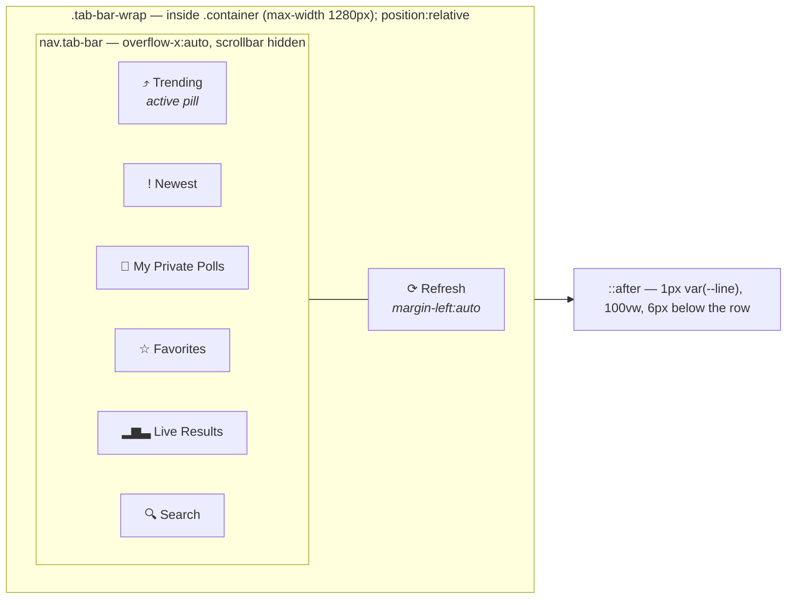
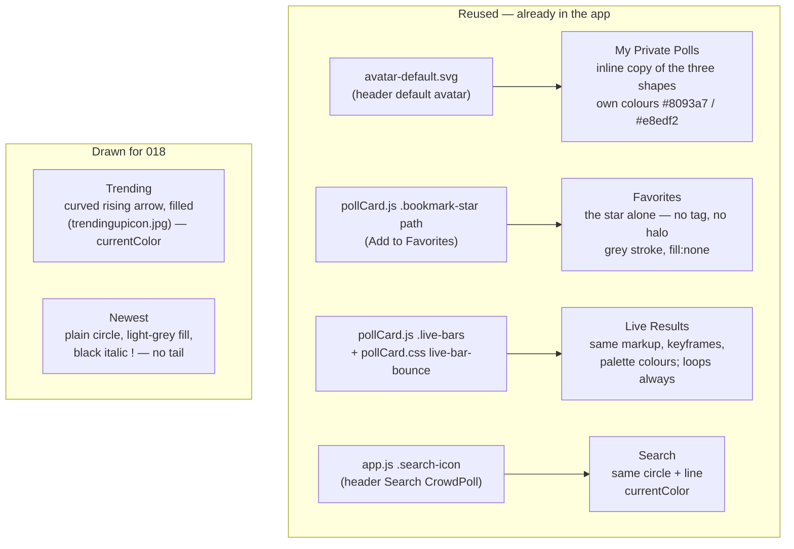
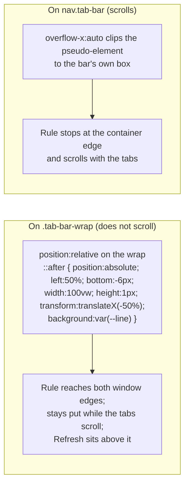
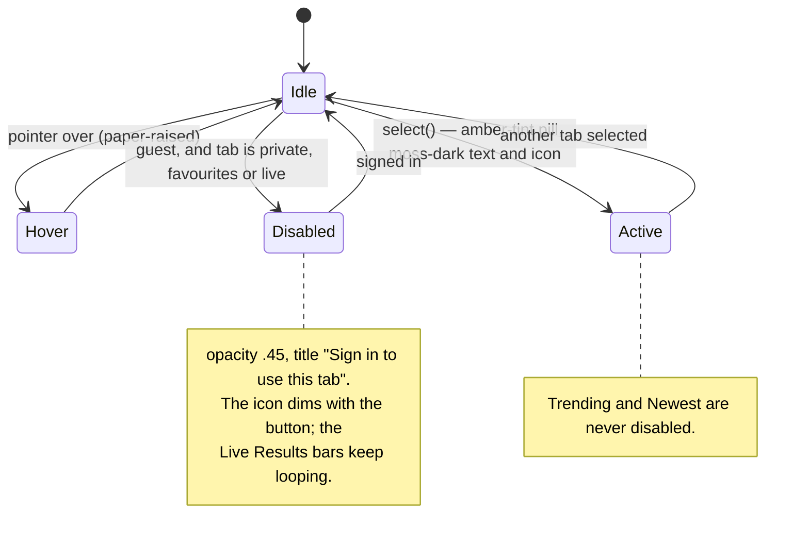
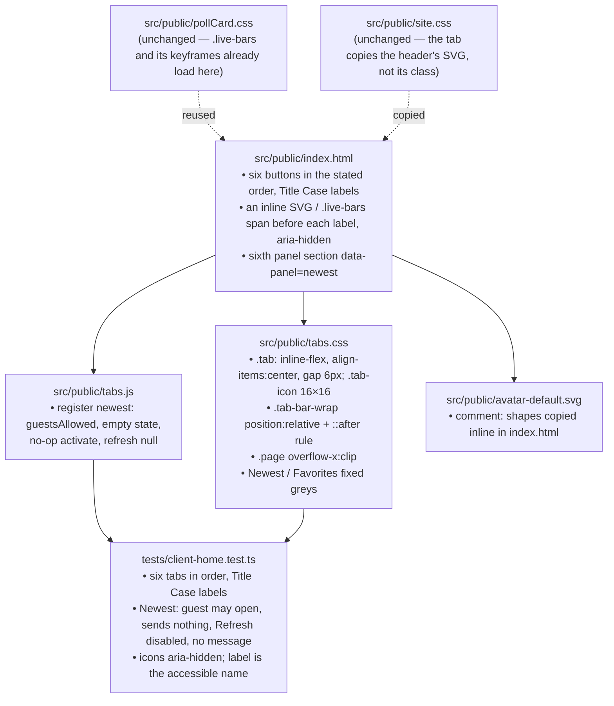

# 018 — Tab Bar — Architecture

| | |
|---|---|
| **Requirements document** | `designDocs/018-high-level-requirements-TAB-BAR.md` — 63 lines (carries the twelve resolutions of the previous run), plus two mockups (`designDocs/dontTrack/tab_bar.jpg`, `designDocs/dontTrack/trendingupicon.jpg`) |
| **Architecture directory** | `architecture/018-tab-bar` — reused: `.specify/architecture.json` records this same requirements file |
| **Main document** | `architecture/018-tab-bar/architecture.md` |
| **Mode** | REGENERATE — verification pass over the resolved document |
| **Generated** | 2026-09-20 |
| **Previous run** | REGENERATE against the 45-line document, then 12 resolutions applied in session (INC-1, AMB-1–4, UNS-1–7) |
| **Sequencing** | After 017 and its fixes FIX001–FIX029; touches the home page only |

---

## 1. Overview and scope

018 is a presentation change to the home page's tab bar. Every existing tab keeps its behaviour;
what changes is what the bar looks like — an icon before each label, a grey rule under the row
that runs the full width of the window, Title Case labels in the mockup's order, and one new tab,
**Newest**, that for now shows an empty grid and is wired up by a later feature.

| ID | Change | Layer | Server change |
|---|---|---|---|
| C1 | Six inline SVG icons, one per tab, 16×16, 6px before the label; three reuse glyphs the app already has, three are drawn now | `index.html` markup, `tabs.css` | none |
| C2 | A 1px `--line` rule 6px under the row, spanning the viewport, drawn by a pseudo-element on the row's non-scrolling wrapper | `tabs.css` | none |
| C3 | Six tabs in the order Trending · Newest · My Private Polls · Favorites · Live Results · Search, labels in Title Case | `index.html` | none |
| C4 | New **Newest** tab: open to guests, no request, Refresh disabled on it, empty grid and no message | `index.html`, `tabs.js` (a controller that does nothing) | none |

Nothing else moves: the active pill (`--amber-tint` background, `--moss-dark` text) is kept as
is; the Refresh control stays at the right of the row, above the rule; guests still see the three
personal tabs disabled; `?q=` deep links still open Search; no API, contract, configuration,
build or database change. The work is almost entirely in one HTML file and one stylesheet.

### 1.1 The bar after 018



The glyphs above stand in for the SVGs; the real ones are specified in §2. The rule belongs to
the wrap, not to the scrolling bar — see §3 and AMB-1.

---

## 2. The six icons — three reused, three new

Every icon is inline SVG in `index.html`, inside its button before the label, `aria-hidden="true"`
and `focusable="false"`; the button's accessible name stays the label text. Three glyphs already
exist in the codebase and are reused; three are drawn now.



| Tab | Glyph | Colour (requirements §Icon colours) | Size note |
|---|---|---|---|
| Trending | New path traced from `trendingupicon.jpg`: a curve rising left→right ending in a filled arrowhead | `currentColor` — `--muted` at rest, `--moss-dark` in the pill | 16×16 |
| Newest | New: circle + italic `!` as a path (never `<text>`, so nothing is announced) | Circle light grey, `!` black | 16×16 |
| My Private Polls | Inline copy of `avatar-default.svg`'s three shapes; a comment in that file notes the copy | Its own two colours, as in the header | 16×16 |
| Favorites | The `.bookmark-star` path from `pollCard.js`, without tag and halo | Grey stroke, no fill | 16×16, 24-unit viewBox as on the card |
| Live Results | `<span class="live-bars"><i></i><i></i><i></i></span>` — the card's markup verbatim | Palette 1–3 as on the card | 14px tall, bottom-aligned in the 16px box |
| Search | The header's `.search-icon` SVG | `currentColor` | 16×16 — identical to the header |

`pollCard.css` is loaded on the home page, so `.live-bars`, its keyframes and its
`prefers-reduced-motion` rule already apply to the tab's copy; the requirement that the loop runs
at all times — on every tab, and dimmed while the button is disabled for a guest — is the card's
existing behaviour and needs no new CSS.

---

## 3. The full-bleed line inside a capped container

The tab row lives at `.page > .container > .layout > .tab-bar-wrap > nav.tab-bar`. `.container`
caps width at 1280px with 20px side padding, and `.tab-bar` scrolls horizontally with
`overflow-x:auto`. The requirements settle the mechanism — a pseudo-element `100vw` wide, no
markup restructure, a scrollbar guard — but the element that carries it matters:



The wrap is the only correct host (AMB-1 asks the requirements to name it). Two guards complete
it: `overflow-x:clip` on `.page` so that `100vw` — which includes the vertical scrollbar's width
on Windows browsers — cannot add a horizontal scrollbar, and `bottom:-6px` rather than a margin so
the row's own height is unchanged.

---

## 4. Newest — a real tab that does nothing yet

`tabs.js` ignores a click on a tab it has no controller for (`select()` returns when
`controllers[name]` is missing), and would never mark the button active or show the panel. So
Newest needs the minimum a tab has today — a registration — even though it asks the server for
nothing.

```mermaid
sequenceDiagram
  actor U as User (guest or member)
  participant B as tab button
  participant T as tabs.js select()
  participant C as controllers.newest
  participant P as panel[data-panel=newest]
  U->>B: click Newest
  B->>T: select("newest")
  T->>T: guestsAllowed → no sign-in redirect
  T->>B: is-active (pill)
  T->>P: show; other panels hidden
  T->>T: updateRefreshButton() → disabled (controller.refresh is null)
  T->>C: activate()
  C-->>P: nothing rendered — empty grid, no message
  Note over C,P: No fetch. Not a dynamic request.<br/>No floor, budget or token involved.
```

The controller is `{ guestsAllowed: true, state: <empty tab state>, activate() {}, refresh: null }`
— the shape `liveResults.js` registers, minus the work. `refresh: null` is what already disables
the Refresh control on a tab (`updateRefreshButton`), so the requirement costs no new code there.
`PERSONAL_TABS` is unchanged, so `applyGuestState()` never disables Newest.

### 4.1 Tab button states, including the new tab



---

## 5. What changes where



No change to: any route, `openapi.json`, `config.ts`, the `ENV_*` table, the database, the
TRENDING objects, the delta/version protocol, the budget controller, the build's asset
fingerprinting, or any poll card behaviour.

---

## 6. Findings

Each open item carries an empty checkbox; the recommended resolution is indented beneath it.
Items resolved in the previous run are listed in §6.6 for the record.

### 6.1 Inconsistencies

None found in the amended document.

### 6.2 Ambiguities

- [X] **AMB-1 — "Drawn by the tab bar row itself".** *(Resolved 2026-09-20 — the requirements now name the row's non-scrolling wrapper as the host, and exclude the scrolling tab strip.)* The line (Design, third bullet) is "drawn by
  the tab bar row itself (a pseudo-element spanning the viewport width)". On the page there are
  two candidates for "the row": `nav.tab-bar`, which holds the six buttons and scrolls
  horizontally with `overflow-x:auto`, and its wrapper `.tab-bar-wrap`, which also holds the
  Refresh control and does not scroll. A pseudo-element on the scrolling element is clipped to
  its box, so the line would stop at the container's edge and scroll with the tabs — the
  opposite of the same bullet's "extends the full width" and the next bullet's "stays in place
  beneath it whatever the scroll position" (§3).
  - *Resolution*: name the host: "drawn by the row's wrapper (the element that holds the tabs and
    the Refresh control and does not scroll)". One parenthesis in the third bullet.

### 6.3 Unspecified aspects

None remaining. Every dimension, colour rule, placement, behaviour and accessibility rule the
diagrams depend on is now stated in the document.

### 6.4 Needs clarification

None.

### 6.5 Breaking changes

None to any interface. Two visible changes, both stated in the requirements and consequences of
the mockup rather than defects:

- **BC-1 — Tab positions move**: Search and Live Results swap, and a new tab appears second.
  Users' muscle memory, not code, is what breaks; tests select tabs by `data-tab`.
- **BC-2 — Label text changes**: `TRENDING` → `Trending`, `My PRIVATE POLLS` → `My Private
  Polls`. External documentation or screenshots quoting the old labels go stale.

### 6.6 Resolved in the previous run

All twelve are now written into the requirements; re-read cold, each is stated once, in the
section an implementer would look for it, and none contradicts another.

| Item | Was | Now in the requirements |
|---|---|---|
| INC-1 | Newest: circle in prose, bubble in mockup | Plain circle, no tail; the mockup's bubble is superseded |
| AMB-1 | Tab order | Trending · Newest · My Private Polls · Favorites · Live Results · Search; the Search / Live Results swap named |
| AMB-2 | Label casing | Title Case for all six; the two that change named |
| AMB-3 | "Default avatar shown in the header" | Always `avatar-default.svg`'s shapes, never the user's own avatar |
| AMB-4 | Icon colours | Trending and Search `currentColor`; avatar its own; the other three as their sections state |
| UNS-1 | Icon size and spacing | 16×16, 6px gap, vertically centred; bars 14px bottom-aligned |
| UNS-2 | The line | 1px `--line`, 6px below, pill and Refresh above, pseudo-element at `100vw`, scrollbar guard |
| UNS-3 | Newest behaviour | Open to guests, no request, Refresh disabled, empty grid, no message |
| UNS-4 | Live bars animation | Always, including disabled and on other tabs; reduced motion stops it |
| UNS-5 | Narrow screens | Single row, horizontal scroll, no wrapping, no new breakpoint |
| UNS-6 | Accessibility | Decorative icons, `aria-hidden` + `focusable="false"`, label is the name |
| UNS-7 | Where the SVGs live | Inline in `index.html`; avatar copied with a note in the file |

---

## 7. Assumptions

Reasonable defaults adopted where the requirements are silent. Each is a *default*, not a
decision — drop any that a resolution above contradicts.

1. The `data-tab` / `data-panel` identifiers stay as they are (`trending`, `private`,
   `favourites`, `search`, `live`); the new one is `newest`. Only visible text and order change.
2. `KIND_OF` in `tabs.js` gains no request kind for `newest`, because the tab never requests;
   `PERSONAL_TABS` is unchanged.
3. "Black" for the Newest `!` is rendered as `var(--ink)` (#1E2422), the page's black for all
   text, not `#000`; "light grey" for its circle is `var(--line)` (#D8DCD3), the lightest grey in
   the palette. Either is one value if pure black or another grey is preferred.
4. "Grey with no fill" for the Favorites star is the Bookmark control's resting grey (`#9AA197`)
   — the same grey the unpressed card icon uses, so the two stars match on screen.
5. The Live Results icon reuses `.live-bars` from `pollCard.css` as-is; if the card's icon changes
   later, the tab's changes with it — the intent of "the exact same icon". The requirements'
   phrase "View Live Results button" refers to the card's `Live Results` link.
6. The rule is `bottom:-6px` on the wrap's `::after`, so the row's own height and the wrap's
   existing 20px bottom margin are unchanged; the 6px is measured from the bottom of the row's
   box (which includes `.tab-bar`'s 4px bottom padding).
7. `overflow-x:clip` goes on `.page` (already `position:relative; width:100%`), not on `html`, so
   nothing else on the page is affected.
8. No `ENV_*` variable is added or changed; nothing in `postman/openapi.json` changes.
9. The 017 UI contract (`contracts/ui-contracts.md`) is updated by the 018 plan to list six tabs;
   this document does not edit 017's artifacts.

---

## 8. Completion Report

| Item | Value |
|---|---|
| **Mode** | REGENERATE — verification pass over the resolved document |
| **Architecture directory** | `architecture/018-tab-bar` (reused — see header) |
| **Main document** | `architecture/018-tab-bar/architecture.md` |
| **Source requirements** | 63 lines + 2 mockup images |
| **Software architecture diagrams** | 6 |
| **Inconsistencies** | 0 (1 resolved in the previous run) |
| **Ambiguities** | 1 — found this pass, resolved; 4 resolved in the previous run |
| **Unspecified aspects** | 0 (7 resolved in the previous run) |
| **Needs Clarification items** | 0 |
| **Breaking changes** | 2 (visible, not interface) |

**Against the previous run**: the twelve resolutions read consistently as a whole. Re-reading the
document cold surfaced one new ambiguity, introduced by a resolution itself: UNS-2's wording
"drawn by the tab bar row itself" can be read as the scrolling `nav.tab-bar`, on which the
mechanism does not work. It is a one-parenthesis fix.

**Readiness for `/speckit-specify`**: **ready.** All thirteen findings across both runs are closed
— one inconsistency, five ambiguities, seven unspecified aspects, no clarifications. Two breaking
changes remain documented; they are consequences of the mockup, not defects.

The item to carry into `/speckit-plan`: `tabs.js` silently ignores clicks on a tab with no
controller (§4), so the Newest registration is not optional polish — without it the new button
does nothing and the pill never moves.
