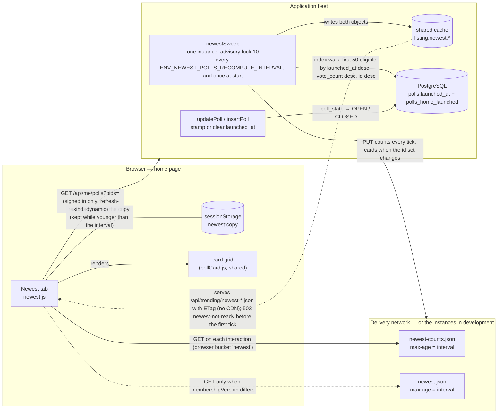
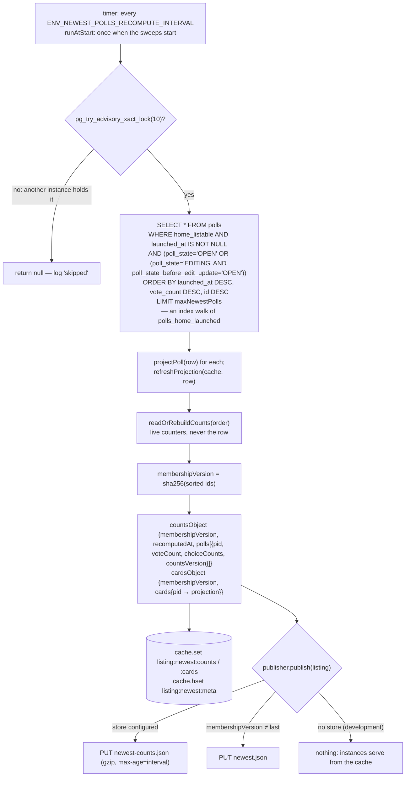
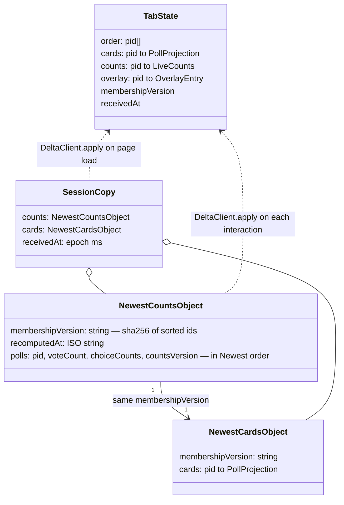
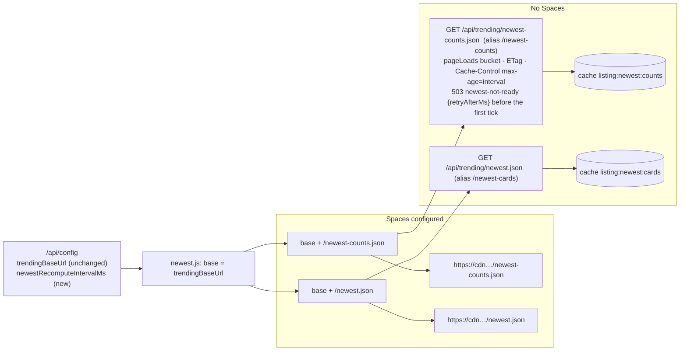
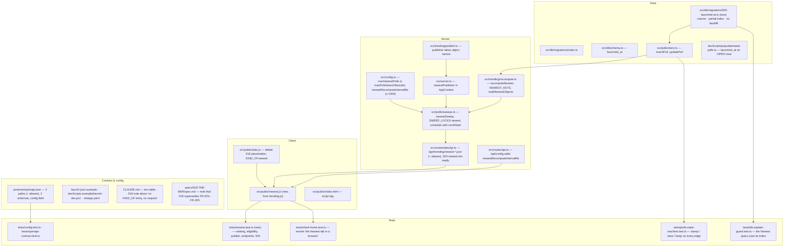

# 019 — Newest Poll Tab — Architecture

| | |
|---|---|
| **Requirements document** | `designDocs/019-high-level-requirements-NEWEST-POLL-TAB.md` — 65 lines (carries the thirteen resolutions of the previous run) |
| **Architecture directory** | `architecture/019-newest-poll-tab` — reused: `.specify/architecture.json` records this same requirements file |
| **Main document** | `architecture/019-newest-poll-tab/architecture.md` |
| **Mode** | REGENERATE — verification pass over the resolved document |
| **Generated** | 2026-09-21 |
| **Previous run** | REGENERATE against the 56-line document, then 13 resolutions applied in session (INC-1, AMB-1–4, UNS-1–8) |
| **Sequencing** | After 018 (the tab exists, empty, with a placeholder controller) and 017 (the TRENDING publication this feature instantiates a second time) |

---

## 1. Overview and scope

019 fills the **Newest** tab that 018 left empty. The tab lists the public polls that entered the
OPEN state most recently — "launched" being a new, dedicated `launched_at` timestamp on the poll
row — and is built as a second instance of the TRENDING publication from 017: one instance
recomputes the list every interval under an advisory lock, publishes a small *counts* object every
time and a full *cards* object only when the set of polls changes, and the browser fetches those
objects from the CDN (or from the instances in development) with no server-side floor, budget
token or dynamic request of the tab's own.

| ID | Change | Layer | Notes |
|---|---|---|---|
| C1 | `polls.launched_at timestamptz` — stamped on every entry into OPEN except a return from EDITING, cleared on entry into CLOSED, untouched otherwise; set at insert for a poll inserted OPEN; **no backfill** | migration 005, `schema.ts`, `store.ts`, populate seed | Follows the `closed_at` precedent (§3) |
| C2 | Partial index `polls_home_launched (launched_at desc, vote_count desc, id desc) where home_listable and launched_at is not null` | migration 005, `db-explain-guard.test.ts` | The recompute is an index walk of the first `cap` eligible entries |
| C3 | `ENV_MAX_NEWEST_POLLS` (50, 1 ≤ n ≤ `ENV_MAX_POLLS_SEARCH_RESULTS`), `ENV_NEWEST_POLLS_RECOMPUTE_INTERVAL` (60000, ≥ 1000) | `config.ts`, both launch templates, `.do/app.yaml`, `CLAUDE.md`, `config.test.ts` | `/api/config` publishes `newestRecomputeIntervalMs` |
| C4 | NEWEST recompute: eligible polls by `launched_at` desc, `vote_count` desc, `id` desc, top 50; `runAtStart` | `src/trending/recompute.ts` (sibling function), `sweeps.ts` | Own lock id and interval; reuses the `listable` predicate, `membershipVersionOf`, `etagOf`, `readOrRebuildCounts` |
| C5 | Objects `newest-counts.json` / `newest.json` at the Trending base; instance routes `/api/trending/newest-counts.json`, `/api/trending/newest.json` (+ `/newest-counts`, `/newest-cards`); `503 newest-not-ready` | `publish.ts`, `tabsApi.ts`, `openapi.json` | Second publisher instance with its own object names and last-membership memory |
| C6 | `newest.js` — the tab controller cloned from `trending.js`: session-storage copy, browser bucket `newest`, overlay call, empty state "No polls have been launched yet." | `src/public/newest.js`, `index.html`, `tabs.js` | Replaces 018's do-nothing placeholder; Refresh enabled on Newest (BC-1) |

Out of scope, by the document's own framing: no change to Trending's ranking, objects or paths;
no change to the card (the Newest grid renders the same `pollCard.js` cards with Vote, Live and
Bookmark); no new tab-bar markup or icon (018 delivered the button and the panel); no display of
`launched_at` anywhere.

### 1.1 The tab after 019



The picture is Trending's picture with three substitutions: the ranking key (`launched_at`, not the
trailing-hour vote buckets), the object names, and the cap (50, not 200). Everything else — the
lock, the two-object split, the session-storage copy, the browser bucket, the overlay call — is
the same mechanism instantiated a second time.

---

## 2. Requirement-by-requirement mapping

| Requirement (019) | Where it lands | 017 precedent |
|---|---|---|
| `launched_at`: stamp on entry into OPEN unless from EDITING-with-prior-OPEN; NULL on entry into CLOSED; untouched otherwise | `updatePoll` in `store.ts`, beside the `closed_at` stamp (§3) | `closed_at` |
| Set at insert for a poll inserted OPEN: `start_at ?? created_at` | `insertPoll` column mapping | `closed_at: endAt ?? createdAt` |
| No backfill; seed sets it itself | Migration adds column + index only; `devScripts/populate/seed-polls.ts` writes `launched_at` for its OPEN rows | — |
| Partial index; explain guard | Migration 005; `tests/db-explain-guard.test.ts` gets `newestQuery` | `polls_home_newest`, `seqScansOfPolls` |
| `ENV_MAX_NEWEST_POLLS` = 50, bounded by `ENV_MAX_POLLS_SEARCH_RESULTS` | `config.maxNewestPolls` with a cross-check like `ENV_MAX_CHOICES ≥ ENV_MIN_CHOICES` | `maxTrendingPolls` |
| `ENV_NEWEST_POLLS_RECOMPUTE_INTERVAL` = 60000, ≥ 1000 | `config.newestRecomputeIntervalMs`; sweep interval; CDN `max-age`; copy lifetime; `/api/config.newestRecomputeIntervalMs` | `trendingRecomputeIntervalMs` |
| Surfaced in `.do/app.yaml`, `CLAUDE.md`, `config.test.ts`, `openapi.json` | The four files | 017's variables |
| Eligible: `home_listable`, OPEN or EDITING-with-prior-OPEN | The `listable` predicate `recomputeTrending` builds, plus `launched_at is not null` | FR-015 |
| Rank: `launched_at` desc, `vote_count` desc, `id` desc | One query, `orderBy` matching the index, `limit cap` | FR-015 |
| One instance, advisory lock, `runAtStart`, identical for every visitor | `buildSweepSchedules` entry `newestSweep`, `SWEEP_LOCKS.newest = 10` | FR-058 |
| Success criterion: in the objects within one interval; shown by the next fresh fetch | Asserted by a sweep-tick test; the CDN and copy lifetimes are each one interval | SC-007 |
| Objects `newest-counts.json` / `newest.json`, counts every recompute, cards on membership change | Second `Publisher` from a generalised `createTrendingPublisher(store, intervalMs, names)` | FR-016 |
| Browser: counts each interaction, cards on membership change, copy younger than the interval rendered first | `newest.js` = `trending.js` with `TAB`, `COPY_KEY`, object names, interval key and empty-state text changed | FR-017 |
| No server floor or budget; browser bucket of Newest's own with the manual floor and burst; Refresh enabled | `KIND_OF.newest = "newest"`, `bucketOf` treats it as a refresh-floor bucket like `trending` | FR-018 |
| Instance-served at `/api/trending/newest-*.json` with ETag; `503 newest-not-ready` | `serveTrendingObject`-style handler on the page-load bucket only | FR-018 |
| Overlay: one `/api/me/polls` call after each applied counts object and on sign-in/out; guests none; cross-tab vote/bookmark updates | `Tabs.createOverlayFetcher` (returns at once for a guest); `applyVote` / `updateOverlayEverywhere` iterate every registered controller | FR-019 |
| Empty state "No polls have been launched yet." | `Tabs.emptyState("newest", …)` | Trending's `.tab-empty` |

Every sentence of the requirements maps to a row above; nothing in the document is left without a
home.

---

## 3. `launched_at` — the poll state machine annotated

The requirements now name every edge that matters. The diagram is the rule as written: **stamp on
every entry into OPEN except a return from EDITING whose prior state was OPEN; clear on every entry
into CLOSED; leave the value alone on every other edge.**

```mermaid
stateDiagram-v2
  direction LR
  [*] --> INITIALIZED
  INITIALIZED --> AWAITING_APPROVAL : publish
  AWAITING_APPROVAL --> WAITING_TO_OPEN : screened, start_at in future
  AWAITING_APPROVAL --> OPEN : screened ✎ stamp
  AWAITING_APPROVAL --> REJECTED
  WAITING_TO_OPEN --> OPEN : schedule sweep / admin ✎ stamp
  OPEN --> CLOSED : end_at reached / admin ✎ clear
  WAITING_TO_OPEN --> CLOSED : admin (already NULL)
  CLOSED --> OPEN : admin re-open ✎ stamp again
  CLOSED --> ARCHIVED : admin
  OPEN --> EDITING : admin edits — keep; still eligible
  EDITING --> OPEN : publish / stale-edit release, prior OPEN — keep
  EDITING --> OPEN : publish, prior WAITING_TO_OPEN and start now past ✎ stamp
  EDITING --> WAITING_TO_OPEN : publish with future start — keep; ineligible until it opens
  note right of OPEN
    launched_at = now() on entry,
    except from EDITING with
    poll_state_before_edit_update = 'OPEN'
  end note
  note right of CLOSED
    launched_at = NULL on entry
    (beside closed_at = now())
  end note
```



Where the rule executes: `updatePoll` (`src/polls/store.ts`) already reads the row `for update` as
`before`, then sets `closed_at` when `$set.pollState === "CLOSED" && before.poll_state !== "CLOSED"`.
The launch stamp is the symmetrical pair beside it:

```
if ($set.pollState === "OPEN" && before.poll_state !== "OPEN"
    && !(before.poll_state === "EDITING" && before.poll_state_before_edit_update === "OPEN"))
  columns.launched_at = new Date();
if ($set.pollState === "CLOSED" && before.poll_state !== "CLOSED") columns.launched_at = null;
```

Every transition in the diagram goes through `updatePoll` — the approval sweep, the schedule
sweep, the stale-edit sweep, the admin PATCH and the editing publish all call it — so there is one
place to get this right, and `tests/polls-state-machine.test.ts` is where each edge is asserted.
`insertPoll` needs the parallel of its `closed_at` line for a poll created already OPEN (test
fixtures through `polls(ctx).insertOne`): `launched_at = poll.startAt ?? poll.createdAt`.

**The stale value and the index.** A poll that an edit sends from OPEN to WAITING TO OPEN keeps its
old `launched_at`. It therefore has an entry in `polls_home_launched` (`home_listable` is true for
WAITING TO OPEN) but fails the state predicate; the index walk skips it and continues, and `LIMIT`
applies after the filter, so the tab still gets 50 eligible polls. A CLOSED poll has no such
window: the clear and the state change are one `UPDATE`.

**No backfill — what it means in practice.** After 019 deploys, `launched_at` is NULL on every
existing row; the tab shows "No polls have been launched yet." until the first poll enters OPEN
through `updatePoll`. On the SC-012 seed set the populate script must write `launched_at` for its
OPEN rows (it inserts through Kysely directly, not through `insertPoll`) or the tab stays empty
there too. Both consequences are stated in the requirements; the plan should carry the seed change
as a task.

---

## 4. The recompute tick



Two things differ from `recomputeTrending` and are worth stating so the implementer does not copy
too much:

- **One query, not a merge.** Trending unions "polls with recent bucket votes" with "top by
  lifetime votes" and sorts in memory because its key lives in the cache. The Newest key is a
  column with an index in the query's exact order, so the database does the whole ranking and
  returns exactly `cap` rows; `tests/db-explain-guard.test.ts` asserts the plan has no sequential
  scan of `polls`.
- **Membership changes are the common case, reorders the rare one.** In Trending the set is stable
  and the order churns; here a launch pushes one poll in and one out, so the cards object is
  republished on most ticks in which anything changed at all. The two-object split still pays: on
  the many ticks where nothing launched, only the counts object moves.

`readOrRebuildCounts` keeps 017's invariant (R7/R8): counts come from the live `cnt:<pid>` hashes
and their `seq`, never from the flushed row, so a card in Newest shows the same numbers the same
poll shows in any other tab. The `vote_count` tie-break, by contrast, reads the row — at most
`ENV_COUNTER_FLUSH_INTERVAL` stale — and each flush of a dirty open public poll moves its entry
in `polls_home_launched`; that is the same maintenance cost the existing `polls_vote_count` index
already pays, on a far smaller index.

---

## 5. The objects, the copy and a Newest interaction



The shapes are byte-for-byte the Trending shapes (`TrendingCountsObject`, `TrendingCardsObject`);
`DeltaClient.apply` consumes them unchanged, and `openapi.json` can describe them by referencing
the existing schemas. Only the storage key (`newest:copy`) and the object names differ.

```mermaid
sequenceDiagram
  autonumber
  actor V as Visitor
  participant N as newest.js
  participant T as tabs.js (buckets)
  participant SS as sessionStorage
  participant E as CDN / instance (/api/trending/newest-*.json)
  participant A as App (dynamic)

  V->>N: page load, Newest active (or first click)
  N->>SS: loadCopy()
  alt copy exists and is younger than newestRecomputeIntervalMs
    N->>N: applyObjects(copy) — render at once
    N->>A: GET /api/me/polls?pids=… (signed in only; refresh-kind token)
  end
  N->>T: canRequest("newest")? — bucket of Newest's own, manual floor and burst
  alt token available
    N->>T: spend("newest")
    N->>E: GET newest-counts.json (cache: no-cache → ETag revalidation)
    E-->>N: 200 counts | 304 | 503 newest-not-ready
    alt counts.membershipVersion ≠ state.membershipVersion or no cards held
      N->>E: GET newest.json
      E-->>N: 200 cards
    end
    N->>N: applyObjects(counts, cards?) → grid.render, emptyState, saveCopy
    N->>A: GET /api/me/polls?pids=… (signed in only)
  else no token
    N->>V: "Please wait n s" notice (Refresh) / silent (tab click)
  end
  V->>N: later click on Newest
  N->>N: grid.render(state); refetch only if the copy is older than manualFloorMs
```

Steps 4 and 12 are the only requests that reach an application instance, and only for a signed-in
visitor — the same two the Trending tab makes. A guest's Newest costs the fleet nothing but a CDN
hit (or, in development, one cache read behind the page-load bucket). On sign-in or sign-out
`tabs.js` calls every controller's `reset()`, which clears the overlay and fetches it again (a
no-op for a guest, since `createOverlayFetcher` returns at once when no session is held).

---

## 6. Instance-served objects and the shared base URL



`/api/trending/` is, by the requirements' own statement, the one base for every published listing
object; `trendingBaseUrl` keeps its name and its OpenAPI description gains the words "and the
Newest objects". The CDN layout is the same bucket root either way.

---

## 7. What changes where



Roughly: one new migration, one new client module, one new test file; everything else is a
handful of lines in files that already hold the Trending equivalent.

---

## 8. Findings

Each open item carries an empty checkbox; the recommended resolution is indented beneath it.
Items resolved in the previous run are listed in §8.6 for the record.

### 8.1 Inconsistencies

None found in the amended document. The thirteen resolutions read consistently as a whole: the
stamp/clear rule, the no-backfill decision, the empty state and the success criterion agree with
one another and with the eligibility rule.

### 8.2 Ambiguities

- [X] **AMB-1 — "republished every minute".** *(Resolved 2026-09-21 — option 1: now "republished every recompute".)* The counts object is "republished every minute"
  (How it's published and served, first bullet), while the same bullet says each object is "cached
  for the recompute interval", the recompute runs "every ENV_NEWEST_POLLS_RECOMPUTE_INTERVAL", and
  the interval is configurable (≥ 1000 ms). If an operator sets the interval to 30 s or 5 min,
  "every minute" is false; 017 FR-016 words the same rule as "republished every recompute".
  - *Resolution*: change "republished every minute" to "republished every recompute". One word.
- [X] **AMB-2 — The value stamped at insert.** *(Resolved 2026-09-21 — option 1: `launched_at = start_at ?? created_at` at insert, mirroring `closed_at = end_at ?? created_at`.)* "A poll inserted directly in the OPEN state … gets
  `launched_at` at insert time, exactly as `closed_at` is set for a poll inserted CLOSED." The
  `closed_at` precedent does not use the insert time: `insertPoll` writes `endAt ?? createdAt`. So
  "at insert time" can mean *the moment of insertion* or *the poll's own timestamps, at the time
  of insertion*. The two differ for every fixture that constructs a poll with a past `createdAt`
  or `startAt` — which is how ranking tests will build their data.
  - *Resolution*: "gets `launched_at = start_at ?? created_at` at insert, mirroring
    `closed_at = end_at ?? created_at`". This makes fixtures' launch order follow the timestamps
    they declare, and keeps the two columns symmetrical.

### 8.3 Unspecified aspects

None remaining. The retry hint on `503 newest-not-ready`, the lock id, the shape of the objects and
the overlay fetcher's guest behaviour are all fixed by the Trending precedent the document names
(§9).

### 8.4 Needs clarification

None.

### 8.5 Breaking changes

- **BC-1 — 018's Newest contract is superseded.** 018 FR-023–FR-025 and `tests/client-home.test.ts`
  ("the Newest tab in a browser") assert that clicking Newest sends nothing, the Refresh control
  is disabled while Newest is open, and the panel shows no message. All three flip, and the
  requirements now say so explicitly. The tests are rewritten, not extended; the 018 spec gains a
  note that 019 replaces those three requirements; the CLAUDE.md sentence "no module, no `KIND_OF`
  entry, no request" for Newest becomes false and is updated. The 018 placeholder
  `controllers.newest = { … activate() {}, refresh: null }` in `tabs.js` `init()` **must be
  deleted**, not left beside the new registration — `init()` runs after the deferred scripts have
  registered, so the placeholder would silently overwrite `newest.js`'s controller and the tab
  would keep doing nothing.

Not breaking: the migration is additive (a nullable column, a partial index, no data rewrite); no
route, object, table or identifier existing before 019 changes; Trending's objects and paths are
untouched; the poll domain object and card projection gain no field.

### 8.6 Resolved in the previous run

| ID | Finding | Resolution recorded in the requirements |
|---|---|---|
| INC-1 | "first opened" vs NULL-on-close and re-opening | Stamp on every entry into OPEN except from EDITING-with-prior-OPEN; clear on entry into CLOSED; re-opened polls are newly launched |
| AMB-1 | `/api/trending/…` path, unnamed objects | `newest-counts.json` / `newest.json` at the Trending base; routes and aliases named; one `trendingBaseUrl` |
| AMB-2 | "under a minute old" | Younger than `ENV_NEWEST_POLLS_RECOMPUTE_INTERVAL`, published as `newestRecomputeIntervalMs` |
| AMB-3 | "no floor" vs Trending's browser floor; which interactions | No server-side floor; browser bucket of Newest's own; interactions listed; Refresh enabled |
| AMB-4 | SC-007 "within a minute" | Restated: in the objects within one interval; shown by the next fresh fetch; CDN and copy add one interval each |
| UNS-1 | Backfill | **No backfill** (developer's choice); tab empty after deploy until polls launch; seed sets the value itself |
| UNS-2 | Index | `polls_home_launched (launched_at desc, vote_count desc, id desc) where home_listable and launched_at is not null`; explain guard |
| UNS-3 | Edges not named | EDITING round trip, WAITING TO OPEN case and insert-time stamp stated |
| UNS-4 | Tie-break | `id` descending as the third key |
| UNS-5 | Empty state | "No polls have been launched yet." in `.tab-empty`; 018's no-message rule superseded |
| UNS-6 | Before the first recompute | `runAtStart`; `503 newest-not-ready` with `retryAfterMs`; previous CDN objects keep serving |
| UNS-7 | Where the settings are surfaced | `/api/config`, `.do/app.yaml`, `CLAUDE.md`, `config.test.ts`, `openapi.json`; validation bounds |
| UNS-8 | Signed-in overlay | One `/api/me/polls` call after each applied counts object and on sign-in/out; guests none |

---

## 9. Assumptions

| # | Assumption | Basis |
|---|---|---|
| A1 | `launched_at` is a column only — not on the `Poll` domain object, not in `projectPoll`, not shown on the card. | Mirrors `closed_at`; the requirements ask for a ranking key, not a display. |
| A2 | `vote_count` for the tie-break is the flushed row value (at most `ENV_COUNTER_FLUSH_INTERVAL` stale); the counts *shown* come from the live cache. | 017 R7/R8; Trending does the same for its secondary key. |
| A3 | The Newest sweep is a separate schedule with its own lock id (`SWEEP_LOCKS.newest = 10`) and interval, not a second step inside `trendingSweep`. | The two intervals are independently configurable; sharing a tick would bind them. |
| A4 | `503 newest-not-ready` carries `retryAfterMs: 5000`, as `trending-not-ready` does. | Same handler pattern. |
| A5 | The publisher is generalised (`createTrendingPublisher(store, intervalMs, { counts, cards })`) rather than duplicated, and `recomputeNewest` lives beside `recomputeTrending`, sharing `listable`, `membershipVersionOf` and `etagOf`. | Two copies of the publish-only-on-membership-change closure would drift. |
| A6 | `newest.js` is a clone of `trending.js` with the tab name, storage key, object names, interval key and empty-state text changed — not a parameterised shared module. | The 017 tab modules are one file per tab; a shared factory is a refactor 019 does not ask for. |
| A7 | The two object schemas in `openapi.json` reference the Trending schemas (same shape) rather than duplicating them. | Byte-identical shapes. |
| A8 | Both objects are gzipped and carry `Cache-Control: public, max-age=<interval in seconds>` on the CDN and from the instances; the instance routes sit behind the page-load bucket only. | Identical to Trending's `serveTrendingObject`. |
| A9 | Cross-tab propagation works for Newest with no new code, because `tabs.js` iterates every registered controller with a `state` and `grid`. | `applyVote`, `updateOverlayEverywhere`, `heldCopy` in `tabs.js`. |
| A10 | Guests may open Newest (`guestsAllowed: true`); the tab is never dimmed and is never the sign-out fallback (Trending stays the fallback). | 018 FR-023; `applyGuestState` selects `trending`. |
| A11 | The `ENV_MAX_NEWEST_POLLS ≤ ENV_MAX_POLLS_SEARCH_RESULTS` check is a `ConfigError` at load, in the style of `ENV_MAX_CHOICES ≥ ENV_MIN_CHOICES`. | `config.ts` precedent. |
| A12 | The spec directory the requirements ask for is `specs/019-NEWEST-POLL-TAB/`, and no branch is created by this run. | First line of the requirements; skill rule. |

---

## 10. Completion Report

| Item | Value |
|---|---|
| **Mode** | REGENERATE — verification pass over the resolved document |
| **Architecture directory** | `architecture/019-newest-poll-tab` (reused — see header) |
| **Main document** | `architecture/019-newest-poll-tab/architecture.md` |
| **Source requirements** | `designDocs/019-high-level-requirements-NEWEST-POLL-TAB.md`, 65 lines |
| **Software architecture diagrams** | 7 (overview flow, annotated state machine, recompute tick, object model, interaction sequence, base-URL routing, file change map) |
| **Inconsistencies** | 0 (1 resolved in the previous run) |
| **Ambiguities** | 2 found this pass, both resolved (AMB-1, AMB-2); 4 resolved in the previous run |
| **Unspecified aspects** | 0 (8 resolved in the previous run) |
| **Needs Clarification items** | 0 |
| **Breaking changes** | 1 (BC-1 — 018's "Newest does nothing" contract and tests) |

**Against the previous run**: the thirteen resolutions hold together. Re-reading the document cold
surfaced two small ambiguities, both one-phrase fixes: "republished every minute" survived from
the original text next to a now-configurable interval, and "at insert time" — introduced by the
INC-1 resolution — can be read as the clock or as the poll's own timestamps, where the `closed_at`
precedent it cites uses the latter.

**Readiness for `/speckit-specify`**: **ready.** All fifteen findings across both runs are closed
— one inconsistency, six ambiguities, eight unspecified aspects, no clarifications. BC-1 remains
documented as a consequence of 019's purpose, not a defect.

The items to carry into `/speckit-plan`: the 018 placeholder controller in `tabs.js` `init()`
overwrites any controller registered by a deferred script, so deleting it is a required task, not
cleanup (BC-1); and the populate seed must write `launched_at` itself, since the no-backfill
decision leaves the seeded tab empty otherwise.
