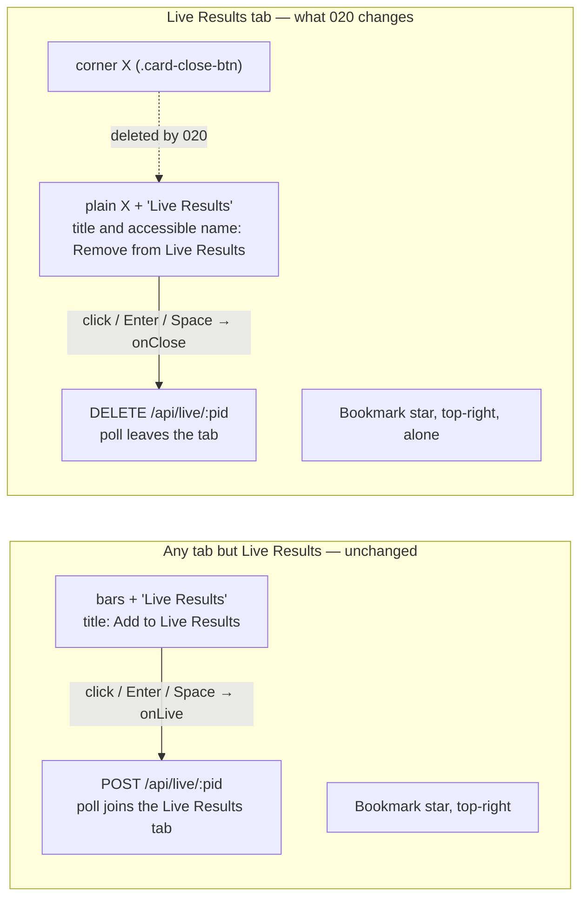
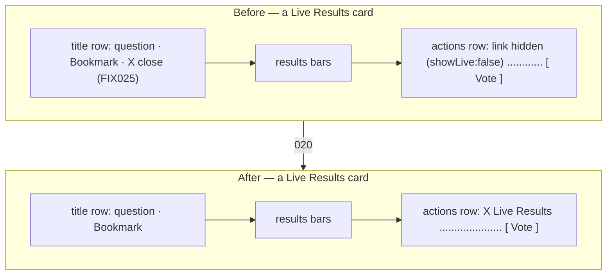
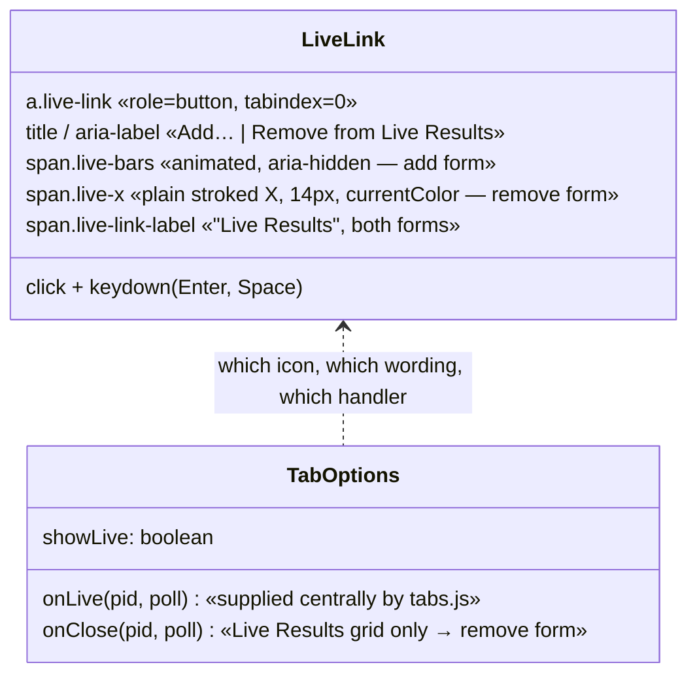
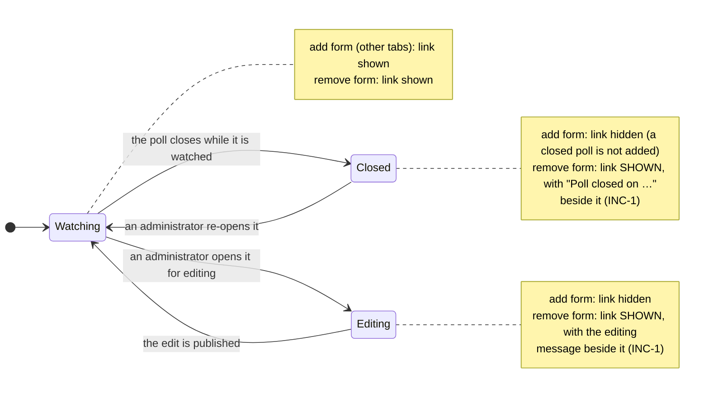
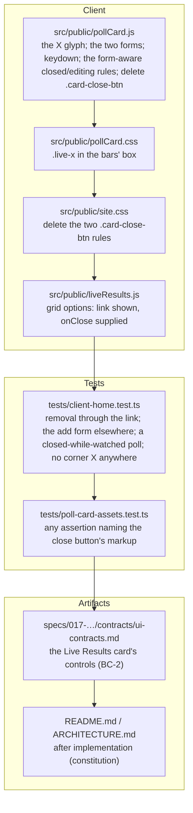

# 020 — Live Results X — Architecture

| | |
|---|---|
| **Requirements document** | `designDocs/020-high-level-requirements-LIVE-RESULTS-X.md` — 47 lines (carries the ten resolutions of the previous run), plus the mockup `designDocs/dontTrack/liveResultsX.jpg` |
| **Architecture directory** | `architecture/020-live-results-x` — reused: `.specify/architecture.json` records this same requirements file |
| **Main document** | `architecture/020-live-results-x/architecture.md` |
| **Mode** | REGENERATE — verification pass over the resolved document |
| **Generated** | 2026-09-22 |
| **Previous run** | REGENERATE against the 22-line document, then 10 resolutions applied in session (INC-1, AMB-1–3, UNS-1–6) |
| **Sequencing** | After 019 (Newest) and 017 FIX025, which put the corner X on the card in the first place |

---

## 1. Overview and scope

020 moves one control. On the **Live Results tab only**, the X that removes a poll from the tab
leaves the card's top-right corner and becomes the icon of the card's bottom-row link: where every
other tab shows the animated three-bar icon before the words **Live Results**, the Live Results tab
shows a plain **X** before the same words, and activating it does exactly what the corner X does
today — `DELETE /api/live/:pid`, the card leaves the tab. The corner button is removed outright.

| ID | Change | Layer | Notes |
|---|---|---|---|
| C1 | The corner X (`.card-close-btn`), its styling and its "show the corner X" switch are deleted; the Bookmark star sits as it does on every other tab | `pollCard.js`, `site.css` | Removed outright, not hidden (UNS-4, UNS-5) |
| C2 | The link gains a second icon — a plain stroked X in the bars' 14 px box — and a second form: remove instead of add, with its own tooltip and accessible name | `pollCard.js`, `pollCard.css` | One control, two forms (AMB-1–3) |
| C3 | On the Live Results tab the link is shown for **every** poll, whatever its state; the closed and editing messages keep their place beside it | `pollCard.js` | The resolution of INC-1 — the reason this is not a three-line change |
| C4 | Enter **and** Space activate the link, in both forms, Space without scrolling | `pollCard.js` | `role="button"` finally behaves as one (UNS-1) |
| C5 | The Live Results grid asks for the link in its remove form | `liveResults.js` | `showLive: false, showClose: true` → the link shown, `onClose` supplied |
| C6 | Tests and the 017 UI contract follow the control | `tests/client-home.test.ts`, `specs/017-…/contracts/ui-contracts.md` | BC-1, BC-2 |

Out of scope, by the document's own framing: no change to what removal *does* (the route, the
registry, the refresh timer, the idle prompt, the empty-tab line); no change to any other tab's
card, including the bars, their animation and their colours; no change to the Vote button, the
Bookmark star, the card faces or the results bars; no server, contract, configuration or database
change.

### 1.1 The card's two bottom-row forms



One element, one position, one visible label; the icon, the tooltip, the accessible name and the
action change together, and the tab that supplies a remove handler gets the second form.

---

## 2. Where the control lives, before and after



`.card-front .actions` is already `flex-direction:row; justify-content:space-between`, so the link
takes the left slot it takes on every other tab and Vote keeps the right. The title row loses one
child, and `site.css`'s two `.card-close-btn` rules — the corner nudge that made room for it and
the `[hidden]` rule — go with the button.

---

## 3. The click paths

```mermaid
sequenceDiagram
  autonumber
  actor V as Member
  participant C as pollCard.js (.live-link)
  participant L as liveResults.js
  participant T as tabs.js (floors)
  participant A as App

  Note over C: Any tab but Live Results — unchanged
  V->>C: click, Enter or Space on "bars Live Results"
  C->>L: opts.onLive(pid) → LiveResults.addPoll(pid)
  L->>T: refresh-kind token
  L->>A: POST /api/live/:pid
  A-->>L: polls[] (or 409 live-cap)
  L->>L: render the tab, switch to it

  Note over C: Live Results tab — what 020 moves
  V->>C: click, Enter or Space on "X Live Results"
  C->>L: opts.onClose(pid) → removePoll(pid)
  L->>T: refresh-kind token
  L->>A: DELETE /api/live/:pid
  A-->>L: polls[] the session still watches
  L->>L: drop the card; the tab stays active; the empty line when it was the last
```

The second path is today's corner-X path with a different element firing it. No request, floor,
budget or registry behaviour changes. `createGrid` (`tabs.js:102-111`) merges a universal `onLive`
into every grid's options, so "the tab supplies a remove handler" is a sound discriminator: only
the Live Results grid passes `onClose`.

---

## 4. The element: one link, two forms



The X is a plain glyph in the box the bars occupy — no border, no background, `currentColor` — so
the label does not move between the forms and the 8 px gap is unchanged. The link keeps exactly
one hover treatment (the label's amber underline) in both forms; the X takes none of its own and
has no animation in any state, so the reduced-motion and guest rules continue to govern the bars
alone.

---

## 5. The state machine the control sits inside



This is the part of 020 that is not a three-line change. `updateClosedState` (`pollCard.js:997`)
and `updateEditingState` (`:982`) hide the link today, deliberately, because in its add form
neither state may be added. The resolved requirements make both rules conditional on the form, so
the remove control survives every state the corner X survived. `updateBlockedState` never touched
the link — it withdraws only Vote and Submit — so a banned or uninvited member keeps the control
with no change at all.

---

## 6. What changes where



One template edit, one CSS rule added and two deleted, one options line, one test rewrite. No
server file, no `postman/openapi.json` change, no database change.

---

## 7. Findings

Each open item carries an empty checkbox; the recommended resolution is indented beneath it.
Items resolved in the previous run are listed in §7.6 for the record.

### 7.1 Inconsistencies

None found in the amended document. The ten resolutions read consistently as a whole: the form
rules, the wording rules, the keyboard rule and the deletion of the corner button agree with one
another and with the mockup.

### 7.2 Ambiguities

- [X] **AMB-4 — "whatever the poll's state" and the flipped card.** *(Resolved 2026-09-22 via Apply all — the requirements now state that the phrase is about the poll, not the card's face — the link is a front-face control in both forms, and the Back arrow returns a flipped card to the front.)* The requirements say the link
  is shown "for **every** poll on the tab, whatever the poll's state". A card has two faces: the
  front carries the link and Vote, the back carries Back and Submit vote. A member who has flipped
  a card to vote has no remove control until they flip back — which was equally true of the corner
  X (it lives in the front face's title row), but the new wording invites the reading that the
  control must be reachable at all times.
  - *Resolution*: say that the sentence is about the poll's state, not the card's face — the link
    is a front-face control in both forms, exactly as the corner X was, and the Back arrow returns
    a flipped card to the front. One clause; no code follows from it.

### 7.3 Unspecified aspects

- [X] **UNS-7 — Where focus goes after a keyboard removal.** *(Resolved 2026-09-22 via Apply all — the requirements now state that after a removal focus moves to the same link on the card taking the removed card's place, or to the tab's empty-state line when it was the last.)* The keyboard rule (UNS-1) makes the
  link operable by Tab + Enter/Space, and activating it in remove form destroys the card that
  holds the focused element. Focus then falls back to `<body>`, so a keyboard user loses their
  place in the grid and must Tab from the top of the page. With a mouse this is invisible; the
  corner X had the same flaw, but it did not promise keyboard operation.
  - *Resolution*: after a removal, move focus to the same control on the card that takes the
    removed card's place, or — when the removed card was the last one — to the tab panel's empty
    line. One line in the removal handler, and the promise UNS-1 makes is kept end to end.

### 7.4 Needs clarification

None.

### 7.5 Breaking changes

- **BC-1 — The removal control's identity changes.** Anything that finds the control by
  `.card-close-btn` breaks: three assertions in `tests/client-home.test.ts` (hidden on Trending,
  shown on Live Results, the click that sends the `DELETE`) and any screenshot or operator note
  showing a corner X on a Live Results card. The route, the payload and the registry are untouched,
  so nothing outside the browser is affected.
- **BC-2 — 017's UI contract goes stale.** `specs/017-…/contracts/ui-contracts.md` says the Live
  Results tab's cards carry no Live Results link (it is the tab you are on), and 017's FIX025
  record describes the corner X as the removal control. Both need the 020 note, as 019 did for
  018's Newest rules; 017's fix record stays as history.

Not breaking: the add form on every other tab, the Vote button, the Bookmark star, the card faces,
the live refresh timer, the idle prompt, `409 live-cap`, and every server route.

### 7.6 Resolved in the previous run

| ID | Finding | Resolution recorded in the requirements |
|---|---|---|
| INC-1 | The moved control is hidden for closed and editing polls, so a watched poll that closes could never be removed | The link is shown for every poll on the Live Results tab whatever its state; the closed and editing messages keep their place in the row |
| AMB-1 | Which X drawing | A plain stroked glyph in the bars' 14 × 14 box, `currentColor`, no border — explicitly not the bordered 28 px icon button |
| AMB-2 | The accessible name and tooltip | "Remove from Live Results" on the Live Results tab, "Add to Live Results" elsewhere; visible words unchanged |
| AMB-3 | Which option shape drives the two forms | One control in two forms, chosen by whether the tab supplies a remove handler; the corner X's own switch goes away with the button |
| UNS-1 | Keyboard | Enter and Space both activate the link in either form, Space without scrolling |
| UNS-2 | Hover and focus treatment | One hover treatment (the label's underline) in both forms; the X takes none of its own; the focus ring unchanged |
| UNS-3 | Reduced motion and the guest rule | The X is static in every state; both rules continue to govern the bars alone |
| UNS-4 | The title row after the X leaves | The corner X's spacing rules go with it; the Bookmark star sits as on every other tab |
| UNS-5 | Whether the button survives | Removed outright — button, styling, switch — not left hidden for a future use |
| UNS-6 | What must be verified | A four-point list: the add form elsewhere, the remove form and its name here, a closed-while-watched poll, and no corner X anywhere |

---

## 8. Assumptions

| # | Assumption | Basis |
|---|---|---|
| A1 | The corner X is **moved**, not duplicated: after 020 no poll card shows an X in its title row, on any tab. | "relocated from its current position … to a new position"; the removal is now explicit in the requirements. |
| A2 | The label stays the words "Live Results" in both forms — the X replaces the icon, not the text. | The requirements; the mockup. |
| A3 | The change is confined to the Live Results tab; Trending, Newest, My Private Polls, Favorites and Search keep the animated bars and the add behaviour. | "On the `Live Results` tab, the animated 3-bar icon is replaced…". |
| A4 | Removal keeps its current mechanics end to end: a refresh-kind token, `DELETE /api/live/:pid`, the server's answer replacing the tab's order, the empty-tab line when the last poll goes. | "the exact same function as clicking the 'X' icon"; 017 FIX025. |
| A5 | The link keeps its element (`a.live-link`) and its position in `.card-front .actions`; no new row, no reordering of Vote. | The mockup; the requirements' "bottom row". |
| A6 | The vote-blocked, closed and editing **messages** keep their slot and their precedence; only the link's visibility rule becomes form-aware. | The requirements; `pollCard.js` `updateBlockedState` / `updateClosedState` / `updateEditingState`. |
| A7 | The link is a front-face control in both forms; the back face keeps Back and Submit vote. | The card's markup; AMB-4 proposes stating it. |
| A8 | No server, route, contract (`postman/openapi.json`), configuration or database change is needed. | The action already exists as `DELETE /api/live/:pid`. |
| A9 | The `.live-x` glyph reuses the two crossed `<path>` elements already in the card template rather than a new asset. | The corner button's SVG is deleted with the button; its paths are the drawing the mockup shows. |
| A10 | The spec directory the requirements ask for is `specs/020-LIVE-RESULTS-X/`, and no branch is created by this run. | First line of the requirements; skill rule. |

---

## 9. Completion Report

| Item | Value |
|---|---|
| **Mode** | REGENERATE — verification pass over the resolved document |
| **Architecture directory** | `architecture/020-live-results-x` (reused — see header) |
| **Main document** | `architecture/020-live-results-x/architecture.md` |
| **Source requirements** | `designDocs/020-high-level-requirements-LIVE-RESULTS-X.md`, 47 lines + 1 mockup |
| **Software architecture diagrams** | 6 (the two bottom-row forms, the card before and after, the two click paths, the link's anatomy, the state machine, the file change map) |
| **Inconsistencies** | 0 (1 resolved in the previous run) |
| **Ambiguities** | 1 found this pass (AMB-4) — resolved; 3 resolved in the previous run |
| **Unspecified aspects** | 1 found this pass (UNS-7) — resolved; 6 resolved in the previous run |
| **Needs Clarification items** | 0 |
| **Breaking changes** | 2 (BC-1 the control's identity, BC-2 017's contract) |

**Against the previous run**: the ten resolutions hold together, and the one that mattered — INC-1 —
is now stated plainly enough to implement and to test. Re-reading the document cold surfaced two
small items, both consequences of resolutions rather than of the original requirement: the phrase
"whatever the poll's state" can be over-read to cover the card's back face (AMB-4), and the
keyboard promise of UNS-1 leaves focus nowhere once the focused card is removed (UNS-7).

**Readiness for `/speckit-specify`**: **ready.** All twelve findings across both runs are closed —
one inconsistency, four ambiguities, seven unspecified aspects, no clarifications. The two breaking
changes stay documented; they are the point of the feature, not defects.

The item to carry into `/speckit-plan`: the link and the corner X were never interchangeable —
one is state-dependent and an anchor, the other was state-blind and a button. Moving the action is
three lines; making it behave is INC-1, UNS-1 and UNS-7.
