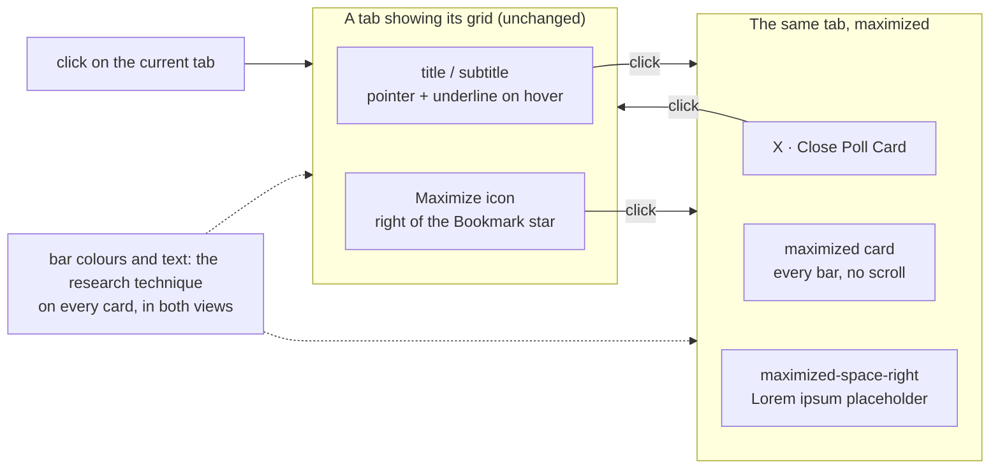
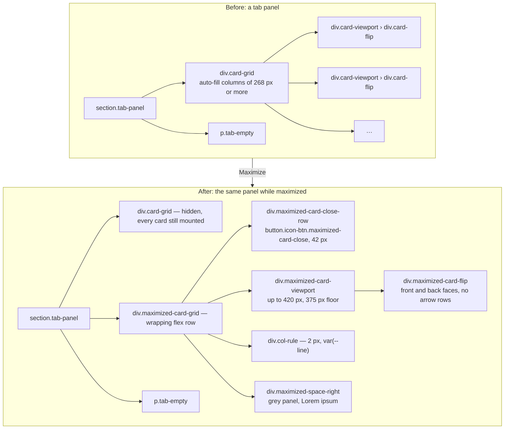
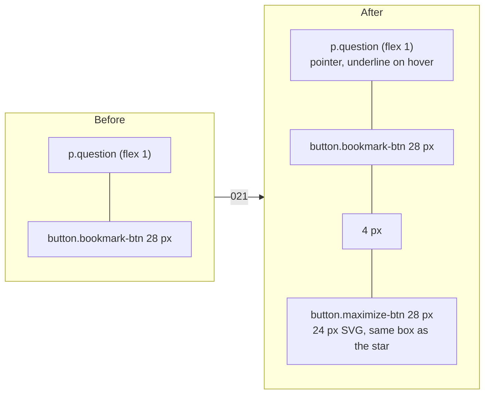
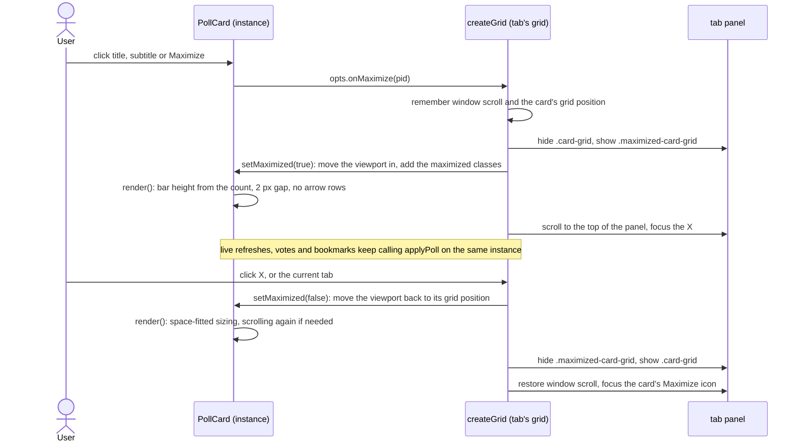
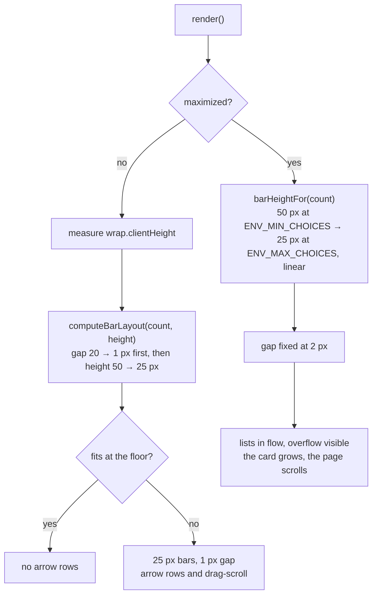
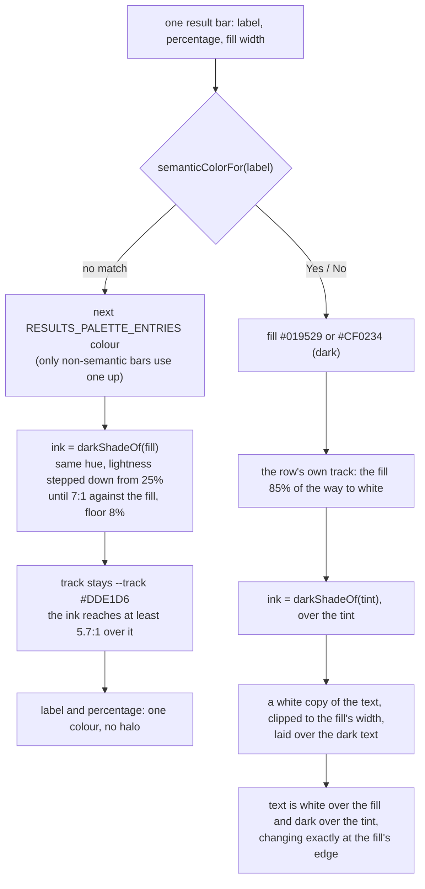
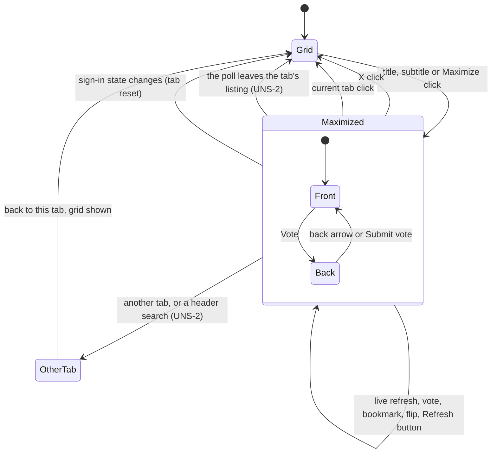

# 021 — Maximized Poll Card — Architecture

| | |
|---|---|
| **Requirements document** | `designDocs/021-high-level-requirements-MAXIMIZED-POLL-CARD.md`, 97 lines after Apply all (68 before), plus the icon image `designDocs/dontTrack/maximizeIcon.jpg` and the stand-alone layout in `research/MAXIMIZED-POLL-CARD/SINGLE-CARD-LAYOUT/` |
| **Architecture directory** | `architecture/021-maximized-poll-card`, new (`.specify/architecture.json` recorded 020's requirements, so a new number was allocated) |
| **Main document** | `architecture/021-maximized-poll-card/architecture.md` |
| **Mode** | UPDATE-IN-PLACE |
| **Generated** | 2026-09-24; updated 2026-09-24 for the new "Impact on the Non-maximized Poll Card" section |
| **Sequencing** | After 020 (Live Results X). 020's rules still hold: the link has two forms on Live Results, and focus is placed after a removal. |

---

## 1. Overview and scope

021 lets a user open **one poll card in a maximized view**, in place, inside the tab they are on.
The tab's card grid gives way to a single large card. The card sits beside a side panel, and a
close **X** sits above both. Closing the view brings the grid back as it was. The maximized card is
the same working card: it votes, bookmarks, flips and updates live. The difference is that it
grows to show every bar, and nothing scrolls.

021 also changes **every** poll card, maximized or not, in one respect: how result bars are
**coloured** and how their **text** is drawn. The research page's technique replaces the app's.
Bars take light fills from a new 50-colour palette. Each bar's label and percentage are drawn in a
very dark shade of that bar's own fill, with no halo. Yes/No bars take new, darker semantic colours
on a pale tinted track, with text that turns white where it crosses the fill. The size and spacing
of the non-maximized card's bars do not change (§4.2).

| ID | Change | Layer | Notes |
|---|---|---|---|
| C1 | **Two ways in**: a click on the title or subtitle (pointer cursor, underlined on hover), or a click on a new **Maximize** icon at the right of the title row, to the right of the Bookmark star | `pollCard.js`, `site.css` | The icon is converted from `maximizeIcon.jpg` to an SVG and inlined in the card template |
| C2 | **The maximized view**: `.maximized-card-grid` takes the place of the tab's `.card-grid`. It holds the close row, `.maximized-card-viewport` › `.maximized-card-flip`, the 2 px rule and `.maximized-space-right` (Lorem ipsum for now) | `tabs.js`, new CSS | From the stand-alone layout |
| C3 | **No scrolling**: bar height follows the choice count (50 px at `ENV_MIN_CHOICES`, down to 25 px at `ENV_MAX_CHOICES`) with a fixed 2 px gap, the card grows to fit, and neither arrow row renders | `pollCard.js`, `pollCard.css` | Replaces `computeBarLayout`'s space-fitted sizing in this view only |
| C4 | **Two ways out**: the X (`Close Poll Card`) and a click on the current tab. Both put back the tab's grid as it was before | `tabs.js` | See §5 for the exits the requirements do not name |
| C5 | **Bar colours and text, on every card**: the research palette (`RESULTS_PALETTE_ENTRIES`, 50 light xkcd colours), dark-shade ink per bar (`darkShadeOf`, 7:1), no halo; Yes/No in `#019529` / `#CF0234` on a tinted track, with white text clipped to the fill | `pollCard.js`, `pollCard.css` | Replaces 009's palette and Yes/No colours and 010's per-element ink rule (BC-2) |
| C6 | Tests, the 017 UI contract, the 009/010 records and the README follow | `tests/client-home.test.ts`, `tests/poll-card-assets.test.ts`, `specs/017-…/contracts/ui-contracts.md` | BC-1, BC-2 |

**Out of scope**, by the document's own framing: the content of `.maximized-space-right` (the next
requirements document); any server, route, `postman/openapi.json`, configuration or database
change; the admin pages (they draw no result bars); and the non-maximized card's bar **size,
spacing and scrolling**, which stay exactly as they are.

### 1.1 The feature at a glance

---

## 2. The page, before and after

The shell above the panel (`.container`, `.layout`, the header, the tab bar, the notice line) is
not touched. It must stay on screen: the tab bar is one of the two ways out. The stand-alone page
renamed `.container` and `.layout` too, but only because that page has no shell of its own (AMB-2).

The layout rules come across from the stand-alone page unchanged. They are all flex, with no media
queries:

| Window (container width + 40 px padding) | Card | Side panel | Rule |
|---|---|---|---|
| ≥ 898 px | 420 px (its cap) | takes the rest | shown |
| 808 – 898 px | shrinks with the panel, 420 → 375 px | the same width as the card | shown |
| < 808 px | centred on its own line | wraps below, full width | dropped (container query) |
| < 403 px (phones) | **overflows its 375 px floor, and `.page{overflow-x:clip}` cuts it off** | — | — |

The last row is a gap the requirements do not cover (UNS-1).

---

## 3. The title row, before and after

- **The icon.** `maximizeIcon.jpg` is traced to `designDocs/dontTrack/maximizeIcon.svg`: one
  colour, white made transparent, the rounded square with the filled box in its lower left, and the
  arrow. The same paths are inlined in `POLL_CARD_TEMPLATE`, in a `viewBox` that draws at the
  Bookmark icon's 24 px inside a 28 px button.
- **The gap.** The requirements leave it to the architect. It is **4 px**: close enough that the two
  icons read as one group, and wide enough that the two 28 px targets do not touch. The row's
  existing `gap:8px` still separates the question from the pair.
- **The subtitle** (`p.subtitle`, under the row) takes the same pointer and hover underline as the
  title.
- **My Private Polls** hides the Bookmark star (FIX024), so the Maximize icon sits alone at the
  right there (UNS-8).

---

## 4. Opening and closing

The recommended design **moves the card instance** rather than mounting a second one (AMB-1,
UNS-4). The tab's grid keeps the card in its `mounted` map, so every refresh, vote and bookmark
still reaches it through `applyPoll`. While it is maximized, the grid leaves it out of its
reordering loop.

### 4.1 Bar sizing in the two views

The non-maximized branch is today's code, unchanged. The maximized branch is the stand-alone page's
`barHeightFor` and `RESULTS_GAP_FIXED`, with the page's hard-coded bounds read from the
configuration the client already receives (`ENV_MIN_CHOICES`, `ENV_MAX_CHOICES`). At 50 choices the
bar region is 50 × 25 + 49 × 2 = 1,348 px. The card is about 1.5 k px tall and the window scrolls,
which is the point of the view.

The CSS side is the five rules the stand-alone copy of `pollCard.css` marks `SINGLE-CARD-LAYOUT`,
scoped under `.maximized-card-flip`: the scroll wrap stops flexing, the inner column goes back in
flow, both lists stop clipping and scrolling, and the arrow rows are not rendered.

### 4.2 Bar colours and text, on every card

This is the part of 021 that reaches beyond the maximized view. The sizing branch above differs
between the two views. The colouring below is the same in both, which is what the requirements'
"consistent between the maximized and non-maximized Poll Cards" asks for.

What it replaces, and what it keeps:

| | Before 021 | After 021 |
|---|---|---|
| Palette | 50 dark, saturated colours (009), each measured at 4.5:1 against its black-or-white ink | 50 light xkcd colours; repeats allowed |
| Ink choice | `textStyleFor`: black or white by the fill's luminance (threshold 0.40), chosen per element by `majorityBackground` from measured fill/track coverage (010) | one dark shade per bar, which reads over both its fill and the plain track, so no per-element choice is needed |
| Halo | a black or white text-shadow | none |
| Yes / No | `#43F781` / `#FC9E9E` on the plain track | `#019529` / `#CF0234` on a tinted track, with the two-colour text |
| Fill's trailing edge | `inset -2px 0 0 rgba(0,0,0,0.55)` (009 FR-012) | kept. Several light fills are within 1.3:1 of the track (light grey 1.05:1, light tan 1.13:1, pale blue 1.22:1), so the edge carries the boundary |
| Bar size, gap, font size, padding, truncation, compact rows | as today | as today |

---

## 5. The view's states

The requirements name two exits: the X and the current tab. The others in the diagram are ones the
code can reach today, and each needs a stated rule (UNS-2). A poll leaves a tab's listing in these
ways:

| Tab | How the maximized poll can leave it |
|---|---|
| Live Results | its own remove link (020), in the maximized card itself |
| Favorites | un-bookmarking it from the maximized card |
| Trending, Newest | the next recompute drops it |
| My Private Polls | access is removed, or the poll is deleted |
| Search | a new search |
| any | the poll is deleted or rejected by an admin |

---

## 6. What changes where

```mermaid
flowchart TB
  subgraph client ["Client"]
    pc["src/public/pollCard.js<br/>Maximize button and inline SVG; title/subtitle click; onMaximize;<br/>setMaximized(); count-based sizing branch; no arrow rows when maximized"]
    pcol["src/public/pollCard.js (every card)<br/>new palette and Yes/No colours; darkShadeOf; tinted track and clipped white text;<br/>retire textStyleFor, majorityBackground and the 0.40 threshold"]
    tb["src/public/tabs.js<br/>createGrid: maximize(pid) / restore(), skip the maximized card when reordering,<br/>close on unmount; select(): the current tab restores; other tabs leave"]
    lr["src/public/liveResults.js<br/>after a removal from the maximized view, restore, then 020's focus rule"]
    css["src/public/pollCard.css + site.css (or a new maximizedCard.css)<br/>.maximized-* rules, the 5 no-scroll overrides, title-row and hover rules"]
    html["src/public/index.html<br/>a stylesheet link, if a new sheet"]
  end
  subgraph assets ["Assets"]
    svg["designDocs/dontTrack/maximizeIcon.svg<br/>traced from the JPG, black on transparent"]
  end
  subgraph tests ["Tests"]
    ch["tests/client-home.test.ts<br/>both ways in; both ways out; updates while maximized; the poll leaving the listing"]
    ca["tests/poll-card-assets.test.ts<br/>replace the 009/010 colour and threshold assertions (BC-2); a new sheet is fingerprinted"]
  end
  subgraph artifacts ["Artifacts"]
    uc["specs/017-…/contracts/ui-contracts.md<br/>the card's title row (BC-1)"]
    old["specs/009-…, specs/010-…<br/>a 021 note: palette, Yes/No and ink rule superseded (BC-2)"]
    rd["README.md / ARCHITECTURE.md<br/>after implementation"]
  end
  svg --> pc --> pcol --> tb --> lr --> css --> html --> ch --> ca --> uc --> old --> rd
```

No server file, no `postman/openapi.json` change, no database change, no new environment variable.

---

## 7. Findings

Each item carries a checkbox, with the recommended resolution indented beneath it. All 19 were resolved on 2026-09-24 via Apply all, and each resolution is now stated in the requirements document.

### 7.1 Inconsistencies

- [X] **INC-1: "The same way it is rendered in the current implementation".** *(Resolved 2026-09-24 via Apply all: the requirements now say the maximized card renders like the non-maximized card, with the colors and fonts 021 introduces, except for scrolling; the count-based bar height and 2px gap are stated.)* The new section
  "Impact on the Non-maximized Poll Card" settles the question the previous run raised (it chose
  that run's Option C): the research page's colour and text technique applies to **every** card, so
  the two views match. But the earlier sentence still stands: the poll data "will be rendered in the
  maximized Poll Card the same way it is rendered in the current implementation … except that there
  will be no scrolling". Read today, "the current implementation" means the dark palette and
  black-or-white ink that the new section replaces. The two sentences now contradict each other.
  - *Resolution*: reword the earlier sentence to "the same way it is rendered in the non-maximized
    Poll Card, including the colours and fonts this document introduces (see 'Impact on the
    Non-maximized Poll Card'), except that there will be no scrolling". The new section already
    carries the intent; this makes the earlier sentence agree with it.

### 7.2 Ambiguities

- [X] **AMB-1: "will replace the `card-grid` div".** *(Resolved 2026-09-24 via Apply all: the requirements now define "replace" as a sibling shown in place of the hidden `.card-grid`, with every card staying mounted.)* Taken literally, swapping the element destroys
  the tab's mounted cards, their scroll positions and the grid's reordering state. It would then
  have to rebuild all of them on close, which "as it was before" rules out.
  - *Resolution*: "replace" means **in place of, on screen**. `.maximized-card-grid` is a sibling of
    `.card-grid` in the same tab panel. It is shown while `.card-grid` is hidden, and every mounted
    card stays mounted.
- [X] **AMB-2: Class renaming versus adding classes.** *(Resolved 2026-09-24 via Apply all: the requirements now add the maximized classes alongside the existing ones and keep `.container` / `.layout`.)* The requirements say `maximized-card-flip`
  "will replace" `card-flip`. The stand-alone page also renamed `.card-viewport`, `.container` and
  `.layout`. Renaming on the live card would leave every existing `.card-flip` and `.card-viewport`
  rule and every `querySelector` in `pollCard.js` unmatched: the grid cell, the 3-D flip, the face
  sizing, and `initPollCard`'s own lookup.
  - *Resolution*: while maximized, the card's elements carry the maximized classes **in addition
    to** their own (`class="card-viewport maximized-card-viewport"`,
    `class="card-flip maximized-card-flip"`). The maximized rules override only what differs: the
    375 px floor and the five no-scroll rules. `.maximized-card-grid` is new. `.container` and
    `.layout` keep their names, because the page shell is not part of the maximized view.
- [X] **AMB-3: The Maximize icon's colour.** *(Resolved 2026-09-24 via Apply all: the requirements now fill the inline icon with `currentColor` in the Bookmark icon's colours; the file stays black.)* The SVG file is to be "just 1 color which is the
  black". The Bookmark icon it sits beside is drawn in `currentColor`: a light grey `#9AA197` at
  rest, `--muted` on hover and focus. A black icon next to a grey star would read as a heavier, more
  urgent control.
  - *Resolution*: keep the file black on transparent, as asked. The inline copy in `pollCard.js`
    fills with `currentColor` and takes the Bookmark button's colours: grey at rest, `--muted` on
    hover and focus.
  - *Revised 2026-09-24 by FIX02 (`specs/021-MAXIMIZED-POLL-CARD/fix.md`): the icon is now `#202020`, with a light grey background on hover, a darker one while pressed, and the grey background plus a focus ring on keyboard focus; it no longer takes the star's grey.*
- [X] **AMB-4: What "fonts" covers.** *(Resolved 2026-09-24 via Apply all: the requirements now define "fonts" as the text colour and shadow only.)* The new section says the bars' "colors and fonts will be
  changed to match the maximized Poll Card". The research changed the text's **colour** (a dark
  shade of each fill) and removed its **shadow** (the halo). It did not change the typeface
  (Inter), the weight (600), the size (scaled 7–11 px by bar height) or the padding. Read literally,
  "fonts" could mean all of those.
  - *Resolution*: "fonts" means the label and percentage **text colour and shadow** only. Typeface,
    weight, size and padding stay as they are, which also keeps the requirement that "the size and
    spacing of the bars … will remain the same".
- [X] **AMB-5: Whether the Yes/No treatment is part of "the technique".** *(Resolved 2026-09-24 via Apply all: the requirements now apply the whole technique, Yes/No treatment included.)* The research did more than
  swap palettes. It changed the Yes/No colours to `#019529` / `#CF0234`, gave those bars a tinted
  track, and drew their text in two colours split at the fill's edge. The requirement names "colors
  and fonts" and does not say whether the semantic bars follow.
  - *Resolution*: yes, the whole technique, Yes/No included. Otherwise a Yes/No poll would keep
    009's pale `#43F781` / `#FC9E9E` fills with the new dark-shade ink and no halo, a combination
    nobody has checked. The research's semantic treatment was designed and measured as part of
    the same work.

### 7.3 Unspecified aspects

- [X] **UNS-1: Narrow screens.** *(Resolved 2026-09-24 via Apply all: the requirements now set both width floors to `min(375px, 100%)`.)* The stand-alone card and side panel each have a 375 px floor. Below
  a 640 px window the app's container padding is 14 px each side, so a 375 px phone leaves 347 px,
  and `.page{overflow-x:clip}` cuts off the card's right edge and its percentages. Today's card has
  no floor: it takes the viewport minus 28 px.
  - *Resolution*: make the floor `min-width:min(375px, 100%)` on both the card and the panel. They
    keep 375 px wherever it fits and never overflow the container on a phone. The side-by-side
    thresholds (898 / 808 px) are unchanged.
- [X] **UNS-2: Exits the document does not name.** *(Resolved 2026-09-24 via Apply all: the requirements now list the other exits: another tab, a search, a sign-in change, or the poll leaving the listing.)* Only the X and the current tab are specified.
  The maximized view can also meet: a click on **another tab**; a **header search**, which switches
  to Search; **sign-in or sign-out**, which resets every tab; and the poll **leaving the tab's
  listing** (§5 table), which on Live Results and Favorites happens from a control on the maximized
  card itself.
  - *Resolution*: the maximized view belongs to the tab it was opened in and never outlives the tab
    being on screen. Another tab, a search or a sign-in change closes it, so coming back to the tab
    shows its grid. If the poll leaves the listing, the view closes and the tab shows its grid
    without it. When there is no card left to focus, the existing focus rules apply: 020's R5 on
    Live Results, otherwise the tab's first card or `.tab-empty`.
- [X] **UNS-3: What a click on the current tab sends.** *(Resolved 2026-09-24 via Apply all: the requirements now say a click on the current tab restores the grid with no request; Refresh updates the card in place.)* Today `select()` calls
  `controller.activate()`, which sends a request whenever the tab's copy is older than the manual
  floor, and so spends a token. The requirement says the click shows the tab "as it was before".
  - *Resolution*: while maximized, a click on the current tab only restores the grid, with no
    request and no token spent. The next click, the Refresh button or the tab's own timer refresh
    it as usual. The Refresh button, pressed while maximized, refreshes the tab and the maximized
    card updates in place.
- [X] **UNS-4: What the card carries into and out of the view.** *(Resolved 2026-09-24 via Apply all: the requirements now carry the same card instance, with its face, selection, notice and error, both ways.)* A card can be flipped to its back
  face, with choices selected but not submitted (012 FR-045's `pendingSelection`), when its title is
  clicked (the back face shows the title too).
  - *Resolution*: the view carries the **same card instance** (§4), so the face, the pending
    selection, any vote notice and the vote error all go with it, both ways. The title and subtitle
    open the view from either face. The Maximize icon is in the front's title row, so it opens it
    from the front.
- [X] **UNS-5: Keyboard, focus and names.** *(Resolved 2026-09-24 via Apply all: the requirements now name the icon "Maximize Poll Card", keep the title and subtitle mouse and touch only, place focus on open and close, and add Escape.)* Nothing says whether the title and subtitle are
  keyboard-operable, what the Maximize icon is called, or where focus goes.
  - *Resolution*: the Maximize icon is a `<button>` with `aria-label` and `title` set to
    **"Maximize Poll Card"**, matching the X's "Close Poll Card". It is the keyboard route in. The
    title and subtitle stay text, operable by mouse and touch only, so each card gains one tab stop,
    not three. On opening, focus goes to the X. On closing, it goes back to that card's Maximize
    icon, or its title when opened from the back. **Escape** closes the view, as it closes the
    app's modal.
- [X] **UNS-6: Scroll position.** *(Resolved 2026-09-24 via Apply all: the requirements now bring the panel top into view on opening and restore the window scroll on closing.)* Opening the view in a grid scrolled far down would show the
  maximized card at the scroll position the grid had, part-way down the page or past its end.
  - *Resolution*: on opening, bring the top of the tab panel into view. On closing, restore the
    window's scroll position from before opening, so the grid and the card are where the user left
    them.
- [X] **UNS-7: The entry points inside the maximized view.** *(Resolved 2026-09-24 via Apply all: the requirements now hide the Maximize icon and disable the title and subtitle click while maximized.)* The maximized card carries the same
  template, so it has its own Maximize icon and a clickable, underlined title.
  - *Resolution*: while maximized, the Maximize icon is hidden and the title and subtitle lose the
    pointer, the underline and the click. The X is the only way out on the card.
  - *Revised 2026-09-24 by FIX02: the icon is no longer hidden inside the view. It becomes a Minimize icon (the arrow turned 180°, "Minimize Poll Card") that closes the view like the X; the title and subtitle stay inert.*
- [X] **UNS-8: Where the Bookmark star is hidden, and guests.** *(Resolved 2026-09-24 via Apply all: the requirements now place the icon alone where the star is hidden, and let guests maximize.)* "Push the Bookmark icon to the
  left" assumes the star is there. My Private Polls hides it (FIX024). Guests see it, but pressing it
  sends them to sign in.
  - *Resolution*: the Maximize icon sits at the right of the row on every tab, whether or not the
    star is beside it. Guests may maximize a card: it is a view, not an action. The card's Vote,
    Bookmark and Live Results controls keep sending guests to sign in, as they do in the grid.
- [X] **UNS-9: The browser's Back button and the URL.** *(Resolved 2026-09-24 via Apply all: the requirements now give the view no URL and no history entry, and replace `history.back()`.)* The stand-alone page's X calls
  `history.back()`. That is correct there, but in the app, with no history entry, it would leave
  the site. Nothing says whether the maximized view has an address or a history entry.
  - *Resolution*: no URL change and no history entry in 021. The X, the current tab and Escape
    close the view in the page. `closeMaximizedCard`'s `history.back()` body is replaced, as the
    research README already notes. A shareable address for a maximized poll can come in a later
    requirements document.
- [X] **UNS-10: How much of the stand-alone page is carried.** *(Resolved 2026-09-24 via Apply all: the requirements now list what is carried from the stand-alone layout and what is not, and restore the first two palette entries.)* The page contains design aids that
  must not reach the app: the `#back` hash and `showFace`, `single-card-back.html`, the `'halo'`
  text mode, `rowGapFor` and its bounds, the hard-coded `ENV_MIN_CHOICES` / `ENV_MAX_CHOICES`, and
  the palette's first two entries temporarily set to the Yes/No colours. Its bars also carry frozen
  inline sizes and a 55-character truncation estimate.
  - *Resolution*: carry the markup structure, the `.maximized-*` rules, the rule between the columns
    and its container query, the close row, the Lorem ipsum panel, and `barHeightFor` with
    `RESULTS_GAP_FIXED`, and, for every card, the colour technique of §4.2
    (`RESULTS_PALETTE_ENTRIES`, `darkShadeOf` and its contrast helpers, the semantic tint and
    `addInkOnFill`). Drop everything else. In particular, restore the palette's first two entries
    to robin's egg blue `#98EFF9` and pale peach `#FFE5AD`, as the page's own `TEMPORARY` comment
    says. Truncation stays `renderPollResults`'s measured rule, and the bounds come from the client's
    configuration.
- [X] **UNS-11: White text on the Yes bar fails WCAG AA.** *(Resolved 2026-09-24 via Apply all: the requirements now set the Yes colour to `#018826` (white 4.61:1) and a 4.5:1 rule for white on semantic fills.)* The research measured it: white reaches
  5.66:1 on the No red, but only **3.94:1** on the Yes green `#019529`, below the 4.5:1 that WCAG AA
  asks of text this small (7–11 px, weight 600). Until 021 this was confined to a research page.
  Applied to every card, it puts sub-AA text on every Yes bar in the app. The previous palette was
  held to 4.5:1 by a stated rule (009).
  - *Resolution*: darken the affirmative colour, keeping its hue, until white reaches 4.5:1.
    **`#018826`** reaches 4.61:1. The tinted track and its dark ink are derived from the fill, so
    they follow automatically. Record 4.5:1 for white-on-semantic as a rule alongside the palette's
    7:1.
- [X] **UNS-12: The two-colour text during the fill's animation.** *(Resolved 2026-09-24 via Apply all: the requirements now clip the white text to the fill's current width throughout its 0.9 s animation, on every path.)* The fill grows from 0 to its
  width over 0.9 s (`transition:width 0.9s` in `pollCard.css`, deferred past a paint in
  `renderPollResults`). The research clips the white copy of a Yes/No bar's text to the fill's
  **final** width, once, statically. On a live card, for most of a second after every render and
  every refresh that changes a percentage, the white text would stand over the pale tint where the
  fill has not yet arrived, and be close to invisible. The research page never animates, so it
  never showed this.
  - *Resolution*: the clip follows the fill. Animate the overlay's `clip-path` with the same 0.9 s
    duration and easing, starting from the same deferred frame. Alternatively, drive it from a CSS
    custom property the fill's width also uses, so the two cannot drift apart. Set it on the in-place
    update path too, not only on a rebuild (009's R1 lesson).
- [X] **UNS-13: What happens to 009's and 010's rules.** *(Resolved 2026-09-24 via Apply all: the requirements now retire `textStyleFor`, `majorityBackground`, the 0.40 threshold and the halos, keeping the track constant and the trailing edge.)* 010 chose each label's and percentage's ink
  from the measured share of fill and track under it (`majorityBackground`), because black-or-white
  ink could be right over the fill and wrong over the track. 009 set the luminance threshold for
  that choice at 0.40. Under the new technique, a palette bar's single dark shade reads over both
  (at least 7:1 on the fill and 5.7:1 on the track), and a Yes/No bar's text changes colour at the
  fill's edge by construction. Nothing says whether the old machinery stays.
  - *Resolution*: retire `textStyleFor`, `majorityBackground`, the 0.40 threshold and the halo
    shadows. Keep `RESULTS_TRACK_COLOR` (the track contrast is still measured against it) and 009's
    trailing edge on the fill (§4.2). Record in 009's and 010's folders that 021 supersedes these
    decisions (BC-2).

### 7.4 Needs clarification

None. The previous run's one product choice (bar colours in the two views) was settled by the requirements' new section; see INC-1.

### 7.5 Breaking changes

- **BC-1: The card's title row and its contract.** The title row gains a second control, and the
  title and subtitle become interactive. `specs/017-…/contracts/ui-contracts.md` lists each tab's
  card controls without either, and needs a 021 note. Any test that selects the title row's buttons
  by position, or counts `.card-grid .card-viewport` while a card is maximized, sees one card fewer
  (it has moved out of the grid). No route, payload or stored value changes, so nothing outside the
  browser is affected.

- **BC-2: Every card's bar colours and text change, and 009's and 010's decisions are superseded.**
  Every result bar on every tab looks different after 021. Users who learned a Yes/No poll's pale
  green and pink, or any poll's bar colours, see new ones. In the code: `tests/poll-card-assets.test.ts`
  asserts that `pollCard.js` ships `#43F781` and `#FC9E9E` and the comparison `luminanceOf(hex) > 0.40`.
  Those assertions break and must be replaced with the new colours and the 7:1 / 4.5:1 rules.
  009's and 010's `quickstart.md` checks (Q3, Q9), written for the black-or-white ink, no longer
  describe the card. The palette's header comment in `pollCard.js` ("dark/saturated … 4.5:1 against
  the label ink textStyleFor picks") is rewritten. No stored value changes: colours are assigned
  in the browser, by bar order.

Not breaking: the non-maximized card's bar size, spacing and scrolling; the Bookmark star's
behaviour; 020's Live Results link and focus rule; every server route.

---

## 8. Assumptions

| # | Assumption | Basis |
|---|---|---|
| A1 | "The exact same location (current tab)" means inside the current tab's panel, below the header and tab bar, not an overlay, a modal or a new page. | The requirements; the tab bar must stay visible to be clicked. |
| A2 | Only one card is maximized at a time, per page. | "the maximized Poll Card", singular throughout. |
| A3 | The maximized card keeps its tab's options: no Vote on Search, the remove form of the Live Results link on Live Results, no Bookmark on My Private Polls. | "functions the same as the current Poll Card". |
| A4 | Live refresh, idle prompts and refresh timers continue while a card is maximized. The maximized card updates through `applyPoll` like any mounted card. | "functions the same". |
| A5 | The card's width stays capped at 420 px. "Maximized" means every bar is shown and the side panel is added, not a wider card. | The stand-alone layout's `.maximized-card-viewport` keeps poll-card.css's 420 px cap. |
| A6 | The side panel shows the stand-alone page's Lorem ipsum, with the same grey panel and 2 px rule, until the next requirements document replaces it. | The requirements. |
| A7 | The gap between the Bookmark and Maximize icons is 4 px. | Delegated to the architect by the requirements. |
| A8 | `designDocs/dontTrack/maximizeIcon.svg` is a working file (the folder is untracked). The inline SVG in `pollCard.js` is the copy the app ships. | The folder's name; the requirements. |
| A9 | The X is the stand-alone page's control as it stands: `.icon-btn` at 1.5× (42 px button, 21 px icon), `aria-label="Close Poll Card"`, on its own row at the top right of `.maximized-card-grid`. | The stand-alone layout. |
| A10 | No server, route, contract, configuration or database change. `ENV_MIN_CHOICES` and `ENV_MAX_CHOICES` already reach the client. | The feature is client-only. |
| A11 | The back face's vote rows keep their two flat colours (`--choice-unselected` / `--choice-selected`). The new technique is about the result bars, which is all the research changed. | The research page's back face; "colors and fonts assigned to the bars". |
| A12 | The admin pages are untouched: they render no result bars with this palette. | `adminCard.js`, `adminResults.js` use neither the palette nor `textStyleFor`. |
| A13 | The non-maximized card keeps its trailing fill edge, compact-row rule (text hidden below 10 px bars) and truncation. Only the fill colour, the ink and the shadow change. | "The size and spacing of the bars … will remain the same". |
| A14 | The spec directory is `specs/021-MAXIMIZED-POLL-CARD/`, and this run creates no branch. | The requirements' first line; the skill's rule. |

---

## 9. Completion Report

| Item | Value |
|---|---|
| **Mode** | UPDATE-IN-PLACE: the new "Impact on the Non-maximized Poll Card" section was merged into the existing structure (§1, §1.1, the new §4.2, §6, §7, §8). No section was dropped. |
| **Architecture directory** | `architecture/021-maximized-poll-card` (new) |
| **Main document** | `architecture/021-maximized-poll-card/architecture.md` |
| **Source requirements** | `designDocs/021-high-level-requirements-MAXIMIZED-POLL-CARD.md`, 68 lines, plus 1 icon image and the stand-alone layout |
| **Software architecture diagrams** | 8 (feature at a glance, page before and after, title row, open/close sequence, bar sizing, bar colours and text (new), view states with the card's faces nested, file change map) |
| **Inconsistencies** | 1 (INC-1, revised: the new section chose the previous run's Option C, and one earlier sentence still contradicts it; a single recommendation now), resolved |
| **Ambiguities** | 5 (AMB-1 – AMB-3; AMB-4 and AMB-5 new), all resolved |
| **Unspecified aspects** | 13 (UNS-1 – UNS-10, UNS-10 extended; UNS-11 – UNS-13 new), all resolved |
| **Needs Clarification items** | 0 |
| **Breaking changes** | 2 (BC-1 the title row and its contract; BC-2 every card's colours and text, new) |

**What the update changed**: the new section turns 021 from a view into a view plus an app-wide
restyle of the result bars. §1 gains C5, §4.2 is new, and §6 gains the colour work and the 009/010
records. INC-1's options are gone, because the requirements chose C. Five findings are new
(AMB-4, AMB-5, UNS-11 – UNS-13), and so is BC-2. UNS-11 (Yes text below AA) and UNS-12 (the
two-colour text against the fill's animation) matter most. Neither shows on the research page,
which is small and static. Both appear once the technique runs on every live card.

**Readiness for `/speckit-specify`**: **ready.** All 19 findings are resolved: 1 inconsistency,
5 ambiguities and 13 unspecified aspects, each applied to the requirements document with its
recommended resolution. There are no clarifications. The two breaking changes stay documented; they
are the point of the feature, not defects.

**The item to carry into `/speckit-plan`**: the view **moves** the card; it does not copy it. Most
of the findings (AMB-1, UNS-2, UNS-4, UNS-5, BC-1) resolve cleanly because one instance keeps
receiving the tab's updates, carries its own face and selection, and is removed by the tab in the
ordinary way when the poll leaves the listing. The second item: the colour technique is **one**
code path shared by both views. Build it and its tests against the non-maximized card first, since
that card is on every tab, and let the maximized view inherit it.
