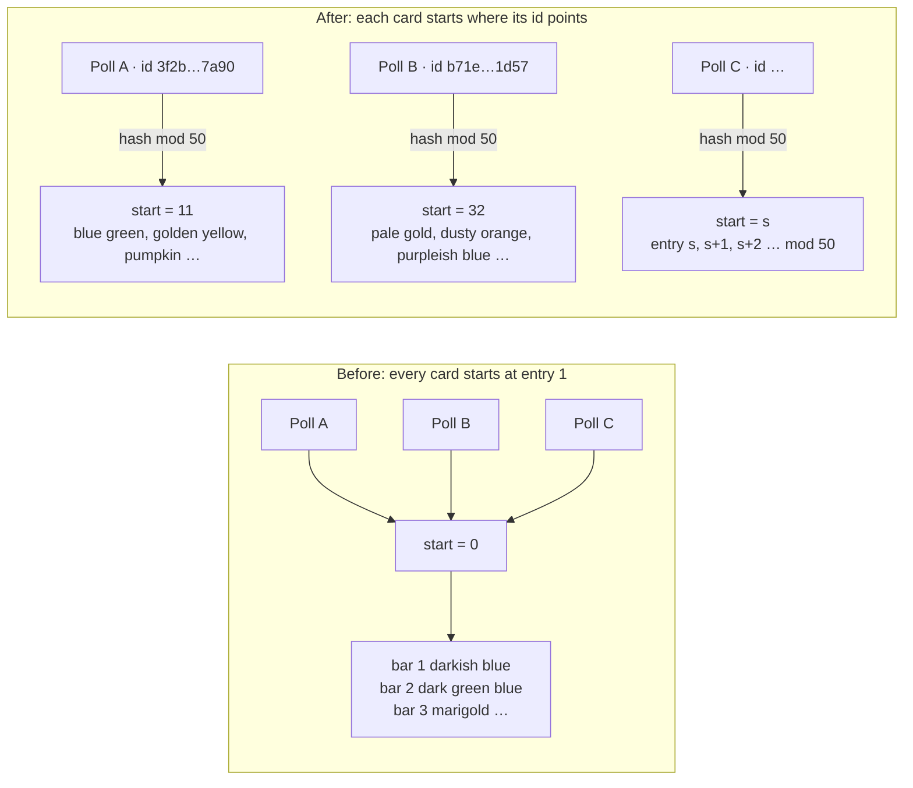
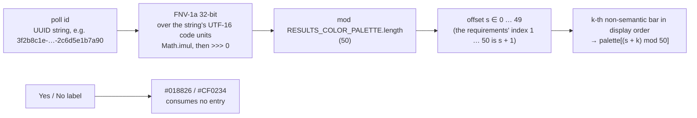
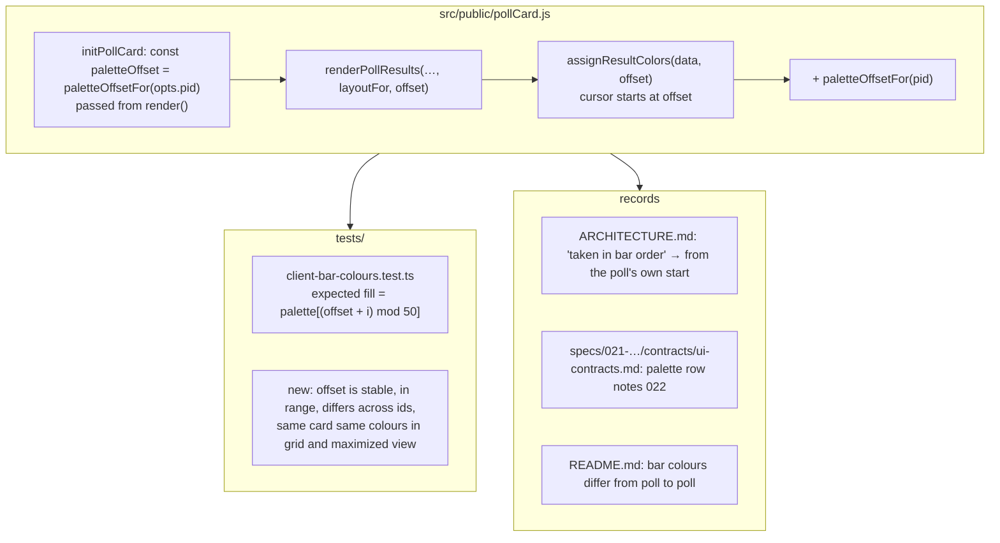

# 022 — Bar Colors — Architecture

| | |
|---|---|
| **Requirements document** | `designDocs/022-high-level-requirements-BAR-COLORS.md`, 60 lines: the resolved 022 requirements, moved back from `research/022-BAR-COLORS/research-requirements.md` with their path lines corrected by the developer |
| **Architecture directory** | `architecture/022-bar-colors`, reused as on the previous move; `.specify/architecture.json` records the designDocs path again. The earlier runs are kept beside this one as `architectureBACKUP.md` (first run) and `architectureBACKUP02.md` (research path) |
| **Main document** | `architecture/022-bar-colors/architecture.md` |
| **Mode** | REGENERATE |
| **Generated** | 2026-09-25, third run; the 14 findings of the first two runs are already folded into the requirements |
| **Sequencing** | After 021 (Maximized Poll Card). 021's colour technique stays as it is: the palette, the tints, the derived ink, the clipped text copy over every fill and the Yes/No colours. 022 changes only **which palette entry a bar starts from**. |

---

## 1. Overview and scope

Today every poll card colours its non-semantic bars from the same place: the first such bar takes
palette entry 1 (darkish blue `#014182`), the next takes entry 2 (dark green blue `#1F6357`), and
so on. A grid of twenty cards therefore shows twenty dark-blue top bars and twenty dark-green-blue
second bars. The colours read as a site theme rather than as each poll's own.

022 makes the **starting entry** depend on the poll's unique id. A deterministic function maps the
id to a palette index. The first non-semantic bar takes that entry, and the rest continue through
the palette from there, wrapping at the end. Because the id never changes, a card's colours never
change either, in the grid, in the maximized view, on Live Results or anywhere else it appears.

| ID | Change | Layer | Notes |
|---|---|---|---|
| C1 | **A palette offset per poll**: `paletteOffsetFor(pid)`, a 32-bit FNV-1a hash of the poll id string modulo `RESULTS_COLOR_PALETTE.length` (50) | `src/public/pollCard.js` | New pure function beside `assignResultColors` |
| C2 | **`assignResultColors(data, offset)`**: the palette cursor starts at `offset` instead of 0. Semantic choices still take their fixed colour and consume no entry | `src/public/pollCard.js` | The modulo, today unreachable, now really wraps |
| C3 | **The offset reaches the renderer**: computed once in `initPollCard` from `opts.pid` and passed to `renderPollResults` | `src/public/pollCard.js` | Every render path (rebuild and in-place) uses the same array, as today |
| C4 | Tests and the 021 records follow | `tests/client-bar-colours.test.ts`, `ARCHITECTURE.md`, 021's UI contract | BC-1, BC-2 |

**Unchanged**: the palette itself (`RESULTS_PALETTE_ENTRIES`, its 50 entries and their order), the
Yes/No colours `#018826` / `#CF0234` and their word rules, every tint and ink rule in `BAR_COLORS`,
bar sizing, the voting face's flat vote-row colours, and the admin pages, which draw no result
bars. No server, route, `postman/openapi.json`, configuration or database change.

### 1.1 Before and after



The two sample ids are illustrative UUIDs; the start values are what the recommended function
(§3) returns for them.

---

## 2. Where the colours are decided

A poll card's result bars are drawn by one function on one path. The card is the same instance in
every view (021 R1), so a single change at the colour assignment covers the grid, the maximized
view, Live Results, Trending, Newest, Search, Favorites and My Polls.

```mermaid
sequenceDiagram
  participant Tab as tab module<br/>(trending.js, newest.js, liveResults.js, searchTab.js …)
  participant Init as initPollCard(viewport, opts)
  participant Render as renderPollResults(…, data, layoutFor, offset)
  participant Assign as assignResultColors(data, offset)
  participant Colours as BAR_COLORS (Map, precomputed)

  Tab->>Init: opts.pid (the poll's id)
  Note over Init: offset = paletteOffsetFor(opts.pid)<br/>computed once; the pid never changes
  loop every applyPoll / resize / maximize / live refresh
    Init->>Render: data sorted by pct desc, offset
    Render->>Assign: data, offset
    Assign-->>Render: one fill per bar (semantic first, then palette[(offset + k) mod 50])
    Render->>Colours: fill → { track, inkOnTrack, inkOnFill }
    Note over Render: rebuild and in-place paths<br/>use the same colours array
  end
```

---

## 3. The mapping



Properties this gives, and why this function:

- **Deterministic and identical in every browser.** FNV-1a on the id string needs only integer
  arithmetic (`Math.imul`, `^`, `>>> 0`), so every engine returns the same offset. No
  `crypto.subtle` (asynchronous, and unavailable on plain `http://` in development).
- **Evenly spread.** UUIDs are random, and FNV-1a spreads their characters well across 50 buckets.
- **No colour repeats within a card.** A poll has at most `ENV_MAX_CHOICES` = 50 choices, and the
  palette holds 50 entries, so `(s + k) mod 50` visits each entry at most once whatever `s` is.
- **Cheap.** Thirty-six characters hashed once per card, not per render.

---

## 4. What changes where



---

## 5. Findings

Each item carries a checkbox, with the recommended resolution indented beneath it. The first two
runs' fourteen findings are all stated in the requirements now and are not repeated. The path lines
now name `designDocs\022-high-level-requirements-BAR-COLORS.md` (and the skill line the same file
with forward slashes), which matches where the file is. What follows is only what this reading found. It was resolved on 2026-09-25 via Apply all.

### 5.1 Inconsistencies

None.

### 5.2 Ambiguities

- [X] **AMB-1: "The white text copy clipped to the Yes/No fill".** *(Resolved 2026-09-25 via Apply all: the requirements' first assumption now names the text copy clipped to every bar's fill, white on Yes/No and the light or dark shade on a palette fill.)* The first assumption lists what
  of 021's technique is "kept whole", and names the clipped text copy only for Yes/No bars. In the
  code every bar has one (`syncInkOnFill` in `pollCard.js`): white over a Yes/No fill, and over a
  palette fill whichever of the fill's light shade (95% lightness) or dark shade reads better (021's
  UI contract, "Palette text"). Read literally, the assumption leaves the palette bars' copy out of
  what is kept, which a plan could take as licence to drop it.
  - *Resolution*: reword to "the text copy clipped to every bar's fill: white on a Yes/No fill, the
    fill's light or dark shade on a palette fill". Since 022 moves a card to different palette
    entries, that copy's colour moves with the fill; nothing about it changes, because `BAR_COLORS`
    already holds an entry for every palette colour.

### 5.3 Unspecified aspects

None.

### 5.4 Needs clarification

None.

### 5.5 Breaking changes

Unchanged and already accepted in the requirements' "Effect on the current implementation".

- [X] **BC-1: Every card's colours change once.** Every card whose index is not 1 shows different
  bar colours after deployment. *(Accepted in the requirements; the README is updated.)*
- [X] **BC-2: Tests and 021's records assume the palette starts at entry 1.**
  `tests/client-bar-colours.test.ts`, `ARCHITECTURE.md` and 021's UI contract. *(Accepted in the
  requirements, with the test rewrite, the wrap case and the two annotations named.)*

---

## 6. Assumptions

| # | Assumption | Basis |
|---|---|---|
| A1 | The colour technique of 021 is kept whole: `BAR_COLORS`, tints, derived ink, the text copy clipped to every bar's fill. | "Those will remain as is"; only the entry order is at issue. |
| A2 | Semantic bars still consume no palette entry, so the first **non-semantic** bar takes the poll's starting entry. | The current technique, which the requirements keep. |
| A3 | The same poll has the same colours for every viewer, in every tab and view, on every device. | The colours derive from the poll's id alone. |
| A4 | The offset is computed in the browser; no field is added to the poll, its API or its row. | "This feature will not affect any functional requirements"; the id already reaches the card. |
| A5 | A copied poll gets a new id (`service.ts` creates one), so its colours differ from the original's. | The id is the only input. |
| A6 | The spec directory is `specs/022-BAR-COLORS/`, and this run creates no branch. | The requirements' first line; the skill's rule. |

---

## 7. Completion Report

| Item | Value |
|---|---|
| **Mode** | REGENERATE (reusing `architecture/022-bar-colors` for the moved requirements, as the developer chose on the previous move) |
| **Architecture directory** | `architecture/022-bar-colors` |
| **Main document** | `architecture/022-bar-colors/architecture.md` |
| **Source requirements** | `designDocs/022-high-level-requirements-BAR-COLORS.md`, 60 lines |
| **Software architecture diagrams** | 4 (before and after, where the colours are decided, the mapping, what changes where) |
| **Inconsistencies** | 0 |
| **Ambiguities** | 1 (AMB-1: the clipped text copy named for Yes/No bars only), resolved |
| **Unspecified aspects** | 0 |
| **Needs Clarification items** | 0 |
| **Breaking changes** | 2 (BC-1, BC-2), both already accepted in the requirements |

**Readiness for `/speckit-specify`**: ready. Apply all (2026-09-25) resolved AMB-1 with a wording
change to the requirements' first assumption; the design is unchanged. No item is open.
