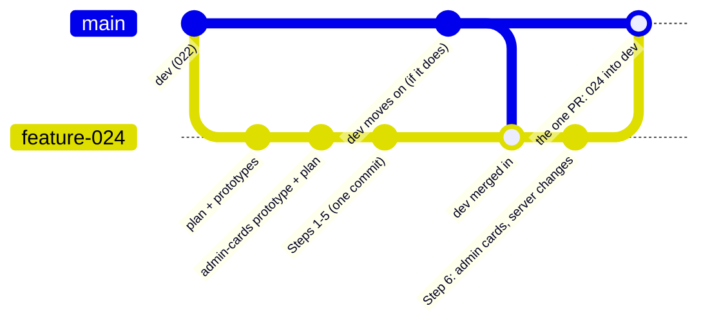
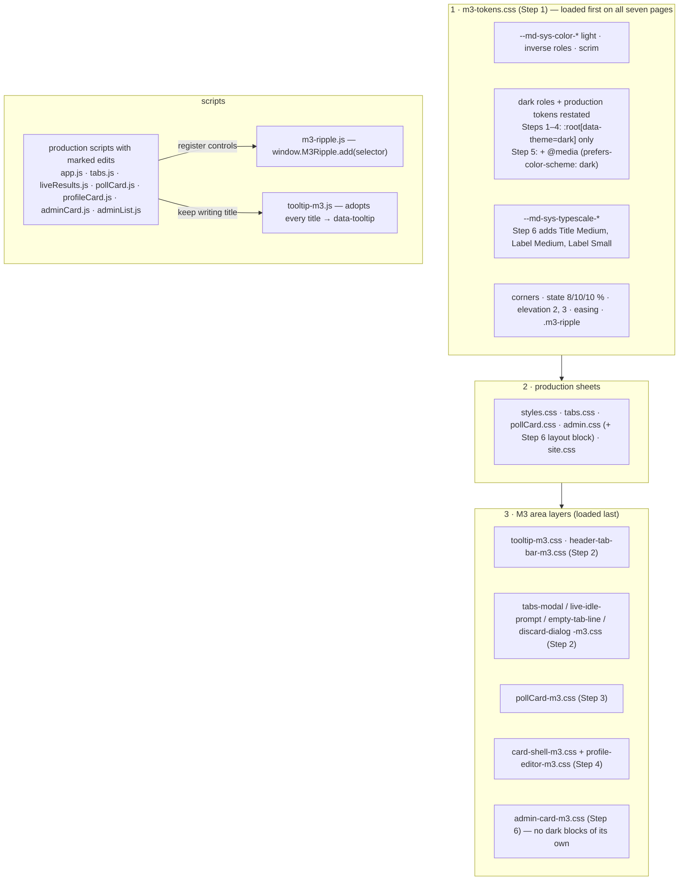
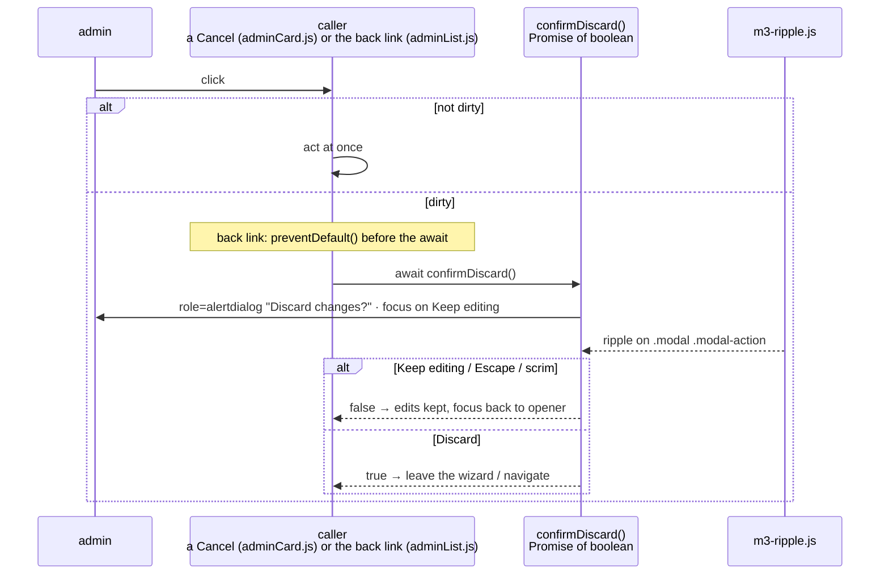
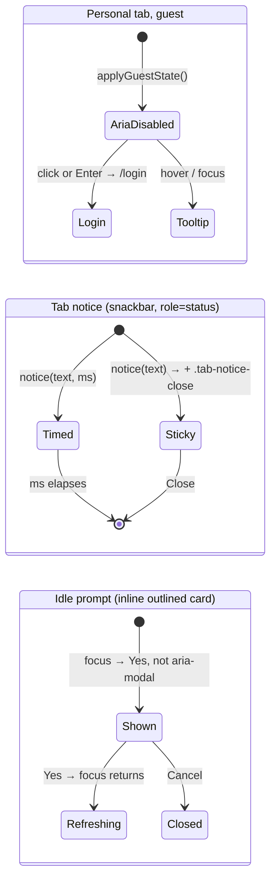
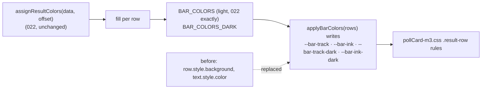
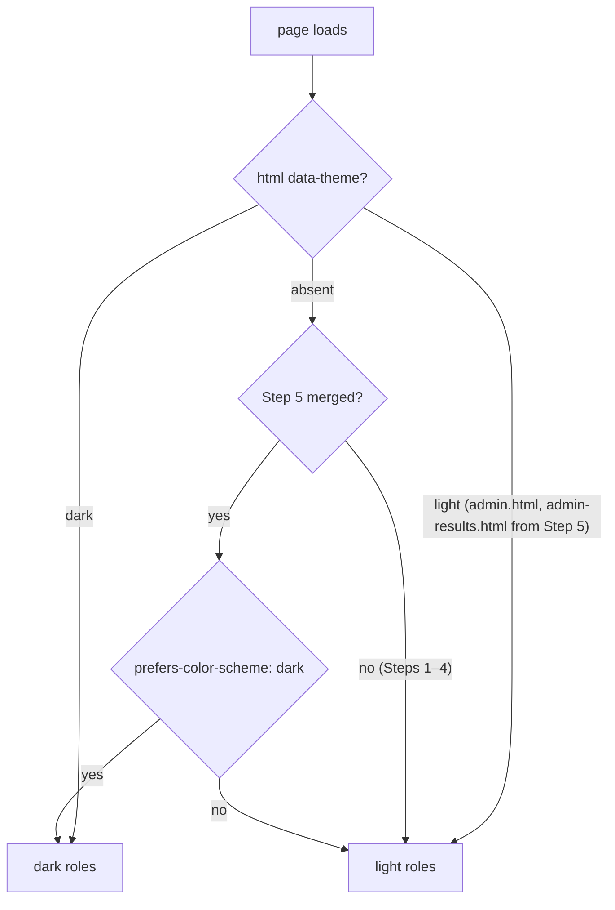
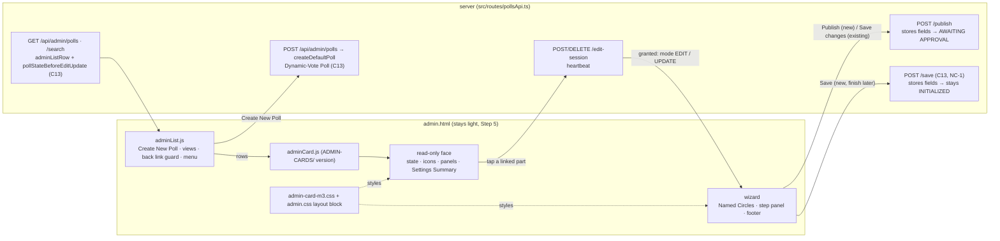
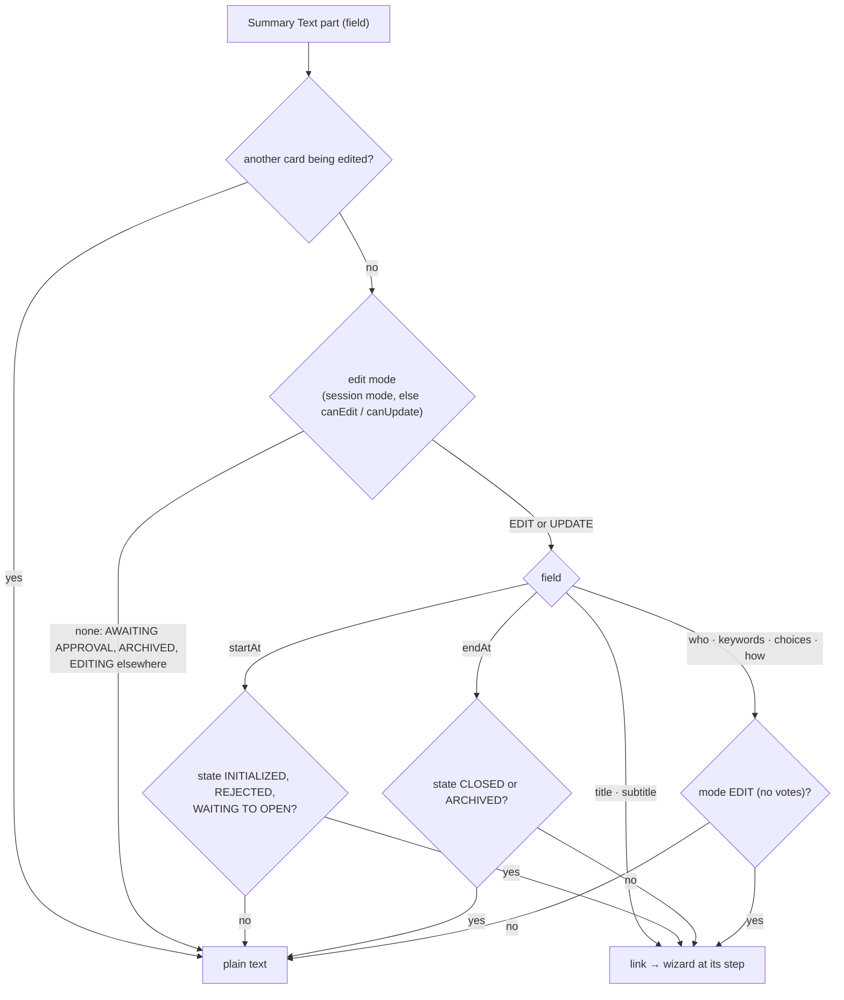
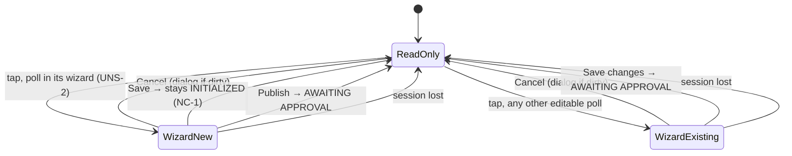
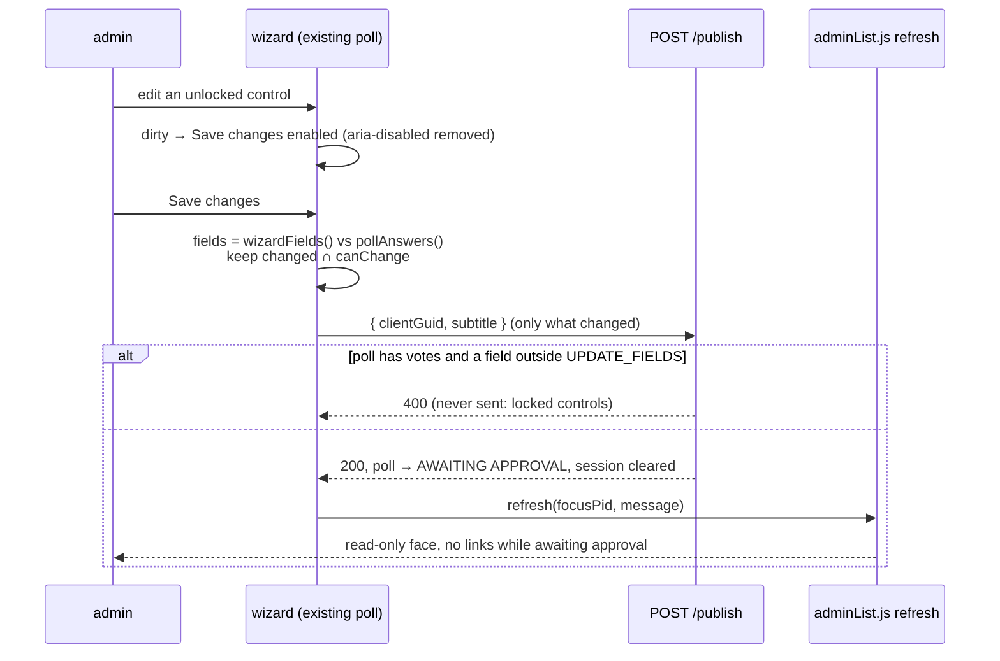

# 024 — Material 3 Merge — Architecture

| | |
|---|---|
| **Requirements document** | `designDocs/024-high-level-requirements-MATERIAL3-MERGE.md`, 649 lines |
| **Architecture directory** | `architecture/024-material3-merge` (reused: `.specify/architecture.json` records it for this same requirements document) |
| **Main document** | `architecture/024-material3-merge/architecture.md` |
| **Mode** | REGENERATE |
| **Generated** | 2026-10-02, second run. The first run (2026-10-01) covered Steps 1–5. Its 25 findings were all resolved in the requirements, and they are summarised in §6.1. This run adds Step 6, the admin cards. |
| **State of the code** | Steps 1–5 are built and committed on `024-MATERIAL3-MERGE` as one commit (`c0da4ad`). Step 6 exists as the prototype `prototypes/POLL-CARD-MATERIAL3/ADMIN-CARDS/` and in the requirements only. |

---

## 1. Overview and scope

024 brings the Material 3 prototypes in `prototypes/POLL-CARD-MATERIAL3/` into `src/public`. The
prototypes are **layers**: each keeps exact copies of the production files it uses and adds its M3
look in sheets and scripts loaded last. The merge keeps that shape: production sheets stay, a
shared token sheet goes under them, and one M3 layer per area goes over them.

The route has four parts:

- A **foundation** comes first, with no visible change (Step 1).
- Each **area** then merges on top of it (Steps 2–4).
- **Dark mode** is switched on (Step 5).
- The **admin cards** merge last (Step 6). This step is a redesign as well as a restyle, and it
  carries 024's only server changes (five, C13).

`dev` (and so production) receives the whole of 024 once, after Step 6.

| ID | Change | Step | Where |
|---|---|---|---|
| C1 | Shared tokens: colour roles (light, dark, inverse, scrim), type scale, shapes, state layers, elevations, easing, the `.m3-ripple` rules | 1 | new `m3-tokens.css` |
| C2 | One delegated press ripple, `window.M3Ripple.add(selector)` | 1 | new `m3-ripple.js` |
| C3 | M3 plain tooltips in place of the browser's `title` tooltips | 2 | new `tooltip-m3.css`, `tooltip-m3.js` |
| C4 | Header, tab bar, search, avatar menu, snackbars (tab notice, cookie banner) | 2 | new `header-tab-bar-m3.css`; `app.js`, `tabs.js` |
| C5 | `Tabs.modal`, Live Results idle prompt, empty-tab line | 2 | new layers; `tabs.js`, `liveResults.js`, `tabs.css` |
| C6 | Not Saved page dialog in place of `window.confirm` | 2 | `adminCard.js`, `adminList.js`, `admin.html` |
| C7 | Fixes: the 640px rule, the avatar button, guest tabs `aria-disabled` | 2 | `tabs.css`, `app.js`, `tabs.js` |
| C8 | Poll Card (both faces) and the maximized view; bar colours as custom properties; `is-multi` | 3 | new `pollCard-m3.css`; `pollCard.js` |
| C9 | 021 hover rule scoped to poll cards | 3 | `site.css` |
| C10 | Card-shell pages (Profile, Login, Create Account, Not Authorized); profile snackbar | 4 | new `card-shell-m3.css`, `profile-editor-m3.css`; `profileCard.js` |
| C11 | Dark mode follows the system setting (admin pages stay light); browser checklist | 5 | every M3 layer; `admin.html`, `admin-results.html` |
| C12 | Admin cards: new-poll wizard, Settings Summary, read-only face, state-worded when-line, the wizard for existing polls, the M3 layer; the edit face and its three voter settings removed; follow-ups after the build: saved progress kept across admin views, `admin.css`'s unused rules removed (spec FR-040, FR-050) | 6 | new `admin-card-m3.css`; `adminCard.js`, `admin.css`, `admin.html`, `m3-tokens.css` |
| C13 | The five server changes: `createDefaultPoll` defaults to `Dynamic-Vote Poll` (visibility stays `Public Poll`); `adminListRow` adds `pollStateBeforeEditUpdate`; new `POST /api/admin/polls/:pid/save` (NC-1); `validatePollFields` accepts `keywords` (spec clarification Q1); `/publish`'s starter-choices hold applies only to unpublished polls (spec FR-049) | 6 | `src/polls/service.ts`, `src/routes/pollsApi.ts`, `postman/openapi.json` |

**Unchanged**:
- every route, configuration variable and table;
- every server file other than C13's two, and every route other than C13's `/save`;
- 022's bar palette, its order and its starting-entry rule, and the Yes/No colours;
- the admin toolbar, search, back link, list notices, and `admin-results.html`'s content;
- the build, since `devScripts/build-assets.ts` fingerprints every top-level `.css` and `.js` in
  `src/public`.

---

## 2. The merge route



This diagram is the route as the requirements' **Branching** section states it (UNS-1, resolved):
every step is committed straight onto the feature branch, Steps 1–5 as one commit, and the only
pull request is the feature branch into `dev`, after Step 6, with the developers' go-ahead. The
`main` lane stands in for `dev`, and `feature-024` for `024-MATERIAL3-MERGE`. `dev` autodeploys,
so nothing reaches it until Step 6 is in.

---

## 3. The layer model

Each page loads `m3-tokens.css` first. Its production sheets follow unchanged (apart from the
named fixes), and the area layers come last. A layer wins by order and reads only tokens.



### 3.1 Which page loads what

| File | index | profile | login | create-account | not-authorized | admin | admin-results |
|---|:-:|:-:|:-:|:-:|:-:|:-:|:-:|
| `m3-tokens.css`, `m3-ripple.js`, Roboto (1) | ● | ● | ● | ● | ● | ● | ● |
| `tooltip-m3.css`, `tooltip-m3.js` (2) | ● | ● | ● | ● | ● | ● | ● |
| `header-tab-bar-m3.css` (2) | ● | ● | ● | ● | ● | ● | ● |
| `tabs-modal-m3.css` (2) | ● | | | | | ● | |
| `live-idle-prompt-m3.css`, `empty-tab-line-m3.css` (2) | ● | | | | | | |
| `discard-dialog-m3.css` (2) | | | | | | ● | |
| `pollCard-m3.css` (3) | ● | | | | | | |
| `card-shell-m3.css` (4) | | ● | ● | ● | ● | | |
| `profile-editor-m3.css` (4) | | ● | | | | | |
| `admin-card-m3.css` (6) | | | | | | ● | |

---

## 4. Behaviour that changes (Steps 1–5)

### 4.1 Tooltips

```mermaid
sequenceDiagram
  participant Prod as production script<br/>(pollCard.js, tabs.js, adminCard.js …)
  participant MO as tooltip-m3.js<br/>MutationObserver (title)
  participant El as control
  participant Tip as one aria-hidden tooltip<br/>on body, position:fixed

  Prod->>El: el.title = "Visit all five steps to publish."
  MO->>El: move to data-tooltip, remove title
  alt mouse
    El->>Tip: enter + 500 ms → show (4 px below, or above; 8 px inside viewport)
    El->>Tip: leave control and tooltip + 150 ms → hide
  else keyboard focus
    El->>Tip: show at once
  else touch
    El->>Tip: 500 ms press → show 1.5 s, no click, no long-press menu
  end
  Note over El,Tip: rows only while cut off · aria-disabled controls keep their tooltip<br/>(guest tabs, Step 2; blocked Publish / Save / Save changes, Step 6)
```

### 4.2 The Not Saved dialog (admin page)



From Step 6, the callers are the new poll's Cancel, an existing poll's Cancel, and the back link.

### 4.3 Guest tabs, notice, idle prompt



### 4.4 Bar colours (Step 3)



### 4.5 Theme resolution



---

## 5. Step 6: the admin cards

### 5.1 Components and flows



### 5.2 Which Summary Text parts are links



### 5.3 The card's faces



### 5.4 Saving an existing poll



---

## 6. Findings

Each item carries a checkbox, with the recommended resolution indented beneath it. The code and
prototype facts cited below were checked against the working tree on 2026-10-02.

### 6.1 Carried over from the first run (all resolved)

| ID | Item | Resolved |
|---|---|---|
| INC-1 … INC-5 | Tooltips moved to Step 2; Step 1's test wording; "no production colour token changes in light"; the complete New files list; "025 or later" | [X] 2026-10-01, Apply all |
| AMB-1 … AMB-6 | `app.js` vs `tabs.js` for the header port; own files for the Step 2 layers; ripple registration and `.m3-ripple` in `m3-tokens.css`; dark blocks confined until Step 5; guest-tab mechanics; `--` bullets | [X] 2026-10-01, Apply all |
| UNS-1 … UNS-4 (first run) | Page × file matrix; jsdom tooltip tests; profile snackbar; notice Close | [X] 2026-10-01, Apply all |
| NC-1 (first run) | Dark mode on the admin pages → `data-theme="light"` | [X] 2026-10-01, Apply it A |
| BC-1 … BC-7 | Listed again in §6.5 | accepted |

The new findings below are numbered from 1 again, for Step 6 and the route.

### 6.2 Inconsistencies

None found. Step 6, Functional Requirements, Exclusions, Afterwards, the page × file table, the
checklist and the token list agree with each other and with `ADMIN-CARDS/`. For example, Step 6
adds exactly the three type roles `admin-card-m3.css` reads that production's `m3-tokens.css`
lacks: Title Medium, Label Medium and Label Small.

### 6.3 Unspecified aspects

- [X] **UNS-1: The Branching section does not record the route the developers chose.** It says
  "each step below is its own pull request into that branch". REQUIREMENT "Merge to CrowdPoll
  Webapp" (recommendation 2) chose otherwise: commit straight onto `024-MATERIAL3-MERGE`, with
  Steps 1–5 as one commit, and the only pull request the one into `dev`. The plan and its
  diagram (§2) still describe six pull requests.
  - *Resolution*: reword Branching to the adopted route:
    - all of 024 is committed on `024-MATERIAL3-MERGE`, Steps 1–5 as one commit (they were built
      together), then Step 6;
    - the only pull request is `024-MATERIAL3-MERGE` into `dev`, after Step 6, with the
      developers' go-ahead;
    - `dev` is merged into the branch if it moves.

    Point to "Merge to CrowdPoll Webapp" for the checklist, and redraw §2 to match.
  - *Resolved 2026-10-03 (Apply all)*: Branching rewritten to the adopted route, with the pointer
    to "Merge to CrowdPoll Webapp"; §2 redrawn.

- [X] **UNS-2: How production knows a poll is "in its wizard".** `ADMIN-CARDS/adminCard.js`
  decides with `isWizardPoll()`, which is `current.cardType === "new" && pollState ===
  "INITIALIZED"`. Only the harness sets `cardType` (`harness.js:164`). Production's
  `adminListRow` has no such field, so every production poll would take the existing-poll path.
  A new poll would get Cancel / Save changes (which re-screens) instead of Cancel / Save /
  Publish, and Steps 1–5 of its wizard would open all visited.
  - *Resolution*: a poll is in its wizard when its worded state is INITIALIZED. That is, when
    `pollState` is INITIALIZED, or EDITING with `pollStateBeforeEditUpdate` INITIALIZED, which
    C13 now carries. No new field is needed. Step 6 states the rule, and `cardType` stays a
    harness-only fixture flag.
    - A24.4's saved progress (current step, visited and answered steps) lives in the card
      instance (`wizardSaved`). After a reload, an INITIALIZED poll's wizard reopens at Step 1
      with its stored answers. Step 6 says so.
  - *Resolved 2026-10-03 (Apply all)*: Step 6's wizard bullet states the worded-state rule,
    `cardType` as harness-only, and the reload behaviour.

- [X] **UNS-3: Create New Poll opens the new card by clicking `.card-pen`.** That is
  `src/public/adminList.js:470`, `controller.element.querySelector(".card-pen")?.click()`.
  REQUIREMENT021 removed the pen, so the new poll would not open in its wizard. Step 6 names no
  `adminList.js` change.
  - *Resolution*: `adminCard.js`'s controller exposes `openWizard()` (`requestEdit(1)`).
    `adminList.js`'s Create New Poll calls `controller.openWizard()` in place of the pen click.
    Step 6 and "Changed scripts" name the `adminList.js` edit, and a client test covers Create New
    Poll opening Step 1.
  - *Resolved 2026-10-03 (Apply all)*: Step 6 names `openWizard()` and the `adminList.js` edit;
    "Changed scripts" lists both scripts; Step 6's tests add the Create New Poll client test.

- [X] **UNS-4: The existing tests that read the edit face.** Step 6's tests name only "the
  existing admin client tests, updated where the read-only face changed". Removing the edit face
  also breaks:
  - `tests/poll-card-assets.test.ts`: the 012 sections on Save and Publish availability and
    participant edits, which slice `adminCard.js`'s source at `participantRows`,
    `rosterCount`, …;
  - `tests/polls-editing-eligibility.test.ts`: "offers Save and Publish, then Cancel, on the
    card's editing face" and its neighbours;
  - `tests/client-admin-discard.test.ts`: it opens the card with `.card-pen` and reads
    `.card-header--editing`.
  - *Resolution*: Step 6's tests list them by name.
    - The edit-face assertions in the first two are retired, with a note naming this step.
    - `client-admin-discard.test.ts` is rewritten to open the wizard from the Summary Text and
      use the wizard's Cancel and the back link.
    - The server suites that mention "Save and Publish" only in comments or route names (for
      example `polls-admin-crud.test.ts`) are unaffected.
  - *Resolved 2026-10-03 (Apply all)*: Step 6's tests list the three suites by name, with what is
    retired and what is rewritten.

### 6.4 Needs clarification

- [X] **NC-1: The new poll's Save has no production route.** A24.4 makes Save keep the answers
  and leave the poll INITIALIZED. `ADMIN-CARDS/adminCard.js` posts to
  `/api/admin/polls/:pid/save` (`postWizard("/save")`), which only the harness answers.
  Production has no `/save` route: its routes are `edit-session`, `publish`, `rescreen`,
  `results`, the exports and `duplicate`. `/publish` always sends a poll to screening, so it
  cannot stand in. Step 6 promises "the two server changes in 024", and the Exclusions forbid
  any further server or route change.
  - **Option A (recommended)**: a third server change, `POST /api/admin/polls/:pid/save`.
    - It takes the same fields as `/publish` and the edit-session lock, and validates with
      `validatePollFields`.
    - It accepts only a poll whose effective state is INITIALIZED, stores the fields, keeps it
      INITIALIZED, and clears the session.
    - It is described in `postman/openapi.json`, and has server tests.
    - Step 6's server list, Functional Requirements, Exclusions and the Overview say three.
    - Save works as designed and as the prototype shows.
  - **Option B**: drop Save from the new poll's wizard in 024. The footer becomes Cancel /
    Publish, and A24.4's "finish later" waits for a later requirement. There is no server
    change, but an admin who leaves loses their answers, and the prototype changes.
  - **Option C**: Save goes through `/publish` and is refused by the "still has its default
    values" rule. This works only while the poll still holds its defaults, so it is not a real
    option. Listed for completeness.
  - *Resolved 2026-10-03 (Apply it A)*: Step 6 lists three server changes, the third being
    `POST /api/admin/polls/:pid/save` with its rules and server tests; the table in §1, the
    "Server" line, Functional Requirements and Exclusions follow. The Overview names no count,
    so it is unchanged.

### 6.5 Breaking changes

None breaks a server contract. `adminListRow`'s new field, the `/save` route and `keywords` on publish and save are additive.

- [X] **BC-1 … BC-7 (Steps 1–5)**:
  - bar colours become custom properties;
  - `confirmDiscard()` becomes `Promise<boolean>`;
  - guest tabs lose `disabled`;
  - the idle prompt's text changes;
  - the Live Results link loses "open in new tab" on touch;
  - `title` moves to `data-tooltip`;
  - dark follows the system.

  All accepted in the first run.
- [X] **BC-8: New polls default to `Dynamic-Vote Poll`** (`createDefaultPoll`). Existing polls
  are unchanged. *(Accepted in Step 6, with the two test assertions named.)*
- [X] **BC-9: The edit face goes, and with it the only place to change a poll's Voter Count
  Limit, invitations and bans.** Stored values stay, and the routes stay. *(Accepted in Step 6
  and Functional Requirements, until the voter-settings requirement.)*
- [X] **BC-10: Editing an existing poll is the wizard, and only what the state lets change is
  offered.** The start date's rule is tighter than the server's. *(Accepted in Step 6.)*
- [X] **BC-11: Tests that assert the edit face break.** See UNS-4.
  - *Resolution*: as UNS-4. Retire or rewrite them by name in Step 6's tests.
  - *Resolved 2026-10-03 (Apply all)*, with UNS-4.

---

## 7. Assumptions

| # | Assumption | Basis |
|---|---|---|
| A1 | The prototypes are verified copies. Their production files differ from `src/public` only by marked edits. `ADMIN-CARDS/`'s `styles.css`, `tabs.css`, `site.css` and `pollCard.css` are byte-identical to the working tree. | Checked when `ADMIN-CARDS/` was made. |
| A2 | `admin-card-m3.css` reads only tokens that `m3-tokens.css` holds, plus the three Step 6 adds. | Every `var(--md-sys-*)` it reads was checked against `src/public/m3-tokens.css`. Only Title Medium, Label Medium and Label Small are missing. |
| A3 | `admin.html` stays `data-theme="light"`, so the cards' dark look is reached only through `data-theme="dark"` in development. | Step 5. |
| A4 | The wizard's 50-character subtitle and 40-character choice caps are client-side, for new polls only. Existing polls keep the server's 100, so stored values are never cut. | `ADMIN-CARDS/adminCard.js`, and REQUIREMENT "Wizard When Editing An Existing Poll" NOTES. |
| A5 | Saving any poll through `/publish` sends it back to AWAITING APPROVAL, with or without votes, as production does today. The card says so. | `src/routes/pollsApi.ts` `/publish`. |
| A6 | `data-theme` is a development and test hook, except `data-theme="light"` on the two admin pages. | "No theme picker in the product". |
| A7 | The spec directory is `specs/024-MATERIAL3-MERGE/`, and this run creates no branch. | The requirements' Assumptions; the skill's rule. |
| A8 | New polls stay `Public Poll`, so the wizard opens Step 1 on "Everyone on CrowdPoll", not on A25.1's private default. Keywords are saved through `validatePollFields`. | `/speckit-specify` clarifications, 2026-10-03 (Q2 B, Q1 A), carried into the requirements' Step 6. |

---

## 8. Completion Report

| Item | Value |
|---|---|
| **Mode** | REGENERATE. The directory was reused, since `.specify/architecture.json` records it for the same requirements document, and the file was overwritten. |
| **Architecture directory** | `architecture/024-material3-merge` |
| **Main document** | `architecture/024-material3-merge/architecture.md` |
| **Source requirements** | `designDocs/024-high-level-requirements-MATERIAL3-MERGE.md`, 649 lines when generated; 696 after Apply all and NC-1 |
| **Software architecture diagrams** | 11, plus the page × file matrix. Merge route, layer model, tooltip sequence, Not Saved sequence, guest tab / notice / idle prompt states, bar colours flow, theme resolution; Step 6 components and flows, Summary Text link rule, card faces, saving an existing poll. |
| **Inconsistencies** | 0 new (5 from the first run, resolved) |
| **Ambiguities** | 0 new (6 from the first run, resolved) |
| **Unspecified aspects** | 4 new, resolved 2026-10-03 by Apply all (UNS-1 … UNS-4); 4 from the first run, resolved |
| **Needs Clarification items** | 1 new, resolved 2026-10-03 by Apply it A (NC-1: a third server change, `POST /api/admin/polls/:pid/save`); 1 from the first run, resolved |
| **Breaking changes** | 11: BC-1 … BC-10 accepted; BC-11 resolved with UNS-4 |

**Readiness for `/speckit-specify`**: ready. Every finding is resolved.
- **Steps 1–5** are ready, and built.
- **Step 6** has three server changes (NC-1, Option A), and UNS-1 … UNS-4 and BC-11 were closed by
  "Apply all" on 2026-10-03.
