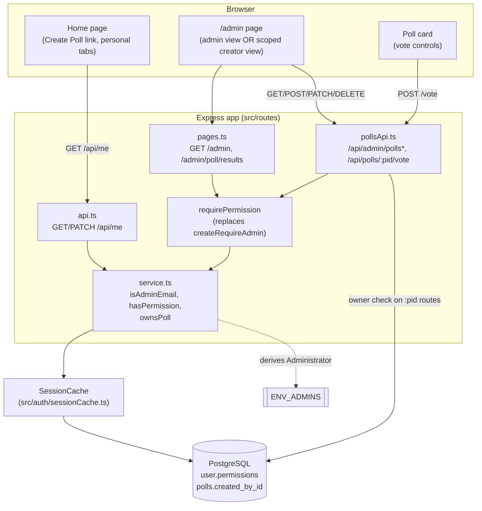
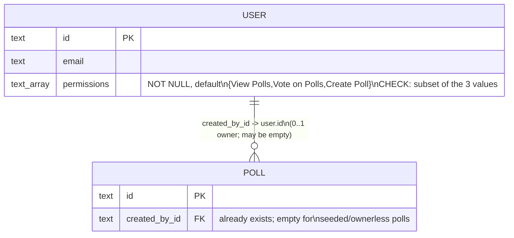
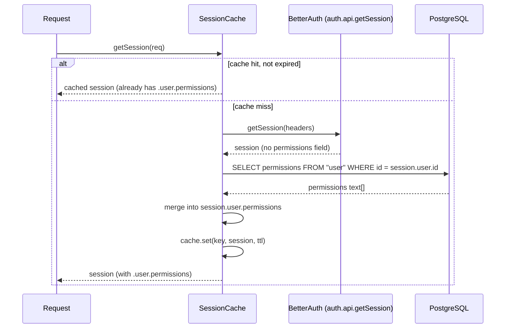
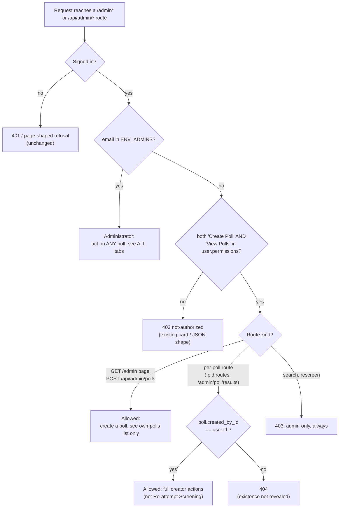
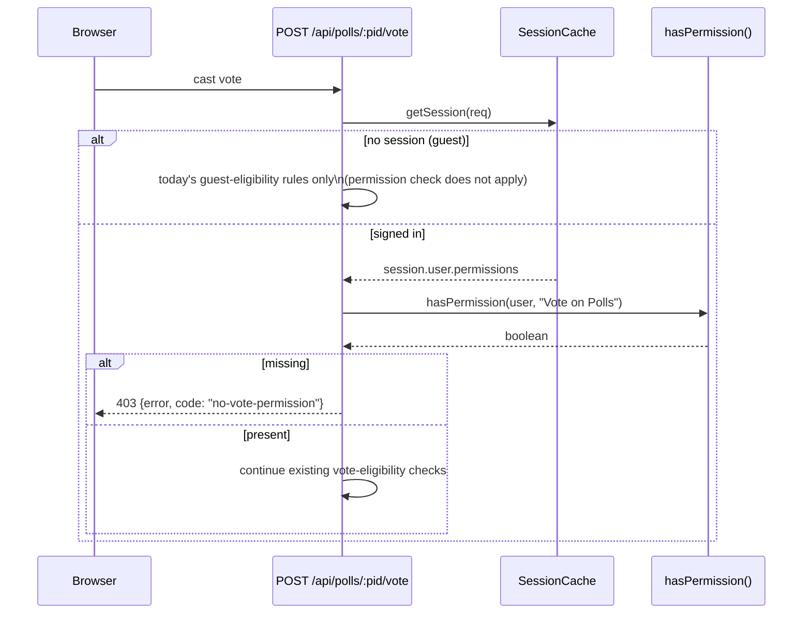
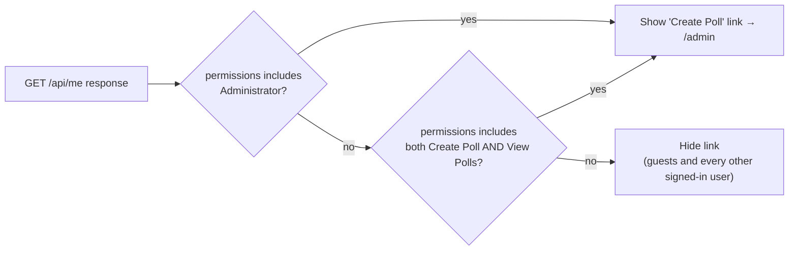
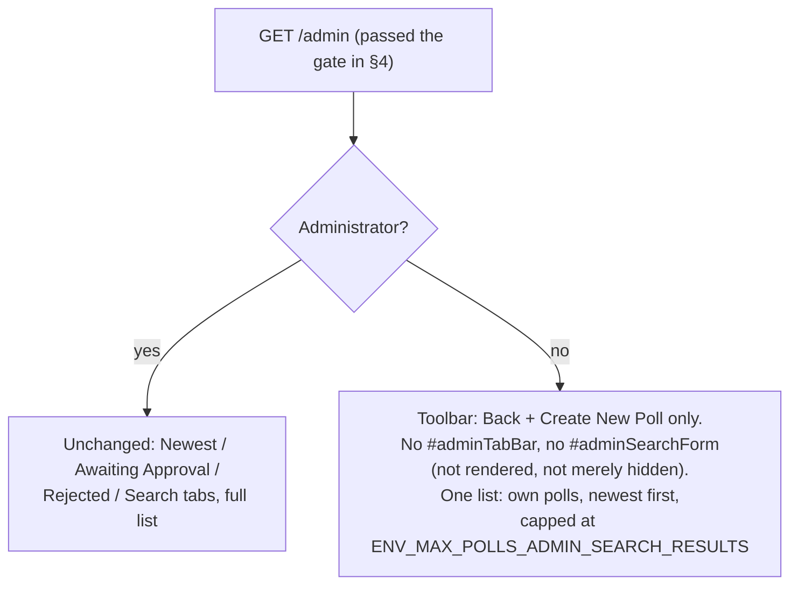

# Architecture: 025 — User Permissions

Source requirements: `designDocs/025-high-level-requirements-USER-PERMISSIONS.md`

## 1. Overview and Scope

Today, `/admin` and every `/api/admin/*` route are gated by one predicate,
`isAdminEmail(email, config)`, fed by the `ENV_ADMINS` allow-list
(`src/polls/service.ts:742`, shared by `createRequireAdmin` at
`src/polls/service.ts:758` and used in `src/routes/pollsApi.ts` and
`src/routes/pages.ts`). A user is either a full admin or has no access to poll
authoring at all.

025 splits that binary into four grants, three of them stored per user and one
derived:

| Grant | Stored? | Governs |
|---|---|---|
| `View Polls` | yes (`user.permissions`) | Opening a private (link-only/invitation) poll; a non-empty My Private Polls tab; adding a bookmark or Live Results entry |
| `Vote on Polls` | yes (`user.permissions`) | Casting a vote |
| `Create Poll` | yes (`user.permissions`) | Creating polls, reaching `/admin`, acting on polls one created |
| `Administrator` | no — derived from `ENV_ADMINS` | Everything, on every poll |

The scope is: a new `permissions text[]` column on `user`; a server-side
authorization split that lets a non-admin **creator** reach a scoped `/admin`
and act on **their own** polls (never another user's); a `403` for a vote
attempt without `Vote on Polls`; and `permissions` surfaced on `GET /api/me`.
Explicitly out of scope (see Exclusions below and in the requirements doc): an
admin UI to set permissions, site-wide banning, and porting the
non-admin poll-editing card prototype.

No new environment variable. No queue, cache, or search-index change. One
schema migration, additive only, with a column default that back-fills every
existing row.

## 2. System Context

## 3. Data Model Change

`permissions` is intentionally **not** declared to BetterAuth (its Kysely
adapter cannot store arrays — R in the requirements doc). It is read in the
same query the session cache already does on a cache miss and merged into the
cached `session.user` object, so a cache hit costs no extra round trip.

## 4. Authorization: Replacing the Single Admin Gate

`createRequireAdmin` (`src/polls/service.ts:758`) is the one seam both
`pollsApi.ts` and `pages.ts` already share — 025 generalizes it rather than
forking it, so the 403-vs-404 shape stays a single decision point.

`GET /api/admin/polls` itself is not a per-poll route: the same handler
(`adminListRow` in `src/routes/pollsApi.ts:542`) stays, but its query gains a
`WHERE created_by_id = :userId` clause whenever the caller is not an admin
(requirements doc, "CREATING Polls by non-Admin users").

## 5. Vote Permission Check

The guest branch reflects the recommended resolution to Needs-Clarification
N1 below.

## 6. Create Poll Link Visibility (Home Page)

## 7. `/admin` Page Layout Branch

## 8. Inconsistencies

- [X] **I1 — Does `/admin` access and poll creation need `Create Poll` alone, or `Create Poll` *and* `View Polls`?**
  Three places in the requirements doc require **both**: the "Create Poll
  link" bullet ("shown to users with Administrator, **or with both** Create
  Poll and View Polls"), the "CREATING Polls by non-Admin users" heading ("A
  user who has **both** the Create Poll and View Polls permissions..."), and
  "Missing permissions" ("No Create Poll, **or no View Polls**... `/admin`
  shows the ... 403; poll management needs Administrator, **or both** Create
  Poll and View Polls"). But "Access enforcement on the server" states
  `POST /api/admin/polls` needs **`Create Poll` (or Administrator)`** only,
  and the Permissions table's `Create Poll` row ("Creating polls, opening
  `/admin`, and acting on their own polls") never mentions `View Polls` as a
  co-requirement. A user with `Create Poll` but not `View Polls` would be
  refused the page (403, per the 3-to-1 majority reading) yet — read
  literally — could still call `POST /api/admin/polls` directly and succeed,
  since that line names no second permission.
  - **Resolved:** amended "Access enforcement on the server" in the
    requirements doc to read *"`POST /api/admin/polls` needs `Create Poll`
    and `View Polls` (or `Administrator`)"*, matching the majority wording,
    and added a parenthetical to the Permissions table's `Create Poll` row
    noting it is exercised together with `View Polls`. One authorization
    rule now governs reaching `/admin` and creating a poll (§4's flowchart
    updated to match); the Breaking Changes test list gained a fourth case
    (§13).

## 9. Ambiguities

- [X] **A1 — "personal tabs" is used but never enumerated.** "`View Polls`...
  Without it, a signed-in user's personal tabs are empty" names no specific
  tabs, and the codebase has several tabs with different scopes (Trending,
  Newest, My Private Polls, Favorites, Live Results — specs 017–021).
  - **Resolved:** the requirements doc now names the **My Private Polls**
    tab — the only personal tab that lists only private polls
    (`privateTab()`, `src/polls/userPolls.ts`). Favorites lists only public
    polls and is unaffected; Live Results is mixed and is not filtered (a
    private poll already there stays until the user removes it). Trending and
    Newest stay global/public and are unaffected by `View Polls`. (Corrected
    during `/speckit-analyze-resolve` on 2026-10-04: the first resolution
    named Favorites and Live Results, which contradicted FR-014.)

## 10. Unspecified Aspects

- [X] **U1 — Exact form of the `CHECK` constraint on `user.permissions`.**
  The requirements doc says a `CHECK` constraint "limits it to those three
  values" but doesn't give the predicate. An equality/array-literal check
  would wrongly reject any subset or reordering (e.g. a tester clearing one
  grant by hand, per the Exclusions section's testing note).
  - **Resolved:** the requirements doc's Storage section now specifies
    `CHECK (permissions <@ ARRAY['View Polls','Vote on Polls','Create Poll']::text[])`
    — containment, not equality — so any subset (including the empty array)
    is valid and order doesn't matter.

- [X] **U2 — What "refused" means when `View Polls` is missing and a user opens a private poll's link.** The doc states the outcome ("a private poll's
  link is refused") but not the mechanism (status code / page shown).
  - **Resolved:** the requirements doc's Permissions table now folds the new
    rule into whatever the poll already returns today for a visitor who is
    not eligible for its visibility/sharing mode (e.g. a non-invited user
    hitting an invitation-only poll) — "missing `View Polls`" is one more
    reason inside that existing ineligibility check, not a new response
    shape.

- [X] **U3 — The Exclusions section cites a path that does not exist in the
  repository.** "the new-poll card designed in
  `designDocs/UI-UX-FOR-PRIVATE-POLLS/NON-ADMIN-POLL-EDITING/`" — no such
  directory exists under `designDocs/`. The actual prototype and its
  recommendations file are at
  `prototypes/POLL-CARD-MATERIAL3/NON-ADMIN-POLL-EDITING/accepted-recommendations.md`.
  - **Resolved:** corrected the path in the requirements document to
    `prototypes/POLL-CARD-MATERIAL3/NON-ADMIN-POLL-EDITING/`.

## 11. Needs Clarification

- [X] **N1 — Does the `Vote on Polls` check apply to guests (no session),
  or only to signed-in users?** `permissions` and its default live only on
  the `user` table; a guest has no user row and so no stored `Vote on Polls`
  grant at all. Read literally, "Voting in any poll the user is otherwise
  eligible to vote in" could be mistaken to require the grant universally,
  which would silently break today's anonymous voting on public polls — a
  severe regression if implemented the wrong way.
  - **Resolved:** the requirements doc's "Missing permissions" section now
    states the `Vote on Polls` check (and its `403 no-vote-permission`)
    applies only when the caller is signed in. A guest vote is governed by
    whatever eligibility rule already decides it today, unchanged. This is
    the branch modeled in §5 above.

## 12. Assumptions (carried from the requirements doc, confirmed against the code)

- `user.id` is the existing BetterAuth-managed primary key; `polls.created_by_id`
  already exists and is already populated on poll creation
  (`src/db/schema.ts:95`).
- The admin gate is consolidated in exactly one place today
  (`createRequireAdmin`, `src/polls/service.ts:758`, shared by
  `src/routes/pollsApi.ts` and `src/routes/pages.ts`) — 025 generalizes that
  one function rather than introducing a second gate.
- `isAdminEmail` (`src/polls/service.ts:742`) stays the sole source of the
  derived `Administrator` grant; nothing about `ENV_ADMINS` parsing changes
  (`src/config.ts:213`).
- The next migration file follows the existing numeric convention in
  `src/db/migrations/` (currently `001`…`005`), so 025 adds `006-*.ts`.
- No limit on polls per creator; existing screening, floors and budgets are
  unchanged (per requirements doc Assumptions).

## 13. Breaking Changes

(Documented per requirements doc §Breaking Changes — not failures, but noted
here for visibility.)

- `/admin` and `/api/admin/*` no longer refuse every non-admin outright.
  `tests/polls-admin-crud.test.ts` and `tests/pages.test.ts` need their
  blanket "every non-admin is refused" assertions replaced with four cases:
  guest (401/403), signed-in user without `Create Poll` (403), signed-in
  user with `Create Poll` but not `View Polls` (403, per I1's resolution),
  and a creator reaching another user's poll (404).
- The API contract changes: `POST /api/polls/:pid/vote` gains a new `403`
  shape (`no-vote-permission`), and `GET /api/me` gains `permissions`.
  `postman/openapi.json` and `tests/openapi-contract.test.ts` must follow.
- `user` table shape changes: new `permissions` column, additive, with a
  default that back-fills existing rows — no data loss, no migration step
  needed per the requirements doc's "No Data Migration Necessary" section.

## Completion Report

- **Mode:** REGENERATE
- **Location:** `architecture/025-user-permissions/`
  - Main document: `architecture/025-user-permissions/architecture.md`
- **Diagrams:** 7 (system context, ER, session-cache sequence, authorization
  flowchart, vote-check sequence, Create-Poll-link flowchart, `/admin`
  layout-branch flowchart)
- **Inconsistencies:** 1 (resolved)
- **Ambiguities:** 1 (resolved)
- **Unspecified Aspects:** 3 (resolved)
- **Needs Clarification items:** 1 (resolved)
- **Breaking Changes:** 3 (documented, not a failure)

**Readiness for `/speckit-specify`:** Ready. All 6 items (1 inconsistency, 1
ambiguity, 3 unspecified aspects, 1 clarification) are resolved — each
checkbox above is checked, and the corresponding edits were carried into
`designDocs/025-high-level-requirements-USER-PERMISSIONS.md`.
