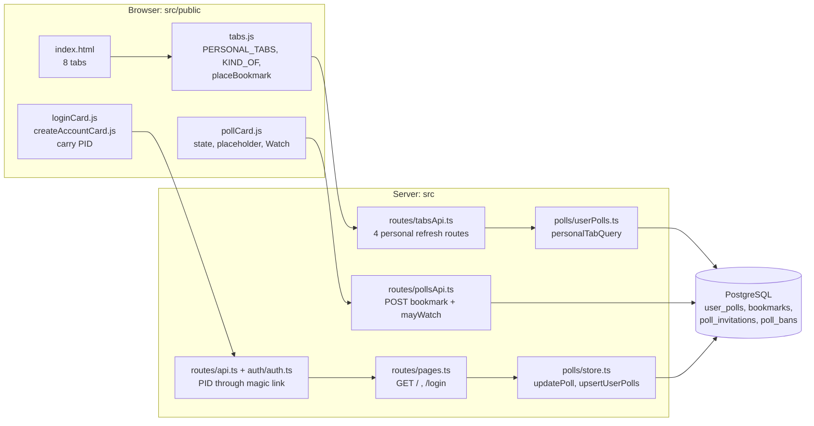
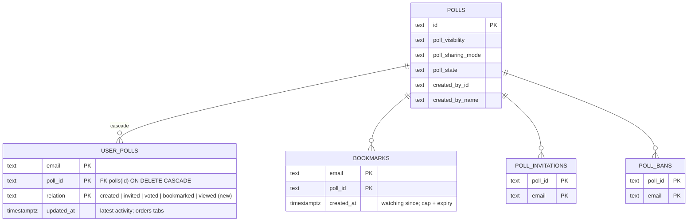
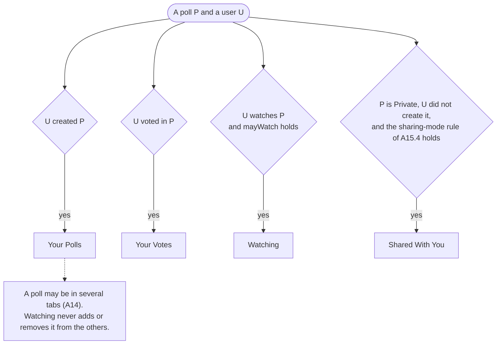
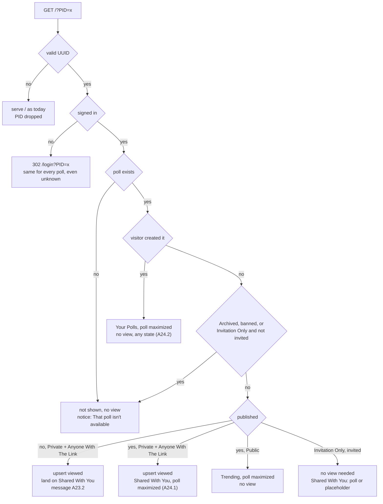
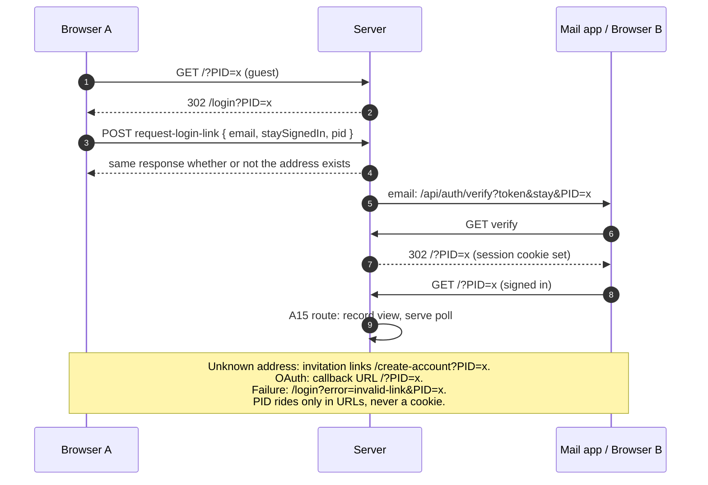
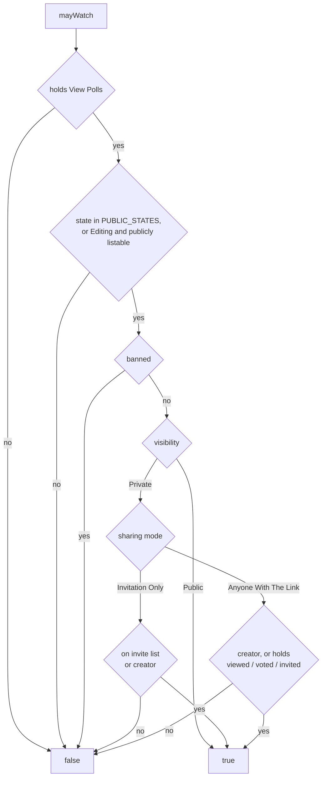
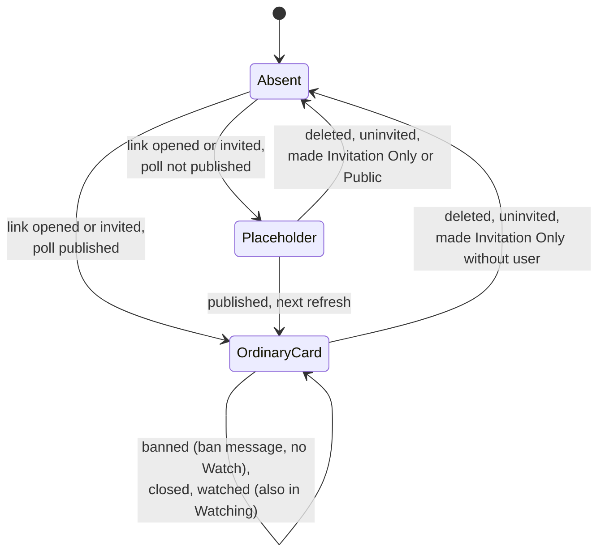

# Architecture: 026 — Home Page Tabs

Source requirements: `designDocs/026-high-level-requirements-HOME-PAGE-TABS.md` (A1–A24; A24 records the resolutions of the first architecture pass)

## 1. Overview and Scope

The goal (A1) is to make **private polls** the most prominent part of the site. The home page tab bar is refactored from `Trending · Newest · My Private Polls · Favorites · Live Results · Search` into eight tabs:

**Your Polls · Shared With You · Your Votes · Trending · Newest · Watching · Live Results · Search**

Seven things change:

| # | Change | Req. |
|---|---|---|
| 1 | Three new personal tabs (Your Polls, Shared With You, Your Votes); My Private Polls retired | A2, A3, A9, A10 |
| 2 | Favorites becomes **Watching** (eye icon, Watch/Watching button) and narrows to deliberate watches only | A5–A8, A11 |
| 3 | "Your/You" voice everywhere, Title Case labels, UI-only rename | A4, A12, A13 |
| 4 | Each tab is one relation of `user_polls`; a poll may be in several tabs. One new relation value, `viewed` — no schema change | A14, A15.5 |
| 5 | `/?PID=<pid>` opens the poll (today it is dropped); the server records a `viewed` relation | A15 |
| 6 | Guest links go straight to sign-in and the poll id survives the whole round trip (including create-account and OAuth) | A22 |
| 7 | New `mayWatch` access check; unpublished-poll placeholder card; `invited` rows deleted on uninvite | A17, A19, A23 |

Out of scope: phone tab-fit layout (A18), email of watched results (A20), removal from Shared With You (A19), view expiry (A21), poll-creation UX (next spec).

## 2. Tab Model: One Relation Set per Tab

`user_polls (email, poll_id, relation, updated_at)` already holds every relation. 026 adds the value `viewed`; no migration (the column is plain `text`).

| Tab | `data-tab` | Relations | Visibility filter | Extra rule |
|---|---|---|---|---|
| Your Polls | `your-polls` | `created` | none | every state; creator only |
| Shared With You | `shared-with-you` | `invited`, `viewed` | Private Poll | not own; Invitation Only → current invite list; Anyone With The Link → `viewed` or `invited` (A15.4); redacted placeholder if unpublished |
| Your Votes | `your-votes` | `voted` | none | published states + Archived read-only; unreachable private polls hidden, banned kept (A24.6) |
| Watching | `watching` | `bookmarked` | none | drop rows failing `mayWatch` |
| Trending / Newest / Live Results / Search | unchanged | — | — | — |

## 3. Poll Link Route and Sign-In Round Trip (A15, A22, A23)

Today `GET /` redirects `/?PID=…` to `/`. The new behavior, decided **before any poll lookup** so nothing leaks:

The id is validated as a UUID at every step and every redirect is built by the server (`/?PID=<encoded uuid>`) — no open redirect (A22.3). One shared helper does both.

## 4. Watch Access Check (A17)

`mayWatch(db, email, userId, pid)` — one function used by `POST /api/polls/:pid/bookmark`, the Watching tab query, the personal-tab overlay, and the future results email. `DELETE` stays unchecked. A failure answers `404 Not found`.

The `View Polls` test is the 025 check the bookmark route already makes first, so guests never reach the rest (A24.5). The tabs stay visible to everyone signed in; only the Watch control is hidden without `View Polls`. Vote controls follow `Vote on Polls` as today.

## 5. Shared With You Card Lifecycle (A23)

The placeholder is a **server-side redacted projection**: pid, `notPublished: true`, `createdByName`, view time — no title, choices, counts, overlay or `mayWatch`. Text: "Shared by <name>" or "Shared with you"; never an email address.

## 6. Components and Change Map

| Area | File | Change |
|---|---|---|
| Server | `src/polls/userPolls.ts` | `visibility` optional; `yourPollsTab`, shared/votes/watching queries; `privateTab`, `favouritesTab` removed |
| | `src/db/schema.ts`, `src/polls/store.ts` | `"viewed"` in `UserPollRelation` and `upsertUserPolls`; `updatePoll` deletes `invited` rows of removed emails |
| | `src/routes/tabsApi.ts` | four personal refresh routes; `/api/tabs/private/refresh` retired; redacted placeholder projection; rejection reason for creator only |
| | `src/routes/pollsApi.ts` | `mayWatch` before `addBookmark`; new `404` |
| | `src/routes/pages.ts` | link route; `/login`, `/create-account` carry `PID` |
| | `src/routes/api.ts`, `src/auth/auth.ts`, `src/email/` | optional `pid` through request, magic link metadata, verify, OAuth callback |
| Client | `index.html`, `tabs.js`, `tabs.css` | eight tabs; `PERSONAL_TABS`/`KIND_OF`; `showBookmark:false` removed; `placeBookmark` → Watching only |
| | `pollCard.js`, `deltaClient.js` | state + rejection reason; placeholder; Watch/Watching eye; "listed because" suppressed in Your Polls |
| | `loginCard.js`, `createAccountCard.js` | send `pid`; show generic line (A22.4) |
| Docs | `postman/openapi.json`, `CLAUDE.md` | routes, `pid`, `PID`, 404; comments "My PRIVATE POLLS" updated |
| Config / DB | — | **No new `ENV_*`, no migration, no table, column or index** |

## 7. Findings of This Pass

The first pass found 16 items (2 inconsistencies, 3 ambiguities, 8 unspecified aspects, 3 needs-clarification). All were applied to the requirements (A15.1, A15.3, A15.4, A16.1, A16.5, A19.3 and the new A24). This pass re-checked the revised requirements against each other and against the code.

### 7.1 Resolved in the requirements

- [X] I1 — A16.1 stale after 025 → rewritten (`Create Poll` + `View Polls`).
- [X] I2 — A15.4 vs A19.2/A19.4 → one rule per sharing mode in A15.4.
- [X] Am1 — creator opening own link / Archived → A24.2.
- [X] Am2 — `invited` on an Anyone With The Link poll → A15.4, A24.4.
- [X] Am3 — historic stale `invited` rows → A19.3 does both options.
- [X] U1 default tab → A24.7 · [X] U2 "not shown" notice → A24.3 · [X] U3 state and order → A24.7 · [X] U4 view-write cost → A24.7 · [X] U5 icons → A24.7 · [X] U6 empty states → A24.7 · [X] U7 "listed because" wording → A24.7 · [X] U8 identifiers → A24.7.
- [X] NC1 linked-poll presentation → A24.1 · [X] NC2 025 permissions → A24.5 · [X] NC3 Your Votes after access loss → A24.6.

### 7.2 Inconsistencies

None. The resolved text of A15.4, A19.2, A19.4, A17.2 and A24 agrees: Invitation Only lists through the current invite list; Anyone With The Link lists through `viewed` or `invited`.

### 7.3 Ambiguities

None.

### 7.4 Unspecified Aspects

- [X] **U9 — How a linked public poll is mounted when it is not in the tab's list.** A24.1 shows a public poll as the maximized card over **Trending**, but a poll outside the 200 Trending rows has no card there. 021 only keeps an already-mounted card (`retainMaximized`).
  - *Recommendation:* the link route sends the poll's id with the page. The client fetches that one poll through the existing overlay/poll projection, mounts it as a retained card (as 021's `patchRetained` does for a dropped poll), and maximizes it. It is not added to Trending's list, and closing removes it. Votes and Watch keep working through the retained card.
  - *Resolution (applied):* A24.1 extended: the link route passes the id; the client mounts a retained card (021) and maximizes it, without adding it to the list.

### 7.5 Needs Clarification

None.

## 8. Assumptions

- Poll ids are `randomUUID()`; the UUID check in A22.3 is sound (confirmed in `src/polls/service.ts`).
- `user_polls.relation` has no check constraint, so `viewed` needs no migration (A15.5).
- The bookmark route already refuses callers without `View Polls` (025, `pollsApi.ts:109`), so guests and permission-less users never reach `mayWatch`.
- Both `watching-icon.svg` and `watching-icon-active.svg` exist under `dontTrack/` (A7, confirmed).
- `personalTabQuery` takes `visibility` as a parameter today; making it optional is additive.
- 021's retained-card mechanism can mount a card not in the grid's list (basis for U9's recommendation; to verify at planning).
- Magic-link `metadata` is the carrier for `pid`, as for `origin` and `stay` (`src/auth/auth.ts`).

## 9. Breaking Changes

1. **`GET /?PID=` changes**: it was a silent redirect to `/`; guests now go to `/login?PID=`, and signed-in users get the poll. Links already shared keep working, now with a sign-in step.
2. **Tab ids and routes**: `private` and `favourites` are replaced; `POST /api/tabs/private/refresh` is retired; selectors, tests, comments (`tabs.js`, `pollCard.js`, `deltaClient.js`) change.
3. **Favorites narrows**: invited and voted polls no longer appear in it. A user's existing voted polls move to Your Votes; invited ones to Shared With You.
4. **`POST /api/polls/:pid/bookmark` can now answer `404`** for private polls the user cannot reach and for unpublished polls.
5. **`updatePoll` now deletes `invited` rows** when an invite list shrinks, and the Shared With You query also checks the current invite list.
6. **Sign-in surfaces gain an optional `pid`** on `request-login-link`, `create-account`, `verify` and the OAuth callback (additive; older emailed links still work).
7. **UI vocabulary**: star → eye, Favorites → Watching, "My Private Polls" → three tabs; tooltips and tests asserting the old words change.

## Completion Report

- **Mode:** REGENERATE (the document was regenerated against the requirements as revised by the first pass's resolutions; the recorded directory was reused)
- **Location:** `architecture/026-home-page-tabs/`
  - Main file: `architecture/026-home-page-tabs/architecture.md`
- **Software Architecture Diagrams:** 7 (context/component, ER, tab-membership flow, link-route decision flow, sign-in sequence, `mayWatch` flow, card-lifecycle state)
- **Inconsistencies:** 0 open (2 resolved earlier)
- **Ambiguities:** 0 open (3 resolved earlier)
- **Unspecified Aspects:** 0 open (9 resolved: 8 earlier, U9 now)
- **Needs Clarification items:** 0 open (3 resolved earlier)
- **Breaking Changes:** 7
- **Readiness for `/speckit-specify`:** Ready. All 17 findings are resolved in the requirements document.
