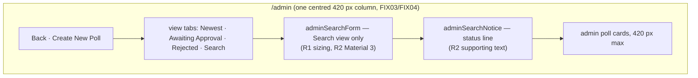
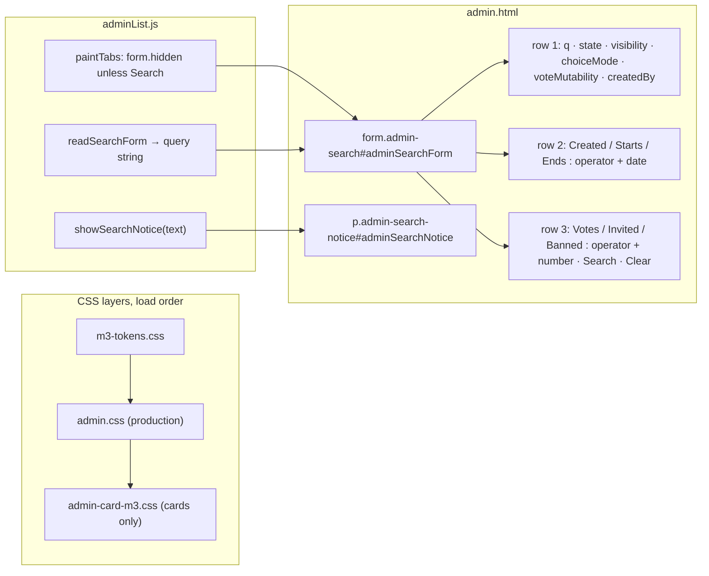
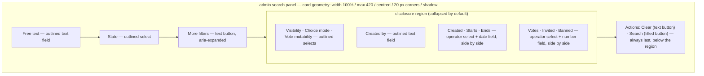
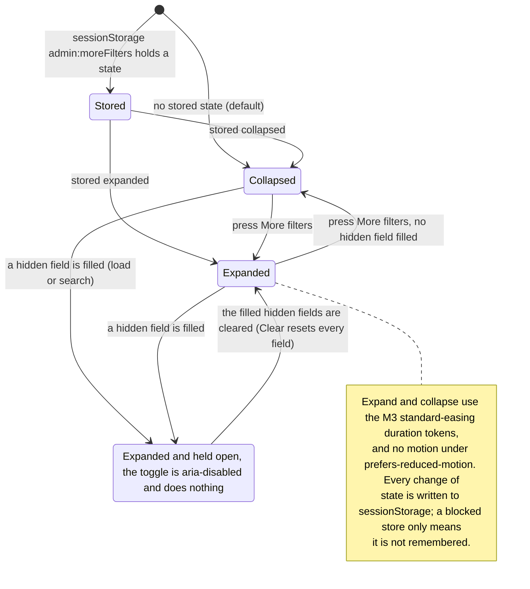
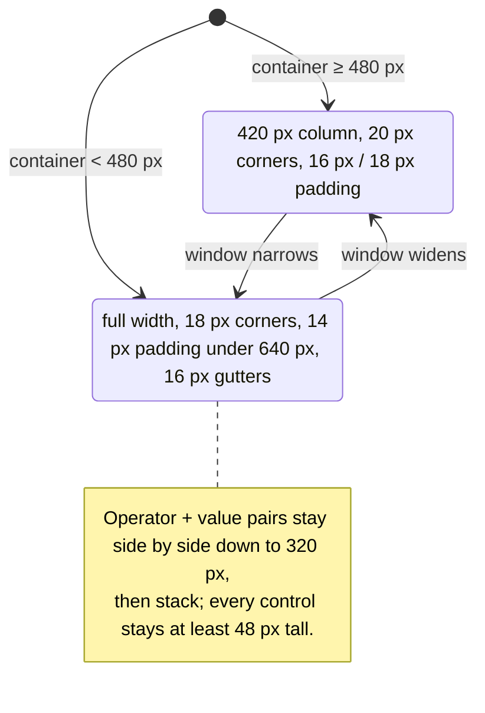
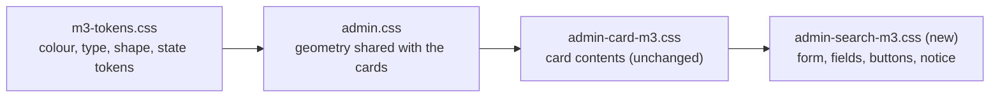
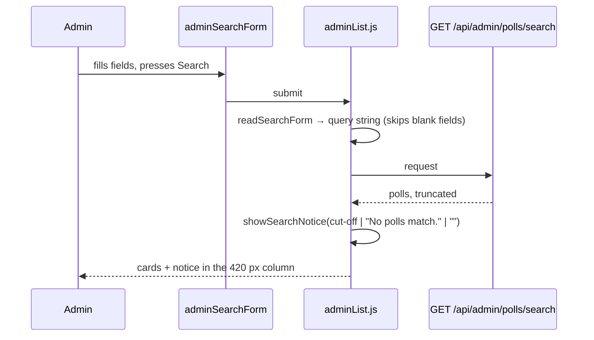

# Architecture: 027 — Admin Search, Material 3

Source requirements: `designDocs/027-high-level-requirements-admin-search.md` (as revised by the first pass's resolutions)

> **Superseded in part by FIX01 (2026-10-06):** the More filters disclosure (R3, section 3.1 and findings U6–U8) was removed and visibility, choice mode and vote mutability became radio groups; every field is always shown. The Search view also no longer shows the pre-search prompt (FIX02), the panel gained a collapse toggle (FIX05), and the read-only card gained a Created By line with `createdByName`/`createdByEmail` on the admin list rows (FIX04). See `specs/027-ADMIN-SEARCH-MATERIAL3/fix.md`.

## 1. Overview and Scope

The `/admin` page's **Search** view has a structured search form (`<form class="admin-search" id="adminSearchForm">`) and a one-line status paragraph under the view tabs (`
`). Both are styled by the pre-Material-3 production sheet `admin.css` (hairline border, 12 px corners, 13 px Inter, a three-row flex wrap of 15 controls). The requirements ask for two things, and nothing else:

| # | Requirement | Where it lands |
|---|---|---|
| R1 | **Search Panel Size** — responsive, "the exact same sizing as the Admin Poll Cards" | `.admin-search` geometry |
| R2 | **Material 3 compliance** — spacing, typography, responsive behaviour, consistent with the rest of the admin interface | the form's fields and buttons, and the notice |
| R3 | **More filters** (resolved in the first pass) — only free text, state and the actions show at first; the other filters sit under a disclosure | the form's structure and one small script addition |

Out of scope: any change to the search itself. The field names, the `readSearchForm()` query string, `GET /api/admin/polls/search`, the views, the creator-only view (which removes the form), and the notice's messages are unchanged. No server, route, contract, configuration or database change.

## 2. What exists today

Facts that shape the design (read from the source):

- The admin poll card is `width:100%; max-width:420px; margin:0 auto; padding:16px 18px; border:1px solid var(--line); border-radius:20px (18px under 480 px); box-shadow:var(--shadow)` (`admin.css`), with 14 px padding under 640 px; `admin-card-m3.css` then restyles only the card's contents.
- The form is **full width**, `padding:14px 16px`, `border-radius:12px`, no shadow. Its 15 controls sit in three `display:flex; flex-wrap:wrap` rows with 10 px gaps; the free-text box is `flex:1 1 240px`. Fields have **no visible labels**: the first row uses `placeholder` + `aria-label`; the date and count rows have inline `<label>` text with an operator `<select>` and a value input.
- The notice has been centred in the 420 px column since FIX04 and is 13 px Inter in `--muted`. It carries the cut-off, empty-view, prompt and error messages for **every** view, not only Search.
- `admin.html` is `data-theme="light"` and loads `m3-tokens.css` then `admin-card-m3.css`; the form is in neither M3 layer today.
- Tests and script depend on `#adminSearchForm`, `#adminSearchClear`, `#adminSearchNotice`, the control `name`s (`q`, `state`, `visibility`, `choiceMode`, `voteMutability`, `createdBy`, `createdAt`/`startAt`/`endAt` with `…Op`, `voteCount`/`invitedVoterCount`/`bannedVoterCount` with `…Op`) and the `.admin-search-btn` / `.admin-search-clear` classes.

## 3. Target layout

The panel becomes the same kind of surface as the cards, in the same column. Inside it the controls stack in one column of full-width Material 3 outlined fields. The common filters show; the rest sit under **More filters**.

### 3.1 Disclosure behaviour

| Aspect | Decision | Source |
|---|---|---|
| Position | the toggle follows the state field; the region opens directly beneath it; the actions stay last, so tab order follows the visual order | requirements, More filters |
| Default | collapsed | requirements, More filters |
| Storage | `sessionStorage` key `admin:moreFilters`, written in a `try` like the existing `admin:tab` key | requirements, More filters |
| Motion | M3 standard-easing duration tokens; none under `prefers-reduced-motion` | requirements, More filters |
| Forced open | a filled hidden field holds the region open on load and after a search; the toggle does nothing until it is cleared, stays focusable with `aria-expanded="true"` and `aria-disabled="true"`, is dimmed to the M3 disabled state and titled "Clear the filters below to collapse this section"; never `disabled` | requirements, More filters |
| Clear | resets every field, hidden ones included; it does not itself collapse the region | requirements, More filters |
| Script | one addition to `adminList.js` (read and write the state, set `aria-expanded`, test the hidden fields); `readSearchForm` and the request are unchanged | this document |

## 4. Styling layers

One new layer, loaded last on `admin.html`, as 024 did for each area: the production sheet keeps the geometry (so the form and cards share one sizing rule), the M3 layer restyles the controls from tokens and carries no literal font sizes. Dark mode follows because every colour is a token; `admin.html` stays `data-theme="light"` as it is today (024 Step 5).

## 5. Search request flow (unchanged)

## 6. Findings of This Pass

Two earlier passes found 11 items (1 inconsistency, 2 ambiguities, 7 unspecified aspects, 1 needs-clarification). All were applied to the requirements. This pass re-checked the requirements as they now stand, including the "More filters" section and the U6/U7 resolutions.

### 6.1 Resolved in the requirements

- [X] I1 — the form and the notice shared an id → the form is `#adminSearchForm`, the notice `#adminSearchNotice`.
- [X] Am1 — "exact same sizing" → the cards' whole container geometry, one shared rule.
- [X] Am2 — is the notice part of the panel → a separate element in the same column, never boxed.
- [X] U1 layout of 15 controls → one column, today's order · [X] U2 components → M3 outlined fields, filled and text buttons · [X] U3 labels and accessibility → visible labels, `role="status"` · [X] U4 dark mode → tokens only · [X] U5 validation → unchanged.
- [X] NC1 all fields or the common ones → Option A: a "More filters" disclosure.
- [X] U6 toggle and action placement → the toggle follows the state field, the actions stay last · [X] U7 storage, default and motion → collapsed by default, `admin:moreFilters`, M3 duration tokens, forced open by a filled hidden field.

### 6.2 Inconsistencies

None.

### 6.3 Ambiguities

None.

### 6.4 Unspecified Aspects

- [X] **U8 — How the toggle looks and sounds while it is held open.** The requirement says the toggle "does nothing" while a hidden field is filled, but not how that is shown, so a disabled-looking control could confuse a user who cannot tell why.
  - *Recommendation:* keep it focusable with `aria-expanded="true"` and add `aria-disabled="true"`, dimmed to the M3 disabled state layer (38 % content), with a title "Clear the filters below to collapse this section". It is never `disabled`, so keyboard and screen-reader users can still reach it and read why.

  - *Resolution (applied):* Requirements "More filters": held open, the toggle keeps `aria-expanded="true"`, adds `aria-disabled="true"`, is dimmed to the M3 disabled state and titled "Clear the filters below to collapse this section"; it is never `disabled`.
### 6.5 Needs Clarification

None.

## 7. Assumptions

- The control names, ids and classes listed in section 2 do not change, so `adminList.js`, `readSearchForm` and the existing tests keep working.
- Material 3 here means the tokens, shapes, type and state layers already used by the cards (`m3-tokens.css`), not a new design system.
- The creator-only view, which removes the form, is unaffected.
- No new `ENV_*` variable, route, table or script is needed.

## 8. Breaking Changes

1. **Visual:** the form narrows from the full page width to the 420 px card column, its fields restack into one column, and corners, borders, type and spacing change. This is the intent of the requirement.
2. **Markup and CSS:** the `.admin-search-row` wrappers are likely to be replaced by a field-per-block structure, so any selector on them breaks. Nothing in `src/` or `tests/` depends on the rows today beyond the rule in `admin.css`.
3. **Tests that read the DOM** by the preserved ids and names keep passing, except that a hidden filter's field is now inside a collapsed region: a test that sets a hidden field's value without opening it still works (the field is in the DOM), but one that asserts it is visible would not. None were found.

## Completion Report

- **Mode:** REGENERATE (against the requirements as revised by every earlier resolution, U6 and U7 included; the recorded directory was reused)
- **Location:** `architecture/027-admin-search-material3/`
  - Main file: `architecture/027-admin-search-material3/architecture.md`
- **Software Architecture Diagrams:** 7 (page layout, what exists today, target layout, disclosure states, responsive states, style layers, search request flow)
- **Inconsistencies:** 0 open (1 resolved earlier)
- **Ambiguities:** 0 open (2 resolved earlier)
- **Unspecified Aspects:** 0 open (8 resolved)
- **Needs Clarification items:** 0 open (1 resolved earlier)
- **Breaking Changes:** 3
- **Readiness for `/speckit-specify`:** Ready. All 11 findings are resolved in the requirements document, and the diagrams and tables match it.
