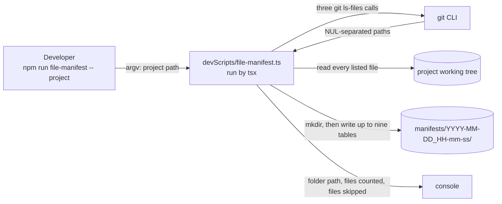
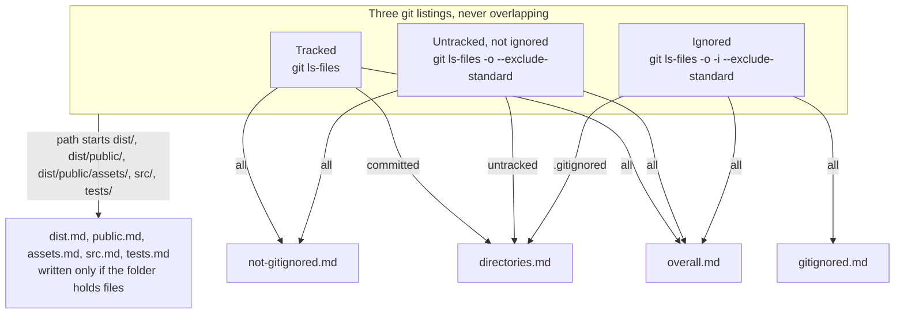
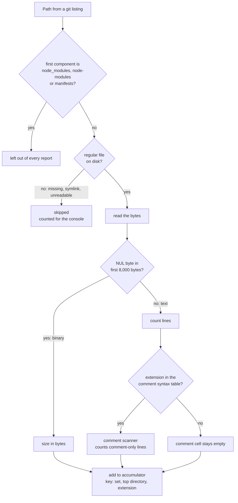
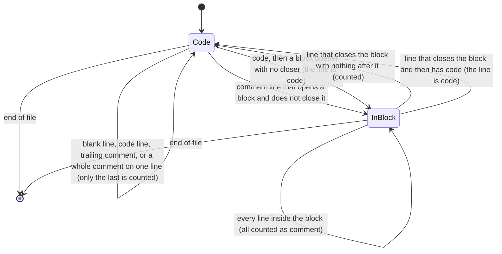
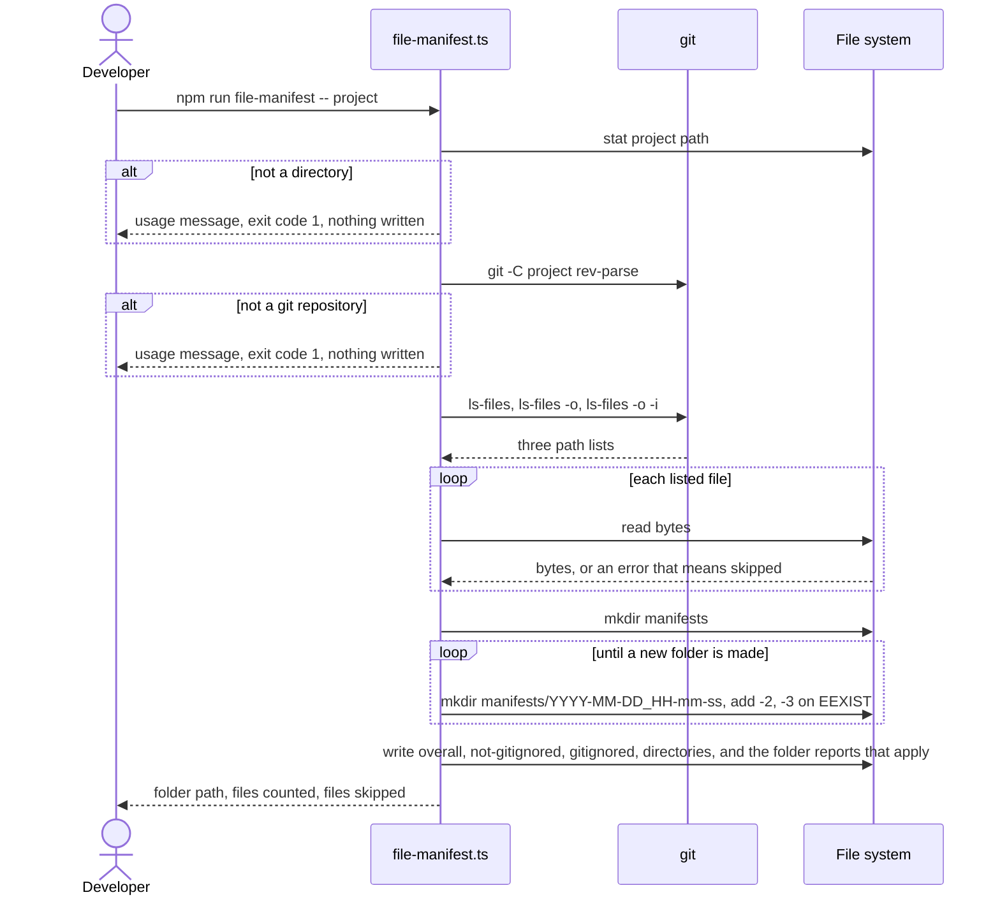
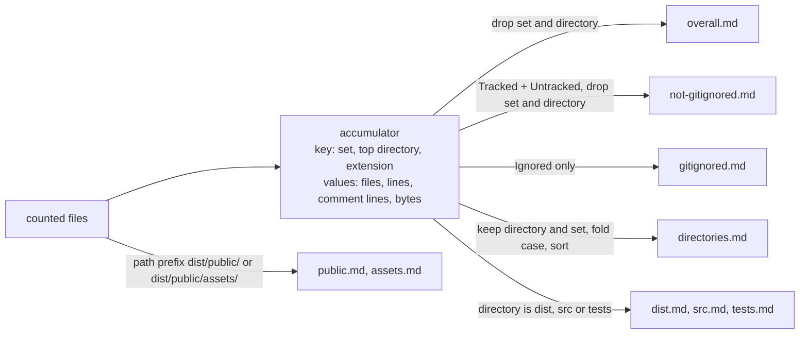
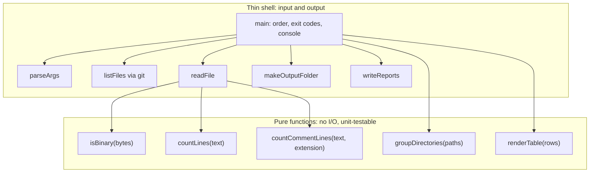

# Architecture: 028 — File Manifest Script

Source requirements: `designDocs/028-high-level-requirements-FILE-MANIFEST-SCRIPT.md` (generated from `research/speckit-file-manifest/research.md`)

## 1. Overview and Scope

The requirements ask for one new command-line script, `devScripts/file-manifest.ts`, run as `npm run file-manifest -- <project>`. It lists every file git knows about in a project, measures each one, and writes up to nine markdown files, each holding one table, into a new timestamped folder under the project's `manifests/` folder.

| # | Requirement | Where it lands |
|---|---|---|
| R1 | **The script** — TypeScript, `tsx`, Node built-ins only, needs `git` (FR-001, FR-016) | one new file and one `package.json` entry |
| R2 | **Which files are counted** — Tracked, Untracked, Ignored from git's own listings; three top-level folders excluded; unreadable entries skipped (FR-003 to FR-005) | the listing and filtering stage |
| R3 | **What is measured** — extension, binary test, lines, size, comment lines (FR-006 to FR-009) | the per-file classification stage and the comment scanner |
| R4 | **The output folder** — `manifests/YYYY-MM-DD_HH-mm-ss`, never reused (FR-010) | the output stage |
| R5 | **The tables and reports** — one table per file, a `**Total**` row, nine reports, three `.gitignored` values (FR-011 to FR-014) | the accumulator and the renderers |
| R6 | **Console report and errors** (FR-002, FR-015) | the shell around the pure core |

Out of scope: any change to `src/`, the build, the deployment spec or the existing tests; a standalone JavaScript copy; ports to other languages; per-file listings; comment counts for Markdown and JSON. **No server, route, database, configuration or contract change.** The script never writes outside `<project>/manifests/`.

*Figure 1. The whole run: one argument in, three git calls, one pass over the working tree, one new folder out. Nothing outside `manifests/` is written.*

## 2. What exists today

- **Script convention.** `devScripts/` holds `reconcile.ts`, `build-assets.ts` and `publish-assets.ts`, each run through `tsx` by an `npm run` script (`package.json` scripts `reconcile` and `publish-assets`; `build` calls `build-assets.ts`). `tsx` is a dev dependency, the package is ESM and needs Node >= 22. `tsconfig.json` compiles only `src/**/*.ts`, so `devScripts/` is not type-checked by `tsc`.
- **Plain `node` cannot run `.ts` here** (`ERR_NO_TYPESCRIPT` on Node v22.22.1), so the script depends on `tsx` being installed.
- **`.gitignore` already hides most of `devScripts/`.** Line 12 is `devScripts/*`, followed by a `!` exception for each tracked script. A new `devScripts/file-manifest.ts` is ignored until it gets its own exception (finding U5).
- **`/manifests/` is now ignored** (`.gitignore` line 29), so the script's output never shows as untracked work.
- **No script tests exist.** No file under `tests/` mentions `devScripts` (finding U6).
- **No manifest tooling exists.** Nothing in the repo counts files, lines or comments.
- **Measured on this repository** with a throwaway prototype: 880 files outside `node_modules` and `manifests` (679 not ignored, 201 ignored), 10 binary, read in about 160 ms. Four tracked paths are missing on disk (a `designdocs`/`designDocs` case clash and `FILE-REMOTE-SKILL`), so skipping missing files is a real case here, not a theoretical one.

## 3. Target design

### 3.1 The three sets and the nine reports

Git decides what is ignored. Three listings partition every file git knows about; each report is a union of some of them or a path filter over all of them.

*Figure 2. A tracked file that also matches `.gitignore` is Tracked (`committed`), because Ignored is defined as "not tracked and ignored". Today no file is in that position.*

### 3.2 One file through the pipeline

*Figure 3. The decisions the requirements fix, in the order they are applied. The two exits other than the accumulator are the exclusions (FR-004) and the skipped entries (FR-005).*

### 3.3 The comment scanner

A text file in a recognised language is read one line at a time with a two-state scanner. A line counts as a comment line only when it holds nothing but comment text.

*Figure 4. Why the scanner needs two states: a block comment makes every line it spans a comment line, including blank ones, until the closer. Strings and regex literals are not parsed (an accepted limit, see Assumptions).*

### 3.4 One run in time

*Figure 5. Validation happens before anything is written (FR-002). The folder name is created with a non-recursive `mkdir`, so two runs in the same second cannot share a folder.*

### 3.5 One pass, nine reports

The files are read once. Every report is a view over the same accumulator, not a second walk of the tree.

*Figure 6. The three folders below `dist/` that are not top-level cannot come from the accumulator's directory key, which stops at the first path component. They need the path prefix, so those two reports are accumulated separately from the same file list (finding noted in section 5, assumption 8).*

### 3.6 Pure core, thin shell

*Figure 7. Every rule the requirements state about content (binary test, line count, comment scanner, row grouping, table text) lives in a function that takes data and returns data. That is what makes the requirements testable without a git repository on disk.*

### 3.7 Requirement coverage

| Requirement | Section |
|---|---|
| FR-001, FR-002, FR-016 | Figures 1, 5, 7; U1, U5 |
| FR-003, FR-004, FR-005 | Figures 2, 3; U2 |
| FR-006, FR-007, FR-008 | Figure 3; I2 |
| FR-009 | Figures 3, 4; A1 |
| FR-010 | Figure 5 |
| FR-011, FR-012, FR-013, FR-014 | Figures 2, 6; A2, U3, U4 |
| FR-015 | Figures 1, 5; U2 |
| FR-017 | U4 |
| FR-018 | A2 |
| FR-019 | U5 |
| FR-020 | Figure 7; U6 |

## 4. Findings of This Pass

### 4.1 Inconsistencies

- [X] **I1. The Overview promises per-file figures; the Exclusions forbid them.** The Overview lists "count the lines in each text file" and "report the size of each binary file", but the tables hold totals per file type and the Exclusions rule out per-file listings.
  - *Recommended resolution:* reword the Overview purposes to "the total lines of the text files of each type" and "the total size of the binary files of each type". Nothing else changes.
  - *Resolved 2026-10-08:* Overview purposes reworded to totals per file type (requirements, Overview).
- [X] **I2. "Counted by `\n`" does not count the last line when it has no newline.** FR-008 says lines are counted by `\n` and also that a final line without a newline is counted. Counting newline characters alone gives `a\nb` one line, not two.
  - *Recommended resolution:* define it as the number of `\n` bytes, plus one when the file is not empty and its last byte is not `\n`. An empty file has 0 lines; `a\nb` has 2; `a\nb\n` has 2. CRLF files count alike. Edit FR-008 and the *Lines* row of the measures table to say so.
  - *Resolved 2026-10-08:* Lines rule and FR-008 now define lines as `\n` bytes plus one for an unterminated last line (requirements, What is measured and FR-008).
### 4.2 Ambiguities

- [X] **A1. The comment syntax table can be read as "both syntaxes for every listed extension".** `//` and `/* */` are listed together for `.css`, but CSS has no `//` comment; `.sql` and `.lua` are listed only for `--`, yet SQL also has `/* */` and Lua has `--[[ ]]`; `.ps1` is listed only for `#`, yet PowerShell has `<# #>` blocks (the repo has 8 `.ps1` files); `#!` lines in shell scripts are not mentioned.
  - *Recommended resolution:* replace the table with one row per extension. `.css`: `/* */` only. `.scss` and the other C-family extensions: `//` and `/* */`. `.sql`: `--` and `/* */`. `.lua`: `--` and `--[[ ]]`. `.ps1`: `#` and `<# #>`. `.sh`, `.py`, `.rb`, `.toml`, `.yml`, `.yaml`: `#` only. A `#!` first line counts as a comment line. Python docstrings count as code, and `<script>` and `<style>` bodies inside `.html` count as code.
  - *Resolved 2026-10-08:* Syntax table replaced by one row per extension, with the `#!`, docstring and `<script>`/`<style>` rules (requirements, What is measured).
- [X] **A2. Folding directories that differ only in letter case is stated as unconditional.** The requirement folds `designdocs` and `designDocs` into one row and shows "the spelling on disk". On a case-sensitive file system (Linux, macOS by choice) those are two real folders and folding them is wrong. It also does not say which spelling "on disk" means when the git index holds one that disk does not, nor that on a case-insensitive file system the two index entries are one physical file, so counting both double-counts it.
  - *Recommended resolution:* detect case sensitivity once at the start (create a probe file in the output folder and look it up in the other case, or compare `readdir` results). On a case-insensitive file system, fold directory names, take the spelling that `readdir` returns, and count each physical file once (de-duplicate on the case-folded path, keeping the first). On a case-sensitive file system, keep directory names exactly as git lists them and fold nothing.
  - *Resolved 2026-10-08:* Case-sensitivity detection, folding rule and single counting added (requirements, The reports and new FR-018).
### 4.3 Unspecified Aspects

- [X] **U1. How the project path argument is resolved.** `npm run` runs scripts with the package root as the working directory, not the shell's. `npm run where` run from a subfolder prints the package root as `process.cwd()` and the subfolder only in `INIT_CWD`. So `npm run file-manifest -- .` or `-- ../other` would silently mean this repo's root. The requirements also say nothing about a path that is a subfolder of a repository, or about extra arguments.
  - *Recommended resolution:* resolve a relative argument against `process.env.INIT_CWD ?? process.cwd()`. Treat the given folder as the project (its listings, its top-level folders, its `manifests/`), which works inside a subfolder of a repository without extra rules. More than one argument is an error: `ERROR: Unrecognized argument(s): <args>. Usage: npm run file-manifest -- <project>`, exit code 1, nothing written.
  - *Resolved 2026-10-08:* `INIT_CWD` resolution, subfolder-as-project and the extra-argument error added (requirements, FR-001 and FR-002).
- [X] **U2. Entries git lists that cannot be counted as files.** FR-005 skips only paths missing from the working tree. Symlinks (reading follows them, possibly outside the project), submodule folders (git lists a folder, not a file) and unreadable files (permissions, locked by another program on Windows) are not covered.
  - *Recommended resolution:* skip every listed path that is not a readable regular file (`lstat` says symlink or directory, or the read throws), and fold all of them into the one skipped count FR-005 and FR-015 already print. The console also prints the first five skipped paths and the reason, never into a manifest.
  - *Resolved 2026-10-08:* Skip rule widened to any non-readable-regular-file, with the first five paths printed (requirements, Which files are counted and FR-005).
- [X] **U3. Totals when a column is empty, and tables with no files.** The `**Total**` row sums "every column", but a column with no applicable rows (no binary files, no recognised-language files) has nothing to sum. `overall.md`, `not-gitignored.md`, `gitignored.md` and `directories.md` are always written, even when their set is empty (for example an untracked-free repository still writes a table for `gitignored.md` if nothing is ignored).
  - *Recommended resolution:* the `**Total**` row always shows numbers, `0` when nothing contributes. An empty set writes the header row and a `**Total**` row of zeros. Other rows keep empty cells for measures that do not apply.
  - *Resolved 2026-10-08:* Total row always numeric and empty sets still written (requirements, The tables and FR-011).
- [X] **U4. Table text formatting.** Not stated: file encoding, line endings, number format, and what a file type containing a pipe looks like.
  - *Recommended resolution:* UTF-8 without a byte-order mark, `\n` line endings, a final newline, integers with no thousands separators (so the tables parse and diff cleanly), the file type exactly as grouped (`.ts`, `(none)`), and `\|` for any literal pipe in a cell. Header cells as in the requirements.
  - *Resolved 2026-10-08:* UTF-8, LF, integers and escaped pipes added (requirements, The tables and new FR-017).
- [X] **U5. The script would be ignored by `.gitignore`.** `.gitignore` line 12 ignores everything in `devScripts/` except named files, so `devScripts/file-manifest.ts` would not be committed, and FR-016's `package.json` entry would point at a file that is missing on every other clone.
  - *Recommended resolution:* add `!devScripts/file-manifest.ts` after line 15 of `.gitignore`, beside the other three exceptions, as part of this feature. Record it in the requirements' Design section and take `.gitignore` out of "unchanged".
  - *Resolved 2026-10-08:* `!devScripts/file-manifest.ts` exception made part of the feature (requirements, The script and new FR-019); `.gitignore` itself is edited at implementation, not now.
- [X] **U6. How the requirements are verified.** No test approach is stated, and no existing test touches `devScripts/`. The requirements are rules about content (binary test, line count, comment scanner, grouping, table text) that can be checked without a real repository.
  - *Recommended resolution:* split the script into the pure core and the shell shown in Figure 7, export the pure functions, run `main` only when the file is the entry point, and test the core with Vitest under `tests/` (for example `tests/file-manifest.test.ts`), using small in-test strings and byte arrays. One further test builds a throwaway git repository in a temporary folder to check the three-way split and the missing-file case. Add this to the requirements as a Verification section.
  - *Resolved 2026-10-08:* Structure and verification section and new FR-020 added (requirements, Design and Functional Requirements).
### 4.4 Needs Clarification

None. Every open point above has a reasonable default, so no `[NEEDS CLARIFICATION]` marker is raised.

## 5. Assumptions

1. `git` is on the path of the machine running the script, and the project is a git repository (the requirements' Assumptions).
2. The requirements' `node-modules` is the `node_modules` directory; both spellings are excluded.
3. Text files are UTF-8. A file that is not valid UTF-8 but has no NUL byte counts as text, with each undecodable sequence counting as one character; this never changes the line count.
4. Reading each file whole is acceptable: the largest file here is about 0.5 MB. A project with very large text files would need streaming.
5. The ignored set is whatever `git ls-files --exclude-standard` returns, which honours nested `.gitignore` files, `.git/info/exclude` and the user's global excludes, not only the root `.gitignore`.
6. The comment scanner does not parse strings, template literals or regular expressions, so a `//` or `/*` at the start of a line inside a multi-line string would be miscounted. This is the accepted limit of the line-based rule.
7. The spec the first line of the requirements names is `028-FILE-MANIFEST`; the requirements file is named `...FILE-MANIFEST-SCRIPT`; this architecture folder follows the file name (`028-file-manifest-script`). The spec's folder name is the developer's choice at `/speckit-specify`.
8. `public.md` and `assets.md` are path-prefix views (`dist/public/`, `dist/public/assets/`), not top-level-directory views, so they are accumulated from the same file list rather than from `directories.md`'s key (Figure 6).
9. "Generated Files" in the titles of `src.md` and `tests.md` does not change what they count: every file under the folder.
10. The script prints no progress while running; the largest project it will meet takes seconds.

## 6. Breaking Changes

None. The change is additive: one new script, one new `package.json` entry, and (finding U5) one `.gitignore` exception. `.gitignore` already gained `/manifests/` in this session; that is not a behaviour change for any existing command. No existing file, test, route or deployment setting is altered.

## Completion Report

- **Mode:** REGENERATE (first architecture pass for this requirements document; the previous record in `.specify/architecture.json` was for 027 and did not match).
- **Location:** `architecture/028-file-manifest-script`, main file `architecture/028-file-manifest-script/architecture.md`.
- **Software architecture diagrams:** 7 (context flow, set-to-report map, per-file pipeline, comment scanner state machine, run sequence, accumulator fan-out, pure core and shell).
- **Inconsistencies:** 2 (I1, I2)
- **Ambiguities:** 2 (A1, A2)
- **Unspecified Aspects:** 6 (U1 to U6)
- **Needs Clarification items:** 0
- **Breaking Changes:** 0
- **Readiness for `/speckit-specify`:** ready. All 10 findings were resolved by "Apply all" and the requirements were revised (FR-001, FR-002, FR-005, FR-008, FR-011 changed; FR-017 to FR-020 added).

## Success Criteria

- [x] no inconsistencies
- [x] no ambiguities
- [x] no unspecified aspects
- [x] no "needs clarifications" items
