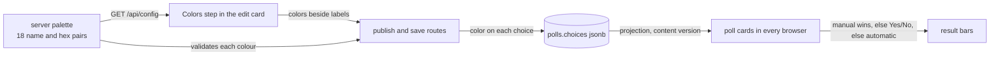
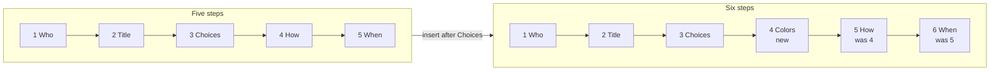
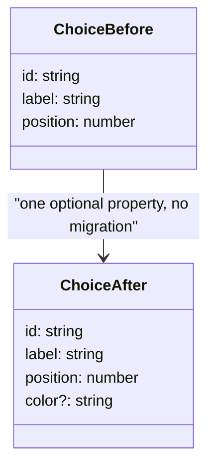
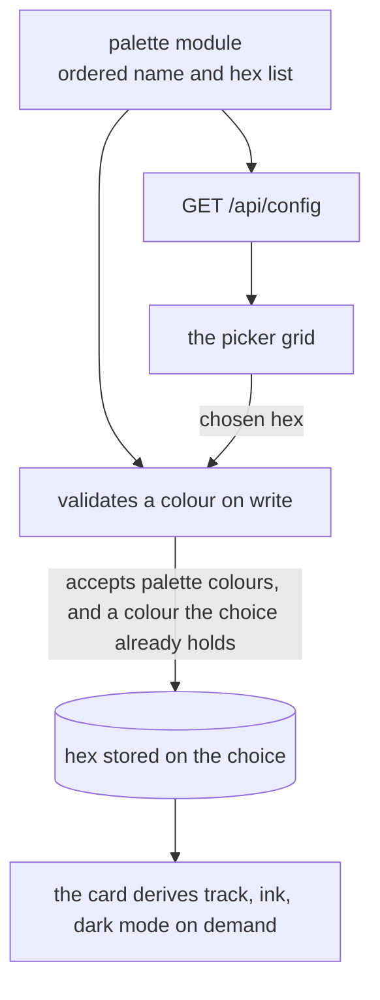
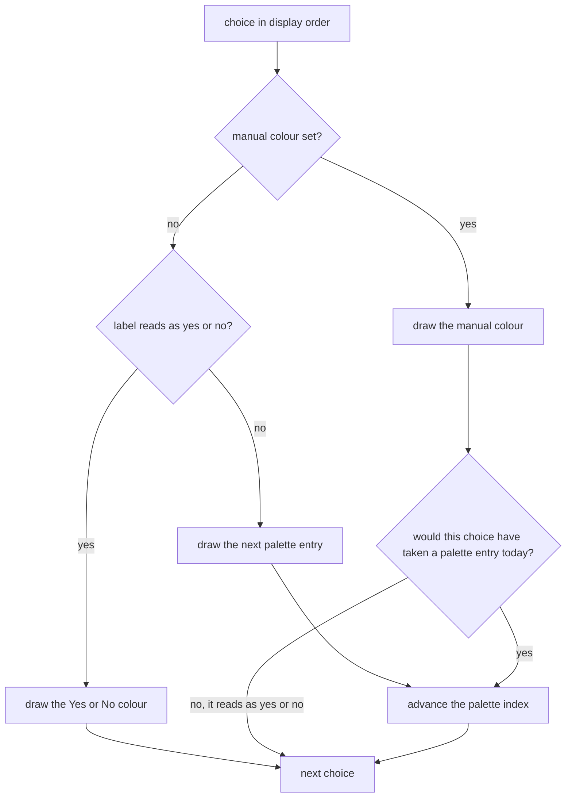
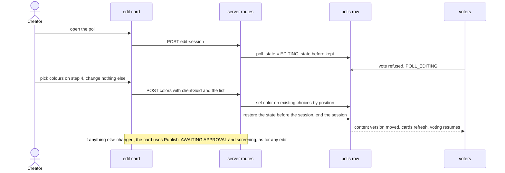
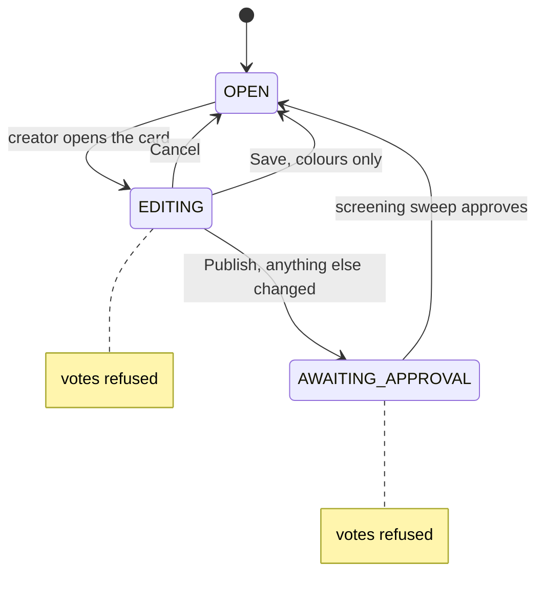
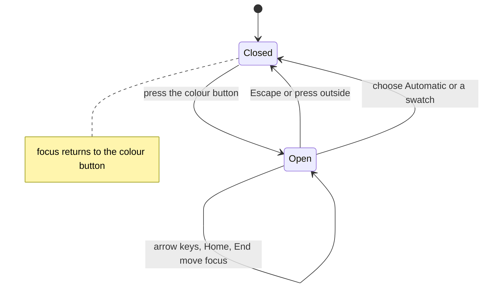

# Architecture: 029 — Manual Bar Colors

Source requirements: `designDocs/029-high-level-requirements-MANUAL-BAR-COLOR-SETTING.md` (generated from `research/MANUAL-BAR-COLOR-SETTING/research.md`)

## 1. Overview and Scope

Today every result bar is coloured automatically, by its rank. This feature lets a poll's creator, or an administrator, give each choice a colour by hand from a 16-colour palette, on a new numbered circle of the poll edit card, **Colors**. A choice left on **Automatic** is coloured exactly as before.

| # | Requirement | Where it lands |
|---|---|---|
| R1 | **The palette** — 18 colours, one ordered list, validated server-side, sent to the browser (FR-007) | one new server module, `/api/config`, the card's picker |
| R2 | **The Colors step** — step 4, six circles, a swatch button per choice, a 4-column swatch grid, Automatic first (FR-001 to FR-006) | `adminCard.js`, `admin.css`, `admin-card-m3.css` |
| R3 | **Storage** — an optional `color` on each element of `polls.choices`, no migration (FR-008) | `Choice` types, `replaceChoices`, `duplicatePoll` |
| R4 | **The save request** — `colors` beside `labels`; a colours-only route for a poll with votes (FR-009, FR-010, FR-012, FR-020) | `publish` and `save` routes, a new `POST /api/admin/polls/:pid/colors` |
| R5 | **Who and when** — creator and administrators; also after votes (FR-011) | `requireOwnPoll`, `UPDATE_FIELDS`, the wizard's locks |
| R6 | **What the voter sees** — manual wins; Automatic unchanged; any hex drawn (FR-013 to FR-017) | `pollCard.js` |
| R7 | **Contract and tests** (FR-018, FR-019) | `postman/openapi.json`, `tests/` |

Out of scope (the requirements' Exclusions): AI colouring, a free colour picker or hex box, a bar preview on the edit card, changes to the automatic palette or the Yes/No colours, stable choice ids across saves, and changes to search, screening or the vote path. **One new route (colours only, for a poll that has votes), no migration, no new dependency.**

*Figure 1. The whole feature: one palette, one request, one extra property per choice, read by every card. The server validates colours on the way in; the card draws whatever hex it is given.*

## 2. What exists today

- **Bar colours are automatic and rank-based.** `assignResultColors` (`src/public/pollCard.js:284-292`) returns a choice's fixed Yes or No colour (`:106-107`) or the next of 50 palette entries, starting at a hash of the poll id (`paletteOffsetFor`, `:266`). Only a choice that takes a palette entry advances `paletteIndex`. Data is sorted by percentage on every refresh (`rebuildData`, `:962-970`).
- **The card draws from a closed set.** `BAR_COLORS.get(color)` and `BAR_COLORS_DARK.get(color)` (`:659-660`) read two Maps built once from the 50 entries and the two Yes/No colours (`:376, :408`); a hex outside them returns `undefined`. `barColorsFor` and `darkBarColorsFor` accept any hex.
- **Choices are a jsonb array** `[{id, label, position}]` (`src/db/migrations/002-polls.ts:11`, `src/db/schema.ts:73-77`), written whole by `replaceChoices` (`src/polls/service.ts:921-955`), which issues a **new `randomUUID()` for every choice on every save** (`:948`) and drops empty labels (`:929-931`).
- **The wizard has five hard-wired steps**: `WIZARD_STEPS` (`src/public/adminCard.js:345`), `visited`/`answered` `[1, 2, 3, 4, 5]` (`:479`), `lockStep` and `buildStepPanel` by number (`:1498-1521`), and the Settings Summary links to steps 4 and 5 by number (`:748-757`). The circle row is `repeat(5, 1fr)` (`src/public/admin.css:331`) with a 10% inset on the joining line (`:336`).
- **Two edit modes.** A poll with no vote is `EDIT`, one with votes is `UPDATE`; both are refused in `EDITING`, `AWAITING APPROVAL` and `ARCHIVED` (`service.ts:205-222`). In `UPDATE` mode only `title`, `subtitle`, the dates, the participant lists and the voter limit may be sent (`UPDATE_FIELDS`, `src/routes/pollsApi.ts:418`), and `labels` are refused.
- **Editing pauses voting.** Opening the card takes an edit session that sets the poll to `EDITING` (`pollsApi.ts:208-262`), and publish then sets `AWAITING APPROVAL` and clears the screening record (`:470-476`). Votes are refused in every state but `OPEN` (`service.ts:435-460`: `POLL_EDITING`, "not open for voting").
- **Content changes reach open cards.** `choices` is not in `NON_CONTENT_FIELDS` (`src/polls/store.ts:272-296`), so a save bumps `content_version`, and the delta path sends the whole projection to any card that holds an older version (`src/refresh/deltas.ts:69-78`). The projection copies `row.choices` whole (`src/polls/versions.ts:35`).
- **Who may edit**: both routes sit behind `requireOwnPoll`, which lets an administrator or the creator through (`pollsApi.ts:181`, `service.ts:825-846`).
- **Configuration reaches the browser** through `/api/config` (`src/routes/api.ts:98-110`).
- **The admin page does not load `pollCard.js`** (`src/public/admin.html:187-191`), so the bar derivation is not available there.

## 3. Target design

### 3.1 The wizard, before and after

*Figure 2. Only How and When change number. Next on Choices now leads to Colors, so the "every step visited" rule for Publish needs no change. The steps' numbers appear in `lockStep`, `buildStepPanel`, the `[1..5]` lists, the Settings Summary links, the circle-row CSS and the wizard tests.*

### 3.2 The choice, before and after

*Figure 3. `color` is the palette hex, absent for Automatic. Because ids are reissued on every save, the colour is carried with the choice rather than keyed by id.*

### 3.3 One palette, three readers

*Figure 4. Adding a colour is adding one line. The stored value is the hex, so editing the palette later never changes an existing poll; the card draws any hex.*

### 3.4 How the card chooses a colour

*Figure 5. The branch on the right is what keeps Automatic bars exactly as they are: a manually coloured choice that would have taken an entry still advances the index without drawing it. Without it, giving the top bar a colour shifts every colour below it (finding I2).*

### 3.5 A colour change on a poll that has votes

*Figure 6. Resolved by N1, Option A. The first pause (the edit session) stays, as for any edit; the second pause and the re-screening do not happen for a colours-only change. `UPDATE` mode needs a writer that sets `color` by position and touches nothing else, because `replaceChoices` would reissue every id and orphan the votes.*

### 3.6 What the voter's poll goes through

*Figure 7. A colours-only save returns straight to the state the poll was in. Publish still goes through `AWAITING_APPROVAL`, one screening sweep (`ENV_POLL_APPROVAL_POLLING_INTERVAL`, 5 s by default) plus the screening call.*

### 3.7 The picker

*Figure 8. A single-choice grid: Automatic first, then 18 swatches in four columns of 48 dp targets. The chosen swatch shows a check mark, never colour alone.*

### 3.8 Requirement coverage

| Requirement | Section |
|---|---|
| FR-001 to FR-005 | Figures 2, 8; A1 |
| FR-006 | I1 |
| FR-007, FR-008 | Figures 3, 4; I3 |
| FR-009, FR-010, FR-012, FR-020 | Figure 6; I3; U2; N1 |
| FR-011 | Figures 6, 7; A1; N1 |
| FR-013 to FR-016 | Figure 5; I2 |
| FR-017 | Figures 6, 7; N1 |
| FR-018, FR-019 | section 4 |

## 4. Findings of This Pass

### 4.1 Inconsistencies

- [X] **I1. Where a colour goes when a choice line is edited, reordered or removed.** *The Colors step* says the colour "stays with its position in the box and is dropped for a line that was removed or renamed". Those two halves disagree: a renamed line keeps its position, so by the first half it keeps its colour, by the second it loses it. FR-006 says the colour "moves with the line's position". Three readings, one requirement.
  - *Recommended resolution:* a colour follows the **label text** (labels are unique, `replaceChoices` refuses duplicates). Reordering the lines keeps every colour with its label; renaming or removing a line drops its colour. Reword *The Colors step* and FR-006 to say so.
  - *Resolved: a colour follows its choice's label; reordering keeps colours, renaming or removing drops them (requirements: The Colors step, FR-006).* (2026-10-08 19:39)
- [X] **I2. FR-014 contradicts itself.** FR-014 and *What the voter sees* say that only Automatic choices use up automatic palette entries *and* that setting a colour on one choice does not change the colour of any other. They cannot both hold: if the top bar becomes manual and no longer takes an entry, the next bar takes the entry the top bar used to have, and every Automatic bar below moves one colour (Figure 5). (My earlier research text made the same claim and is wrong in the same way.)
  - *Recommended resolution:* keep the second half, which is the point of the feature. A manually coloured choice that would have taken a palette entry still advances the palette index without drawing the entry; a choice that reads as yes or no still does not advance it, as today. Reword FR-014 to "setting a colour on a choice does not change the colour of any Automatic choice".
  - *Resolved: a manually coloured choice that would have taken an entry still advances the palette without drawing it; FR-014 and *What the voter sees* reworded (requirements).* (2026-10-08 19:39)
- [X] **I3. A stored colour that the palette no longer holds.** *Storage* says a stored colour no longer in the palette "is still drawn", and FR-009 refuses an entry that is not in the palette. When the palette is edited later, the wizard sends the poll's stored colours back on the next save, and the server refuses the whole save with `400`.
  - *Recommended resolution:* the server accepts, for each position, a palette colour or the colour that choice already stores. The picker shows a stored colour that is not in the palette as its hex, selected, so the creator can keep it or replace it. Reword FR-009.
  - *Resolved: the server accepts a palette colour or a colour the poll already stores; the picker shows such a colour as its hex, selected (requirements: Storage, FR-009).* (2026-10-08 19:39)
### 4.2 Ambiguities

- [X] **A1. Which poll states allow a colour change after votes.** FR-011 says "after the poll has votes". The edit modes refuse `EDITING`, `AWAITING APPROVAL` and `ARCHIVED` and allow every other state, so a colour could be changed on a `REJECTED`, `WAITING TO OPEN`, `OPEN` or `CLOSED` poll that has votes. The requirements do not say whether a closed poll's colours may change.
  - *Recommended resolution:* the same rule as the title: any state in which the card can be opened for editing. Say so in FR-011, and add a test for a `CLOSED` poll.
  - *Resolved: any state in which the card can be opened for editing, including a closed poll (requirements: Who may set colours, FR-011, FR-019).* (2026-10-08 19:39)
### 4.3 Unspecified Aspects

- [X] **U1. The Colors step with nothing to colour.** Next on the Choices step is not blocked by a missing or short list, so a creator can reach step 4 with no valid choice lines.
  - *Recommended resolution:* show one line in place of the list, "Add your choices first, then come back to choose their colours.", and no colour buttons.
  - *Resolved: one line asks for choices first and no colour buttons show (requirements: The Colors step, FR-002).* (2026-10-08 19:39)
- [X] **U2. What `colors` means when it is absent, and how a hex is compared.** FR-009 describes a list that always accompanies `labels`. An older client, a script or a test may send `labels` alone; `replaceChoices` builds every choice anew. A hex may also arrive as `#ff0000`.
  - *Recommended resolution:* `labels` without `colors` replaces the choices with none coloured (every choice Automatic), exactly as before the feature. A hex is compared case-insensitively and stored in the palette's spelling (upper case).
  - *Resolved: labels without colors replaces the choices with none coloured; a hex is compared case-insensitively and stored in the palette's spelling (requirements: The save request, FR-009).* (2026-10-08 19:39)
- [X] **U3. Surfaces that show choices but are not mentioned.** The Settings Summary line "Voters choose from …" (`adminCard.js:742`), the read-only admin card, the JSON and Markdown exports (`service.ts:853-880`) and the admin results page show choices and say nothing about colours.
  - *Recommended resolution:* leave all four unchanged; add them to the Exclusions so the next phase does not reopen them.
  - *Resolved: the Settings Summary, read-only card, exports and results page stay unchanged and are listed in the Exclusions (requirements).* (2026-10-08 19:39)
- [X] **U4. Seeing a swatch on any surface.** The palette has `#000000` and `#E0E0E0`; in dark mode a black swatch vanishes into the surface and a light gray one almost does on a light surface. The requirements ask for a check mark on the chosen swatch but say nothing about the swatch's edge.
  - *Recommended resolution:* every swatch gets a 1 dp outline in the theme's outline colour, in light and dark mode, using the card's tokens, so no colour needs a special case.
  - *Resolved: every swatch has a 1 dp outline in the theme's outline colour (requirements: The Colors step, FR-004).* (2026-10-08 19:39)
### 4.4 Needs Clarification

- [X] **N1. A colour change on a poll with votes pauses voting twice, and screens unchanged text.** FR-011 and FR-017 compare a colour change to a title change. A title change goes through the edit session (`EDITING`, votes refused) and then through publish, which sets `AWAITING APPROVAL`, clears the screening record and waits for the screening sweep (Figures 6 and 7). A colour change would do the same: voting stops while the card is open and again until screening finishes, and a screening failure could mark a live poll `REJECTED` for text that did not change.
  - *Options:* **A** a colours-only save that restores the poll's state before the edit session, with no screening; **B** accept the existing path for every change; **C** option A plus a Colors action on the card that takes no edit session.
  - *Resolved (Option A, 2026-10-08 19:46):* a small route `POST /api/admin/polls/:pid/colors`, used when colours are the only change on a poll that has votes, sets the colours by position, restores the state from before the session, ends the session and does not screen again; Publish is used when anything else changed (requirements: *Who may set colours*, *The save request*, FR-010, FR-011, FR-017, FR-018, FR-019, new FR-020, Exclusions). The first pause stays, because the wizard always takes an edit session (`adminCard.js:2076`); a colours-only change on a published poll that has no votes still uses Publish. This corrects the earlier wording of Option A, which said "no edit session".

## 5. Assumptions

1. The poll creator or administrator colours a poll once, usually before it opens; colouring a live poll is the exception (this is why N1 matters but is not blocking).
2. Choice labels stay unique within a poll, as `replaceChoices` enforces, so a colour can follow its label (I1).
3. The 18 hex codes of the palette are final, with the teal as `#007A7E`; the names and the order are proposals.
4. The text colour on the filled part of a bar is below 7:1 for eight of the 18 colours (lowest 4.67:1), as it is for half of the automatic palette; this is accepted.
5. The browser receives the palette from `/api/config` before the picker is first opened; the card already waits for the other limits it takes from that response.
6. A poll with up to `ENV_MAX_CHOICES` (default 50) choices needs 50 colour buttons; each opens one shared swatch surface, so the page does not grow with the number of choices.
7. The spec for this feature takes its number at `/speckit-specify`; `029` is a placeholder in the requirements.

## 6. Breaking Changes

None for users or for the API: `colors` and `color` are optional and additive, `/api/config` gains a palette, one new route (`POST /api/admin/polls/:pid/colors`) is added, and every existing poll is Automatic. Internal changes that touch existing code and tests:
- **Step numbers.** `How` and `When` become steps 5 and 6, in `lockStep`, `buildStepPanel`, the `[1..5]` lists, the Settings Summary links and the circle-row CSS; the wizard tests that number steps change.
- **`UPDATE_FIELDS`** gains `colors`, so the refusal message that lists the allowed fields changes text; any test that matches it changes.
- **`pollCard.js`** replaces the closed colour lookup with a get-or-create one; the bar-colour and maximized-card tests keep their expectations for polls without manual colours.

## Completion Report

- **Mode:** REGENERATE (the previous record in `.specify/architecture.json` was for 028 and did not match this requirements document).
- **Location:** `architecture/029-manual-bar-colors`, main file `architecture/029-manual-bar-colors/architecture.md`.
- **Software architecture diagrams:** 8 (feature flow, wizard before and after, the choice type, the palette's readers, the card's colour decision, the colour-change sequence, the poll's states, the picker's states).
- **Inconsistencies:** 3 (I1, I2, I3)
- **Ambiguities:** 1 (A1)
- **Unspecified Aspects:** 4 (U1 to U4)
- **Needs Clarification items:** 1 (N1)
- **Breaking Changes:** 0
- **Readiness for `/speckit-specify`:** ready. All 9 findings are resolved and the requirements were revised (FR-002, FR-004, FR-006, FR-009 to FR-011, FR-014, FR-017 to FR-019 changed; FR-020 added).

## Success Criteria

- [x] no inconsistencies
- [x] no ambiguities
- [x] no unspecified aspects
- [x] no "needs clarifications" items
