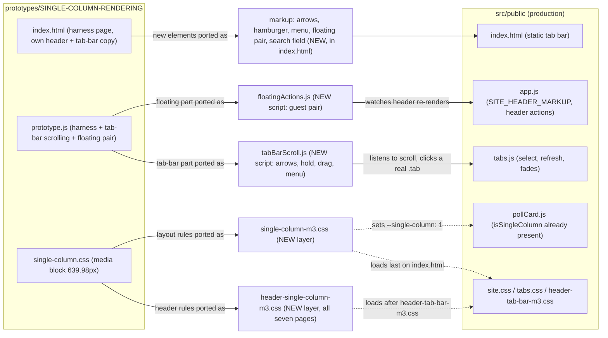
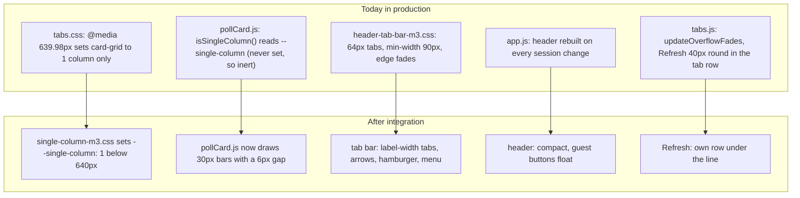
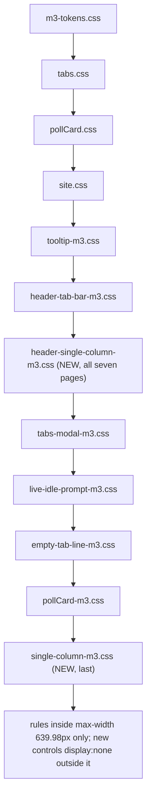
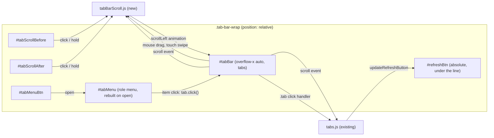
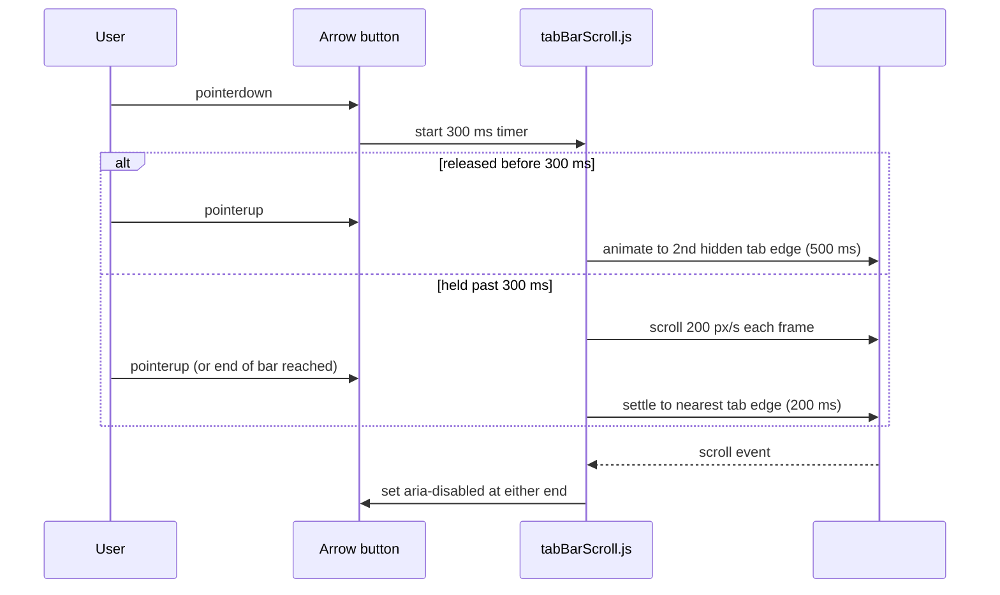
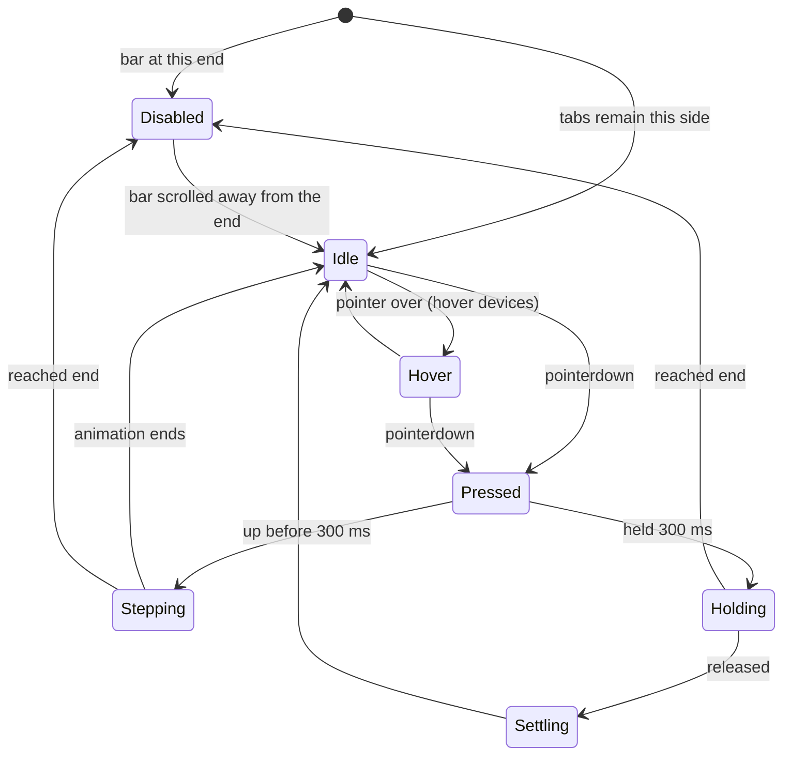
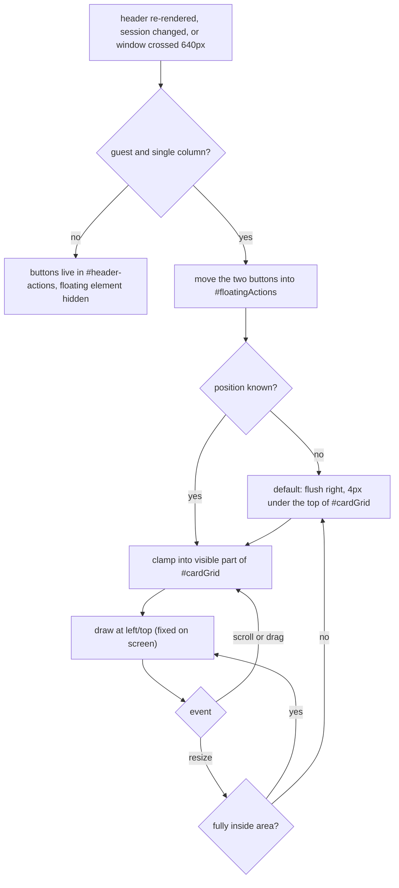
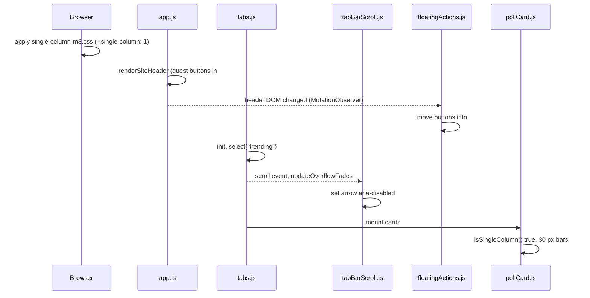
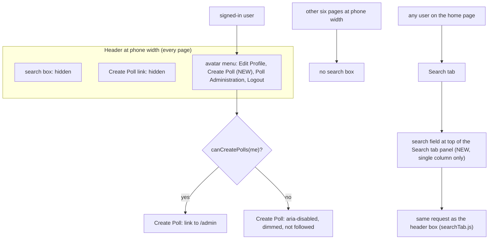
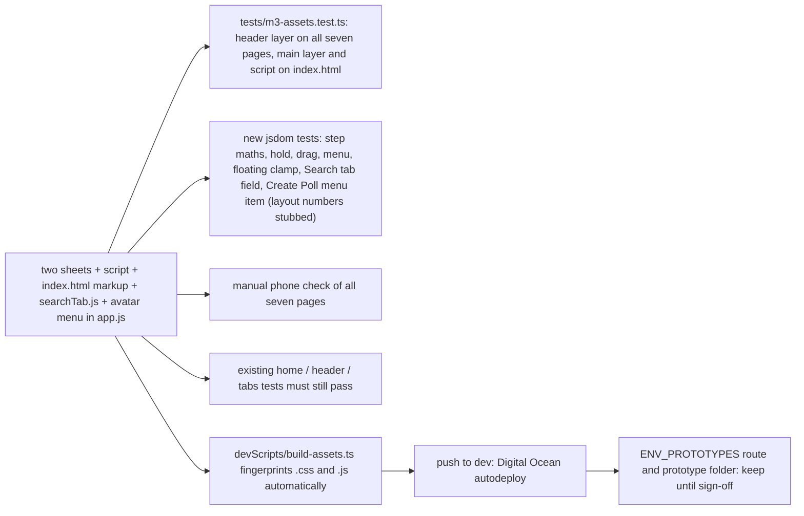

# Architecture: 030 — Integrate Single Column Prototype

Requirements document: `designDocs/030-high-level-requirements-INTEGRATE-SINGLE-COLUMN-PROTOTYPE.md`
Design source: `prototypes/SINGLE-COLUMN-RENDERING/` (its decisions are recorded in `iterative-requirements.md`, 19 resolved requirements).

## 1. Overview and scope

The requirements document is two sentences: a stand-alone prototype for the single-column (phone) rendering exists in `prototypes/SINGLE-COLUMN-RENDERING`, and it is to be integrated into the main CrowdPoll webapp. Everything else is read from the prototype itself.

**What the prototype is.** A harness page (`index.html` + `prototype.js`, with a session picker, a width readout, sample polls and sample notices) that loads the app's own production sheets and `pollCard.js`, then one extra sheet, `single-column.css`. Every layout rule in that sheet sits inside `@media (max-width: 639.98px)`, which also sets the marker `--single-column: 1` that the production `pollCard.js` already reads (`isSingleColumn()`, bar height 30 px, gap 6 px).

**What integration must deliver** (derived from the prototype, nothing is invented):

| # | Capability in the prototype | Where it lives in the prototype |
|---|---|---|
| 1 | Poll cards sized for a phone (75% type, 24 px icon buttons, 21 px Vote button, 30 px bars, 16 px card gap) | `single-column.css` |
| 2 | Compact header: 24 px banner and logo, search box, Create Poll link and user name hidden, 8 px space under it | `single-column.css` |
| 3 | Compact tab bar: label-width tabs (6 px padding, -0.03 em tracking, 56 px high), bare arrows and hamburger with hover and press highlight | `single-column.css` |
| 4 | Tab bar behaviour: arrows stay in place and grey out at the ends, a click scrolls 2 tabs in 500 ms, press-and-hold scrolls at 200 px/s then settles, mouse drag, an all-tabs hamburger menu | `prototype.js`, markup in `index.html` |
| 5 | Refresh button on its own row under the tab bar line, hidden on Live Results | `single-column.css` |
| 6 | Guest "Log In" and "Create Account to Vote" buttons float over the cards, draggable, kept inside the visible card area | `prototype.js`, `single-column.css`, one element in `index.html` |

**Out of scope (harness only, not integrated):** the session picker, the width readout, sample polls, sample notices, the stub `VoteClient`, the prototype page's own copy of the header and tab-bar markup, and the temporary production route (`ENV_PROTOTYPES`).

**Approach decided** (A1, A2): port the prototype as two new Material 3 layer sheets and two new scripts (`tabBarScroll.js` for the arrows, hold, drag and menu, and `floatingActions.js` for the guest pair), following specs 024 ("layers, not rewrites"). `header-single-column-m3.css` carries the header rules and loads on all seven pages that have the header; `single-column-m3.css` carries everything else and loads on the home page only. The existing production sheets are not edited.

**Two additions beyond the prototype** (N1, N2), decided in the architecture review and never shown in the prototype: a search field at the top of the Search tab, because the header search box is hidden at phone width, and a **Create Poll** item in the avatar menu (disabled without permission), because the header link is hidden. Together with `index.html` these change `searchTab.js` and the avatar menu code in `app.js`.

*Figure 1. The prototype's parts land in new sheets, two new scripts and a few elements. Production files that are also edited: `index.html`, `searchTab.js` (N1) and the avatar menu code in `app.js` (N2); no production stylesheet is edited.*

## 2. Current state versus target

*Figure 2. The production code is partly prepared: `pollCard.js` already reacts to the marker, so setting it is what switches the cards.*

## 3. Stylesheet layering on the home page

*Figure 3. Appending a layer after the sheets it overrides lets its rules win over production rules of the same specificity, exactly as the prototype's sheet does today. The header layer follows `header-tab-bar-m3.css` on every page that has the header; the main layer is last on the home page only. `tests/m3-assets.test.ts` pins this order per page and must list both sheets.*

## 4. Tab bar: runtime structure

*Figure 4. The new script owns scrolling, arrows and the menu; selecting a tab (also from the menu) goes through the existing `.tab` click handler in `tabs.js`, so guest redirects and the maximized-card rule are not duplicated.*

## 5. Sequence: an arrow press

*Figure 5. The press sequence the prototype settled on (requirements Tab Bar Refactor 02/03, 2 Tweaks, More Tweaks).*

## 6. State of an arrow button

*Figure 6. A disabled arrow is `aria-disabled` (still focusable, no highlight, no action); it is never removed, so the tabs do not shift.*

## 7. Floating guest buttons: placement rule and header re-render

*Figure 7. In production `app.js` rebuilds the whole header (`innerHTML`) on each session change, so the pair must be re-synchronised after every rebuild, not only on resize (see U1).*

## 8. Sequence: guest loads the home page on a phone

*Figure 8. Order of events on first load; the new script reacts to existing events and does not change `app.js` or `tabs.js`.*

## 8a. Search and Create Poll on a phone (new work beyond the prototype)

*Figure 10. The two decisions that go beyond the prototype: Create Poll moves into the avatar menu, and search on phones moves into the Search tab. On the other six pages there is no search box at phone width (B2).*

## 9. Rollout and test impact

*Figure 9. No server, route, configuration, data or database change is required for the integration itself.*

## 10. Proposed mapping, prototype to production

| Prototype | Production target |
|---|---|
| `single-column.css` media block | `src/public/single-column-m3.css` (new, loaded last on `index.html`) |
| Outside-block defaults (`.tab-scroll, .tab-menu-btn, .tab-menu`, `.floating-actions` set to `display:none`) | Same sheet, above the media block (see I2) |
| `index.html`: `#tabScrollBefore`, `#tabScrollAfter`, `#tabMenuBtn`, `#tabMenu`, `#floatingActions` | `src/public/index.html`, inside `.tab-bar-wrap` and at the end of `<body>` |
| `prototype.js`: arrows, hold, drag, menu | `src/public/tabBarScroll.js` (new, loaded after `tabs.js`, home page only) |
| `prototype.js`: floating pair | `src/public/floatingActions.js` (new, loaded after `tabBarScroll.js`, home page only) |
| `prototype.js`: harness, sample data, picker, readout | Not ported |
| Header rules (`.header-nav`, `#header-username`, `.header-search`, banner and logo 24 px, 24 px header buttons, margin, logo icon hidden) | `src/public/header-single-column-m3.css` (new, loaded after `header-tab-bar-m3.css` on all seven pages with the header; A1 Option B) |
| (none in the prototype: new work) Search field at the top of the Search tab for the single column | `src/public/index.html` (inside `#panel-search`), `src/public/searchTab.js`, styled in `single-column-m3.css` |
| (none in the prototype: new work) Create Poll item in the avatar menu, disabled without permission, single column only | `src/public/app.js` (avatar menu code), shown by `header-single-column-m3.css` |
| `pollCard.js` single-column bar layout | Already in production |

## 11. Assumptions

- The breakpoint stays `max-width: 639.98px`, the same as production `tabs.css`.
- The prototype's numbers (sizes, 500 ms, 200 px/s, 300 ms, 5 px, 16 px, 10 px, -0.03 em, 6 px) are final and are ported as the same CSS variables and script constants, so they stay tunable.
- Wide screens (640 px and up) must look and behave exactly as today.
- `window.matchMedia` is absent in jsdom, so the ported script guards it as `m3-ripple.js` does.
- The 19 resolved requirements and their NOTES in the prototype's `iterative-requirements.md` are the specification of behaviour; the file stays as the design record.
- No new dependency, no server change, no configuration change, no migration.
- The Search tab field and the Create Poll avatar item are new work that the prototype never showed; their exact look is decided when they are specified.

## 12. Findings

Legend: `[ ]` open · `[X]` resolved · `[-]` resolved manually. Each item has a recommended resolution below it.

### Inconsistencies

- [X] **I1. The requirements document was stored at the architecture output path.** The two-sentence requirements lived in `architecture/030-integrate-single-column-prototype/architecture.md`, the very file this command writes, so regenerating would have destroyed the only copy.
  - Resolution applied: the text was copied verbatim to `designDocs/030-high-level-requirements-INTEGRATE-SINGLE-COLUMN-PROTOTYPE.md`, which is now the requirements document and is recorded in `.specify/architecture.json`. The existing `030` directory was reused for the architecture (its number was chosen by the developer; the next free number would have been `031`).
- [X] **I2. "Every rule goes inside the media query, and nowhere else" versus the sheet's actual contents.** The prototype sheet's own header comment says so, but three groups of rules sit outside the block: the harness-only `.prototype-bar` and `.width-readout`, and the `display:none` defaults for the new controls (`.tab-scroll`, `.tab-menu-btn`, `.tab-menu`, `.floating-actions`), which are needed so the wide view does not show them.
  - Recommended resolution: port the second group into the new sheet above the media block, drop the harness rules, and rewrite the sheet's header comment to say "layout rules inside the media block; defaults that hide the single-column controls outside it".
  - **Resolution applied (apply all, 2026-10-13 17:20):** Requirements document, Decisions: the layer sheet keeps the layout rules inside the media block and the `display:none` defaults for the single-column controls above it; harness rules are not ported.
- [X] **I3. "`app.js` is not changed" versus the Create Poll avatar item.** The decision for the floating pair says `app.js` is not changed; the decision for N2 adds an item to the avatar menu, which is built in `app.js` (`renderSiteHeader`).
  - Recommended resolution: reword the floating-pair decision in the requirements document to "`app.js` is not changed for the floating pair"; the avatar menu change is the only edit to `app.js`.
  - **Resolution applied (apply all, 2026-10-13 17:47):** Requirements document: the floating-pair decision now reads "`app.js` is not changed for the floating pair"; the avatar menu change is the only edit to `app.js`.
- [X] **I4. Who owns the search box code: the Search tab field decision versus the "only edit to `app.js`" decision.** The Search tab field decision (U8) says `searchTab.js` reads whichever box is visible and `/` focuses the visible one, and the Create Poll item decision (U9) says the avatar menu is the only edit to `app.js`. In the code, `searchTab.js` never reads a box at all: the whole header search behaviour lives in `app.js` (delegated handlers on `#siteSearch`, `#siteSearchBox` and `#siteSearchClear`, the `/` shortcut, and `window.SiteSearch`, which `tabs.js` calls to fill the box for `?q=`), and `searchTab.js` only exposes `SearchTab.submit` and `SearchTab.clear`. A field in the Search tab with its own ids is therefore not read by anything, and the two decisions cannot both hold.
  - Option A (recommended): keep it self-contained in `searchTab.js`. The tab's field has its own handlers: submit calls `SearchTab.submit`, its clear button calls `SearchTab.clear`, `/` is handled there too when the field is visible (in the capture phase, so the `app.js` handler does not also run), and `SearchTab.submit` copies the terms into the field so `?q=` and the header-style flow fill it. Pros: `app.js` keeps its single change (the avatar item), and the search code for the tab sits with the tab. Cons: a small amount of logic is duplicated, and two places know about search boxes.
  - Option B: generalise the search section of `app.js` to handle both forms (for example a shared class instead of ids, and `window.SiteSearch.set` filling the visible one). Pros: one implementation. Cons: more edits to a script every page loads, so the U9 decision ("the only edit to that file") must be reworded, and every page's header tests need checking.
  - **Resolution applied (Option A chosen, 2026-10-13 17:54):** the Search tab field is self-contained in `searchTab.js` (own submit, clear and capture-phase `/` handling; `SearchTab.submit` copies the terms into the field). The U8 decision in the requirements document is reworded accordingly, and `app.js` keeps a single edit, the avatar item.
### Ambiguities

- [X] **A1. Which pages get the header changes.** "The main CrowdPoll webapp" has seven pages sharing one header (`index`, `login`, `create-account`, `profile`, `not-authorized`, `admin`, `admin-results`). The prototype only shows the home page. Header rules (24 px banner, hidden search, nav and name, 8 px margin) are not home-page specific.
  - Option A (recommended): the header rules are part of the layer on the home page only, so other pages are unchanged until they are redesigned. Pros: no regression risk on forms and admin pages. Cons: the header differs between pages on a phone.
  - Option B: load the sheet's header section on every page that has the header (a separate small sheet or a second section). Pros: consistent header. Cons: every page needs checking on a phone, admin pages included.
  - **Resolution applied (Option B chosen, 2026-10-13 17:28):** the header rules go into a second layer, `header-single-column-m3.css`, loaded after `header-tab-bar-m3.css` on all seven pages that have the header; everything else (cards, tab bar, Refresh, floating pair) stays in `single-column-m3.css` on the home page only. Consequences recorded: the hidden search box, Create Poll link and user name (N1, N2, B2) now apply on every page at phone width; `m3-assets.test.ts` needs the new sheet in `LAYER_ORDER` and on all seven pages; every page needs a check on a phone, the admin pages included.
- [X] **A2. How "integrate" is done: a new layer or edits to the existing sheets.** The rules could be merged into `site.css`, `tabs.css`, `header-tab-bar-m3.css`, `pollCard-m3.css`, or kept as one layer.
  - Option A (recommended): one new layer `single-column-m3.css` loaded last, as specs 024 decided ("layers, not rewrites"). Pros: the prototype maps one-to-one; easy to remove or tune. Cons: some rules override production ones instead of replacing them.
  - Option B: split the rules into the production sheets they override. Pros: no overrides. Cons: a large, risky diff across four sheets, and the prototype can no longer be compared with the app.
  - **Resolution applied (Option A chosen, 2026-10-13 17:29):** the prototype is ported as new layers, never merged into the production sheets: `single-column-m3.css` (home page) and, from A1, `header-single-column-m3.css` (all seven pages). `site.css`, `tabs.css`, `header-tab-bar-m3.css` and `pollCard-m3.css` are not edited.
- [X] **A3. The new logo icon.** The production header (`app.js`, commit `130405a`) includes the new logo icon, but the prototype's own header copy has it commented out, so the prototype shows the banner alone. The integration would show an icon the approved prototype does not.
  - Recommended resolution: in the single column hide the icon (`.brand-logo{display:none}` inside the block) so the integrated header matches what was approved; revisit when the icon is final.
  - **Resolution applied (apply all, 2026-10-13 17:20):** Requirements document, Decisions: the logo icon is hidden in the single column.
  - **Reversed by feature 031 FIX08:** the logo icon is shown at every width. The guest buttons are also 21 px on a phone since 031 FIX05, and the tab-bar, arrow, menu and Refresh-row rules now apply from 900 px down (031 FIX02 to FIX04).
- [X] **A4. "The prototype" versus its folder.** It is unclear whether the prototype folder and its production route (`ENV_PROTOTYPES=SINGLE-COLUMN-RENDERING` in `.do/app.yaml`) are removed after integration.
  - Recommended resolution: keep both until the integrated page has been checked on a phone; then remove the value from `.do/app.yaml` in a later change. Keep the folder as the design record, like `prototypes/POLL-CARD-MATERIAL3/`.
  - **Resolution applied (apply all, 2026-10-13 17:20):** Requirements document, Decisions: prototype folder and route are kept until sign-off.
### Unspecified aspects

- [X] **U1. Re-synchronising the floating pair after header rebuilds.** In production `renderSiteHeader` replaces the header's `innerHTML` on every session change and builds the buttons with `location.href` handlers, and `Create Account to Vote` appears only when `ENV_SIGNIN_METHOD` is `native`. The prototype only moves the buttons once per render, from its own `renderHeaderActions`.
  - Recommended resolution: a `MutationObserver` on `#site-header` re-runs the placement after each rebuild, so `app.js` is untouched; the pair is measured each time, so one button (OAuth mode) or two both clamp correctly.
  - **Resolution applied (apply all, 2026-10-13 17:20):** Requirements document, Decisions: a MutationObserver on `#site-header` re-places the pair after every header rebuild.
- [X] **U2. Floating buttons on pages other than the home page.** `login.html` and `create-account.html` also show Log In and Create Account in the header for a guest; a floating pair over those cards would be wrong.
  - Recommended resolution: the script and `#floatingActions` element exist on `index.html` only, so no other page floats.
  - **Resolution applied (apply all, 2026-10-13 17:20):** Requirements document, Decisions: floating pair on the home page only.
- [X] **U3. Tests and environment guards.** The prototype has no automated tests. `window.matchMedia` is unguarded at `prototype.js:448` and jsdom does not implement it; `tests/m3-assets.test.ts` pins each page's sheets and scripts; jsdom applies no stylesheet, so layout can only be tested with stubbed numbers.
  - Recommended resolution: guard `matchMedia` as `m3-ripple.js` does; update `m3-assets.test.ts` for the new sheet, layer position and script; add jsdom tests for step targets, hold stop at each end (including the first-frame time stamp case), drag threshold and swallowed click, arrow `aria-disabled`, menu build and the floating clamp and reset; leave "how it looks" to a manual check on a phone.
  - **Resolution applied (apply all, 2026-10-13 17:20):** Requirements document, Decisions: tests and guards.
- [X] **U4. Accessibility of the new controls.** The prototype's menu uses `role="menu"` and buttons without arrow-key navigation, the floating pair can be moved only by pointer, and the arrows are `aria-disabled` buttons.
  - Recommended resolution: arrow keys and Escape inside the menu, focus returned to the hamburger on close; the floating pair stays operable by keyboard because the buttons keep their normal order in the DOM (no reposition by keyboard is required); arrows and menu keep their `aria-label`s.
  - **Resolution applied (apply all, 2026-10-13 17:20):** Requirements document, Decisions: accessibility of the new controls.
- [X] **U5. Interplay with existing tab-bar code.** `setActiveButton` in `tabs.js` calls `scrollIntoView` on the selected tab, and `updateOverflowFades` toggles `has-tabs-before` and `has-tabs-after`, whose edge-fade masks the prototype switches off in the single column. A running scroll animation could be fought by `scrollIntoView`.
  - Recommended resolution: the new script cancels its animation when the bar is scrolled by anything else (a `wheel`, `pointerdown` or `scrollIntoView` shows up as a scroll event with no animation owner), keeps the fade classes as they are, and the layer disables the masks with `mask-image:none !important` inside the block as the prototype does.
  - **Resolution applied (apply all, 2026-10-13 17:20):** Requirements document, Decisions: interplay with existing tab-bar code.
- [X] **U6. Refresh button states in production.** `updateRefreshButton` disables the button during the per-user floor, and `header-tab-bar-m3.css` dresses the disabled state; the prototype only shows the enabled button. The row's bottom margin is 60 px except on Live Results (20 px), and `data-active` is set only after the first `select()`.
  - Recommended resolution: keep the production disabled styling (nothing in the layer overrides it) and set the 60 px as the default margin so the first paint before `select()` is already correct.
  - **Resolution applied (apply all, 2026-10-13 17:20):** Requirements document, Decisions: Refresh button states.
- [X] **U7. Documentation to bring in line.** `CLAUDE.md` lists the project's decisions; a new feature section and the file list (`single-column-m3.css`, `tabBarScroll.js`) are needed, and `postman/openapi.json` is unaffected.
  - Recommended resolution: add one feature section to `CLAUDE.md` when the plan is made, using the decisions in section 10.
  - **Resolution applied (apply all, 2026-10-13 17:20):** Requirements document, Decisions: documentation.
- [X] **U8. Behaviour of the Search tab's new field.** The decision names a field at the top of the Search tab but not its details. Today `searchTab.js` reads the header box (`#siteSearchBox`), its clear button and the `/` shortcut, and the `?q=` hand-off from other pages' boxes; ids must stay unique in the page.
  - Recommended resolution: the field is a second form in `#panel-search` with its own ids (`searchTabBox`, `searchTabClear`), the same placeholder "Search CrowdPoll", `maxlength` 200 and clear button; it submits the same request, subject to the same floor (`ENV_MIN_SEARCH_INTERVAL`) and burst; `searchTab.js` reads whichever box is visible and `/` focuses the visible one; `?q=` still fills the visible field when someone follows such a link.
  - **Resolution applied (apply all, 2026-10-13 17:47):** Requirements document, Decisions: the Search tab field is a second form in `#panel-search` with its own ids, the same request and floor as the header box.
- [X] **U9. Details of the Create Poll avatar item.** The decision gives the position and the disabled rule, but not the wording of a disabled state or whether it is focusable. It also differs from spec 012 FR-052 (an unauthorised item is absent, as "Poll Administration" still is), so for the same user one of two items to the same page is shown dimmed and the other not at all.
  - Recommended resolution: label exactly "Create Poll"; a disabled item is `aria-disabled="true"`, focusable, does nothing when activated and has the tooltip "You need permission to create polls"; record in the requirements document that the item is deliberately shown dimmed, unlike Poll Administration.
  - **Resolution applied (apply all, 2026-10-13 17:47):** Requirements document, Decisions: label, disabled state, tooltip, and the deliberate difference from Poll Administration.
- [X] **U10. What "checked on a phone" means for seven pages.** The header layer reaches pages the prototype never covered (`login`, `create-account`, `profile`, `not-authorized`, `admin`, `admin-results`), but no acceptance criteria are given.
  - Recommended resolution: a manual checklist run at 360, 384, 414 and 639 px on every page: header does not overflow, nothing is cut off or overlapped, the avatar menu opens and its items are reachable, and the page's own cards or forms keep their layout; recorded in the plan's quickstart.
  - **Resolution applied (apply all, 2026-10-13 17:47):** Requirements document, Decisions: manual phone checklist at four widths on all seven pages.
### "Needs Clarification" items

- [X] **N1. The header search box is hidden in the single column.** The prototype hides `.header-search`. In production that box fills the Search tab ("/" focuses it) and is also how a user on another page starts a search. Whether a phone user has another way to enter search terms is not specified.
  - Recommended resolution: keep it hidden only if the Search tab can take typed terms itself; otherwise show a compact search icon that expands the box. Needs the product owner's decision.
  - **Resolution applied (Option B chosen, 2026-10-13 17:32):** the header search box stays hidden in the single column, and the Search tab's panel gets its own search field at the top (form, input and clear button, same terms and the same request as the header box), shown only in the single column. `searchTab.js` is changed to read the field when the header box is hidden. Consequence recorded (B2): on `login`, `create-account`, `profile`, `not-authorized`, `admin` and `admin-results` a phone user has no search box, because A1 hides the header box on every page; they reach the home page's Search tab by the logo or the tab bar.
- [X] **N2. The Create Poll link is hidden in the single column.** For administrators and users with `Create Poll` and `View Polls` the link is the only way into `/admin` from the home page; hiding it removes that on phones. The avatar menu still has "Poll Administration" for administrators only.
  - Recommended resolution: keep it hidden on phones (poll creation is a desktop task) but say so in the requirements; the alternative is an item in the hamburger or avatar menu.
  - **Resolution applied (developer's own resolution, 2026-10-13 17:42):** the header's Create Poll link stays hidden in the single column, and the avatar menu gets a **Create Poll** item (link to `/admin`), placed after Edit Profile and before Poll Administration, shown only in the single column. It is rendered disabled (`aria-disabled="true"`, dimmed, not followed, the same look as the header link's inert state) when the signed-in user may not create polls, using the same test the header link uses (`canCreatePolls(me)`: an administrator, or a user with both `Create Poll` and `View Polls`). Recorded consequences: `app.js` gets a small change in the avatar menu code (so it is no longer untouched); the item is new work that the prototype never showed (its avatar menu is a sample notice), so it needs a check on a phone; it departs from spec 012 FR-052, which keeps "Poll Administration" absent rather than disabled, so the two items behave differently for a user without permission, and both open `/admin`; a guest has no avatar menu.
- [X] **N3. Greyed (guest) tabs in the hamburger menu.** In the prototype a greyed item does nothing and the menu stays open; in production a click on a guest's `aria-disabled` tab goes to `/login`.
  - Recommended resolution: follow production: the menu item calls the real tab's `click()`, so a guest is sent to `/login` exactly as from the bar.
  - **Resolution applied (apply all, 2026-10-13 17:20):** Requirements document, Decisions: menu items go through the real tab.
- [X] **N4. Rollout of a layout that changes every phone user at once.** The change takes effect on deploy for every visitor below 640 px, including the `max-width` of small tablets in portrait.
  - Option A (recommended): ship it directly; the prototype has been reviewed on a phone throughout. Pros: no flag code. Cons: no quick switch off.
  - Option B: put the marker behind an environment variable (default on) so the layer can be turned off without a deploy of code. Pros: safety. Cons: a new variable, documentation and a test for a switch that may never be used.
  - **Resolution applied (Option A chosen, 2026-10-13 17:44):** the layout ships directly, with no environment variable or switch; it takes effect for every visitor below 640 px on deploy. The only way back is to revert the change.
## 13. Breaking changes

- **B1. The phone layout changes completely.** Below 640 px the cards, header, tab bar and Refresh button change size and position, and the poll card's single-column bar layout in `pollCard.js` (inert until now) becomes active. Wide screens are unchanged.
- **B2. Header items disappear on phones.** The search box, the Create Poll link and the user name are hidden below 640 px on every page (see N1, N2). Create Poll moves into the avatar menu. Search on phones moves to a new field in the home page's Search tab; the other six pages have no search box at that width.
- **B3. The home page's tab bar markup grows.** `.tab-bar-wrap` gains `#tabScrollBefore`, `#tabScrollAfter`, `#tabMenuBtn`, `#tabMenu`; tests or scripts that assume the tab bar's siblings, or count children of `.tab-bar-wrap`, need checking. `#refreshBtn` stays in place in the markup.
- **B4. Guest buttons leave the header on phones.** `#header-actions` is empty for a guest below 640 px while the buttons float; any code or test that reads that slot at a phone width (not in jsdom, which has no layout) sees no buttons there.

## Completion Report

- **Mode:** UPDATE-IN-PLACE (`UPDATEONLY` passed twice. First run: the requirements changed by decisions, so the overview, three diagrams, one new diagram and the findings were edited. Confirming run: the 18 earlier findings stayed resolved and one new inconsistency, I4, was added. Nothing was regenerated).
- **Location:** `architecture/030-integrate-single-column-prototype`
- **Main file:** `architecture/030-integrate-single-column-prototype/architecture.md`
- **Requirements document:** `designDocs/030-high-level-requirements-INTEGRATE-SINGLE-COLUMN-PROTOTYPE.md` (created from the developer's text; the architecture file had been used as the input)
- **Software architecture diagrams:** 10
- **Inconsistencies:** 4 (all resolved)
- **Ambiguities:** 4 (all resolved)
- **Unspecified aspects:** 10 (all resolved)
- **"Needs Clarification" items:** 4 (all resolved)
- **Breaking changes:** 4 (documented, not failures)
- **Readiness for the next phase (`/speckit-specify`):** ready. All items are resolved; one more confirming `/speckit-architecture ... UPDATEONLY` run is optional, because the last change only reworded one decision.
