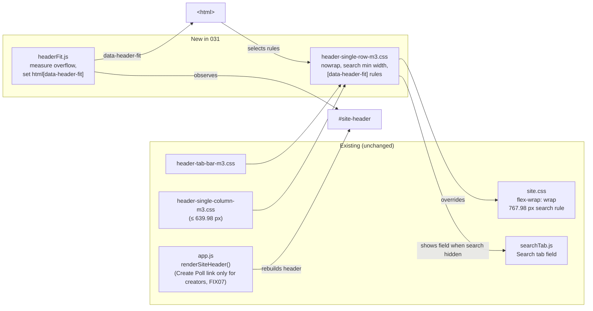
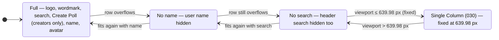
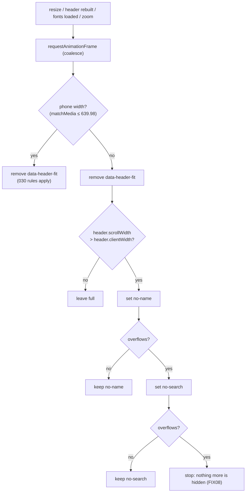
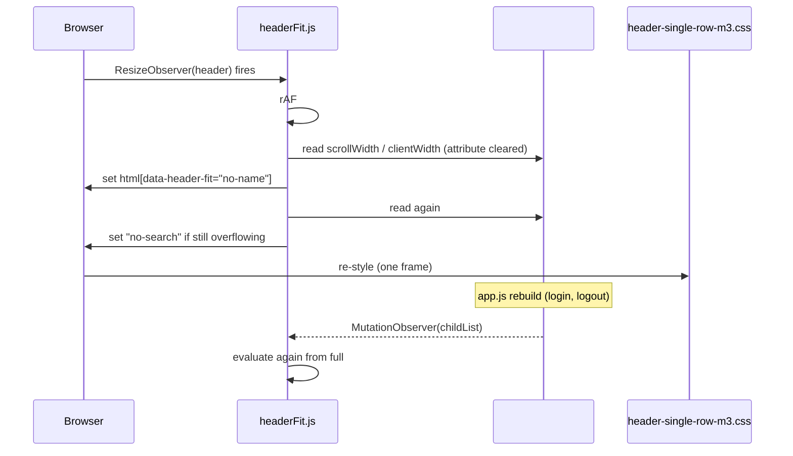
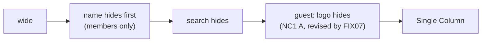
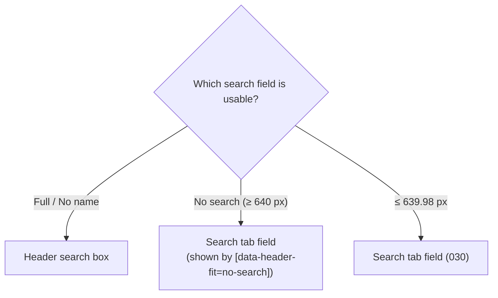

# Architecture: 031 — Single Row site-header

Requirements document: `designDocs/031-high-level-requirements-SINGLE-ROW-HEADER.md`
Builds on: 030 (`architecture/030-integrate-single-column-prototype/architecture.md`) — the Single Column mode at `max-width: 639.98px` is unchanged.

## 1. Overview and scope

The header (`<header id="site-header" class="site-header">`, drawn by `renderSiteHeader()` in `app.js` on all seven pages) must never wrap onto a second row. When the row runs out of room, parts disappear in a fixed order:

1. the **user name** goes first (when the user cluster, name + avatar, would wrap);
2. then the **header Search field** (when the avatar would wrap again);
3. narrower than that, **Single Column mode** (030) takes over.

**What the code does today** (read from `site.css`, `header-tab-bar-m3.css`, `header-single-column-m3.css`, `app.js`):

| Fact | Where | Consequence for 031 |
|---|---|---|
| `.site-header{display:flex; flex-wrap:wrap}` | `site.css:26` | the row wraps; this is what 031 forbids |
| `@media (max-width:767.98px){.header-search{order:3; flex:1 1 100%}}` | `site.css:217` | from 640 to 767 px the search box already drops to a **second row**, the opposite of the requirement |
| `.header-search{flex:1 1 auto; max-width:640px}`, 56 px high in the M3 layer | `site.css`, `header-tab-bar-m3.css` | the box has no declared minimum width |
| `.header-nav-link{margin:0 28px}` (Create Poll; since FIX07 rendered only for a user who may create polls) | `header-tab-bar-m3.css:210` | wide fixed spacing |
| `#header-username`, `.header-search`, `.header-nav` hidden ≤ 639.98 px | `header-single-column-m3.css` | the phone rules already hide the name and the search box |
| `header.className = "site-header"` on every rebuild | `app.js` `renderSiteHeader` | any class put on `#site-header` is wiped when the session changes |
| Search tab field `.search-tab-form{display:none}` outside phone width | `single-column-m3.css:5` | with the header box hidden at 640+, there is **no** search field |

**Approach recommended** (A1, A4): a content-driven fit, not fixed breakpoints. Layers, not edits (024/030): a new sheet `header-single-row-m3.css` (after `header-single-column-m3.css`, all seven pages) and a new script `headerFit.js` (all seven pages) that measures whether the row overflows and sets one attribute on `<html>`. `app.js` is edited only for the Create Poll link (FIX01, FIX07).

*Figure 1 — The two new files and what they override. The attribute sits on `<html>` because `renderSiteHeader` overwrites the header's own class on every rebuild (U3).*

## 2. The stages

*Figure 2 — Stage ladder. The transitions down to No logo are content-driven (measured); the last is the fixed 030 media query.*

`data-header-fit` values: `full` (absent), `no-name`, `no-search` (cumulative: each keeps the earlier hides). Single Column is not a value of it; the 030 media query still owns that range.

## 3. Evaluation

Every evaluation starts from the full state, so nothing needs remembering and there is no hysteresis (U1).

*Figure 3 — The three measurements happen in one task with no paint in between, so the user never sees the intermediate states.*

*Figure 4 — Triggers. A rebuilt header (different name length, guest ↔ member) is re-measured because its width changed.*

## 4. Who sees what, by stage

| Stage | Guest | Member (Create Poll) | Member (no Create Poll) | Admin |
|---|---|---|---|---|
| Full | logo, wordmark, search, Log In, Create Account to Vote (no Create Poll link) | logo, wordmark, search, Create Poll, name, avatar | logo, wordmark, search, name, avatar | same as member |
| No name | unchanged (no name) | name hidden | name hidden | name hidden |
| No search | search hidden | search hidden | search hidden | search hidden |
| Logo mark | always shown (FIX08) | always shown | always shown | always shown |
| ≤ 639.98 px | wordmark; Log In / Create Account float over the cards (030) | wordmark, avatar; Create Poll in avatar menu (030) | wordmark, avatar | same |

Approximate widths from the stylesheets (not measured): wordmark 40 px high × 1914/310 ≈ 247 px, logo ≈ 40 px, Create Poll link ≈ 150 px with its 28 px margins, the two guest buttons ≈ 340 px, avatar 32 px, user name ≈ 60–150 px, header gap 16 px. FIX07 removed the link for a guest and for a member without permission, and FIX01 added about 32 px of icon to the link a creator keeps. A guest therefore needs about 680 px with the search hidden (about 890 px with the search at its minimum), whereas a member needs about 600 px.

*Figure 5 — Order of events as the window narrows. For a guest the first stage has nothing to hide, so the ladder goes straight to the search and stops (NC1, revised by FIX07 and FIX08: there is no Create Poll link for a guest to hide, and the logo mark is never hidden).*

## 5. Search availability

*Figure 6 — Only one field is on screen at a time. `/` already goes to the Search tab field when it is on screen (`isOnScreen` in `searchTab.js`), so it needs no new code (U2).*

## 6. Requirements coverage

| Requirement | Where |
|---|---|
| Header is one row at all widths | `flex-wrap:nowrap` in `header-single-row-m3.css`; the 767.98 px rule is overridden (`order`, `flex-basis`); `headerFit.js` guarantees nothing overflows |
| Narrower, user/avatar wraps → hide user name | stage `no-name`: `#header-username{display:none}` |
| Narrower still, avatar wraps → hide header Search | stage `no-search`: `.header-search{display:none}`, Search tab field shown |
| Still no room (guest) | no further stage; the guest buttons are tightened from 641 to 900 px instead (NC1, revised by FIX07 and FIX08) |
| Narrower than that → Single Column | unchanged 030 media query at 639.98 px |

## 7. Findings

No contradictions inside the requirements document, so there are no Inconsistencies.

### Ambiguities
- [X] **A1 — "When the viewport width gets narrower and … wraps."** The wrapping depends on the content (guest vs member, name length, Create Poll link present, fonts, zoom), not on the viewport width alone, so no single viewport width can be named.
  - Recommended: the trigger is the header's own measured overflow (`scrollWidth > clientWidth` of `#site-header`), not fixed viewport widths. One resolution, no options.
  - **Resolution:** Requirements now say the trigger is the header's measured overflow. (applied)
- [X] **A2 — "the User/Avatar Icon wraps."** The slash can mean the pair (name and avatar), the avatar alone, or the last item of the row, which for a guest is not a user cluster at all.
  - Recommended: the trigger is "the row overflows"; the item that would wrap is whatever comes last (the user cluster for a member, *Create Account to Vote* for a guest). Stage 1 hides the name, if there is one; stage 2 hides the search.
  - **Resolution:** Requirements now name the last item in the row as the one that would wrap. (applied)
- [X] **A3 — "hide the username."** Visual only, or removed from the accessibility tree and the avatar menu too?
  - Recommended: `display:none` on `#header-username`, exactly as the 030 phone rule does; the avatar button and its menu are unchanged.
  - **Resolution:** Requirements now say the name is hidden with display:none, like the phone rule. (applied)
- [X] **A4 — "Any narrower than that, the Single Column mode will be activated."** Single Column is a fixed 639.98 px breakpoint (030), but "narrower than that" could mean "as soon as the search is hidden and the avatar wraps again", which would be a content-driven threshold.
  - Recommended: Single Column stays at the fixed 639.98 px; the two stages operate above it. Below 640 px the 030 rules apply and `headerFit.js` clears its attribute.
  - **Resolution:** Requirements now keep Single Column at the fixed 639.98 px. (applied)

### Unspecified Aspects
- [X] **U1 — When the hidden parts come back, and what triggers a re-measure.** Nothing says what happens when the window widens again, the header is rebuilt (login, logout), fonts load late, or the page is zoomed.
  - Recommended: every evaluation clears `data-header-fit` and re-measures from the full state (Figure 3), triggered by a `ResizeObserver` on the header, a `MutationObserver` on its children, and `document.fonts.ready`; coalesced in one `requestAnimationFrame`.
  - **Resolution:** Requirements now say each evaluation re-measures from the full state. (applied)
- [X] **U2 — Search is unreachable between 640 px and the width where the header box fits.** The Search tab field is shown only at phone width, so hiding the header box at 640 px or wider leaves no search field.
  - Recommended: `header-single-row-m3.css` shows `.search-tab-form` whenever `data-header-fit="no-search"` (its phone styling reused). `/` already follows whichever field is on screen.
  - **Resolution:** Requirements now show the Search tab field whenever the header search is hidden. (applied)
- [X] **U3 — Where the stage lives.** `renderSiteHeader` sets `header.className = "site-header"` on every rebuild, so a class on `#site-header` would be lost.
  - Recommended: the attribute `data-header-fit` on `<html>`; rules are written as `html[data-header-fit~="no-name"] #header-username{display:none}` etc.
  - **Resolution:** Requirements now keep the stage in data-header-fit on the html element. (applied)
- [X] **U4 — The Search box has no minimum width.** `flex:1 1 auto` lets it shrink to its input's intrinsic width, so "the search box fits" is undefined; it should shrink somewhat before it is hidden.
  - Recommended: a tunable `--header-search-min-width: 200px` (CSS variable, as 030 does for its tunables) applied as `min-width` in the new layer; below it, the stage-2 hide applies.
  - **Resolution:** Requirements now give the search box a tunable minimum width of 200 px. (applied)

### Needs Clarification
- [X] **NC1 — A guest's header still overflows from about 830 px down to 640 px.** A guest has no user name to hide, and even without the search box the wordmark, logo, inert Create Poll link and two buttons (≈ 830 px) are wider than the 640–830 px range. The requirement lists no further step, but also forbids wrapping.
  - Option A (recommended): add a third content-driven step for the guest case: hide the inert *Create Poll* link first (it does nothing for a guest), then the logo mark. Pros: no new rule for members, nothing a guest can use is lost. Cons: two more hide steps than the document lists.
  - Option B: float the guest buttons earlier — the guest uses the 030 floating pair whenever the row would overflow, at any width. Pros: reuses `floatingActions.js`. Cons: the document says guest buttons stay in the header until Single Column; floats over cards on tablet widths.
  - Option C: raise the Single Column breakpoint for guests only. Pros: simple. Cons: guests and members would get different layouts at the same width, contradicting 030's fixed 639.98 px.
  - **Resolution:** Option A applied. Two more content-driven steps, run after the search is hidden: the inert Create Poll link is hidden (`no-link`), then the logo mark (`no-logo`). Members rarely reach them; for a member they apply only if the row still overflows. The requirements document records the decision. (applied)
  - **Revised by FIX07:** the header no longer has a Create Poll link for a guest or for a user without permission (`app.js` renders it only for a user who may create polls), so the `no-link` step was removed. A creator keeps the link, which is never hidden.
  - **Revised by FIX08:** the logo mark is shown at all widths (the phone rule that hid it is gone too), so the `no-logo` step was removed and the ladder is `no-name`, `no-search`. To keep a guest's row from overflowing near 640 px, the guest buttons take the card Vote button's 16 px side padding from 641 to 900 px (FIX05's rule); the figures in section 4 are estimates and T035 records the real fit.

## 8. Breaking changes

- **B1 — Search no longer drops to its own row between 640 and 767.98 px.** The existing `site.css` rule is overridden; it was a second row, which the requirement forbids.
- **B2 — The header Search box disappears at widths where it was visible** (anywhere the row would overflow, up to roughly 860 px for a member); the Search tab field replaces it there.
- **B3 — The user name disappears at wide-but-not-wide-enough widths** instead of the row wrapping.
- **B4 — The Search tab field now appears above 640 px** (when the header box is hidden); it was phone-only.
- **B5 — The Create Poll link is absent from the header for a guest and for a user without permission** (FIX07); it was shown dimmed. It exists only for a user who may create polls.

## 9. Assumptions

- The measured breakpoints are not constants; the widths in section 4 are estimates for orientation only.
- No server, route, configuration or data change; no new dependency.
- Tests: jsdom has no layout, so `headerFit.js` tests stub `scrollWidth`/`clientWidth` (the way 030's tests stub the tab bar's measurements).
- `app.js` is edited only for the Create Poll link (FIX01, FIX07); the existing search code is not changed.

## Completion Report

- **Mode:** REGENERATE (new directory; the recorded directory was 030's, for a different requirements file)
- **Location:** `architecture/031-single-row-header` — `architecture/031-single-row-header/architecture.md`
- **Diagrams:** 6
- **Inconsistencies:** 0
- **Ambiguities:** 4 (A1–A4)
- **Unspecified Aspects:** 4 (U1–U4)
- **Needs Clarification:** 1 (NC1, three options)
- **Breaking Changes:** 5 (B1–B5)
- **Readiness for `/speckit-specify`:** ready — all nine items are resolved.
