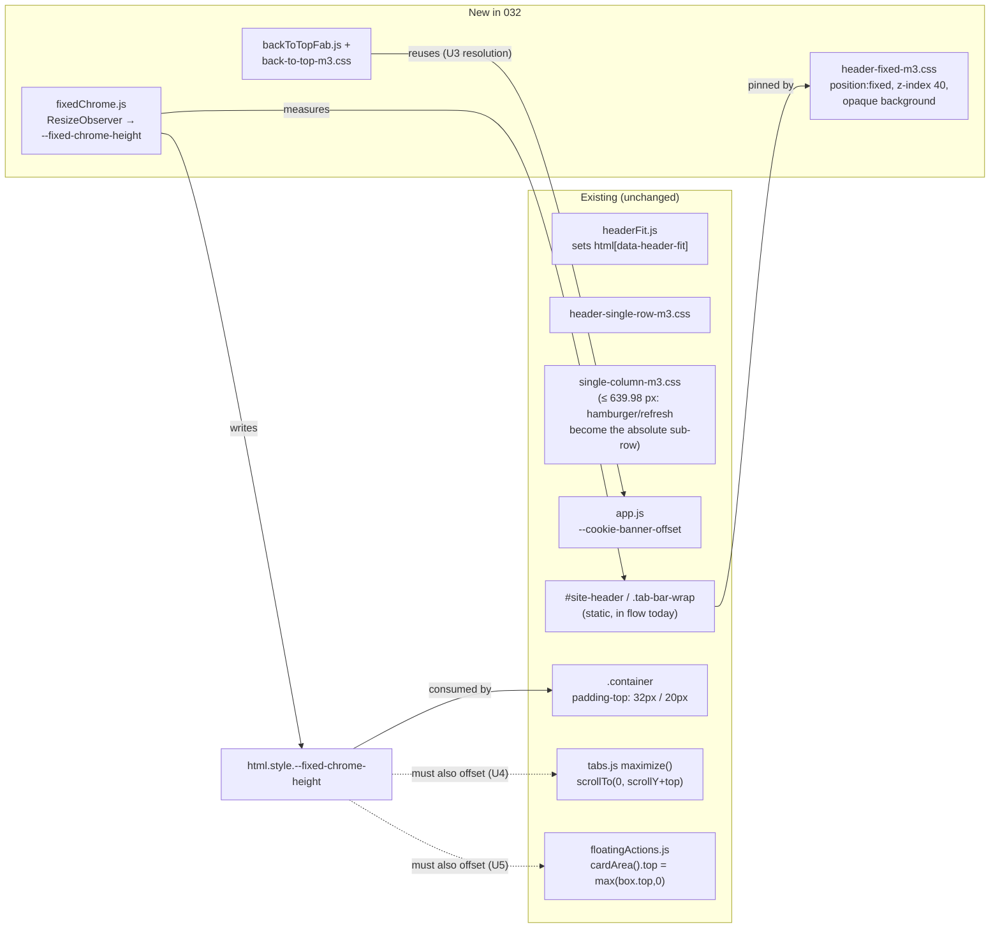
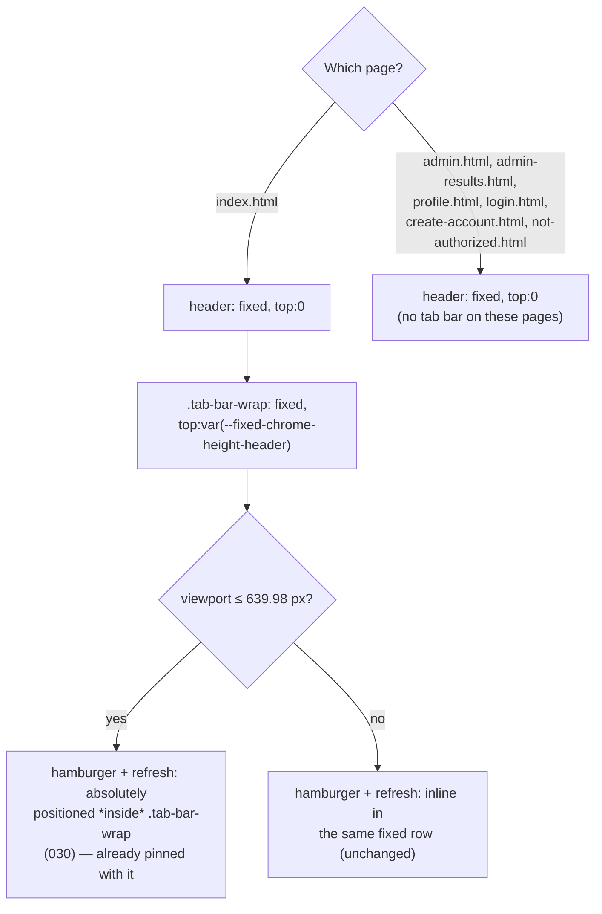
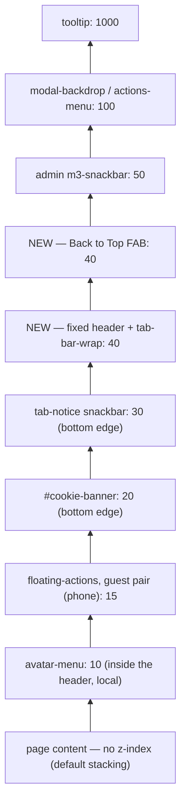
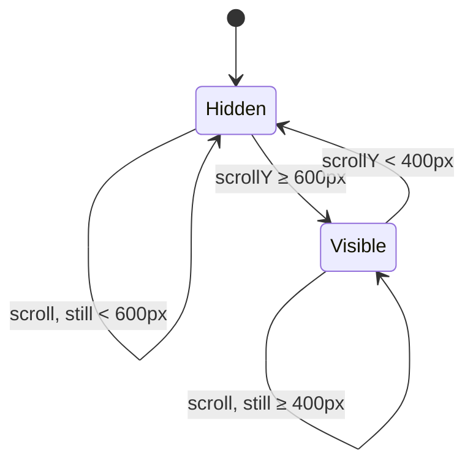
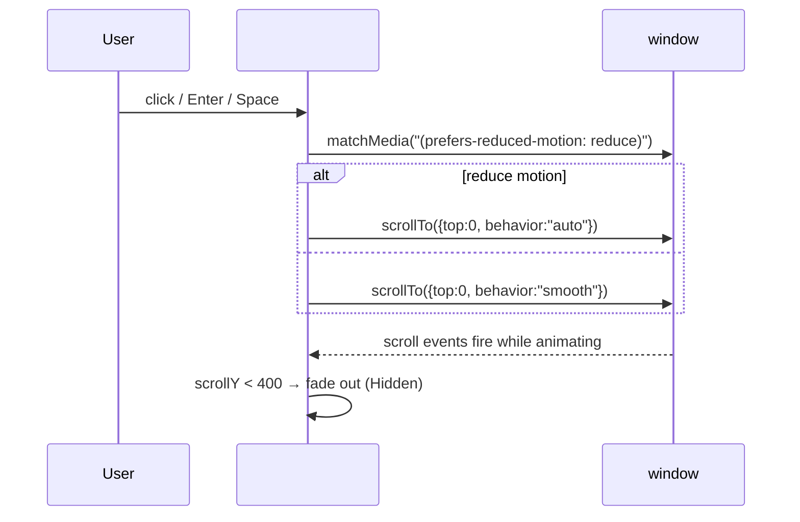

# Architecture: 032 — Fixed-Position Site Header & Back-to-Top FAB

Requirements document: `designDocs/032-high-level-requirements-FIXED-POSITION-HEADER.md`
Builds on: 031 (`architecture/031-single-row-header/architecture.md`) — the single-row header and the `data-header-fit` ladder are unchanged; 030's Single Column breakpoint (639.98 px) and the tab bar's phone-only hamburger/refresh sub-row are unchanged in their own right, only *repositioned* (pinned) by this feature.

## 1. Overview and scope

Two independent requirements, bundled in one document:

1. **Pin the top chrome.** At every width, `#site-header` and — on the one page that has one — `.tab-bar-wrap` (which already contains the tab strip, the "All tabs" hamburger button and the Refresh icon, and, below 640 px, the absolutely-positioned row those two buttons form beneath the tab strip) must stay fixed to the top of the viewport while the page scrolls underneath.
2. **Add a Back to Top FAB.** A Material 3 Floating Action Button, bottom-right, that appears only after a significant scroll and smoothly returns the user to the top.

**What the code does today** (read from `site.css`, `tabs.css`, `header-tab-bar-m3.css`, `header-single-row-m3.css`, `single-column-m3.css`, `app.js`, `tabs.js`, `floatingActions.js`):

| Fact | Where | Consequence for 032 |
|---|---|---|
| `#site-header` has no `position` rule anywhere | `site.css:26-32`, `header-*-m3.css` | it is `position:static`, in normal flow — pinning it is a new behaviour, not a tweak |
| `.tab-bar-wrap` is a **sibling** of `#site-header`, not nested in it, and exists **only on `index.html`** | `index.html:36,38` | the other six pages (`admin.html`, `admin-results.html`, `profile.html`, `login.html`, `create-account.html`, `not-authorized.html`) have nothing to pin but the header |
| The hamburger (`#tabMenuBtn`) and Refresh icon (`#refreshBtn`) sit *inside* `.tab-bar-wrap`; only below 639.98 px do they become `position:absolute; top:calc(100% + var(--refresh-gap))`, forming the "row" the requirement names, with `.tab-bar-wrap{margin-bottom:calc(40px + gap*2)}` reserving the space | `single-column-m3.css:102,114,115,135` | the "row" is not a separate element — it is already contained inside `.tab-bar-wrap`'s own box, so pinning `.tab-bar-wrap` pins it for free |
| No `padding-top`/`margin-top`/`--header-height` custom property exists anywhere to reserve space for the header | grepped across all CSS | taking the header out of flow needs a **new**, measured compensation; nothing today assumes a fixed header |
| `.container{padding:32px 20px 60px}` (≥640 px) / `padding:20px 14px 40px` (≤639.98 px) | `tabs.css:50-54,233` | loaded on **all seven pages** — the one shared place to add the reserved-space offset |
| `#site-header`/`.tab-bar-wrap` have no declared `background`; the page paints its own background separately (`.page-decor`, or nothing on `index.html`) | grepped across all CSS | once fixed over scrolling content, they need an **opaque** background or the page will show through |
| No ancestor of the header (`.page`, `.container`, `.layout`, `body`, `html`) sets `transform`, `filter`, `contain`, `will-change` or `backdrop-filter` | grepped across all CSS | none of them creates a new containing block for `position:fixed` — pinning will anchor to the real viewport, not silently to some ancestor |
| `tabs.js maximize()` does `if (top<0) window.scrollTo(0, window.scrollY+top)` to land the grid's top at `y=0` | `tabs.js:255-263` | once the header/tab-bar-wrap sit fixed *over* `y=0`, this lands content **behind** the fixed chrome, not just below it |
| `floatingActions.js cardArea()` clamps its usable top to `Math.max(box.top,0)` | `floatingActions.js:30-41` | the guest floating Login/Create-Account pair can be dragged (or auto-placed) into the strip now covered by the fixed chrome |
| `--cookie-banner-offset` is set by `app.js` on `<html>` when the cookie banner is visible, and already consumed by `.tab-notice`/`.profile-snackbar` to avoid it | `app.js:452-458`, `header-tab-bar-m3.css:324`, `card-shell-m3.css:83` | the new FAB, also bottom-anchored, should reuse the same variable instead of inventing a second mechanism |
| Every existing icon (hamburger, refresh, tab icons, scroll arrows, tooltip close) is an inline `<svg>`; there is no Material Symbols font/ligature anywhere in the repo | `index.html:40,77,80,87`, grepped `material-symbols` | the requirement's `arrow_upward` is a Material Symbols glyph name, but the FAB's icon must be built as an inline SVG arrow to match the codebase's one icon convention |
| z-index values in use: avatar-menu 10, floating-actions (phone) 15, cookie banner 20, tab-notice snackbar 30, admin snackbar 50, modal-backdrop/actions-menu 100, tooltip 1000 | grepped across all CSS | nothing today reserves a tier for "fixed chrome"; one must be chosen that sits above normal content but below modals/tooltips |


*Figure 1 — The two new files and what they touch. `fixedChrome.js` is the single source of truth for "how much space is the fixed chrome taking", read by CSS and by the two existing scripts that assumed `y=0` was unobstructed.*

## 2. Pinning the chrome

`header-fixed-m3.css` (new, loaded last of the header sheets, on all seven pages) gives `#site-header` and `.tab-bar-wrap` `position:fixed; left:0; right:0; z-index:40` plus an opaque background (`var(--paper)`/`var(--md-sys-color-surface)` — matching the dark-mode token pair already defined in `m3-tokens.css`). `#site-header{top:0}`; `.tab-bar-wrap{top:var(--fixed-chrome-height-header, 0px)}` so the tab bar sits directly under the header without needing a wrapping element around both (no markup change). Six of the seven pages have no `.tab-bar-wrap`, so only the header rule ever applies there — "if it exists" is resolved by *measurement*, not by per-page branching (see A1).

**Horizontal footprint (NC2, Option B).** `left:0; right:0` sets the fixed box's *positioning* bounds, not its *painted* width: `#site-header` and `.tab-bar-wrap` additionally get `max-width:var(--max-width); margin:0 auto; padding-inline:20px` (and the `14px`/phone variant below 639.98 px), mirroring `.container`'s own centering and side-padding values exactly, so each one's content lines up with the page content below it, pixel for pixel, exactly as it does today. The background is painted only across that centered column, not edge-to-edge — on screens wider than `--max-width` (1280px), the bare page background remains visible on either side of the fixed header, matching how the page already looks today above the fold. Because this duplicates `.container`'s centering/breakpoint numbers in a second place, any future change to `.container`'s `max-width` or side padding (`tabs.css:50-54,233`) must be mirrored into `header-fixed-m3.css` by hand.

Because `.tab-bar-wrap` is already `position:relative` (for the horizontal-scroll fade/arrow overlays) and nothing in it uses `transform`/`contain`, switching it to `position:fixed` keeps it as the containing block for its absolutely-positioned children (the fade overlays, and the phone-only hamburger/refresh sub-row) — nothing inside it needs to change.

## 3. The reserved-space pipeline

```mermaid
sequenceDiagram
  participant B as Browser
  participant FC as fixedChrome.js
  participant H as #site-header
  participant T as .tab-bar-wrap (if present)
  participant Root as &lt;html&gt;
  participant Cs as .container (tabs.css)
  B->>FC: ResizeObserver(header[, tab-bar-wrap]) fires
  FC->>FC: requestAnimationFrame (coalesce)
  FC->>H: read offsetHeight
  FC->>T: read offsetHeight (0 if the element is absent)
  FC->>Root: style.setProperty("--fixed-chrome-height", sum + "px")
  Root->>Cs: padding-top: calc(32px/20px + var(--fixed-chrome-height,0px))
  Note over H,T: app.js rebuild (login/logout) or a headerFit.js stage change
  H-->>FC: MutationObserver / ResizeObserver re-fires
  FC->>FC: re-measure, update the variable
```
*Figure 2 — One variable, three consumers: `.container`'s padding (new), `tabs.js maximize()` (U4) and `floatingActions.js cardArea()` (U5) all read the same measured height instead of each guessing it independently.*

## 4. Per-page composition


*Figure 3 — The requirement's "if it exists" clause is true for six of seven pages (no tab bar at all) and, within the one page that has it, the "row" only forms below 640 px. Pinning `.tab-bar-wrap` as a unit covers both cases without a page-specific code path.*

| Page | Fixed elements | Reserved offset source |
|---|---|---|
| `index.html` | header + tab-bar-wrap (+ its phone sub-row) | `fixedChrome.js` sums both |
| `admin.html`, `admin-results.html`, `profile.html`, `login.html`, `create-account.html`, `not-authorized.html` | header only | `fixedChrome.js` measures the header; the tab-bar-wrap term is 0 |

## 5. Stacking order


*Figure 4 — 40 sits above every piece of ordinary chrome (including the cookie banner and tab-notice, which live at the bottom edge and never spatially overlap the top-pinned header anyway) and below every overlay that must be able to cover it (admin snackbar, modals, tooltips).*

## 6. The Back to Top FAB

- **Markup.** Injected by a new `backToTopFab.js`, appended once to `document.body` on all seven pages (NC1) — an inline `<svg>` upward-arrow glyph inside a `<button id="backToTopFab" class="back-to-top-fab" type="button" aria-label="Back to top" title="Back to top">`, matching the codebase's one existing icon convention (inline SVG, `aria-hidden`, `focusable="false"` on the glyph) rather than a Material Symbols font dependency.
- **Position.** `position:fixed; right:20px; bottom:calc(20px + var(--cookie-banner-offset,0px))`, reusing the variable `app.js` already maintains for the cookie banner (U3), so the FAB rides up with the banner instead of sitting under it. It is not clamped against the tab-notice snackbar (also bottom-anchored); see the residual note under Assumptions.
- **Trigger.** `window.scrollY`, read in a `scroll` listener (passive, `requestAnimationFrame`-throttled, the same pattern `tabBarScroll.js`/`floatingActions.js` already use). A single number in the requirement's 500–800 px range is picked as the default show threshold: 600 px, with a lower hide threshold of 400 px (hysteresis — see U9) so the FAB doesn't flicker while the user's scroll position hovers near one boundary.
- **Motion.** `window.scrollTo({top:0, behavior:"smooth"})`, downgraded to `behavior:"auto"` under `prefers-reduced-motion: reduce` — the same `matchMedia` check `tabBarScroll.js:22` already performs. The FAB's own show/hide is a CSS opacity/transform transition, similarly skipped under reduced motion.


*Figure 5 — Two thresholds, not one, avoid a flicker loop exactly at the boundary (U9).*


*Figure 6 — Click behaviour, including the accessibility requirement (keyboard-activatable, `aria-label="Back to top"`).*

## 7. Requirements coverage

| Requirement | Where |
|---|---|
| Header fixed at the top at every width | `header-fixed-m3.css`: `#site-header{position:fixed;top:0}` |
| Tab Bar fixed, when it exists | same sheet: `.tab-bar-wrap{position:fixed;top:var(--fixed-chrome-height-header)}`, present only on `index.html` |
| The Hamburger/Refresh row, when it exists, stays fixed | already nested inside `.tab-bar-wrap` (030); pinning the wrap pins the row |
| Content no longer slides under the fixed chrome | `fixedChrome.js` → `--fixed-chrome-height` → `.container{padding-top}` |
| FAB: `arrow_upward` icon | inline SVG arrow, matching the codebase's icon convention (U7) |
| FAB: fixed, 16–24 px from the corner | `right:20px; bottom:calc(20px + var(--cookie-banner-offset,0px))` |
| FAB: appears only after a significant scroll | `scrollY ≥ 600px` (within the requirement's 500–800 px range), hides `< 400px` |
| FAB: scrolls to top on click | `window.scrollTo({top:0,behavior:"smooth"})`, reduced-motion aware |
| FAB: tooltip + `aria-label` "Back to top" | `title="Back to top"` / `aria-label="Back to top"` on the button |

## 8. Findings

No contradictions inside the requirements document, so there are no Inconsistencies.

### Ambiguities
- [X] **A1 — "if it exists" (fixed-header requirement).** The clause sits directly before "the row with the Hamburger Menu and Refresh icon", but the Tab Bar itself also only exists on one of the seven pages (`index.html`); the sentence never says "if it exists" for the Tab Bar.
  - Recommended: read the conditionality as applying uniformly — each page pins whatever top chrome it actually has (header always; tab bar, and within it the phone sub-row, only where present). Resolved by *measurement* (Figure 1/2), not by naming pages in code, so no per-page branching is needed.
  - **Resolution:** Requirements now say each page keeps fixed whatever top chrome it actually has. (applied)
- [X] **A2 — "approximately 16–24 px from the edges" (FAB).** Could mean the physical viewport edges, or the edges of the centred `max-width:1280px` content column (`.container`), which can be hundreds of pixels from the viewport edge on a wide screen.
  - Recommended: viewport edges — the standard Material 3 FAB placement, independent of the content column's width.
  - **Resolution:** Requirements now say the 16–24 px margin is measured from the viewport edges. (applied)
- [X] **A3 — "Only appear after the user has scrolled down significantly (e.g., 500–800 px)."** A range, not a value, and doesn't say what it's measured from (the very top of the document, or how far past the now-fixed chrome).
  - Recommended: `window.scrollY` from the document's true top (not relative to the fixed chrome's height), with one concrete default of 600 px to show and 400 px to hide (U9's hysteresis).
  - **Resolution:** Requirements now say the distance is measured from the top of the document, with concrete show/hide values of 600 px / 400 px. (applied)

### Unspecified Aspects
- [X] **U1 — No existing mechanism reserves space for the header.** `.container{padding-top:32px/20px}` is a fixed literal unrelated to the header's actual rendered height; pulling the header out of flow with nothing added would make the first on-screen content slide up underneath it.
  - Recommended: `fixedChrome.js` measures the real height and writes it to `--fixed-chrome-height`; `.container`'s padding-top becomes `calc(32px/20px + var(--fixed-chrome-height,0px))` (Figure 2).
  - **Resolution:** Requirements now say the page content reserves live-measured space for the fixed chrome instead of assuming a fixed amount. (applied)
- [X] **U2 — The combined fixed-chrome height is not a constant.** It differs by page (header-only vs. header + tab-bar-wrap) and, on `index.html`, by viewport stage (the phone sub-row adds to `.tab-bar-wrap`'s own rendered height via its `margin-bottom` reservation).
  - Recommended: never hardcode it; `fixedChrome.js`'s `ResizeObserver` re-measures on every layout change, the same trigger discipline `headerFit.js` already uses.
  - **Resolution:** Requirements now say the reserved space is re-measured whenever the fixed chrome's rendered height changes. (applied)
- [X] **U3 — No background color is declared on `#site-header`/`.tab-bar-wrap` today.** Once they're fixed over scrolling content, page content would show through/behind them without one.
  - Recommended: an opaque background (`var(--paper)` / the dark-mode `--md-sys-color-surface` pair already in `m3-tokens.css`) in the new `header-fixed-m3.css` layer.
  - **Resolution:** Requirements now say the fixed header and Tab Bar have an opaque background. (applied)
- [X] **U4 — `tabs.js maximize()` assumes `y=0` is unobstructed.** `if (top<0) window.scrollTo(0, window.scrollY+top)` (`tabs.js:255-263`) lands the maximized card's grid at the literal top of the viewport — which the fixed chrome now covers.
  - Recommended: offset the scroll target by `--fixed-chrome-height` (the same variable from U1), so the grid lands just below the fixed chrome instead of behind it.
  - **Resolution:** Requirements now say maximizing a poll card accounts for the fixed chrome's height so the maximized view lands below it, not behind it. (applied)
- [X] **U5 — `floatingActions.js cardArea()` clamps its top bound to `Math.max(box.top,0)`.** The guest floating Login/Create-Account pair can be dragged into, or auto-placed within, the strip the fixed header now occupies (`floatingActions.js:30-41`).
  - Recommended: clamp to `--fixed-chrome-height` instead of `0`, so the buttons' draggable area starts below the fixed chrome, not at the physical viewport edge.
  - **Resolution:** Requirements now say the guest floating buttons' draggable area starts below the fixed chrome, never underneath it. (applied)
- [X] **U6 — No ancestor currently breaks `position:fixed` containment, but nothing guards against a future one.** None of `.page`/`.container`/`.layout`/`body`/`html` sets `transform`/`filter`/`contain`/`will-change`/`backdrop-filter` today (would silently re-anchor a `position:fixed` descendant to that ancestor instead of the viewport).
  - Recommended: record this as a constraint (section 10) rather than adding a defensive mechanism — nothing today exercises it, and an explicit guard would be speculative code for a hypothetical future change.
  - **Resolution:** Recorded as a constraint in section 10 (Assumptions); no product-facing requirement changes, since today's behaviour already satisfies it and no defensive code is warranted. (applied)
- [X] **U7 — The requirement names a Material Symbols glyph (`arrow_upward`); the codebase has no Material Symbols font anywhere.** Every existing icon (hamburger, refresh, tab icons, tooltip close, scroll arrows) is an inline `<svg>`.
  - Recommended: build the FAB's icon as an inline SVG upward arrow, matching the existing convention exactly; no new font/dependency.
  - **Resolution:** Requirements now say the icon is an inline SVG upward arrow, matching the product's existing icon convention. (applied)
- [X] **U8 — Page scope of the FAB is not stated.** Resolved under Needs Clarification (NC1) since it has real, differently-reasonable options rather than one obvious default.
  - **Resolution:** NC1 Option A chosen — the FAB appears on all seven pages. (applied)
- [X] **U9 — A single scroll threshold for both showing and hiding the FAB would flicker right at the boundary** (ordinary scroll jitter crossing back and forth across one number).
  - Recommended: two thresholds — show at 600 px, hide below 400 px (Figure 5).
  - **Resolution:** Requirements now specify two thresholds (600 px show / 400 px hide) instead of one. (applied)
- [X] **U10 — The FAB's bottom-right position can coincide with the tab-notice snackbar**, which is also bottom-anchored and, when visible, up to `min(672px, 100% - 32px)` wide — on a phone that can reach close to the right edge the FAB occupies.
  - Recommended: accept the residual overlap. The snackbar is transient (an action confirmation), already timed to dismiss itself, and already designed to sit above other bottom chrome (`z-index:30` vs. the FAB's 40, so the FAB would visually sit on top of it rather than being hidden); no further mechanism is proposed (see Assumptions).
  - **Resolution:** Accepted as a residual, documented risk (section 10); no requirements change, since no product behaviour needs to differ. (applied)

### Needs Clarification
- [X] **NC1 — Does the Back to Top FAB appear on all seven pages, or only on the pages whose content can plausibly exceed the scroll threshold** (today, realistically `index.html`'s tab panels, `admin.html`'s poll list, `admin-results.html`)?
  - Option A (recommended): render it on all seven pages, via one shared script (`backToTopFab.js`) injected identically everywhere — the same approach already used for other page-wide scripts. It costs nothing on short pages (profile/login/create-account/not-authorized): the FAB simply never reaches its show threshold there under normal content, and it correctly appears if the page content, OS text scaling, or browser zoom ever makes one of them tall enough to scroll.
  - Option B: only on `index.html`, `admin.html`, `admin-results.html`; omit the script and any reference to it from the other four pages. Pros: no inert code shipped to pages that "shouldn't" need it. Cons: inconsistent chrome across the seven pages that otherwise all share the same header; a page assumed short today can still grow (more profile fields, a longer login error state, a future change) and would silently lack the affordance until someone remembers to add it back.
  - **Resolution:** Option A chosen. The FAB is injected by `backToTopFab.js` identically on all seven pages. (applied)
- [X] **NC2 — Should the fixed header/tab-bar span the full viewport width (edge-to-edge), or stay visually confined to the same centred `max-width:1280px` column `.container` uses today?**
  - Option A (recommended): full-bleed. `#site-header`/`.tab-bar-wrap` become `left:0;right:0` with their own horizontal centering and side padding mirroring `.container`'s current values (`max-width:var(--max-width); margin:0 auto; padding-inline` matching `32px→20px`/`20px→14px`), and an opaque background that spans the entire width. This is the standard Material 3 top-app-bar treatment, and avoids a visible seam where the page's bare background would otherwise show beside a header that stopped short of the physical edges on very wide screens.
  - Option B: keep the header's painted area confined to the same column as the page content, by computing the fixed box's own `left`/`right` to mirror `.container`'s centering math exactly. Pros: zero visual change to the header's horizontal footprint on wide screens. Cons: duplicates `.container`'s centering/breakpoint math in a second place that must be kept in sync by hand every time it changes, and the header still wouldn't look "pinned" the way the rest of a conventional fixed app bar does — unpainted background would be visible beside it while content scrolls underneath, which can read as an incomplete implementation of "fixed," though the requirement never actually asks for edge-to-edge treatment.
  - **Resolution:** Option B chosen. The fixed header and tab bar keep the same centred `max-width:1280px` column and side padding as `.container` today; no edge-to-edge background band. Section 2 now documents the mirrored centering math and the hand-sync maintenance cost it carries. (applied)

## 9. Breaking changes

- **B1 — `.container`'s top padding changes from a fixed literal to a measured `calc()`.** Visually, every one of the seven pages shifts its content down by however tall the fixed chrome renders (intended and necessary — see U1 — but it moves every page's content on every load).
- **B2 — The header and tab bar can no longer be scrolled out of view.** Today a user can scroll them away to reclaim vertical space (e.g., on a short landscape-phone screen); after this change that space is permanently reserved. This is the explicit intent of the requirement, recorded here because it is a real loss of usable viewport height, most noticeable on short screens.
- **B3 — `tabs.js maximize()`'s scroll target must change (U4)** or maximizing a card will scroll its grid to sit behind the fixed chrome instead of just below it — a regression if this feature ships without that fix.
- **B4 — `floatingActions.js cardArea()`'s top clamp must change (U5)** or the guest floating action buttons can end up partly hidden under the fixed header on a phone — a regression if this feature ships without that fix.
- ~~**B5 — If NC2 Option A is chosen, the header's horizontal footprint changes from "matches the content column" to "spans the full viewport"** on screens wider than 1280 px — a visible, if minor, chrome redesign.~~ Does not apply: NC2 resolved to Option B, so the header's horizontal footprint is unchanged from today.

## 10. Assumptions

- z-index 40 is a new, previously-unused tier reserved for this feature (both the fixed header/tab-bar-wrap and the FAB); nothing existing currently occupies it (section 5).
- The fixed header's background uses the existing `--paper`/`--md-sys-color-surface` light/dark token pair already defined in `m3-tokens.css`; no new color is introduced.
- Any future change that adds `transform`, `filter`, `contain`, or `will-change` to `.page`, `.container`, `.layout`, `body`, or `html` would silently break fixed positioning (U6) — noted as a constraint on future work, not guarded against here.
- The FAB's residual visual adjacency with the tab-notice snackbar (U10) is accepted rather than engineered around, given the snackbar's transient nature.
- No server, route, configuration, or data change; no new dependency. Everything here is CSS plus two small new client scripts (`fixedChrome.js`, `backToTopFab.js`) alongside one new stylesheet (`header-fixed-m3.css`) and the FAB's own small stylesheet.
- Tests: jsdom has no layout, so `fixedChrome.js`'s tests stub `offsetHeight` the way `headerFit.js`'s tests already stub `scrollWidth`/`clientWidth`; `backToTopFab.js`'s tests stub `window.scrollY` and assert the threshold/hysteresis transitions directly rather than relying on real scrolling.

## Completion Report

- **Mode:** REGENERATE (new requirements document; no prior architecture directory was recorded for it)
- **Location:** `architecture/032-fixed-position-header` — `architecture/032-fixed-position-header/architecture.md`
- **Diagrams:** 6
- **Inconsistencies:** 0
- **Ambiguities:** 3 (A1–A3)
- **Unspecified Aspects:** 10 (U1–U10)
- **Needs Clarification:** 2 (NC1–NC2, each with options)
- **Breaking Changes:** 4 (B1–B4; B5 does not apply — NC2 resolved to Option B, so the header's horizontal footprint is unchanged)
- **Readiness for `/speckit-specify`:** ready — all 3 ambiguities, all 10 unspecified aspects, and both needs-clarification items (NC1, NC2) are resolved.
