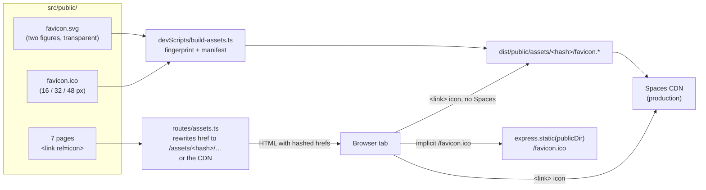
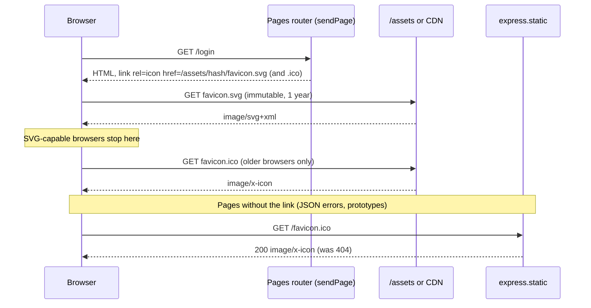
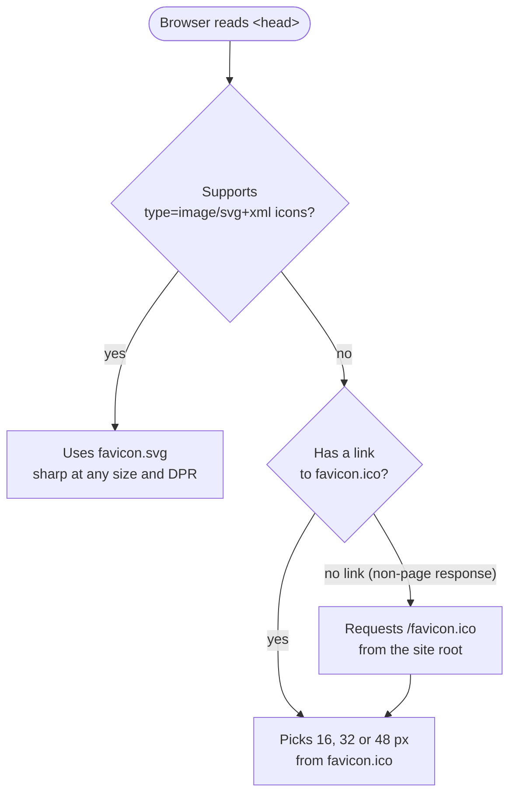
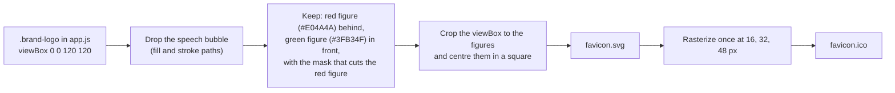

# Architecture: Site Favicon

Requirements: `requirements/20261016-172002-site-favicon/requirements.md`  
Mockup: `requirements/20261016-172002-site-favicon/favicon-mockup.jpg`  
Generated: 2026-10-16 17:20  

## 1. Overview and Scope

The site has no favicon today.  
None of the seven pages in `src/public/` has a `<link rel="icon">`, and the browser's automatic request for `/favicon.ico` gets a 404.  
This feature adds a favicon that resembles the mockup: a green figure standing in front of a red one, the same two figures the header's brand logo (`.brand-logo` in `app.js`) shows inside its speech bubble.  

**In scope**

- The icon files: an SVG, and an ICO holding 16, 32 and 48 px images.
- A `<link rel="icon">` in the `<head>` of every page: `index.html`, `login.html`, `create-account.html`, `profile.html`, `admin.html`, `admin-results.html` and `not-authorized.html`.
- Serving the icon files through the existing fingerprinted asset pipeline, and answering the browser's bare `/favicon.ico` request.

**Out of scope** (see U3)

- An Apple touch icon, a web app manifest, and 192 px or 512 px icons.
- Any change to the header's brand logo.

No server route, configuration, data, migration or dependency change is needed.  
`devScripts/build-assets.ts` already fingerprints `.svg`, `.png` and `.ico` files.  
`routes/assets.ts` already rewrites `href="/x.ico"` and `href="/x.svg"` in every page to the fingerprinted (CDN) copy.  

## 2. Diagrams

### 2.1 Context: where the icon lives

### 2.2 Sequence: a page load

### 2.3 Which file a browser uses

### 2.4 How the icon is drawn (derived from the brand logo)

## 3. Requirements Traceability

| Requirement | Addressed by |
|---|---|
| Format: .ico, .png or .svg | `favicon.svg` and `favicon.ico` (A1) |
| Size: 16, 32 and 48 px | Three images inside `favicon.ico`, and the SVG scales to any size |
| Placement: a `<link rel="icon">` in `<head>` | One pair of links in each of the seven pages, after the viewport meta |
| Accessibility | The page `<title>` names the tab, and the SVG carries `<title>CrowdPoll</title>` (A2) |
| Resemble the image | Two figures from the brand logo, without the bubble (NC1) |

## 4. Findings

### 4.1 Inconsistencies

**I1. The mockup image link does not resolve from the document.**  
✅ Resolved  
✅ Requirements File Updated: 2026-10-16 9:50 PM   
**Notes**: Recommendation accepted 2026-10-16: the image is `designDocs/20261016-172002-favicon-mockup.jpg`, and the requirements link it as ``.  

The requirements show ``.  
Markdown links are relative to the document, which is itself in `designDocs/`, so the link points to `designDocs/designDocs/…` and the image does not render.  
The image's prefix (`20261016-171007`) also no longer matches the document's (`20261016-172002`).  

  - **Recommendation**  
    ➡️ [X] **Accepted**  
    Rename the image to `designDocs/20261016-172002-favicon-mockup.jpg` and change the link to ``, relative to the document.  

**I2. The Scope line counts the admin refusal page among the responses without the links.**  
✅ Resolved  
✅ Requirements File Updated: 2026-10-17 4:44 PM  
**Notes**: Recommendation accepted by "Accept" 2026-10-17: **Recommendation**, **replace "the admin refusal page" with "the plain-text 404 replies".**  
The Scope line's parenthesis now reads "(JSON errors, the prototypes, the plain-text 404 replies)".  

The Scope requirement says the root `/favicon.ico` covers "responses without the links (JSON errors, the prototypes, the admin refusal page)".  
The admin refusal page is `not-authorized.html`, which `src/routes/pages.ts` serves with status 403.  
It is one of the seven pages in `src/public/`, so the same Scope line also gives it the links.  
The plain-text `Not found` reply that `pages.ts` sends with status 404 has no links, and the list leaves it out.  

  - **Recommendation**: **replace "the admin refusal page" with "the plain-text 404 replies".**  

    ➡️ [X] **Accepted**  
    The parenthesis then reads "(JSON errors, the prototypes, the plain-text 404 replies)".  
    `not-authorized.html` keeps its two links like the other six pages, and the U4 page test covers it.  

### 4.2 Ambiguities

**A1. "Format: .ico, .png, or .svg" can mean one format or all of them.**  
✅ Resolved  
✅ Requirements File Updated: 2026-10-16 9:50 PM   
**Notes**: Recommendation accepted in file 2026-10-16: the requirements now name `favicon.svg` and `favicon.ico` (16, 32 and 48 px), with no separate PNGs, and give the two `<link>` tags.  

  - **Recommendation**  
    ➡️ [X] **Accepted**  
    Ship two files.  
    - `favicon.svg`: modern browsers use it, and it stays sharp at every size and pixel density.  
    - `favicon.ico`, holding 16, 32 and 48 px images: older browsers use it, and it also answers the browser's bare `/favicon.ico` request.  
    - No separate PNGs: the ICO already carries the three sizes the requirements list.  

**A2. "Provide a descriptive title or alt text for the favicon if necessary" has nothing to attach to.**  
✅ Resolved  
✅ Requirements File Updated: 2026-10-16 9:50 PM   
**Notes**: Recommendation accepted in file 2026-10-16: the requirements now say no alt text, a `<title>CrowdPoll</title>` in `favicon.svg`, and the pages' titles unchanged.

A favicon is decoration: browsers give a `<link rel="icon">` no alt text, and the page's `<title>` is what names the tab.  
  - **Recommendation**  
    ➡️ [X] **Accepted**  
    Add no alt text.  
    Give `favicon.svg` a `<title>CrowdPoll</title>` for tools that open the file directly.  
    Every page already has a `<title>`, which stays as it is.  

**A3. "The website" does not say which responses get the icon.**  
✅ Resolved  
✅ Requirements File Updated: 2026-10-16 9:50 PM   
**Notes**: Recommendation accepted in file 2026-10-16: the requirements now cover all seven pages, plus `favicon.ico` at the site root.  

  - **Recommendation**  
    ➡️ [X] **Accepted**  
    Link the icon from all seven pages in `src/public/`.  
    Put `favicon.ico` at the site root so that every other response (JSON errors, the prototypes under `/prototypes/`, the admin refusal page) also shows it through the browser's automatic `/favicon.ico` request.  

### 4.3 Unspecified Aspects

**U1. The mockup is not square (23 × 20 px), and its background is not given.**  
✅ Resolved  
✅ Requirements File Updated: 2026-10-16 9:50 PM   
**Notes**: Recommendation accepted in file 2026-10-16: the requirements now give a square canvas with a transparent background and at most 1 px padding at 16 px.  

  - **Recommendation**  
    ➡️ [X] **Accepted**  
    Centre the figures in a square canvas, scaled to fill its width, with a transparent background and no padding beyond 1 px at 16 px.  
    The green and red stay legible on both light and dark browser tab strips.  

**U2. How the ICO is produced is not specified.**  
✅ Resolved  
✅ Requirements File Updated: 2026-10-16 9:50 PM   
**Notes**: Recommendation accepted in file 2026-10-16: the requirements now say a hand-authored SVG, a one-time ICO export, and no build step or dependency.  

The project has no image rasterizer, and adding one (`sharp`, `png-to-ico`) would be a new dependency.  
  - **Recommendation**  
    ➡️ [X] **Accepted**  
    Hand-author `favicon.svg` from the brand logo's figure paths.  
    Rasterize it once to a 16/32/48 px `favicon.ico` with any external tool, and commit both files as source.  
    Add no build step and no dependency.  
    Re-export the ICO whenever the SVG changes, and note this in `plan.md`.  

**U3. Larger icons and mobile home-screen icons are not mentioned.**  
✅ Resolved  
✅ Requirements File Updated: 2026-10-16 9:50 PM   
**Notes**: Recommendation accepted in file 2026-10-16: the requirements now list the Apple touch icon, the web app manifest and the 192/512 px icons as out of scope.  

iOS uses `apple-touch-icon` (180 px), and Android uses a web app manifest (192 px and 512 px).  
  - **Recommendation**  
    ➡️ [X] **Accepted**  
    Leave them out of this feature and record them under Assumptions.  
    The requirements name only 16, 32 and 48 px, and a manifest would make the site an installable app, which is a separate decision.  

**U4. How the icon is tested is not specified.**  
✅ Resolved  
✅ Requirements File Updated: 2026-10-16 9:50 PM   
**Notes**: Recommendation accepted in file 2026-10-16: the requirements now list the three tests.  

  - **Recommendation**  
    ➡️ [X] **Accepted**     
    Add to `tests/pages.test.ts` a check that each of the seven pages, as served, has `<link rel="icon" type="image/svg+xml">` and `<link rel="icon" sizes="16x16 32x32 48x48">`.  
    Add a request test that `GET /favicon.ico` answers 200 with an icon content type.  
    Add a check that `favicon.ico` holds exactly the 16, 32 and 48 px images, by reading its directory header.  

**U5. "Rasterized once with any external tool" does not say who produces `favicon.ico`, or with what.**  
✅ Resolved  
✅ Requirements File Updated: 2026-10-17 4:45 PM  
**Notes**: Recommendation accepted by "Accept A" 2026-10-17: **Recommendation A**, **a small committed script that uses headless Edge and packs the PNGs itself.**  
Recommendation B had also been marked, and was unmarked because A was named.  
The Production line now names `devScripts/favicon-ico.ts`, headless Edge at 16, 32 and 48 px on a transparent background, the hand-written ICO header, the browser-path variable and the `.gitignore` exception;  
it is run by hand and is not part of `npm run build`.  

The project has no rasterizer, and the Production requirement adds no dependency.  
This machine has no Inkscape or ImageMagick, so `/speckit-implement` cannot produce the ICO without a decided method.  
Microsoft Edge is installed, and its headless mode can render the SVG to a PNG at an exact size.  
An ICO file may hold PNG images directly, and every browser that reads ICO files supports that.  

  - **Recommendation A** _(recommended)_: **a small committed script that uses headless Edge and packs the PNGs itself.**  

    ➡️ [X] **Accepted**  
    `devScripts/favicon-ico.ts` runs `msedge --headless --screenshot` at 16, 32 and 48 px with `--default-background-color=00000000`, so the background stays transparent;  
    it then writes the three PNGs into `src/public/favicon.ico` behind a hand-written ICO header (about 30 lines, no dependency).  
    The browser path comes from an environment variable, defaulting to Edge's usual install path.  
    `.gitignore` needs `!devScripts/favicon-ico.ts`, as feature 028 did for `file-manifest.ts`.  
    It is run by hand whenever the SVG changes, and is not part of `npm run build`.  
    - <u>Pros</u>: the ICO can be re-made from the SVG in one command, and `/speckit-implement` can make the first one itself.  
    - <u>Cons</u>: a script to keep, and it depends on a Chromium browser being installed.  
  - **Recommendation B**: **the developer exports the ICO by hand.**  

    ➡️ [ ] **Accepted**  
    `tasks.md` gets a manual task: export `favicon.svg` to a 16/32/48 px `favicon.ico` with any tool (e.g. an online converter or GIMP) and save it in `src/public/`.  
    Implementation pauses at that task until the file exists.  
    - <u>Pros</u>: no script at all.  
    - <u>Cons</u>: each later change to the SVG needs the same manual step, and nothing checks that the ICO still matches the SVG.  

### 4.4 Needs Clarification

**NC1. Should the favicon include the speech bubble?**  
✅ Resolved  
✅ Requirements File Updated: 2026-10-16 9:50 PM   
**Notes**: Recommendation accepted in file 2026-10-16: Recommendation A, figures only, with no speech bubble;  
the requirements now say so beneath the mockup.  

The mockup shows only the two figures.  
The header's brand logo draws the same figures inside a white speech bubble with a black outline.  

  - **Recommendation A** _(recommended)_: **figures only, as in the mockup.**  
    ➡️ [X] **Accepted**  
    - `Pros`: it matches the mockup, and it is legible at 16 px, where the bubble's outline and tail would take a third of the pixels.  
    - `Cons`: it is a slightly different mark from the header logo.  
  - **Recommendation B**: **the full brand logo, bubble included.**  
    ➡️ [ ] **Accepted**

    - `Pros`: it is the same mark everywhere.  
    - `Cons`: the figures shrink to about 8 px at 16 px and blur, the white bubble disappears on a light tab strip, and it does not match the mockup.  

## 5. Breaking Changes

None.  
`GET /favicon.ico` changes from 404 to 200, which nothing depends on.  

## 6. Technical Debt

- **The brand logo is a string inside `app.js`** (`SITE_HEADER_MARKUP`).  
  The favicon will copy its figure paths, so a later logo change has to be made in two places.  
  A later feature could move the logo to `src/public/brand-logo.svg` and derive both from it.  
- **The `<head>` is repeated in seven HTML files.**  
  Every page-wide addition, this one included, means seven edits, and `tests/m3-assets.test.ts` / `tests/pages.test.ts` keep them in step by hand.  
- **Many older design documents link images in `dontTrack/`, which is git-ignored**, so those images are missing from the repository.  
  This document's mockup is now in `designDocs/`.  
- **A stray `designDocs/requirement copy.md`** sits beside the requirements documents and does not follow the naming scheme.  

## 7. Assumptions

- The icon uses the brand logo's exact colours: green `#3FB34F` and red `#E04A4A`.
- No dark-mode variant: the colours read on both light and dark tab strips, so the SVG needs no `prefers-color-scheme` rule.
- Each page's links come right after the viewport `<meta>`:  
  `<link rel="icon" href="/favicon.svg" type="image/svg+xml">` and `<link rel="icon" href="/favicon.ico" sizes="16x16 32x32 48x48">`.  
  `routes/assets.ts` rewrites both to the fingerprinted copies, which are cached for a year as immutable.
- The root `/favicon.ico` is served by the existing `express.static(publicDir)` with its default caching, so no route is added.
- Apple touch icons and a web app manifest are out of scope (U3).

## 8. Architecture Complete Report  
  
- **Architecture Document:** `architecture/20261016-172002-site-favicon/architecture.md`  
- **Requirements document:** `designDocs/20261016-172002-high-level-requirements-FAVICON.md`  
- **Software Architecture Diagrams:** 4  
- **Inconsistencies:** 2  
- **Ambiguities:** 3  
- **Unspecified Aspects:** 5  
- **Needs Clarifications:** 1  
- **Breaking Changes:** 0  
- **Technical Debt items:** 4  
  
The requirements are ready for speckit-specify.  
To generate specs from the requirements document, use the `/speckit-specify` command with the path to the requirements file.  
At the prompt, Type:  
🟩 👉 /speckit-specify designDocs/20261016-172002-high-level-requirements-FAVICON.md  
