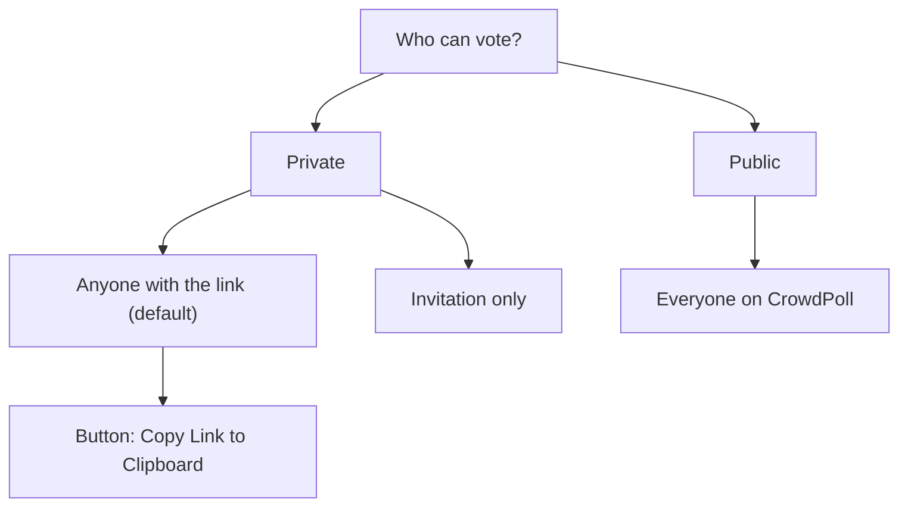
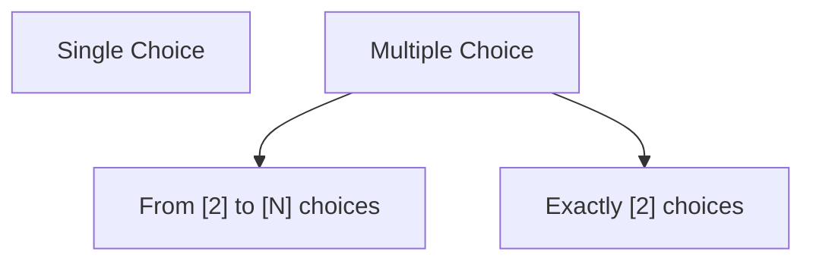
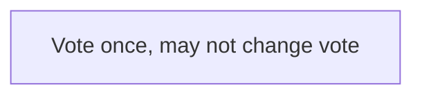
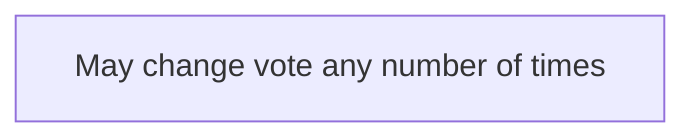
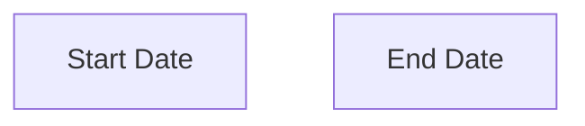

# Overview

The # REQUIREMENT### sections are the individual requirements as we develop the UI/UX for private poll administration.  

In CC CLI, we (the developers) will type "Whats Next".  
You will find the next # REQUIREMENT### section that is not marked as Resolved[X].  
This will be referred to as the "current requirement".  
You will read the ## REQUIREMENT section of the current requirement.
You will log the the prompt to the console of CC CLI.  
If there are any clarifications needed, you will log them to the console of CC CLI  
and we will update the ## REQUIREMENT section of the current # REQUIREMENT### section to resolve the clarifications.

Then you will place your recommendation (of how to satisfy the requirement),  
in the ## RECOMMENDATION section of the current # REQUIREMENT### section.  
If there are options, 
please list them in the ## RECOMMENDATION section, A. Option 1, B. Option 2, etc.  
then we will discuss the options and decide which option to implement.  
You will log the options or single recommendation to the console of CC CLI.  

Then, in CC CLI, we will type "Apply".  
You will then implement the requirement according to the recommendation.  
When the implementation is complete and successful, you will mark the # REQUIREMENT### section as Resolved[X]  
and then if there are any notes, you will place them in the ## NOTES section of the # REQUIREMENT### section.  

You will then wait for the next "Whats Next" command.  

# REQUIREMENT001
[X] Resolved
## REQUIREMENT
Is it possible to extract the html/css/js from the client-side code, 
of one  
<div class="admin-card-list">  
that includes 2 poll-admin-card   

one poll-admin-card that isn't in edit mode  
<div class="poll-admin-card">  
   <div class="card-header">

and one poll-admin-card that is in edit mode  
<div class="poll-admin-card edit-mode">  
  <div class="card-header card-header--editing">  
  
This will allow us to design a more user-friendly poll-admin-card, in edit-mode and in read-only mode.  
  
There is no need for the site-header, tab-bar, admin-toolbar, admin-search-notice.  
Remove any js files that are not needed for the admin list of 2 cards.  
Please place the resulting files in:  
"research/UI-UX-FOR-PRIVATE-POLLS/NON-ADMIN-POLL-EDITING"

**Fixture polls.** Proposed:
   - **Read-only card:** a Private Poll, Anyone With The Link, OPEN, 5 choices, with
     votes.
   - **Edit-mode card:** a Private Poll, **Invitation Only**, WAITING TO OPEN, with 12
     invited voters (so the roster pages at 10) and 2 banned voters.
Created `admin-cards.html`
**Fonts.** Keep the Google Fonts link, which needs internet to show Fraunces and Inter

## RECOMMENDATION
**Yes, it is possible.** The two cards can be run on their own, without a server, a
sign-in or a database.

### What the admin page is made of today

**Scripts** (`src/public/admin.html`):

| Script | What it does | Needed for 2 cards? |
|---|---|---|
| `app.js` | Site header, session, cookie banner | **No** |
| `adminList.js` | The admin tab bar, search, list loading, create/duplicate/delete/state actions, and the `deps` object each card is given | **No.** Replaced by a small harness (below) |
| `adminCard.js` | Builds one `poll-admin-card`: the read-only face, the edit-mode face (`card-header--editing`), the choices editor, schedule fields, and the Participants and Banned Voter List rosters | **Yes, unchanged** |

**How `adminCard.js` depends on the page:**
- It is self-contained: `window.AdminCard.create(poll, deps)` returns the card element.
- It needs a `deps` object: `now`, `isLatched`, `onEditStart`, `onEditEnd`,
  `refresh`, `onDuplicate`, `onCopyLink`, `onRescreen`, `onDelete`, `onArchive`,
  `onState`, `onMenuToggle`.
- It calls the server only through `fetch` to `/api/admin/polls/<pid>/…`:
  - `POST /edit-session`, which enters edit mode and returns `{ granted, poll, mode }`;
  - `/edit-session/heartbeat`;
  - `DELETE /edit-session`;
  - `/publish`;
  - `/results`, which supplies the voted-participant list.
- Settings from `/api/config` are passed in with `AdminCard.setRuntimeConfig(...)`.
- The row icons are `<use href="#icon-…">`, so the `<svg><symbol>` block at the top of
  `admin.html` is needed.

**Styles:** the page loads five sheets in this order: `styles.css`, `tabs.css`,
`pollCard.css`, `admin.css`, `site.css`. The card's own classes are almost all in
`admin.css`, but the others still contribute:
- `site.css`: colour tokens `--ink` / `--line` / `--muted`, and the body;
- `styles.css`: base `button`, `box-sizing` and the body;
- `pollCard.css`: `.btn-primary`;
- `tabs.css`: `.page`, `.container`, the page width.

### Options

**A. A working, self-contained copy (recommended)**
- `admin-cards.html`:
  - the Google Fonts link;
  - the five stylesheets, in the same order;
  - the `<symbol>` icon block;
  - a `.page > .container > main > <div class="admin-card-list">` wrapper, without
    the site header, tab bar, admin toolbar or search notice.
- `adminCard.js`: copied **unchanged** from `src/public/`.
- `harness.js`, a small replacement for `adminList.js`:
  - two fixture polls;
  - a stub `deps` whose actions only log to the console;
  - a fake `fetch` that answers the `/api/admin/polls/<pid>/…` calls above;
  - `setRuntimeConfig` with today's defaults;
  - card 1 is left read-only, and card 2 is put into edit mode on load, by the same
    `POST /edit-session` path the real page uses.
- The five CSS files, copied unchanged.
- It opens straight from disk (`file://`), with no server.
- The cards behave as they do on the admin page: the actions menu, the choices
  editor, schedule inputs, roster paging, dirty-state and Save/Cancel. The markup is
  exactly what production produces, because it is the production script.
- Downside: the CSS files carry rules for other pages (tabs, voter cards, sign-in).
  They are harmless, but a designer has more to read.

**B. A static snapshot**
- The two cards are rendered once (in jsdom, as the tests do) and saved as plain HTML.
- A single CSS file holds only the rules whose selectors match that markup.
- No JavaScript at all.
- Easiest to read and restyle.
- Downsides:
  - Nothing is interactive. The menu cannot open, the choices editor does not work,
    and dirty and Save states cannot be seen.
  - It drifts from the real code as soon as `adminCard.js` changes.
  - Pruning can drop rules that apply only on `:hover`, `:disabled` or a narrow
    screen, unless they are kept by hand.

**C. Both A and B.** A is the reference that behaves correctly, and B is the
simplified sheet to design on.

### Recommendation

**Option A.** A friendlier card has to be judged in use: opening the menu, typing
choices, and switching the sharing mode, which shows or hides the Invitations roster.
A copy that runs `adminCard.js` unchanged is the only one guaranteed to match what
users see. It can later be trimmed, as in Option B, once the design direction is known.

### Clarifications needed
Answered in ## REQUIREMENT above. **Option A** chosen.

## NOTES
Implemented as **Option A**. Files in this folder:

| File | What it is |
|---|---|
| `admin-cards.html` | The page. Open it directly from disk (no server). It has the Google Fonts link, the five stylesheets in the admin page's order, the `<symbol>` icon block from `admin.html`, and one `<div class="admin-card-list" id="pollList">`. There is no site header, tab bar, admin toolbar or search notice. |
| `adminCard.js` | **Unchanged** copy of `src/public/adminCard.js`. It builds both cards. |
| `harness.js` | Replaces `adminList.js`, `app.js` and the server. It holds the two sample polls, a stub `deps`, the actions-menu code copied from `adminList.js`, and a fake `fetch` for `/edit-session`, `/edit-session/heartbeat`, `/results` and `/publish`. On load it clicks card 2's pen, so it enters edit mode by the real `POST /edit-session` path. |
| `styles.css`, `tabs.css`, `pollCard.css`, `admin.css`, `site.css` | **Unchanged** copies from `src/public/`. |

**Left out:** `app.js` (site header, session, cookie banner) and `adminList.js` (admin tabs, search, list loading, the real actions).

**Sample polls** (as clarified):

- **Card 1, read-only:**
  - Private Poll, Anyone With The Link, OPEN;
  - 5 choices, 23 votes, voter limit 50;
  - has votes, so its pen opens **update** mode, with the mechanics frozen.
- **Card 2, edit mode:**
  - Private Poll, Invitation Only, WAITING TO OPEN, no votes;
  - 12 invited, so the Invitations roster shows `1 - 10 (12 items)`, page 1 of 2;
  - 2 banned.

**Things to know when designing from it:**

- **Nothing is sent anywhere.** Duplicate, Copy Link, View Results, Delete, Open/Close,
  Save and Publish, and Cancel only show a note on the card's status line and log to
  the browser console. After Save or Cancel, card 2 returns to read-only, and its pen
  opens edit mode again.
- **Card 1's pen is disabled while card 2 is being edited.** This is the real page's
  rule: one card is edited at a time (`isLatched`).
- **The real markup differs from the requirement's description:**
  - the card element is `<article class="poll-admin-card">`, not a `<div>`;
  - no `edit-mode` class is added in edit mode. Edit mode shows only as
    `card-header card-header--editing` and the edit-form contents.

  A redesign that wants an `edit-mode` class on the card would have to add it in
  `adminCard.js`.
- **The stylesheets are the full production sheets.** They also carry rules for the
  home page, tabs and sign-in pages. The card's own rules are almost all in
  `admin.css`.
- **Keeping it in step:** if `src/public/adminCard.js` or the stylesheets change,
  copy them over again. `harness.js` needs changing only if the card's `deps` or
  server calls change.
- **Verification:** checked in jsdom (there is no headless browser in the sandbox):
  - two `.poll-admin-card`s render;
  - card 1 has `card-header` and card 2 has `card-header card-header--editing`;
  - card 2's title and 4 choices are filled in;
  - the Invitations and Banned Voter List rosters render, and the Invitations
    roster pages 10 of 12;
  - the actions menu opens.

  It has not yet been viewed in a real browser.

# REQUIREMENT002 Admin Card Border
[X] Resolved
## REQUIREMENT
Change the admin card border from a solid line to a drop shadow exactly as used by the Poll Card in the main CrowdPoll webapp of this repo.  
The current size of the admin card and its responsiveness should remain the same.

## RECOMMENDATION
### What the two cards use today

| | Poll Card (`.card-face`, `src/public/pollCard.css:111`) | Admin card (`.poll-admin-card`, `admin.css:437`) |
|---|---|---|
| Border | `1px solid var(--line)` (`#D8DCD3`) | `1px solid var(--line)` (the same line) |
| Shadow | `box-shadow: var(--shadow)`, which is `0 20px 50px -25px rgba(30,36,34,0.35)` | **none** |
| Radius | `20px` (`18px` below 640 px) | `12px` |

The Poll Card does **not** replace its line with a shadow. It has **both**: the same
hairline the admin card has, plus a soft shadow below. What makes the Poll Card look
lifted is the shadow.

**Size and responsiveness are unaffected either way.** `box-shadow` takes no space in
the layout, and both options keep a 1px border, so the card stays the same width and
height at every screen size. The list's `gap: 18px` leaves room for the shadow. Its
visible part reaches about 20px below the card and fades out, and the next card sits
on top of it.

### Options

**A. Exactly as the Poll Card: keep the hairline and add its shadow (recommended)**
```css
.poll-admin-card {
  border: 1px solid var(--line);   /* unchanged */
  box-shadow: var(--shadow);       /* added: the Poll Card's shadow token */
}
```
It uses the same token, so if the Poll Card's shadow ever changes, the admin card
follows.

**B. The shadow instead of the line**
```css
.poll-admin-card {
  border: 1px solid transparent;   /* line hidden; the 1px keeps the size */
  box-shadow: var(--shadow);
}
```
This does what "from a solid line to a drop shadow" says literally. But it is not how
the Poll Card looks. The card's top and sides become harder to see against the page
background, because this shadow falls almost entirely below the card.

### Recommendation
**Option A**, because the requirement asks for the shadow "exactly as used by the Poll
Card", and the Poll Card keeps its hairline. It is one added line of CSS.

Option A is chosen. The admin card will have the same corner radius as the Poll Card, 20px.

### Clarifications needed
1. **Where to make the change.** Proposed: only in this folder's `admin.css` copy,
   since this folder is where the card is being redesigned. The real admin page
   (`src/public/admin.css`) would be left alone until the redesign is applied there.
   Or should it change in both?
2. **Corner radius.** The admin card is `12px` and the Poll Card is `20px`. Keep
   `12px` (only the shadow changes, as asked), or match the Poll Card's rounding too?

Clarification 1 Option 1 is chosen: only change the copy in this folder. The real admin page will be updated later, after the redesign is approved.  
Clarification 2 Option 2 is chosen: match the Poll Card's rounding of 20px. The admin card will have the same corner radius as the Poll Card.

## NOTES
Implemented as **Option A**, with the clarifications as answered. The change is made in
**this folder's `admin.css` only**. `src/public/admin.css` is unchanged, and will be
updated after the redesign is approved.

The change to `.poll-admin-card`:

| Property | Before | After |
|---|---|---|
| `border` | `1px solid var(--line)` | unchanged |
| `box-shadow` | none | `var(--shadow)`, the Poll Card's token (`0 20px 50px -25px rgba(30,36,34,0.35)`, declared on `:root` in `pollCard.css`) |
| `border-radius` | `12px` | `20px`, and **`18px` below 480px** (new `@media (max-width: 479.98px)` rule), matching `.card-face`'s own narrow-screen rule |

- **Size and responsiveness are unchanged.** The border is still 1px, `box-shadow`
  takes no layout space, and the padding (`16px 18px`, `14px` below 640px) is
  unchanged.
- **Wide corners on the edit face.** With 20px corners, the edit-mode card's inner
  boxes (the text boxes, and roster lists at `8px`) sit inside a rounder frame than
  before. Content still clears the curve: a 20px corner only cuts about 6px into the
  corner, which is less than the card's 14-18px padding.
- To see it, open `admin-cards.html`.

## REQUIREMENT003 New Admin Card Type
[X] Resolved
## REQUIREMENT
Create a new admin card type that is a variation of the current admin card.  
This new type is for a New Poll that has just been created when the user has clicked "Create New Poll".  
For the purposes of the prototype we are working on, (i.e. research\UI-UX-FOR-PRIVATE-POLLS\NON-ADMIN-POLL-EDITING),  
we don't need to implement the "Create New Poll" button, but we do need to create a new admin card type that is a variation of the current admin card.  
So it will be a 3rd entry in the `const polls = [ ]` array.  
It will start out as a blank card. The subsequent requirements will describe how the new card will be filled in and how it will behave.  

## RECOMMENDATION
### What Create New Poll does today

- `POST /api/admin/polls` inserts a poll built by `createDefaultPoll`
  (`src/polls/service.ts:89`):
  - state `INITIALIZED`;
  - title `New Poll <yyyy-mm-dd hh:mm:ss>` and an empty subtitle;
  - choices `Choice 1` / `Choice 2`;
  - Public Poll, Anyone With The Link, Single-Choice, Final-Vote, anonymous `Yes`;
  - no start, end or voter limit.
- The admin page then scrolls to that card and **clicks its pen**
  (`adminList.js:461-471`), so a new poll appears as the ordinary edit face,
  pre-filled with those defaults.
- There is no separate "new poll" card today. That is what this requirement adds.

### Options

**A. The new type lives in the `adminCard.js` copy (recommended)**
- A third fixture poll carries `cardType: "new"`.
- `AdminCard.create` checks it and calls a new `renderNew()` instead of
  `renderReadOnly()`.
- The card is `<article class="poll-admin-card poll-admin-card--new">`. It keeps the
  frame from REQUIREMENT002 (hairline, shadow, 20px corners, same padding) and is
  empty inside.
- Its styles go in this folder's `admin.css`, under `.poll-admin-card--new`.
- **For:**
  - later requirements that fill the card in can reuse the helpers already in
    `adminCard.js`: the choices editor, the radio groups, the schedule inputs, the
    rosters and the save path;
  - this is where the change will eventually be made in `src/public/adminCard.js`.
- **Against:** the copy is no longer identical to production, so REQUIREMENT001's
  "copy it over again" note no longer holds. `admin.css` already diverged in
  REQUIREMENT002.

**B. The new type in its own script, `newPollCard.js`**
- `window.NewPollCard.create(poll, deps)` is loaded after `adminCard.js`. The harness
  picks it when `cardType === "new"`, and `adminCard.js` stays unchanged.
- **Against:** `adminCard.js` keeps its helpers private inside its closure, so every
  one the new card needs later has to be copied. The two cards would drift apart.

### Recommendation
**Option A.** The later requirements will fill this card in with the same kinds of
fields the edit face already has. Keeping the new type in the same file avoids
duplicating them, and matches where the design will finally be applied.

Option A is chosen. The new type will live in the `adminCard.js` copy.

### Proposed fixture (the third entry in `const polls = [ ]`)
- The documented defaults of `createDefaultPoll`:
  - `pollState: "INITIALIZED"`, `createdAt` = now;
  - no launch, start or end;
  - no votes, invitations or bans.
- Plus `cardType: "new"`.
- The capabilities of an INITIALIZED, never-voted poll: `canEdit` and `canDelete`
  true, everything else false.
- These values are **carried but not shown**: the card starts blank, as the
  requirement says. They are there so later requirements have the defaults to fill
  in from.

### Clarifications needed
1. **What "blank" shows.** Proposed: the empty frame only, with no header, fields or
   buttons. An empty frame is only as tall as its padding (about 34px), so it would
   look like a thin strip. Should it:
   - (a) be an empty frame only;
   - (b) have a minimum height, for example that of the read-only card (card 1); or
   - (c) show a single placeholder line such as "New Poll"?

Clarification 1 Option a is chosen: the new card will be an empty frame only, with no header, fields or buttons. An empty frame is only as tall as its padding (about 34px), so it will look like a thin strip.

2. **Where the card appears in the list.** It is the third entry in the array, which
   puts it **last** (below card 2). On the real admin page a new poll is the newest,
   so it shows **first**, on the Newest view. Should it be:
   - (a) last, in array order; or
   - (b) first, as the real page places it?

Clarification 2 Option b is chosen: the new card will appear first in the list, as the real admin page places it.  

3. **The initial fixture values.** Keep `createDefaultPoll`'s defaults as above? In
   particular, a new poll starts as a **Public Poll**. Since this prototype is about
   private polls, should the new card's fixture default to **Private Poll** instead?  

Clarification 3 Option b is chosen: the new card's fixture will default to **Private Poll** instead of Public Poll, since this prototype is about private polls.

4. **The one-card-at-a-time rule.** Card 2 is in edit mode on load, which disables the
   other cards' pens (`isLatched`). The blank card has no pen yet, so nothing
   conflicts now. Should a new card, once it becomes editable in later requirements,
   follow that rule?

Clarification 4 Option a is chosen: the new card, once it becomes editable in later requirements, will follow the one-card-at-a-time rule.  The only difference is that it will be Card 1, based on the Clarification 1 choice. 

## NOTES
Implemented as **Option A**, with the clarifications as answered.

**`adminCard.js`** (this folder's copy):
- New `isNewCard()` / `renderNew()`. A poll with `cardType: "new"` renders as
  `<article class="poll-admin-card poll-admin-card--new">`, containing only the
  card's hidden status line. There is no header, no fields and no buttons.
- `renderIdle()` picks `renderNew()` or `renderReadOnly()`. It is used both when the
  card is created and by `update()`, so the card stays blank when the harness
  redraws idle cards (for example after card 2's Cancel or Save).
- **This copy now differs from `src/public/adminCard.js`.** REQUIREMENT001's "copy it
  over again" note no longer applies to this file or to `admin.css`.

**`harness.js`:**
- A third entry in `const polls = [ ]`, with `cardType: "new"`, holding
  `createDefaultPoll`'s values:
  - `INITIALIZED`, title `New Poll <now>`, empty subtitle;
  - `Choice 1` / `Choice 2`, Single-Choice, Final-Vote, anonymous `Yes`;
  - no start, end or voter limit.
- It starts as a **Private Poll**, Anyone With The Link, as clarified.
- Capabilities: `canEdit` and `canDelete` only. The values are carried for later
  requirements and not shown.
- The new card is **listed first**, as on the admin page's Newest view. The other
  two cards keep their order, and card 2 still opens in edit mode on load.

**`admin.css`:** no change was needed. The blank card uses the existing
`.poll-admin-card` frame from REQUIREMENT002 (hairline, shadow, 20px corners, and
padding `16px 18px`, `14px` below 640px). That makes it a strip about 34px tall
(30px on narrow screens). The `.poll-admin-card--new` class is there for later
requirements to style.

**Deferred to later requirements** (clarification 4): once the new card becomes
editable, it follows the one-card-at-a-time rule (`isLatched`). With no pen, it
neither blocks nor is blocked by card 2 today.

**Verification** (jsdom):
- three cards render, in this order: the new card, then card 1, then card 2 in edit
  mode;
- the new card holds only the hidden status line;
- after Cancel on card 2, the new card is still blank and card 1's pen is enabled
  again;
- no script errors.

## REQUIREMENT004 Guided Poll Configuration 
[X] Resolved
## REQUIREMENT
The admin card for NON-ADMIN users to guide the user through the process of creating a new poll.  
This requirement is to research the various methods used by software and websites to guide users through the process of entering settings or answer questions.

## RECOMMENDATION
### What the user has to decide today

The edit face (`adminCard.js`, `renderEditing`) asks for **eleven** things at once,
using the system's own names:

| Field on the card | Values | What it actually asks the user |
|---|---|---|
| Title | text, up to 100 | What is your question? |
| Subtitle | text, up to 100 | Anything voters should know? |
| Choices | one per line, 2–50 | What can people pick from? |
| Choice Mode | Single-Choice / Multiple-Choice Poll | Can people pick more than one? |
| Vote Mutability | Final-Vote / Dynamic-Vote Poll | Can people change their vote later? |
| Poll Visibility | Public / Private Poll | Who can find this poll? |
| Sharing Mode *(private only)* | Anyone With The Link / Invitation Only | Who can vote? |
| Anonymous Votes *(private only)* | Yes / No | Can other voters see who picked what? |
| Voter Count Limit *(private only)* | 1–500, blank = 500 | Is there a limit on how many can vote? |
| Start / End | date-times, optional | When does voting open and close? |
| Invitations *(Invitation Only)* | email list | Who is invited? |

Only three of these are **needed** to publish: the question, the choices, and who can
vote. Everything else already has a sensible default (`createDefaultPoll`, with
Private Poll as chosen in REQUIREMENT003). The main problem for a non-admin user is
not the number of fields but their **names**: "Vote Mutability", "Final-Vote Poll"
and "Poll Visibility" are system words, not questions a person would ask.

### Methods used to guide users through settings

| # | Method | How it works | Where users have seen it | Good for | Weak for |
|---|---|---|---|---|---|
| 1 | **Step-by-step wizard (stepper)** | A few short steps, one topic each, with Back / Next and a progress indicator ("Step 2 of 4"). It ends on a review step. | Doodle's create flow, checkout pages, installers, account set-up | A fixed order of decisions, and first-time users | Changing one setting later means stepping through again; more clicks for experts |
| 2 | **One question at a time (conversational)** | Each setting is a plain-language question on its own, answered with a tap. Earlier answers stay visible above as a short summary. | Typeform, TurboTax's interview, chat-style onboarding | Turning technical settings into everyday questions; phones | Slow if there are many questions; hard to see everything at once |
| 3 | **Single form with progressive disclosure** | The essentials are shown; everything else sits under a collapsed "More options" with defaults already chosen. | StrawPoll, Google Forms (settings kept apart), most "Create" dialogs | Speed: publish in seconds, and experts see everything | Beginners may never open the options, or may not understand them when they do |
| 4 | **Templates / presets** | The user starts from a named starting point ("Pick a date", "Yes or No", "Where should we go?") that fills in choices and settings. | SurveyMonkey and Google Forms templates, Canva | Getting a good poll with almost no typing | Needs a curated set; users still edit afterwards |
| 5 | **Checklist / setup progress** | A list of tasks that tick off as they are done ("Add a question ✓, Add choices, Choose who can vote"). Each opens its own small editor. | Stripe and Shopify onboarding, LinkedIn profile strength | Long or optional set-up that people finish over time | Too heavy for a two-minute task like a poll |
| 6 | **Live preview beside the form** | The poll card the voters will see updates as the user types. | Website builders, email editors, Google Forms preview | Confidence: "this is what my friends will see" | Needs room; on a phone it has to be a toggle |
| 7 | **Plain-language summary sentence** | The settings are read back as one sentence: "Only people you invite can vote, once each, and nobody sees who voted for what." Each part is tappable to change it. | Calendar repeat rules, Gmail filters, airline fare summaries | Checking the whole set-up at a glance before publishing | A summary, not an input method; it complements the others |
| 8 | **AI-assisted draft** | The user describes the poll in a sentence, and a draft (question, choices, settings) is filled in for them to confirm. | Many 2025–26 form and doc tools | The fastest start | New dependency, cost and moderation questions; out of scope for now |

Techniques that apply to every method:
- **Smart defaults**, so the user never has to answer something they don't care about.
- **Inline help** ("What does this mean?") beside a setting, not in a separate page.
- **Validation as they type**: the choices editor already does this.
- **A clear finish**: one button, shown only when the poll is publishable.

### Options for the new-poll card

**A. A short guided wizard inside the card (recommended)**

Four steps in the card itself, each a plain-language question, then a review:

1. **Your question:** Title, plus an optional "Add details" for the Subtitle.
2. **The choices:** the existing choices editor, plus "Can people pick more than
   one?" (Choice Mode).
3. **Who can vote:**
   - three plain options that combine Visibility and Sharing Mode:
     - "Only people I invite": Private + Invitation Only, which reveals the invite
       list;
     - "Anyone I send the link to": Private + Anyone With The Link, the default;
     - "Everyone on CrowdPoll": Public;
   - a collapsed **"More options"** holding "Can voters change their vote?", "Keep
     votes anonymous?", the voter limit, and Start / End.
4. **Review and publish:** a plain-language summary sentence (method 7), each part
   linking back to its step, with a **Publish** button.

Why this option:
- It combines what works best for first-time users: the order of a wizard (1), the
  plain wording of one-question-at-a-time (2), and the defaults of progressive
  disclosure (3), without the length of a fully conversational flow.
- It fits inside a card on a phone.

**B. One question at a time (method 2)**
- Every setting is its own screen-sized question, answered by tapping.
- It is the friendliest option, but it takes about ten screens for a poll that needs
  three decisions. It suits a phone and is slow on a desktop.

**C. A single form with progressive disclosure (method 3)**
- The question, the choices and "Who can vote" are visible, and "More options" is
  collapsed. A live summary sentence (7) sits above Publish.
- It is the fastest and closest to today's edit face, but it guides the least:
  everything appears at once.

**D. Templates first (method 4), then A or C**
- A strip of starting points ("Pick a date", "Yes / No", "Choose a place",
  "Blank poll") fills in the choices and settings, followed by A or C.
- It can be added on top of either option later.

### Recommendation
**Option A** for **new** polls, with its plain-language labels and summary sentence.
Editing an **existing** poll keeps the full form, in the style of C, because by then
the user knows the poll and wants to change one thing. Templates (D) and a live
preview (6) are good later additions. AI drafting (8) is out of scope.

Option A is chosen. The new-poll card will be a short guided wizard inside the card, with four steps and a review.

### Clarifications needed
1. **Research only, or also a prototype?** The requirement asks for research. Should
   "Apply" record the chosen method only (this section), or also build it in the new
   card (REQUIREMENT003's blank card) in `adminCard.js`?

   Option 1: research only, with the method recorded here.

2. **The plain-language wording.** Is it acceptable for the guided card to relabel the
   settings (for example "Can people change their vote later?" for Vote Mutability)?
   The stored enumerations stay verbatim either way.

   Option 1: yes, the guided card can relabel the settings. The stored enumerations stay verbatim either way.

3. **Public polls for non-admin users.** Should "Everyone on CrowdPoll" (Public Poll)
   be offered in the guided flow at all? Public polls will probably need moderation
   (accepted-recommendations A16.1), and this prototype is about private polls.

   Option 1: yes, "Everyone on CrowdPoll" (Public Poll) will be offered in the guided flow. Public polls will require moderation and will be reviewed in a later requirement.

4. **Invitations at creation.** For "Only people I invite", should the invite list be
   filled in during step 3, or after the poll is created?

    Option 1: the invite list will be filled in after the poll is created. The guided card will only ask "Who can vote?" and not ask for the invite list.  

5. **Primary device.** Should the guided card be designed phone-first (one step fills
   the card) or desktop-first (the steps shown side by side)?

   Option 1: the guided card should be designed phone-first (one step fills the card).

## NOTES
Research only (clarification 1): nothing was built. **Option A**, the short guided
wizard inside the card, is recorded as the chosen method. The clarification answers
and the stepper design carry forward into REQUIREMENT005.


# REQUIREMENT005 Guided Poll Configuration Part 2
[X] Resolved
## REQUIREMENT
The previous requirement (REQUIREMENT004) was:
```
"The admin card for NON-ADMIN users to guide the user through the process of creating a new poll.  
This requirement is to research the various methods used by software and websites to guide users through the process of entering settings or answer questions."
```

With the current ## REQUIREMENT005, the research will continue. And it will continue with subsequent requirements, until explicitely state in a requirement when implementation will proceed. The implementation will be a prototype. The current git branch is "UI-UX-PRIVATE-POLLS"   

**The plain-language wording.** It is acceptable for the guided card to relabel the settings.  
The stored enumerations stay verbatim either way.

**Public polls for non-admin users.** "Everyone on CrowdPoll" (Public Poll) will be offered in the guided flow.  
Public polls will require moderation and will be reviewed in a later requirement.  

**Invitations** The invite list will be filled in after the poll is created.  

**Primary device.** The guided card should be designed phone-first (i.e., one step fills the card)

Techniques that apply:
- **Inline help** ("What does this mean?") beside a setting, not in a separate page.  
- **Validation as they type**: the choices editor already does this. Any field that can do this, should do this.  
- **A clear finish**: one button, shown only when the poll is publishable.  

------------------------------------
### QUESTION: **Width of card.**  

**What width is the maximum width to fit on modern phones?**

Based on the answer to that question, all the admin cards may need to be made that width, so they are all the same width.

-------------------------------

### Step-by-step wizard (stepper)   
The selected method from the recommendations in REQUIREMENT004 is the step-by-step wizard (stepper) method  
with some variations. 
```
"A few short steps, one topic each, with Back / Next and a progress indicator ("Step 2 of 4"). It ends on a review step."
```
```
Four steps in the card itself, each a plain-language question, then a review:

1. **Your question:** Title, plus an optional "Add details" for the Subtitle.
2. **The choices:** the existing choices editor, plus "Can people pick more than
   one?" (Choice Mode).
3. **Who can vote:**
   - three plain options that combine Visibility and Sharing Mode:
     - "Only people I invite": Private + Invitation Only, which reveals the invite
       list;
     - "Anyone I send the link to": Private + Anyone With The Link, the default;
     - "Everyone on CrowdPoll": Public;
   - a collapsed **"More options"** holding "Can voters change their vote?", "Keep
     votes anonymous?", the voter limit, and Start / End.
4. **Review and publish:** a plain-language summary sentence (method 7), each part
   linking back to its step, with a **Publish** button.
```   

### Variations from the standard stepper
The steps are **inside the card**. The card is the wizard, not a separate overlay.  
The card's frame is the wizard's frame.

The wizard steps will appear sequentially within the card, with only one step visible at a time.  

The results of the previous steps will be summarized at the top of the card, so the user can see what they have already entered.  
The summary will be a plain-language summary sentence (method 7), each part linking back to its step.  
The settings summary is read back as sentences.  
For example: "Only people you invite can vote, once each, and nobody sees who voted for what."  
Each part is tappable to change it.  

There will be 5 Steps, plus the "Publish" button and the "Save" button.  
The steps will be designed 1 requirement at a time.  
This requirement only includes the design of Step 1.

### UI/UX Design

A mockup of the Poll Card in Edit modewith notes about the keywords and the card height:
  

### Settings Summary Section
The poll card will have a **plain-language summary sentence** section at the top of the card, which will summarize the settings that have been entered so far.  
We will call this the "Settings Summary Section".  
The height of the "Settings Summary Section" will adjust dynamically based on the content.
Initially, the sentences will be written to reflect the defaults for a new poll.  
As the user progresses through the steps, the sentences will be updated to reflect the settings that have been entered.  
Even when in the middle of the wizard (i.e., the Steps), the user will be able to click on parts of the sentences to go back to the step where that setting was entered, so they can change it.  
The parts of the sentences that are clickable are only the parts the have been answered by previous steps.  
This will take the user back to that StepN, where they can change their response and then progress to StepN+1.  

The actual wording of the "Settings Summary Section" will be determined by the recommendations resulting from these requirements.  

### Step Section
The "Step Section" will be below the "Settings Summary Section".  
The actual Step "buttons" will resemble the block arrow buttons in the mockup. 

The ui elements in each of the individual Steps must resemble the controls on an Android phone. 

The layout of each "Step Section" will resemble the following:

#### Step 1 - Who Can Vote




#### Step 2 - Title & Tags

- Title   (default to "New Poll <now>") (must change)
- Subtitle  (default empty)
- Keywords  (public polls only) (default empty)

Length validation will be done (as it is now) on the Title and Subtitle fields.
There can be up to 10 keywords, each keyword must be 1 to 20 characters long. This is new.
This will require a new field in the database. The keywords will be stored as comma separated values in a single field. The keywords will be used for searching and filtering public polls.  
There can be no duplicate keywords.  
The keywords will be displayed in the "Settings Summary Section" as a comma separated list of keywords.  
The keywords will be displayed in the "Settings Summary Section" only if the poll is a public poll.  
The keywords will not be displayed in the "Settings Summary Section" if the poll is a private poll.  
The keywords can only include a-z, lower case.

#### Step 3 - Choices
- Choices  
Validated Text Area as currently implemented in the admin card   
Default  
    - Choice 1 (must change)  
    - Choice 2 (must change)

This yields N Choices, which must be from 2 to 50 choices. 
The Choices can include any character, as well as emoji.
When on a computer, there will be instructions of how to enter emoji based on the user agent to identify the computer type.
On a phone, there will be no need for instruction since the phone keyboard includes emoji.

There will be a "Copy Choices from Clipboard" button. The clipboard contents will delimit each Choice by a new line.    

The current validation on Choice length and number of Choices will be maintained.

#### Step 4 - How to Vote





#### Step 5 - When to Vote

Default to no start and no end.
The current date selector will be used for the start and end date. The time selector will be used for the start and end time.  


#### Publish and Save Buttons

**Publish** is only enabled when:
- the poll has not been published yet  
- all 5 Steps have been viewed at least once
- all settings are valid 
  - when the title has been set
  - when the Choices have at least 2 entries
  - etc. 

Complete validation rules will be determined in later requirements.  
When a poll has been published and the user edits the poll (to change the few settings that can be changed after publishing)  
validation on the settings will be done when the user changes a settings to an invalid value.  
This will prevent the user from publishing the new settings until the invalid setting is corrected.

**Save** is enabled when the Poll hasn't been Published yet.  
Clicking it will save the current state of the poll, so that the user can come back later to finish it.

## RECOMMENDATION
Research only: nothing is built in this requirement. It covers the **card-width
question**, the **Settings Summary Section** as far as Step 1 fills it, the **step
arrows**, and the design of **Step 1, Who Can Vote**.

### 1. Answer to the question: the width of the card

**Modern phone widths** (portrait, in CSS pixels, which is what the page sees):

| Width | Typical phones |
|---|---|
| **360** | Many Samsung Galaxy phones (S-series base models, many A-series) and other Android phones: the **narrowest common width** today |
| 375 | iPhone SE (2nd / 3rd gen), iPhone mini |
| 390–402 | iPhone 12–16 and 16 Pro |
| 412 | Google Pixel and many larger Android phones |
| 428–440 | iPhone Plus and Pro Max models |

A few devices are narrower, for example a foldable's closed cover screen at about
344. Those are handled by the card shrinking, below.

**What fits.** On a phone the page keeps a **14px gutter** on each side (`.container`
below 640px, `tabs.css`). So the card's width is:
- **332px** on a 360px phone, the widest card that fits *every* common phone;
- up to **412px** on the largest phones.

**What the main app already does.** The Poll Card is `width: 100%` with
`max-width: 420px`, centred (`.card-viewport`, `pollCard.css:64-69`). It fills a phone
edge to edge (inside the gutters) and stops at 420px on anything bigger. The admin card
has no cap today. It stretches across the page container, up to 1280px.

**Options**

- **A. Fluid, capped at 420px, like the Poll Card (recommended).**
  - Every admin card gets `width: 100%; max-width: 420px; margin: 0 auto`.
  - On any one screen, all cards are the **same width**: the phone's width minus the
    gutters (332–412px), or 420px on a tablet or computer.
  - It matches the Poll Card exactly, so the voter's card and the creator's card are
    the same size.
- **B. One fixed width everywhere: 332px.**
  - The cards are identical on every device.
  - But they leave empty space on most phones (a 412px Pixel gets a 332px card), and
    look very small on a computer.
- **C. Fluid with a wider cap for computers** (for example 560px).
  - This gives the edit form more room on a desktop.
  - But it no longer matches the Poll Card, and the design is phone-first anyway.

**Effect on the existing cards 1 and 2.** Their two-column body (`.card-column`,
`flex: 1 1 320px` with `flex-wrap`) already wraps into **one column** whenever the card
is narrower than about 680px. At 420px they become single-column cards, with no CSS
beyond the cap.

Option A is chosen. The admin cards will be fluid, capped at 420px, like the Poll Card.  
Regarding the note about existing card: the existing card will be redesigned even when not editing.

### 2. The step arrows

The mockup has five block arrows side by side: **Who can vote · Title & Tags ·
Choices · How to vote · When to vote**. On a 332px card, five arrows leave about 66px
each. That is too narrow for two-line labels such as "Who can vote" at a readable
size.

- **Recommended:**
  - On a phone, each arrow shows its **number** (1–5) and a **state**: done ✓,
    current, or not yet visited. The **current step's name** is shown as the step
    section's heading ("Step 1 · Who can vote").
  - At 420px the full labels fit, as in the mockup.
  - This is how Android's own steppers behave on narrow screens.
- **Arrow states:**
  - **current**: filled, in the step's colour;
  - **visited**: outlined, with a check;
  - **not yet visited**: grey.
- Every arrow can be tapped, so the user can jump to any step. The Publish rule "all 5
  steps viewed at least once" is what the visited state tracks.
- **Colours.** The mockup's red-to-green run suggests "wrong" to "right". Red for
  Step 1 reads as an error before the user has done anything. It is better to use one
  accent colour for the current step and neutral colours for the rest, or the CrowdPoll
  palette's own colours.

**My Proposal**  
  - Since 66px are available for each Step icon, the Step number can be shown in a circle, with a check mark for completed steps.  
  We feel that the Step Name (or at least a one word description of the Step) should be shown, so the user knows what the step is about.  
  The idea of showing the full Step Name in the Step Section heading is good, but we feel that an abbreviated Step Name should also be shown.  
  A mockup of our proposed design is shown below.
  This will fit in the available 66 pixels for each step.

    


### 3. Step 1: Who can vote

**Android-style controls (Material Design 3).** The step uses:
- a **radio list** with a label and a line of supporting text for each option;
- an **outlined "tonal" button** for Copy Link;
- a **snackbar** at the bottom ("Link copied") for confirmation;
- a **filled Next button**.

**Options**

- **A. One flat list of three choices (recommended).** "Who can vote" is a single
  decision, so it is one tap:

  > **Who can vote?**
  >
  > ◉ **Anyone you send the link to** *(default)*
  >   Private. Only people with the link can find and vote in your poll.
  >   [ Copy link ]
  >
  > ○ **Only people you invite**
  >   Private. You'll add their email addresses after the poll is created.
  >
  > ○ **Everyone on CrowdPoll**
  >   Public. Anyone can find it in Trending, Newest and Search. Public polls are
  >   reviewed before they appear.
  >
  > What does this mean? ⌄

  - The two private options come **first**, in keeping with the goal of this work
    (accepted-recommendations A1).
  - The words "Private" and "Public" start each option's supporting text, so the
    diagram's tree (Private → link / invite, Public → everyone) is still visible.
- **B. Two levels, exactly as the diagram draws it.**
  - A segmented button **Private | Public**.
  - Under Private, two radios: **Anyone with the link** / **Invitation only**.
  - This mirrors how the data is stored (Visibility, then Sharing Mode). But it takes
    two taps for the most common choice, and asks the user to understand a
    distinction the data model needs and they don't.

**Option A is chosen**. The new-poll card will have one flat list of three choices, with the two private options first, and Copy link under the link option.

**Stored values** (verbatim, per REQUIREMENT004 clarification 2):

| Choice | `pollVisibility` | `pollSharingMode` |
|---|---|---|
| Anyone you send the link to | `Private Poll` | `Anyone With The Link` |
| Only people you invite | `Private Poll` | `Invitation Only` |
| Everyone on CrowdPoll | `Public Poll` | unchanged (not used while public) |

**Copy link:**
- It is shown only under "Anyone you send the link to".
- It copies `<site>/?PID=<pid>`, the link form of accepted-recommendations A15.1.
- It confirms with a "Link copied" snackbar.
- **Before publishing, the link does not work yet**: A15.3 refuses a poll that
  voters cannot see, and a new poll is `INITIALIZED`. So the button carries a note,
  "Your link will work once the poll is published" (see clarification 2).

Clarification: The link will be handled by the server by adding the poll to the user's "Shared With You" tab. If the user is not logged in, the server will prompt the user to log in or create an account.  
Then, if the poll has not be published yet, the user will receive a message that poll has not been published yet.
  

**Inline help:**
- A single "What does this mean?" disclosure at the foot of the step explains the
  three choices in two short sentences each. It stays in the card and never links
  away.
- Each option's supporting text is already a one-line explanation.

**Validation as they type:** none needed. A radio list always holds a valid choice,
and the default is pre-selected.

**Next:** a filled **Next** button at the foot of the step moves to Step 2 and marks
Step 1 as visited. There is no Back on Step 1.

**All these recommendation are accepted.**

### 4. The Settings Summary Section, as Step 1 fills it

The sentences start from the defaults (Private, Anyone With The Link). A part becomes
**tappable** (underlined) only once its step has been answered. Before Step 1 is
answered, the sentence reads the same but nothing is underlined. Tapping an underlined
part opens that step.

| Step 1 answer | Summary sentence (tappable parts in __underline__) |
|---|---|
| Anyone you send the link to | Your poll will be a __Private Poll__. __Anyone you send the link to__ can vote. |
| Only people you invite | Your poll will be a __Private Poll__. __Only people you invite__ by email can vote. |
| Everyone on CrowdPoll | Your poll will be a __Public Poll__. __Everyone on CrowdPoll__ can find it and vote. |

- Both tappable parts go to Step 1.
- Later steps add their own sentences, as the mockup shows: title, subtitle, choices,
  "Everyone can select up to 2 choices", "they can change their vote", "launched
  immediately", "close on …".
- "By email" appears in the invite sentence because invitations are added after the
  poll is created (REQUIREMENT004 clarification 4). In the mockup "email" is
  underlined, but it has no step to go to yet (see clarification 4).

**ACCEPTED**

### Recommendation

- **Width:** Option A, fluid and capped at 420px like the Poll Card, for all admin
  cards.
- **Step 1:** Option A, one flat list of three plain choices, private options first,
  with Copy link under the link option.
- **Arrows:** numbered, with the current step's name as the step heading on narrow
  cards, and full labels at 420px.

**ACCEPTED** except for the **Arrows** which was addressed above.  
Out proposal is to show the Step Number, a check mark for completed steps, and an abbreviated Step Name. The full Step Name will be shown in the Step Section heading.  
This is mocked up in the image below:  

    

### Clarifications needed

1. **Step 1 layout.** Option A (one flat list) or Option B (Private | Public, then
   the two private options)?

   **Option A** is chosen: The new-poll card will have one flat list of three choices, with the two private options first, and Copy link under the link option.

2. **Copy link before publishing.** The link only works once the poll is published.
   Should the button:
   - (a) be shown with the note "Your link will work once the poll is published";
   - (b) be shown disabled until publishing; or
   - (c) move to after Publish?

   **Option A** is chosen: The Copy Link button will be shown before publishing, with the note "Your link will work once the poll is published".

3. **Next / Back buttons.** The mockup shows only the arrows. Should each step also
   have a **Next** button (and Back from Step 2 on), the usual stepper controls, or
   do the arrows alone move between steps? 

   **Option 1** is chosen: The arrows will move between steps. Each step will also have a Next button (and Back from Step 2 on). The Next button will be the primary way to move to the next step, and the Named Circles will be secondary. 

4. **"Email" in the summary.** The mockup underlines "email" in "Only people you
   invite by email". Since invitations come after creation, should that part be plain
   text, or should it open something?  

   **Option 2** is chosen: The "email" in the summary will be plain text, since invitations come after creation.  
   The reason for this is that in a future requirement, the invitees will receive an email with their invitation.  

5. **Arrow labels on phones.** Is it acceptable that on the narrowest phones the
   arrows show numbers only, with the current step's name as the heading?

   **Response**: this has been addreesed with the change to Named Circles.

**Noticed in the mockups** (for Step 2, which a later requirement will design; listed
here so it is not lost):
- `pollCardEditing.jpg` gives the Title as "up to 200 characters" and "hit enter for
  newlines". Today's limit is **100** (`TITLE_MAX`), and this requirement says length
  validation stays "as it is now".
- The sample keywords "Christmas" and "2026" break the new rule "a-z, lower case only".
- `publicPrivate.jpg` labels Step 1 "Title, Subtitle and Keywords", which is the older
  order. This requirement makes Step 1 "Who can vote".

  **Response** Correct. 
  - the Title max is 100 characters
  - the keywords will be lower case only
  - the order of the steps has been changed to Step 1: Who can vote, Step 2: Title & Tags, Step 3: Choices, Step 4: How to Vote, Step 5: When to Vote.

## NOTES
Research only: nothing was built. The decisions are recorded here for the requirements
that design Steps 2–5 and for the eventual prototype.

**Decided**

| Topic | Decision |
|---|---|
| Card width | **All** admin cards are fluid, `width: 100%; max-width: 420px; margin: 0 auto`, like the Poll Card. That is 332px on a 360px phone, up to 412px on the largest phones, and 420px elsewhere. The existing read-only card will also be **redesigned**, not just narrowed (a later requirement). |
| Step order | 1 Who can vote · 2 Title & Tags · 3 Choices · 4 How to vote · 5 When to vote |
| Step indicator | **Named Circles** (`pollAdminSteps66pxEach.jpg`), each 66px wide: <ul><li>a completed step is a **filled circle with a check** ✓;</li><li>a step not yet visited is an **outlined circle with its number**;</li><li>the short name (Who, Title, Choices, How, When) **alternates above and below** the circles so each fits in 66px (5 × 66 = 330px, inside the 332px card).</li></ul> The full step name is the step section's heading ("Step 1 · Who can vote"). |
| Moving between steps | A filled **Next** button on every step is the main way forward, with **Back** from Step 2 on. The circles also move between steps, as a secondary way. Publish needs all five steps visited. |
| Step 1 layout | **One flat list** of three Material-style radio options, private first: <ul><li>**Anyone you send the link to** (default), with **Copy link** below it;</li><li>**Only people you invite**;</li><li>**Everyone on CrowdPoll**.</li></ul> Each option has one line of supporting text. There is one "What does this mean?" disclosure, and the stored values are as in the table above. |
| Copy link before publishing | Shown, with the note **"Your link will work once the poll is published."** |
| Summary sentences after Step 1 | As in section 4: "Your poll will be a __Private Poll__. __Anyone you send the link to__ can vote." (and the invite and public forms). A part is tappable only once its step is answered. |
| "email" in the invite sentence | **Plain text**, not tappable. Invitees will receive an email in a future requirement. |
| Title / keywords | The Title stays at **100** characters (`TITLE_MAX`). Keywords are **lower case letters, numbers and space**. The mockup's "200" and "Christmas, 2026" are superseded. |

**Follow-ups this requirement creates**

1. **Opening a link to an unpublished poll changes accepted-recommendations A15.**
   The clarification under Copy link says:
   - the link adds the poll to the visitor's **Shared With You**;
   - a guest is asked to sign in or create an account;
   - if the poll is not published yet, the visitor is told so.

   Today the file says the opposite. A15.2 condition 5 and A15.3 say that a poll voters
   cannot see (for example `INITIALIZED`) is **not shown and records no view**. A16.3
   says unlaunched polls appear only to their creator. To be decided and written back
   into `accepted-recommendations.md`:
   - the `viewed` relation is recorded even though the poll is unpublished;
   - Shared With You lists it, most likely as a **"Not published yet"** card with no
     title, choices or results until it is published (showing the draft would leak
     unfinished content);
   - the message the visitor sees on opening the link;
   - that the creator opening their own link still records no view (A15.2
     condition 4).
2. **The current step in the Named Circles.** The mockup shows the completed and
   not-yet-visited states only. How the **current** step is marked (for example a
   thicker ring or the accent colour) is still to be designed.
3. **The redesigned read-only card** (card 1) is a later requirement.

# REQUIREMENT006 Ready For Next Implementation
[X] Resolved
## REQUIREMENT
The current folder, "research\UI-UX-FOR-PRIVATE-POLLS\NON-ADMIN-POLL-EDITING" contains the main html file, admin-cards.html, for the prototype that is being iteratively designed.  
  
To make sure that the prototype appears and functions as we intended, we want the requirements to be implemented in the prototype.  


## RECOMMENDATION
### What gets built

Everything **decided** in REQUIREMENT001–005 that the prototype does not show yet.
Everything stays inside this folder, with no server, as since REQUIREMENT001.

| # | Decision | Where it came from | What changes in the prototype |
|---|---|---|---|
| 1 | All admin cards fluid, capped at **420px**, centred | REQ005 §1 | `admin.css`: `.poll-admin-card { width:100%; max-width:420px; margin:0 auto }`. Cards 1 and 2 wrap to one column by themselves (REQ005 §1). They are **not** redesigned yet, which is a later requirement. |
| 2 | The new card becomes the **guided wizard** | REQ003, REQ004 option A, REQ005 | `adminCard.js`: `renderNew()` builds the four parts below, top to bottom. |
| 2a | **Settings Summary Section** | REQ005 §4 | Sentences start from the defaults. The Step 1 sentence uses the chosen wording. A part is underlined and tappable only after its step is answered, and tapping it opens that step. The section's height follows its content. |
| 2b | **Named Circles** | REQ005 §2 (your proposal) | Five 66px circles joined by a line. A visited step is a filled ✓; one not yet visited is an outlined number. The short names Who / Title / Choices / How / When alternate above and below. Tapping a circle opens its step. |
| 2c | **Step section** with heading "Step N · \<name\>" | REQ005 §2 | Only the current step is visible. |
| 2d | **Step 1 · Who can vote** | REQ005 §3 | <ul><li>A Material-style radio list: **Anyone you send the link to** (default) · **Only people you invite** · **Everyone on CrowdPoll**, each with its supporting line.</li><li>A tonal **Copy link** button under the first option, with the note "Your link will work once the poll is published." It copies `<page origin>/?PID=<pid>` and shows a "Link copied" **snackbar**.</li><li>A "What does this mean?" disclosure.</li><li>A filled **Next** button.</li><li>The answer is written to the draft as `pollVisibility` / `pollSharingMode`, verbatim.</li></ul> |
| 2e | **Steps 2–5** | Not designed yet | A placeholder step: "Step 2 · Title & Tags: designed in a later requirement", with **Back** and **Next**. Visiting it marks the circle, so navigation and the Publish rule can be tried now. |
| 2f | **Publish** and **Save** | REQ005 (Publish and Save Buttons) | <ul><li>Two buttons at the foot of the card, in the mockup's block-arrow shape.</li><li>**Save (Publish later)** is enabled while the poll is unpublished.</li><li>**Publish** is enabled only when **all five steps have been visited** and the settings built so far are valid. Only Step 1 exists, so that is just the visit rule for now.</li><li>Both go through the harness's fake server, as Save does on card 2, and show a note on the card.</li></ul> |
| 3 | The one-card-at-a-time rule applies to the new card | REQ003 clarification 4 | See clarification 1. |

**Styling.**
- Hand-written CSS in this folder's `admin.css`, under `.poll-admin-card--new`,
  imitating Material 3 as in `androidMaterial3Palette.jpg`:
  - radio rings;
  - a tonal button;
  - a filled button;
  - a dark snackbar;
  - 40–48px tap targets.
- No component library is added. Material Web would need a download and a build, and
  the prototype must still open from disk.
- **Colours:** see clarification 2.

**Copy link from `file://`.** Browsers allow `navigator.clipboard` on pages opened from
disk in most cases. The code falls back to selecting the text for a manual copy if it
is refused, and the snackbar says which happened.

**Checked the same way as before:** a jsdom run for structure and behaviour. The look
still needs your review in a real browser.

### Clarifications needed

1. **Which card is being edited on load?**
   - Today card 2 opens in edit mode, and the one-card-at-a-time rule
     (REQ003 clarification 4) then blocks every other card.
   - If the new card's wizard counts as editing, both cannot be open at once.
   - Proposed: **the new card opens in its wizard on load**, and card 2 starts
     **read-only** (its pen disabled while the wizard is open). After Save or Publish
     on the new card, card 2's pen works again, and card 2 can still be opened to see
     the old edit face.
   - Or keep card 2 in edit mode and have the new card wait?

**Proposal 1** is chosen: The new card opens in its wizard on load, and card 2 starts read-only (its pen disabled while the wizard is open). After Save or Publish on the new card, card 2's pen works again, and card 2 can still be opened to see the old edit face.

2. **Accent colour.**
   - (a) CrowdPoll's own palette: moss `#3D5A46` for the current step, filled buttons
     and the selected radio, ink for completed steps. This matches the rest of the
     site.
   - (b) Material's default purple, as in `androidMaterial3Palette.jpg`.

   **Option 1** is chosen: CrowdPoll's own palette: moss `#3D5A46` for the current step, filled buttons and the selected radio, ink for completed steps. This matches the rest of the site.

   The mockup's red-to-green step colours are replaced by the Named Circles either way.

3. **How the current step's circle looks.** Not in the mockup yet (REQ005 follow-up
   2). Proposed: the outlined number with a **thick ring in the accent colour**, and
   its short name in bold.  

   **Accepted**: the current step's circle will be an outlined number with a thick ring in the accent colour, and its short name in bold.  

4. **What Save and Publish do in the prototype.** Proposed:
   - **Save** keeps the card in its wizard and shows "Saved: you can finish later".
   - **Publish** turns the new card into the ordinary read-only card for its answers
     (the existing face, at 420px), since the read-only redesign comes later.

   Or should both just show a note and leave the card as it is?  

**Response**: 
- **Save** will save the settings and return to the read-only card with the poll in the state "INITIALIZED".    
- **Publish** will publish the poll and return to the read-only card.  
- The read-only card will be redesigned in a later requirement.  
- The **Save** and **Publish** buttons will not be the arrow boxes as in the mockup image, since the Step arrows have been replaced. 
They will be rounded corner buttons, the same appearance as the buttons that currently exist in the main CrowdPoll webapp.  
The footer will also need a "Cancel" button.  
In the following order.
[Cancel] [Save] [Publish]

5. **Steps 2–5 placeholders.** Is a placeholder step with Back / Next acceptable until
   each is designed? Or should the circles for 2–5 be shown but not yet tappable?

**Response**: The panel with the Step Settings controls will have the "Next >>" button. Step 5 will not have a "Next >>" button.  
A Back button will not be part of the Step panels, but rather the Named Circles will be used to go back to a previous step.  

### Follow-up clarifications (after reviewing the answers)

The answers change a few things decided earlier, and raise six points that affect what
gets built. Each has a proposal. On **Apply**, the proposals are built unless an
answer is entered here.

**Superseded by the answers above** (recorded so nothing contradicts later):
- REQ005's "**Back** from Step 2 on" → **no Back button**. The Named Circles go back.
- REQ005 / REQ006's "block-arrow Save and Publish" → **rounded buttons like the main
  webapp's**, in the order **[Cancel] [Save] [Publish]**.
- REQ006 item 2e "placeholder steps with Back and Next" → a placeholder panel with
  **Next >>** only, and no Next on Step 5.

**F1. Can a circle jump *ahead* to a step not yet visited?**
Answer 5 says the circles are used "to go back to a previous step". REQ005 said every
arrow could be tapped.
- **Proposed:** only the **current** and **already visited** circles can be tapped.
  An unvisited circle is shown but inert. Moving forward is by **Next >>** only.
- This also guarantees the Publish rule "all five steps viewed" is met in order.

**Accepted**: only the current and already visited circles can be tapped. An unvisited circle is shown but inert. Moving forward is by Next >> only.

**F2. What Cancel does on a new poll.**
The poll already exists (Create New Poll made it), so Cancel cannot un-create it.
- **Proposed:** Cancel **discards the wizard's answers** and returns to the read-only
  card, with the poll still `INITIALIZED` and its defaults unchanged.
- If anything was changed, Cancel first asks "Any edits will be lost. Continue?",
  the existing `confirmDiscard`.
- The difference from Save is that **Save keeps the answers**.

**Accepted**: Cancel discards the wizard's answers and returns to the read-only card, with the poll still INITIALIZED and its defaults unchanged. If anything was changed, Cancel first asks "Any edits will be lost. Continue?", the existing confirmDiscard. The difference from Save is that Save keeps the answers. 

**Addition to Accepted**: The Cancel button will be on the left, the Save button and the Publish button on the right. If the poll is already published and user makes a change to the settings that can be changed after publishing, the Cancel button will discard the changes and return to the read-only card with the poll state being unchanged. 

**F3. Coming back after Save.**
After Save, the card is read-only and `INITIALIZED`. Its pen should reopen the
**wizard**, not the old edit face, because the poll is still unpublished.
- **Proposed:** the pen on an unpublished new poll reopens the wizard, with the
  **saved answers** and the **visited steps** kept, so the user continues where they
  left off.
- Card 2's pen still opens the old edit face.

**Accepted**: the pen on an unpublished new poll reopens the wizard, with the saved answers and the visited steps kept, so the user continues where they left off. Card 2's pen still opens the old edit face.

**F4. The state after Publish.**
On the real server, publishing a new poll sends it to screening: `AWAITING APPROVAL`,
then `WAITING TO OPEN` or `OPEN`.
- **Proposed:** the prototype shows the read-only card as **`AWAITING APPROVAL`**,
  as the server would. The poll is then published, so its pen opens the old edit face
  (REQ005: "the few settings that can be changed after publishing" are a later
  requirement).
- Or show it as `OPEN` straight away, to skip the screening step?

**Accepted**: the prototype shows the read-only card as AWAITING APPROVAL, as the server would. The poll is then published, so its pen opens the old edit face (REQ005: "the few settings that can be changed after publishing" are a later requirement).

**F5. Button appearance.**
The main webapp has two rounded button styles:
- **filled ink** (`.btn-header-primary`: `#1E2422`, 12px corners, moss-dark on hover);
- **outlined** (`.btn-header-ghost`).

**Proposed:**
- **Publish** is filled ink.
- **Save** and **Cancel** are outlined.
- The step panel's **Next >>** is a filled **moss** button, the Material "filled"
  control in the accent colour (clarification 2), so it reads as part of the step
  rather than the card's footer.

Or should Next also be filled ink, like Publish?

**Accepted**: Publish is filled ink. Save and Cancel are outlined. The step panel's Next >> is a filled moss button, the Material "filled" control in the accent colour (clarification 2), so it reads as part of the step rather than the card's footer.

**F6. The default poll's summary before Step 1 is answered.**
- **Proposed:** the Settings Summary Section shows the defaults as plain,
  non-tappable sentences from the start ("Your poll will be a Private Poll. Anyone
  you send the link to can vote.").
- The Step 1 parts become tappable once **Next >>** is pressed on Step 1.
- Sentences for Steps 2–

**Accepted**: the Settings Summary Section shows the defaults as plain, non-tappable sentences from the start ("Your poll will be a Private Poll. Anyone you send the link to can vote."). The Step 1 parts become tappable once Next >> is pressed on Step 1. Sentences for Steps 2–5 are added as those steps are answered.  

## NOTES
Implemented in the prototype, with the recommendation and every clarification
(1–5, F1–F6) as answered. Open `admin-cards.html` to see it.

**Files changed** (all in this folder):

- **`admin.css`:**
  - every `.poll-admin-card` is `width: 100%; max-width: 420px; margin: 0 auto`;
  - a new "REQUIREMENT006" section styles the wizard: summary, Named Circles, step
    panel, Material-style radio list, tonal and filled buttons, help, footer and
    snackbar.
- **`adminCard.js`:**
  - REQUIREMENT003's blank face is replaced by the wizard (`renderWizard`).
  - A new poll (`cardType: "new"`) that is still `INITIALIZED` opens the wizard from
    its pen. Any other poll opens the old edit face.
  - The wizard takes the edit session through the same `POST /edit-session` path, so
    the heartbeat, the one-card-at-a-time rule (`isLatched`) and the unsaved-changes
    guard all apply.
  - `isEditing()` now covers the wizard too.
- **`harness.js`:**
  - on load it opens the **new card's wizard** (not card 2's edit face);
  - the fake server answers a new `/save`;
  - `/publish` on the new poll moves it to `AWAITING APPROVAL`;
  - Copy link uses the origin `https://crowdpoll.example`, because a page opened from
    disk has no origin of its own.

**What the prototype does:**

| Part | Behaviour |
|---|---|
| Order on load | The new card in its wizard, then card 1 (read-only), then card 2 (read-only, its pen disabled while the wizard is open) |
| Settings Summary Section | "Your poll will be a Private Poll. Anyone you send the link to can vote." (or the invite / public form) as plain text. After **Next >>** on Step 1, "Private Poll" / "Public Poll" and the who-can-vote phrase become underlined buttons that open Step 1. |
| Named Circles | <ul><li>Five equal columns joined by a line.</li><li>**Current:** outlined number with a 4px moss ring and a bold short name.</li><li>**Visited:** a filled ink circle with ✓, tappable to go back.</li><li>**Not yet visited:** a grey outlined number, inert.</li><li>Short names alternate above (Who, Choices, When) and below (Title, How).</li></ul> |
| Step 1 | <ul><li>Heading "Step 1 · Who can vote" and a radio list with supporting lines, private options first.</li><li>**Copy link** (tonal) and its note, shown under the link option while that option is selected. It copies `…/?PID=<pid>` and shows a "Link copied" snackbar.</li><li>If the browser refuses the clipboard, the link appears in a box, selected, to copy by hand.</li><li>"What does this mean?" and **Next >>** (filled moss).</li></ul> |
| Steps 2–5 | "Designed in a later requirement." with **Next >>**, and no Next on Step 5 |
| Footer | **[Cancel]** on the left and **[Save] [Publish]** on the right, in the main webapp's rounded styles: Cancel and Save outlined (`btn-header-ghost`), Publish filled ink (`btn-header-primary`). Publish is disabled ("Visit all five steps to publish.") until every step has been visited. |
| Save | Keeps the answer and the progress (current step, visited, answered), and returns to the read-only card, still `INITIALIZED`, with "Saved: you can finish later". The pen reopens the wizard where it was left. |
| Cancel | Asks "Any edits will be lost. Continue?" if the answer changed since the last Save, then returns to the read-only card with the poll unchanged. |
| Publish | Returns to the read-only card as `AWAITING APPROVAL` ("queued"), with a note. Its pen then opens the old edit face. |

**Things to know:**

- **Narrowest phones.** The circles use five **equal** columns rather than a fixed
  66px. On a 360px phone the card's inside is about **302px** (the 332px card minus
  its 14px padding and border), so each column is about 60px. "Choices" at 12px still
  fits. At 420px each column is about 76px.
- **Publish while `AWAITING APPROVAL`.** Opening the old edit face after Publish is a
  prototype-only allowance (F4). The real server refuses editing while `AWAITING
  APPROVAL` (`editModeFor`, `src/polls/service.ts`), so the harness sets `canEdit`
  on the published fixture for the prototype.
- **Only Step 1's answer is stored:** `pollVisibility` / `pollSharingMode`, verbatim.
  For "Everyone on CrowdPoll", the sharing mode is left as it was. Steps 2–5 store
  nothing yet.
- **REQUIREMENT003's blank card is superseded.** The new card is never blank now: it
  is the wizard, or the read-only card after Save, Cancel or Publish.
- **Verification** (jsdom), with no script errors:
  - load order, and card 2 disabled while the wizard is open;
  - the summary starts plain and becomes tappable after Next;
  - circle states and inert unvisited circles;
  - Copy link's URL and snackbar;
  - the invite choice updates the summary and hides Copy link;
  - Next through to Step 5 with no Next there, and Publish enabling;
  - going back by circle;
  - Save to `INITIALIZED` with card 2's pen enabled, then reopening at the saved step
    with the saved answer;
  - Cancel keeps the saved answer;
  - Publish to `AWAITING APPROVAL`, and the pen then opening the old edit face.

  The **look** (widths, circles, colours) has not been checked in a real browser.

# REQUIREMENT007 Minimum Card Width
[X] Resolved

When testing at width narrower than 420px, the card shrinks so much that it is unusable.  
Is this correct? Perhaps it is satisfactory because any modern phone would never go that small.  

The image below show what the card looks like when very narrow.  
  

## RECOMMENDATION
### Is this correct?

**Yes: it is doing what REQUIREMENT006 built, and there is nothing to stop it.**
- The card is `width: 100%; max-width: 420px` with **no minimum**, so it follows the
  window down as far as it goes.
- In `tooNarrow.jpg` the window is roughly **230px** wide. That is far narrower than
  any phone.
- The card still loses width to its own padding (14px each side) and to the page
  gutters (14px each side). At that size the summary wraps a word per line, the
  circles touch, and **Publish** runs off the edge. The footer's three buttons need
  about 250px together.

### How narrow it really has to go

| Width (CSS px) | Who sees it |
|---|---|
| 360 | The narrowest **common** modern phone (REQUIREMENT005 §1) |
| **320** | The accessibility baseline, WCAG 2.1 SC 1.4.10 *Reflow*: content must work at 320px with no sideways scrolling. It is also what a phone looks like with **large text / display zoom** turned on, or a desktop browser at 400% zoom. Older small phones (iPhone SE 1st gen) are 320 too. |
| < 320 | No phone. Only a desktop window dragged very narrow, as in the screenshot. |

So "no modern phone goes that small" is right for phones. But **320px is still worth
supporting**, because it is what people with large-text settings get on ordinary
phones.

At 320px the card is 292px wide and about **262px inside**:
- the Named Circles get about 52px each, and "Choices" at 12px just fits;
- the footer's buttons (about 250px) fit, only just.

### Options

**A. Work properly down to 320px, and stop shrinking below it (recommended)**
- **Floor:** `.poll-admin-card { min-width: 292px }`, which is 320px minus the two 14px
  page gutters. Below a 320px window the card stops shrinking, and the page **scrolls
  sideways** instead of squashing it.
- **Scrolling instead of clipping:** in this prototype's `admin.css`, `.page` becomes
  `overflow-x: auto`. `tabs.css` sets `overflow-x: clip`, which would *cut off* the
  card instead of letting it scroll. `clip` is there for the home page's full-width
  tab-bar rule, which this page does not have.
- **Tighter spacing below 360px**, so everything fits comfortably at 320:
  - the card's padding goes from 14px to 12px;
  - the footer buttons' side padding goes from 16px to 12px;
  - the Named Circles go from 36px to 32px.
- **For:** meets WCAG *Reflow* at 320 and is readable at every real phone width.
  Nothing is squashed below that.

**B. Leave it as it is**
- It is correct for every real phone at 360px and up.
- But it breaks at 320, which is large-text users on ordinary phones, and turns to
  mush below it.

**C. Floor at 360px** (`min-width: 332px`)
- It is simpler, and no spacing changes are needed.
- But anything under 360, including 320 large-text users, scrolls sideways.

### Recommendation
**Option A.** It is the only option that keeps the card usable for large-text users,
and it turns the "unusable" case in the screenshot into a sideways scroll.

**Option A Accepted** is implemented in the prototype, with the card's min-width set to 292px, the page scrolling sideways below 320px, and the tighter spacing applied below 360px.

### Clarifications needed
1. **The floor:** 320px (Option A) or 360px (Option C)?

**Option A Accepted** is implemented in the prototype, with the card's min-width set to 292px, the page scrolling sideways below 320px, and the tighter spacing applied below 360px. 

2. **Below the floor:** is a sideways scroll acceptable, or should the card keep
   shrinking regardless (Option B)?

**Option A Accepted** is implemented in the prototype, with the card's min-width set to 292px, the page scrolling sideways below 320px, and the tighter spacing applied below 360px.  

3. **Cards 1 and 2:** apply the same floor to them now, or leave them until the
   read-only card is redesigned? Proposed: now, so all cards stay the same width
   (REQUIREMENT005).

**Option 2** is chosen: leave cards 1 and 2 until the read-only card is redesigned. The new card is the only one that needs to be usable at 320px, since it is the only one that can be opened on a small phone. Cards 1 and 2 are read-only, and they will be redesigned in a later requirement.

## NOTES
Implemented as **Option A**, with cards 1 and 2 left alone (clarification 3). The only
change is at the end of this folder's `admin.css`, in a "REQUIREMENT007" section.

| Rule | Effect |
|---|---|
| `.poll-admin-card--new { min-width: 292px }` | The **wizard** stops shrinking at a 320px window (320px minus the two 14px page gutters). Once the new poll is saved, cancelled or published it is a read-only card and shrinks like cards 1 and 2. The floor returns when the wizard reopens. |
| `.page { overflow-x: auto }` | Below 320px the page scrolls sideways instead of `tabs.css`'s `overflow-x: clip` cutting the card off. It applies to the whole page, but only the wizard is wide enough to trigger it. |
| `@media (max-width: 359.98px)` | <ul><li>The wizard's padding goes from 14px to 12px.</li><li>The footer buttons' side padding goes from 16px to 12px.</li><li>The Named Circles go from 36px to 32px, with their row and the joining line adjusted to match.</li></ul> |

- **Below 320px the cards are not all the same width.** The wizard stays at 292px
  while cards 1 and 2 keep shrinking. This is an accepted exception to REQUIREMENT005's
  "all cards the same width", limited to widths below any phone.
- **Not tested**, at the developer's request: no jsdom run and no browser check.
  Please check it by narrowing the window past 360px and 320px.


# REQUIREMENT008 Labels on Step Circles
[X] Resolved 

We are changing the labels on the Step Circles so that they are all above the circles.

  

## RECOMMENDATION
**A single row of labels above the circles, as in the revised mockup.** It changes the
Named Circles from REQUIREMENT005 / 006, where the labels alternated above and below.

**Does one row fit?** The labels no longer have two rows to spread over, so each must
fit its own column:

| Window | Inside the wizard | Column width | "Choices" at 12px (the longest label, about 46px) |
|---|---|---|---|
| 420px+ | 382px | ~76px | plenty of room |
| 360px | 302px | ~60px | fits, about 14px to spare |
| 320px (the floor, REQUIREMENT007) | 266px | ~53px | fits, but only about 7px between it and its neighbours |

At 320px, "Title Choices How" reads almost as one phrase. So **below 360px the labels
drop to 11px** (about 42px for "Choices"), which gives about 11px between neighbours.

**What changes** (this folder only):
- **`adminCard.js`:** every step gets the label-above layout. The alternating
  `label-above` / `label-below` classes are removed.
- **`admin.css`:**
  - the circle button has **two rows** (label 18px, circle 36px) instead of three, so
    the Named Circles are **18px shorter**;
  - the joining line stays at 36px from the top (18px label + half the circle), and
    at 34px below 360px (REQUIREMENT007's 32px circles);
  - below 360px the labels are 11px.
- The current step's label stays **bold**, and unvisited labels stay grey.

### Clarifications needed
1. **Labels below 360px:** shrink to 11px (proposed), or keep 12px and accept the
   tight gaps at 320px?

**Accepted:** below 360px the labels shrink to 11px, which gives about 11px between neighbours at 320px.

Let's implement it in order to see how it looks.

## NOTES
Implemented as recommended, with the 11px labels below 360px (the clarification's
proposal).

- **`adminCard.js`:** the `label-above` / `label-below` classes are no longer added.
  Every step's short name is above its circle.
- **`admin.css`:**
  - `.wizard-step-btn` rows are `18px 36px` (label, circle), and `18px 32px` below
    360px. The empty third row is gone, so the Named Circles are 18px shorter.
  - `.wizard-step-label` is always in row 1, and 11px below 360px.
  - The joining line is unchanged: 36px from the top, and 34px below 360px.
- **Not tested**, at the developer's request: no jsdom run and no browser check.

# REQUIREMENT009 Step 2 Title & Tags
[X] Resolved 

We are now going to design Step 2, Title & Tags, setting panel.  

See mockup:


**Question**  
Where do you recommend the field instructions go to resemble the UI/UX on an Android phone?  
The mockup shows them beside the label but that might not be ideal.

**Keyword limit** (supersedes REQ005's "up to 10 keywords, each keyword must be 1 to 20
characters long")  
Keywords are limited the way YouTube limits its tags: by the **total number of
characters** across all the keywords, not by how many keywords there are.  
The total limit is **200 characters**. There is no separate limit on the number of keywords.


## RECOMMENDATION
Research only until "Apply". It answers the **question** (where the field instructions
go), and designs the three fields of Step 2 and the summary sentence it adds.

### 1. Answer to the question: where the field instructions go

On Android, a Material 3 text field has four text parts, each in a fixed place:

| Part | Where | Example here |
|---|---|---|
| **Label** | Inside the field, at the top (it floats up when the field has text or focus) | Title |
| **Input** | Inside the field, under the label | Where should we get together for Christmas? |
| **Supporting text** (the instructions) | **Below** the field, left-aligned, small grey text | Emoji are welcome |
| **Character counter** | **Below** the field, right-aligned, on the same line | 43 / 100 |

An **error** replaces the supporting text in the same place, in the error colour, and the
field's underline turns the same colour. Nothing sits beside the label.

**Options**

**A. Supporting text below the field, with a counter on the right (recommended)**
- This is what every Android form looks like (Gmail, Contacts, Play Console).
- The counter is the length rule, so the instruction does not have to state it in words:
  "up to 100 characters" becomes `0 / 100`, which also shows how much is left.
- It fits at 320px: the supporting line has the full width (about 266px) to itself.
- The error has an obvious home, and screen readers read it through `aria-describedby`.

**B. Beside the label (the mockup)**
- On a 420px card, "Title up to 200 characters, including emojis, hit enter for
  newlines" is already about 380px of text at 12px. At 360px and 320px it wraps under
  the label and looks like a second label.
- There is no place for an error or for how many characters are left.
- It is not an Android pattern.

**C. Placeholder text inside the empty field**
- It disappears as soon as the user types, so it cannot be referred back to.
- Placeholder grey fails contrast (WCAG 1.4.3). Material advises against it for
  instructions.

**Recommendation: A.**

**Accepted: A.** The supporting text goes below the field, with a counter on the right.

### 2. Step 2's layout (Option A applied)

Heading "Step 2 · Title & Tags", then three **filled** text fields (a light grey
fill with an underline, as in the mockup's lines), then **Next >>**.

| Field | Control | Supporting text (below, left) | Right of it |
|---|---|---|---|
| **Title** (required) | Multi-line field, grows from 2 lines | "Required. Emoji are welcome." | `n / 100` |
| **Subtitle** | Single-line field, grows if it wraps | "Optional. Shown under the title." | `n / 100` |
| **Keywords** (public polls only) | Chip field (below) | "Used for search. Lower case letters, numbers and space" | `n / 10` |

- **Title default:** "New Poll 2026-09-29 14:05" (REQ005), shown **selected** when the
  step opens, so typing replaces it.
- **Errors** replace the supporting text:
  - "Give your poll a title." when it is still the default or empty;
  - the length cannot be exceeded (`maxLength`, as today), so no length error is needed.
- **Next >>** is always enabled (F1). A missing or default title does not stop the user
  moving on; it disables **Publish**, as REQ005's Publish rule says.

**Keywords as Material input chips** (`keywordsControlExample.jpg`, with the × after the
word as Material places it, not before as in `step2Settings.jpg`):
- the user types in the field. **Enter, space or comma** turns the text into a chip;
- a chip's **×** removes it, and **Backspace** in the empty field removes the last one;
- typing is lowered to a-z as it happens: capitals become lower case, and any other
  character is not accepted;
- a duplicate, or an eleventh keyword, is refused with the error line
  ("Already added." / "Up to 10 keywords.");
- each chip is 1–20 letters: the input stops at 20.

**Summary sentence** added after Next on Step 2 (REQ005's Settings Summary Section),
with the title tappable to return to Step 2:
- private: Your poll __"Where should we get together for Christmas?"__ will be a Private
  Poll. Anyone you send the link to can vote.
- public, with keywords: … It can be found by searching for __christmas, holidays__.

### Recommendation
**Option A** for the instructions, and the Step 2 layout above, built in this folder's
prototype only (no server change: the keywords field is not stored yet, as for Steps 2–5
in REQ006).

### Clarifications needed
1. **Enter in the Title.** The mockup says "hit enter for newlines", and today's Title is a
   2-row textarea, so Enter does insert one. But nothing on the site shows it: no
   stylesheet in `src/public/` sets `white-space: pre-wrap`, so a newline shows as a space
   on the Poll Card. Proposed: **Enter moves to the Subtitle** (the Android "Next" key),
   and pasted newlines become spaces. Or keep newlines and make the Poll Card show them?

**Question:** The current CrowdPoll webapp treats enter as a newline. Tab goes to the next field.  
How does this work on mobile? The Android keyboard has a "Next" button, which is the same as tab.  
Will Android offer a Next button AND a newline button? 

**Answer:** **No. An Android keyboard has one action key, and it is either Next or
newline, never both.**

| Field | Android (Gboard, Samsung) action key | iPhone |
|---|---|---|
| Single-line (`<input>`) | **Next** (→\|) when another field follows, **Done** / **Go** on the last | "return", plus the **⌃ ⌄** arrows in the bar above the keyboard |
| Multi-line (`<textarea>`) | **Newline** (↵). There is no Next: the user taps the next field to move on | "return" inserts a newline, and the **⌄** arrow moves to the next field |

- The page can **suggest** the key's label with `enterkeyhint="next"`, but on a
  `<textarea>` most Android keyboards still insert a newline. To make Next work, the
  field has to be an `<input>`, or the page has to catch Enter and move focus itself.
- So on Android, "Enter for a newline" and "a Next key" rule each other out for the
  Title. Tab has no key on a phone keyboard.

**What the newline achieves today** (`enterForNewlines.jpg`): the admin page's Title is a
textarea, so "line 1 / line 2" is stored. But **no stylesheet in `src/public/`** sets
`white-space: pre-wrap` or `pre-line`, so the Poll Card shows it as
"New Poll 2026-09-27 22:48:12 line 1 line 2" on one line. The newline is stored but
never shown.

**Options**
- **A. No newlines in the Title (recommended).** The Title is a field that wraps and
  grows like a textarea, but **Enter moves to the Subtitle** (`enterkeyhint="next"`,
  and the page catches Enter), and pasted newlines become spaces. This matches what
  the Poll Card shows, gives Android users the Next key, and a title is one sentence.
  The Subtitle does the same, with **Next** moving to Keywords, or **Done** on a
  private poll.
- **B. Keep newlines.** Enter inserts a newline and the user taps the Subtitle to move
  on. It also needs `white-space: pre-line` on the Poll Card's title in `src/public/`
  (outside this prototype) and a rule for how many lines a title may have. The step's
  supporting text would say "Enter starts a new line."

Which option?

  **Accepted:** Option A. No newlines in the Title. The Title is a field that wraps and grows like a textarea, but Enter moves to the Subtitle (enterkeyhint="next", and the page catches Enter), and pasted newlines become spaces. This matches what the Poll Card shows, gives Android users the Next key, and a title is one sentence. The Subtitle does the same, with Next moving to Keywords, or Done on a private poll.

2. **Keywords on a private poll.** Proposed: the Keywords field is **not shown** unless
   Step 1 is "Everyone on CrowdPoll". If the user adds keywords and then changes Step 1 to
   private, they are **kept but hidden**, and are not saved with a private poll.

   ** Accepted**: the Keywords field is not shown unless Step 1 is "Everyone on CrowdPoll". If the user adds keywords and then changes Step 1 to private, they are kept but hidden, and are not saved with a private poll.  

3. **Digits in keywords.** "a-z only" rules out "2026" from the mockup. Keep a-z only, or
   allow 0-9 as well?

   **Accepted optioon:** Lower case letters, numbers and space. 

   **Follow-up (space inside a keyword):** a space can no longer end a chip, so a keyword
   like "christmas party" can be typed. Proposed:
   - a chip is made by **Enter** or **comma** only (the Android keyboard's action key
     shows **Done**, and Enter makes the chip rather than leaving the field);
   - leading and trailing spaces are trimmed, and runs of spaces become one, so
     "christmas  party " is stored as "christmas party";
   - the 20-character limit counts the spaces;
   - a keyword that is only spaces makes no chip;
   - duplicates are compared after trimming, so "party" and " party" are the same.
   - The Keywords supporting text becomes **"Used for search. Lower case letters,
     numbers and spaces. Up to 10."**, since the accepted wording says a-z only.

   Accept, or change?

   **Accepted:** a chip is made by Enter or comma only (the Android keyboard's action key shows Done, and Enter makes the chip rather than leaving the field); leading and trailing spaces are trimmed, and runs of spaces become one, so "christmas  party " is stored as "christmas party"; the 20-character limit counts the spaces; a keyword that is only spaces makes no chip; duplicates are compared after trimming, so "party" and " party" are the same. The Keywords supporting text becomes "Used for search. Lower case letters, numbers and spaces. Up to 10.", since the accepted wording says a-z only.

4. **Supporting text wording.** The three lines in the table above, or different wording?

    **Accepted Option:** The three lines in the table above are used as the supporting text for the three fields.  

5. **Emoji and the counter.** `maxLength` and the server both count UTF-16 units, so most
   emoji count as **2** of the 100. Proposed: accept this (it matches the server), rather
   than counting what the user sees.  

   **Accepted:** accept this (it matches the server), rather than counting what the user sees.

6. **The 200-character keyword total** (added to the requirement above). Proposed:
   - **What counts:** every keyword's characters (spaces included) plus **one comma
     between each pair**, i.e. the length of the stored comma-separated value, as
     YouTube counts its commas. "christmas party" + "2026" = 15 + 1 + 4 = **20**.

     **Accepted:** every keyword's characters (spaces included) plus one comma between each pair, i.e. the length of the stored comma-separated value, as YouTube counts its commas. "christmas party" + "2026" = 15 + 1 + 4 = 20.

   - **Per keyword:** keep the **20-character** limit on each keyword, so one long
     phrase cannot use the whole 200. Or drop it, as YouTube (almost) does?

    **Drop it** (the 200-character total is enough).

   - **The counter** below the field (Option A) becomes **`n / 200`**, replacing `n / 10`.

    **Accepted:** The counter below the field (Option A) becomes n / 200, replacing n / 10.  

   - **When the total would pass 200:** the chip is not made, and the error line says
     "Keywords can total at most 200 characters." The typed text stays, so it can be
     shortened.  

     **Accepted:** the chip is not made, and the error line says "Keywords can total at most 200 characters." The typed text stays, so it can be shortened.  

   - **Supporting text** drops "Up to 10": **"Used for search. Lower case letters,
     numbers and spaces."** (the counter shows the limit).  

     **Accepted:** "Used for search. Lower case letters, numbers and spaces." (the counter shows the limit).

   

## NOTES
Implemented in the prototype with Option A and every clarification (1–6) as answered.
Open `admin-cards.html`, choose a Step 1 answer and press **Next >>**.

**Files changed** (all in this folder):

- **`adminCard.js`:**
  - the wizard's state now carries `title`, `subtitle` and `keywords`, kept by Save
    and restored by the pen, and discarded by Cancel like Step 1's answer;
  - `buildStep2` builds Step 2 from two helpers: `m3TextField` (Title, Subtitle) and
    `m3KeywordsField` (the chips);
  - typing updates the summary and the footer in place (`refreshWizardChrome`), so
    the field keeps its focus;
  - Publish now also needs a title that is set (not empty, not the "New Poll …"
    default);
  - Save and Publish send `title`, `subtitle` and, for a public poll only, `keywords`
    as one comma-separated string.
- **`admin.css`:** a new "REQUIREMENT009" section: the Material 3 filled text field,
  its floating label, supporting line, counter, error colours, and the input chips.
- **`harness.js`:** the fake `/save` and `/publish` keep `title` (if not empty),
  `subtitle` and `keywords`, and clear `keywords` on a private poll.

**What the prototype does:**

| Part | Behaviour |
|---|---|
| Fields | A tinted box with an underline. The label sits inside and floats up once the field has text or focus. The supporting text is below on the left and the counter below on the right. The field is moss when focused and red with an error. |
| Title | A textarea that starts at one line and grows as it wraps, with `maxLength` 100. Enter moves to the Subtitle (`enterkeyhint="next"`), and pasted newlines become spaces. The default "New Poll …" is focused and **selected** when Step 2 opens. After the field is left (or Next is pressed), an empty or default title shows "Give your poll a title." Counter `n / 100`. |
| Subtitle | The same control. Enter moves to Keywords on a public poll (`next`), and leaves the field on a private poll (`done`). Counter `n / 100`. |
| Keywords | Shown only for "Everyone on CrowdPoll". Enter or comma makes a chip; each chip has a × after its word, and Backspace in the empty field removes the last chip. Typing is lowered, and anything but a-z, 0-9, space and comma is dropped. Spaces are trimmed and runs of spaces become one. A duplicate ("Already added.") or a chip that would take the total past 200 ("Keywords can total at most 200 characters.") is refused, and the typed text stays. Counter `n / 200`, counting the commas between keywords. |
| Summary | After Next on Step 2: Your poll __"title"__ will be a __Private Poll__. … and, for a public poll with keywords, It can be found by searching for __holidays, picnic__. The title and the keywords open Step 2. |
| Publish | Disabled until all five steps are visited **and** the title is set. Its tooltip says which one is missing. |

**Things to know:**

- **Keywords on a private poll** are kept in the wizard, and in what Save keeps for
  reopening. They are not sent to the server, so switching back to public shows them
  again, until the page is reloaded.
- **No per-keyword limit** (clarification 6). One keyword can use the whole 200.
  The limit from clarification 3's follow-up ("the 20-character limit counts the
  spaces") no longer applies.
- **The label is floated whenever the field has text.** On Step 2 that is the Title
  always, since it starts with the default.
- **Verification** (jsdom), with no script errors:
  - focus and selection of the default title;
  - newlines becoming spaces, and the counters;
  - Enter moving Title → Subtitle → Keywords, and the `next` / `done` hints;
  - chips from comma and Enter, lowering, trimming, duplicates, the 200 total,
    Backspace and ×;
  - the summary sentence and its link back to Step 2;
  - Keywords hidden on a private poll and returning on a public one;
  - the title error;
  - Publish enabling;
  - Save showing the new title on the read-only card, and the pen reopening at the
    saved step.

  The **look** (field tint, floating label, chips) and the **Android keyboard's**
  Next / Done keys have not been checked on a real browser or phone.

# REQUIREMENT010 Step 2 Edit Fields 
[X] Resolved 

We would like the text fields in Step 2 to match the screenshot from an Android phone as shown in the image below:

  

## RECOMMENDATION
### What the screenshot shows

`androidEditFields.jpg` is a **Samsung One UI** screen (Settings › Mobile Hotspot).
Samsung draws text fields differently from stock Android's Material 3, which
REQUIREMENT009 imitated:

| Part | Step 2 today (Material 3 "filled") | The screenshot (One UI "underlined") |
|---|---|---|
| Box | Grey-green tint, square top corners | **None**: the field sits on the card's own background |
| Label | Inside the box; large and grey when empty, floats up when filled | **Always above** the input, small, in the **accent colour** (blue), never moves |
| Input text | 16px | Larger: about **17px** |
| Underline | 1px grey, 2px moss when focused | About **1px, near-black**, full width |
| Error | Label, underline and supporting text red | The same: label, a **thicker red underline**, and a red message below |
| Supporting text / counter | Grey instructions left, `n / 100` right | Not shown in the screenshot: only the error message appears below |
| Spacing | 12px between fields | Roughly **50px** from one underline to the next label: the fields are well spaced |

Sizes are measured from the screenshot. It is 1080px wide on a 360px-wide phone, so
3 image pixels = 1 CSS pixel:
- label about 14px;
- input about 17px;
- error message about 14px;
- about 44px from the top of the label to the underline.

### Options

**A. Restyle the three fields as One UI underlined fields (recommended)**
- **No box:** transparent background, with no side padding, so the text lines up
  with the step heading and the rest of the panel.
- **Label:** always above the input, 14px, in the accent colour, and red in an error.
  The floating-label movement from REQUIREMENT009 is removed.
- **Input:** 17px, ink colour.
- **Underline:**
  - 1px ink;
  - **2px** moss when focused;
  - **2px** red in an error.
- **Below the field:** unchanged from REQUIREMENT009. The supporting text (grey, left)
  and the counter (right) stay, and an error replaces the supporting text in red.
  One UI would show only the error, but the counter was accepted in REQUIREMENT009
  (clarification 1 below).
- **Spacing:** about 24px between one field's supporting line and the next label.
- **Keywords:** the chips sit on the same underline. There is no box around them,
  and they keep their tonal moss colour.
- **Unchanged:** only `admin.css` changes, apart from dropping the `is-floated` class
  in `adminCard.js`. The behaviour does not change: Enter and Next, newlines, chips,
  errors and counters.

**B. Keep Material 3 filled fields** (as now).
- Stock Android and Pixel phones look like this, but Samsung phones do not.
- It does not match the screenshot.

**C. Material 3 outlined fields**
- A rounded outline with the label cut into the top border.
- It is also stock Android, and does not match the screenshot.

### Recommendation
**Option A.** It is what the requirement asks for, and Samsung is the most common
Android phone brand. A plain underline is also the lightest-looking field, which suits
a card that already has a panel border around the step.

**Accepted:** Option A. It is what the requirement asks for, and Samsung is the most common Android phone brand. A plain underline is also the lightest-looking field, which suits a card that already has a panel border around the step.

### Clarifications needed
1. **Supporting text and counter.** One UI shows nothing under a valid field. Keep
   REQUIREMENT009's grey supporting text and `n / 100` counter under each field
   (proposed), or show only errors, as the screenshot does?

   **Accepted:** Keep REQUIREMENT009's grey supporting text and n / 100 counter under each field, as the screenshot does not show them but they were accepted in REQUIREMENT009.  

2. **Label colour.** The screenshot's labels are Samsung **blue** (`#3E6FD8`-ish).
   Proposed: CrowdPoll's **moss** (`#3D5A46`), per REQUIREMENT006 clarification 2's
   palette. Or use the blue?

   **Accepted:** CrowdPoll's moss (#3D5A46), per REQUIREMENT006 clarification 2's palette.  

3. **Label colour when not focused.** In the screenshot, "Network name" is blue even
   though the cursor is in Password: One UI colours every label. Proposed: the same,
   with every label in moss. Or grey labels, with moss only on the focused one?

   **Accepted:** Every label in moss, as proposed.  
   
4. **Red.** Keep the site's error red `#B0242E` (proposed), or match the screenshot's
   brighter `#D2412F`-ish?
   **Accepted:** Keep the site's error red `#B0242E`, as proposed.  

## NOTES
Implemented as **Option A**, with clarifications 1–4 as answered.

**Files changed** (this folder):
- **`admin.css`:** the REQUIREMENT009 field rules now describe a One UI underlined
  field, under the heading "REQUIREMENT009 / REQUIREMENT010".
- **`adminCard.js`:**
  - the floating label is removed (`setFloated` and the `is-floated` class);
  - the focus and blur listeners that only served it are removed.

  Nothing else changed, so the behaviour is exactly REQUIREMENT009's.

| Part | Before (Material 3 filled) | Now (One UI underlined) |
|---|---|---|
| Box | `#E7ECE7` tint, 14px side padding | None; the text lines up with the step heading |
| Label | Inside, 16px grey, floating to 12px | Above the input, always: 14px, weight 500, **moss** on every field |
| Input | 16px | **17px** ink |
| Underline | 1px grey, 2px moss when focused | **1px ink**, 2px moss when focused |
| Error | Red label, underline, supporting text | Unchanged: `#B0242E`, 2px underline, even while focused |
| Below | Supporting text and counter, 4px below, inset 14px | The same, **6px** below, flush with the field's edges |
| Between fields | 12px | **24px** |
| Keywords | Chips inside the tinted box | Chips on the same underline, no box; the chip colours are unchanged |

- **Verification:** REQUIREMENT009's jsdom run was repeated, and all 32 checks pass
  with no script errors. The **look** has not been checked in a real browser or on a
  phone.

# REQUIREMENT011 Tweaks
[X] Resolved 

The Step 2 Keywords field's supporting text is changed  
from:  
__Used for search. Lower case letters, numbers and spaces.__  
to:  
__Use a comma to separate keywords. Lower case letters, numbers and spaces. Used for search.__

Changes to the Step 2 summary sentence, after Next on Step 2.  
Currently it is:   
__Your poll “Poll Title” will be a Public Poll. Everyone on CrowdPoll can find it and vote. It can be found by searching for christmas, 2026.__
  
We are changing it so that the Title and Subtitle are exactly as appears on a Poll Card in the main CrowdPoll webapp.  
We are reducing the limit of Subtitle to 50 characters.   
We will now refer to the "Summary Sentence" as the "Summary Text" since it is actually several sentences, and the Title and Subtitle are the heading.
For readability the summary text will have line breaks between sentences that are describing different aspects of the poll.  

For example:  
```
**Poll Title**  
Subtitle  
Your poll is a Public Poll. Everyone on CrowdPoll can find it and vote.  
It can be found by searching for christmas, 2026.
```
Any wording on the Poll Editor should refer to "Your poll" instead of "This poll".  
Also, any wording that says "will be" will be changed to "is".  

In the "What does this mean?" section of the summary text,  
__Your poll is private: it is not listed in Trending, Newest or Search. Anyone who has the link can open it and vote.__  
will be changed to:  
__Your poll is private: it is listed only in "Shared With You" and is not listed in Trending, Newest or Search. Anyone who has the link can open it and vote.__

In the "What does this mean?" section of the summary text,  
__Your poll is private, and only the people whose email addresses you add can vote. You add them after the poll is created.__  
will be changed to:  
__Your poll is private: it is listed only in "Shared With You" and is not listed in Trending, Newest or Search. and only the people whose email addresses you add can vote. You add them after the poll is created.__    


## RECOMMENDATION
Six small changes, all in this folder (`adminCard.js`, `admin.css`), plus the record in
`accepted-recommendations.md`.

### 1. Keywords supporting text
The line under Keywords becomes **"Use a comma to separate keywords. Lower case letters,
numbers and spaces. Used for search."**
- It is about 90 characters, so it wraps to two lines at phone widths, beside the
  `n / 200` counter. That is fine: Material and One UI both allow multi-line supporting
  text.
- Enter still makes a chip too. The text names only the comma, the one separator that
  works on every keyboard.

  **Accepted:** The line under Keywords becomes "Use a comma to separate keywords. Lower case letters, numbers and spaces. Used for search." It is about 90 characters, so it wraps to two lines at phone widths, beside the n / 200 counter. That is fine: Material and One UI both allow multi-line supporting text. Enter still makes a chip too. The text names only the comma, the one separator that works on every keyboard.

### 2. The Summary Text: Title and Subtitle as the heading, exactly as on a Poll Card
**How the Poll Card draws them** (`src/public/pollCard.js:1341-1359`, `pollCard.css:335-352`):

| | Element | Style |
|---|---|---|
| Title | `<p class="question">` | Fraunces 600, `clamp(18px, 1.8vw, 21px)`, line-height 1.2, ink |
| Subtitle | `<p class="subtitle">` | Inter 500, `clamp(11px, 1vw, 12.5px)`, line-height 1.4, muted, 4px above |

**Proposed:**
- Reuse the Poll Card's own **`question` and `subtitle` classes** in the Summary Text
  rather than copying their values. The page already loads `pollCard.css`, and
  `cardShell.js` (sign-in pages) reuses them the same way (`site.css:490-497`). If the
  Poll Card changes, the summary follows.
- There are no quotation marks around the title.
- The **Subtitle line is left out when it is empty**.
- Each sentence group is **its own line** (`<p>`), with a small gap between them:

```
Where should we get together for Christmas?          ← question
2026 - Can't Wait                                    ← subtitle
Your poll is a Public Poll. Everyone on CrowdPoll can find it and vote.
It can be found by searching for christmas, 2026.
```

- **Tappable parts:**
  - Once Step 2 is answered, the title and subtitle open Step 2, as the Step 1 parts
    open Step 1.
  - Their underline is the same moss underline as the other tappable parts.
- **Rename:** "Summary Sentence" becomes **"Summary Text"** in the code
  (`wizard-summary-sentence` → `wizard-summary-text`), in comments, and in
  `accepted-recommendations.md`. The section keeps its name, "Settings Summary Section".

  **Accepted:** All of the above, including the renaming of "Summary Sentence" to "Summary Text" in the code (wizard-summary-sentence → wizard-summary-text), in comments, and in accepted-recommendations.md. The section keeps its name, "Settings Summary Section".  

### 3. Subtitle limit: 50 characters
- In the prototype: `maxLength` 50 and the counter `n / 50`.
- **For the real app** (recorded in `accepted-recommendations.md`, not built here):
  - the server needs a separate `SUBTITLE_MAX = 50`. Today `service.ts:482` checks
    the Subtitle against `TITLE_MAX` (100);
  - existing polls may already have subtitles of 51–100 characters (clarification 3).  

  **Accepted:** In the prototype: maxLength 50 and the counter n / 50. For the real app (recorded in accepted-recommendations.md, not built here): the server needs a separate SUBTITLE_MAX = 50. Today service.ts:482 checks the Subtitle against TITLE_MAX (100); existing polls may already have subtitles of 51–100 characters (clarification 3).

### 4. "Your poll", and "is" instead of "will be"
| Where | Now | Becomes |
|---|---|---|
| Summary, Step 1 sentence | Your poll **will be** a Private Poll. | Your poll **is** a Private Poll. |
| Copy link's accessible name | Copy the link to **this** poll | Copy the link to **your** poll |
| The manual-copy box's accessible name | Link to **this** poll | Link to **your** poll |
| Status line when the pen is refused | **This** poll cannot be edited right now. | **Your** poll cannot be edited right now. |
| Status line when the edit session is lost | **This** poll is no longer being edited by this tab. | **Your** poll is no longer being edited in this tab. |
| State buttons' tooltip (read-only card) | Open **this** poll | Open **your** poll |

"Any edits will be lost. Continue?" is left as it is. It is about the edits, not the
poll, so "is" would not make sense.  

**Accepted:** All of the above, changing "this" to "your" and "will be" to "is" in the listed places. "Any edits will be lost. Continue?" is left as it is. It is about the edits, not the poll, so "is" would not make sense.  

### 5. "What does this mean?"
| Option | New text |
|---|---|
| Anyone you send the link to | Your poll is private: it is listed only in "Shared With You" and is not listed in Trending, Newest or Search. Anyone who has the link can open it and vote. |
| Only people you invite | Your poll is private: it is listed only in "Shared With You" and is not listed in Trending, Newest or Search. Only the people whose email addresses you add can vote. You add them after the poll is created. |

The second one is **tidied** (clarification 4): the requirement's ". and only" becomes
". Only".

**Accepted with one small change:** The quotes around "Shared With You" was a mistake. Should be  
Your poll is private: it is listed only in the Shared With You tab and is not listed in Trending, Newest or Search. Anyone who has the link can open it and vote.

### Recommendation
Apply 1–5 as above.

**Accepted:** Apply 1–5 as above.

### Clarifications needed
1. **The heading before Step 2 is answered.** The poll always has a title (the default
   "New Poll 2026-09-29 14:05"). Proposed: show it as the heading **from the start**,
   as plain text, like the Step 1 parts before Next (REQUIREMENT006 F6). It becomes
   tappable after Next on Step 2. Or hide the heading until Step 2 is answered?  
   **Option A (accepted):** show it as the heading from the start, as plain text, like the Step 1 parts before Next (REQUIREMENT006 F6). It becomes tappable after Next on Step 2.  
2. **Heading tappable style.** An underlined 21px Fraunces title is heavy. Proposed:
   the same moss underline as the other parts, for consistency. Or no underline on the
   heading, only a moss colour on hover?  

   **Option A (accepted):** the same moss underline as the other parts, for consistency.  

3. **Existing subtitles over 50 characters** (real app, later): keep them as they are
   until the poll is next edited, and then require them to be shortened (proposed)? Or
   cut them to 50 when the limit is introduced?

   **Option A (accepted):** keep them as they are until the poll is next edited, and then require them to be shortened.  

4. **The invite help text.** Tidied as in §5 (". Only the people…"), or kept word for
   word?  

   **Option A (accepted):** Tidied as in §5 (". Only the people…").

5. **"Listed only in Shared With You".** That is true for voters. The creator also sees
   their own poll in **Your Polls** (A16). Proposed: keep the wording, since the help
   describes what voters see. Or say "listed only in 'Shared With You' for the people
   you share it with"?  

   **Option B (accepted):** say "listed only in 'Shared With You' for the people you share it with".

6. **Scope of "Your poll".** Proposed: every creator-facing message in this folder's
   `adminCard.js`, including the read-only card's tooltip (§4). The old edit face's
   messages are the admin page's and will change when it is redesigned. Or the wizard
   only?  

   **Option A (accepted):** every creator-facing message in this folder's adminCard.js, including the read-only card's tooltip (§4). The old edit face's messages are the admin page's and will change when it is redesigned.

## NOTES
Implemented as recommended (§1–5), with clarifications 1–6 as answered.

**`adminCard.js`:**
- **Keywords:** the supporting text is "Use a comma to separate keywords. Lower case
  letters, numbers and spaces. Used for search."
- **Summary Text** (`buildSummary`):
  - the heading is `<p class="question">` (Title) and `<p class="subtitle">`
    (Subtitle, left out when empty), the Poll Card's own classes, with no quotation
    marks;
  - the heading is shown from the start, plain until Next on Step 2, then tappable to
    Step 2;
  - each aspect of the poll is its own `<p class="wizard-summary-text">`: the Step 1
    line, then the keywords line for a public poll;
  - "Your poll **is** a …".
- **Subtitle:** a new `SUBTITLE_MAX = 50`. `m3TextField` now takes the limit as a
  parameter, so the Title keeps 100.
- **"Your poll":**
  - Copy link's two accessible names;
  - the read-only card's state-button tooltip ("Open your poll");
  - the two status lines: "Your poll cannot be edited right now.", and "Your poll is
    no longer being edited in this tab.".
- **"What does this mean?":** both private texts now begin "Your poll is private: it
  is listed only in "Shared With You" for the people you share it with, and is not
  listed in Trending, Newest or Search." (clarification 5), and the invite text is
  tidied (clarification 4).
- **Follow-up fix:** the developer asked for the quotation marks to go. Both texts now
  read "it is listed only in the Shared With You tab for the people you share it
  with".

**`admin.css`:**
- `.wizard-summary-sentence` is renamed `.wizard-summary-text` (14px, 6px apart);
- there is 8px between the heading and the first line;
- the heading's own font comes from `pollCard.css`, and its tappable part inherits it
  with the usual moss underline (clarification 2).

**`accepted-recommendations.md`:**
- **A24.1:** the "Your poll" / present-tense rule.
- **A24.3:** the Summary Text.
- **A25.1:** the help texts.
- **A25.3:** "is" instead of "will be".
- **A26.1 / A26.2:**
  - Subtitle 50;
  - the server's new `SUBTITLE_MAX`;
  - existing longer subtitles kept until next edited (clarification 3);
  - the new Keywords text.
- **A26.4:** the heading layout.

**Things to know:**
- **A subtitle longer than 50 is not cut.** If a poll's saved subtitle is already
  longer than 50, the field shows it whole, and `maxLength` only stops it growing. On
  the real app the server would refuse it until it is shortened (clarification 3).
- **The heading follows typing**, since the summary is rebuilt as the Title and
  Subtitle change. Before Step 2 is answered, it shows the default "New Poll …".
- **Verification** (jsdom), with no script errors. The REQUIREMENT009 checks were
  extended, and all 39 pass:
  - the heading plain from the start and tappable after Step 2;
  - the four-line layout (question, subtitle, the Step 1 line, the keywords line);
  - "is a Private Poll";
  - the help text;
  - Subtitle `maxLength` 50 and `n / 50`;
  - the new Keywords text.

  The look has not been checked in a real browser.

# REQUIREMENT012 Tweaks
[X] Resolved 

While manually testing Step 2, we came across a few small tweaks we would like to find fixes for.  

Refer to the following screenshot for reference:
  

## Keywords in Poll Summary Text
The keywords don't wrap to make a single sentence with "It can be found by seraching for ".
In the screenshot it is circled in green.
Do you have a suggestion for how to fix this? 

## Final Keyword Lost
When testing several of us experienced the same problem.  
After typing the last keyword and either tabbing to the "Next" button or clicking the "Next" button, the last keyword is lost.  
Since commas are used to separate keywords, a user doesn't think a comma is needed after the last keyword.  
The likely fix is to have the "Next" button check for any text in the keywords field and make a chip from it before moving to the next step.

## RECOMMENDATION

### 1. Keywords in the Summary Text

**Why it happens.** Every tappable part of the Summary Text is a `<button>`. A button
is laid out as one **inline block**: it cannot break across lines the way text does.
- When the keyword list is too long for the rest of the line, the whole button drops
  to the next line.
- Inside the button the text wraps and is **centred**, since buttons centre their
  text. That is the green circle in `keywordsFixes.jpg`.
- The full stop after it is left on a line of its own.

The same will happen to any long tappable part: a long title, or "Anyone you send the
link to" on a narrow phone.

**Options**

- **A. Make the tappable parts real inline text (recommended).**
  - Each part becomes a `<span role="button" tabindex="0">`, which wraps like any
    other word. It stays keyboard-operable: Enter and Space open the step, and it is
    announced as a button with the same accessible name as now.
  - This fixes the keywords, the title, the subtitle and every Step 1 part at once.
  - The style (moss underline, moss on hover and focus) is unchanged.
  - The sentence then reads as one paragraph:
    > It can be found by searching for __christmas, 2026, family, one, three, four,
    > five, size, seven, eight__.
- **B. One button per keyword**, with ", " as plain text between them.
  - The line can break between keywords, but a single long keyword ("christmas
    party") still cannot break.
  - The title and the Step 1 parts keep the problem.
  - It is ten tab stops for ten keywords.
- **C. Keep the buttons, but left-align them and let them shrink.** This removes the
  centring, but the list still starts on a new line and the full stop still drops.
  It does not make a sentence.

  **Accept Option A.** It fixes the keywords, the title, the subtitle and every Step 1 part at once. The style (moss underline, moss on hover and focus) is unchanged. The sentence then reads as one paragraph: "It can be found by searching for christmas, 2026, family, one, three, four, five, size, seven, eight."

### 2. The final keyword is lost

**Why it happens.** Only Enter or a comma turns the typed text into a chip. Anything
still in the field when the user leaves Step 2 is not in `wizard.keywords`, so
rebuilding the step discards it.

**Proposed: the typed text becomes a chip whenever the Keywords field loses focus.**
- The field loses focus on Tab, a click on **Next >>**, a Named Circle, a summary
  link, **Save** or **Publish**, or a tap anywhere else. So this covers every way off
  the step, not just Next.
- This is how Gmail's recipient chips and Android's chip fields behave.
- It uses the same rules as Enter: lower case, trimmed, no duplicates, 200 in total.
- **If the text cannot become a chip** (a duplicate, or it would pass 200), it stays
  in the field with its error. See clarification 2 for what Next does then.
- **One detail in the build:** on blur, only the summary is redrawn, **not the
  footer**. Redrawing the footer between the press and the release of Save or Publish
  would swallow that click.

### Recommendation
**Option A** for the summary, and **make a chip on blur** for the keywords.  

**Accept Option A** for the summary, and make a chip on blur for the keywords.

### Clarifications needed
1. **Numbering.** Rename this section **REQUIREMENT012** (proposed)?  
**Fixed**  
2. **Text that cannot become a chip when leaving the step.**
   - Proposed: **Next >>** stays on Step 2, with the error showing, so nothing is lost
     silently.
   - This is the only case where Next does not move on. REQUIREMENT006 F1 made Next
     always move forward, and a missing title does not stop it.
   - Or should Next move on anyway and drop the text? A duplicate adds nothing, but
     text over the 200 limit would be lost.  
  **Accept Option B**: Next moves on anyway and drops the text. A duplicate adds nothing, but text over the 200 limit would be lost.  

3. **Save and Publish** with text that cannot become a chip. Proposed: the same as
   Next. They do nothing, and the error stays showing on Step 2. Or save or publish
   without it?  
**Accept Option B**: Save and Publish without it. Drop the text. A duplicate adds nothing, but text over the 200 limit would be lost.

## NOTES
Implemented as **Option A** with **a chip on blur**, and clarifications 1–3 as
answered: leftover text that cannot become a chip is dropped on Next, Save and
Publish, and on a Named Circle or a summary part too, since those also leave the step.

**`adminCard.js`:**
- **`summaryPart`:** a tappable part is now a `<span role="button" tabindex="0">`
  instead of a `<button>`.
  - It wraps with the sentence.
  - Click, Enter and Space open its step.
  - Its accessible name is unchanged ("…: change in Step N").
  - This fixes the keywords line, and equally a long title, subtitle or Step 1 part.
- **Keywords:** a `blur` listener makes a chip of the typed text, with the same rules
  as Enter.
  - If it cannot, the text stays with "Already added." or the 200-character error,
    and is dropped when the step is rebuilt.
  - Save and Publish send only the chips, so they drop it too.
- **`refreshSummaryKeywords`:** a chip made on blur redraws **only the summary's
  keywords line**, not the whole summary or the footer. The press that took focus
  away may be on a summary part, Save or Publish, and replacing that element before
  the release would swallow the click.
  - A chip made by Enter or comma still redraws the summary and footer as before.

**`admin.css`:** a focus ring for the inline parts (`outline` 2px moss at 45%, 2px
offset). Their look is otherwise unchanged.

**`accepted-recommendations.md`:**
- **A24.3:** tappable parts wrap as text.
- **A26.3:** chips on leaving the field, and leftover text dropped.

**Verification** (jsdom), with no script errors. Six checks were added, and all 45
pass:
- blur makes the last chip;
- a duplicate on blur keeps its text and error;
- the summary parts are `span role="button"` with `tabindex 0`;
- Enter on a part opens its step;
- the leftover duplicate is dropped on leaving the step;
- a blur chip updates only the keywords line, and the title node is untouched.

The wrapping itself (a layout effect) and the click-through on a real
press-and-release have not been checked in a real browser.

# REQUIREMENT013 Step 3 Choices
[X] Resolved 

The Step 3 page is the "Choices" step.  
The existing Poll Edit card has implemented this exactly as required, except that it might not have the look and feel of the new Poll Editor.  

Integrate the existing Choices controls into the new Poll Editor, and make any necessary adjustments to match the look and feel of the new editor.

## RECOMMENDATION
### What the existing Choices editor does (the old edit face, `adminCard.js`)

It is one **textarea, one choice per line**, with:

| Rule | Behaviour today |
|---|---|
| Default | "Choice 1" / "Choice 2". Focusing a box that holds only these **selects them**, so typing replaces them. |
| Label length | Each line is capped at **100** characters (`CHOICE_LABEL_MAX`): "Choices are capped at 100 characters." |
| Blank lines | Enter on an empty line is refused ("Type a choice before starting a new line."). Blank lines are removed as you type, or on leaving the box ("Blank lines were removed."). |
| Most choices | `maxChoices` (50, from `/api/config`). Enter past it is refused ("That's the limit — 50 choices maximum."), and a paste past it keeps the first 50 ("Only the first 50 choices were kept."). |
| Fewest choices | Under `minChoices` (2), the counter and box turn red and Save and Publish are disabled ("Add at least 2 choices to save."). |
| Counter | `n / 50 lines`, in a gutter to the right of the box. |

All of this lives in `sanitizeChoicesText`, `holdsOnlyDefaultChoices` and
`wireChoicesBox`. It works well, but it is laid out for the wide admin card: a
bordered box beside a 132px gutter, with the hint *above* the box.

REQUIREMENT005 also asked for two things the old editor does not have:
- a "Copy Choices from Clipboard" button;
- emoji instructions on computers.

### What Step 3 becomes

**The same rules, in the new editor's look.** The code is reused, not rewritten:
- `sanitizeChoicesText` is called as it is;
- `wireChoicesBox` is generalised so that both faces use it. It currently reports to
  the edit face's own `editable` / `markDirty`.

The field looks like Step 2's One UI underlined field (REQUIREMENT010):

```
Step 3 · Choices

Choices                                     ← moss label, above
Pizza Palace
Taco Town
Burger Barn 🍔
────────────────────────────────────────    ← 1px ink underline, 2px moss when focused
One choice per line. Emoji are welcome.        3 / 50
( Paste choices )                           ← tonal button

                                   [ Next >> ]
```

- **Box:**
  - multi-line, starting at 4 lines and growing with its content, with no inner
    scroll bar;
  - Enter starts a new line (`enterkeyhint="enter"`, the Android newline key),
    because here each line *is* a choice.
- **Below it:**
  - the supporting text on the left and the counter **`n / 50`** on the right, as in
    Step 2. The gutter is gone;
  - every existing message replaces the supporting text in red, as Step 2's errors
    do.
- **Defaults:**
  - "Choice 1" / "Choice 2" are selected when the step opens, as the Title's default
    is;
  - if they are left unchanged, or fewer than 2 choices remain, the field shows
    **"Replace the sample choices with your own."** or **"Add at least 2 choices."**
    once the user leaves the field;
  - that disables **Publish**, as the Title does. **Next >>** still moves on
    (REQUIREMENT006 F1).
- **"Paste choices"** (REQUIREMENT005's "Copy Choices from Clipboard"). A tonal button
  under the field:
  - it reads the clipboard, one choice per line;
  - if the box still holds only the sample choices it **replaces** them, and
    otherwise it **adds** the lines after the existing ones;
  - it goes through `sanitizeChoicesText`, so blank lines, long lines and lines past
    50 are handled with the usual messages;
  - if the browser refuses the clipboard (a page opened from disk, or permission
    denied), a snackbar says "Paste into the box instead", and the field is focused.
- **Emoji instructions** (computers only, from the user agent):

  | Platform | Supporting text becomes |
  |---|---|
  | Windows | One choice per line. For emoji press **Win + .** |
  | macOS | One choice per line. For emoji press **Ctrl + Cmd + Space** |
  | ChromeOS | One choice per line. For emoji press **Search + Shift + Space** |
  | Phone, tablet, Linux or unknown | One choice per line. Emoji are welcome. |

  Phones are recognised by `navigator.userAgentData.mobile` or a mobile user agent.
  Linux has no single emoji shortcut, so it gets the phone wording.
- **Stored:** the lines are kept in the wizard, and restored by Save and discarded by
  Cancel. Save and Publish send them as `labels`, the name the edit face already
  uses. The harness stores them as the poll's choices, so the read-only card lists
  them after Save.
- **Summary Text:** a line is added after Step 3 is answered: "It has __3 choices__.",
  tappable to Step 3 (clarification 2).
- **The old edit face (card 2) is unchanged.** It keeps its box and gutter.

### Recommendation
Build Step 3 as above.

### Clarifications needed
1. **The two REQUIREMENT005 extras.** The requirement says the old editor is "exactly
   as required", but it has neither the clipboard button nor the emoji instructions.
   Include both (proposed), or leave them out for now?  

   **Accept Option A:** Include both the clipboard button and the emoji instructions.  

2. **Summary Text line.** Proposed: "It has __3 choices__." Or list the choices
   themselves ("Voters choose from Pizza Palace, Taco Town, Burger Barn."), which
   gets long with 50 choices? Or no line?  

   **Accept Option B:** Or list the choices themselves ("Voters choose from Pizza Palace, Taco Town, Burger Barn.").  
  
3. **Paste choices: replace or add.** Proposed: replace the sample choices, add to
   real ones. Or always replace (after "Replace your choices?" if there are real
   ones)?  

   **Accept Option A:** replace the sample choices  
     
4. **Button name.** "Paste choices" (proposed: short, and "paste" is the word for
   taking from the clipboard) or REQUIREMENT005's "Copy Choices from Clipboard"?  

   **Accept Option A:** "Paste choices" (short, and "paste" is the word for taking from the clipboard).  
     
5. **Emoji shortcut in Step 2 too?** The Title's "Emoji are welcome." could show the
   same shortcut on computers. Proposed: yes, for consistency. Or Step 3 only?  

   **Accept Option A:** yes, for consistency.

## NOTES
Implemented as recommended, with clarifications 1–5 as answered:
- both REQUIREMENT005 extras are included;
- the Summary Text lists the choices;
- Paste replaces the sample choices, and is added after the user's own;
- the button is "Paste choices";
- the emoji shortcut is shown in Step 2's Title too.

**`adminCard.js`:**
- **`wireChoicesBox(box, hooks)`** is now shared by the edit face and Step 3.
  - It reports through `hooks.setError`, `hooks.onInput` and `hooks.onBlur` instead
    of the edit face's own state.
  - The edit face passes the same behaviour as before.
  - `sanitizeChoicesText` and `holdsOnlyDefaultChoices` are unchanged.
  - `onInput` now runs **before** the message is set, so a caller can base its
    message on the new text.
- **`buildStep3`:**
  - the underlined field (class `m3-field--choices`): 4 rows, growing, spellcheck
    off, `enterkeyhint="enter"`;
  - the counter `n / 50`;
  - the not-publishable message once the field has been left, or after Next on
    Step 3;
  - the **Paste choices** button.
- **Wizard state:** `choicesText`, kept by Save, discarded by Cancel, and compared for
  unsaved changes.
  - `choicesProblem()` gives the not-publishable reason.
  - Publish is disabled while there is one, with the tooltip "… to publish."
  - Save and Publish send `labels` (the trimmed non-blank lines).
- **`emojiShortcut()` / `emojiHint()`:**
  - phones and tablets are recognised from `userAgentData.mobile`, a mobile user
    agent, or a Mac platform with touch (iPad);
  - Windows, macOS and ChromeOS get their shortcut;
  - anything else gets "Emoji are welcome.".
- **Summary Text:**
  - "Voters choose from __…__." after Step 3 is answered, as one tappable part;
  - the lines now carry `wizard-summary-who` / `-keywords` / `-choices`;
  - `refreshSummaryLine(className)` (formerly `refreshSummaryKeywords`) updates one
    line in place, keeping the order, when a field loses focus.

**`admin.css`:** a "REQUIREMENT013" section:
- the choices box is at least four lines tall;
- Paste choices sits at the start of the row, tucked under the field.

**`harness.js`:** `/save` and `/publish` store `labels` as the poll's choices, so the
read-only card lists them.

**`accepted-recommendations.md`:**
- **A27** is new: Step 3's field, rules, Paste choices, emoji instructions and
  summary line;
- **A24.2 / A24.4 / A24.6:** Step 3 is designed, and the Publish rule now includes
  the choices;
- **A26.1:** the Title's emoji wording.

**Things to know:**
- **Summary line length.** With 50 choices the "Voters choose from …" line is long,
  as accepted in clarification 2.
- **Clipboard.** On `file://`, and in browsers that ask for permission,
  `clipboard.readText()` may be refused. Paste choices then falls back to the
  snackbar, and long-press or Ctrl+V into the box still works.
- **Verification** (jsdom), with no script errors:
  - 17 Step 3 checks were added, and all 63 checks pass:
    - focus and selection of the sample choices;
    - the counter, the supporting text, and the Enter hint;
    - the sample-choices and too-few errors;
    - Enter on a blank line, blank-line removal, and the 100-character cap;
    - Paste adding after the user's own choices, with CRLF;
    - the summary line and its order;
    - the Publish tooltip, and Publish re-enabling;
    - the read-only card listing the saved choices.
  - A separate run confirmed the **old edit face** still removes blank lines and
    flags too few choices through the shared wiring.

  The emoji shortcuts for each platform, the real clipboard and the look have not
  been checked in a real browser.


# REQUIREMENT014 Step 3 Fixes
[X] Resolved 

## Choice length limit
We have decided to limit each choice to 40 characters instead of 100.  
This is more than enough for most choices and will make the poll card look better.  

## Duplicate Choice Filtering  

We require a filter that displays an error message when a user attempts to add a duplicate choice, while they are typing it in.  
They will be prevented from clicking the "Next" button until they have removed the duplicate choice.  
They will be prevented from clicking the "Save" or "Publish" buttons until they have removed the duplicate choice.  
When the user "Pastes" a list of choices, any duplicates will be removed and the user will be notified that duplicates were removed.  

## Choices Text Area Title

Since the Step3 Choice panel has the main title "Step 3 - Choices" the title on the text area is redundant.  
Remove the title on the text area and replace it with a placeholder that says "Enter your choices here".

## RECOMMENDATION
Three changes, all in this folder, plus the record in `accepted-recommendations.md`.

### 1. Choice length: 40 characters
- `CHOICE_LABEL_MAX` becomes **40** in this folder's `adminCard.js`. The existing rule
  then caps each line at 40 as it is typed or pasted, with "Choices are capped at 40
  characters."
- That constant is **shared** by Step 3 and the old edit face (card 2), so both
  change (clarification 1).
- **For the real app** (recorded in `accepted-recommendations.md`, not built here):
  - the server's `CHOICE_LABEL_MAX` (`src/polls/service.ts:30`, 100) becomes 40;
  - existing polls may already have longer choices (clarification 2).

  **Accept:** `CHOICE_LABEL_MAX` becomes 40 in this folder's `adminCard.js`. The existing rule then caps each line at 40 as it is typed or pasted, with "Choices are capped at 40 characters." That constant is shared by Step 3 and the old edit face (card 2), so both change. For the real app (recorded in accepted-recommendations.md, not built here): the server's CHOICE_LABEL_MAX (src/polls/service.ts:30, 100) becomes 40; existing polls may already have longer choices.  

### 2. Duplicate choices

**What counts as a duplicate.** Proposed: two lines that are the same **ignoring
capitals and extra spaces**, so "Taco Town", "taco town" and "Taco  Town " are one
choice. To a voter, those would look like the same choice twice. The server has no
duplicate rule today.

**While typing:**
- As soon as a line matches an earlier line, the field shows the error
  **"“Taco Town” is already a choice."**, in red in place of the supporting text.
  The counter goes red too.
- The check runs on every keystroke, so it clears as soon as the line differs
  ("Taco Town" → "Taco Towne"). A line that is only a prefix of another ("Taco") is
  not a duplicate.
- A textarea cannot colour one line, so the message names the choice.

**Blocking, while any duplicate remains:**
- **Next >>**, **Save** and **Publish** are **disabled**, with the tooltip "Remove
  the duplicate choice first."
- **Named Circles and summary parts:** so the step cannot be left another way,
  tapping one keeps the user on Step 3, focuses the field and keeps the error
  showing (clarification 3).
- **Cancel** still works: it discards the edits anyway.
- This is the first rule that stops Next. REQUIREMENT006 F1 made Next always move on,
  and a missing title or too few choices still do not stop it.

**Paste choices:**
- Duplicates are removed: within the pasted lines, and against the choices already in
  the box.
- The first occurrence is kept.
- A snackbar says **"2 duplicates were removed."** ("1 duplicate was removed."). It
  is combined with the existing note when the paste also hit the 40-character or
  50-choice limit.
- **Paste by keyboard (Ctrl+V / long-press) into the box** goes through the same
  filter as the button, so there is one rule for pasting (clarification 4).

**Accept:** two lines that are the same ignoring capitals and extra spaces are duplicates. While typing, as soon as a line matches an earlier line, the field shows the error “Taco Town” is already a choice., in red in place of the supporting text. The counter goes red too. The check runs on every keystroke, so it clears as soon as the line differs. A line that is only a prefix of another is not a duplicate. Next >>, Save and Publish are disabled, with the tooltip "Remove the duplicate choice first." Named Circles and summary parts: so the step cannot be left another way, tapping one keeps the user on Step 3, focuses the field and keeps the error showing. Cancel still works: it discards the edits anyway. Paste choices: Duplicates are removed: within the pasted lines, and against the choices already in the box. The first occurrence is kept. A snackbar says "2 duplicates were removed." ("1 duplicate was removed."). It is combined with the existing note when the paste also hit the 40-character or 50-choice limit. Paste by keyboard (Ctrl+V / long-press) into the box goes through the same filter as the button, so there is one rule for pasting.

### 3. No label on the Choices field
- The moss "Choices" label is removed. The step heading "Step 3 · Choices" names it.
- The box gets the placeholder **"Enter your choices here"**.
- For screen readers the box keeps an accessible name, `aria-label="Choices"`,
  since a placeholder is not a reliable label.
- **When the placeholder shows:** the box starts with the sample choices
  (REQUIREMENT005), so the placeholder is seen only once the box is emptied. To have
  it show from the start, see clarification 5.  

**Accept:** The moss "Choices" label is removed. The step heading "Step 3 · Choices" names it. The box gets the placeholder "Enter your choices here". For screen readers the box keeps an accessible name, aria-label="Choices", since a placeholder is not a reliable label. When the placeholder shows: the box starts with the sample choices (REQUIREMENT005), so the placeholder is seen only once the box is emptied. To have it show from the start, see clarification 5.  

### Recommendation
Build 1–3 as above.

### Clarifications needed
1. **The old edit face (card 2).** It shares `CHOICE_LABEL_MAX`, so it gets 40 too
   (proposed). Keep it at 100 until the admin card is redesigned instead?  

   **Accept Option B:** Keep it at 100 until the admin card is redesigned instead.  

2. **Existing choices over 40 characters** (real app, later). As for subtitles
   (REQUIREMENT011): keep them until the poll is next edited, and then require them
   to be shortened (proposed)? Or cut them to 40?  

   **Accept Option A:** Keep them until the poll is next edited, and then require them to be shortened.  

3. **What counts as a duplicate, and how far the block goes.**
   - Match ignoring capitals and extra spaces (proposed), or exact text only?
   - Should the Named Circles and summary parts also refuse to leave Step 3 while a
     duplicate remains (proposed)?  

  **Accept Option A:** Match ignoring capitals and extra spaces. The Named Circles and summary parts also refuse to leave Step 3 while a duplicate remains.  

4. **Keyboard paste.** Remove duplicates from a Ctrl+V / long-press paste too, with
   the same snackbar (proposed)? Or only from the Paste choices button, with typed
   and keyboard-pasted duplicates shown as errors?

  **Accept Option A:** Remove duplicates from a Ctrl+V / long-press paste too, with the same snackbar.  

5. **Sample choices vs placeholder.** Keep the sample "Choice 1 / Choice 2", so the
   placeholder shows only when the box is emptied (proposed, REQUIREMENT005)? Or start
   the box **empty**, showing "Enter your choices here"? The Publish rule would then
   be simply "at least 2 choices". 

  **Accept Option B:** Start the box empty, showing "Enter your choices here". The Publish rule would then be simply "at least 2 choices".

## NOTES
Implemented as recommended, with clarifications 1–5 as answered:
- the edit face keeps 100;
- choices longer than 40 already stored are kept until next edited (real app);
- duplicates are matched ignoring capitals and spaces, and every way off Step 3 is
  blocked;
- a keyboard paste drops duplicates too;
- the box starts empty.

**`adminCard.js`:**
- **Length:**
  - `sanitizeChoicesText` takes a `maxLabel` option (default `CHOICE_LABEL_MAX`,
    100);
  - `wireChoicesBox` passes `hooks.maxLabel` to it, and names that limit in its
    message;
  - Step 3 passes `WIZARD_CHOICE_MAX = 40`, while the edit face passes nothing and
    keeps 100.
- **Duplicates:**
  - `choiceKey`, `firstDuplicateChoice` and `withoutDuplicateChoices` sit beside
    `sanitizeChoicesText`, and `duplicateMessage()` wraps them for the wizard;
  - the field's error shows the duplicate before any other message, and the class
    `is-duplicate` turns the counter red;
  - Next >> (`setNextBlocked`, refreshed with the summary and footer), Save and
    Publish are disabled while one remains;
  - `goToStep` refuses to leave Step 3 and focuses the box, which covers the Named
    Circles and the summary parts.
- **Paste:**
  - one `insertPasted` serves both the Paste choices button (appending after the
    existing choices) and a keyboard paste (the `paste` event, inserted at the caret);
  - it drops repeated choices across the whole box, keeping the first, and then runs
    the usual rules through the `input` event;
  - its snackbar says "1 duplicate was removed." or "N duplicates were removed."
    Otherwise the button still says "Choices added" or "Choices pasted".
- **Label and empty start:**
  - the Choices label is removed;
  - the placeholder is "Enter your choices here", with `aria-label="Choices"`;
  - `storedChoicesText()` shows the stored "Choice 1 / Choice 2" as no choices, and
    "Replace the sample choices…" is gone.

**`admin.css`:** a "REQUIREMENT014" section:
- the placeholder colour;
- the red counter on a duplicate;
- dimmed disabled Next and Save.

**`accepted-recommendations.md`:** A27 is updated:
- no label, the placeholder, and the empty start;
- 40 characters;
- the duplicate rule and its blocking;
- paste dropping duplicates;
- the real-app follow-ups: the server limit of 40, longer choices kept until next
  edited, and a server-side duplicate rule.

**Things to know:**
- **Save before any choices are entered.** The poll still holds the sample choices,
  so the read-only card lists "Choice 1 / Choice 2". Reopening the wizard shows the
  box empty again.
- **Next is no longer always enabled.** A duplicate is the one thing that stops it,
  as the requirement asks.
- **A duplicate typed before a paste** is also removed by that paste, and counted in
  its snackbar, because the paste de-duplicates the whole box.
- **Verification** (jsdom), with no script errors:
  - the Step 3 checks were rewritten, and all 70 checks pass:
    - the empty box, with its placeholder and accessible name, and no label;
    - "Add at least 2 choices." and the 40-character cap;
    - the duplicate error, and Next, Save and Publish disabled;
    - the Named Circles and summary parts staying on Step 3;
    - unblocking once the line differs;
    - keyboard paste dropping 2 duplicates, and button paste dropping 1, with their
      snackbars;
    - the summary line, and the Publish tooltip.
  - The separate edit-face run passes 4 checks, including that it still caps at
    **100**.

  The look and a real clipboard have not been checked in a browser.

# REQUIREMENT015 Step 4
[X] Resolved 

Requirement005 describes what appears on the Step 4 How to Vote page.  
Please implement.

## RECOMMENDATION
### What REQUIREMENT005 asks for

Two decisions:
- **How many choices a voter picks:**
  - Single Choice; or
  - Multiple Choice, either "From [2] to [N] choices" or "Exactly [2] choices".
- **Whether a vote can change:**
  - "Vote once, may not change vote"; or
  - "May change vote any number of times".

### What exists today

| Setting | Stored values (`src/polls/service.ts`) | Default (`createDefaultPoll`) |
|---|---|---|
| Choice Mode | `Single-Choice Poll` / `Multiple-Choice Poll` | Single-Choice |
| Vote Mutability | `Final-Vote Poll` / `Dynamic-Vote Poll` | Final-Vote |

- **A Multiple-Choice Poll has no range today.** A voter may pick any number from 1 up
  to all of them (`validateVoteChoicesAndState` checks only "at least one" and
  "single means one").
- "From [a] to [b]" and "Exactly [k]" are **new**. They need new stored fields and
  vote checks in the real app (see "For the real app" below). The prototype stores
  them in the wizard and sends them on Save and Publish, as it does the keywords.

### Step 4 layout (Android style)

Two Material radio lists in the panel, in REQUIREMENT005's order, relabelled in plain
language (REQUIREMENT004 clarification 2):

```
Step 4 · How to vote

How many choices can each voter pick?
◉ One choice
○ More than one
     ◉ From [ 1 ▾ ] to [ 4 ▾ ] choices
     ○ Exactly [ 2 ▾ ] choices

Can voters change their vote?
◉ No, their first vote is final
○ Yes, as often as they like while the poll is open

What does this mean?                       [ Next >> ]
```

- **Radio lists:** the same M3 radio rows as Step 1, each with a line of supporting
  text:
  - One choice: "Voters pick a single choice."
  - More than one: "Voters pick several choices."
  - Final: "Once a vote is cast, it cannot be changed."
  - Change: "Voters can change their vote until the poll closes."
- **The sub-options** appear, indented, only while "More than one" is selected, as
  Copy link does under Step 1's first option.
- **Numbers:** each `[ n ▾ ]` is a small **dropdown** (`<select>`), in the underlined
  One UI style. On a phone it opens the system picker, so there is no typing to
  validate.
  - "From" offers 1 to N−1, and "to" offers "from"+1 to N.
  - "Exactly" offers 2 to N−1.
  - N is the number of choices from Step 3.
  - Choosing a "from" above the current "to" moves "to" up with it.
- **When Step 3 changes** after Step 4 is answered, the numbers are **clamped** to the
  new N.
  - For example, "to 4" becomes "to 3" when a choice is removed.
  - If N is too small for the chosen option, the radio falls back to the nearest
    valid one: with 2 choices, only "From 1 to 2" exists, so "Exactly" is hidden.
  - Step 4 then shows a note: "Adjusted to your 3 choices." Clamping can never make
    the poll unpublishable.
- **With fewer than 2 choices** (Step 3 not yet valid), "More than one" is shown but
  disabled, with its support text "Add at least 2 choices in Step 3 first."
- **Stored values:**
  - `choiceMode` and `voteMutability` stay verbatim;
  - plus the new `minSelections` / `maxSelections`: One choice = 1 / 1, From a to
    b = a / b, and Exactly k = k / k.
- **"What does this mean?"** A disclosure explaining the two decisions, as on Step 1.
- **Summary Text line**, once Step 4 is answered, tappable to Step 4:

  | Setting | Line |
  |---|---|
  | One choice, final | Each voter picks __one choice__, and __their vote is final__. |
  | From 1 to 3, change | Each voter picks __from 1 to 3 choices__, and __can change their vote__. |
  | Exactly 2, final | Each voter picks __exactly 2 choices__, and __their vote is final__. |

- **No new Publish rule.** Both lists always hold a valid answer, and the clamping
  keeps the numbers valid.

### For the real app (recorded in `accepted-recommendations.md`, not built here)
- **New poll fields** `minSelections` / `maxSelections`:
  - Single-Choice is 1 / 1;
  - existing Multiple-Choice polls become 1 / (their number of choices), which is
    today's behaviour;
  - the server checks 1 ≤ min ≤ max ≤ choices.
- **Vote validation:** refuse a vote with fewer than min or more than max choices.
- **The Poll Card** tells the voter what to pick ("Pick 2", "Pick 1 to 3"), and
  enforces it before sending. This is a later requirement.
- **Editing Step 3 after publishing** is locked once votes exist, as `choiceMode`
  already is, so the range cannot become invalid under voters.

### Recommendation
Build Step 4 as above.

### Clarifications needed
1. **Default range.** REQUIREMENT005 shows "From [2] to [N]". Proposed: **From 1 to N**
   when "More than one" is first chosen. It is today's behaviour, and "at least 2" is
   unusual as a default. Or keep 2?

  **Accept Option A:** From 1 to N when "More than one" is first chosen. 

2. **Number controls.** Dropdowns (proposed: the Android system picker, no typing)? Or
   − n + steppers?

  **Accept Option A:** Dropdowns (the Android system picker, no typing).

3. **"Exactly" limits.** 2 to N−1 (proposed): "Exactly 1" is the same as One choice,
   and "Exactly N" makes everyone pick everything. Or allow 1 to N?

  **Accept Option A:** 2 to N−1.  

4. **Vote Anonymity** (`voteAnonymity`, default "Yes") exists today but is not in
   REQUIREMENT005's steps. Leave it out of the wizard, so every new poll is anonymous
   (proposed)? Or add a third question to Step 4, "Can voters see who voted for
   what?"

  **Accept Option A:** Leave it out of the wizard, so every new poll is anonymous.  

5. **Wording.** The plain-language labels, support lines and summary sentences
   above, or different wording?

  **Accept Option A:** The plain-language labels, support lines and summary sentences above.

## NOTES
Implemented as recommended, with clarifications 1–5 as answered:
- the range defaults to from 1 to N;
- the numbers are dropdowns;
- "Exactly" offers 2 to N−1;
- anonymity is left out;
- the wording is as proposed.

**`adminCard.js`:**
- **Wizard state:** `multi`, `rangeKind` ("range" / "exact"), `from`, `to` (`null` =
  "up to every choice", so it follows Step 3) and `exact`, and `mutable`.
  - `storedHow()` reads them from `choiceMode`, `voteMutability` and any stored
    `minSelections` / `maxSelections`.
  - Save keeps them, Cancel discards them, and they count as unsaved changes.
- **`howPlan()`** turns the answers into what applies for Step 3's current count
  (One choice under 2 choices, no "Exactly" under 3, numbers clamped).
  - The summary and Save / Publish always use it.
  - Save and Publish send `choiceMode` and `voteMutability` verbatim, plus
    `minSelections` / `maxSelections`.
- **`buildStep4()`:**
  - the two radio lists, with the sub-options under "More than one";
  - the "What does this mean?" disclosure;
  - on opening, the stored numbers are clamped to N, with "Adjusted to your N
    choices." when that changed anything.
  - Helpers `m3RadioRow` and `m3Select`. Choosing a number also selects its option,
    and a redraw keeps focus on the control that changed.
- **Summary Text:** "Each voter picks __…__, and __…__." (`wizard-summary-how`),
  after the choices line.

**`admin.css`:** a "REQUIREMENT015" section:
- the question headings;
- the indented sub-options;
- the dimmed disabled option;
- the underlined dropdowns;
- the adjustment note.

**`harness.js`:** `/save` and `/publish` store `choiceMode`, `voteMutability`,
`minSelections` and `maxSelections`. The read-only card shows Choice Mode and Vote
Mutability as today, and has no place for the range yet.

**`accepted-recommendations.md`:**
- **A28** is new: Step 4's questions, the range, the summary line, and the real-app
  follow-ups (new fields, vote validation, the Poll Card telling voters what to pick);
- **A24.2 / A24.6** are updated.

**Things to know:**
- **"More than one" is kept as an intent** when choices fall below 2. The poll is
  shown and saved as One choice, and "More than one" comes back once there are 2
  choices again. The numbers themselves are clamped for good.
- **The read-only card** does not show the range. That waits for its redesign.
- **Verification** (jsdom), with no script errors:
  - 16 Step 4 checks were added, and all 85 checks pass:
    - the defaults, and the range opening at from 1 to 4;
    - the dropdown ranges, and "to" narrowing after "from" changes;
    - focus kept on a changed dropdown;
    - choosing an exact number selecting "Exactly";
    - the summary line and its order;
    - clamping to 2 choices, with the note;
    - "More than one" disabled under 2 choices, and restored with 4;
    - Save storing the choice mode and mutability.
  - The edit-face run still passes its 4 checks.

  The look of the dropdowns, and the Android system picker, have not been checked
  on a real phone.

# REQUIREMENT016 Step 4 tweaks
[X] Resolved 

Change the help text under the Step 2 choices
from:
```
Use a comma to separate keywords. Lower case letters, numbers and spaces. Used for search.
```
to:
```
Comma separates keywords (keyword1, keyword2). Letters, numbers and spaces. Used for search.
```

Change the help text under the Step 3 choices
from:
```
One choice per line. For emoji press Win + .
```
to:
```
One choice per line. Press Enter after each choice. For emoji press Win + .
```

The default for the "Can voters change their vote?" question should be changed to "Yes.  
The first radio button should be "Yes, as often as they like while the poll is open" and the second radio button should be "No, their first vote is final".

Please add some help text to the "Paste" button.

## RECOMMENDATION
**Which steps these are.** The first two texts are not on Step 4:
- the keywords text is under **Step 2's** Keywords field;
- the "One choice per line" text is under **Step 3's** Choices field.

**Accepted**

They are changed where they are (clarification 1).

### 1. Keywords supporting text (Step 2)
"Use a comma to separate keywords. Lower case letters, numbers and spaces. Used for
search." becomes:

> Comma separates keywords (keyword1, keyword 2). Letters, numbers and spaces. Used for search.

- "Lower case" is dropped. Capitals are still lowered as they are typed, so the
  stored keywords stay lower case (A26.3).
- The example shows both a keyword with a digit (`keyword1`) and one with a space
  (`keyword 2`). They are taken as written.

 **Correction:** The example has been changed to `keyword1` and `keyword2` (no space), to avoid confusion. The text now reads: "Comma separates keywords (keyword1, keyword2). Letters, numbers and spaces. Used for search."

### 2. Choices supporting text (Step 3)
"Press Enter after each choice." is added after "One choice per line.":

| Platform | Text |
|---|---|
| Windows | One choice per line. Press Enter after each choice. For emoji press Win + . |
| macOS | One choice per line. Press Enter after each choice. For emoji press Ctrl + Cmd + Space |
| ChromeOS | One choice per line. Press Enter after each choice. For emoji press Search + Shift + Space |
| Phone, tablet, other | One choice per line. Press Enter after each choice. Emoji are welcome. |

At phone widths this wraps to two or three lines beside the counter. That is fine, as
for the keywords text.

**Accepted:** "Press Enter after each choice." is added after "One choice per line." The emoji instructions are platform-specific, as above.  

### 3. "Can voters change their vote?": Yes first, and the default
- The order becomes:
  1. ◉ **Yes, as often as they like while the poll is open** (default)
  2. ○ **No, their first vote is final**
- The "What does this mean?" entries follow the same order.
- **Where the default comes from.** The wizard reads it from the poll, and a new poll
  is created as `Final-Vote Poll` (`createDefaultPoll`, `src/polls/service.ts:97`).
  So:
  - in the prototype, the new poll's fixture in `harness.js` becomes
    `voteMutability: "Dynamic-Vote Poll"`;
  - for the real app, `createDefaultPoll` changes to `Dynamic-Vote Poll`, recorded in
    `accepted-recommendations.md` (clarification 2).
- The Summary Text for the default then reads: "Each voter picks __one choice__, and
  __can change their vote__."  

  **Accepted:** The order becomes Yes first, and the default is changed to "Yes, as often as they like while the poll is open". The Summary Text for the default then reads: "Each voter picks one choice, and can change their vote."  

### 4. Help text for Paste choices
A button has no supporting text in Material. The nearest pattern is a short grey
caption beside or under it, as Copy link already has on Step 1 ("Your link will work
once the poll is published."). Proposed, under the button:

> Adds choices copied from another app, one per line. Repeats are removed.

- It is the same small grey text as Copy link's note.
- It is linked to the button with `aria-describedby`, so screen readers read it with
  the button.
- The button's tooltip (`title`) says the same thing for mouse users.

**Accepted:** A short grey caption is added under the Paste choices button: "Adds choices copied from another app, one per line. Repeats are removed." It is linked to the button with `aria-describedby`, and the button's tooltip says the same thing.  

### Recommendation
Apply 1–4 as above. 

**Accepted:** Apply 1–4 as above.

### Clarifications needed
1. **The steps.** Change the keywords text on Step 2 and the choices text on Step 3
   (proposed: the requirement's "Step 4" is taken to mean those fields)?  

   **Accepted Option A:** Change the keywords text on Step 2 and the choices text on Step 3.  

2. **Default for every new poll?** Change `createDefaultPoll` to `Dynamic-Vote Poll`,
   so admin-created polls also start as "Yes" (proposed: one default everywhere)? Or
   only in the wizard, leaving the admin page's default as it is?  

   **Accept Option A:** Change `createDefaultPoll` to `Dynamic-Vote Poll`, so admin-created polls also start as "Yes".  

3. **Paste caption wording.** "Adds choices copied from another app, one per line.
   Repeats are removed." Or different wording, for example "Pastes choices from the
   clipboard, one per line. Duplicates are removed."?  

   **Accept Option A:** "Adds choices copied from another app, one per line. Repeats are removed."

## NOTES
Implemented as recommended (§1–4), with clarifications 1–3 as answered.

- **Step 2 Keywords text:** "Comma separates keywords (keyword1, keyword 2). Letters,
  numbers and spaces. Used for search." Capitals are still lowered as typed.
- **Step 3 Choices text:** "One choice per line. Press Enter after each choice.",
  then the emoji instruction for the platform, or "Emoji are welcome.".
- **Step 4 "Can voters change their vote?":**
  - "Yes, as often as they like while the poll is open" is now first and the
    default, and "No, their first vote is final" is second;
  - "What does this mean?" follows the same order;
  - the default comes from the poll: in `harness.js` the new poll's fixture is
    `voteMutability: "Dynamic-Vote Poll"`, matching the real app's change to
    `createDefaultPoll` (clarification 2).
- **Paste choices:** the button now sits in a `.wizard-paste` column with a grey
  caption under it, in Copy link's note style.
  - The caption reads "Adds choices copied from another app, one per line. Repeats
    are removed."
  - It is the button's `aria-describedby` and its `title`.

**Files:**
- `adminCard.js`;
- `harness.js` (the new poll's fixture);
- `admin.css` (`.wizard-paste` is now a column holding the button and caption);
- `accepted-recommendations.md`:
  - A26.1: the Keywords text;
  - A27.1 / A27.3: the Choices text and the paste caption;
  - A28.1 / A28.3: the Yes-first order and the default, and the real-app
    `createDefaultPoll` change for every new poll.

**Verification** (jsdom), with no script errors. The texts, the default, the order
and the caption are checked, and all 87 checks pass. The edit-face run still passes
its 4.

# REQUIREMENT017 Step 3 Choices Strip White Space
[X] Resolved 

The Choices must be stripped of leading and trailing white space as the user types or pastes them in. 
See the following image for an example of white space that isn't be stripped currently:  


## RECOMMENDATION
### Why the spaces stay today
- In `choiceStripWhiteSpace.jpg`, " four" and " five" keep their leading spaces in the
  box.
- The wizard trims only what it *sends* and *shows in the summary* ("Voters choose
  from one, two, three, four, five"), and the duplicate check compares trimmed text.
- The box itself is never trimmed. `sanitizeChoicesText` only cuts long lines, drops
  blank lines and caps the count.
- The server also trims each label (`replaceChoices`, `src/polls/service.ts:830`), so
  the spaces are never stored. They only look wrong in the box, and they count toward
  the 40-character limit while they are there.

### The difficulty with "as the user types"
- A **leading** space is never wanted, so it can go at once, even on the line being
  typed.
- A **trailing** space on the line being typed usually *is* wanted: it is the space
  before the next word ("Taco␣" on the way to "Taco Town"). Stripping it at once would
  make two-word choices impossible to type.

### Proposed rule
| Where | Leading white space | Trailing white space |
|---|---|---|
| The line being typed (the caret's line) | Removed **as typed**, and the caret moves with the text | Kept while typing. Removed when the user **leaves the line**: Enter, an arrow key or a click onto another line, or leaving the box (blur) |
| Every other line | Removed at once | Removed at once |
| **Pasted text** (the button, Ctrl+V, long-press) | Removed from every pasted line | Removed from every pasted line |

- "White space" means spaces, tabs and the other Unicode spaces, for example a
  non-breaking space copied from a web page. It is exactly what `trim()` removes, as
  the server does.
- The rule goes into `sanitizeChoicesText`, as a new `trimLines` option alongside
  `maxLabel`, so typing, pasting and blur all use it.
- A line that becomes empty after trimming is a blank line, and is removed as blank
  lines are today.
- **Spaces inside a choice** ("Taco␣␣Town") are left alone (clarification 2).
- The 40-character count then applies to the trimmed text, so leading spaces no
  longer eat into it.

### Correction to `accepted-recommendations.md`
A27.2 says "the server has no duplicate rule today". That is **wrong**:
`replaceChoices` already refuses **exact** duplicates after trimming (`409 "Choice
labels must be unique."`). The real-app note should read: **extend** the server's
rule to ignore capitals and spaces, as the wizard does. It is corrected on Apply.

### Recommendation
Build the rule above in Step 3, and correct A27.2.

### Clarifications needed
1. **Edit face (card 2).** It shares `sanitizeChoicesText`. Apply the trimming there
   too (proposed: it is harmless, and the server trims anyway)? Or Step 3 only, as for
   the 40-character limit?
2. **Double spaces inside a choice.** Collapse "Taco␣␣Town" to "Taco Town" (the
   duplicate check already treats them as the same)? Or leave inner spaces alone
   (proposed: the requirement asks only for leading and trailing)?

**Rejected** this feature is not required since the white space is stripped any time the Choices are "used".

## NOTES
**Rejected** by the developer: the white space is already stripped wherever the
choices are used (the summary, the duplicate check, Save / Publish, and the server's
`replaceChoices`). **Nothing was built.** The prototype is unchanged.

- **`accepted-recommendations.md`:**
  - **A27.2 corrected.** It said the server has no duplicate rule. It already refuses
    exact duplicates after trimming, so the real-app note now says to *extend* that
    rule to ignore capitals and inner spaces.
  - It also records that leading and trailing spaces in the box are left, and why.

# REQUIREMENT018 Step 5 Start Date and End Date
[X] Resolved 

Step 5 of Requirement004 simply states there will be a Start Date control and an End Date control.  

There will be radio buttons as follows:

```
( ) Poll starts immediately
( ) Poll starts on [Date Control]  
```

```
( ) Poll has no end date
( ) Poll ends on [Date Control]
```

When Start Date and End Dates are entered, the same validation that exist now will be maintained. 

Please recommend Help Text for this Step panel.

## RECOMMENDATION
### What exists today (the old edit face)

| | Today |
|---|---|
| Controls | Two `datetime-local` inputs, **Start** and **End**. On Android each opens the system date picker, then the time picker, in one field. |
| Empty | "No start" (the poll opens when published) and "no end" (it stays open until closed). REQUIREMENT005's default is both empty. |
| Validation, in the browser | `checkSchedule()`: if both are set and Start ≥ End, it shows **"Start must be before End."** and Save is disabled. |
| Validation, on the server | `validatePollFields`: the same rule ("startAt must be before endAt."). Plus, once a poll has votes and has started, its start cannot be moved into the future. |
| Stored | `startAt` / `endAt`, as ISO timestamps or `null`. The state then follows from them: `WAITING TO OPEN` before the start, `CLOSED` after the end. |

There is **no "must be in the future" rule** today: an end in the past is accepted,
and the poll is then simply closed.

### Step 5 layout

```
Step 5 · When to vote

When does voting start?
◉ Poll starts immediately
     Voting opens as soon as your poll is published.
○ Poll starts on [ Oct 3, 2026, 9:00 AM ▾ ]
     Voting opens at the date and time you choose.

When does voting end?
◉ Poll has no end date
     Your poll stays open until you close it.
○ Poll ends on [ Oct 10, 2026, 9:00 AM ▾ ]
     Voting closes at the date and time you choose.

Times are in your time zone (America/Toronto).
What does this mean?
```

- **The radio labels** are the requirement's. Each has a supporting line in the style
  of Steps 1 and 4.
- **The date control:**
  - the **same `datetime-local` input** the edit face uses, sitting inline in its
    radio row, in the underlined style of Step 4's dropdowns;
  - on a phone it opens the system date picker, then the time picker;
  - choosing a date also selects its radio, as Step 4's dropdowns do.
- **Defaults:** both "immediately" and "no end date", as REQUIREMENT005 says. When the
  user picks "starts on" or "ends on", the control is **pre-filled** so it is never
  blank (clarification 2):
  - start: **tomorrow at 9:00**;
  - end: **7 days after the start**, or 7 days from now if the poll starts
    immediately, at the same time of day.
- **Validation**, the existing rule, shown under the end control in red:
  - **"Start must be before End."** when both are set and the start is not before the
    end.
  - It disables **Publish** ("Start must be before End to publish."), as the Title
    and Choices rules do, and does not stop Save.
  - Step 5 is the last step, so there is no Next to consider.
  - See clarification 3 for dates in the past.
- **The time zone line:** "Times are in your time zone (America/Toronto).", from
  `Intl.DateTimeFormat().resolvedOptions().timeZone`. Voters in other zones see the
  same moment in their own time.
- **Stored:** `startAt` / `endAt` as ISO timestamps, or `null` for immediately / no
  end, as today. Save and Publish send them. The harness stores them, so the
  read-only card's Start and End show them.
- **Summary Text line**, once Step 5 is answered, tappable to Step 5:

  | Setting | Line |
  |---|---|
  | Immediately, no end | Voting opens __as soon as your poll is published__ and __stays open until you close it__. |
  | On a date, on a date | Voting opens __on Sat, Oct 3, 9:00 AM__ and closes __on Sat, Oct 10, 9:00 AM__. |
  | (mixed) | Voting opens __as soon as your poll is published__ and closes __on Sat, Oct 10, 9:00 AM__. |

  - Dates are formatted with the browser's locale.
  - **"Answered" for Step 5:** there is no Next on the last step, so Step 5 counts as
    answered once the user **changes anything on it**, or on Publish. Until then the
    line is plain (clarification 5).

### Recommended help text ("What does this mean?")

| Term | Help |
|---|---|
| Poll starts immediately | Voting opens as soon as your poll is published. Public polls open once they have been reviewed. |
| Poll starts on | Your poll waits until this date and time, then opens for voting. Until then, anyone who opens it sees that it hasn't started yet. |
| Poll has no end date | Your poll stays open until you close it from its card. |
| Poll ends on | Voting closes at this date and time. The results stay available after it closes. |
| Time zone | Dates and times are in your time zone. Voters see them in their own. |

### Recommendation
Build Step 5 as above, with this help text.

### Clarifications needed
1. **The date control.** One `datetime-local` field per date, the edit face's control
   (proposed)? Or REQUIREMENT005's wording, a separate date field and time field?

   **Option A Chosen**: as proposed.  

2. **Pre-filled dates.** Tomorrow at 9:00, and 7 days later (proposed)? Or leave the
   control empty until the user picks, with "Choose a date and time." until they do?  

  **Option A Chosen**: as proposed.  

3. **Dates in the past.** Today's rules accept them. Proposed additions, in the
   wizard only:
   - an **end in the past** disables Publish ("The end must be in the future."), since
     the poll would publish already closed;
   - a **start in the past** only shows a note ("This is in the past: voting opens as
     soon as it is published.").

  **Accepted**: ass proposed  

   Or keep strictly today's rule, Start before End only?  

4. **Help text.** The table above, or different wording? It assumes the creator can
   close their own poll from its card, which is true on the admin page today and is
   expected for non-admin creators.  

   **Accepted**: as proposed  

5. **When Step 5 counts as answered.** On the first change, or on Publish (proposed)?
   Or always, as soon as it is visited?

   **Accepted** as proposed.

## NOTES
Implemented as recommended, with the help text and clarifications 1–5 as answered:
- one `datetime-local` per date;
- pre-filled dates;
- the two past-date rules;
- the help text as proposed;
- Step 5 answered on its first change or on Publish.

**All five steps are now designed and built.**

**`adminCard.js`:**
- **Wizard state:** `startMode` ("now" / "on"), `startLocal`, `endMode` ("none" /
  "on") and `endLocal`, as `datetime-local` strings.
  - `storedWhen()` reads them from `startAt` / `endAt`.
  - Save keeps them, Cancel discards them, and they count as unsaved changes.
- **`buildStep5()`:**
  - the two radio lists, with the date inputs inline (`m3DateTime`);
  - the defaults: tomorrow at 9:00, and 7 days later;
  - the start-in-the-past note and the schedule error (`role="alert"`, and the end
    input's `aria-invalid` / `aria-describedby`);
  - the time zone line and the "What does this mean?" help.
  - A change redraws the step and keeps focus on the changed control, as Step 4 does.
- **`scheduleProblem()`:** "Start must be before End." or "The end must be in the
  future."
  - It disables Publish with "… to publish.", after the duplicate, visit, title and
    choices reasons.
  - Save and Publish send `startAt` / `endAt` (ISO, or null).
- **Summary Text:** "Voting opens __…__ and __…__." (`wizard-summary-when`), the last
  line, shown once Step 5 is answered.
- **Removed:** `buildPlaceholderStep`, with no placeholder steps left.

**`admin.css`:** a "REQUIREMENT018" section:
- the underlined inline date inputs, red when invalid;
- the wrapping radio label;
- the error and the time zone line.

The unused `.wizard-placeholder` rule is removed.

**`harness.js`:** `/save` and `/publish` store `startAt` / `endAt`, so the read-only
card's Start and End show them.

**`accepted-recommendations.md`:**
- **A29** is new: the questions, the help text, the validation, and the summary line;
- **A24.2 / A24.4 / A24.6:** Step 5 is designed, and the Publish rule includes the
  schedule.

**Things to know:**
- **An earlier date comes back.** Switching back to "starts on" or "ends on" restores
  the date chosen before, even one now in the past, and the error then says so.
  Pre-filling happens only while the field is empty.
- **The "end in the future" rule is the wizard's only.** The server still checks only
  Start before End (A29.3).
- **Verification** (jsdom), with no script errors:
  - 19 Step 5 checks were added, and all 106 checks pass:
    - the defaults, and no summary line before a change;
    - the time zone line and the help;
    - the start pre-filled for tomorrow at 9:00, and the end 7 days later;
    - "Start must be before End." and "The end must be in the future.", with
      Publish blocked;
    - the start-in-the-past note only;
    - focus kept on a changed date;
    - the summary line with both dates, last in order;
    - the read-only card showing the saved end.
  - The edit-face run still passes its 4.

  The Android date and time pickers have not been checked on a real phone.

# REQUIREMENT019 Tab Order on Step Panels
[X] Resolved 

The goals of this requirements is to minimize the the amount of tabbing necessary to complete a Poll configuration.  

## Step 1 Who can vote

When the radio buttons have focus,
pressing/clicking tab brings the "Next" button into focus.  
After the "Next" button, is "Copy link" and then "What does this mean" and then the remaining buttons.  

## Step 2 Title & Tags  

Step 2 has the correct tab order.

## Step 3 Choices

When the text area has focus,
pressing/clicking tab brings the "Next" button into focus.  
After the "Next" button, is "Paste choices" and then the remaining buttons.  

## Step 4 How to vote

When the radio buttons have focus,
pressing/clicking tab brings the "Next" button into focus.  
After the "Next" button, is "What does this mean" and then the remaining buttons.  

## Step 5 When to vote

Step 5 has the correct tab order.

## RECOMMENDATION
### Why the order is as it is
Tab follows the page's source order, and the **Next >>** button is the last thing in
every step panel:

| Step | Tab order today (inside the panel) |
|---|---|
| 1 | radio group → **Copy link** (it sits under the first option) → *(the rest of the radio group is one stop)* → **What does this mean?** → **Next** |
| 3 | Choices box → **Paste choices** → **Next** |
| 4 | "How many" radios → range radios and dropdowns → "change vote" radios → **What does this mean?** → **Next** |

Then the footer: Cancel → Save → Publish. The requirement wants Next reached straight
from the answer, with the secondary controls (Copy link, Paste choices, the help)
after it.

### Options

**A. Scripted Tab order, with the page order unchanged (recommended)**
- Each panel marks its secondary controls: Copy link (and its manual-copy box when
  shown), Paste choices, and "What does this mean?".
- A card-level Tab handler then follows **answer controls → Next → secondary
  controls → footer**:
  - Tab moves forward through that sequence, and from its last control to the
    footer's first button;
  - **Shift+Tab** runs it backwards, so Shift+Tab from Cancel goes to the last
    secondary control, and from Next back to the answer.
- **A radio group stays one stop**: its checked radio, as browsers do. Arrow keys
  still move within it.
- Disabled and hidden controls are skipped. For example, Copy link is not there
  when the invite option is chosen.
- **Why:**
  - the layout is unchanged;
  - screen readers (which read in page order, not Tab order) are unaffected;
  - phones are unaffected, since there is no Tab key;
  - it is limited to the wizard.
- It applies only to a panel that has both a Next and secondary controls, which is
  Steps 1, 3 and 4. Steps 2 and 5 are already right, as the requirement says.

**B. Move Next up in the page order and put it back visually with CSS (`order`)**
- It needs no script.
- But visual order and reading order then disagree: a screen reader announces "Next"
  before Copy link or the help. WCAG 2.4.3 (Focus Order) and 1.3.2 (Meaningful
  Sequence) warn against that.

**C. Positive `tabindex` values**
- They override the order for the whole page, not just the panel, and break as soon
  as anything is added. Widely advised against.

**D. Move Next itself**, placing it directly under the answer, above Copy link, Paste
choices or the help.
- It is honest ordering, but changes the layout: Next would sit mid-panel, and no
  longer at the bottom right where Steps 2 and 5 have it.

### The resulting orders (Option A)

| Step | Tab | Shift+Tab (reverse) |
|---|---|---|
| 1 | radio group → **Next** → Copy link *(if shown)* → What does this mean? → Cancel → Save → Publish | exactly the reverse |
| 3 | Choices box → **Next** → Paste choices → Cancel → … | exactly the reverse |
| 4 | "How many" radios → range radio → dropdowns *(when "More than one")* → "change vote" radios → **Next** → What does this mean? → Cancel → … | exactly the reverse |

On Step 4 every answer control comes before Next, so "when the radio buttons have
focus" means the **last** group, "Can voters change their vote?" (clarification 1).

### Recommendation
**Option A.**

### Clarifications needed
1. **Step 4 with two radio groups.** Tab from the first group ("How many") goes to its
   range options (if shown), then to the second group, and only then to Next
   (proposed)? Or Tab from *either* group jumps straight to Next, skipping the rest?
2. **Shift+Tab.** The exact reverse of the new order (proposed)?
3. **When Next is disabled** (a duplicate on Step 3), it cannot take focus. Proposed:
   Tab then goes straight to Paste choices.  

**Rejected** this requirement is not needed

## NOTES
**Rejected** by the developer: the requirement is not needed. **Nothing was built.**
- Tab keeps following the page order in every step panel. Next is still reached
  after Copy link, Paste choices and "What does this mean?".
- `accepted-recommendations.md` is unchanged.

# REQUIREMENT020 Anonymous Voting
[X] Resolved 

On the Step 1 - Who can vote, we require a Material 3 On-Off Switch  
labelled "Users can see who voted for what".  
This is only visible for Private polls, i.e, "Any you sent the link to" and "Only poeple you invite".  
This maps to the "vote_anonymity" database field of the polls table.  

Please recommend what should be added to the "What does this mean" text.  
Please recommend what should be added to the "Summary Text" for "Users can see who voted for what".  

How the users actually see who voted for what will be deferred to a subsequent requirement.

## RECOMMENDATION
### What `vote_anonymity` means today

| | |
|---|---|
| Values | `"Yes"` (anonymous) / `"No"` (not anonymous). The default in `createDefaultPoll` is `"Yes"`. |
| Rule (`designDocs/016-high-level-requirements-POLL-SETTINGS-CHANGE.md`) | Only relevant for **private** polls, and ignored for public ones. It decides whether **the poll creator** can see who voted for which choice. An admin always can. **"Voters who did not create the poll can never see who voted for which choice, regardless of the voteAnonymity setting."** |
| Server | It cannot change once the poll has a vote (`409`). |
| Admin card | Labelled "Anonymous Votes", Yes / No. |

The requested label, **"Users can see who voted for what"**, reads as if *voters* see
it, which 016 forbids. Which people it means decides the help text, so it is
clarification 1. The rest of the design does not depend on it.

This also supersedes REQUIREMENT015 clarification 4 ("leave anonymity out of the
wizard").

### The switch

```
Who can vote?
◉ Anyone you send the link to
     Private. Only people with the link can find and vote in your poll.
     ( Copy link )  Your link will work once the poll is published.
○ Only people you invite
     Private. You'll add their email addresses after the poll is created.
○ Everyone on CrowdPoll
     Public. Anyone can find it in Trending, Newest and Search. …

Users can see who voted for what                 [  ○ ]
Off: votes are anonymous.

What does this mean?                                   [ Next >> ]
```

- **A Material 3 switch:**
  - a 52×32 track and a round handle;
  - **off:** outlined track, small grey handle;
  - **on:** moss track, large white handle with a ✓.
- **The label is on the left and the switch on the right**, the whole row tappable,
  as in Android Settings. A supporting line under the label follows the state:
  - off: "Off: votes are anonymous."
  - on: "On: voters' names are shown with their choices."

  The on-line depends on clarification 1.
- **Placement:** one row **after the radio list**, shown while either private option
  is selected. It applies to both, so it is not repeated under each.
- **Accessibility:** a native checkbox with `role="switch"`. Screen readers announce
  "switch, off". Space toggles it and Tab reaches it.
- **Default: off**, which is `voteAnonymity "Yes"`. Every new poll stays anonymous
  unless the creator turns it on.
- **Stored:** on = `"No"`, off = `"Yes"`, verbatim.
  - **For a public poll the switch is hidden**, and `"Yes"` is saved, since 016
    ignores the field for public polls.
  - A value set while private is kept in the wizard if the user switches to public
    and back, as keywords are.
- **Locked after votes:** as today, it cannot change once the poll has a vote. That
  matters for the later "editing after publishing" requirement. The wizard is
  unpublished, so it is always editable here.

### Recommended "What does this mean?" addition

A new entry after the three "Who can vote" entries, shown only while a private option
is selected:

| Term | Help |
|---|---|
| Users can see who voted for what | Off (the default): votes are anonymous. Everyone sees how many votes each choice has, but not who cast them. On: the names of voters are shown next to the choices they picked. Turn it on only if your voters expect it, and tell them. It can't be changed once your poll has votes. |

With clarification 1 option (a), "the names … are shown" becomes "**you** can see who
picked each choice. Voters still can't."

### Recommended Summary Text addition

A sentence appended to the Step 1 line, for private polls only, tappable to Step 1
once it is answered:

| Switch | Step 1 line |
|---|---|
| Off | Your poll is a __Private Poll__. __Anyone you send the link to__ can vote. __Votes are anonymous.__ |
| On | Your poll is a __Private Poll__. __Only people you invite__ by email can vote. __Users can see who voted for what.__ |

- A public poll's line is unchanged. Its votes are always anonymous, so saying so
  adds nothing.
- The sentence uses the switch's own wording, so the summary and the control match.

### Recommendation
Build the switch, the help entry and the summary sentence as above, with the "on"
wording following clarification 1.

### Clarifications needed
1. **Who are the "users"?** Today's rule (016) is that only the **creator** (and
   admins) can ever see who voted, and voters never can.
   - (a) Keep 016. Relabel the switch **"You can see who voted for what"**, and the
     help says voters still can't.
   - (b) Change 016. **Voters** also see who voted for what when the switch is on.
     Keep the label as written. This is a rule change for the real app, recorded in
     `accepted-recommendations.md`.
   - (c) Keep the label as written, and leave who sees it to the deferred requirement.
     The help then says "…the names of voters are shown with their choices" without
     saying to whom.

  **Accept Option b** Change 016. **Voters** also see who voted for what when the switch is on.
     Keep the label as written. This is a rule change for the real app, recorded in
     `accepted-recommendations.md`.  

2. **Default off** (anonymous, as `createDefaultPoll` has it today)?  
  ** Accepted**: Default off (anonymous, as `createDefaultPoll` has it today).  

3. **Placement:** one row after the radio list, shown for both private options
   (proposed)? Or under each private option?  
  **Accept Option a** one row after the radio list, shown for both private options.  

4. **Help and summary wording:** as above, or different?  
  **Accept Option a** as above.

## NOTES
Implemented as recommended, with clarifications 1–4 as answered:
- (b): voters as well as the creator see who voted when it is on;
- off by default;
- one row after the radio list;
- the help and summary wording as proposed.

**`adminCard.js`:**
- **Wizard state:** `showVoters`, read from `voteAnonymity === "No"`. Save keeps it,
  Cancel discards it, and it counts as an unsaved change.
- Save and Publish send **`voteAnonymity`**: `"No"` only on a private poll with the
  switch on, and `"Yes"` otherwise.
- **`buildVotersSwitch()`:**
  - the row after Step 1's radio list, for the two private options only;
  - a checkbox with `role="switch"`, its label, and its state line (the
    `aria-describedby`);
  - toggling it redraws Step 1 and keeps focus on the switch (`howChanged` now also
    recognises the switch).
- **"What does this mean?"** gains the switch's entry while a private option is
  selected.
- **Summary Text:** the Step 1 line of a private poll ends with "Votes are
  anonymous." or "Users can see who voted for what.", tappable to Step 1.

**`admin.css`:** a "REQUIREMENT020" section:
- the row;
- the M3 switch: an outlined track with a small grey handle when off, and a moss
  track with a larger white handle and ✓ when on;
- the focus ring.

**`harness.js`:** `/save` and `/publish` store `voteAnonymity`, so the read-only
card's "Anonymous Votes" shows it.

**`accepted-recommendations.md`:**
- **A25.3:** the sentence;
- **A25.4** is new: the switch, its storage, the help, and the **real-app rule
  change** to 016 (voters also see who voted when it is on; how is deferred);
- **A28.1:** it no longer says anonymity is left out of the wizard.

**Verification** (jsdom), with no script errors. 12 checks were added, and all 117
pass:
- shown and off by default for a private poll, with its label;
- the help entry, and the "Votes are anonymous." sentence;
- the row placed right after the radio list;
- turning it on updates the state line and summary, and keeps focus;
- kept across invite, and hidden for public (no switch, help entry or sentence);
- still on back on private;
- the saved read-only card showing "Anonymous Votes: No".

The edit-face run still passes its 4. The switch's look has not been checked in a
browser.

# REQUIREMENT021 Poll Card Non-editing Mode
[X] Resolved 

This requirement is for the redesign of the poll card in non-editing mode.  

The following image gives an example of the new design for the poll card in non-editing mode.  
  

# Card Components

The components of the poll card are described below.  
All components that are ported from the existing poll card will need to use the Material 3 design system.  

## Poll State is:
This is ported from the existing poll card in non-editing mode.  

## 4 Icons
The 4 icons are ported from the existing poll card in non-editing mode.  
- Duplicate Poll
- Copy Link
- View Results
- Delete Poll

These functions are also included in the 3 dot menu.  

## Date Related Panel

The first panel under the Poll State and 4 icons is the Date Related Panel. 
This panel contains the following elements:
- Open, Close, Archive buttons
- Create Date
- Launched Date

## Counts
The second panel under the Date Related Panel is the Counts Panel.  
- Vote Count
- Invitation Count
- Banned Voter Count

All these are ported from the existing poll card in non-editing mode.  

Invitation Count is visible for "Invitation Only" polls. 

## Poll Summary Text

The Summary Text will be exactly what has been designed in this prototype on the Poll Editing Face.


## CLARIFICATIONS

1. **The pen.** The mockup's header has no pen. Today the pen, left of "Poll State Is:",
   is the only way into the editor (the wizard while `INITIALIZED`, the edit face after).
   Keep it? *Recommended: keep it, left of "Poll State Is:" as today.*

   **Response** The pen is not needed because clicking on the summary text will take the user to the edit face.  The pen is removed from the header.  

2. **Which cards.** Only the owner's card (`cardType: "new"`, the card this prototype
   builds), or the admin page's cards too? *Recommended: only the owner's card. The admin
   cards keep today's two-column read-only face.*  

   **Response** This will be the card for admins and user owners.  

3. **Tappable summary.** The mockup underlines the summary's parts as on the editing face.
   Should a tap do anything here? See options A–C below.

   **Response** AS described above, the pen icon is not needed because clicking on the summary text will take the user to the edit face.  The summary text is tappable and takes the user to the edit face.  
   Just as with the pewn icon, follow the one-at-a-time. When the wizard is open, all other Summary Text underlines are removed. 

4. **Fields that are not in the mockup.** Title, Subtitle, Choices, Start, End, Choice Mode,
   Vote Mutability, Poll Visibility, Sharing Mode and Anonymous Votes are all said by the
   summary, so they go. **Voter Count Limit** is not in the summary, and the wizard does not
   set it. *Recommended: drop it from this card.*

   **Accept Recommendation**: Drop it from this card.  The Voter Count Limit is not needed on the non-editing face.  

5. **State details.** The AWAITING APPROVAL elapsed time, the REJECTED reason and the
   **Re-attempt Screening** button sit beside the state today. *Recommended: keep them
   there.*  

  **Accept Recommendation**: Keep them there.  The AWAITING APPROVAL elapsed time, the REJECTED reason and the **Re-attempt Screening** button will remain beside the state.  

6. **The notch** at the top centre of the Counts panel's border looks like a mockup
   artifact. *Recommended: no notch.*  

  **Accept Recommendation**: No notch.  The notch is a mockup artifact and will not be included in the final design.  

7. **Banned Voter Count** is shown for every poll, as the requirement says, although only
   private polls can ban. *Recommended: show it for private polls only, like Invitation
   Count for invitation-only polls.*   

   **Response** Show Banned Voter Count for all polls. The support for banning voters in a Public Poll is a future requirement.  The Banned Voter Count will be shown for all polls.  

8. Line 1 of this file reads `FStep 5# OVERVIEW`, which looks like a stray paste.

    **Fixed**: The stray paste is removed.  The line now reads `# OVERVIEW`.

## RECOMMENDATION

### Layout (one column, top to bottom)

| Part | Content | Material 3 treatment |
|---|---|---|
| Header | pen · **Poll State Is:** `OPEN` (+ detail / Re-attempt Screening) · Duplicate, Copy Link, View Results, Delete · ⋮ | Standard icon buttons (40 px target, 24 px icon). Delete is disabled (38% opacity) when `canDelete` is false. The ⋮ menu is unchanged. |
| Date Related Panel | **Open · Close · Archive** in a row, then **Created**, **Launched** | Outlined card (1 px `outline-variant`, 12 px radius). Buttons are small M3 outlined buttons, enabled by `canOpen` / `canClose` / `canArchive`. Launched shows "not launched yet" dimmed when absent, as today. |
| Counts Panel | **Vote Count**, **Invitation Count** (invitation-only), **Banned Voter Count** (private, see 7) | The same outlined card, label/value rows. |
| Summary Text | The heading (title, subtitle) and the lines built by the wizard's `buildSummary` | Filled tonal card (`surface-container`, 12 px radius), as on the editing face. |

The panels and summary are separated by a 12 px gap. The card keeps the wizard's minimum
width (REQUIREMENT007) and does not become two columns when it is wider.

### Sharing the summary

`buildSummary()` today reads the open `wizard`. It changes to
`buildSummary(answers, partFor)`:
- `answers` comes from `wizard` on the editing face, or from the stored poll on the
  read-only face (`whoFromPoll`, `keywordsFromPoll`, `storedChoicesText`, `storedHow`,
  `storedWhen`, `voteAnonymity`). Every step counts as answered for a saved poll.
- `partFor(text, step)` makes one part.

The wording is then the same on both faces by construction.

### Summary parts on the read-only face (clarification 3)

- **A. Tappable, opens the editor at that step (recommended).** When the poll can be edited, a
  part is a button-role span, as on the editing face. A tap does what the pen does and
  then goes to that step. This works only while the wizard opens, i.e. `INITIALIZED`. On a
  published poll the pen opens the edit face, so a tap opens the edit face. When the pen is
  disabled, parts are plain text.
- **B. Underlined, not tappable.** This looks like the mockup, but underlined text that does
  nothing reads as a broken link.
- **C. Plain text.** This is the simplest and clearest, but it does not look like the mockup.

**Accept Option A**: Tappable, opens the editor at that step. When the poll can be edited, a part is a button-role span, as on the editing face. A tap does what the pen does and then goes to that step. This works only while the wizard opens, i.e. `INITIALIZED`. On a published poll the pen opens the edit face, so a tap opens the edit face. When the pen is disabled, parts are plain text.

### Verification

jsdom checks cover:
- the header order;
- the three state buttons enabled per state;
- Created/Launched;
- the counts shown per sharing mode;
- the summary matching the editing face's text for the same answers (public, link and
  invite);
- the removed fields being absent;
- (A) a tap opening the right step.

The admin cards' existing checks must still pass.

**Response** The verification checks will be updated to cover the new non-editing face.  The following will be verified:
- the header order;
- the three state buttons enabled per state;
- the counts shown per sharing mode;
- the summary matching the editing face's text for the same answers (public, link and
  invite);
- the removed fields being absent;
- (A) a tap opening the right step.


### Revised recommendation (after the responses)

**Header:** **Poll State Is:** `OPEN` (+ elapsed time / rejection reason / Re-attempt
Screening) · Duplicate, Copy Link, View Results, Delete · ⋮. There is **no pen**.

**Every card:** the owner's card and the admin page's cards get the same face. The admin
cards' two-column read-only face is replaced. Their editing face is unchanged. The summary
is built from the stored poll, so a poll made before the wizard reads the same way.

**Counts:** Vote Count and Banned Voter Count always. Invitation Count for Invitation Only.

**Voter Count Limit, Start, End and the old mechanics fields** are removed from the
read-only face.

**Summary parts replace the pen.**
- A part is tappable (button-role span, underlined, Enter/Space) when the pen would have
  been enabled: `(canEdit || canUpdate) && !deps.isLatched()`. Otherwise every part on
  that card is plain text with no underline.
- **One at a time:** while any card is in the wizard or the edit face, the latch is on, so
  every other card's summary loses its underlines. They come back when that editor
  closes. This is the same rule that disabled the other cards' pens.
- **A tap:**
  - `INITIALIZED`: it requests the edit session and opens the wizard **at that part's
    step**, keeping the saved progress (visited/answered) for the other steps.
  - Published: it opens the edit face.
- **While the request is in flight:** the summary is marked `aria-busy` and ignores further
  taps. This replaces the pen's `data-busy`. On refusal, the status line shows the message
  as today.
- **Focus after Save / Cancel / lost session:** `focusPen()` becomes `focusSummary()`. It
  focuses the first tappable part, and does nothing if there is none. The harness's
  `.card-pen` lookup (harness.js:403) changes to match.

**Verification (jsdom):**
- the header order, with no pen;
- the three state buttons enabled per state;
- the counts per sharing mode (Banned always, Invitation only for invite);
- the summary text equal to the editing face's for the same answers (public, link and
  invite);
- the removed fields absent;
- a tap on each part of an `INITIALIZED` card opening the wizard at that step;
- a tap on a published card opening the edit face;
- the other cards' parts plain while one card is editing, and underlined again after;
- focus returning to the first part after Cancel.

The admin-card checks that assert the old two-column fields are rewritten to the new face.

## NOTES

Implemented as the revised recommendation.

**`adminCard.js`:**
- `choiceLines`, `howPlan`, `startDate`, `endDate` and `buildSummary` take the
  answers as an argument, defaulting to the open wizard. `buildSummary` also takes its
  part function.
- The read-only face passes `readOnlyAnswers()`:
  - `wizardBase()` for a poll still in its wizard;
  - otherwise the stored poll, with every step answered.
- It also passes `readOnlyPart`. Its parts are tappable while
  `canOpenEditor()` = `(canEdit || canUpdate) && !deps.isLatched()`.
- A tap calls `requestEdit(step)`:
  - the wizard opens at that step (the heading's step is 2);
  - a published poll opens the edit face;
  - while the request is out, the summary is `aria-busy`.
- `renderReadOnly` draws: the header (no pen), the Date Related Panel, the Counts Panel
  and the summary.
- `focusPen` is now `focusSummary`.
- The unused `formatStart` / `formatEnd` are deleted.
- The Invitation Count reads the poll, not the edit session, which does not exist on
  the read-only face.

**`admin.css`:**
- The REQUIREMENT021 block: the panels, the M3 outlined state buttons and the M3
  standard icon buttons. The icons are 20 px in 40 px targets, closer to the mockup
  than the 24 px first proposed.
- The 292 px floor now applies to every `.poll-admin-card`.

**`harness.js`:** it opens the new poll's wizard with a tap on the summary's Step 1
part, and returns focus with `focusSummary`.

**`accepted-recommendations.md`:**
- **A30** is new: the face, the summary on a saved poll, the summary replacing the pen,
  and the real-app follow-ups (`adminList.js` lines 391 and 470, and the tests that
  find `.card-pen`).
- **A24.1** and **A24.4** no longer mention the pen.

**Verification** (jsdom), with no script errors. 147 checks pass:
- The five checks on the old read-only fields were replaced.
- 35 checks were added, covering:
  - no pen, the header order, and Delete disabled;
  - the card's and body's order;
  - the state buttons per state (OPEN: Close; WAITING TO OPEN: Open and Close);
  - Created/Launched, and the absent Launched dimmed;
  - the counts per sharing mode;
  - the removed fields absent;
  - every summary line of both fixture cards;
  - the saved card's summary equal to the wizard's for link, invite and public;
  - focus on the first part after Save and after Cancel;
  - a tap opening Steps 3, 5 (by Enter) and 1;
  - a published card's tap opening the edit face;
  - the other cards plain while a wizard or edit face is open, and tappable after.

**Not checked:** the look in a real browser.

**Wording gap:** a published poll with no start date still reads "Voting opens as
soon as your poll is published". The wizard has no wording for an open poll.

# REQUIREMENT022 Poll Summary Text Tweak

[X] Resolved 

As mentioned as the last bullet of REQUIREMENT021, the summary text for a published poll with no start date reads "Voting opens as soon as your poll is published". The wizard has no wording for an open poll.  

## No start date not launched
When a poll is published and has no start date and the poll has not been launched, the summary text should read "Voting opens as soon as your poll is published".  

## No start date launched
When a poll is published and has no start date and the poll has been launched, the summary text should read "Voting is open now".  

## Start date in the past
When the poll has a start date that was in the past, the summary text should read "Voting opened on [date] at [time]".  

## Start date in the future
When the poll has a start date that is in the future, the summary text should read "Voting opens on [date] at [time]".  

## End date in the past
When the poll has an end date that is in the past, the summary text should read "and closed on [date] at [time]".  

## End date in the future
When the poll has an end date that is in the future, the summary text should read "and closes on [date] at [time]".  

## No end date
When the poll has no end date, the summary text should read "and stays open until you close it".  

## End date in the future
When the poll has an end date that is in the future, and the poll has not yet started, the summary text should read "and closes on [date] at [time]".  

Please make a clarification if any possibility of State date and End date is not covered above. 
## CLARIFICATIONS

1. **Typo.** "No start date launched" says "has **not** been launched". I read it as "has
   been launched".

   **Corrected**: "No start date launched" says "has been launched". The summary text reads "Voting is open now". 

2. **Closed polls lose `launchedAt`.** The server clears `launched_at` on every entry into
   CLOSED (`src/polls/store.ts:564`). So a CLOSED or ARCHIVED poll with no start date would
   fall under "No start date not launched" and read "Voting opens as soon as your poll is
   published". That is wrong. *Recommended: decide by the **poll state**, not by
   `launchedAt` (table below). A closed poll with no start date reads "Voting opened when
   your poll was published and closed on [date] at [time]."*

  **Accept Recommendation**: Decide by the **poll state**, not by `launchedAt`. A closed poll with no start date reads "Voting opened when your poll was published and closed on [date] at [time]."  

3. **A past start date on a poll that has not opened.** A poll AWAITING APPROVAL or
   REJECTED may have a start date that has passed, because it opens only when approved.
   "Voting opened on …" would be false. The schedule sweep can also lag by up to a minute
   (`ENV_POLL_DATE_CHECK_POLLING_INTERVAL`). *Recommended: "opened" only when the state is
   OPEN, CLOSED or ARCHIVED. Before approval, a past or absent start reads "Voting opens as
   soon as your poll is approved".*  

   **Accept Recommendation**: "opened" only when the state is OPEN, CLOSED or ARCHIVED. Before approval, a past or absent start reads "Voting opens as soon as your poll is approved".  

4. **A past end date on a poll that is not yet CLOSED** (the same sweep lag).
   *Recommended: "closed on" only when the state is CLOSED or ARCHIVED, otherwise "closes
   on".*  

   **Accept Recommendation**: "closed on" only when the state is CLOSED or ARCHIVED, otherwise "closes on".  

5. **Manual Open and Close.** These rules keep the wording true after a manual change:
   - **Open** clears `startAt`, so a manually opened poll reads "Voting is open now".
   - **Close** sets `endAt` to now, so a closed poll always has an end date and "stays
     open until you close it" never shows on a closed poll.

   *No action needed.*
6. **EDITING.** While a published poll is being edited, its state is EDITING.
   *Recommended: word it as the state it came from (`pollStateBeforeEditUpdate`). If that
   field is not on the card's row, word it as OPEN when `launchedAt` is set, and as not yet
   opened otherwise.*  

    **Accept Recommendation**: Word it as the state it came from (`pollStateBeforeEditUpdate`). If that field is not on the card's row, word it as OPEN when `launchedAt` is set, and as not yet opened otherwise.  

7. **Date format.** Today the wizard writes "on Sat, Oct 3, 9:00 AM". The requirement asks
   for "on [date] at [time]". *Recommended: "on Sat, Oct 3 at 9:00 AM", adding the year
   when it is not the current year ("on Sat, Oct 3, 2027 at 9:00 AM"). Use it in the wizard
   too, so both faces still match.*  

   **Accept Recommendation**: "on Sat, Oct 3 at 9:00 AM", adding the year when it is not the current year ("on Sat, Oct 3, 2027 at 9:00 AM"). Use it in the wizard too, so both faces still match.  

8. The second "End date in the future" (not yet started) says the same as the first, so
   it needs no separate rule.
   
9. **The wizard (INITIALIZED)** keeps today's wording ("opens as soon as your poll is
   published" / "opens on"). Its answers are plans, not events.

## RECOMMENDATION

The when-line is built from the **state** first, then the dates. Each phrase stays one
tappable part (Step 5), as today.

**Opening phrase**

| State | Start date | Text |
|---|---|---|
| INITIALIZED (wizard or saved) | none | Voting opens **as soon as your poll is published** |
| INITIALIZED | set | Voting opens **on [date] at [time]** |
| AWAITING APPROVAL, REJECTED | none or past | Voting opens **as soon as your poll is approved** |
| AWAITING APPROVAL, REJECTED | future | Voting opens **on [date] at [time]** |
| WAITING TO OPEN | (always future) | Voting opens **on [date] at [time]** |
| OPEN | none | Voting **is open now** |
| OPEN, CLOSED, ARCHIVED | set | Voting opened **on [date] at [time]** |
| CLOSED, ARCHIVED | none | Voting opened **when your poll was published** |

**Closing phrase**

| State | End date | Text |
|---|---|---|
| any but CLOSED/ARCHIVED | none | and **stays open until you close it**. |
| any but CLOSED/ARCHIVED | set | and closes **on [date] at [time]**. |
| CLOSED, ARCHIVED | set (always, after a Close) | and closed **on [date] at [time]**. |
| CLOSED, ARCHIVED | none (only in old data) | and **has closed**. |

**How:**
- `buildSummary` takes the poll state along with the answers. It is `"INITIALIZED"` for
  the wizard and saved wizard polls, `pollStateBeforeEditUpdate`-or-`pollState`
  otherwise.
- The rules live in one `whenPhrases(state, start, end)` function.
- `whenText` gets the new format, and the wizard uses it too.

**Verification (jsdom)** adds one fixture poll per row via the harness, checking the
line's text:
- OPEN with no start;
- OPEN with a past start and a future end;
- WAITING TO OPEN;
- AWAITING APPROVAL with a past start;
- CLOSED with no start;
- CLOSED with both dates;
- ARCHIVED.

**Above Accepted**

It also checks the wizard's line in the new format. The 147 existing checks must still
pass, with the date-format regexes updated.

## NOTES

Implemented as recommended.

**`adminCard.js`:**
- `whenPhrases(state, start, end)` returns the when-line's two [lead, part] pairs, per
  the tables above. Each part is still one tappable Step 5 part.
- `whenText` now writes "on Sat, Oct 3 at 9:00 AM", adding the year when it is not this
  year. The wizard uses it too.
- `readOnlyAnswers()` adds `state`:
  - `"INITIALIZED"` for a poll in its wizard;
  - otherwise `wordedState()`: the poll state, or for EDITING,
    `pollStateBeforeEditUpdate` → OPEN when `launchedAt` is set → INITIALIZED.
- The wizard's answers carry no state, and are worded as INITIALIZED.

**Case outside the tables:** WAITING TO OPEN with no start date cannot happen, and reads
"as soon as your poll is approved". WAITING TO OPEN with a start that just passed (sweep
lag) reads "opens on [that time]".

**`accepted-recommendations.md`:**
- **A31** is new: the wording tables, the date format, EDITING, and the real-app note
  that the admin row should carry `pollStateBeforeEditUpdate`.
- **A29.4** and **A30.2** now point to it.

**Verification** (jsdom), with no script errors. 163 checks pass:
- Two existing checks were updated:
  - the OPEN fixture card now reads "Voting is open now and closes on …";
  - the wizard's line is checked against the new format.
- 16 checks were added. Each builds a card with `AdminCard.create`, so the harness page
  is unchanged. They cover:
  - OPEN with no start, with a past start and future end, and with a passed end (still
    "closes");
  - WAITING TO OPEN;
  - AWAITING APPROVAL with a past start and with no start;
  - REJECTED with future dates;
  - CLOSED with an end only, with both dates, and with neither;
  - ARCHIVED;
  - EDITING from OPEN, launched without the field, and not launched;
  - a date in another year, which carries the year.

**Not checked:** a locale other than en-US. The format comes from the browser's locale.

