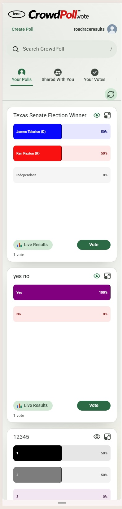

# Overview

The # REQUIREMENT### sections below are the individual requirements as we develop the UI/UX for private poll administration.  

**File Lock While Executing an Instruction**  
Before making any change to this file while executing an instruction (**next requirement**, **whats next**, a letter, **apply**, **Other**, **implement**), you will create the sibling file `iterative-requirements.md.lock` containing the instruction being executed and the time it started.  
While the lock file exists, the developers will not save this file. If they have unsaved edits open, they will save them before typing the instruction, or wait for the lock to be removed.  
While locked, you will:
- re-read the part of this file you are about to change immediately before each change
- change it only with targeted edits, never by rewriting the whole file
- if an edit fails because the file changed on disk, re-read it, keep the developers' change, and redo your edit on top of it

When the instruction is finished, or abandoned because of an error, you will delete `iterative-requirements.md.lock` and log "Lock released" to the CC CLI console.  
If a lock file is already present when an instruction starts, you will log its contents and ask the developers whether it is stale before continuing.

**Next Command**  
Whenever you wait for the developers, your last few lines will be a reminder of what is expected next. The final line will be a line containing the exact command expected after `Type or say:`.  
Here are the possibilities.  

**Clarifications**
```
You are reviewing the clarifications for <current requirement title>.  
Type or say: whats next
```


**Clarification Options**
```
You are reviewing clarification <clarification number> for <current requirement title>.  
<clarification concise title>  
<recommended clarification option letter> <recommended clarification option title> is the recommendeded clarification option.    
To accept a clarification option Type or say its letter.  

You may also accept the recommended options for all clarifications, Type or say: accept all

To accept the recommended option, 
Type or say: <recommended option letter>  
  
```

**Requirement Recommendations**
```
You are reviewing the Recommendation(s) of how to satisfy <current requirement title>.  
<preferred recommendation number> <preferred recommendation title> is the preferred Recommendation.  

To accept a recommendation option, Type or say its number.  

To accept the preferred recommendation, 
Type or say: <preferred recommendation number>
```
**Implementing a Requirement**
```
All clarifications and recommendations have been addressed for <current requirement title>.  

Type or say: implement
```
**After Implementing a Requirement**
```
<current requirement title> has been implemented.  
Ready to move on the next unresolved requirement.

Type or say: next requirement
```
These help messages in CC CLI let the prompt suggestion offer the most appropriate command, so the developers can accept it with one key press.

**Starting the iterative requirements session**  

**Next Requirement**  
In CC CLI, we (the developers) will type **next requirement** to start the iterative session.    
You will find the next **# REQUIREMENT** section that has a line that is **[ ] Resolved** . Can also be `[ ]Resolved`, `Resolved[ ]` or `Resolved [ ]`.
In other words, the next requirement is the one that has not yet been resolved.
If there is no **# REQUIREMENT** section that is marked as **[ ] Resolved**, but there is a **# REQUIREMENT** section that does not have a **Resolved** line (as described above), you will add a **[ ] Resolved** line under the **# REQUIREMENT** heading, and treat it as the next REQUIREMENT.  
This will be referred to as the **current requirement**.  
.You will read the **## REQUIREMENT DETAILS** section of the current requirement.

&nbsp;&nbsp;&nbsp;&nbsp;&nbsp;&nbsp;**Logging Short A Summary of Next Requirement**  
&nbsp;&nbsp;&nbsp;&nbsp;&nbsp;&nbsp;You will log a **short summary** of the requirement to the console of CC CLI.  
&nbsp;&nbsp;&nbsp;&nbsp;&nbsp;&nbsp;You will also insert the **short summary** into the current requirement section, under the **[ ]Resolved** line.  
&nbsp;&nbsp;&nbsp;&nbsp;&nbsp;&nbsp;The **short summary** will be placed in a new section, called ## SHORT SUMMARY.

**Clarifications**  
You will determine if there are any clarifications needed to fulfill the requirement. You will add them to a section called **## CLARIFICATIONS** in the **current requirement**, creating the section if necessary.    
Each clarification will be:
- numbered sequentially, starting from 1
- have a concise clarification title
- have a **[ ] Resolved** line after the clarification title to indicate whether it has been resolved. Can also be `[ ]Resolved`, 
- marked as **Recommended** if it is the preferred resolution for the clarification.
`Resolved[ ]` or `Resolved [ ]`.  

If possible, you will provide one or more **options** to resolve each clarification.  
Each option will have a letter assigned to it, starting from "a" and continuing sequentially.  
You will recommend one of the options, if possible, as the preferred resolution for the clarification.  
The recommended option will be marked with the word **Recommended** above its acceptance line.  
Even if there is just one **option** provided to resolve a clarification, it will still have a letter, "a", and it be marked as **Recommended**.

The format of the section for clarifications is as follows:  
```markdown
<!-- Clarifications format -->
1. Clarification concise title
[ ] Resolved  
description of the clarification goes here
  
a. concise title clarification option 1  
Recommended
[ ] Accepted  
description of clarification option 1 goes here  
  
b. concise title clarification option 2  
[ ] Accepted  
description of clarification option 2 goes here  
etc.  

Other.   
[ ] Accepted  
<The developers will enter their own resolution in the console of CC CLI.>
```
After you generate the clarification(s) you will:  

**Finding The Next Clarification**
You will find the next Clarification of the **current requirement** that is not marked **[X] Resolved**.  
This will be referred to as the "**current clarification**".  
You will log the **current clarification** title, option(s), and which option is recommended, to the console of CC CLI.  
  
If there is more than one clarification **option** provided to resolve the **current clarification**, the developers will select an **option** by typing its corresponding letter in the CC CLI Console. You will then mark the option as **[X] Accepted**. You will also mark the **current clarification** as **[X] Resolved**.   

If there is just one option provided to resolved the **current clarification**, the developers will type **a** to accept it. You will then mark the option as **[X] Accepted**. You will mark the **current clarification** as **[X] Resolved**.   

The developers may also choose to provide their own resolution to the **current clarification**. To indicate this, they will type **Other.** in the console of CC CLI and then provide their resolution.  You will add what the user provided to the **Other.** section of the **current clarification**.  You will then mark the **current clarification** as **[X] Resolved**.

When resolving the clarifications the developers may choose to accept the recommended option for all clarifications by typing or saying: **accept all**.  

When the **current clarification** has been resolved by typing a letter or creating their own resolution by typing **Other** followed by the resolution, you will then mark the option as **[X] Accepted** and you will mark the **current clarification** as **[X] Resolved**.  

After resolving one or more clarifications, you will log the resolution to the console of CC CLI.  
Then you will loop back to **Finding The Next Clarification** until all clarifications have been resolved.

**Recommendations**  
After all clarifications have been resolved, you will:
- create a section called **## RECOMMENDATION** in the **current requirement**
- add a **[ ] Resolved** line under **## RECOMMENDATION**  

You will provide one or more recomendations of how to satisfy the requirement, and add them to a section called **## RECOMMENDATION** in the **current requirement**.  
Each recomendation will have a **concise title** and a **detailed explanation**.  
The **concise title** will briefly summarize the recommendation,  
while the **detailed explanation** will provide enough detail for proper implementation.  
The **detailed explanation** will also include **Pros** and **Cons** of the recommendation.  
Each recommendation will be:
- numbered sequentially, starting from 1
- have an **[ ] Accepted** line after the **concise title**
- marked as **Recommended** if it is the preferred recommendation to implement the **current requirement**.
`Resolved[ ]` or `Resolved [ ]`. 

The format of the recommendation section will be as follows:  

```markdown
## RECOMMENDATION
[X] Resolved

1. recomendation 1 concise title
Recommended
[X] Accepted
recomendation 1 details
 
2. recomendation 2 concise title
[ ] Accepted
recomendation 2 details
etc.
```

**Resolving Recommendations**  
After generating the recommendation(s) for the **current requirement**,  
you will log the numbered recommendation title(s) to the console of CC CLI.  
You will indicated which recommendation is **Recommended**. This will guide the developers in selecting the appropriate recommendation to implement.  

&nbsp;&nbsp;&nbsp;&nbsp;&nbsp;&nbsp;If there is just one recommendation provided, the developers will type **1** to accept it, and then you will mark it as **[X] Accepted**, and you will mark the **current recommendation** as **[X] Resolved**.  

&nbsp;&nbsp;&nbsp;&nbsp;&nbsp;&nbsp;If there is more than one recomendation provided, the developers will select an option by typing its number to accept it, and then you will mark it as **[X] Accepted**, and you will mark the **current recommendation** as **[X] Resolved**. 

**Implementing the Current Requirement**  
After the **current recommendation** for the **current requirement** has been resolved,
you will prompt the developers to type **implement** to implement the **current requirement** using the **accepted recommendation** and the **resolved clarifications**.  

**Implementation Notes**  
When the implementation is complete, you will mark the **# REQUIREMENT** section as **[X] Resolved**.    
You will also add a **## NOTES** section to the **# REQUIREMENT** section of the **current requirement**. 
The **## NOTES** section will contain any important information about the implementation.  

You will then loop back to the top and wait for the developers to type **next requirement** in the CC CLI Console.

# REQUIREMENT Extract Prototype Page

[X] Resolved

## SHORT SUMMARY
Extract the home page's header, tab bar and Material 3 poll cards into one non-functional, responsive prototype page, so a layout for viewports 399 px wide or less (single-column cards) can be designed there before it goes into the app.

## REQUIREMENT DETAILS
Is it possible to extract the html/css/js from the client-side code of the main CrowdPoll webapp,  
to create a single, non-functional prototype page. 
We are going to use it to design a layout for the home page that renders nicely on a phone when the width of the viewport is 384 pixels wide.  
At that width the Poll Cards are rendered in a single column.
At that width the header currently wraps onto three lines.
Also, at that width only three Tabs are visible with the rest hidden off-screen. They can be accessed by draging the Tab bar horizontally.  

The only "functionality" is that we need the layout to still be Responsive so that we can test it at different viewport widths.

We have determined that the Poll Cards are rendered in a single column when the viewport is 399 pixels wide or less.  
In case this makes a difference to how you extract the html/css/js,  
when the viewport is 399 pixels wide or less, we are going to make changes to:
- font sizes
- scaling of the Logo icon and Logo Banner
- contents of the header
- possibly the removal of Search field in the header
- appearance and UI/UX of the Tab bar
- height of the Poll Cards
- positioning and size of the Refresh icon



We are going to maintain the Material 3 design principles in the prototype page.  

## CLARIFICATIONS

1. Where the prototype page gets its CSS and JS
[X] Resolved  
The home page loads `m3-tokens.css`, `tabs.css`, `pollCard.css`, `site.css`, `header-tab-bar-m3.css` and `pollCard-m3.css` (and others), and `pollCard.js` draws the cards. The header is built by `app.js` from a session fetch, so it cannot simply be opened as a file. Production has no 399 px rule today (its narrow rules are at 479.98, 639.98 and 767.98 px), and the single column comes from the card's `min-width: min(375px, 100%)`.

a. Link the production files, and put every new rule in one sheet loaded last  
Recommended  
[X] Accepted  
`index.html` here links `../../src/public/*.css` and `pollCard.js` by relative path, as the Color Palette Editor does, plus a new `single-column.css` loaded last, holding every rule under `@media (max-width: 399.98px)`. The header and tab bar are static markup copied from `app.js` and `index.html`. The page always shows production's current styling, and `single-column.css` is the layer that is later ported into the app. Con: a production change moves the prototype under you.

b. Copy a snapshot of the files into this folder  
[ ] Accepted  
Self-contained and stable, but it drifts from production, and the changes would have to be separated out again when porting.

c. Start from `prototypes/POLL-CARD-MATERIAL3/HEADER-TAB-BAR/`  
[ ] Accepted  
That folder already holds an extracted header, tab bar and harness, but its copies of the CSS predate later production changes (bar colors, the Material 3 fixes), so the page would not match your screenshot.

Other.  
[ ] Accepted  
<The developers will enter their own resolution in the console of CC CLI.>

2. What the cards show
[X] Resolved  
Your screenshot shows three cards (Texas Senate Election Winner, yes no, 12345) with real bar colors, the Live Results button, the Vote button and the vote count.

a. Draw real cards with `pollCard.js` from sample polls  
Recommended  
[X] Accepted  
Sample polls modeled on the screenshot's three cards, plus a few more so the page scrolls (long titles, many choices, a Closed poll), drawn by the production `pollCard.js` with a stub vote client, as the HEADER-TAB-BAR harness does. Card height, bars and colors are then the real ones. Nothing is sent to a server.

b. Hand-written static card markup  
[ ] Accepted  
No script needed, but the markup must be kept in step with what `pollCard.js` produces, and the bar colors and heights would be approximations.

Other.  
[ ] Accepted  
<The developers will enter their own resolution in the console of CC CLI.>

3. Which signed-in state and tab the page shows
[X] Resolved  
The screenshot shows a signed-in member (`roadraceresults`, with the Create Poll link and avatar) on the Your Polls tab. The requirement says the header's contents will change below 400 px, so the guest header (a Sign In link) may need designing too.

a. Fixed to the screenshot, with a small picker for guest, member and admin  
Recommended  
[X] Accepted  
The page opens as the screenshot does. A select in a prototype bar above the header switches the header between guest, member and admin, so each version can be checked at 384 px. The tab clicks only move the underline.

b. Fixed to the screenshot only  
[ ] Accepted  
Simpler, but the guest and admin headers cannot be checked.

Other.  
[ ] Accepted  
<The developers will enter their own resolution in the console of CC CLI.>

4. How to test different viewport widths
[X] Resolved  
Media queries react to the browser viewport, not to a container, so the page itself is responsive only when the window (or DevTools device mode) is resized. Your screenshot looks like DevTools device mode.

a. The page alone, with a small width readout  
Recommended  
[X] Accepted  
No extra files. A fixed corner label shows the current viewport width and whether the 399 px rule applies, so a resize is easy to read.

b. The page plus a `viewer.html` that frames it at a chosen width  
[ ] Accepted  
A second page with presets (320, 360, 384, 399, 400, 480) and a slider, framing the prototype in an iframe so the media queries see the frame's width. Useful on a desktop without DevTools, at the cost of a second file.

Other.  
[ ] Accepted  
<The developers will enter their own resolution in the console of CC CLI.>

## RECOMMENDATION
[ ] Resolved

1. Static header and tab bar, real cards, one harness script
Recommended
[ ] Accepted
Files in `prototypes/SINGLE-COLUMN-RENDERING/`:
- `index.html`: the `<head>` of `src/public/index.html` with every stylesheet and script href rewritten to `../../src/public/...` (clarification 1a), and `single-column.css` linked last. The body has a prototype bar (the guest/member/admin select and the width readout), the header markup copied from `SITE_HEADER_MARKUP` in `app.js` with the member's actions filled in as in the screenshot (Create Poll link, `roadraceresults`, avatar), the tab bar and Refresh button from `index.html`, and an empty `.card-grid`. Cards are `pollCard.js`'s, so no `app.js`, `tabs.js` or other production script that fetches is loaded.
- `single-column.css`: opens with the rule `@media (max-width: 399.98px) { }` and nothing inside, so the first render is exactly today's layout (the baseline in your screenshot). Each later requirement (font sizes, logo scaling, header contents, Search field, Tab bar, card height, Refresh icon) adds rules inside it, so the file is the layer to port.
- `prototype.js`: a small harness modeled on `POLL-CARD-MATERIAL3/HEADER-TAB-BAR/harness.js`. It supplies a stub `window.VoteClient`; the session select (a guest also gets the Sign In link, an admin the admin link, with the personal tabs disabled for a guest); the tab underline on click; and `window.PollCard.mount(grid, pid, opts)` for the sample polls. Anything that would leave the page logs `[sample]` and shows "(sample only: no action taken)" in the notice line. The width readout updates on `resize`.
- Sample polls (in `prototype.js`): the screenshot's three (Texas Senate Election Winner with blue and red bars and 0% Independent, yes no with the purple Yes bar, 12345 with the black and gray bars), then a long title, a 10-choice poll and a Closed poll.
- Checks: open the file, resize across 399/400 px and confirm the cards go from two columns to one at the break, and that nothing differs from the app at 384 px.
Pros: always current production styling; the new rules are isolated; no server, no fetches; cards have real bar colors, heights and ripple.
Cons: a production CSS change moves the prototype; the copied header markup must be re-copied if `app.js` changes it.

2. Run the real `app.js` and `tabs.js` against a stubbed `fetch`
[ ] Accepted
Load `app.js` and `tabs.js` as production does, with a script before them that replaces `window.fetch` and answers the session, config, tab and poll requests from sample data. The header, tabs and cards then come from production code with no copied markup.
Pros: the header can never drift, and tab behavior is real.
Cons: the stub must imitate several endpoints (`/api/me`, `/api/config`, the trending and newest objects, the delta calls); the page is less "non-functional" and harder to reason about; the production scripts may start timers, WebSockets-like polling and `localStorage` use.

## NOTES
Files in `prototypes/SINGLE-COLUMN-RENDERING/`: `index.html`, `single-column.css`, `prototype.js`. Open `index.html` directly in a browser; no server is needed.
- `index.html` links the production sheets (`../../src/public/*.css`, in production order) and scripts (`m3-ripple.js`, `tooltip-m3.js`, `pollCard.js`) by relative path, then `single-column.css` last. The header (from `SITE_HEADER_MARKUP` in `app.js`), the tab bar and the symbol defs are static copies from `app.js` and `index.html`; re-copy them if production changes them.
- `single-column.css` holds an empty `@media (max-width: 399.98px) { }`, so the first render is today's layout. Every later change for 399 px and under goes inside it. Its only other rules style the prototype bar and the width readout.
- `prototype.js` supplies the stub `VoteClient`, the Member / Administrator / Guest picker (Member is the screenshot's state, on Your Polls), the tab underline, and six sample polls drawn by `PollCard.mount`: the screenshot's three, a long title, ten choices and a Closed poll. A guest's personal tabs are `aria-disabled` and open on Trending. Anything that would leave the page logs `[sample]` and shows "(sample only: no action taken)". The corner readout shows the viewport width and whether the 399.98 px rule applies.
- The sample polls' colors come from the production palette rules, so the screenshot's Yes bar is no longer purple; the Texas poll's blue and red are set by hand, as in the screenshot.
- Verified by loading the page in jsdom: six cards mount, the member header and Your Polls underline show, switching to Guest swaps the header buttons, disables five tabs and moves to Trending, and there are no script errors. Layout, fonts and the real breakpoint behavior have not been looked at in a browser.
- Not extracted: the Search tab's panel, the maximized view, the cookie banner and the login dialogs.

# REQUIREMENT Our Error Typing 399

[X] Resolved

## SHORT SUMMARY
The single-column breakpoint is 639 px, not 399 px: the prototype's media query, its width readout and the wording that says 399 must change to 639.

## REQUIREMENT DETAILS

We made a mistake referring to 399 pixels.  
The correct number for the viewport width where single column takes effect is 639 pixels.  

So the folloiwng is incorrect:
```
We have determined that the Poll Cards are rendered in a single column when the viewport is 399 pixels wide or less.  
In case this makes a difference to how you extract the html/css/js,  
when the viewport is 399 pixels wide or less, we are going to make changes to:
```

It should read:
```
We have determined that the Poll Cards are rendered in a single column when the viewport is 639 pixels wide or less.  
In case this makes a difference to how you extract the html/css/js,  
when the viewport is 639 pixels wide or less, we are going to make changes to:
```

## CLARIFICATIONS

1. How the 639 px breakpoint is written
[X] Resolved  
Production already switches the card grid to one column at `@media (max-width:639.98px)` (`tabs.css:232-234`), and its header and tab rules use the same query (`site.css`, `header-tab-bar-m3.css`). Those rules also apply inside the prototype, since it links the production sheets. The prototype's own query, its readout and `SINGLE_COLUMN_QUERY` in `prototype.js` currently say 399.98.

a. `(max-width: 639.98px)`, the production form  
Recommended  
[X] Accepted  
"639 pixels wide or less" written the way every production rule writes it, so the prototype's block and production's single-column rule switch on at the same width, and a fractional viewport such as 639.5 px falls on the same side in both. The readout reads "639 px rule ON/off".

b. `(max-width: 639px)`  
[ ] Accepted  
Literally the number in the correction, but a viewport between 639 and 640 px would get production's single column without the prototype's rules, leaving a thin gap.

Other.  
[ ] Accepted  
<The developers will enter their own resolution in the console of CC CLI.>

2. What happens to the 399 in the earlier requirement and its notes
[X] Resolved  
The words "399 pixels" appear in the Extract Prototype Page requirement (your text), in the clarification and recommendation text I wrote for it, and in its notes, all marked resolved.

a. Change the code and live behavior; leave the resolved text as the record  
Recommended  
[X] Accepted  
`single-column.css`, `prototype.js` and the readout move to 639.98. The Extract Prototype Page text stays as written, and this requirement's `## NOTES` records the correction, so the history reads in order. The clarification 1 description's claim that production has no rule near the single column is corrected in the notes.

b. Also rewrite the 399 wording in the earlier requirement  
[ ] Accepted  
Your correction block replaces the earlier text in place, and my text and notes are corrected to match. The file then reads as if 399 never appeared, and the history of the mistake is lost.

Other.  
[ ] Accepted  
<The developers will enter their own resolution in the console of CC CLI.>

## RECOMMENDATION
[X] Resolved

1. Mark the single-column state in CSS and let the readout read the mark
Recommended
[X] Accepted
In `single-column.css`, change the query to `@media (max-width: 639.98px)` and put one declaration in it, `:root{ --single-column:1; }`, above the place where later rules go. In `prototype.js`, delete `SINGLE_COLUMN_QUERY` and decide the readout from `getComputedStyle(document.documentElement).getPropertyValue('--single-column').trim() === '1'`, recomputed on `resize`; the readout reads "<width> px · single-column rule ON" or "off". The number 639.98 then appears once in the prototype, which is where the 399 mistake would otherwise recur if the breakpoint changes again. The notes of Extract Prototype Page stay as the record; this requirement's `## NOTES` records the correction (639, not 399), including that clarification 1 of that requirement wrongly said production has no rule near the single column. Check: with `prototype.js` loaded in jsdom the readout needs `getComputedStyle` of a media-query rule, which jsdom does not evaluate, so the check is a read of the files; the real check is yours, resizing across 639/640 px.
Pros: one number, nothing to keep in step; the readout can no longer disagree with the CSS.
Cons: a custom property is a small piece of scaffolding that is not ported with the layer; the readout shows only that the prototype's block applies, not production's own 639.98 rules (they switch at the same width by construction).

2. Change the number in the three places
[ ] Accepted
`single-column.css` gets `@media (max-width: 639.98px){ }`, `prototype.js` gets `SINGLE_COLUMN_QUERY = '(max-width: 639.98px)'` and the readout says "639 px rule". Same notes entry as above.
Pros: the smallest change; the readout is checked by `matchMedia`, which jsdom can evaluate.
Cons: the number is written in two files, which is how a wrong number lives on.

## NOTES
The breakpoint is 639 px, written `@media (max-width: 639.98px)`, the form production uses; production's own single-column rule is at that width (`tabs.css`, with the header rules in `site.css` and `header-tab-bar-m3.css`).
- `single-column.css`: the media block moved from 399.98 to 639.98 px and holds `:root{ --single-column:1; }`. Rules for this layout go in the same block, below the marker.
- `prototype.js`: `SINGLE_COLUMN_QUERY` is gone. The corner readout reads `--single-column` with `getComputedStyle` on each `resize` and shows "<width> px · single-column rule ON/off". The number 639.98 is written in one place.
- The Extract Prototype Page requirement, its clarifications, recommendations and notes still say 399 and stay as the record of the mistake. Its clarification 1 also said production has no rule near the single column; that was wrong, and this note is the correction.
- Production already has rules at 639.98 px (container padding, header sizes, button heights, logo height, nav link), and they apply in the prototype too. Rules added in the block layer on top of them.
- Verified by loading the page in jsdom: six cards mount and there are no script errors. jsdom does not evaluate the stylesheet, so the readout showed "off" there; the readout and the single column at 639/640 px have not been looked at in a browser.

# REQUIREMENT Poll Card Height In Single-Column Layout

[X] Resolved

## SHORT SUMMARY
In the single-column layout, each poll card (front and back) gets fixed 36 px bars, title, subtitle, icons, buttons and "N votes" at 75% of today's size, unchanged colors and fonts in the bars, no scroll arrows, and every bar from 2 to 50 rendered without scrolling.

## REQUIREMENT DETAILS

The image below shows the first requirement to determine the height of a Poll Card:  
 

The image shows the existing layout on the top and the revised layout for the single-column view on the bottom.

When in the Poll Cards are in a single column the front and back of the card will be revised as follows: 
- the fixed height of the bars are to be 36 pixels  
- the colors and fonts will remain as they are now  
- the title and subtitle will be 75% of what they are now
- the height of the icons and buttons will be 75% of what they are now
- the "N votes" text will be 75% of what it is now
- there will be no scroll controls (up or down)
- all bars from 2 to 50 will be rendered with no scrolling

## CLARIFICATIONS

1. Card height
[X] Resolved  
Production gives every card a 500 px minimum height (`.card-flip{ min-height:500px }`) and fits the bars into what is left. The bottom picture shows the card ending just below "1 vote", so the card now takes the height of its content. With 36 px bars, 50 choices make a card about 2,000 px tall.

a. Card height follows its content  
Recommended  
[X] Accepted  
In the single-column layout the 500 px minimum is removed. The card is as tall as its title, bars, buttons and vote count need, on both faces.

b. Keep the 500 px minimum  
[ ] Accepted  
Cards with few choices keep today's empty space under the bars, as in the top picture.

Other.  
[ ] Accepted  

2. Gap between bars
[X] Resolved  
The text fixes the bar height but not the space between bars. Today the gap is up to 20 px with few choices. In the bottom picture the two bars are about 6 px apart.

a. 6 px gap, as in the picture  
Recommended  
[X] Accepted  
A fixed 6 px between bars. Fifty bars then need about 2,100 px.

b. 2 px gap  
[ ] Accepted  
The gap production already uses for the maximized card. Fifty bars need about 1,900 px, but the bars look crowded.

Other.  
[ ] Accepted  

3. Picture or text for the 75% sizes
[X] Resolved  
The text says the title, subtitle, icons, buttons and "N votes" are 75% of today's size. In the bottom picture they look the same size as in the top one (for example the Live Results and Vote buttons are 32 px in both). Only the bars changed.

a. Follow the text  
Recommended  
[X] Accepted  
Title and subtitle 75% of today's font size, icons and buttons 75% of today's height (32 px becomes 24 px; 20 px icons become 15 px), "N votes" 75%. The picture is read as an illustration of the bars only. On the back face the radio buttons stay as they are.

b. Follow the picture  
[ ] Accepted  
Only the bars change: 36 px height, no scroll arrows. All other sizes stay as they are.

Other.  
[ ] Accepted  

4. Maximized view
[X] Resolved  
The maximized card is today sized by its own rule (50 px for two choices down to 25 px for fifty, 2 px gap, never scrolling). The prototype page has no maximized view, and the requirement names only the cards in the single column.

a. Not part of this requirement  
Recommended  
[X] Accepted  
Only the cards in the grid change. The maximized view keeps its own sizing.

b. Same 36 px bars in the maximized view  
[ ] Accepted  
The maximized card also uses 36 px bars, so it would be taller than the phone screen with many choices.

Other.  
[ ] Accepted  

## RECOMMENDATION
[X] Resolved

1. A single-column bar layout in pollCard.js, and the 75% sizes in the media block
Recommended
[X] Accepted
The bar height, the gap and the arrows are set from script, not from the stylesheet: `renderPollResults` and `renderVotingOptions` take a layout function (`layoutFor`) and write the row height, line height and font size inline. A stylesheet alone cannot change them, so the change has two parts.

**Script, `src/public/pollCard.js`.** Add `singleColumnBarLayout()` returning `{ scrolling:false, barHeight:36, gap:6 }` for any count from 2 to 50. The card's default layout function becomes: the maximized one while maximized (unchanged, clarification 4), else the single-column one when the `--single-column` marker reads `1` on the root element, else `measuredBarLayout`. The marker is the one the prototype already defines inside `@media (max-width: 639.98px)`. The card re-renders on its existing size-change hook, so crossing 639/640 px switches the bars without a reload. Font size still follows `scaleFontSize`, which is at its 11 px maximum from a 26 px bar, so the bar label and percentage fonts do not change. Colors do not change. With `scrolling:false` the up and down arrows stay hidden on both faces, and the radio size on the back face is left as it is.

**Stylesheet, `single-column.css`, inside the media block.**
- `.card-flip{ min-height:0 }` so the card follows its content (clarification 1).
- Title and subtitle at 75% of today's font size, using `calc(var(--md-sys-typescale-...-size) * 0.75)` on the rules that set them.
- `.btn-vote`, `.icon-btn` and the `Live Results` link at 24 px high (75% of 32), icon SVGs at 15 px (75% of 20), button label font at 75%.
- The "N votes" text at 75%.
- `.arrow-row{ display:none }` as a second guard.
The exact selectors are found in `pollCard-m3.css` and `pollCard.css` while implementing.

**Production safety.** `--single-column` is defined only in the prototype stylesheet, so production behaves exactly as it does now until a production sheet defines the marker.

**Tests.** A jsdom test for `singleColumnBarLayout` and for the layout choice (marker on, marker off, maximized); the prototype page is mounted in jsdom to check six cards render.

Pros: small change, no `!important`, the same marker already used for the breakpoint, production unaffected, 2 to 50 bars all use one rule.
Cons: touches the shared `pollCard.js`; the real look at 639/640 px still has to be checked in a browser.

2. Stylesheet overrides only, with `!important`
[ ] Accepted
Keep `pollCard.js` untouched and override the inline row heights in `single-column.css` with `!important` (`.result-row, .vote-row{ height:36px !important; line-height:36px !important }`, margins for the 6 px gap, arrows hidden), along with the same 75% rules as in 1.

Pros: the prototype file alone changes.
Cons: fights the inline styles; the script still computes the old bar layout and the scroll state, so the rows can disagree with the card's own sizing (a hidden arrow row still reserves its slots in the script, and the font size and label padding are still computed for the old height); it cannot be carried to production without the same overrides.

## NOTES
- `src/public/pollCard.js` (shared with production): added `singleColumnBarLayout()` (36 px bars, 6 px gap, no scrolling), `isSingleColumn()` (reads `--single-column` on the root) and `defaultBarLayout()`, which replaces `measuredBarLayout` as the card's starting layout function and as the one restored when the card is minimized. The maximized card still uses `maximizedBarLayout`. Bar font sizes, colors and the radio size are untouched.
- `single-column.css`, inside the `max-width: 639.98px` block: card minimum height removed, the bar area and both lists grow with their bars (the same overrides the maximized card uses), scroll arrows hidden, title, subtitle, "N votes" and the "you voted" text at 75% of their font sizes, `Live Results`, `Vote`, `Submit vote` and the icon buttons 24 px high (icons 15 px). All rules are scoped with `:not(.maximized-card-flip)`.
- Production is unaffected: nothing in the production stylesheets defines `--single-column`, so `defaultBarLayout()` returns today's layout there. A production sheet that sets the marker would turn this on.
- The card re-renders on the window resize hook it already has (100 ms after the last resize), so crossing 639/640 px changes the bars without a reload.
- Verified in jsdom with the prototype page: marker off gives 25 px bars, marker on gives 36 px bars, the six cards keep their 3, 2, 5, 5, 10 and 3 rows, no script errors. jsdom does not apply the stylesheet or lay anything out, so the 75% sizes, the 6 px gap, the card height and the hidden arrows are unchecked in a browser.
- The test suite could not be run here (the vitest native module for this platform is missing); `tests/client-bar-colours.test.ts` and `tests/poll-card-assets.test.ts` are not re-run, and no test was added for the new layout function.

# REQUIREMENT View Prototype on Phone

[X] Resolved

## SHORT SUMMARY
Find the simplest way to open the single-column prototype on a real phone, so the layout can be judged before it is integrated into CrowdPoll. Deploying to Digital Ocean is allowed if it is needed, but nothing is integrated yet.
## REQUIREMENT DETAILS

What can be built to allow us to view the prototype on a phone so we can validate how it is going to look before integrating it in the main CrowdPoll webapp?  
We can deploy to Digital Ocean if necessary but we don't want to integrate it yet. 

## CLARIFICATIONS

1. How the phone reaches the prototype
[X] Resolved  
The prototype is static: its page, `single-column.css` and `prototype.js` use sample data and call no server, but the page links to the app's own files in `../../src/public/`, so it must be served with the repository's folder layout. The developers work on Windows 11 with PowerShell, and the phone has to load the page over a network.

a. A small local server on the development PC, phone on the same Wi-Fi  
Recommended  
[X] Accepted  
A script serves the repository folder over HTTP on the PC's network address, and the phone opens `http://<PC address>:<port>/prototypes/SINGLE-COLUMN-RENDERING/`. No deployment, no account, nothing public, and a saved file shows after a refresh on the phone. The PC's firewall must allow the port, and the phone must be on the same network as the PC.

b. A temporary public tunnel to that local server  
[ ] Accepted  
The same local server, plus a tunnel program that gives it a public `https` address, so the phone can be on mobile data. It needs a tunnel tool installed or run through `npx`, and anyone with the address can open the page while it runs.

c. Deploy to Digital Ocean as a separate static site  
[ ] Accepted  
A second component in Digital Ocean, apart from the CrowdPoll web service, built from the `dev` branch with a step that copies the prototype and the files it needs into one folder. It is always on and can be shared, but the address is public, each change needs a push and a deploy, and it adds a component to the app spec.

Other.  
[ ] Accepted  

2. Which prototypes the viewer serves
[X] Resolved  
`prototypes/` holds three prototypes with pages (`SINGLE-COLUMN-RENDERING`, `COLOR-PALETTE-EDITOR`, `POLL-CARD-MATERIAL3`). The requirement names only the single-column one.

a. Any folder under `prototypes/`  
Recommended  
[X] Accepted  
The server serves the whole repository's static files, and the script prints the address of each prototype's page, so the next prototype needs nothing new.

b. Only SINGLE-COLUMN-RENDERING  
[ ] Accepted  
The script serves and prints the address for this one prototype only.

Other.  
[ ] Accepted  

3. Seeing a change on the phone
[X] Resolved  
After the developers save a file, the phone has to show the new version.

a. Refresh the page on the phone  
Recommended  
[X] Accepted  
The server sends files with no caching, so one pull-down refresh shows the change. No extra code.

b. The page reloads itself when a file changes  
[ ] Accepted  
The server watches the prototype's files and tells the page to reload. It adds a small script to the page, which must stay out of the code that is later ported into the app.

Other.  
[ ] Accepted  

## RECOMMENDATION
[X] Resolved

1. A small static server script, `npm run prototypes`
Recommended
[X] Accepted
Add `devScripts/serve-prototypes.ts`, run with `tsx` like the other dev scripts, and an `npm` script `prototypes` in `package.json`. `.gitignore` ignores `devScripts/*` except named scripts, so it also needs the line `!devScripts/serve-prototypes.ts`.

- **Server.** Node's own `node:http` and `node:fs`, no new dependency. It listens on `0.0.0.0` so the phone can reach it, on port 8081 by default (the CrowdPoll dev server uses 8080), or the port given as the first argument.
- **What it serves.** Files from the repository root, but only under `prototypes/` and `src/public/` (the prototype's own files and the app files it links to). Any other path, and any path that leaves the repository folder after resolving `..`, is answered `404`. Every response carries `Cache-Control: no-store`, so one refresh on the phone shows a saved change (clarification 3).
- **The addresses.** On start it prints each folder under `prototypes/` that holds an `index.html`, with the phone address for each, `http://<PC address>:8081/prototypes/<folder>/`. The PC address comes from the PC's non-internal IPv4 network addresses (all of them are listed, since a PC often has several). `GET /` serves a plain page listing the same prototypes as links, so the phone only needs the PC address and port.
- **First run on Windows.** Windows asks whether `node.exe` may accept connections; allow it on private networks. The phone must be on the same Wi-Fi network as the PC.
- **Scope.** Development only; nothing is added to the CrowdPoll server, `.do/app.yaml` or the build, and nothing is deployed.
- **Tests.** A Vitest test for the path rule (inside `prototypes/` and `src/public/` is served, `..` and other folders give `404`) and for `no-store`.

Pros: no deployment, no account, no new dependency; works for every prototype, present and future; prints the address to type on the phone.
Cons: a new script to keep; the phone must be on the PC's network; the page is reachable by anyone on that network while it runs.

2. Run an existing package with `npx`, no script
[ ] Accepted
Run `npx http-server -a 0.0.0.0 -p 8081 -c-1` (or `npx serve`) from the repository root and read the PC's address with `ipconfig`.

Pros: nothing to write or keep.
Cons: downloads a package each time it is used; it serves the whole repository (including `.env` files and the code under `src/`); it prints no phone address and no list of prototypes; the developers have to remember the flags.

## NOTES
- To use it: on the development PC run `npm run prototypes` (or `npm run prototypes 9000` for another port). It prints, for each network address of the PC, the address of every prototype page. Type one into the phone's browser. The phone must be on the same Wi-Fi network. On the first run Windows asks whether `node.exe` may accept connections; allow private networks.
- New files: `devScripts/serve-prototypes.ts` (Node's own `http` and `fs`, no new dependency) and `tests/serve-prototypes.test.ts`. Changed: `package.json` (the `prototypes` script) and `.gitignore` (`!devScripts/serve-prototypes.ts`). Nothing changed in the CrowdPoll server, `.do/app.yaml` or the build.
- The server listens on all network addresses, port 8081 by default. It serves only `prototypes/` and `src/public/`; every other path, and any path that reaches outside those folders through `..` or an encoded `..`, answers `404`. Every response is `no-store`, so a refresh on the phone shows a saved change. `/` is a page that links to each prototype that has an `index.html` (at present `COLOR-PALETTE-EDITOR` and `SINGLE-COLUMN-RENDERING`).
- While it runs, anyone on the same network can open those pages. They hold sample data and the app's own front-end files, no secrets.
- The prototype loads its fonts from Google Fonts, so the phone needs internet access as well.
- Verified here by compiling the script to a temporary file and running it: `/`, the prototype page, `pollCard.js` and `single-column.css` answered `200` with `no-store`, and `package.json`, `src/server.ts`, `/../package.json` and the encoded `..` forms answered `404`. The temporary file was deleted. `tsx` and `vitest` do not run in this sandbox (their native modules are for Windows), so `npm run prototypes` and the new test file have not been run; the test file is untested.
- Not checked: that a phone can reach the PC (firewall, Wi-Fi isolation on guest networks) and how the prototype looks on the phone.

# REQUIREMENT server-prototype.ts From Phone - Error

[X] Resolved

## SHORT SUMMARY
`npm run prototypes` works from the development PC, but the phone gets "This site can't be reached" (`ERR_CONNECTION_ABORTED`) at `http://192.168.0.145:8081/prototypes/SINGLE-COLUMN-RENDERING/`, and Windows never showed the "allow node.exe" prompt. The developers ask what to do to find the cause.
## REQUIREMENT DETAILS

We executed `npm run prototypes` on the development PC and accessed the prototype page from the computer works as expected, of course.  

When we tried to access the prototype page from the phone, we get the message:
```
This site can't be reached
The web page at 
http://192.168.0.145:8081/prototypes/SINGLE-COLUMN-RENDERING/ might be temporarily down or it may have moved permanently to a new address.

ERR-CONNECTION-ABORTED
```

We didn't get this:
```
On the first run Windows asks whether node.exe may accept connections; allow private networks.
```

What should we do to diagnose this?

## CLARIFICATIONS

1. What the answer delivers
[X] Resolved  
The server cannot tell, today, whether the phone's request ever reached it: it logs nothing per request. The missing Windows prompt points at the firewall (a prompt is skipped when a rule for `node.exe` already exists, for example a "Block" chosen on an earlier run, or when the network is marked Public), but `ERR_CONNECTION_ABORTED` can also come from the phone's side (a VPN, a proxy, or a different network from the PC's).

a. A step-by-step checklist, plus a request log in the script  
Recommended  
[X] Accepted  
The NOTES hold an ordered checklist, cheapest test first, each step saying what the result means. The script gets one change: it prints a line for every request it receives (time, address it came from, path). A phone request that prints nothing was stopped before Node; one that prints a line reached the server.

b. A checklist only  
[ ] Accepted  
Nothing in the code changes. The developers follow the checklist and report back what they see.

Other.  
[ ] Accepted  

2. Changing the Windows firewall
[X] Resolved  
The usual fix is an inbound rule that allows `node.exe` (or port 8081) on the Private profile. It needs PowerShell run as Administrator on the development PC; this assistant works in a Linux sandbox and cannot reach that firewall.

a. Give the commands, the developers run them  
Recommended  
[X] Accepted  
The checklist includes the PowerShell commands to see the network profile, list the existing `node.exe` rules, and add or fix the rule, each marked with what it changes. The developers decide whether to run them.

b. Leave the firewall alone  
[ ] Accepted  
The checklist only diagnoses. If the firewall turns out to be the cause, the developers choose another way to reach the page.

Other.  
[ ] Accepted  

3. If the phone cannot reach the PC at all
[X] Resolved  
Some networks block it whatever the firewall says: a guest Wi-Fi, "AP isolation" on the router, a work or school network, or a phone on mobile data or a VPN.

a. Stop at the diagnosis for now  
Recommended  
[X] Accepted  
The checklist says how to recognise such a network. Choosing another route (the public tunnel or the Digital Ocean static site that were set aside in View Prototype on Phone) is a new decision for the developers.

b. Plan the tunnel as the fallback in this requirement  
[ ] Accepted  
The recommendation also adds the public tunnel as a documented second way to run the same server.

Other.  
[ ] Accepted  

## RECOMMENDATION
[X] Resolved

1. A diagnosis checklist, and a request log in the server
Recommended
[X] Accepted
**Code change, `devScripts/serve-prototypes.ts` only.** The server prints one line for every request it answers: the time, the address the request came from, the method, the path and the status (for example `[prototypes] 14:02:11 192.168.0.23 GET /prototypes/SINGLE-COLUMN-RENDERING/ 200`). `createPrototypeServer` takes an optional log function so the test stays quiet, and one test checks the line. The start-up text adds one sentence: "a phone request that prints no line here never reached this program". No other change.

**The checklist** (cheapest test first; the result of each step says where to look next):

1. *Is the address the right network card?* On the PC run `ipconfig`. The address the phone uses (`192.168.0.145`) must belong to the Wi-Fi or Ethernet card, and the phone's own Wi-Fi address must start with the same three numbers (`192.168.0.`). The script lists every address of the PC, so a VPN, WSL or Hyper-V address (often `172.x.x.x` or `10.x.x.x`) may appear beside it; use the one on the phone's network.
2. *Does the PC reach itself by that address?* In the PC's browser open `http://192.168.0.145:8081/prototypes/SINGLE-COLUMN-RENDERING/` (not `localhost`). It must load. If it does not, the cause is on the PC (firewall or security software); go to step 5.
3. *Is the phone really on the PC's network?* On the phone: Wi-Fi on, mobile data off, no VPN app, "Private DNS" off (Android) or "Limit IP address tracking" off (iPhone), the same Wi-Fi name as the PC (not a "guest" network). Type the full `http://` address (some browsers add `https://`). Try a second browser. To test the network itself, open the router's page (usually `http://192.168.0.1`) on the phone: if that does not load either, the phone cannot see devices on the network at all (guest Wi-Fi or router "AP isolation"); stop here, this is clarification 3's case.
4. *Does the request reach the server?* Restart `npm run prototypes`, load the page on the phone, and look at the console. A line with the phone's address means the request arrived and the problem is in the page; no line means it was stopped before Node, so the firewall or the network is the cause.
5. *The Windows firewall* (PowerShell as Administrator; the first two commands only read):
   - `Get-NetConnectionProfile` shows each network's `NetworkCategory`. `Public` blocks incoming connections by default, and the "allow node.exe" prompt is not shown for it; it should read `Private` for your home or office Wi-Fi.
   - To list blocking rules for `node.exe`: `Get-NetFirewallRule -Direction Inbound -Action Block -Enabled True | Where-Object { (Get-NetFirewallApplicationFilter -AssociatedNetFirewallRule $_).Program -like '*node.exe' }`. A block rule wins over any allow rule, and it is the usual reason the prompt never appears (an earlier "Cancel" on the prompt creates one). Disable it with `Disable-NetFirewallRule -DisplayName '<name from the list>'`.
   - To mark the network Private (changes how Windows treats that network): `Set-NetConnectionProfile -InterfaceAlias '<InterfaceAlias from the first command>' -NetworkCategory Private`.
   - To allow just this port on Private networks: `New-NetFirewallRule -DisplayName 'CrowdPoll prototypes 8081' -Direction Inbound -Protocol TCP -LocalPort 8081 -Action Allow -Profile Private`. Remove it later with `Remove-NetFirewallRule -DisplayName 'CrowdPoll prototypes 8081'`.
6. *Other software.* A third-party antivirus or firewall, or a VPN client on the PC, can block incoming connections without Windows showing anything; test by pausing it for a minute.

`ERR_CONNECTION_ABORTED` (instead of "timed out") means something answered and closed the connection, which fits a VPN, a proxy or security software on either side as well as the firewall; steps 3, 4 and 6 cover those.

Pros: finds the cause with the least change, shows exactly where a request stops, and the firewall commands are written out and labelled as reads or changes; the log stays useful afterwards.
Cons: still depends on the developers running the steps and reporting the result; the firewall commands change the PC's settings when run.

2. A checklist, and a `--diagnose` mode in the script
[ ] Accepted
The same checklist, and the script also gets a `--diagnose` option that runs `ipconfig`-style address listing, `Get-NetConnectionProfile` and the blocking-rule query itself through PowerShell and prints what it finds and which step it points to.

Pros: fewer manual steps; one command gives the PC-side facts.
Cons: more code to keep for a one-off problem; it only runs on Windows; it cannot see the phone's side (steps 3 and 4), so the checklist is still needed.

## NOTES
- The checklist is in recommendation 1 above (six steps; the Windows firewall commands are in step 5). It has not been run: the cause of the phone's `ERR_CONNECTION_ABORTED` is still unknown.
- What to do now: stop the server, run `npm run prototypes` again, and load the page on the phone. If a line with the phone's address appears in the console (for example `[prototypes] 14:02:11 192.168.0.23 GET /prototypes/SINGLE-COLUMN-RENDERING/ 200`), the request arrived and the problem is not the network or the firewall. If nothing appears, the request was stopped before the program; follow steps 1, 3, 5 and 6.
- `devScripts/serve-prototypes.ts`: a log line for every answered request (`requestLine`), `createPrototypeServer` takes an optional log function (the script passes `console.log`, the tests pass a list), and the start-up text says that a phone request that prints no line never reached the program. Nothing else changed.
- `tests/serve-prototypes.test.ts`: two tests added, one for the line's format and one that a request is logged. They have not been run (`vitest` does not run in this sandbox).
- Verified here by compiling the script to a temporary file and running it: a request to the prototype page printed `... 127.0.0.1 GET /prototypes/SINGLE-COLUMN-RENDERING/ 200` and one to `/package.json` printed `... 404`. The temporary file was deleted.
- No firewall, network or PC setting was changed.

# REQUIREMENT Temporarily Serve Prototype from Endpoint In Production Server

[X] Resolved

## SHORT SUMMARY
The phone could not be made to reach the PC and the router is out of reach, so the single-column prototype is to be served for a while by the production server at `crowdpoll.vote/prototypes/SINGLE-COLUMN-RENDERING/index.html`, without integrating it into the app.
## REQUIREMENT DETAILS

We tried all the diagnostic steps outlined above, including checking the firewall rules, network settings.  
We couldn't log into the router, but we don't want to wrestle with it now.    

Let's just make the prototype temporarily available from the production server endpoint. 

Make it crowdpoll.vote/prototypes/SINGLE-COLUMN-RENDERING/index.html

## CLARIFICATIONS

1. The address, with `.html` in it
[X] Resolved  
The server redirects every path that ends in `.html` to the same path without it (`server.ts`, added so pages are reached only by their clean routes). Left as it is, `.../index.html` would be redirected to `.../index` and answer `404`. The requirement names the `index.html` address.

a. Serve both addresses  
Recommended  
[X] Accepted  
A prototype route is placed before that redirect, so `/prototypes/SINGLE-COLUMN-RENDERING/index.html` loads as written, and `/prototypes/SINGLE-COLUMN-RENDERING/` loads the same page. The redirect still applies to every other path.

b. Use the folder address only  
[ ] Accepted  
Only `/prototypes/SINGLE-COLUMN-RENDERING/` works, and the `index.html` address redirects to `404`, as every other `.html` address on the site does.

Other.  
[ ] Accepted  

2. Who can open it
[X] Resolved  
The production site is public. The prototype page holds sample polls and no data from the database, but it loads the app's real stylesheets and `pollCard.js`, and it is a half-built design.

a. Anyone who has the link  
Recommended  
[X] Accepted  
The page is not linked from anywhere, carries `noindex` so search engines skip it, and needs no sign-in, so the phone opens it at once. The address is guessable only by someone who knows the folder name.

b. Administrators only  
[ ] Accepted  
The route uses the same check as the `/admin` pages, so the phone has to sign in with an emailed link first (and the account needs the administrator permission).

Other.  
[ ] Accepted  

3. How it is switched off again
[X] Resolved  
The requirement says "temporarily". The configuration of this app comes from `ENV_*` variables.

a. A setting, `ENV_PROTOTYPES`, naming the folders to serve  
Recommended  
[X] Accepted  
The route serves only the prototype folders listed in `ENV_PROTOTYPES` (a comma-separated list; unset, as in every environment today, means none, and the address answers `404`). To publish, set `ENV_PROTOTYPES=SINGLE-COLUMN-RENDERING` in the Digital Ocean app and redeploy; to switch off, clear it. The route's code and its tests stay in the repository, and the variable is added to the table in `CLAUDE.md`.

b. Always on until the code is removed  
[ ] Accepted  
No setting; the route serves that one folder, and a later requirement deletes it.

Other.  
[ ] Accepted  

## RECOMMENDATION
[X] Resolved

1. A prototypes route in the server, switched by `ENV_PROTOTYPES`
Recommended
[X] Accepted
**Setting.** `src/config.ts` reads `ENV_PROTOTYPES`: a comma-separated list of folder names under `prototypes/`, default none. A name that is not letters, digits, `_` or `-` makes start-up fail with the usual `Invalid ENV_PROTOTYPES` message, so a value can never name a path. `CLAUDE.md`'s variable table gets a row, and `.do/app.yaml` gets `ENV_PROTOTYPES` with the value `SINGLE-COLUMN-RENDERING`, so the push that deploys the route also publishes the page. Clearing the value and redeploying switches it off.

**Route.** A new `src/routes/prototypes.ts` (`createPrototypesRouter`) mounted in `createApp` before the middleware that redirects `.html` paths (clarification 1). For a listed folder that exists it answers:
- `/prototypes/<name>/` and `/prototypes/<name>/index.html`: the folder's `index.html`;
- `/prototypes/<name>/<file>`: a file of that folder, only for the extensions `.html .css .js .svg .png .ico .woff2`, so the requirements notes (`.md`) and the screenshots (`.jpg`) in the folder are never served;
- anything else, an unlisted folder, or a path that leaves the folder (`..`, encoded `..`): not handled, so it falls through and answers `404` as today. `/prototypes/<name>` (no slash) redirects to the slash form.

**The prototype's links.** The page links to the app's files as `../../src/public/<file>`, which do not exist on the server. When the route sends an `.html` file it rewrites `href` and `src` values of that form to `/<file>`, which the existing static handler serves from `dist/public`, and inserts `<meta name="robots" content="noindex">` in `<head>`; every response from the route also carries `X-Robots-Tag: noindex` and `Cache-Control: no-cache`. The prototype files themselves are not changed, so the local viewer (`npm run prototypes`) keeps working. The folder is read from the repository's `prototypes/` at run time (the deployed app runs from the checked-out repository, `node dist/server.js`), so the build step is unchanged.

**What is deployed.** Besides the route and the setting, the push carries the `pollCard.js` change from the previous requirement. It does nothing on the live site: only the prototype's stylesheet defines `--single-column`, so the site's own cards keep today's layout.

**Tests.** `tests/prototypes-route.test.ts`, on the usual test server: with the setting unset every prototype address is `404`; with it set, `/prototypes/SINGLE-COLUMN-RENDERING/` and `/index.html` answer `200` with `noindex`, the `../../src/public/` links are rewritten, `.md` and `.jpg` files and `..` paths answer `404`, and an unlisted folder answers `404`. A config test covers an invalid name. These tests cannot be run in this sandbox.

**Publishing.** Committing and pushing to `dev` (which deploys) is done by the developers when they choose; nothing is committed or pushed by the implementation.

Pros: the page loads at the address asked for, nothing is public unless the setting names it, switching off is a setting, the prototype files stay as they are, no change to the build.
Cons: touches `src/server.ts`, `src/config.ts`, `.do/app.yaml` and `CLAUDE.md` for something temporary; the live site is public for as long as the setting is on; it relies on `prototypes/` being present in the deployed folder.

2. Copy the prototype into the build output
[ ] Accepted
`devScripts/build-assets.ts` also copies the folder to `dist/public/prototypes/<name>/` with the links rewritten, and the existing static handler serves it. The `.html` redirect has to be exempted for that path, and there is no run-time switch (the folder is in the build or it is not), so clarification 3 would be met only by editing the build script and redeploying.

Pros: no new route and no run-time file reads.
Cons: changes the build for every deploy; no `ENV_PROTOTYPES` switch, no extension filter unless added to the copy; the `noindex` tag and header still need code.

## NOTES
- New: `src/routes/prototypes.ts` (`createPrototypesRouter`, `rewritePrototypePage`) and `tests/prototypes-route.test.ts`. Changed: `src/config.ts` (`prototypes`, from `ENV_PROTOTYPES`; a name with anything but letters, digits, `_` and `-` stops start-up), `src/server.ts` (the router is mounted before the middleware that redirects `.html` paths), `.do/app.yaml` (`ENV_PROTOTYPES` = `SINGLE-COLUMN-RENDERING`), `CLAUDE.md` (a row in the variable table).
- The addresses `/prototypes/SINGLE-COLUMN-RENDERING/index.html` and `/prototypes/SINGLE-COLUMN-RENDERING/` both load the page; the name without the slash redirects to the slash form. Only `.html .css .js .svg .png .ico .woff2` files are sent, so `iterative-requirements.md` and the `.jpg` screenshots in the folder answer `404`, as does any path that leaves the folder and any folder not listed. Responses carry `X-Robots-Tag: noindex`, `Cache-Control: no-cache`, and the page has a `noindex` meta tag.
- The page's `../../src/public/<file>` links are rewritten to `/<file>` while it is sent, and the existing static handler serves those files. The prototype files are unchanged, so `npm run prototypes` still works.
- To switch it off: clear `ENV_PROTOTYPES` (in `.do/app.yaml`, or in the Digital Ocean console if it is set there) and redeploy. To publish another prototype folder: add its name, comma-separated.
- Nothing is live yet. The route reaches `crowdpoll.vote` only after the developers commit and push to `dev`; nothing was committed or pushed. The push also carries the `pollCard.js` change from Poll Card Height In Single-Column Layout, which does nothing on the live site because only the prototype's stylesheet defines `--single-column`.
- The route reads `prototypes/` from the checked-out repository at run time (`../../prototypes` from `src/routes` or `dist/routes`). This assumes the Digital Ocean run keeps the repository's `prototypes/` folder next to `dist/`; if the page answers `404` after the deploy with the setting present, that is the first thing to check.
- Verified here by compiling the router to a temporary file and mounting it in a small Express app: unset gave `404`; with the folder listed, `index.html` and the folder address gave `200` with `noindex`, the slash redirect gave `302`, the `.css` and `.js` files gave `200`, and `.md`, `.jpg`, the `..%2f` and `%2e%2e` and `..%5c` paths and the other folder gave `404`. The temporary files were deleted.
- Not run: `vitest` and `tsx` do not run in this sandbox, so `tests/prototypes-route.test.ts` (including its three tests on the full test server, which check the order against the `.html` redirect) and the rest of the suite are unrun, and `npx tsc` was not run either. Whether the rewritten page looks right from the live site is unchecked.


# REQUIREMENT Bar Size Tweaks etc.

[X] Resolved

## SHORT SUMMARY
Six more changes for the single-column layout: bars 30 px high instead of 36, buttons 3 px shorter, the header logo icon and banner scaled down, and the header's Create Poll link, the user name beside the avatar, and the Search field removed.
## REQUIREMENT DETAILS

For Single Column Layout:

- make the fixed bar height 30px
- make the buttons height 3 pixels shorter
- scale the logo icon and log banner down 75%
- remove  "create Poll" link in the header
- remove User Name that is beside the Avatar
- remove the Search field in the header

## CLARIFICATIONS

1. Which buttons are 3 pixels shorter
[X] Resolved  
In the single column today the header buttons (Sign in, Create account) are 40 px high, and the card buttons (Live Results, Vote, Submit vote) are 24 px since Poll Card Height In Single-Column Layout. The list does not say which "the buttons" are, and the round icon buttons on the card (watch, maximize, back) are also 24 px.

a. Header buttons and card buttons  
Recommended  
[X] Accepted  
Header buttons 40 px becomes 37 px; Live Results, Vote and Submit vote 24 px becomes 21 px. The round icon buttons stay 24 px, because the earlier requirement sized them with the icons.

b. Header buttons only  
[ ] Accepted  
Sign in and Create account become 37 px; the card is untouched.

c. Card buttons only  
[ ] Accepted  
Live Results, Vote and Submit vote become 21 px; the header is untouched.

Other.  
[ ] Accepted  

2. What "scale down 75%" means for the logo
[X] Resolved  
The logo icon (the oval) and the CrowdPoll banner are each 32 px high in the single column today.

a. Scale to 75% of today's size  
Recommended  
[X] Accepted  
Both become 24 px high, with their widths following. This is how "75% of what they are now" was used for the card in the previous requirement.

b. Reduce by 75%  
[ ] Accepted  
Both become 8 px high, which is too small to read.

Other.  
[ ] Accepted  

3. Removing the Create Poll link
[X] Resolved  
The link is greyed out for guests and members without the permission, and a live link to `/admin` for administrators and for members who hold both `Create Poll` and `View Polls`. The avatar menu's own "Poll Administration" link is for administrators only.

a. Remove it for everyone in the single column  
Recommended  
[X] Accepted  
It is hidden for every session type. A member with the two permissions who is not an administrator then has no link to `/admin` on the phone-width page; they can still type the address, and it is back at wider widths.

b. Remove only the greyed-out one  
[ ] Accepted  
Guests and members without the permission see no link; those who may create polls keep it.

Other.  
[ ] Accepted  

4. Removing the Search field
[X] Resolved  
The header Search field fills the Search tab, so without it no search terms can be typed at this width. The Search tab itself, the `/` shortcut and the search code stay in the page; the field is only hidden.

a. Hide the field and leave the Search tab as it is  
Recommended  
[X] Accepted  
The field is hidden in the single column. What happens to the Search tab (hide it, or give it its own field) is left for a later requirement.

b. Hide the field and the Search tab  
[ ] Accepted  
The Search tab is hidden with the field, so the tab bar shows only the tabs that work.

Other.  
[ ] Accepted  

## RECOMMENDATION
[X] Resolved

1. Change the bar height and button heights in `pollCard.js` and the prototype stylesheet
Recommended
[X] Accepted
**Bars.** In `src/public/pollCard.js`, `SINGLE_COLUMN_BAR_HEIGHT` goes from 36 to 30. The 6 px gap and the 11 px label font are unchanged (the font stays 11 px from a bar height of 26 px up). Like the earlier change, it is inert on the live site, because only the prototype's stylesheet defines `--single-column`.

**Buttons (clarification 1).** Inside the `@media (max-width:639.98px)` block of `prototypes/SINGLE-COLUMN-RENDERING/single-column.css`: `.btn-header-ghost` and `.btn-header-primary` are 37 px high (from 40); `.card-flip:not(.maximized-card-flip) .btn-vote` and `.live-link` are 21 px high (from 24). The round icon buttons stay 24 px.

**Logo (clarification 2).** In the same block, `.brand-logo` and `.brand-wordmark` are 24 px high (from 32), widths following.

**Header removals (clarifications 3 and 4).** In the same block: `.header-nav` is `display:none` (the Create Poll link, for every session type); `#header-username` is `display:none` (the name beside the avatar; the avatar button and its menu stay); `.header-search` is `display:none` (the Search tab, the `/` shortcut and the search code are untouched).

**Not touched.** The production stylesheets (`site.css`, `header-tab-bar-m3.css`) are not edited; every header change lives in the prototype's stylesheet, so the live site's header is unchanged apart from the page at `/prototypes/SINGLE-COLUMN-RENDERING/`.

**Tests.** The client tests that pin the single-column bar height (36) are updated to 30. The CSS changes cannot be asserted in jsdom, which applies no stylesheet; they are checked by eye on the prototype. These tests cannot be run in this sandbox.

Pros: smallest change, one JS constant plus CSS in the prototype file, nothing in production styles.
Cons: header look is verified only by eye; once the layout is merged into `site.css`, these rules move with it.

2. Also edit the production stylesheets now
[ ] Accepted
Put the header rules in `site.css` and `header-tab-bar-m3.css` under the existing 639.98 px query, so the live site's phone header changes immediately.

Pros: no later merge step.
Cons: changes the live header on every phone before the prototype has been reviewed; the requirement says the prototype is the place to try this.

## NOTES
- Bars: `SINGLE_COLUMN_BAR_HEIGHT` in `src/public/pollCard.js` is now 30 (was 36). Gap and fonts unchanged. Inert on the live site, which does not define `--single-column`.
- `prototypes/SINGLE-COLUMN-RENDERING/single-column.css`, inside the 639.98 px block: `.btn-vote` and `.live-link` 21 px (was 24); `.btn-header-ghost` and `.btn-header-primary` 37 px; `.brand-logo` and `.brand-wordmark` 24 px; `.header-nav`, `#header-username` and `.header-search` are `display:none`. Production stylesheets are untouched.
- No existing test pins the bar height, so no test was changed. Nothing was run: the change is a constant and CSS, and jsdom applies no stylesheet. Check by eye on the prototype (`npm run prototypes`, or the production route after a push).
- Not committed or pushed.


# REQUIREMENT More Size Tweaks

[X] Resolved

## SHORT SUMMARY
Three changes: the header logo icon is replaced by the new CrowdPoll logo SVG, the Log In and Create Account to Vote buttons become 24 px high, and the tab text becomes 75% of its current size.
## REQUIREMENT DETAILS

1. Replace the temporary logo with the updated CrowdPoll logo SVG as shown below:
```
<svg class="brand-logo" xmlns="http://www.w3.org/2000/svg" viewBox="0 0 120 120" role="img" aria-labelledby="title desc">
  <title id="title">CrowdPoll Logo</title>
  <desc id="desc">CrowdPoll Logo</desc>
  <ellipse cx="60" cy="60" rx="42" ry="42" fill="none" stroke="#000000" stroke-width="5"></ellipse>
  <text x="60" y="60" fill="#000000" font-family="Arial, Helvetica, sans-serif" font-size="25" font-weight="400" text-anchor="middle" dominant-baseline="middle">LOGO</text>
</svg>
```
2. set the "Login" and "Create Account to Vote" button height to 24

3. set the text in the Tabs to be 75% of their current size

## CLARIFICATIONS

1. Where the new logo applies
[X] Resolved  
The logo icon is in `SITE_HEADER_MARKUP` in `src/public/app.js`, which builds the header of every page at every width. The prototype page uses that same markup, so there is no separate copy to replace. The new SVG is square (120 by 120) where the old one is 240 by 120, so at the same height it is half as wide. Its `id="title"` and `id="desc"` are the same ids the old icon uses, so the swap is like for like.

a. Replace it in `app.js`, for every page and width  
Recommended  
[X] Accepted  
The logo is the same everywhere, as the requirement's word "temporary" suggests. The live site shows it after the next push. The 24 px height in the single column (from Bar Size Tweaks etc.) is kept; wider widths keep their current heights, so the icon is narrower there too.

b. Replace it in the prototype only  
[ ] Accepted  
`prototype.js` swaps the icon after the header is built; the live site keeps the placeholder. Two logos exist until the swap is moved into `app.js`.

Other.  
[ ] Accepted  

2. Which widths get the 24 px buttons
[X] Resolved  
The sign-in buttons read "Log In" and "Create Account to Vote". Today they are 37 px high in the single column (Bar Size Tweaks etc.) and 36 or 40 px at wider widths.

a. Single column only  
Recommended  
[X] Accepted  
Both buttons are 24 px high at 639.98 px and below, replacing the 37 px, in the prototype stylesheet. Their text size and padding are unchanged, and wider widths are untouched. The 3 px reduction in the earlier requirement applies to the card buttons only from now on.

b. Every width  
[ ] Accepted  
The buttons are 24 px at all widths, edited in `site.css` and `header-tab-bar-m3.css`.

Other.  
[ ] Accepted  

3. What "text in the Tabs" covers
[X] Resolved  
Each tab shows a 24 px icon above a label set at the Material title-small size (14 px). The single column is the width this prototype is for.

a. Tab labels only, single column  
Recommended  
[X] Accepted  
Labels become 75% (10.5 px) at 639.98 px and below, in the prototype stylesheet. Icons stay 24 px and the tab height is unchanged.

b. Labels and icons, single column  
[ ] Accepted  
Labels 10.5 px and icons 18 px at 639.98 px and below.

Other.  
[ ] Accepted  

## RECOMMENDATION
[X] Resolved

1. New logo in app.js, and two rules in the prototype stylesheet
Recommended
[X] Accepted
**Logo (clarification 1).** In `SITE_HEADER_MARKUP` in `src/public/app.js`, the placeholder `<svg class="brand-logo">` (viewBox 240 by 120, the word "icon") is replaced by the SVG given in the requirement (viewBox 120 by 120, the word "LOGO"), copied exactly. `.brand-logo` keeps its `height` rules (40 px, 32 px at 639.98 px and below, 24 px in the prototype), so the icon is now as wide as it is high. The wordmark is untouched. If a test or page quotes the old placeholder text, it is updated.

**Buttons (clarification 2).** In `single-column.css`, inside the 639.98 px block, the existing `.btn-header-ghost, .btn-header-primary{ height:37px; }` rule becomes `height:24px`. Text size and padding stay, so the label sits in a 24 px pill; at 12.5 px type that is tight but fits.

**Tabs (clarification 3).** In the same block, a new rule `#tabBar .tab{ font-size:calc(var(--md-sys-typescale-title-small-size) * 0.75); }` makes the labels 75% of their size (14 px becomes 10.5 px). Icons (24 px), tab height (64 px) and widths are unchanged.

**Tests.** The suites that read the header markup are checked for the old placeholder (`Icon placeholder`, `icon`); none was found by search, so no test is expected to change. The CSS cannot be asserted in jsdom. Nothing can be run in this sandbox.

Pros: small, and the production stylesheets stay untouched; the logo is replaced in the one place that builds every header.
Cons: the new logo reaches the live site with the next push; the 24 px button is tight around the label.

2. Replace the logo in the prototype only
[ ] Accepted
`prototype.js` swaps the icon after the header is built; `app.js` keeps the placeholder. Button and tab rules as in 1.

Pros: the live site is unchanged.
Cons: contradicts clarification 1a; two logos until the swap is moved.

## NOTES
- Logo: the placeholder `svg.brand-logo` in `SITE_HEADER_MARKUP` (`src/public/app.js`) is replaced by the supplied SVG, verbatim. This is the shared header, so it reaches every page and width, and the live site after the next push. The icon is now square, so at 24 px (single column) it is 24 px wide, not 48.
- `single-column.css`, 639.98 px block: header buttons 24 px (was 37); `#tabBar .tab` font-size is title-small x 0.75 (10.5 px). Icons and tab height unchanged.
- No test mentions the old placeholder, so none changed. Nothing was run; check by eye on the prototype. Not committed or pushed.

# REQUIREMENT Header Tweaks

[X] Resolved

## SHORT SUMMARY
Reduce the empty space between the header banner and the tab bar.

## REQUIREMENT DETAILS

The image below shows too much space between the banner and Tab Bar.  
Please reduce the space between the banner and the Tab Bar.  


The image also shows that the Icon SVG hasn't been replaced.

## CLARIFICATIONS

1. How much space remains between the banner and the tab bar
[X] Resolved  
The screenshot (`dontTrack/header-01.jpg`; the link in the requirement points into the prototype folder, where the file is not, which does not affect the work) shows the header 32 px high with an orange band of about 26 px under it before the tab bar. That band is `.site-header{ margin-bottom:26px }` in `site.css`, which every page's header shares. The tab itself is 64 px high with its icon centred, so it adds a few pixels of its own.

a. 8 px  
Recommended  
[ ] Accepted  
Roughly a third of today's gap: clearly tighter, and still a visible break between the logo row and the tabs.

b. 12 px  
[ ] Accepted  
A smaller reduction; the gap is still a little over a third of the tab's height.

c. No gap (0)  
[ ] Accepted  
The tab bar touches the banner row; only the tab's own inner padding separates them.

Other.  
[X] Accepted  
Only in Single Column: Roughly a third of today's gap: clearly tighter, and still a visible break between the logo row and the tabs.

2. Which widths change
[X] Resolved  
The margin is shared by every page and width.

a. Single column only  
Recommended  
[X] Accepted  
The rule goes in `single-column.css`, inside the 639.98 px block, like every other change in this session; the production stylesheets are untouched and wider widths keep 26 px.

b. Every width  
[ ] Accepted  
`site.css` changes, so all pages and widths get the smaller gap after the next push.

Other.  
[ ] Accepted  

## RECOMMENDATION
[X] Resolved

1. One margin rule in the prototype stylesheet
Recommended
[X] Accepted
In `prototypes/SINGLE-COLUMN-RENDERING/single-column.css`, inside the 639.98 px block, add `.site-header{ margin-bottom:8px; }` (from 26 px). This follows the developers' own entry under clarification 1 (Other: "Only in Single Column", with the wording of option a, which is 8 px); if a different distance was meant, say so before `implement`. `site.css` is untouched, so wider widths keep 26 px and the live site is unchanged except on the prototype page. The tab's own 64 px height is not changed.

Pros: one line, no production change, easy to adjust.
Cons: judged by eye only; nothing can be run or asserted here.

2. Apply the same 8 px to every width
[ ] Accepted
Edit `.site-header{ margin-bottom }` in `site.css`. Contradicts clarification 2a.

## NOTES
- `single-column.css`, 639.98 px block: `.site-header{ margin-bottom:8px; }` (was 26 px from `site.css`). Wider widths and production stylesheets unchanged.
- Clarification 1 was answered with Other, read as 8 px, single column only.
- Nothing was run; check by eye on the prototype. Not committed or pushed.


# REQUIREMENT Replace Logo Icon

[X] Resolved

## SHORT SUMMARY
The prototype page still shows the old "icon" logo; it must show the new CrowdPoll logo SVG.

## REQUIREMENT DETAILS

The image below shows that the Logo Icon hasn't been replaced.


It should be:

<svg class="brand-logo" xmlns="http://www.w3.org/2000/svg" viewBox="0 0 120 120" role="img" aria-labelledby="title desc">
  <title id="title">CrowdPoll Logo</title>
  <desc id="desc">CrowdPoll Logo</desc>
  <ellipse cx="60" cy="60" rx="42" ry="42" fill="none" stroke="#000000" stroke-width="5"></ellipse>
  <text x="60" y="60" fill="#000000" font-family="Arial, Helvetica, sans-serif" font-size="25" font-weight="400" text-anchor="middle" dominant-baseline="middle">LOGO</text>
</svg>

## CLARIFICATIONS

1. How the prototype gets the new logo
[X] Resolved  
The screenshot (`dontTrack/header-02.jpg`) shows the prototype's header still holding the old `viewBox="0 0 240 120"` "Icon placeholder". The cause: More Size Tweaks replaced the logo in `src/public/app.js`, but the prototype does not use `app.js`. Its `index.html` carries its own static copy of the header markup, and `prototype.js` only fills the action buttons. Clarification 1 of More Size Tweaks assumed there was no separate copy; that was wrong. The live site's header (built by `app.js`) does show the new logo. A third copy of the old logo sits in `prototypes/POLL-CARD-MATERIAL3/HEADER-TAB-BAR/header.js`, which is the earlier design source for another prototype.

a. Replace the icon in the prototype's `index.html`  
Recommended  
[X] Accepted  
The old `svg.brand-logo` in `prototypes/SINGLE-COLUMN-RENDERING/index.html` is replaced by the supplied SVG, verbatim. The other prototype's `header.js` is left alone.

b. Replace it in `index.html` and in the POLL-CARD-MATERIAL3 prototype  
[ ] Accepted  
Also edits `prototypes/POLL-CARD-MATERIAL3/HEADER-TAB-BAR/header.js`, which was not asked for and is a different prototype.

Other.  
[ ] Accepted  

## RECOMMENDATION
[X] Resolved

1. Swap the icon in the prototype's index.html
Recommended
[X] Accepted
In `prototypes/SINGLE-COLUMN-RENDERING/index.html`, the `<svg class="brand-logo" ...>` element (viewBox 240 by 120, the word "icon") is replaced by the supplied SVG (viewBox 120 by 120, the word "LOGO"), copied exactly, the same as in `app.js`. Nothing else in the file or in `single-column.css` changes; the 24 px height rule already applies to `.brand-logo`. `prototypes/POLL-CARD-MATERIAL3/` is untouched. The production route serves the file as it is, so the live prototype page shows the new logo after the next push.

Pros: one element, matches the live header.
Cons: the prototype's header is a hand-kept copy of `app.js`'s, so it can drift again whenever the header changes.

## NOTES
- `prototypes/SINGLE-COLUMN-RENDERING/index.html`: the `svg.brand-logo` is replaced by the supplied SVG, verbatim. Nothing else changed.
- The prototype's header is a separate hand-kept copy of `app.js`'s; any future header change has to be made in both.
- Nothing was run; check by eye on the prototype. Committed as `130405a`; not pushed.


# REQUIREMENT Tab Bar Font Size

[X] Resolved

## SHORT SUMMARY
Make the tab bar labels 25% larger, and say where the size is set so other values can be tried.

## REQUIREMENT DETAILS

Make the font of the tab bar text 25% larger.
Also, let us know where we can change this size in the code to try different values.

## CLARIFICATIONS

1. 25% larger than what
[X] Resolved  
The tab labels are 14 px in the site's own style (Material title-small). More Size Tweaks set them to 75% of that in the single column, 10.5 px, in `single-column.css`. "25% larger" can be counted from either number.

a. 25% larger than today's 10.5 px  
Recommended  
[X] Accepted  
Labels become 13.125 px (that is 93.75% of the site's 14 px). It continues from the last change and stays a little smaller than the site's own label.

b. 25% larger than the site's 14 px  
[ ] Accepted  
Labels become 17.5 px, bigger than the labels on the wide layout, and the tab labels such as "Shared With You" may no longer fit in the 90 px minimum tab width.

Other.  
[ ] Accepted  

2. Which widths change
[X] Resolved  

a. Single column only  
Recommended  
[X] Accepted  
The change stays in the prototype stylesheet's 639.98 px block, like the earlier size changes; wider widths keep their 14 px.

b. Every width  
[ ] Accepted  
Edits `header-tab-bar-m3.css`, which changes the live site after the next push.

Other.  
[ ] Accepted  

## RECOMMENDATION
[X] Resolved

1. A named size setting at the top of the prototype's single-column block
Recommended
[X] Accepted
In `prototypes/SINGLE-COLUMN-RENDERING/single-column.css`, the 639.98 px block starts with the marker `:root{ --single-column:1; }`. Beside it add `--tab-label-scale:0.9375;` (0.75 x 1.25), and change the existing tab rule to `#tabBar .tab{ font-size:calc(var(--md-sys-typescale-title-small-size) * var(--tab-label-scale)); }`. That gives 13.125 px.

**Where to change it:** the number in `--tab-label-scale` at the top of that block in `single-column.css` (0.75 gives 10.5 px, 1 gives the site's 14 px, 1.25 gives 17.5 px). The prototype serves the file with `no-store`, so a browser refresh shows the new value; on the phone viewer, reload the page. Nothing else needs to change. At 13.125 px the longest label, "Shared With You", may be tighter in the 90 px minimum tab width; the tab bar scrolls sideways if it overflows.

Pros: one named number to try values; production stylesheets untouched.
Cons: judged by eye only; nothing can be run here.

2. Set the number inside the rule
[ ] Accepted
Change the multiplier in the existing `#tabBar .tab` rule from `0.75` to `0.9375`, with no new setting. To try values, edit that number in the same rule.

Pros: smallest edit.
Cons: the number sits in the middle of a rule, harder to find.

## NOTES
- `single-column.css`: `--tab-label-scale:0.9375;` is set at the top of the 639.98 px block (line 17), and `#tabBar .tab` uses `font-size:calc(var(--md-sys-typescale-title-small-size) * var(--tab-label-scale))`, which is 13.125 px.
- **To try other sizes, change that number:** 0.75 is 10.5 px, 1 is the site's 14 px, 1.25 is 17.5 px. Reload the page to see it.
- Nothing was run; check by eye. "Shared With You" may be tight at 90 px minimum tab width. Not committed or pushed.


# REQUIREMENT Tab Bar Refactor

[X] Resolved

## SHORT SUMMARY
In the single column the tab bar gets left and right scroll buttons (shown only on the side that holds more tabs) and a hamburger button that opens a menu listing every tab with its icon and label, the current one underlined and the unavailable ones greyed, closing when an item or the outside is clicked.

## REQUIREMENT DETAILS

The image below shows that the proposed new Tab Bar that allows scrolling and has a hamburger menu.  
The left and right scrolling buttons appear when the tab bar overflows horizontally, either on the left side or the right side.  
When the hamburger menu icon is clicked, the menu expands to show all the Tab view icons and labels as a menu list.  
The items appear as they do in the tab bar.  
This means:
- with an icon
- a label
- current item underlined
- greyed out items that aren't available  

This means that the items that are greyed out in the Tab Bar, are also greyed out in the menu.  
The current Tab item is displayed with an underline, as it is in the Tab Bar.

The border of the menu has the same style as the tab bar, ensuring visual consistency between the two components.  
Clicking an item in the menu, or clicking outside the menu, makes the menu disappear.

The image below is just a rough illustration to give an idea of the proposed Tab Bar design. It is not pixel perfect at all.


## CLARIFICATIONS

1. Where the new tab bar is built
[X] Resolved  
The tab bar's behaviour is in `src/public/tabs.js` and its markup in `src/public/index.html`; the prototype has its own copies, `index.html` and the harness `prototype.js`, so it can be tried without the app. Every change in this session so far has been made in the prototype, with the production files changed only where the requirement said the live site should change (the logo).

a. In the prototype only  
Recommended  
[X] Accepted  
Buttons and menu are added to the prototype's `index.html`, `prototype.js` and `single-column.css`, inside the 639.98 px block (the buttons and hamburger are hidden at wider widths). The live site's tab bar does not change; moving it into `tabs.js` is a later requirement.

b. In the production files as well  
[ ] Accepted  
`tabs.js`, `index.html` and the tab-bar stylesheet change too, so the live site's phone width gets the new bar after the next push. This also needs tests, which cannot be run in this sandbox.

Other.  
[ ] Accepted  

2. How far a scroll button moves the bar
[X] Resolved  
The bar already scrolls sideways by touch and by the arrow keys; the buttons are new.

a. About three quarters of the visible width  
Recommended  
[X] Accepted  
One tap moves the bar by roughly a page, smoothly, keeping a tab or so in view for orientation. A button disappears when its end is reached.

b. One tab at a time  
[ ] Accepted  
Each tap moves one tab (about 90 px). Precise, but eight tabs need several taps.

Other.  
[ ] Accepted  

3. Where the Refresh button goes
[X] Resolved  
Today the round Refresh button sits at the right end of the tab row. The mock-up shows the scroll buttons and the hamburger there and does not show Refresh.

a. Keep it, to the right of the hamburger  
Recommended  
[ ] Accepted  
Order: bar with the left button on its left edge and the right button on its right edge, then the hamburger, then Refresh. It is the least change; at 384 px the bar is narrower, and it scrolls.

b. Move it into the menu as the last item  
[ ] Accepted  
Refresh becomes a menu entry below the tabs, which frees width on the row but hides a frequently used action behind a tap.

Other.  
[X] Accepted  
For now, the remove the Refresh button. It will be reintroduced in a subsequent "Next Requirement" in this file. 

4. Clicking a greyed-out item in the menu
[X] Resolved  
For a guest the personal tabs are greyed (`aria-disabled`); clicking one in the bar shows the "sign in" notice and does not open the tab.

a. Do what the greyed tab does, and close the menu  
Recommended  
[ ] Accepted  
The menu behaves exactly like the bar for that item: the same notice appears and no tab opens, and the menu closes like for any click on an item.

b. Do nothing and keep the menu open  
[X] Accepted  
The item ignores clicks, so the menu stays open.

Other.  
[ ] Accepted  

## RECOMMENDATION
[X] Resolved

1. Scroll buttons, hamburger and menu in the prototype, Refresh hidden for now
Recommended
[X] Accepted
Everything is in the prototype (clarification 1a); the production files are not touched. Your entries are applied: Refresh is removed for now (3, Other) and a greyed item ignores clicks and leaves the menu open (4b).

**Markup, `index.html`.** Inside `.tab-bar-wrap`: a button `.tab-scroll.tab-scroll--before` (aria-label "Scroll tabs left") before `#tabBar`, a button `.tab-scroll.tab-scroll--after` ("Scroll tabs right") after it, then `#tabMenuBtn` (the hamburger icon; `aria-haspopup`, `aria-expanded`, `aria-controls="tabMenu"`) and an empty `div#tabMenu.tab-menu[role=menu][hidden]`. Both scroll buttons start `hidden`.

**Behaviour, `prototype.js`.**
- *Scroll buttons* (2a): the existing overflow check shows the left button only when the bar has tabs hidden to the left, and the right button only when it has tabs hidden to the right, and hides each at its end. A click calls `scrollBy` on `#tabBar` by 75% of its visible width, smooth, in that direction.
- *Menu*: opening it rebuilds `#tabMenu` from the buttons in `#tabBar`, so it always matches the bar: for each tab, a `role="menuitem"` button with a copy of the icon and the label, `is-active` on the current tab (underlined), `aria-disabled` copied from the tab, so a guest's greyed tabs are greyed in the menu. Clicking an enabled item selects that tab (the harness's `select`), scrolls its tab into view in the bar, and closes the menu. Clicking a greyed item does nothing and the menu stays open (4b). The menu also closes on a click outside it, on Escape, and when the hamburger is clicked again; `aria-expanded` follows.

**Style, `single-column.css`, inside the 639.98 px block.** The two scroll buttons and the hamburger are 40 px round icon buttons in the tab row's tonal style; at wider widths all three and the menu are `display:none`. The edge fades on the bar are turned off here, because the buttons now say where more tabs are. `.tab-bar-wrap .tab-refresh--icon{ display:none }` (Refresh returns in a later requirement). `.tab-menu` is positioned under the hamburger, right-aligned, above the poll cards, with the same 1 px outline colour, surface colour and corner treatment as the tab bar, and a width that fits "Shared With You". Items repeat the tab look: 24 px icon, label at the `--tab-label-scale` size, a 3 px underline under the current label, and the same dimmed colour as a greyed tab.

**Row width.** At 384 px the left button (40), right button (40) and hamburger (40) leave about 250 px for the bar, so about two and a half tabs show at once; the bar scrolls. Say if a smaller button size is wanted.

**Tests.** None; the prototype has no test suite and nothing can be run here. Checked by eye.

Pros: the live site is untouched; the menu is built from the bar, so the two cannot disagree; one new setting-free CSS block.
Cons: only about two and a half tabs fit beside three buttons; the code later has to be ported into `tabs.js`, which the live bar needs its own requirement for.

2. Same, with the menu written out in `index.html`
[ ] Accepted
The menu items are static markup in `index.html`, and `prototype.js` only toggles their state.

Pros: no building step.
Cons: the menu copies the tab list, so adding a tab means editing two places; the greyed state must be mirrored by hand.

## NOTES
- `index.html`: inside `.tab-bar-wrap`, scroll buttons `#tabScrollBefore` / `#tabScrollAfter` (both `hidden` until needed) around `#tabBar`, then the hamburger `#tabMenuBtn` and an empty `#tabMenu`. The Refresh button's markup is still there, hidden by CSS.
- `prototype.js`: `updateScrollButtons` (shows a button only on a side with more tabs), `scrollTabs` (75% of the bar's visible width, smooth), `buildMenu` (rebuilt from the tabs each time it opens, copying icon, label, current tab and `aria-disabled`), and `setMenuOpen`. An enabled item selects the tab, scrolls it into view and closes the menu; a greyed item does nothing and the menu stays open; an outside click or Escape closes it.
- `single-column.css`: the buttons and menu are `display:none` except inside the 639.98 px block; there they are 40 px round buttons and a bordered menu in the bar's colours; the bar's edge fades are off; Refresh is `display:none` (it comes back in a later requirement); the menu's label size follows `--tab-label-scale`.
- Checked: `node --check prototype.js` passes and each new id appears once. Not run in a browser or a test; look at it on the prototype. Production files untouched. Not committed or pushed.

# REQUIREMENT We Broke The Prototype

[X] Resolved

## SHORT SUMMARY
The single-column prototype shows no poll cards and no scroll buttons or hamburger; find the cause and restore them.

## REQUIREMENT DETAILS

Oops.
While testing different value for some CSS rules, we broke the layout and functionality of the tab bar in the single-column view.    
The Poll Cards no longer show.  
The scrolling icons and the tab bar hamburger menu no longer shows.
Sorry.

## CLARIFICATIONS

1. How to restore the cards and the tab bar controls
[X] Resolved  
**Cause found.** A copy of the page was run in a test window here: `prototype.js` stops with `Cannot read properties of null (reading 'addEventListener')` at the line that attaches the left scroll button's click, and no cards are mounted. The saved `index.html` has no `#tabScrollBefore`, `#tabScrollAfter`, `#tabMenuBtn` or `#tabMenu`: the Tab Bar Refactor markup is missing from it (the file's only differences from the last commit are the logo and banner edits below). It looks as if a version of `index.html` saved from the editor replaced the one the implementation had written. No CSS value is to blame. `prototype.js` mounts the cards after that line, so the missing buttons also take the cards down.

a. Put the missing markup back in `index.html`  
Recommended  
[X] Accepted  
The two scroll buttons, the hamburger and the empty menu are inserted again, exactly as before, by a targeted edit that leaves your logo and banner edits as they are.

b. Put the markup back and make `prototype.js` tolerate its absence  
[ ] Accepted  
As a, and the tab-bar code in `prototype.js` is wrapped so that if one of the four elements is missing it is skipped, and the cards still mount. This guards the harness against the same slip, at the cost of hiding a missing piece instead of failing loudly.

Other.  
[ ] Accepted  

2. The banner's new class name
[X] Resolved  
Your edit in `index.html` comments out the new logo icon (so no icon shows now) and renames the CrowdPoll banner's class from `brand-wordmark` to `brand-banner`. You have also changed `single-column.css` to match: its 24 px rule now reads `.brand-banner` (beside `.brand-logo`). So in the single column the banner is 24 px high. The banner's height rules in `site.css` (40 px, and 32 px at 639.98 px and below) still select `.brand-wordmark`; they are overridden by the prototype's rule in the single column, but at 640 px and wider the renamed banner has no height rule and draws at its natural size. I have not touched either edit.

a. Leave the rename; add `.brand-banner` for the wider widths in the prototype  
Recommended  
[ ] Accepted  
The prototype stylesheet gets a rule outside the 639.98 px block giving `.brand-banner` the 40 px that `site.css` gives `.brand-wordmark`, so the wide view of the prototype still looks right. The logo icon stays commented out as you left it.

b. Put the class back to `brand-wordmark`  
[X] Accepted  
`index.html` and `single-column.css` both use `.brand-wordmark` again; the rest of your edits stay.

c. Leave it as it is  
[ ] Accepted  
You are still experimenting; nothing is changed, and the wide view of the prototype keeps an unsized banner.

Other.  
[ ] Accepted  

## RECOMMENDATION
[X] Resolved

1. Restore the markup and the banner's class name
Recommended
[X] Accepted
**`index.html`, by targeted insertions only** (your other edits stay: the commented-out logo icon, the changed ellipse and font size inside that comment, the banner's title text):
- the two scroll buttons (`#tabScrollBefore` before `#tabBar`, `#tabScrollAfter` after it), the hamburger `#tabMenuBtn` and the empty `#tabMenu`, exactly as in Tab Bar Refactor;
- the banner's class changes from `brand-banner` back to `brand-wordmark` (clarification 2b).

**`single-column.css`:** the rule `.brand-logo, .brand-banner{ height:24px; }` reads `.brand-logo, .brand-wordmark{ height:24px; }` again. Nothing else in the file changes (your `--tab-label-scale:0.9` stays).

**Check.** The page is run in a test window here (the same method that found the fault): no errors, the cards mount, and the scroll buttons, hamburger and menu elements exist and open. Looking at the result in a browser is for you.

Pros: the smallest change that puts back what was lost, and with the original class name the banner's size follows `site.css` and the prototype rule again.
Cons: the logo icon stays commented out, so no icon shows until you un-comment it; the harness still stops if any of the four tab-bar elements goes missing again.

## NOTES
- Cause: the saved `index.html` lacked the Tab Bar Refactor markup, so `prototype.js` threw at the first `addEventListener` on the missing left scroll button, before `mountCards()`.
- `index.html`: the two scroll buttons, the hamburger and the empty menu were inserted again by targeted edits; the banner's class is `brand-wordmark` again. Your commented-out logo icon and its edited ellipse and font size are untouched, so no icon shows until you un-comment it.
- `single-column.css`: the 24 px rule reads `.brand-logo, .brand-wordmark` again. `--tab-label-scale:0.9` is yours and stays.
- Checked in a test window here (jsdom, no styling): no errors, 6 cards mount, the menu opens with 8 items, one current, and closes on an outside click. Not looked at in a browser. Not committed or pushed.
- The harness still stops if one of the four tab-bar elements goes missing again; `index.html` is also saved from your editor, so check that it has `#tabMenuBtn` if the cards vanish.


# REQUIREMENT Tab Bar Refactor 02

[X] Resolved

## SHORT SUMMARY
Make the single-column tab bar more compact (bare scroll arrows, a smaller hamburger, tabs as wide as their labels) and make it scroll one tab per click, continuously while held, and by swiping or dragging.

## REQUIREMENT DETAILS

That image below shows some more Tab Bar changes:


Visual Changes:
1. The Left and Right scroll arrows are more compact, with no icon circle.  
2. The hamburge menu is also more compact, and is aligned with the top edge of the tab bar boundary.  
3. The Tab Icons and text have less spacing between them, and are not a fixed width but rather are just wide enough to fit the text label.  

Functional changes:  
1. When the  Left or Right scroll buttons are clicked, the tab bar scrolls smoothly just one Tab Icon at a time.
The scrolling is also a bit slower than now.  
2. If the Left and Right scroll buttons are clicked/touched and held, the tab bar continues to scroll smoothly in the respective direction until the button is released, or the end of the Tab icon is reached.  
3. The Tab Bar can also be swiped left or right using touch gestures on touch-enabled devices, or using the mouse on non-touch devices.

The actual hamburger men u will not be changed.  
The Left and Right scroll buttons are hidden when at either end of the Tab Bar, just as they are in the current prototype implementation.  

## CLARIFICATIONS

1. The compact arrows and hamburger
[X] Resolved  
Your picture shows the arrows as bare chevrons and the hamburger as bare lines, with no circle behind either. Today each is a 40 px round button with a filled background. The hamburger's top edge sits level with the top of the tabs.

a. Bare glyphs, 24 px, in a 32 px wide touch area  
Recommended  
[X] Accepted  
The circle and its background go. Each arrow is a 24 px chevron centred on the tab row, in the tab text colour. The hamburger is a 24 px glyph in a 32 px wide button, aligned to the top edge of the tab bar (`align-self:flex-start`). The gap between the controls and the tabs is 2 px. The menu still opens under the hamburger, unchanged.

b. Bare glyphs, 20 px, in a 28 px wide touch area  
[ ] Accepted  
As a but smaller; more room for tabs, a smaller thing to hit with a thumb.

Other.  
[ ] Accepted  

2. Which spacing shrinks, and how the tabs size
[X] Resolved  
"Less spacing between them" can mean the gap between the icon and its label, the space around each tab, or both. Tabs are now at least 90 px wide and 64 px high, with 14 px of side padding and a 2 px gap between icon and label. You ask for tabs just wide enough for the label.

a. Remove the 90 px minimum and reduce the side padding to 8 px  
Recommended  
[ ] Accepted  
Each tab is as wide as its label (or its icon, if that is wider) plus 8 px a side. The underline under the current tab follows the same 8 px inset. The icon-to-label gap stays 2 px and the tab stays 64 px high, so the icon and label do not move vertically.

b. As a, and tighten the icon-to-label gap to 0 and the tab height to 56 px  
[X] Accepted  
The tab bar is also 8 px shorter, which gives the poll cards more room on the phone.

Other.  
[ ] Accepted  

3. What "one Tab Icon at a time" means, and how slow
[X] Resolved  
Now one click scrolls 75% of the bar's width with the browser's own smooth scroll, whose speed cannot be set. A slower scroll needs the prototype to animate the scroll itself.

a. Bring the next tab fully into view, over 500 ms  
Recommended  
[X] Accepted  
A click on the right arrow scrolls just far enough to show the first tab that is cut off or hidden on that side, with its edge flush with the bar's edge. The left arrow does the same on the left. The animation takes 500 ms with an ease-in-out curve (the browser's smooth scroll is about 300 ms). The distance depends on the width of that tab, so a wider tab takes the same time at a higher speed.

b. Scroll by the width of one tab, over 700 ms  
[ ] Accepted  
The scroll distance is the width of the first tab on that side. Slower than a, and a tab that is already partly visible moves a little less than a full step.

Other.  
[ ] Accepted  

4. Press and hold on an arrow
[X] Resolved  
Your text says the bar keeps scrolling until the button is released "or the end of the Tab icon is reached". I read that as the end of the tab bar, where the arrow hides itself. The harness needs a rule for a tap versus a hold, and a speed.

a. A press longer than 300 ms starts a steady scroll of 200 px per second  
Recommended  
[ ] Accepted  
A tap (released within 300 ms) scrolls one tab as in clarification 3. Holding past 300 ms starts a continuous scroll at 200 px per second, which stops when the finger or mouse button is released, when the pointer leaves or is cancelled, or when the bar reaches its end. On release the bar stays where it is, even if a tab is cut in half.

b. As a, and on release the bar settles to the nearest tab edge  
[X] Accepted  
A short animation (200 ms) then moves the bar so a tab's edge is flush with the bar's edge. Tidier, but the bar moves once after you let go.

Other.  
[ ] Accepted  

5. Swiping and dragging the tab bar
[X] Resolved  
On a touch screen the bar already scrolls with a finger swipe, because it is an ordinary scrolling area. A mouse cannot do that, so dragging with the mouse needs its own code. A drag must not also count as a click on the tab under the pointer.

a. Mouse drag follows the pointer; a drag of more than 5 px cancels the click  
Recommended  
[X] Accepted  
Touch swiping stays as the browser does it, with its normal momentum. With the mouse, pressing on the bar and moving drags the tabs with the pointer, with no momentum, and the click that would select a tab under the pointer is suppressed when the movement was over 5 px. A plain click on a tab still selects it. The scroll arrows show and hide as the bar moves.

b. As a, and the mouse drag also coasts a little after release  
[ ] Accepted  
The mouse drag keeps moving and slows down over about 400 ms, so it feels like the touch swipe. More code, and it is the part most likely to need tuning.

Other.  
[ ] Accepted  

## RECOMMENDATION
[X] Resolved

1. Compact bar, stepped scroll, hold-to-scroll and drag, all in the prototype
Recommended
[X] Accepted
Production files stay untouched; changes are in `single-column.css` (inside the 639.98 px block) and `prototype.js`. `index.html` needs no change.

**`single-column.css`:**
- Arrows and hamburger lose the circle and background: `.tab-scroll` becomes a 32 px wide, 56 px high button with a 24 px glyph, centred on the tab row; `.tab-menu-btn` becomes a 32 px wide, 32 px high button with a 24 px glyph, `align-self:flex-start`. Both take the tab text colour. The row gap becomes 2 px. The menu is unchanged.
- Tabs: `#tabBar .tab{ min-width:0; height:56px; gap:0; padding:0 8px; }` and the current tab's underline inset becomes 8 px.
- `#tabBar` gets `touch-action:pan-x`, `cursor:grab` (and `grabbing` while dragging) and `user-select:none`, so touch swiping stays native and the mouse drag has a hand cursor.

**`prototype.js`:**
- One `animateScroll(target, duration)` that moves `scrollLeft` with `requestAnimationFrame` and an ease-in-out curve; any new press, drag or scroll cancels it. With `prefers-reduced-motion` it jumps instead.
- A click on an arrow scrolls to the first tab that is cut off or hidden on that side (right edge of the tab flush with the bar's right edge for the right arrow, left edge flush for the left arrow), over 500 ms.
- Press and hold: `pointerdown` on an arrow starts a 300 ms timer; released before it, one step as above; past it, a loop moves the bar at 200 px per second until `pointerup`, `pointercancel`, `pointerleave` or the bar's end, then a 200 ms settle to the nearest tab edge.
- Mouse drag on the bar (`pointerType` mouse only): after 5 px of movement the bar follows the pointer, and the click that follows a drag is swallowed. A plain click on a tab still selects it. The arrows keep showing and hiding through the existing scroll listener.
- A keyboard press on an arrow (Enter or Space) still takes one step.

**Check.** `node --check prototype.js`, and a test window here (jsdom, with layout numbers supplied by hand) for the step targets, the hold stop at the end, the settle target and the click swallowed after a drag. How it looks and feels, speeds included, is for you to judge on the phone.

Pros: every point in the requirement is met, and the speeds and distances are plain numbers at the top of the script to tune.
Cons: more script than before (about 100 lines); the touch swipe keeps the browser's own momentum and cannot be tuned; the 300 ms, 200 px/s and 500 ms values are first guesses.

2. Compact bar now, the new scrolling in a later requirement
[ ] Accepted
Only the `single-column.css` changes above. The arrows keep the current 75% smooth scroll, there is no hold-to-scroll and no mouse drag; touch swiping already works.

Pros: small and quick to look at; the visuals can be judged on their own.
Cons: leaves the functional changes of the requirement unmet until another round.

## NOTES
- `single-column.css` (inside the 639.98 px block): the arrows and hamburger are bare 24 px glyphs in 32 px wide buttons (arrows 56 px high and centred on the tab row, hamburger 32 px high and aligned to the top), row gap 2 px; tabs are `min-width:0`, 56 px high, no icon gap, 8 px side padding, with the underline inset 8 px; the bar has `touch-action:pan-x` and a grab cursor (grabbing while dragging).
- `prototype.js`: `animateScroll` (own ease-in-out animation, cancelled by any new press; jumps when reduced motion is asked for). A click on an arrow scrolls to the first cut-off tab, flush with the bar's edge, over 500 ms. A press over 300 ms scrolls at 200 px/s until release, leaving the pointer, cancel or the end of the bar, then settles to the nearest tab edge in 200 ms. The mouse drags the bar after 5 px of movement and the click that follows a drag is swallowed; touch swiping is the browser's own. The old 75% `scrollTabs` is gone. The numbers (`STEP_MS`, `HOLD_AFTER_MS`, `HOLD_PX_PER_S`, `SETTLE_MS`, `DRAG_START_PX`) are constants above the arrow code.
- Checked: `node --check prototype.js`, and a test window here (jsdom with layout numbers supplied by hand): a step right and a step left land on the tab edges (100 and 0), a hold moves about 80 px in 400 ms and settles on a tab edge, a hold ends at the bar's end, a mouse drag moves the bar and the click after it does not reach the tab, a plain click does. Not run in a browser: how it looks and feels, and the speeds, are for you to judge on the phone.
- The edge between the arrows and the tabs, and the 56 px tab height, change the size of the card area below by a few pixels. Production files untouched. Not committed or pushed.

# REQUIREMENT Tab Bar Refactor 03

[X] Resolved

## SHORT SUMMARY
Keep both scroll arrows on screen and grey them out at the ends so the tabs stop jumping, move the arrows to the outer edges, and tighten the tab label letters and the spacing between tabs.

## REQUIREMENT DETAILS

That image below shows some more Tab Bar changes:


We found that when the Scroll button disappear when the tab bar is fully scrolled to one side, it causes the Tab Icons to jump.  
So, we are going to need to have the Scroll buttons remain visible at all times, and when and end is reached they will be greyed out and disabled, preventing the Tab Icons from jumping.
Note: the image above shows the Left Scroll Button greyed out, but it is not pixel perfect, and the color is indicative only.  

Also, we move the Left Scroll button to hug the left edge of the tab bar, and the Right Scroll button closer to the hamburger menu.  

Is it possible to reduce the kerning of the text in the Tab Icon labels. Let's try reducing it by 1 pixel or if ems are more appropriate by a small amount.  

Finally, it looks like the Spacing between Tab icons can be reduced a couple more pixels to make the tab bar more compact.  

## CLARIFICATIONS

1. How a greyed-out arrow behaves
[X] Resolved  
Each arrow stays in place and takes a greyed colour when its side has no more tabs. Today the arrow is hidden through the `hidden` attribute, which takes it out of the row and moves the tabs by 32 px.

a. The `disabled` attribute and a 38% colour  
[ ] Accepted  
The browser disables the button: no clicks, no focus, no hover. If a keyboard user is on the arrow when it reaches the end, focus is lost to the page.

b. `aria-disabled="true"` and a 38% colour  
Recommended  
[X] Accepted  
Same grey and no action when pressed, but the button stays focusable, so a keyboard user does not lose their place. Screen readers announce it as dimmed. This is the same approach the tabs use for guests.

Other.  
[ ] Accepted  

2. Where the arrows sit
[X] Resolved  
Both arrows are now 32 px wide buttons with the 24 px glyph centred, which leaves about 4 px of empty space on each side of the glyph. You want the left arrow to hug the left edge of the tab bar, and the right arrow to sit closer to the hamburger.

a. Glyph pushed to the outer side of the same 32 px button  
Recommended  
[X] Accepted  
The left arrow's glyph sits at the left end of its button (against the page margin), and the right arrow's glyph at the right end, 2 px from the hamburger. The touch areas keep their size; the visible gaps change by about 4 px.

b. Narrower 28 px buttons, glyph still centred  
[ ] Accepted  
The same effect, but the touch area shrinks to 28 px by 56 px, and the tabs get 8 px more room.

Other.  
[ ] Accepted  

3. How much tighter the tab labels get
[X] Resolved  
The labels use the site's title-small tracking of 0.1 px. Taking 1 px off gives -0.9 px, which on 12.6 px text (14 px at 0.9) is about -0.07 em and likely makes the letters touch. A value in ems follows the text size when you change `--tab-label-scale`.

a. -0.03 em  
Recommended  
[X] Accepted  
About -0.4 px at today's size, half a pixel tighter than now. It is a variable `--tab-label-tracking` next to `--tab-label-scale`, so you can try other values.

b. -0.9 px, as asked  
[ ] Accepted  
The literal 1 px reduction, as the same variable. Try it first if you want to see how far it can go; expect the letters to crowd.

Other.  
[ ] Accepted  

4. How much closer the tabs get
[X] Resolved  
Each tab has 8 px of padding on both sides, so neighbouring labels are 16 px apart. You ask for a couple of pixels less.

a. 7 px a side (labels 14 px apart)  
Recommended  
[ ] Accepted  
Two pixels less between labels. The current tab's underline follows the same inset. It is a variable `--tab-pad` at the top of the block, so you can try other values.

b. 6 px a side (labels 12 px apart)  
[X] Accepted  
Four pixels less; the more compact choice, still with room for a finger.

Other.  
[ ] Accepted  

## RECOMMENDATION
[X] Resolved

1. Permanent greyed arrows, outer glyphs, tighter labels and tabs, in the prototype
Recommended
[X] Accepted
Production files stay untouched. The changes are in `single-column.css` (inside the 639.98 px block), `prototype.js` and one attribute in `index.html`.

**`index.html`:** the `hidden` attribute is removed from `#tabScrollBefore` and `#tabScrollAfter` (targeted edit; nothing else in the file changes).

**`prototype.js`:**
- `updateScrollButtons` no longer sets `hidden`; it sets `aria-disabled="true"` on the left arrow when the bar is at its start and on the right arrow when it is at its end, and removes it otherwise (clarification 1b).
- A press or click on an arrow that has `aria-disabled="true"` does nothing. A hold that reaches the end stops there and the arrow greys as it arrives; the release after it is handled as before.

**`single-column.css`:**
- A new variable beside `--tab-label-scale`: `--tab-label-tracking:-0.03em` (clarification 3a), and `--tab-pad:6px` (clarification 4b). Both carry a comment saying to change the number.
- `#tabBar .tab` takes `letter-spacing:var(--tab-label-tracking)` and `padding:0 var(--tab-pad)`; the current tab's underline inset becomes `var(--tab-pad)`.
- `.tab-scroll--before{ justify-content:flex-start; }` and `.tab-scroll--after{ justify-content:flex-end; }` put each glyph at the outer end of its 32 px button (clarification 2a).
- `.tab-scroll[aria-disabled="true"]` takes the colour `on-surface` at 38% and `cursor:default`. The now-unused `.tab-scroll[hidden]` rule is removed.

**Check.** `node --check prototype.js`, and a test window here (jsdom, layout numbers supplied by hand): both arrows exist without `hidden` at load, the left one is `aria-disabled` at the start and the right one at the end, a press on a greyed arrow does not scroll, and a hold to the end greys the right arrow. How it looks (the grey, the arrow positions, the crowding of the letters) is for you to judge on the phone.

Pros: the tabs no longer move when an end is reached, and each of the three look-and-feel numbers is one variable to change.
Cons: the two arrows take 64 px of the row at all times, so the tabs have that much less room when nothing needs scrolling; -0.03 em is a first guess.

2. Only the look changes; the arrows keep hiding
[ ] Accepted
Tracking, tab padding and the glyph positions as above, but the arrows still disappear at the ends, so the tabs still jump by 32 px there.

Pros: smaller change.
Cons: leaves the problem this requirement was raised for.

## NOTES
- `index.html`: the `hidden` attribute is removed from `#tabScrollBefore` and `#tabScrollAfter`; nothing else changed.
- `prototype.js`: `updateScrollButtons` sets `aria-disabled` (left at the start of the bar, right at its end) instead of hiding; a press or click on a greyed arrow does nothing, and a hold that reaches the end stops there and greys the arrow.
- `single-column.css` (inside the 639.98 px block): two new variables beside `--tab-label-scale`: `--tab-label-tracking:-0.03em` (you changed the choice from -0.9 px to a: -0.03 em) and `--tab-pad:6px`; tabs take both, and the underline inset follows `--tab-pad`. The left arrow's glyph sits at the left of its 32 px button and the right arrow's at the right; a greyed arrow is the on-surface colour at 38%. The `.tab-scroll[hidden]` rule is gone.
- Checked: `node --check prototype.js`, and a test window here (jsdom, layout numbers by hand): both arrows present at load with the left greyed, a press on a greyed arrow does not scroll, a hold to the end greys the right arrow and the left one comes alive. Not run in a browser: how it looks (the grey, the glyph positions, the letter spacing) is for you to judge.
- With both arrows always present the tabs have 64 px less room when nothing needs scrolling. Production files untouched. Not committed or pushed.

# REQUIREMENT Floating Buttons

[X] Resolved

## SHORT SUMMARY
For a guest in the single column, show "Log In" and "Create Account to Vote" as a floating pair that stays where it is when the cards scroll, can be dragged, and always stays inside the card area.

## REQUIREMENT DETAILS

When a user visits the page and is not logged in, the current production webapp has the "Login" and "Create Account to Vote" buttons in the header.  
In the single-column rendering, we need the prototype to display the "Login" and "Create Account to Vote" buttons in a floating manner, ensuring they are always accessible to the user regardless of the scroll position.  
The floating buttons will initially be in the position shown in the image below:
  

The user will be able to drag the buttons to reposition them on the screen as needed.  
But the position must always be in the Poll Card area (below the line under the Tab Bar).  
This area is `<div class="card-grid">`.

When the Poll Cards are scrolled up and down, the floating buttons do not move and remain in their last positioned location within the Poll Card area. 

If the viewport for the webapp is resized so that the location of the floating buttons would be outside the Poll Card area, they are reposition to the initial default position as shown in the image above.  

## CLARIFICATIONS

1. Where the floating buttons come from
[X] Resolved  
Today `prototype.js` builds the two buttons into the header's `#header-actions` slot, and in the single column they show there (only the Create Poll link, the user name and the search box are hidden). They have to leave the header in the single column, and stay there in the wide view.

a. A separate floating pair in the card area  
Recommended  
[ ] Accepted  
`renderHeaderActions` builds a second pair of buttons into a new `#floatingActions` element, placed just before `#cardGrid` in `index.html`, only for a guest. In the single column the header's guest buttons are hidden and the floating pair shows; in the wide view it is the other way round. The pair is not shown for a member or an administrator. Two copies of the buttons exist, both wired to the same sample notices.

b. Move the header's own buttons  
[X] Accepted  
On entering the single column the script moves the two buttons from the header into the floating element, and back on leaving it. Only one copy exists, but the buttons are moved in the page on every resize across the 640 px line, and the header's slot is empty in the single column.

Other.  
[ ] Accepted  

2. What "the Poll Card area" means once the page scrolls
[X] Resolved  
The buttons stay fixed on the screen while the cards scroll. But the line under the tab bar, the top of the card area, scrolls up and off the screen with the page, so the area that is on the screen changes.

a. The part of `#cardGrid` that is currently on the screen  
Recommended  
[X] Accepted  
The pair must always be fully inside the visible part of the card grid: its top edge cannot go above the line under the tab bar, nor above the top of the screen if the line has scrolled off, and it stays inside the grid's left and right edges and the bottom of the screen. The limits are re-checked on every drag, scroll and resize. If you scroll back up so that the line comes down over the pair, the pair is pushed down to stay under it.

b. The whole grid, checked only when dragged or resized  
[ ] Accepted  
Scrolling never moves the pair, so when the page is at the top the pair may sit over the tab bar if it was dragged high before a scroll. It is put back only when you next drag it or resize the window.

Other.  
[ ] Accepted  

3. What moves when you drag
[X] Resolved  
Your text says the buttons are dragged. A tap on a button must still do its normal action, and dragging must work with a finger and with a mouse.

a. The two buttons move together, and a press that moves more than 5 px is a drag  
Recommended  
[X] Accepted  
Pressing on either button and moving more than 5 px drags the pair as one unit, keeping the gap between them; the click that follows is swallowed. A tap or click with less movement is a normal press. The default position is the one in your picture: flush with the grid's right edge, 4 px under the line.

b. Each button moves on its own  
[ ] Accepted  
Each button can be placed anywhere in the area independently, so they can be separated and put on opposite sides. More freedom, and two positions to keep inside the area.

Other.  
[ ] Accepted  

4. Remembering the position
[X] Resolved  
You say the buttons stay in their last position while the cards scroll, and go back to the default only when a resize would put them outside the area.

a. In memory only  
Recommended  
[X] Accepted  
The position lasts until the page is reloaded, then the pair starts at the default again. Switching tabs or the sample session in the picker does not change it.

b. Remembered in the browser  
[ ] Accepted  
The position is also saved in `localStorage`, so a reload keeps it; a saved position that no longer fits the area is replaced by the default. It is another thing that can look stale on the phone while you test.

Other.  
[ ] Accepted  

## RECOMMENDATION
[X] Resolved

1. A floating, draggable pair made from the header's own buttons
Recommended
[X] Accepted
Production files stay untouched. The changes are in `single-column.css` (inside the 639.98 px block, plus one hiding rule outside it), `prototype.js` and one new element in `index.html`.

**`index.html`:** one empty `<div class="floating-actions" id="floatingActions" hidden></div>` at the end of `<body>`, before the scripts. It is `position:fixed`, so it has to sit outside any scrolling or transformed parent.

**`prototype.js`:**
- `renderHeaderActions` empties the floating element first, then builds as today, and ends by calling a new `syncFloating()`.
- `syncFloating()` (clarification 1b): for a guest in the single column the two buttons are moved from `#header-actions` into `#floatingActions`, which is shown; for a guest in the wide view they are moved back into the header; for a member or an administrator the floating element is empty and hidden. It also runs when the window crosses the 640 px line.
- Position (clarification 2a): the area is `#cardGrid`'s rectangle cut to the screen. The default is flush with the grid's right edge and 4 px under its top (your picture) and is stored as the pair's position the first time the pair is shown; after that it stays where it is on the screen while the page scrolls. On every scroll, drag and after the cards mount, the position is clamped so the whole pair is inside the area (so the line under the tab bar pushes the pair down when you scroll back up). On a resize, a pair that no longer fits fully inside the area goes back to the default; one that still fits stays.
- Dragging (clarification 3a): a press on either button followed by more than 5 px of movement moves the pair as one unit, clamped to the area; the click after a drag is swallowed; a smaller movement is a normal press. It works with a finger (the element has `touch-action:none`) and with a mouse.
- The position is kept in memory only (clarification 4a); a reload starts at the default again.

**`single-column.css`:** `.floating-actions` is `display:none` outside the block; inside it is `position:fixed`, `display:flex`, an 8 px gap, a z-index above the cards and below the tab menu, a grab cursor (grabbing while dragging), and the ghost button gets a surface background and both buttons a small shadow so they read over the cards. In the single column the header's actions slot no longer holds the guest buttons because they have moved.

**Check.** `node --check prototype.js`, and a test window here (jsdom, layout numbers by hand): the buttons are in the header in the wide view and in the floating element in the single column for a guest, a member has none floating, the default position is flush right and 4 px under the top, a drag of more than 5 px moves the pair and is clamped to the area, a smaller one does not and the click goes through, a scroll that brings the top under the pair pushes it down, and a resize that leaves the pair outside returns it to the default. How it looks and feels is for you to judge on the phone.

Pros: every point in the requirement is met with the header's own buttons, so there is one copy to keep right.
Cons: the pair covers part of the first card (as in your picture); the buttons are moved in the page whenever the window crosses 640 px; with the page scrolled to the top and a short grid the area can be small.

2. Floating and clamped, but not draggable yet
[ ] Accepted
As above, without the drag code: the pair floats at the default position and stays inside the area, and dragging is added in a later requirement.

Pros: smaller; the floating behaviour can be judged first.
Cons: leaves the requirement's drag unmet.

## NOTES
- `index.html`: one empty `<div class="floating-actions" id="floatingActions" hidden>` before the scripts.
- `prototype.js`: a new "Floating guest buttons" block (before the session picker section). `syncFloating()` moves the header's own Log In and Create Account buttons into `#floatingActions` for a guest in the single column, back into the header in the wide view, and leaves it empty and hidden for a member or administrator; it runs at the end of `renderHeaderActions` and when the window crosses 640 px. The pair starts flush with the card grid's right edge and 4 px under its top, then stays where it is on the screen. It is clamped to the part of `#cardGrid` that is on the screen on every scroll, drag and after the cards mount; a resize that leaves it outside the area puts it back at the default. A press that moves more than 5 px drags both buttons together and the click after it is swallowed. The position is in memory only. The numbers are `FLOAT_TOP_GAP` and `FLOAT_DRAG_PX`.
- `single-column.css`: `.floating-actions` is `display:none` outside the 639.98 px block; inside, it is fixed, z-index 15 (below the tab menu), grab cursor, with a shadow on the buttons and a surface background on Log In.
- Checked: `node --check prototype.js`, and a test window here (jsdom, layout numbers by hand): Member and Administrator have no floating buttons; Guest in the single column has both in the floating element (and none in the header) at the default position; a 3 px movement does not drag and the click goes through; a larger drag moves the pair and the click is swallowed; a drag past the edges stops at the right edge and the bottom of the screen; a resize that leaves the pair outside the area puts it back at the default; the wide view moves both buttons back into the header. The push-down by the line under the tab bar uses the same limits as the drag, but I did not test it separately. Not run in a browser: how it looks and feels, and a finger drag, are for you to judge.
- The pair covers part of the first card, as in your picture. Production files untouched. Not committed or pushed.

# REQUIREMENT 2 Tweaks

[X] Resolved

## SHORT SUMMARY
Add a slight hover highlight and a stronger pressed highlight to the tab bar arrows and the hamburger button, and fix the hold-to-scroll that does nothing when the bar is already at the end it starts from.

## REQUIREMENT DETAILS

1. Add feedback to the Scroll Left and Right buttons on the Tab Bar so that when they are mouse-over there is a slight highlight.
And when clicked or held down there is a more pronounced highlight.  

2. Same sort of highlighting for the hamburger menu.  

3. We have discovered a small glitch when holding down the Scroll Left or Right buttons:  
If the Tab Bar is scrolled to the very left and then the right button is held down, the Tabs dont scroll.  
However, if the Scroll Right arrows are clicked once to move it a bit, and then held down, the Tabs scroll as expected.  
Same case when the Tabs are scrolled to the very right and then the left button is held down.  

## CLARIFICATIONS

1. The shape of the highlight
[X] Resolved  
The arrows and the hamburger are bare glyphs with no background, so a highlight has to appear behind the glyph when the pointer is over it or pressing it. A greyed-out arrow gets no highlight and nothing happens when it is pressed.

a. A 32 px circle behind the button  
Recommended  
[X] Accepted  
The Material 3 "state layer": a circle 32 px across, centred on the button, in the glyph's own colour at low opacity. It appears only on hover and press. The arrows' hit area stays 32 px by 56 px, so the circle is smaller than the area that reacts.

b. The button's whole box, rounded  
[ ] Accepted  
The highlight fills the entire button area (32 px by 56 px for an arrow, 32 px by 32 px for the hamburger) with 8 px corners. It shows the full touch area, and the arrows look like tall strips.

Other.  
[ ] Accepted  

2. How strong the two highlights are
[X] Resolved  
You ask for a slight highlight on hover and a more pronounced one when clicked or held. The pressed highlight stays for as long as the button is held. On a touch screen there is no hover, so only the pressed highlight can show there; the hover one is limited to devices with a real pointer.

a. 8% on hover, 20% when pressed or held  
Recommended  
[X] Accepted  
Two variables beside `--tab-pad`: `--tab-hover-opacity:0.08` and `--tab-press-opacity:0.2`, so you can try other values. The hamburger also keeps the hover highlight while its menu is open.

b. 12% on hover, 28% when pressed or held  
[ ] Accepted  
The same two variables with stronger values; easier to see on a phone in daylight, but heavier looking.

Other.  
[ ] Accepted  

3. The glitch when a hold starts at the end of the bar
[X] Resolved  
**Cause found by reading the code, not run in a browser.** The hold moves the bar by the speed times the time since the last frame. The time stamp the browser gives a frame can be a few thousandths of a second older than the time the hold started, so the first frame can compute a tiny negative distance. At the very left, with the right arrow held, that puts the bar at less than 0, the code reads that as "reached the end" and stops the hold before it begins. After one click the bar is no longer at 0, so the same small step does no harm. The mirror case is the left arrow at the very right. Neither a click nor a drag is affected.

a. Never move the bar backwards, and stop only when it reaches the end in the direction of travel  
Recommended  
[X] Accepted  
The time since the last frame is never less than 0, and the hold ends only when the bar reaches the end it is travelling towards (the right end when going right, the left end when going left), not when it is merely at either end.

Other.  
[ ] Accepted  

## RECOMMENDATION
[X] Resolved

1. Highlights on the three buttons and the hold fix
Recommended
[X] Accepted
Production files stay untouched. The changes are in `single-column.css` (inside the 639.98 px block) and `prototype.js`; `index.html` is unchanged.

**`single-column.css`:**
- Two variables beside `--tab-pad`: `--tab-hover-opacity:0.08` and `--tab-press-opacity:0.2`, with a comment saying to change the numbers.
- `.tab-scroll` and `.tab-menu-btn` become `position:relative`, and each gets a `::before` circle, 32 px across, centred on the button (`left:0; width:32px; height:32px; top:50%; margin-top:-16px`, `border-radius:50%`), in `currentColor` with `opacity:0`, `pointer-events:none`, and the glyph above it.
- Hover (inside `@media (hover:hover)`, so a touch screen does not keep a stuck highlight): `.tab-scroll:not([aria-disabled="true"]):hover::before` and `.tab-menu-btn:hover::before` take the hover opacity.
- Pressed or held: `.tab-scroll:not([aria-disabled="true"]):active::before` and `.tab-menu-btn:active::before` take the pressed opacity, on any device; while the menu is open (`.tab-menu-btn[aria-expanded="true"]`) the hamburger shows the hover opacity.
- A greyed arrow shows nothing on hover or press.

**`prototype.js`:** in `holdLoop`, the time since the last frame is taken as `Math.max(0, now - last)`, and the hold ends only when the bar reaches the end it is travelling towards (`direction > 0 && clamped >= maxScroll()`, or `direction < 0 && clamped <= 0`).

**Check.** `node --check prototype.js`, and a test window here (jsdom, layout numbers by hand), run twice, first with the old code to show the glitch and then with the fix: a hold of the right arrow at the very left scrolls, and a hold of the left arrow at the very right scrolls; a hold still ends at the far end. The highlights are CSS only and jsdom applies no stylesheet, so I can read the rules but not see them; how they look is for you to judge on the phone and with a mouse.

Pros: the three buttons give the feedback you describe with two numbers to tune, and the fix is at the cause (the first frame of a hold), not at the symptom.
Cons: the highlight cannot be checked here; on a touch screen only the pressed highlight can show.

2. The hold fix now, the highlights later
[ ] Accepted
Only the `prototype.js` change, leaving the buttons without any highlight until a later requirement.

Pros: smallest change; removes the glitch you found.
Cons: leaves points 1 and 2 of your requirement unmet.

## NOTES
- `single-column.css` (inside the 639.98 px block): two variables beside `--tab-pad`, `--tab-hover-opacity:0.08` and `--tab-press-opacity:0.2`. Each arrow and the hamburger has a 32 px circle (`::before`, in the glyph's colour) behind the glyph: hover shows the hover opacity (only on devices with a real pointer), pressed or held shows the pressed opacity on any device, and the hamburger keeps the hover look while its menu is open. A greyed arrow shows no highlight.
- `prototype.js`: in `holdLoop` the time since the last frame is never negative, and a hold ends only when the bar reaches the end it is travelling towards.
- Checked: `node --check prototype.js`, and a test window here (jsdom) that gives the first frame of a hold a time stamp older than the hold's start, as a browser can. With the old code a hold of the right arrow at the very left stayed at 0, and a hold of the left arrow at the very right stayed at 500, which is the glitch you found. With the fix they scroll (to about 127 and 373 after 0.9 s) and a hold to the end still reaches it. The highlights are CSS only and jsdom applies no stylesheet, so they are not seen here: how they look, and how the pressed highlight feels on the phone, is for you to judge.
- Production files untouched. Not committed or pushed.

# REQUIREMENT More Tweaks

[X] Resolved

## SHORT SUMMARY
In the single column, make the vote count text as big as the Vote button text, make one arrow click scroll the tab bar by two tabs, and put 2 px less between the poll cards.

## REQUIREMENT DETAILS

1. Make the "N Votes" label text to bew the same size as the Vote Button text.  

2. A single click on the Left or Right arrow buttons currently scrolls the tab bar by one item.  
Change this to scroll by 2 items.  

3. Reduce the spacing between Poll Cards by 2 pixels.

## CLARIFICATIONS

1. Which text counts as the "N Votes" label, and its size
[X] Resolved  
In the single column the count (`.poll-totals`, for example "1 vote") is 9 px (the body-small size at 75%) and the Vote button text is 10.5 px (the label-large size at 75%). The count's line can also say "· 2 not yet voted" in the same element, and a "You voted" note (`.poll-voted`) shares the line.

a. The whole count line and the "You voted" note become 10.5 px  
Recommended  
[X] Accepted  
Both rules in `single-column.css` take the same size expression as the Vote button (`label-large size * 0.75`), so they stay equal if you change one. The weight and colour stay as they are. The line gets 1.5 px taller, which makes the cards a little taller.

b. Only the count line (`.poll-totals`) becomes 10.5 px  
[ ] Accepted  
"You voted" stays at 9 px, so it sits beside a larger count in a smaller size.

Other.  
[ ] Accepted  

2. What "scroll by 2 items" means
[X] Resolved  
Now a click brings the first tab that is cut off or hidden on that side fully into view. With two, the question is which two.

a. The second tab that is not fully in view becomes flush with the bar's edge  
Recommended  
[X] Accepted  
Counting from the edge you scroll towards, the first tab that is cut off or hidden is the first item and the next one is the second; the bar moves until the second is fully in view and flush with the edge. If only one tab is left on that side, the bar moves to its end. The number of tabs per click is a constant `STEP_TABS = 2` above the arrow code, so you can try other values. Holding is unchanged.

b. Move by the widths of the two tabs nearest the edge  
[ ] Accepted  
The bar moves by the combined width of the two tabs next to the edge you scroll towards, whether they are cut off or fully in view; it may stop with a tab cut in half.

Other.  
[ ] Accepted  

3. How long a two-tab step takes
[X] Resolved  
A step takes 500 ms now. Going twice as far in the same time is a quicker scroll, and you asked earlier for the scroll to be a bit slower.

a. Keep 500 ms  
Recommended  
[X] Accepted  
`STEP_MS` is unchanged. A two-tab step is about twice as fast as the old one-tab step, but the time per click stays the same.

b. Scale the time with the distance  
[ ] Accepted  
The step takes 500 ms for one tab's worth of distance, so about 1000 ms for two, and a shorter step at the end of the bar takes proportionally less. The speed stays as it is now.

Other.  
[ ] Accepted  

4. The gap between the poll cards
[X] Resolved  
The cards sit in `#cardGrid`, a single column with an 18 px gap in the production sheet. You ask for 2 px less.

a. 16 px, as a variable  
Recommended  
[X] Accepted  
A variable `--card-gap:16px` beside `--tab-pad`, with a comment saying to change the number, and `.card-grid{ gap:var(--card-gap); }` inside the 639.98 px block. The wide view is untouched.

b. 16 px, as a plain rule  
[ ] Accepted  
`.card-grid{ gap:16px; }` in the block, with no variable.

Other.  
[ ] Accepted  

## RECOMMENDATION
[X] Resolved

1. Vote count size, two-tab steps and a 16 px card gap, in the prototype
Recommended
[X] Accepted
Production files stay untouched. The changes are in `single-column.css` (inside the 639.98 px block) and `prototype.js`; `index.html` is unchanged.

**`single-column.css`:**
- The existing rule for `.poll-totals` and `.poll-voted` changes its size expression from `body-small size * 0.75` to `label-large size * 0.75`, the same expression the Vote button uses (clarification 1a). Nothing else in that rule changes.
- A variable `--card-gap:16px` beside `--tab-pad`, with a comment saying to change the number, and `.card-grid{ gap:var(--card-gap); }` in the block (clarification 4a). The wide view keeps its 18 px.

**`prototype.js`:**
- A constant `STEP_TABS = 2` beside `STEP_MS`.
- `stepTarget` (clarification 2a): going right, it takes the tabs whose right edge is past the bar's right edge, in order, and scrolls so the `STEP_TABS`-th of them (or the last one, if fewer remain) ends flush with the bar's right edge; going left, the same from the left edge with the left edge of the tab. Holding, the settle after a hold, drag and the 500 ms step time (clarification 3a) are unchanged.

**Check.** `node --check prototype.js`, and a test window here (jsdom, layout numbers by hand): with 8 tabs of 100 px in a 300 px bar, one click right from the start lands at 200 (the second hidden tab flush), then 400, then at the end (500, only one tab left); clicks left come back through 300 and 100 to 0. The text size and the gap are CSS only and jsdom applies no stylesheet, so I can read the rules but not see them; how they look is for you to judge.

Pros: the three points are done with the smallest edits, and each number is one place to change.
Cons: the cards get a little taller (the count line is 1.5 px taller), which the 2 px smaller gap only partly offsets.

2. The text size and the gap now, the two-tab step later
[ ] Accepted
Only the `single-column.css` changes; one click still moves the bar by one tab.

Pros: smaller change; the look can be judged first.
Cons: leaves point 2 of your requirement unmet.

## NOTES
- `single-column.css` (inside the 639.98 px block): the `.poll-totals` / `.poll-voted` rule now uses `label-large size * 0.75` (10.5 px), the same expression as the Vote button; a new variable `--card-gap:16px` beside `--tab-hover-opacity`, with `.card-grid{ gap:var(--card-gap); }`. The wide view keeps its 18 px.
- `prototype.js`: a constant `STEP_TABS = 2` beside `STEP_MS` (500 ms, unchanged). `stepTarget` scrolls until the second tab that is not fully in view on that side is flush with the bar's edge, or to the end if only one is left. Holding, the settle after a hold and drag are unchanged.
- Checked: `node --check prototype.js`, and a test window here (jsdom, layout numbers by hand; 8 tabs of 100 px in a 300 px bar): three clicks right give 200, 400, 500; four clicks left from the end give 300, 100, 0, 0. The text size and the gap are CSS only and jsdom applies no stylesheet, so they are not seen here: how they look is for you to judge.
- Production files untouched. Not committed or pushed.

# REQUIREMENT Refresh Button

[X] Resolved

## SHORT SUMMARY
Bring the Refresh button back in the single column, as a round green button on its own row under the tab bar line, at the right edge above the first card.

## REQUIREMENT DETAILS

Return the Refresh button to a position as shown in the image below.

 

## CLARIFICATIONS

1. How the button is placed
[X] Resolved  
The button's markup is still in `index.html` (`#refreshBtn`, inside `.tab-bar-wrap`), hidden by one rule in `single-column.css` since Tab Bar Refactor. In your picture it is a round green button about 40 px across, under the line below the tab bar, flush with the right edge of the cards, with space above it and below it before the first card.

a. On its own row between the line and the cards  
Recommended  
[X] Accepted  
The button keeps its production look (40 px, the secondary-container green, the 26 px icon) and is placed under the tab bar, right-aligned with the cards. The line under the tab bar stays where it is. The space between the tab bar and the cards grows to hold the button, with 10 px above and 10 px below it; the 10 px is a variable `--refresh-gap` beside `--card-gap`, so you can change it. No other part of the tab bar moves.

b. Over the top of the first card  
[ ] Accepted  
The button floats at the top right of the card area and takes no space, so the cards stay where they are. It covers the first card's eye and maximise icons, and the guest's floating buttons start in the same corner.

Other.  
[ ] Accepted  

2. The Live Results tab
[X] Resolved  
The production site hides the Refresh button on the Live Results tab, because that tab refreshes itself. The prototype's tab bar carries `data-active` for the same reason.

a. Keep it hidden there, and take back its space  
Recommended  
[X] Accepted  
The production rule stays, and on the Live Results tab the space the button would use is not added, so the cards sit as close to the line as before.

b. Show it on every tab  
[ ] Accepted  
The button is shown on Live Results too, as in the sample.

Other.  
[ ] Accepted  

3. Does it stay on screen when the page scrolls?
[X] Resolved  
The Floating Buttons float; your picture does not say whether Refresh should.

a. No: it scrolls away with the page  
Recommended  
[X] Accepted  
It is part of the page above the cards, so it scrolls out of view with them. Pressing it shows the same sample notice as now and takes no action.

b. Yes: it stays on the screen like the floating pair  
[ ] Accepted  
It would float too and be draggable, which is a larger change and a second thing that can sit over the cards.

Other.  
[ ] Accepted  

## RECOMMENDATION
[X] Resolved

1. Position the existing button with CSS and make room for it
Recommended
[X] Accepted
Production files stay untouched. The changes are in `single-column.css` (inside the 639.98 px block); `index.html` and `prototype.js` are unchanged, because the button's markup is already there and its click already shows the sample notice.

**`single-column.css`:**
- The rule that hides the button (`.tab-bar-wrap .tab-refresh--icon{ display:none; }`) is replaced by a rule that places it: `position:absolute; right:0; top:calc(100% + 7px + var(--refresh-gap));`. The tab bar's row is already `position:relative`, 100% is the bottom of that row, and the 7 px is the distance from it to the line under the tab bar, so the button sits `--refresh-gap` under the line, flush with the right edge of the cards. Its production look (40 px, green, 26 px icon) is untouched.
- A variable `--refresh-gap:10px` beside `--card-gap`, with a comment saying to change the number.
- The tab bar's row gets `margin-bottom:calc(7px + 40px + var(--refresh-gap) * 2)` (67 px, against 20 px today), which leaves the button 10 px above and 10 px below.
- On the Live Results tab the production rule already hides the button, and `.tab-bar-wrap[data-active="live"]{ margin-bottom:20px; }` takes the extra space back (clarification 2a).
- The button scrolls with the page (clarification 3a).

**Check.** I read the final rules against `tabs.css` and `header-tab-bar-m3.css` to make sure the production hide rule for Live Results still wins and nothing else changes; a test window here (jsdom) confirms the button is still in the page, still has its sample click, and that `data-active` flips to `live` on the Live tab. jsdom applies no stylesheet, so how it looks (the spacing above and below, the right edge) is for you to judge on the phone.

Pros: CSS only, three numbers in one place, and it is the production button with the production look.
Cons: the 7 px is the line's distance in the production sheet, so if that changes, the button's position needs the same change.

2. Move the button into the page, above the cards
[ ] Accepted
`prototype.js` moves `#refreshBtn` into a new row just before `#cardGrid` in the single column (and back into the tab bar's row in the wide view), as the guest's buttons are moved. The row is a normal block that takes its own space, right-aligned, so there is no 7 px to depend on.

Pros: the space is made by the page itself.
Cons: the button is moved in the page whenever the window crosses 640 px; it needs JavaScript, an `index.html` element and more checking.

## NOTES
- `single-column.css` (inside the 639.98 px block): the rule that hid the button is replaced by `.tab-bar-wrap .tab-refresh--icon{ position:absolute; right:0; top:calc(100% + var(--refresh-gap)); }`; a variable `--refresh-gap:10px` beside `--card-gap`; the tab bar's row gets `margin-bottom:calc(40px + var(--refresh-gap) * 2)` (60 px, against 20 px), and `.tab-bar-wrap[data-active="live"]{ margin-bottom:20px; }` takes the space back on Live Results, where the production rule still hides the button. The button's production look is untouched, and it scrolls with the page.
- **A correction to the recommendation's wording:** it said the line under the tab bar is 7 px below the row (the value in `tabs.css`). The Material 3 sheet `header-tab-bar-m3.css` overrides it to `bottom:0; height:1px`, so the line is on the row's bottom edge and the button sits `--refresh-gap` under it with no 7 px; the margin is therefore 60 px, not 67 px. The same con applies: if the line's position changes, the button's does too.
- `index.html` and `prototype.js` are unchanged.
- Checked: a test window here (jsdom) shows the button is still in the tab bar's row, its click still shows the sample notice, and `data-active` becomes `live` on the Live tab. jsdom applies no stylesheet, so the position and spacing are not seen here: how it looks is for you to judge on the phone.
- Production files untouched. Not committed or pushed.


