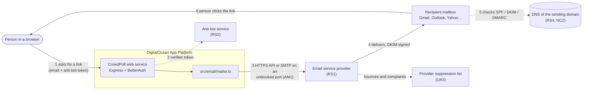
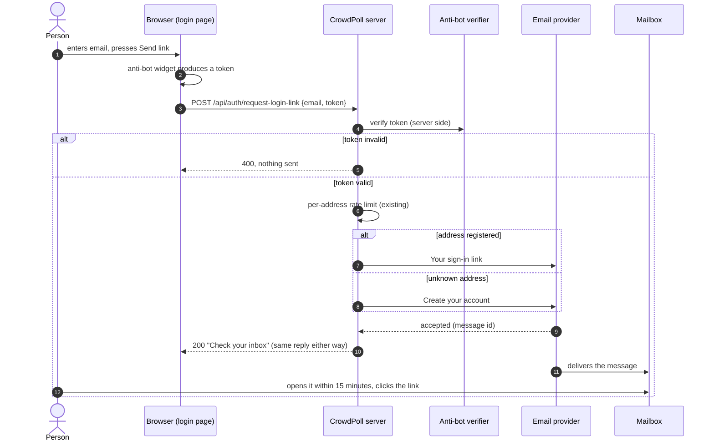
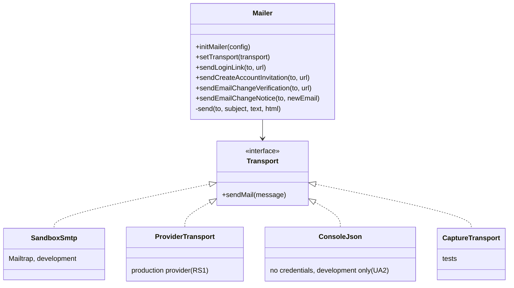
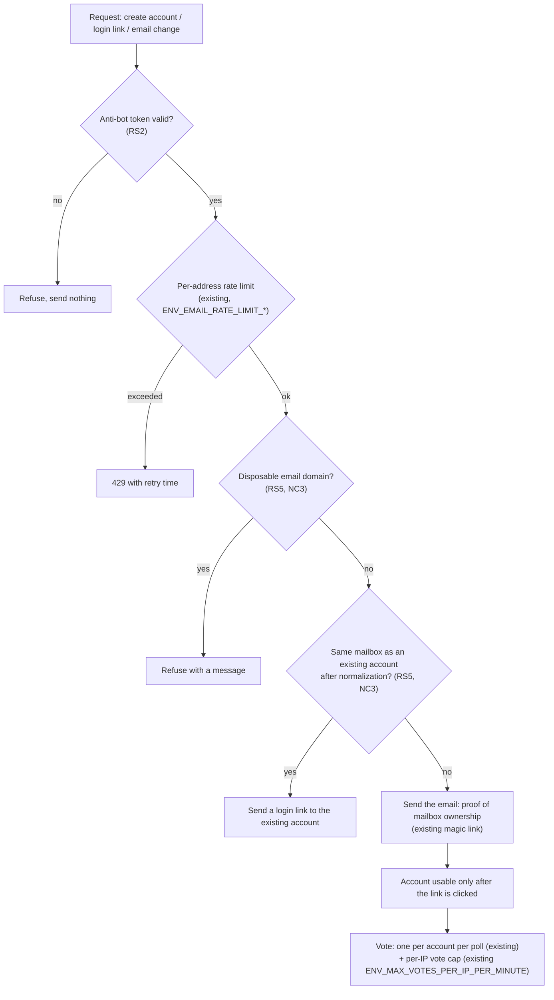
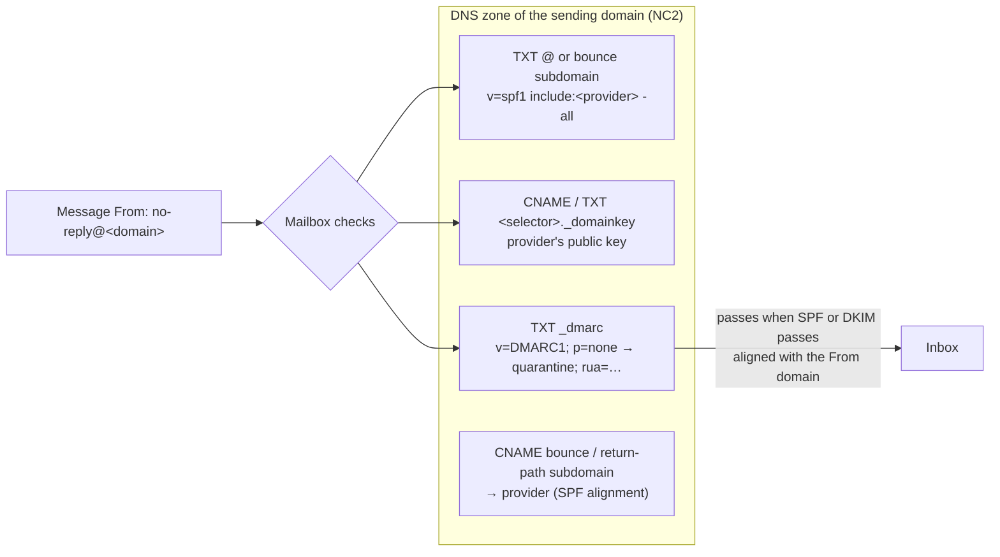

# High Level Requirements

Requirements: `requirements/20261019-153514-production-email/requirements.md`  
External Files: none  
Generated: 2026-10-19 3:35 PM  

The current CrowdPoll webapp uses an email sandbox on mailtrap.io.  
We are ready to move to a production-ready email system.  
The webapp is deployed to Digital Ocean that doesn't offer mail server services.  
Therefore, we need to integrate an external email service provider fo

## Production-Ready Email
Please research suitable external email service providers that can be integrated with the CrowdPoll webapp for production use.  
Compare service providers based on features, pricing, reliability, and ease of integration with the CrowdPoll webapp.  
Provide pros and cons.

## Anti-Bot Mechanisms
Research, the best way of "proving" the user is not a robot.  
Consider researching CAPTCHA solutions, email verification methods, and other anti-bot mechanisms suitable for the CrowdPoll webapp.  
Provide pros and cons.

## Current Email Analysis
To help us in refining our emails, please provide a detailed breakdown of the current emails that are sent by the CrowdPoll webapp.  
Provide where the email content is defined.  
Provide the current email templates or content used by the CrowdPoll webapp.  
Provide any relevant configuration files, settings and environment variables related to email delivery in the CrowdPoll webapp.  

## Email Deliverability Best Practices
Research best practices for email deliverability, including SPF, DKIM, and DMARC configurations, to ensure that emails sent by the CrowdPoll webapp reach users' inboxes reliably.
Provide pros and cons for each approach.  

## Single User Integrity
Research techniques for ensuring that a single user does not create multiple accounts or perform actions that could compromise the integrity of the CrowdPoll webapp.  
Consider methods such as email verification, CAPTCHA, IP address tracking, and device fingerprinting.  
Provide pros and cons for each approach.  

## Additional Requirements and Research Requests

**Instructions To The Developer**  
Enter any additional requirements or research requests here.
When you enter "Next" in the CC CLI terminal, the additional requirements and research requests will be applied to the report.

✅ Applied 2026-10-19 7:34 PM: 0 requirements added; 2 research requests added to requirements.md (RS7 AWS Plan, RS8 AWS Setup Instructions).  
✅ Applied 2026-10-19 10:07 PM: 0 requirements added; 1 research request added to requirements.md, given through the remote input file (RS9 Inbound Mail at `crowdpoll.vote`).  
✅ Applied 2026-10-20 12:25 PM: 0 requirements added; 1 research request added to requirements.md (RS10 Inbound Mail Forwarding Setup).  
✅ Applied 2026-10-20 12:46 PM: 0 requirements added; 1 research request added to requirements.md (RS11 Sandbox Test Details).  
✅ Applied 2026-10-20 1:11 PM: 0 requirements added; 1 research request (a question) added to requirements.md (RS12 Gmail's SPF Result in the Sandbox Test).  
✅ Applied 2026-10-20 1:17 PM: 0 requirements added; 1 research request (the sandbox test's full headers, to be checked) added to requirements.md as a summary, without the recipient address and message ids (RS13 Sandbox Test Headers).  
✅ Applied 2026-10-20 2:04 PM: 0 requirements added; 1 research request (a question) added to requirements.md (RS14 SPF Record for the Root Domain).  
✅ Applied 2026-10-20 2:55 PM: 0 requirements added; 1 research request (a question) added to requirements.md (RS15 Describing the Messages for Production Access).  
✅ Applied 2026-10-20 3:01 PM: 0 requirements added; 1 research request (the `aws sesv2 get-account` output, to be checked) added to requirements.md, with the support case id and the contact address left out (RS16 SES Account Status After Production Access).  
✅ Applied 2026-10-20 3:17 PM: 0 requirements added; 1 research request added to requirements.md (RS17 Monitor Email Sending).  

---

## 1. Overview and Scope

The feature takes CrowdPoll's email from a test sandbox to production.  
Today every message goes through nodemailer to the Mailtrap sandbox (`sandbox.smtp.mailtrap.io:2525`), which captures mail and never delivers it to real inboxes.  
DigitalOcean blocks outbound SMTP on ports 25, 465 and 587 and recommends a third-party email service, so production mail must go through an external provider.  

The requirements cover five areas, four of them mainly research requests:

- **Production-Ready Email**: choose an external email service provider and integrate it (research result RS1).  
- **Anti-Bot Mechanisms**: decide how CrowdPoll proves that a person, not a script, is asking for an email (RS2).  
- **Current Email Analysis**: an inventory of today's messages, where they are defined, and their configuration (RS3, and section 2 below).  
- **Email Deliverability Best Practices**: SPF, DKIM and DMARC for the sending domain (RS4).  
- **Single User Integrity**: limiting one person to one account and one voice (RS5).  

Out of scope unless a finding brings it in: marketing or newsletter email, notification emails about polls, and the OAuth sign-in phase (`ENV_SIGNIN_METHOD=oauth`), in which no sign-in links are emailed.  

## 2. The Current Email System

All email goes through one module, `src/email/mailer.ts`.  
It builds a nodemailer SMTP transport from `ENV_SMTP_*` when both a user and a password are set.  
Otherwise it falls back to nodemailer's `jsonTransport`, which logs each message to the console instead of sending it.  
Each message has a plain-text part and a minimal HTML part, both written inline as template strings.  

### 2.1 The four messages

| # | Function (`src/email/mailer.ts`) | Subject | Sent when | Called from | On failure |
|---|---|---|---|---|---|
| 1 | `sendLoginLink` (line 55) | Your sign-in link | A registered address asks for a login link, or an account is created | `src/auth/auth.ts:158` (BetterAuth magic-link `sendMagicLink`), reached from `issueLoginLink` in `src/routes/api.ts:117` | `502` "Could not send email, try again later" |
| 2 | `sendCreateAccountInvitation` (line 64) | Create your account | An unknown address asks for a login link (`POST /api/auth/request-login-link`) | `src/routes/api.ts:196` | `502` |
| 3 | `sendEmailChangeVerification` (line 73) | Verify your new email address | A signed-in user asks to change their address | `src/routes/api.ts:442` | `502` |
| 4 | `sendEmailChangeNotice` (line 83) | Your account email address was changed | The change is verified; sent to the old address | `src/routes/api.ts:503` | Logged only; the change stands |

### 2.2 The current content

1. **Your sign-in link**  
   Text: "Click this one-time link to sign in (valid for 15 minutes): `<url>` If you did not request this, you can ignore this email."  
   HTML: the same, with the link shown as "Sign in".  
   The link is `<origin>/api/auth/verify?token=…&stay=0|1[&PID=…]`.  
2. **Create your account**  
   Text: "A sign-in was requested for this address, but no account exists yet. Create an account here: `<origin>/create-account[?PID=…]` If this wasn't you, you can ignore this email."  
   HTML: the same, with the link shown as "Create an account".  
3. **Verify your new email address**  
   Text: "Click this one-time link to confirm your new email address (valid for 15 minutes): `<url>` If you did not request this change, you can ignore this email."  
   HTML: the link is shown as "Confirm new address"; the URL is `<origin>/api/me/email-change/verify?token=…`.  
4. **Your account email address was changed**  
   Text: "The email address on your account was changed to `<new address>`. This address no longer receives sign-in links."  
   It holds no action link, by requirement (FR-013d of `001-user-auth`).  

Every message is sent from `ENV_SMTP_FROM`, whose default and current production value is `NativeAuthOAuth <no-reply@nativeauth.local>`, a placeholder from the project's earlier name on a domain that does not exist.  

### 2.3 Configuration

| Variable | Default (`src/config.ts:276-282`) | Production (`.do/app.yaml`) | Purpose |
|---|---|---|---|
| `ENV_SMTP_HOST` | `sandbox.smtp.mailtrap.io` | `sandbox.smtp.mailtrap.io` | SMTP server |
| `ENV_SMTP_PORT` | `2525` | `2525` | SMTP port |
| `ENV_SMTP_USER` | unset | secret, empty | SMTP user; unset → console logging |
| `ENV_SMTP_PASS` | unset | secret, empty | SMTP password; unset → console logging |
| `ENV_SMTP_FROM` | `NativeAuthOAuth <no-reply@nativeauth.local>` | the same | Sender shown to recipients |
| `ENV_EMAIL_RATE_LIMIT_MINUTES_WINDOW` | `15` | `15` | Window shared by the three email-sending endpoints, per client address |
| `ENV_EMAIL_RATE_LIMIT_MAX_REQUESTS_PER_WINDOW` | `2` | `2` | Requests allowed per client address in that window |

Other files involved:

- `launch.json.example`, `devScripts.example/launch-dev.ps1` and `devScripts.example/setup-dev.ps1` carry the Mailtrap placeholders for local development.  
- `src/auth/auth.ts` sets the 15-minute link lifetime (`LINK_EXPIRY_SECONDS`), the hashed token storage and the rate limits on the email endpoints.  
- `tests/helpers/setup.ts` injects a capturing transport through `setTransport`, so no test sends real mail.  
- The `ENV_SMTP_*` variables are not listed in the environment table of `CLAUDE.md` (see Technical Debt).  

## 3. Architecture Diagrams

### 3.1 System context: who sends what to whom

### 3.2 Sign-in link request, after the change

### 3.3 The email module after the change

### 3.4 Defence layers for account creation and voting

### 3.5 Sending-domain DNS records

## 4. Assumptions

- Volume is low: well under 5,000 messages a day, so Gmail's and Yahoo's bulk-sender rules (one-click unsubscribe, complaint-rate reporting) are good practice rather than obligations, and every message is transactional.  
- Sign-in links are time-critical (15 minutes), so delivery speed and inbox placement matter more than price per message.  
- Development and the test suite keep working without a provider account: tests keep the injected capture transport, and local development keeps Mailtrap or console logging.  
- The project owns, or will register, a domain whose DNS it controls; the current `nativeauth.local` sender cannot be authenticated.  
- No new cookie is added: the cookie policy in `CLAUDE.md` allows only `session_token`.  
- Provider prices quoted in section 7 come from third-party comparisons dated 2026 and must be confirmed on each vendor's pricing page before signing up.  

## 5. Breaking Changes

- **Production configuration changes.** `ENV_SMTP_HOST`, `ENV_SMTP_PORT`, `ENV_SMTP_USER`, `ENV_SMTP_PASS` and `ENV_SMTP_FROM` take new production values in `.do/app.yaml`, and an API-based integration (AM1) would add or rename variables, which every developer's git-ignored `launch.json` and `launch-dev.ps1` must follow.  
- **A new sender.** Recipients see a new From name and address; users who filtered or allow-listed the old sender stop matching.  
- **Anti-bot token required.** If RS2 is adopted, `POST /api/auth/create-account`, `POST /api/auth/request-login-link` and the email-change request refuse requests without a valid token, which breaks scripted clients, the Postman collection and any test that calls them directly until they send a test token.  
- **Stricter address rules.** If RS5's normalization or disposable-domain blocking is adopted, some addresses that are accepted today are refused, and two existing accounts may turn out to share one mailbox (NC3).  
- **API contract.** Each changed request body must be described in `postman/openapi.json`.  

## 6. Technical Debt

- **Silent fallback in production.** With no `ENV_SMTP_USER`/`ENV_SMTP_PASS`, `initMailer` logs a warning and switches to console logging, so a production deployment with missing secrets answers "Check your inbox" while sending nothing (UA2).  
- **Unescaped HTML.** The HTML parts interpolate the URL and, in the change notice, the new address straight into markup; validated addresses make this low-risk, but the templates should escape what they insert.  
- **Inline templates.** Subjects and bodies are string literals in `mailer.ts`, with no shared layout, branding or preheader text, so refining the emails means editing code.  
- **Legacy names.** The default sender `NativeAuthOAuth <no-reply@nativeauth.local>` and the `001-user-auth` comments still describe the project before it became CrowdPoll.  
- **Undocumented variables.** `ENV_SMTP_*` is missing from the environment table in `CLAUDE.md`, although `config.ts`, `.do/app.yaml` and the dev templates all use it.  
- **No retry or delivery status.** A failed send is reported to the user as `502`, with no retry, and the provider's message id is not logged, so a delivery cannot be traced later.  
- **Rate limit keyed by client address only.** The email limit counts per client IP, so one address can be sent many links from many IPs, and many people behind one NAT share one allowance.  

## 7. Research Results

### 7.1 Production-Ready Email

**RS1. Which external email service provider should CrowdPoll use in production?**  
✅ Resolved  
✅ Requirements File Updated: 2026-10-19 7:47 PM  
**Notes**: Recommendation accepted in file 2026-10-19: Recommendation C, **Amazon SES, for the lowest cost**;  
the requirements now say so beneath Production-Ready Email (Provider (RS1)).  

The requirements ask for a comparison of providers on features, pricing, reliability and ease of integration.  
Sources: [DigitalOcean — Why is SMTP blocked?](https://docs.digitalocean.com/support/why-is-smtp-blocked/), [DigitalOcean community — unblocking 587/465](https://www.digitalocean.com/community/questions/request-to-unblock-outbound-smtp-ports-587-and-465-e98aefa4-142a-4c0d-a15d-a1d2fcbe9a4b), [Ghost — DigitalOcean SMTP blocked](https://docs.ghost.org/faq/digitalocean-smtp-blocked), [DEV — 7 transactional email APIs, 2026 pricing](https://dev.to/northloopworks/i-compared-7-transactional-email-apis-so-you-dont-have-to-2026-pricing-5912), [Brevo — best email API services 2026](https://www.brevo.com/blog/best-email-api/), [Dreamlit — SendGrid alternatives 2026](https://dreamlit.ai/blog/best-sendgrid-alternatives), [BuildMVPFast — email API pricing, July 2026](https://www.buildmvpfast.com/api-costs/email).  
DigitalOcean blocks outbound SMTP on ports 25, 465 and 587 on Droplets and recommends an email-as-a-service provider; community reports say App Platform blocks SMTP too, which could not be confirmed in DigitalOcean's own documentation.  
Every provider below offers both an HTTPS API (never blocked) and SMTP, usually also on port 2525.  
The pricing figures come from third-party comparisons that disagree in places, so confirm them on each vendor's page:  

| Provider | Free tier | Entry paid plan | Strengths | Weaknesses |
|---|---|---|---|---|
| Postmark | 100 emails/month | about $15/month for 10,000 | Transactional only, separate "message streams", known for fast delivery and inbox placement | Free tier is only for testing; dearer per message at volume |
| Resend | 3,000 emails/month | about $20/month for 50,000 | Simple API and Node SDK, good developer experience | Younger company, shorter deliverability record |
| Amazon SES | eligibility-dependent | about $0.10 per 1,000 | Cheapest at any volume, very reliable infrastructure | Most setup: AWS account, sandbox exit request, IAM keys, bounce handling yourself |
| Mailgun | trial only | about $15/month for 10,000 | Mature, good logs, SMTP on 2525 documented | Mid-price, account reviews on sign-up |
| SendGrid (Twilio) | 60-day trial only | about $19.95/month | Long-established, suggested by DigitalOcean staff | No permanent free tier, shared IP reputation varies |
| Brevo | 300 emails/day | about $9/month | Generous free tier, marketing email in the same account | Marketing-oriented, transactional is a secondary product |

Integration effort is similar for all of them: the four messages already go through one `send()` in `mailer.ts`, so only the transport and the five `ENV_SMTP_*` values change (AM1 decides between SMTP and the API).  

  - **Recommendation A** _(recommended)_: **Postmark, for its transactional-only focus and delivery speed of sign-in links.**  

    ➡️ [ ] **Accepted**  
    - <u>Pros</u>: sign-in depends entirely on a 15-minute link arriving quickly in the inbox, which is what Postmark specializes in;  
      it keeps transactional mail separate from any future bulk mail;  
      SMTP (including port 2525) and HTTPS API are both supported, so nodemailer can stay.  
    - <u>Cons</u>: about $15 a month from the first real message, since the free 100 a month is for testing only.  

  - **Recommendation B**: **Resend, for its free tier and simple API.**  

    ➡️ [ ] **Accepted**  
    - <u>Pros</u>: 3,000 emails a month free covers CrowdPoll's likely early volume;  
      the API and Node SDK are the simplest of the group.  
    - <u>Cons</u>: a shorter deliverability record than Postmark;  
      a daily limit on the free tier could block sign-ins on a busy day.  

  - **Recommendation C**: **Amazon SES, for the lowest cost.**  

    ➡️ [X] **Accepted**  
    - <u>Pros</u>: by far the cheapest per message, on very reliable infrastructure.  
    - <u>Cons</u>: an AWS account, a request to leave the SES sandbox, IAM credentials and bounce/complaint handling to set up;  
      the most operational work for a small project.  

  - **Developer Resolution D**:  

    ➡️ [ ] **Accepted**  

### 7.2 Anti-Bot Mechanisms

**RS2. What is the best way to prove that the person asking for an email is not a robot?**  
✅ Resolved  
✅ Requirements File Updated: 2026-10-19 6:58 PM  
**Notes**: Recommendation accepted in file 2026-10-19: Recommendation B, **honeypot and rate limits only, with no third party**;  
the requirements now say so beneath Anti-Bot Mechanisms (Decision (RS2)).  

The requirements ask for CAPTCHA solutions, email verification and other anti-bot mechanisms, with pros and cons.  
Sources: [Better Auth — Captcha plugin](https://better-auth.com/docs/plugins/captcha), [Makerkit — Better Auth captcha plugin notes](https://makerkit.dev/docs/nextjs-drizzle/better-auth/captcha-plugin), [Prosopo — reCAPTCHA vs Turnstile (competitor blog)](https://prosopo.io/blog/recaptcha-vs-cloudflare-turnstile/), [Prosopo — Turnstile pricing (competitor blog)](https://prosopo.io/tools/cloudflare-turnstile-pricing/), [PHPCaptcha — Turnstile review](https://phpcaptcha.org/cloudflare-turnstile-review/).  
Most CAPTCHA comparisons found are written by competing vendors, so their claims are treated with caution.  
The three emailing endpoints are the targets: each lets a script make CrowdPoll send mail to any address, which costs money and harms the sending domain's reputation.  

| Mechanism | How it works | Pros | Cons |
|---|---|---|---|
| Cloudflare Turnstile | Invisible or managed widget, server verifies a token | Free with no request cap reported, usually no puzzle for people, supported by Better Auth's captcha plugin | A third-party script from Cloudflare; processes IP and browser telemetry in the US |
| Google reCAPTCHA v3 | Invisible score 0–1 per request | Graded risk score | Free only to 10,000 assessments a month; extensive fingerprinting raises privacy concerns |
| hCaptcha | Visible or invisible challenge | Privacy-oriented marketing | Free tier 10,000 requests a month; paid from about $99–139 a month; puzzles annoy people |
| Honeypot field + minimum fill time | A hidden field bots fill, and a too-fast submit check | No third party, no cost, invisible | Stops only naive bots |
| Email verification (magic link) | Account works only after a link in the mailbox is clicked | Already in place: proves mailbox ownership | Proves a mailbox, not a person; does not stop the email being sent |
| Rate limiting | Caps requests per client | Already in place (`ENV_EMAIL_RATE_LIMIT_*`) | Per IP only; distributed bots evade it |

Better Auth's captcha plugin protects Better Auth's own endpoints, while CrowdPoll's `/api/auth/create-account` and `/api/auth/request-login-link` are Express routes of its own, so they would verify the token themselves through Cloudflare's server-side check.  
Whether Turnstile sets any cookie could not be confirmed and must be checked against the one-cookie policy.  

  - **Recommendation A** _(recommended)_: **Cloudflare Turnstile in managed mode on the three emailing endpoints, plus a honeypot field, on top of the existing rate limits and magic-link verification.**  

    ➡️ [ ] **Accepted**  
    - <u>Pros</u>: free, invisible to most people, a token verified server-side before any email is sent;  
      the honeypot adds a free first filter.  
    - <u>Cons</u>: one third-party script and a US data processor, to be mentioned in the privacy notice;  
      a content-security policy, if one is added, must allow Cloudflare's script.  

  - **Recommendation B**: **Honeypot and rate limits only, with no third party.**  

    ➡️ [X] **Accepted**  
    - <u>Pros</u>: no external dependency, no privacy disclosure, nothing for people to see.  
    - <u>Cons</u>: a targeted bot defeats a honeypot easily, leaving only the per-IP limit.  

  - **Developer Resolution C**:  

    ➡️ [ ] **Accepted**  

### 7.3 Current Email Analysis

**RS3. Which emails does CrowdPoll send today, where are they defined, and how are they configured?**  
✅ Resolved  
✅ Requirements File Updated: 2026-10-19 6:58 PM  
**Notes**: Recommendation accepted in file 2026-10-19: Recommendation, **record the section 2 inventory as the baseline**;  
the four messages, their subjects and call sites are now listed beneath Current Email Analysis (Baseline (RS3)).  

The requirements ask for a breakdown of the current emails, their content, and the related files, settings and environment variables.  
Sources: the codebase — `src/email/mailer.ts`, `src/auth/auth.ts`, `src/routes/api.ts`, `src/config.ts`, `.do/app.yaml`, `launch.json.example`, `devScripts.example/launch-dev.ps1`, `devScripts.example/setup-dev.ps1`, `tests/helpers/setup.ts`.  
CrowdPoll sends exactly four messages, all defined in `src/email/mailer.ts`: Your sign-in link, Create your account, Verify your new email address, and Your account email address was changed.  
Section 2 lists each message's trigger, call site, full text and failure behaviour, and every configuration value with its default and production setting.  
No poll-related email (invitations to vote, results) exists today.  

  - **Recommendation**: **record the section 2 inventory in the requirements as the baseline the refined emails start from.**  

    ➡️ [X] **Accepted**  
    - The four messages, their subjects and their call sites go beneath the Current Email Analysis heading, so later refinements (AM3) can refer to them by name.  

  - **Developer Resolution B**:  

    ➡️ [ ] **Accepted**  

### 7.4 Email Deliverability Best Practices

**RS4. How should SPF, DKIM and DMARC be set up so CrowdPoll's emails reach the inbox?**  
✅ Resolved  
✅ Requirements File Updated: 2026-10-19 6:58 PM  
**Notes**: Recommendation accepted in file 2026-10-19: Recommendation, **SPF, DKIM (2048-bit) and DMARC, starting at `p=none` and moving to `p=quarantine`**;  
the requirements now say so beneath Email Deliverability Best Practices (Decision (RS4)).  

The requirements ask for deliverability best practices, including SPF, DKIM and DMARC.  
Sources: [dmarcian — Yahoo and Google DMARC required](https://dmarcian.com/yahoo-and-google-dmarc-required/), [Bird — Gmail and Yahoo bulk sender requirements](https://bird.com/explained/deliverability/what-are-the-gmail-and-yahoo-bulk-sender-requirements), [Close — requirements for bulk senders](https://help.close.com/technical-support/email-deliverability/requirements-for-bulk-email-senders), [Webex — new Gmail and Yahoo requirements](https://cpaas.webex.com/blog/new-gmail-and-yahoo-sending-requirements).  
These are vendor guides; Google's and Yahoo's own pages were not fetched, so details should be checked there.  
Since 2024 Gmail and Yahoo require every sender to have SPF or DKIM, and senders of more than 5,000 messages a day to have SPF, DKIM and DMARC, with SPF or DKIM aligned to the From domain; Microsoft followed in May 2025.  
The three are complementary layers rather than alternatives:  

| Practice | What it does | Pros | Cons |
|---|---|---|---|
| SPF | Lists the servers allowed to send for the domain | Simple TXT record | Breaks on forwarding; aligns only with a custom return-path domain |
| DKIM | Signs each message with the domain's key | Survives forwarding; the strongest alignment | Key records to publish, and rotate when the provider does |
| DMARC `p=none` with reports | Tells mailboxes how to treat failures and reports them | Satisfies Gmail/Yahoo; reports reveal spoofing | No protection until tightened |
| DMARC `p=quarantine`/`reject` | Spoofed mail goes to spam or is refused | Protects the domain's reputation | A mistake in SPF/DKIM sends real mail to spam |
| Sending subdomain (e.g. `mail.<domain>`) | Isolates transactional reputation | Problems do not touch the main domain | One more set of records |
| Plain-text part, no URL shorteners, consistent From | Content hygiene | Already in place (text + HTML parts) | — |

  - **Recommendation**: **publish SPF, DKIM (2048-bit, from the provider) and DMARC for the sending domain, with a provider return-path subdomain for SPF alignment; start DMARC at `p=none` with aggregate reports and move to `p=quarantine` once the reports show only CrowdPoll's provider.**  

    ➡️ [X] **Accepted**  
    - All three are needed together: SPF and DKIM authenticate, and DMARC ties them to the visible From address.  
    - Starting at `p=none` lets a misconfiguration show up in reports before it costs any real sign-in email.  
    - One-click unsubscribe is not required: every CrowdPoll message is transactional and volumes are far below 5,000 a day.  

  - **Developer Resolution B**:  

    ➡️ [ ] **Accepted**  

### 7.5 Single User Integrity

**RS5. How can CrowdPoll keep one person from creating several accounts or otherwise skewing polls?**  
✅ Resolved  
✅ Requirements File Updated: 2026-10-19 6:58 PM  
**Notes**: Developer Resolution accepted in file 2026-10-19: Developer Resolution B, **OAuth-only sign-in (planned phase)**;  
single-user integrity measures are put off until after OAuth-only sign-in is implemented, as the developer wrote;  
the requirements now say so beneath Single User Integrity (Decision (RS5)).  

The requirements ask for techniques such as email verification, CAPTCHA, IP address tracking and device fingerprinting, with pros and cons.  
Sources: the codebase (`src/routes/api.ts`, `src/votes/votePath.ts`, `src/config.ts`), [Fingerprint — open source vs Pro accuracy (vendor)](https://fingerprint.com/blog/open-source-vs-fingerprint-pro-accuracy/), [disposable-email-domains (GitHub)](https://github.com/0xFORK/disposable-email-domains), [eramitgupta/disposable-email (GitHub)](https://github.com/eramitgupta/disposable-email).  
CrowdPoll already has: an account per verified mailbox (magic link), one vote per account per poll, a per-IP cap on votes (`ENV_MAX_VOTES_PER_IP_PER_MINUTE`), a per-IP limit on emailing endpoints, and in the OAuth phase, identity from the provider.  
The cheap way round these is many mailboxes: aliases of one mailbox (`name+1@gmail.com`, `n.ame@gmail.com`) or throwaway addresses.  

| Technique | Pros | Cons |
|---|---|---|
| Email verification (in place) | Proves mailbox control | One person can own many mailboxes |
| Address normalization (plus-tags, Gmail dots) | Closes the cheapest loophole | Provider-specific rules; existing accounts may collide (NC3) |
| Disposable-domain blocklist | Stops throwaway inboxes | Lists of 100,000+ domains go stale; occasional false positives |
| CAPTCHA (RS2) | Stops scripted mass sign-up | Not a uniqueness check: a person passes it many times |
| IP tracking and limits (partly in place) | No user friction | NAT, mobile carriers and VPNs blur IPs both ways |
| Device fingerprinting | Links accounts across mailboxes | The open-source library's accuracy is unverified (vendor claims 99.5% only for its paid product); personal data under GDPR/ePrivacy needing consent; conflicts with the one-cookie, no-tracking stance |
| Phone (SMS) verification | Strongest uniqueness | Cost per message, a second provider, friction, excludes some people |
| OAuth-only sign-in (planned phase) | Accounts tied to Google/GitHub/Facebook identities | Depends on provider approval; providers also allow many accounts |

  - **Recommendation**: **layer cheap, privacy-respecting checks: keep email verification and the IP limits, add Turnstile (RS2), block disposable domains from a maintained list, and normalize plus-tags (and Gmail dots) when checking that an address is new; do not add device fingerprinting or phone verification.**  

    ➡️ [ ] **Accepted**  
    - Each layer raises the cost of a second account without collecting new personal data or adding a cookie.  
    - Fingerprinting is left out because its accuracy is unproven without a paid service and it would need consent under the current cookie policy.  
    - How strictly normalization is applied, and what happens to existing accounts, is settled in NC3.  

  - **Developer Resolution B**:  OAuth-only sign-in (planned phase) 

    ➡️ [X] **Accepted**  
    - this will be put off until after OAuth-only sign-in is implemented

### 7.6 Cookies Beyond `session_token`

**RS6. How could cookies other than `session_token` help with this feature?**  
✅ Resolved  
✅ Requirements File Updated: 2026-10-19 6:58 PM  
**Notes**: Recommendation accepted in file 2026-10-19: Recommendation A, **one security cookie that ties each sign-in link to the browser that requested it, with a "confirm on this device" fallback**;  
a new section, Cookies Beyond `session_token`, records the decision and the new cookie policy.  
Assumption 5 in section 4 ("No new cookie is added") no longer holds, and the cookie policy in `CLAUDE.md` changes with this feature.  

The developer asked, about the assumption "No new cookie is added: the cookie policy in `CLAUDE.md` allows only `session_token`", how other cookies could help.  
Sources: the codebase and project rules (`CLAUDE.md`'s cookie policy and informational cookie banner, `src/routes/api.ts`, section 6's rate-limit debt) and RS2 and RS5 above;  
no external source was fetched for this result, so the GDPR/ePrivacy remarks below are general guidance to confirm before relying on them.  
A cookie can help, but it is never a strong defence against a determined abuser, because a bot or a person can clear cookies or open a private window.  
Four uses are worth weighing:  

1. **Tie a sign-in link to the browser that asked for it.**  
   When a link is requested, the server sets a short-lived cookie with a random value, and the link signs in only if that cookie comes back when it is clicked.  
   It makes a forwarded or intercepted link useless and stops someone pushing a link to sign another person into the attacker's account.  
   The cost is that a link requested on a laptop cannot be opened on a phone; many apps fall back to a "confirm on this device" step for that case.  
   As a security cookie it is arguably strictly necessary, so it needs no consent.  
2. **Rate limit per browser as well as per IP.**  
   A signed browser token gives people behind a shared NAT their own allowance, easing the "per client address only" debt in section 6.  
   It can only make the limits more lenient, never enforce them, because bots discard cookies; the IP limit stays the hard limit.  
3. **Remember a passed anti-bot check.**  
   After someone passes Turnstile once, a short-lived cookie lets them skip it on the next few requests (resending a link, changing their email).  
   Turnstile's managed mode is already invisible to most people, so the gain is small.  
4. **A long-lived browser ID to spot one person with several accounts.**  
   A random ID kept across sign-ups lets accounts created from the same browser be flagged.  
   A private window or clearing cookies defeats it, and it is a tracking cookie, so under GDPR and ePrivacy it would need consent, turning the informational cookie banner into a real consent flow — the same objection as device fingerprinting in RS5.  

Uses 1 and 3 are the kind that usually count as strictly necessary, so the banner could stay informational, with its text updated to list them;  
use 4 would change CrowdPoll's privacy stance.  
The options below are not mutually exclusive: to adopt more than one, describe the combination under the Developer Resolution.  

  - **Recommendation A** _(recommended)_: **allow one security cookie that ties each sign-in link to the browser that requested it, with a "confirm on this device" fallback; the cookie policy becomes "`session_token` plus strictly necessary security cookies".**  

    ➡️ [X] **Accepted**  
    - <u>Pros</u>: a real security gain: forwarded or intercepted links stop working, and login pushing is blocked;  
      no consent needed, so the banner stays informational.  
    - <u>Cons</u>: opening the link on another device needs the fallback step;  
      the cookie policy in `CLAUDE.md` and the banner text change.  

  - **Recommendation B**: **allow a signed per-browser token that adds per-browser allowances on top of the per-IP email rate limit.**  

    ➡️ [ ] **Accepted**  
    - <u>Pros</u>: fairer limits for people sharing one IP (offices, schools, mobile carriers).  
    - <u>Cons</u>: only makes limits more lenient, never stricter;  
      a second limiter to configure and test.  

  - **Recommendation C**: **allow a short-lived cookie that remembers a passed anti-bot check.**  

    ➡️ [ ] **Accepted**  
    - <u>Pros</u>: fewer repeated checks for someone who resends a link or changes their email.  
    - <u>Cons</u>: small gain, since managed-mode Turnstile is invisible to most people;  
      a stolen cookie skips the check until it expires.  

  - **Recommendation D**: **allow a long-lived browser ID that flags several accounts created from one browser, with a consent flow.**  

    ➡️ [ ] **Accepted**  
    - <u>Pros</u>: catches casual multi-account use from one browser.  
    - <u>Cons</u>: defeated by a private window or clearing cookies;  
      a tracking cookie that needs consent, replacing the informational banner with a consent flow and changing CrowdPoll's privacy stance.  

  - **Developer Resolution E**:  

    ➡️ [ ] **Accepted**  

### 7.7 AWS Plan

**RS7. Which Amazon SES pricing plan suits CrowdPoll.vote's email: Essentials, Pro, Enterprise or à la carte?**  
✅ Resolved  
✅ Requirements File Updated: 2026-10-19 7:47 PM  
**Notes**: Recommendation accepted in file 2026-10-19: Recommendation A, **stay on Essentials, the default**;  
the requirements now say so beneath AWS Plan (Decision (RS7)).  

The developer asked, as an additional research request, which of the four SES pricing options fits CrowdPoll.vote.  
Sources: [Amazon SES pricing](https://aws.amazon.com/ses/pricing/), [AWS What's New — Amazon SES introduces pricing plans (July 2026)](https://aws.amazon.com/about-aws/whats-new/2026/07/amazon-ses-pricing-plans/), [AWS Builder Center — what SES pricing plans change](https://builder.aws.com/content/3Gubvy72jmeLSzktz28x7ZwYrEh/amazon-ses-pricing-plans-are-here-what-actually-changes-for-your-sending-architecture), [Classmethod — SES pricing plans through the SESv2 API](https://dev.classmethod.jp/en/articles/ses-pricing-plans-price-list-api-sesv2-api/).  
The question assumes Amazon SES, which is RS1's Recommendation C; RS1 is still open, so this result applies only if SES is chosen there.  
On 2026-07-21 AWS added three plans that build on each other, beside the existing pay-as-you-go pricing, which the API calls plan `NONE`.  
Every new SES account starts on Essentials; the plan is set per account and per region with `aws sesv2 put-account-pricing-attributes --plan ESSENTIALS|PRO|ENTERPRISE|NONE`.  
Upgrades take effect at once and downgrades at the next billing cycle, except the first move away from an automatically assigned Essentials, which is immediate.  
Prices from AWS's pricing page, for the first 10 million emails a month, with two illustrative CrowdPoll volumes (an estimate, not a forecast):  

| Plan | Monthly fee | Per 1,000 emails | Adds | 3,000 emails/month | 30,000 emails/month |
|---|---|---|---|---|---|
| À la carte (`NONE`) | none | $0.10 | Sending only; Virtual Deliverability Manager (VDM) is $0.07 per 1,000 extra | $0.30 | $3.00 |
| Essentials (default) | none | $0.16 | VDM deliverability insights included | $0.48 | $4.80 |
| Pro | $105 | $0.22 | 1 managed dedicated IP, email validation, 5 inbox-placement seed tests, 1 domain | $105.66 | $111.60 |
| Enterprise | $500 | $0.23 | Multi-region resilience, reputation isolation per workload, annual deliverability assessment, 12 managed dedicated IPs | $500.69 | $506.90 |

All plans add $0.12 per GB of attachments, which CrowdPoll's messages do not have.  
New AWS customers also receive up to $200 of AWS Free Tier credits for 12 months, which would cover years of CrowdPoll's mail on either of the first two options.  
Pro and Enterprise pay mostly for dedicated IPs and multi-region sending, which serve large, steady volumes; for a few thousand transactional messages a shared SES IP pool is the usual choice (common guidance, not confirmed on the AWS pages fetched).  

  - **Recommendation A** _(recommended)_: **stay on Essentials, the default.**  

    ➡️ [X] **Accepted**  
    - <u>Pros</u>: no monthly fee, and nothing to change on the account;  
      VDM's deliverability dashboard and advice help with UA4's inbox-placement check and with tracing a "never got my link" report beside the logged message id (UA3);  
      the extra cost over à la carte is cents to a few dollars a month at CrowdPoll's volume.  
    - <u>Cons</u>: 60% dearer per message than à la carte, which matters only if volume grows by orders of magnitude.  

  - **Recommendation B**: **switch to à la carte (`NONE`), the cheapest.**  

    ➡️ [ ] **Accepted**  
    - <u>Pros</u>: the lowest price per message, with no monthly fee;  
      the first switch away from the automatic Essentials applies at once.  
    - <u>Cons</u>: no VDM unless bought separately ($0.07 per 1,000, which makes it dearer than Essentials);  
      one more account setting to remember in every region used.  

  - **Recommendation C**: **Pro, for a managed dedicated IP and inbox-placement tests.**  

    ➡️ [ ] **Accepted**  
    - <u>Pros</u>: CrowdPoll's reputation would not be shared with other SES senders;  
      seed tests show inbox placement across mailbox providers.  
    - <u>Cons</u>: $105 a month regardless of volume, about 200 times the cost of Essentials at 3,000 emails;  
      a dedicated IP with little traffic builds reputation slowly.  

  - **Developer Resolution D**:  

    ➡️ [ ] **Accepted**  

### 7.8 AWS Setup Instructions

**RS8. What are the steps to set up Amazon SES for sending CrowdPoll.vote's email?**  
✅ Resolved  
✅ Requirements File Updated: 2026-10-19 7:47 PM  
**Notes**: Recommendation accepted in file 2026-10-19: Recommendation, **record this checklist in the requirements as the SES setup procedure**;  
the 15 steps now stand beneath AWS Setup Instructions (Decision (RS8));  
the app's domain, `crowdpoll.vote`, is now named beneath Email Deliverability Best Practices (Sending domain (NC2)).  

The developer asked, as an additional research request, for a checklist of the steps to set up SES.  
Sources: [Amazon SES — request production access](https://docs.aws.amazon.com/ses/latest/dg/request-production-access.html), [Amazon SES — Easy DKIM](https://docs.aws.amazon.com/ses/latest/dg/send-email-authentication-dkim-easy.html), [Amazon SES — custom MAIL FROM domain](https://docs.aws.amazon.com/ses/latest/dg/mail-from.html), [Amazon SES pricing](https://aws.amazon.com/ses/pricing/), the codebase (`.do/app.yaml`, region `tor1`).  
Like RS7, it applies only if RS1 chooses Amazon SES.  
The request names the domain `CrowdPoll.vote`, which NC2 left to be named; the checklist uses the sending subdomain NC2 chose, `mail.crowdpoll.vote`.  
Every SES setting below (sandbox status, identities, quotas, suppression list, pricing plan) is per region, so all steps happen in one region.  
SES's documented SPF record ends `~all` (soft fail), where diagram 3.5 shows `-all`; DMARC alignment comes from DKIM either way.  
The checklist, in order:  

1. **AWS account.**  
   Create the account, turn on MFA for the root user and sign in from then on with an administrator IAM identity, not root.  
   Set an AWS Budget alarm (e.g. $10 a month) so an abuse spike is noticed.  
2. **Region.**  
   Use `ca-central-1` (Canada Central), the region nearest App Platform's `tor1`.  
3. **Pricing plan.**  
   Set the plan chosen in RS7 for `ca-central-1` (`aws sesv2 get-account --query PricingAttributes` shows the current one).  
4. **Domain identity with Easy DKIM.**  
   In SES → Identities, create a domain identity for `mail.crowdpoll.vote`, with Easy DKIM and the `RSA_2048_BIT` key (RS4).  
   Publish the DKIM CNAME records SES lists in the DNS of `crowdpoll.vote`.  
5. **Custom MAIL FROM domain.**  
   On the identity, set the MAIL FROM domain `bounce.mail.crowdpoll.vote`, with "Use default MAIL FROM domain" on MX failure.  
   Publish exactly one MX record, `bounce.mail.crowdpoll.vote MX 10 feedback-smtp.ca-central-1.amazonses.com`, and the TXT record `bounce.mail.crowdpoll.vote "v=spf1 include:amazonses.com ~all"`.  
   This gives SPF alignment with the From domain (RS4).  
6. **DMARC.**  
   Publish two TXT records with the same value, `"v=DMARC1; p=none; rua=mailto:<reports address>"` (RS4):  
   `_dmarc.mail.crowdpoll.vote`, the record SES suggests (it suggests it without `rua=`), which governs CrowdPoll's mail, since the most specific DMARC record applies;  
   and `_dmarc.crowdpoll.vote`, which covers the root domain and every other subdomain.  
   `<reports address>` is a placeholder to replace by hand, not one DNS or AWS fills in.  
   `crowdpoll.vote` has no MX record, so it cannot receive the reports, and a mailbox on another domain such as Gmail gets almost none, because RFC 7489 §7.1 lets mailbox providers send reports to another domain only when that domain has published a DNS record authorizing it.  
   Use the address of a DMARC report service, which has that record in place (e.g. Postmark's free weekly DMARC digest, `re+…@dmarc.postmarkapp.com`), or set up inbound mail for `crowdpoll.vote` first.  
   When entering the records in DigitalOcean, type the value without the outer quotes.  
7. **Wait for verification.**  
   The identity shows Verified, DKIM shows Successful and MAIL FROM shows Success; SES may take up to 72 hours to see the records and emails the account each time a state changes.  
8. **Test while still in the sandbox.**  
   The sandbox sends only to verified addresses or the SES mailbox simulator, at most 200 messages a day and 1 a second.  
   Verify one or two of your own addresses and send from `no-reply@mail.crowdpoll.vote` to them and to the simulator's success, bounce and complaint addresses.  
9. **Suppression list.**  
   In SES → Configuration → Suppression list, check that the account-level list suppresses both bounces and complaints (UA3).  
10. **Sending credentials.**  
    Create an IAM user (e.g. `crowdpoll-ses-sender`) whose only policy allows `ses:SendEmail` on `arn:aws:ses:ca-central-1:<account id>:identity/mail.crowdpoll.vote`.  
    Create one access key for it; it is used only by the app's HTTPS API transport (AM1), never for SMTP.  
11. **Request production access.**  
    In SES → Get set up → Request production access, choose Transactional, give `https://crowdpoll.vote`, and up to four contact addresses.  
    Describe the four messages (RS3), that each is sent only at the user's request, the anti-bot honeypot and rate limits (RS2), and bounce handling by the suppression list (UA3).  
    AWS replies within 96 hours, longer if it asks for more information.  
12. **Check the quota.**  
    Once approved, `aws sesv2 get-account` shows the daily quota and maximum send rate for the region.  
13. **DigitalOcean configuration.**  
    Add the region, the access key id and the secret access key as encrypted secrets in `.do/app.yaml`, and set the sender to `CrowdPoll <no-reply@mail.crowdpoll.vote>`;  
    the variable names are settled by `/speckit-plan`, and the app refuses to start without them (UA2).  
14. **Verify the success criteria (UA4).**  
    Sign in from Gmail, Outlook and Yahoo test mailboxes: each link should land in the inbox within 60 seconds, and each message's headers should show `spf=pass`, `dkim=pass` and `dmarc=pass`.  
15. **Monitor, then tighten.**  
    Watch the bounce and complaint rates on the SES Reputation metrics page (a CloudWatch alarm on each is cheap insurance; the thresholds at which AWS reviews an account should be checked in its documentation).  
    Once the DMARC reports show only SES sending for the domain, change `p=none` to `p=quarantine` (RS4).  

  - **Recommendation**: **record this checklist in the requirements as the SES setup procedure, to be carried into the feature's quickstart.**  

    ➡️ [X] **Accepted**  
    - Steps 1–12 are done by hand in AWS and DNS before any code ships; steps 13–15 belong to the deployment.  
    - Accepting it also names `crowdpoll.vote` as the app's domain, completing NC2.  

  - **Developer Resolution B**:  

    ➡️ [ ] **Accepted**  

### 7.9 Inbound Mail at `crowdpoll.vote`

**RS9. How should `crowdpoll.vote` receive mail, including its own DMARC reports?**  
✅ Resolved  
✅ Requirements File Updated: 2026-10-20 12:25 PM  
**Notes**: Recommendation accepted in file 2026-10-20: Recommendation C, **a forwarding service (ImprovMX) that sends `@crowdpoll.vote` mail on to an existing Gmail inbox**;  
the requirements now record Decision (RS9) beneath Inbound Mail at `crowdpoll.vote`;  
RS8 step 6 now sends DMARC reports to `dmarc@crowdpoll.vote`;  
the setup steps are researched separately, as RS10 (section 7.10).  

The developer asked for step-by-step instructions for inbound mail at `crowdpoll.vote`, and for DMARC reports to be received there.  
Sources: [Amazon SES — receiving concepts](https://docs.aws.amazon.com/ses/latest/dg/receiving-email-concepts.html), [Amazon SES — MX record for receiving](https://docs.aws.amazon.com/ses/latest/dg/receiving-email-mx-record.html), [Amazon SES — receiving permissions](https://docs.aws.amazon.com/ses/latest/dg/receiving-email-permissions.html), [AWS — SES receiving in 7 new regions](https://aws.amazon.com/about-aws/whats-new/2023/09/amazon-ses-email-service-7-regions), [Amazon WorkMail end of support](https://docs.aws.eu/workmail/latest/adminguide/workmail-end-of-support.html), [Capterra — Zoho Mail pricing 2026](https://www.capterra.com/p/174694/Zoho-Mail/pricing/), and a DNS lookup of `crowdpoll.vote` (DigitalOcean name servers, no MX record today).  
A domain has one set of MX records, so all mail to `@crowdpoll.vote` goes to one receiver.  
Amazon SES can receive mail in `ca-central-1` (`inbound-smtp.ca-central-1.amazonaws.com`), but it is not a mailbox: it has no IMAP or POP server, so mail lands in S3, SNS or a Lambda function, never in a mail app.  
AWS's own mailbox service, Amazon WorkMail, stopped taking new customers on 2026-04-30 and ends on 2027-03-31, so it is not an option.  
Once `crowdpoll.vote` receives mail, DMARC reports can go to `dmarc@crowdpoll.vote`: the reports for `mail.crowdpoll.vote` share its organizational domain, so no authorization record (RFC 7489 §7.1) is needed.  
Zoho Mail's prices come from a third-party listing and must be checked on Zoho's site.  

  - **Recommendation A** _(recommended)_: **a hosted mailbox provider (e.g. Zoho Mail) for `crowdpoll.vote`, with `dmarc@crowdpoll.vote` as one of its addresses.**  

    ➡️ [ ] **Accepted**  
    - <u>Pros</u>: people can read and answer mail to `support@`, `postmaster@` and `abuse@` in a normal mail app;  
      DMARC reports arrive as ordinary messages;  
      no code, and nothing to run;  
      Zoho's free plan covers up to 5 users on one domain (web and mobile only, no IMAP), and Mail Lite is about $1 per user a month.  
    - <u>Cons</u>: a second email provider beside SES;  
      reports arrive as zipped XML attachments, so reading them takes a viewer (or a free report service later).  
    - Steps:  
      1. **Sign up and add the domain.** Create the provider account and add `crowdpoll.vote`;  
         publish the verification TXT record it shows at hostname `@` in DigitalOcean (Networking → Domains → `crowdpoll.vote`), value without outer quotes.  
      2. **Mailboxes and aliases.** Create one mailbox (e.g. `admin@crowdpoll.vote`) and add the aliases `dmarc@`, `postmaster@`, `abuse@` and `support@` to it.  
      3. **MX records.** At hostname `@`, publish exactly the MX records and priorities the provider lists (Zoho shows three, which differ by data centre);  
         this does not touch `bounce.mail`'s MX record, which stays SES's.  
      4. **SPF for the root domain.** At `@`, publish the provider's SPF record (for Zoho, `v=spf1 include:zohomail.com ~all`, or the value its console shows), so mail sent from `admin@crowdpoll.vote` passes;  
         SES's SPF record on `bounce.mail` is separate and stays.  
      5. **DKIM for the root domain.** Publish the provider's DKIM TXT record (`<selector>._domainkey`) and turn DKIM on in its console.  
      6. **Test.** From Gmail, send to `dmarc@crowdpoll.vote` and `support@crowdpoll.vote`;  
         both arrive in the mailbox, and a reply shows `spf=pass`, `dkim=pass`, `dmarc=pass` in Gmail's "Show original".  
      7. **DMARC reports to `crowdpoll.vote`.** Change both DMARC records (RS8 step 6) to `v=DMARC1; p=none; rua=mailto:dmarc@crowdpoll.vote`:  
         `_dmarc.mail` and `_dmarc`, values without outer quotes;  
         check with `nslookup -type=TXT _dmarc.mail.crowdpoll.vote 8.8.8.8`.  
      8. **Read the reports.** About one a day arrives from each large mailbox provider once real mail flows;  
         open the zipped XML in a DMARC report viewer, or filter `dmarc@` into its own folder.  

  - **Recommendation B**: **Amazon SES receiving, storing mail in an S3 bucket, all inside AWS.**  

    ➡️ [ ] **Accepted**  
    - <u>Pros</u>: one provider for sending and receiving;  
      reports arrive in S3 as files, ready for a later Lambda to parse automatically;  
      SES checks each incoming message's SPF, DKIM and DMARC and scans it for spam and viruses.  
    - <u>Cons</u>: no mailbox: a person reads mail by downloading files from S3, or a forwarding Lambda has to be written;  
      SES charges per message received (check the pricing page; spam blocked by IP filters is free);  
      more AWS resources to set up and keep (bucket, policy, rule set).  
    - Steps:  
      1. **Domain identity.** In SES (`ca-central-1`), create a domain identity for `crowdpoll.vote` with Easy DKIM 2048-bit and publish its DKIM CNAME records;  
         SES receives only for verified identities.  
      2. **S3 bucket.** Create `crowdpoll-inbound-mail` in `ca-central-1`, with all public access blocked and a lifecycle rule that deletes objects after e.g. 90 days.  
      3. **Bucket policy.** Allow `ses.amazonaws.com` `s3:PutObject` on `arn:aws:s3:::crowdpoll-inbound-mail/*`, with the conditions `AWS:SourceAccount` = your account id and `AWS:SourceArn` = `arn:aws:ses:ca-central-1:<account id>:receipt-rule-set/crowdpoll-inbound:receipt-rule/*`.  
      4. **Rule set.** In SES → Email receiving, create the rule set `crowdpoll-inbound` and make it **active** (only one rule set is active per region).  
      5. **Rule for DMARC reports.** Rule `dmarc-reports`: recipient condition `dmarc@crowdpoll.vote`, action "Deliver to S3 bucket" with prefix `dmarc/`, spam and virus scanning on.  
      6. **Rule for people's mail.** Rule `inbox`: recipients `postmaster@`, `abuse@`, `support@crowdpoll.vote`, action "Deliver to S3 bucket" with prefix `inbox/` and an SNS topic whose email subscription tells you a message has arrived (the notice does not contain the message);  
         mail to any other address is refused.  
      7. **MX record.** At hostname `@` in DigitalOcean: mail server `inbound-smtp.ca-central-1.amazonaws.com`, priority `10`, as the only MX record on `@`.  
      8. **Test.** From Gmail, send to `dmarc@crowdpoll.vote`;  
         an object appears under `dmarc/` within a minute (`aws s3 ls s3://crowdpoll-inbound-mail/dmarc/ --region ca-central-1`).  
      9. **DMARC reports to `crowdpoll.vote`.** Change both DMARC records (RS8 step 6) to `v=DMARC1; p=none; rua=mailto:dmarc@crowdpoll.vote`, as in Recommendation A step 7.  
      10. **Read the reports.** `aws s3 cp` the objects down; each is a raw MIME message with the zipped XML report attached;  
          a parsing Lambda is a later feature.  

  - **Recommendation C**: **a forwarding service (e.g. ImprovMX) that sends `@crowdpoll.vote` mail on to an existing Gmail inbox.**  

    ➡️ [X] **Accepted**  
    - <u>Pros</u>: the quickest setup (two MX records, one SPF record, aliases in a web page), usually free for a few aliases.  
    - <u>Cons</u>: replying as `@crowdpoll.vote` needs extra setup;  
      a third party handles every message;  
      forwarded mail can fail SPF at Gmail, so some may go to spam.  

  - **Developer Resolution D**:  

    ➡️ [ ] **Accepted**  

### 7.10 Inbound Mail Forwarding Setup

**RS10. What are the steps to set up ImprovMX forwarding for `crowdpoll.vote`?**  
✅ Resolved  
✅ Requirements File Updated: 2026-10-20 2:40 PM  
**Notes**: Recommendation accepted in file 2026-10-20: Recommendation, **record these steps in the requirements as the forwarding setup procedure, done by hand, to be carried into the feature's quickstart**;  
the requirements now hold Decision (RS10), the eight steps, beneath Inbound Mail Forwarding Setup, with step 4 worded as RS14 decided and step 8 naming the free plan's limits.  

The developer accepted forwarding (RS9 C) and asked for step-by-step setup instructions.  
Sources: [ImprovMX — DigitalOcean DNS guide](https://help.improvmx.com/en/articles/6259545-how-to-configure-your-domain-with-digitalocean-dns-for-use-on-improvmx), [ImprovMX — DNS configuration guides](https://help.improvmx.com/dns-configuration-guides), [ImprovMX — pricing](https://improvmx.com/pricing).  
ImprovMX needs two MX records at the root (`mx1.improvmx.com` priority 10, `mx2.improvmx.com` priority 20) and one SPF TXT record (`v=spf1 include:spf.improvmx.com ~all`, or the value its dashboard recommends).  
The free plan covers 1 domain, 25 aliases and 500 forwarded messages a day, with a 7-day log and no SMTP sending;  
sending as `@crowdpoll.vote` starts with the Light plan ($50 a year), which UA6 makes unnecessary.  
None of these records touch SES's: `bounce.mail.crowdpoll.vote` keeps its own MX and SPF, and the DKIM CNAMEs stay.  
Whether ImprovMX rewrites the envelope sender (SRS), so forwarded mail passes SPF at Gmail, could not be confirmed from its documentation.  

  - **Recommendation**: **record these steps in the requirements as the forwarding setup procedure, done by hand, to be carried into the feature's quickstart.**  

    ➡️ [X] **Accepted**  
    1. **Account and domain.** At improvmx.com, enter `crowdpoll.vote` and the Gmail address to forward to, and create the free account;  
       ImprovMX then shows the DNS records it expects and checks them.  
    2. **Aliases.** In the ImprovMX dashboard for `crowdpoll.vote`, add the aliases `dmarc`, `postmaster`, `abuse` and `support`, each forwarding to the Gmail address;  
       leave the catch-all (`*`) off, so mail to any other address is refused rather than forwarded as spam.  
    3. **MX records.** In DigitalOcean, Networking → Domains → `crowdpoll.vote` → MX:  
       hostname `@`, mail server `mx1.improvmx.com`, priority `10`;  
       then hostname `@`, mail server `mx2.improvmx.com`, priority `20`.  
       These are the only MX records on `@`; the one on `bounce.mail` stays SES's.  
    4. **SPF record.** In DigitalOcean → TXT: hostname `@`, value `v=spf1 include:spf.improvmx.com ~all` (or the "Recommended Value" ImprovMX shows), without quotes;  
       `crowdpoll.vote` must have only one SPF record, so if one already exists at `@`, merge the `include:` into it instead.  
    5. **Check.** In ImprovMX, click "Check Again" until both MX and SPF show as valid (usually minutes, up to 24–48 hours);  
       `nslookup -type=MX crowdpoll.vote 8.8.8.8` should list the two ImprovMX servers.  
    6. **Test.** From a different mailbox than the forwarding target (Gmail can hide a message sent to itself), send to `dmarc@crowdpoll.vote` and `support@crowdpoll.vote`;  
       both arrive in Gmail, check spam, and appear in ImprovMX's log.  
       In Gmail, add a filter on `to:dmarc@crowdpoll.vote` that skips the inbox and labels the reports.  
    7. **DMARC reports.** Add `rua=mailto:dmarc@crowdpoll.vote` to both DMARC records (RS8 step 6);  
       check with `nslookup -type=TXT _dmarc.mail.crowdpoll.vote 8.8.8.8`.  
       Reports, about one a day from each large mailbox provider once real mail flows, arrive as zipped XML attachments.  
    8. **Limits.** Watch ImprovMX's log for the 500-a-day cap;  
       DMARC reports and occasional support mail stay far below it.  
  - **Developer Resolution B**:  

    ➡️ [ ] **Accepted**  

### 7.11 Sandbox Test Details

**RS11. How is RS8 step 8, "Test while still in the sandbox", done?**  
✅ Resolved  
✅ Requirements File Updated: 2026-10-20 2:40 PM  
**Notes**: Recommendation accepted in file 2026-10-20: Recommendation, **replace RS8 step 8 with these sub-steps**;  
RS8 step 8 in the requirements now holds the eight sub-steps, with sub-step 5 in RS12's wording, and Decision (RS11) beneath Sandbox Test Details points to it.  

The developer asked for the sandbox test in detail.  
Sources: [Amazon SES — sending test emails with the simulator](https://docs.aws.amazon.com/ses/latest/dg/send-an-email-from-console.html), [Amazon SES — creating an email address identity](https://docs.aws.amazon.com/ses/latest/dg/creating-identities.html#verify-email-addresses-procedure).  
In the sandbox SES sends only to verified identities and to the mailbox simulator.  
Mail to the simulator does not count toward the sending quota, the bounce and complaint rates or Virtual Deliverability Manager's metrics, but it is billed like any other mail;  
a simulated bounce does not put the address on the suppression list.  
SES sends bounce and complaint notices by email to the sender unless an SNS topic is set up;  
`mail.crowdpoll.vote` has no MX record (RS9 forwards only `@crowdpoll.vote`), so the notices for `no-reply@mail.crowdpoll.vote` cannot be read, and the simulator test confirms only that each send is accepted.  
AWS's walkthrough starts from a verified email-address identity;  
the same **Send test email** button is on the domain identity's page, which is where `no-reply@mail.crowdpoll.vote` is sent from.  

  - **Recommendation**: **replace RS8 step 8 with these sub-steps.**  

    ➡️ [X] **Accepted**  
    1. **Region.** In the SES console, check that the region menu (top right) says **Canada (Central)** `ca-central-1`.  
    2. **Verify a test address.** Configuration → **Identities** → **Create identity** → **Email address**, enter your own address (e.g. your Gmail), **Create identity**;  
       click the link AWS emails to it within 24 hours (check spam), then refresh until the status is **Verified**.  
       Repeat for an Outlook or Yahoo address if you have one (UA4).  
    3. **Open the send form.** **Identities** → click the name `mail.crowdpoll.vote` (not its checkbox) → **Send test email**.  
    4. **Fill it in.** Email format **Formatted**;  
       From-address `no-reply` (the `@mail.crowdpoll.vote` part is filled in);  
       Scenario **Custom** with your verified address as **Custom recipient**;  
       any subject and body;  
       no configuration set.  
       Choose **Send test email**.  
    5. **Check the headers.** In Gmail, open the message → ⋮ → **Show original**:  
       `SPF: PASS` with `bounce.mail.crowdpoll.vote`, `DKIM: PASS` with `mail.crowdpoll.vote`, and `DMARC: PASS`.  
       SPF showing `amazonses.com` means the custom MAIL FROM (step 5) is not verified yet.  
    6. **The simulator.** Send once more with each scenario **Success**, **Bounce** and **Complaint** (no recipient to type);  
       each must be accepted without an error.  
       Do not expect a notice by email or a change in the reputation metrics.  
    7. **Sandbox limits.** At most 200 messages a day and 1 a second;  
       simulator sends do not use up the 200.  
    8. **Done when** the Custom message passed all three checks, and the three simulator sends were accepted.  
       Bounce handling is checked for real after production access, with the suppression list (step 9).  
  - **Developer Resolution B**:  

    ➡️ [ ] **Accepted**  

### 7.12 Gmail's SPF Result in the Sandbox Test

**RS12. Is Gmail's "SPF: PASS with IP 23.249.208.17" a pass for the custom MAIL FROM?**  
✅ Resolved  
✅ Requirements File Updated: 2026-10-20 2:40 PM  
**Notes**: Recommendation accepted in file 2026-10-20: Recommendation, **when RS11's steps are carried into RS8 step 8, word sub-step 5 as below**;  
RS8 step 8, sub-step 5, uses that wording, and Decision (RS12) beneath Gmail's SPF Result in the Sandbox Test answers the question.  

The developer's sandbox test showed `SPF: PASS with IP 23.249.208.17` in Gmail's Show original summary, not `PASS with bounce.mail.crowdpoll.vote` as RS11 step 5 says.  
Sources: DNS lookups on 2026-10-20 of `amazonses.com` (TXT) and `bounce.mail.crowdpoll.vote` (TXT and MX), against `8.8.8.8`.  
Yes, it is a pass: Gmail's summary table always names the sending IP for SPF, and names a domain only for DKIM.  
`23.249.208.17` is inside `23.249.208.0/20`, one of the ranges in SES's SPF record (`amazonses.com`), which `bounce.mail.crowdpoll.vote`'s record `v=spf1 include:amazonses.com ~all` includes;  
`bounce.mail.crowdpoll.vote` also has its MX record `10 feedback-smtp.ca-central-1.amazonses.com`.  
Which domain SPF checked is shown in the raw headers below the summary:  
the `Authentication-Results` header reads `spf=pass (google.com: domain of …@bounce.mail.crowdpoll.vote designates 23.249.208.17 as permitted sender) smtp.mailfrom=…@bounce.mail.crowdpoll.vote`.  
`smtp.mailfrom=…@amazonses.com` there would mean the custom MAIL FROM is not in use.  
So RS11 step 5's wording is wrong, not the setup.  

  - **Recommendation**: **when RS11's steps are carried into RS8 step 8, word sub-step 5 as below.**  

    ➡️ [X] **Accepted**  
    5. **Check the headers.** In Gmail, open the message → ⋮ → **Show original**.  
       The summary shows `SPF: PASS with IP <an SES address>`, `DKIM: PASS with domain mail.crowdpoll.vote` and `DMARC: PASS`.  
       Below it, in `Authentication-Results`, `smtp.mailfrom=` ends in `@bounce.mail.crowdpoll.vote`;  
       one ending in `@…amazonses.com` means the custom MAIL FROM (step 5) is not verified yet.  
    - If RS11 is resolved first, its sub-step 5 in requirements.md is replaced with this wording.  
  - **Developer Resolution B**:  

    ➡️ [ ] **Accepted**  

### 7.13 Sandbox Test Headers

**RS13. Do the sandbox test message's headers show a correct setup?**  
✅ Resolved  
✅ Requirements File Updated: 2026-10-20 2:04 PM  
**Notes**: Recommendation accepted in file 2026-10-20: Recommendation, **record that the sandbox test passed DKIM, SPF and DMARC, and keep `no-reply@mail.crowdpoll.vote` as the sender, repeating the test with that address before production access**;  
the requirements now record Decision (RS13) beneath Sandbox Test Headers.  

The developer pasted the full headers of the sandbox test message `test02` (2026-10-20 17:02:55 UTC) to be checked;  
requirements.md keeps a summary, without the recipient address and message ids.  
Sources: the pasted headers, and the DNS lookups of RS12.  
Everything RS8 steps 4, 5 and 6 set up shows as working:  
  - **DKIM**: `dkim=pass header.i=@mail.crowdpoll.vote`, the Easy DKIM signature of step 4, which is the one DMARC aligns on;  
    the second signature, `header.i=@amazonses.com`, is one SES adds to every message and needs nothing from CrowdPoll.  
  - **SPF**: `spf=pass`, with `smtp.mailfrom=…@bounce.mail.crowdpoll.vote` and `Return-Path` on the same domain, so the custom MAIL FROM of step 5 is in use.  
  - **DMARC**: `dmarc=pass (p=NONE sp=NONE dis=NONE) header.from=mail.crowdpoll.vote`, the `p=none` policy of step 6;  
    both DKIM and SPF align with the From domain.  
  - **Transport**: sent from SES in `ca-central-1` (`d208-17.smtp-out.ca-central-1.amazonses.com`, `23.249.208.17`) over TLS 1.3, as step 2 chose.  

One difference from the requirements: the message is from `noreply@mail.crowdpoll.vote`, while the decided sender is `no-reply@mail.crowdpoll.vote` (NC2, RS8 step 13).  
The console sent it because it uses your administrator sign-in, and any address on a verified domain identity is allowed.  
The app's IAM policy (RS8 step 10) allows only `ses:FromAddress` = `no-reply@mail.crowdpoll.vote`, so the app could not send as `noreply@`.  

  - **Recommendation**: **record that the sandbox test (RS8 step 8, Custom scenario) passed DKIM, SPF and DMARC on 2026-10-20 from SES `ca-central-1`, and keep `no-reply@mail.crowdpoll.vote` as the sender, repeating the test with that address before production access (step 11).**  

    ➡️ [X] **Accepted**  
    - The record shows step 8 is done apart from the simulator sends.  
    - The repeat costs one message and confirms the exact sender the app and its IAM policy will use.  
  - **Developer Resolution B**:  

    ➡️ [ ] **Accepted**  

### 7.14 SPF Record for the Root Domain

**RS14. Does RS10 step 4 add a new SPF record at `@`, beside the one on `bounce.mail.crowdpoll.vote`?**  
✅ Resolved  
✅ Requirements File Updated: 2026-10-20 2:40 PM  
**Notes**: Recommendation accepted in file 2026-10-20: Recommendation, **add the new TXT record at `@`, leave the `bounce.mail` record unchanged, and add to RS10 step 4 that an SPF record on another host name is not merged**;  
Decision (RS10) step 4 now says so, and Decision (RS14) beneath SPF Record for the Root Domain records the answer.  

The developer has `TXT bounce.mail.crowdpoll.vote v=spf1 include:amazonses.com ~all` and asks whether RS10 step 4 still adds a new SPF record at the root (`@`).  
Sources: [RFC 7208 §3.2 — multiple SPF records](https://www.rfc-editor.org/rfc/rfc7208#section-3.2), [RFC 7208 §4.1 — the checked domain](https://www.rfc-editor.org/rfc/rfc7208#section-4.1), and DNS lookups of `crowdpoll.vote` on 2026-10-20 against `8.8.8.8`.  
Yes: SPF records belong to one exact host name, and "only one SPF record" means one per name, not one per domain.  
`bounce.mail.crowdpoll.vote` and `crowdpoll.vote` are different names, so each has its own record, and neither covers the other.  
A receiver checks the record of the envelope sender's domain: SES's mail uses `bounce.mail.crowdpoll.vote`, while ImprovMX's forwarded mail and any mail claiming to come from `@crowdpoll.vote` use the root.  
The lookup shows `crowdpoll.vote` has no TXT record at all today, so there is nothing to merge;  
its MX records already point to `mx1.improvmx.com` (10) and `mx2.improvmx.com` (20), so RS10 step 3 is done.  

  - **Recommendation**: **add the new TXT record at `@` (`v=spf1 include:spf.improvmx.com ~all`), leave the `bounce.mail` record unchanged, and add to RS10 step 4 that an SPF record on another host name, such as `bounce.mail`, is not merged.**  

    ➡️ [X] **Accepted**  
    - Each host name keeps exactly one SPF record, as RFC 7208 requires.  
    - The wording stops the next reader from merging the two records, which would break neither check but would let ImprovMX's servers pass SPF for SES's bounce domain.  
  - **Developer Resolution B**:  

    ➡️ [ ] **Accepted**  

### 7.15 Describing the Messages for Production Access

**RS15. Where are the four messages described when requesting production access?**  
✅ Resolved  
✅ Requirements File Updated: 2026-10-20 3:08 PM  
**Notes**: Recommendation accepted in file 2026-10-20: Recommendation, **reword RS8 step 11 for the current form, and keep the description ready to paste if AWS asks for it**;  
RS8 step 11 now follows the current form's five fields, and Decision (RS15) beneath Describing the Messages for Production Access holds the description, with a note that its CloudWatch sentence needs RS8 step 15's alarms.  

RS8 step 11 says to describe the four messages, the honeypot, the rate limits and the suppression list, and the developer cannot find where.  
Sources: [Amazon SES — request production access](https://docs.aws.amazon.com/ses/latest/dg/request-production-access.html).  
The current form has no description field;  
step 11 was written for an older form that had a "Use case description" box.  
Its fields are, in order: **Mail type** (Marketing or Transactional), **Website URL**, **Additional contacts** (up to 4 addresses), **Preferred contact language** (English or Japanese), and an **Acknowledgement** box confirming that mail goes only to people who asked for it and that bounces and complaints are handled.  
The CLI (`aws sesv2 put-account-details`) takes the same five values.  
AWS Support replies within 96 hours, as a case in the AWS Support Center;  
if it needs more about the use case, it asks there, and the description is written in the reply to that case.  

  - **Recommendation**: **reword RS8 step 11 for the current form, and keep the description below ready to paste if AWS asks for it.**  

    ➡️ [X] **Accepted**  
    - **Step 11, reworded:** in SES (`ca-central-1`) → **Get set up** → **Request production access**:  
      Mail type **Transactional**;  
      Website URL `https://crowdpoll.vote`;  
      Additional contacts `support@crowdpoll.vote, postmaster@crowdpoll.vote` (forwarded, RS9);  
      language English;  
      tick the Acknowledgement and **Submit request**.  
      Watch the Support Center case: if AWS asks how the mail is used, reply with the description below.  
    - **The description, ready to paste:**  
      > CrowdPoll (https://crowdpoll.vote) is a polling web app with passwordless sign-in. SES sends only transactional mail from no-reply@mail.crowdpoll.vote, each message at the request of the person receiving it: (1) a sign-in link, when a user asks to sign in; (2) a create-account invitation, when an unknown address asks to sign in; (3) a verification link, when a signed-in user asks to change their email address; (4) a notice to the old address once that change is verified. We send no marketing or newsletter mail and use no purchased lists. Requests that send mail are protected by a honeypot field and per-client rate limits (2 requests per 15 minutes by default). Bounces and complaints are handled by the SES account-level suppression list, and we monitor the bounce and complaint rates with CloudWatch alarms. The domain uses DKIM (Easy DKIM, 2048-bit), SPF through a custom MAIL FROM domain, and DMARC with aggregate reports.  
  - **Developer Resolution B**:  

    ➡️ [ ] **Accepted**  

### 7.16 SES Account Status After Production Access

**RS16. What does the `aws sesv2 get-account` output show after the production access request?**  
✅ Resolved  
✅ Requirements File Updated: 2026-10-20 3:08 PM  
**Notes**: Recommendation accepted in file 2026-10-20: Recommendation, **record that RS8 steps 3, 9, 11 and 12 are confirmed on 2026-10-20, and add the account's contact address as an ImprovMX alias**;  
Decision (RS16) beneath SES Account Status After Production Access records them;  
RS8 steps 11 and 12 note the grant and the quota, and RS10 step 2 adds an alias for each AWS contact address.  

The developer pasted the output of `aws sesv2 get-account` to be checked;  
requirements.md keeps it without the support case id and the additional contact address.  
Sources: the pasted output, and [Amazon SES — request production access](https://docs.aws.amazon.com/ses/latest/dg/request-production-access.html).  
It confirms several RS8 steps at once:  
  - **Step 11, production access**: `ProductionAccessEnabled: true` and `ReviewDetails.Status: GRANTED`, as Transactional for `https://crowdpoll.vote`, so the account is out of the sandbox (in the region the CLI was set to, which should be `ca-central-1`).  
  - **Step 12, quota**: 50,000 messages a day and 14 a second, far above CrowdPoll's needs;  
    `SentLast24Hours: 3` matches the sandbox tests.  
  - **Step 3, pricing plan**: `CurrentPlan: ESSENTIALS`, as RS7 decided.  
  - **Step 9, suppression list**: `SuppressedReasons: BOUNCE, COMPLAINT`, as UA3 requires.  
  - **Health**: `EnforcementStatus: HEALTHY` and `SendingEnabled: true`.  
    `DedicatedIpAutoWarmupEnabled` concerns dedicated IPs, which CrowdPoll does not use, so it has no effect.  

Two things to check:  
  - **The contact address.** AWS writes about the account to the one additional contact at `@crowdpoll.vote`.  
    RS10's aliases are `dmarc@`, `postmaster@`, `abuse@` and `support@`, with the catch-all off, so mail to any other address there is refused.  
    That address needs its own ImprovMX alias, or the contact should be changed to `support@crowdpoll.vote`.  
  - **The region.** `get-account` reports only the CLI's current region;  
    `aws sesv2 get-account --region ca-central-1` confirms it is `ca-central-1`.  
RS15's ready-made description was not needed, since AWS granted the request without asking.  

  - **Recommendation**: **record in the requirements that RS8 steps 3, 9, 11 and 12 are confirmed on 2026-10-20 (production access granted, 50,000 a day, 14 a second), and add the account's contact address as an ImprovMX alias forwarding to Gmail (RS10 step 2).**  

    ➡️ [X] **Accepted**  
    - AWS's notices about the account (reviews, enforcement, quota) then reach someone.  
    - The record shows the AWS setup is complete apart from steps 13–15, which belong to the deployment.  
  - **Developer Resolution B**:  

    ➡️ [ ] **Accepted**  

### 7.17 Monitor Email Sending

**RS17. How is SES event publishing set up to monitor CrowdPoll's sending?**  
✅ Resolved  
✅ Requirements File Updated: 2026-10-20 3:19 PM  
**Notes**: Recommendation accepted in file 2026-10-20: Recommendation C, **no configuration set: the step 15 alarms and the Virtual Deliverability Manager dashboard only**;  
RS8 step 15 now holds the alarm steps (an SNS topic `crowdpoll-ses-alarms` for the alarm emails, bounce rate `> 0.04`, complaint rate `> 0.0008`, the dashboards), and Decision (RS17) beneath Monitor Email Sending records the choice and that individual notices go unread.  

The developer asked for instructions to monitor sending with SES event publishing, which SES's Get set up page lists as optional but recommended.  
Sources: [Amazon SES — managing configuration sets](https://docs.aws.amazon.com/ses/latest/dg/managing-configuration-sets.html), [Amazon SES — creating event destinations](https://docs.aws.amazon.com/ses/latest/dg/event-destinations-manage.html), [Amazon SES — CloudWatch event destination and pricing](https://docs.aws.amazon.com/ses/latest/dg/event-publishing-add-event-destination-cloudwatch.html).  
Events are published through a **configuration set**, which has one or more event destinations (CloudWatch, SNS, Firehose, EventBridge, Pinpoint).  
A configuration set made the identity's **default configuration set** applies to every message sent from `mail.crowdpoll.vote`, so the app needs no code change and UA3's "no webhook in this feature" still holds.  
Default configuration sets apply only to a verified identity, and a deleted default configuration set makes every send from the identity fail with "bad request".  
CloudWatch event metrics are custom metrics, charged per metric per month;  
SNS email notifications are, at CrowdPoll's volume, within the free tier (not re-checked).  
Whether SES also checks the configuration set's ARN against the sender's IAM policy when a default configuration set is applied could not be confirmed;  
adding that ARN to the policy is harmless and avoids an `AccessDenied` if it does.  
The account-level reputation metrics (`Reputation.BounceRate`, `Reputation.ComplaintRate`) reach CloudWatch without any configuration set, so RS8 step 15's alarms do not depend on this.  

  - **Recommendation A** _(recommended)_: **a default configuration set with a CloudWatch destination for counts and an SNS destination that emails each bounce and complaint, plus the step 15 alarms.**  

    ➡️ [ ] **Accepted**  
    - <u>Pros</u>: send, delivery, bounce, complaint and reject counts in CloudWatch, and a person told about each bounce or complaint by email;  
      the notices that went to the unreadable `no-reply@mail.crowdpoll.vote` (RS11) now reach `support@crowdpoll.vote`;  
      no code change.  
    - <u>Cons</u>: a few dollars a month of CloudWatch custom metrics at most;  
      one more AWS resource that must not be deleted while it is the default.  
    - Steps (all in `ca-central-1`):  
      1. **SNS topic.** SNS → Topics → **Create topic**, Standard, name `crowdpoll-ses-feedback`;  
         **Create subscription**, protocol Email, endpoint `support@crowdpoll.vote`;  
         confirm the link that arrives (forwarded to Gmail by ImprovMX).  
      2. **Configuration set.** SES → Configuration → **Configuration sets** → **Create set**, name `crowdpoll-events`;  
         leave reputation metrics off (the account-level metrics already exist), no IP pool, no tracking (as RS3's sign-in links must not be rewritten).  
      3. **CloudWatch destination.** In `crowdpoll-events` → **Event destinations** → **Add destination**:  
         event types Sends, Deliveries, Bounces, Complaints, Rejects and Rendering failures;  
         destination **Amazon CloudWatch**, name `crowdpoll-cloudwatch`;  
         one dimension, value source **Message tag**, name `ses:configuration-set`, default value `crowdpoll-events`.  
      4. **SNS destination.** **Add destination** again: event types Bounces and Complaints;  
         destination **Amazon SNS**, name `crowdpoll-feedback`, topic `crowdpoll-ses-feedback`.  
      5. **IAM policy.** In `CrowdPollSesSendOnly` (RS8 step 10), add `arn:aws:ses:ca-central-1:<account id>:configuration-set/crowdpoll-events` to the `Resource` list beside the identity ARN.  
      6. **Default configuration set.** SES → **Identities** → `mail.crowdpoll.vote` → **Configuration set** tab → **Edit** under Default configuration set → choose `crowdpoll-events` → **Save**.  
      7. **Test.** **Send test email** from `no-reply@` with the **Bounce** and then the **Complaint** scenario;  
         within minutes a JSON notice for each arrives at `support@crowdpoll.vote`, and CloudWatch → Metrics → **SES** → `ses:configuration-set` shows `Send`, `Bounce` and `Complaint` for `crowdpoll-events`.  
      8. **Alarms (RS8 step 15).** CloudWatch → Alarms → **Create alarm** → metric **SES** → Account metrics → `Reputation.BounceRate`, statistic Maximum, period 1 hour, threshold `> 0.04`;  
         notify the `crowdpoll-ses-feedback` topic.  
         Repeat for `Reputation.ComplaintRate` with `> 0.0008`.  
         Both stay below the rates (about 5% and 0.1%) at which AWS reviews an account.  
      9. **Dashboards.** Watch SES → **Virtual Deliverability Manager** (included in Essentials, RS7) and **Reputation metrics** for trends.  

  - **Recommendation B**: **a default configuration set with only the SNS destination (bounce and complaint emails), plus the step 15 alarms.**  

    ➡️ [ ] **Accepted**  
    - <u>Pros</u>: no CloudWatch metric cost;  
      every bounce and complaint still reaches a person.  
    - <u>Cons</u>: no send or delivery counts beyond the account dashboard and VDM.  
    - Steps: Recommendation A's steps 1, 2, 4, 5, 6, 7 (without the CloudWatch check), 8 and 9.  

  - **Recommendation C**: **no configuration set: the step 15 alarms and the Virtual Deliverability Manager dashboard only.**  

    ➡️ [X] **Accepted**  
    - <u>Pros</u>: nothing new to keep, and no risk of a deleted default configuration set stopping sends.  
    - <u>Cons</u>: no per-message bounce or complaint notice reaches anyone, since SES's email notices go to the unreadable `no-reply@mail.crowdpoll.vote`.  

  - **Developer Resolution D**:  

    ➡️ [ ] **Accepted**  

## 8. Findings

### 8.1 Inconsistencies

No inconsistencies were found: no requirement contradicts another.  
The Anti-Bot Mechanisms and Single User Integrity sections both mention email verification and CAPTCHA, but as overlapping concerns, not conflicting ones.  

**IN1. Development email: UA1 says Mailtrap, the feature now sends through SES.**  
✅ Resolved  
✅ Requirements File Updated: 2026-10-21 2:04 PM  
**Notes**: Recommendation accepted in file 2026-10-21: Recommendation, **reword UA1 to match: development sends through SES in its own region and sandbox, tests keep the capture transport**;  
the requirements now say so beneath Production-Ready Email (Development and tests (UA1, IN1)).  

UA1 says "development keeps the Mailtrap sandbox … only production uses the provider".  
Since then, tweaks TWEAKS01 and TWEAKS03 (`specs/20261019-153514-PRODUCTION-EMAIL/tweaks.md`) moved development to SES:  
`us-east-1`, sender `no-reply@dev.mail.crowdpoll.vote`, a separate key (`crowdpoll-ses-dev`), left in that region's sandbox;  
the Mailtrap/SMTP path stays in the code for reference only.  
TWEAKS06 added `ENV_EMAIL_ASSET_ORIGIN`, so development mail loads its logo from the deployed site.  
The spec, plan and quickstart already say so; the requirements are the one place that still says Mailtrap.  

  - **Recommendation**: **reword UA1 to match: development sends through SES in its own region and sandbox, tests keep the capture transport.**  

    ➡️ [x] **Accepted**  
    - UA1 would read: development sends through SES (`us-east-1`, `no-reply@dev.mail.crowdpoll.vote`, sandbox, its own send-only key; quickstart §6), and tests keep the capture transport;  
      which channel is used is decided by environment variables alone;  
      the Mailtrap/SMTP path stays in the code, unused.  

  - **Developer Resolution B**:  

    ➡️ [ ] **Accepted**  

**IN2. The sending user's permission: RS8 step 10 allows only `ses:SendEmail`, but sending needs `ses:SendRawEmail`.**  
✅ Resolved  
✅ Requirements File Updated: 2026-10-21 2:04 PM  
**Notes**: Recommendation accepted in file 2026-10-21: Recommendation, **amend RS8 step 10 to both actions and the sender condition, as now in place**;  
the requirements now say so in AWS Setup Instructions, Decision (RS8) step 10.  

RS8 step 10 says the IAM user `crowdpoll-ses-sender` is "allowed only `ses:SendEmail`".  
nodemailer's SES transport sends the MIME message it builds as raw content, which SES authorizes as `ses:SendRawEmail`;  
the development user failed with `AccessDeniedException … ses:SendRawEmail` until it was granted (TWEAKS04).  
Production's policy has since been updated by hand to both actions, with `ses:FromAddress` matched by `StringLike` on the bare address and on `*<no-reply@mail.crowdpoll.vote>` (TWEAKS05, quickstart §1).  
Followed as written, step 10 would break every production send.  

  - **Recommendation**: **amend RS8 step 10 to both actions and the sender condition, as now in place.**  

    ➡️ [x] **Accepted**  
    - Step 10 would read: an IAM user (`crowdpoll-ses-sender`) allowed only `ses:SendEmail` and `ses:SendRawEmail` on `arn:aws:ses:ca-central-1:<account id>:identity/mail.crowdpoll.vote`, with `ses:FromAddress` limited to `no-reply@mail.crowdpoll.vote` (bare or after a display name), one access key, used only by the HTTPS API transport (AM1);  
      raw sending is needed because nodemailer sends the MIME it builds (TWEAKS04, TWEAKS05).  
    - The research text in 7.8 is this report's record of what was advised at the time and stays as written.  

  - **Developer Resolution B**:  

    ➡️ [ ] **Accepted**  

### 8.2 Ambiguities

**AM1. Should CrowdPoll talk to the provider over SMTP or over its HTTPS API?**  
✅ Resolved  
✅ Requirements File Updated: 2026-10-19 6:58 PM  
**Notes**: Recommendation accepted in file 2026-10-19: Recommendation B, **call the provider's HTTPS API through a small transport behind the existing `send()`**;  
the requirements now say so beneath Production-Ready Email (Integration (AM1)).  

The requirements ask for "ease of integration" but do not say how the integration is made.  
DigitalOcean blocks SMTP ports 25, 465 and 587, and community reports say App Platform does too, while the HTTPS API is never blocked.  
Today's code uses nodemailer over SMTP on port 2525, which Mailtrap accepts.  

  - **Recommendation A** _(recommended)_: **keep nodemailer and SMTP, on port 2525 (or another unblocked port the provider documents), changing only the `ENV_SMTP_*` values.**  

    ➡️ [ ] **Accepted**  
    - <u>Pros</u>: no code change and no new dependency;  
      the provider can be changed later by configuration alone;  
      tests keep their injected transport.  
    - <u>Cons</u>: relies on the provider keeping a non-standard port open and on App Platform not blocking it;  
      provider features such as message streams or tags are reached through SMTP headers only.  

  - **Recommendation B**: **call the provider's HTTPS API through a small transport behind the existing `send()`.**  

    ➡️ [X] **Accepted**  
    - <u>Pros</u>: immune to SMTP port blocking;  
      returns a message id and clear errors;  
      full access to the provider's features.  
    - <u>Cons</u>: new code (or the provider's SDK as a dependency) and new environment variables;  
      ties the code to one provider.  

  - **Developer Resolution C**:  

    ➡️ [ ] **Accepted**  

**AM2. "Pros and cons for each approach" for SPF, DKIM and DMARC.**  
✅ Resolved  
✅ Requirements File Updated: 2026-10-19 6:58 PM  
**Notes**: Recommendation accepted in file 2026-10-19: Recommendation, **SPF, DKIM and DMARC are all required**;  
the requirements now say so beneath Email Deliverability Best Practices (All three are required (AM2)).  

The Email Deliverability Best Practices section asks for pros and cons of each approach, which reads as if SPF, DKIM and DMARC were alternatives to choose between.  
They are complementary layers, and Gmail, Yahoo and Microsoft expect them together (RS4).  

  - **Recommendation**: **state that SPF, DKIM and DMARC are all required, and that the pros and cons apply to the choices within them (DMARC policy level, sending subdomain).**  

    ➡️ [X] **Accepted**  
    - This removes the reading in which one of the three could be skipped.  

  - **Developer Resolution B**:  

    ➡️ [ ] **Accepted**  

**AM3. What does "refining our emails" include?**  
✅ Resolved  
✅ Requirements File Updated: 2026-10-19 6:58 PM  
**Notes**: Recommendation accepted in file 2026-10-19: Recommendation B, **a shared branded HTML layout and reviewed wording for the four messages**;  
the requirements now say so beneath Current Email Analysis (Refining (AM3)).  

The Current Email Analysis is asked for "to help us in refining our emails", but the requirements do not say what refining covers.  
It could mean only fixing the sender name and address, or rewriting the text, or branded HTML templates with the CrowdPoll logo.  

  - **Recommendation A** _(recommended)_: **in this feature, only the sender: a `CrowdPoll` From name on the production domain (NC2); wording and design of the four messages are a later feature.**  

    ➡️ [ ] **Accepted**  
    - <u>Pros</u>: keeps the move to production small and testable;  
      the inventory (RS3) is ready for a dedicated content feature.  
    - <u>Cons</u>: the messages stay plain until that feature.  

  - **Recommendation B**: **also give the four messages a shared branded HTML layout (logo, colours, footer) and reviewed wording.**  

    ➡️ [X] **Accepted**  
    - <u>Pros</u>: users meet a recognisable CrowdPoll email from the first production message.  
    - <u>Cons</u>: a larger feature, with HTML email testing across mail clients.  

  - **Developer Resolution C**:  

    ➡️ [ ] **Accepted**  

### 8.3 Unspecified Aspects

**UA1. Which email setup do development and tests use?**  
✅ Resolved  
✅ Requirements File Updated: 2026-10-19 6:58 PM  
**Notes**: Recommendation accepted in file 2026-10-19: Recommendation, **Mailtrap for development, the capture transport for tests, the provider for production only**;  
the requirements now say so beneath Production-Ready Email (Development and tests (UA1)).  

The requirements describe production only.  
Today development uses the Mailtrap sandbox (or console logging) and tests inject a capture transport.  

  - **Recommendation**: **keep Mailtrap sandbox for development and the capture transport for tests; only production uses the provider, selected entirely by environment variables.**  

    ➡️ [X] **Accepted**  
    - Developers never send real mail by accident, and no developer needs provider credentials.  

  - **Developer Resolution B**:  

    ➡️ [ ] **Accepted**  

**UA2. What happens in production when the email credentials are missing?**  
✅ Resolved  
✅ Requirements File Updated: 2026-10-19 6:58 PM  
**Notes**: Recommendation accepted in file 2026-10-19: Recommendation, **refuse to start in production without email credentials**;  
the requirements now say so beneath Production-Ready Email (Missing credentials (UA2)).  

Today `initMailer` falls back to console logging when `ENV_SMTP_USER` or `ENV_SMTP_PASS` is unset, in every environment.  
In production this would tell people "Check your inbox" while sending nothing.  

  - **Recommendation**: **refuse to start in production without email credentials, as `config.ts` already does for the auth secret; keep the console fallback for development only.**  

    ➡️ [X] **Accepted**  
    - A failed deployment is visible at once; silently lost sign-in links are not.  
    - "Production" needs a clear signal, e.g. the presence of a new `ENV_EMAIL_REQUIRED=1` or `NODE_ENV=production` in `.do/app.yaml`.  

  - **Developer Resolution B**:  

    ➡️ [ ] **Accepted**  

**UA3. How are bounces, complaints and delivery failures handled?**  
✅ Resolved  
✅ Requirements File Updated: 2026-10-19 6:58 PM  
**Notes**: Recommendation accepted in file 2026-10-19: Recommendation, **the provider's suppression list, a logged message id and today's `502` reply**;  
the requirements now say so beneath Production-Ready Email (Bounces and failures (UA3)).  

The requirements do not say what happens when a message bounces, is marked as spam, or the provider is down.  
Today a send error returns `502` and nothing is retried or traced.  

  - **Recommendation**: **rely on the provider's own suppression list for bounces and complaints (no webhook in this feature), log the provider's message id with each send, and keep today's `502` reply on a send error.**  

    ➡️ [X] **Accepted**  
    - Every provider in RS1 stops sending to hard-bounced and complaining addresses on its own.  
    - The message id lets a "never got my link" report be traced in the provider's activity log.  
    - Webhooks that feed bounces back into CrowdPoll can be a later feature if needed.  

  - **Developer Resolution B**:  

    ➡️ [ ] **Accepted**  

**UA4. How will success be measured?**  
✅ Resolved  
✅ Requirements File Updated: 2026-10-19 6:58 PM  
**Notes**: Recommendation accepted in file 2026-10-19: Recommendation, **four measurable success criteria**;  
a new section, Success Criteria (UA4), lists them.  

The requirements give no success criteria for the move to production.  

  - **Recommendation**: **add measurable success criteria: a sign-in link sent to Gmail, Outlook and Yahoo test mailboxes lands in the inbox (not spam) within 60 seconds; the sending domain passes SPF, DKIM and DMARC in a mail header check; a request without a valid anti-bot token sends no email; all existing tests pass.**  

    ➡️ [X] **Accepted**  
    - Each criterion can be checked by hand or by a test, so the feature has a clear finish line.  

  - **Developer Resolution B**:  

    ➡️ [ ] **Accepted**  

**UA5. Which actions does the anti-bot check protect?**  
✅ Resolved  
✅ Requirements File Updated: 2026-10-19 6:58 PM  
**Notes**: Recommendation accepted in file 2026-10-19 (the box read `[aX]`, taken as marked): Recommendation, **protect the three endpoints that send email, not voting**;  
the requirements now say so beneath Anti-Bot Mechanisms (Where the check applies (UA5)).  

The requirements ask how to prove a user is not a robot, but not where the proof is asked for.  
The candidates are the three emailing endpoints (create account, request login link, request email change) and, possibly, voting.  

  - **Recommendation**: **protect the three endpoints that send email, and not voting: votes already need a signed-in, mailbox-verified account and are limited per IP.**  

    ➡️ [X] **Accepted**  
    - Email sending is where a bot costs money and damages the domain's reputation.  
    - A check on every vote would add friction to the app's most frequent action for little gain.  

  - **Developer Resolution B**:  

    ➡️ [ ] **Accepted**  

**UA6. Where do replies to CrowdPoll's emails go once `crowdpoll.vote` receives mail?**  
✅ Resolved  
✅ Requirements File Updated: 2026-10-20 12:25 PM  
**Notes**: Recommendation accepted in file 2026-10-20: Recommendation B, **no `Reply-To`: the messages stay no-reply, and the footer of the branded layout (AM3) names a contact address instead**;  
the requirements now say so beneath Current Email Analysis (Replies (UA6)), naming `support@crowdpoll.vote` (RS9) as the footer's address.  

The four messages (RS3) are sent from `no-reply@mail.crowdpoll.vote`, and `mail.crowdpoll.vote` has no MX record, so a reply cannot be delivered.  
The 10:07 PM requirement adds inbound mail at `crowdpoll.vote` (RS9), which gives the app an address that can be answered, e.g. `support@crowdpoll.vote`.  
The requirements do not say whether the messages should carry a `Reply-To` header pointing there.  

  - **Recommendation A** _(recommended)_: **add `Reply-To: support@crowdpoll.vote` to all four messages, from an optional environment variable, set in production once inbound mail works (RS9).**  

    ➡️ [ ] **Accepted**  
    - <u>Pros</u>: a user who answers a sign-in or email-change notice reaches a person, which matters most for "Your account email address was changed" (RS3, message 4);  
      the sender stays `no-reply@mail.crowdpoll.vote`, so SPF, DKIM and DMARC alignment (RS4, RS8) are unchanged;  
      unset, the header is left out, so development and tests are unaffected (UA1).  
    - <u>Cons</u>: one more setting, and one more address someone has to read.  

  - **Recommendation B**: **no `Reply-To`: the messages stay no-reply, and the footer of the branded layout (AM3) names a contact address instead.**  

    ➡️ [X] **Accepted**  
    - <u>Pros</u>: no header or setting to add.  
    - <u>Cons</u>: a user who presses Reply gets a bounce, or nothing at all.  

  - **Developer Resolution C**:  

    ➡️ [ ] **Accepted**  

### 8.4 Needs Clarification

**NC1. Is this feature research only, or does it also implement the changes?**  
✅ Resolved  
✅ Requirements File Updated: 2026-10-19 6:58 PM  
**Notes**: Recommendation accepted in file 2026-10-19: Recommendation B, **implement all five areas, including address normalization and disposable-domain blocking**;  
the requirements now say so beneath the opening paragraph (Scope (NC1)).  

The requirements are written almost entirely as research requests, yet the opening says "we need to integrate an external email service provider".  
What /speckit-specify should specify depends on which of the five areas are to be built now.  

  - **Recommendation A** _(recommended)_: **implement the production email provider, the sending domain's SPF/DKIM/DMARC and the anti-bot check on the emailing endpoints; record Single User Integrity (RS5) as research for a later feature.**  

    ➡️ [ ] **Accepted**  
    - <u>Pros</u>: delivers what production needs now: working, trusted, abuse-resistant email;  
      the integrity rules, which change who may sign up, get their own review.  
    - <u>Cons</u>: aliases and throwaway addresses stay possible until the later feature.  

  - **Recommendation B**: **implement all five areas, including address normalization and disposable-domain blocking.**  

    ➡️ [X] **Accepted**  
    - <u>Pros</u>: one feature closes the main loopholes.  
    - <u>Cons</u>: a larger feature mixing infrastructure with policy, and existing accounts to deal with (NC3).  

  - **Recommendation C**: **research only: no code changes; the decisions feed later features.**  

    ➡️ [ ] **Accepted**  
    - <u>Pros</u>: nothing changes until each decision is reviewed.  
    - <u>Cons</u>: production still cannot send real email.  

  - **Developer Resolution D**:  

    ➡️ [ ] **Accepted**  

**NC2. Which domain will CrowdPoll send email from?**  
✅ Resolved  
✅ Requirements File Updated: 2026-10-19 6:58 PM  
**Notes**: Recommendation accepted in file 2026-10-19: Recommendation A, **a sending subdomain of the app's own domain**;  
the requirements now say so beneath Email Deliverability Best Practices (Sending domain (NC2));  
the app's domain itself is not named yet.  

SPF, DKIM and DMARC are published in a domain's DNS, so the sending domain must be one the project controls.  
The current sender, `no-reply@nativeauth.local`, is not a real domain, and the requirements do not name one.  
The app's own custom domain is not recorded in `.do/app.yaml`.  

  - **Recommendation A** _(recommended)_: **a sending subdomain of the app's own domain, e.g. `CrowdPoll <no-reply@mail.<app-domain>>`, with the domain named in the requirements.**  

    ➡️ [X] **Accepted**  
    - <u>Pros</u>: the link domain and the sender match, which people and spam filters trust;  
      the subdomain keeps email reputation apart from the website.  
    - <u>Cons</u>: needs the app's domain to be settled and its DNS to be editable.  

  - **Recommendation B**: **the app's root domain directly, e.g. `CrowdPoll <no-reply@<app-domain>>`.**  

    ➡️ [ ] **Accepted**  
    - <u>Pros</u>: one fewer set of DNS records; the simplest address.  
    - <u>Cons</u>: any email reputation problem affects the main domain.  

  - **Developer Resolution C**:  

    ➡️ [ ] **Accepted**  

**NC3. How strict should the one-person-one-account rules be, and what happens to existing accounts?**  
✅ Resolved  
✅ Requirements File Updated: 2026-10-19 6:58 PM  
**Notes**: Recommendation accepted in file 2026-10-19: Recommendation A, **apply the rules to new sign-ups and email changes only**;  
the requirements now say so beneath Single User Integrity (Existing accounts (NC3)).  

Address normalization (plus-tags, Gmail dots) and disposable-domain blocking (RS5) change who may sign up.  
Existing accounts that differ only by a plus-tag or dots would count as the same mailbox under the new rule.  

  - **Recommendation A** _(recommended)_: **apply the rules to new sign-ups and email changes only; existing accounts keep working unchanged, and a collision with one only refuses the new address.**  

    ➡️ [X] **Accepted**  
    - <u>Pros</u>: no existing user loses access;  
      no data migration.  
    - <u>Cons</u>: duplicate accounts made before the rule stay.  

  - **Recommendation B**: **also find existing accounts that collide and list them for an administrator to review.**  

    ➡️ [ ] **Accepted**  
    - <u>Pros</u>: past abuse becomes visible.  
    - <u>Cons</u>: an admin report to build, and decisions to make per case.  

  - **Developer Resolution C**:  

    ➡️ [ ] **Accepted**  

## 9. Requirements Report Complete Report  

- **Requirements Report Document:** requirements/20261019-153514-production-email/requirements-report.md  
- **Requirements Document:** requirements/20261019-153514-production-email/requirements.md  
- **Software Architecture Diagrams:** 5  
- **Inconsistencies:** 0  
- **Ambiguities:** 3  
- **Unspecified Aspects:** 6  
- **Needs Clarifications:** 3  
- **Research Results:** 17  
- **Breaking Changes:** 5  
- **Technical Debt items:** 7  

The requirements are ready for /speckit-specify.  
To generate specs from the requirements document, use the `/speckit-specify` skill followed by the path (relative to the project root) to the requirements file.  
At the prompt, Type:  
🟩 👉 /speckit-specify requirements/20261019-153514-production-email/requirements.md  

## 10. Requirements Report Complete Report  

- **Requirements Report Document:** requirements/20261019-153514-production-email/requirements-report.md  
- **Requirements Document:** requirements/20261019-153514-production-email/requirements.md  
- **Software Architecture Diagrams:** 5  
- **Inconsistencies:** 2  
- **Ambiguities:** 3  
- **Unspecified Aspects:** 6  
- **Needs Clarifications:** 3  
- **Research Results:** 17  
- **Breaking Changes:** 5  
- **Technical Debt items:** 7  

The requirements are ready for /speckit-specify.  
To generate specs from the requirements document, use the `/speckit-specify` skill followed by the path (relative to the project root) to the requirements file.  
At the prompt, Type:  
🟩 👉 /speckit-specify requirements/20261019-153514-production-email/requirements.md  
