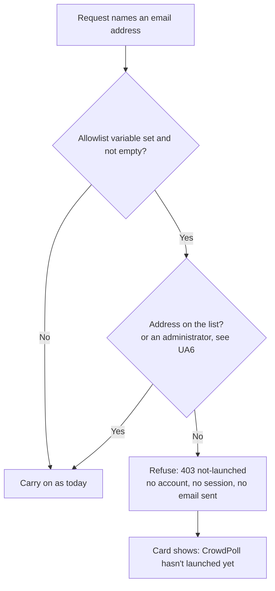
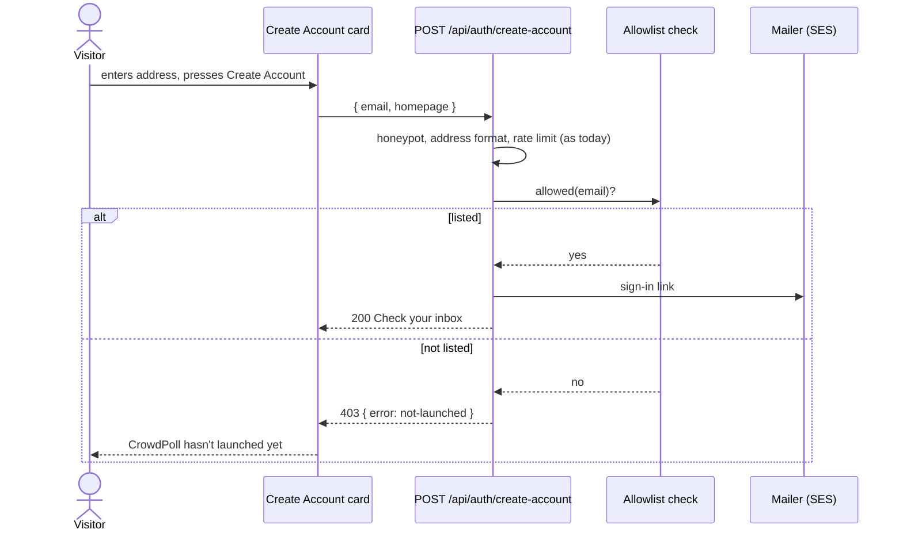
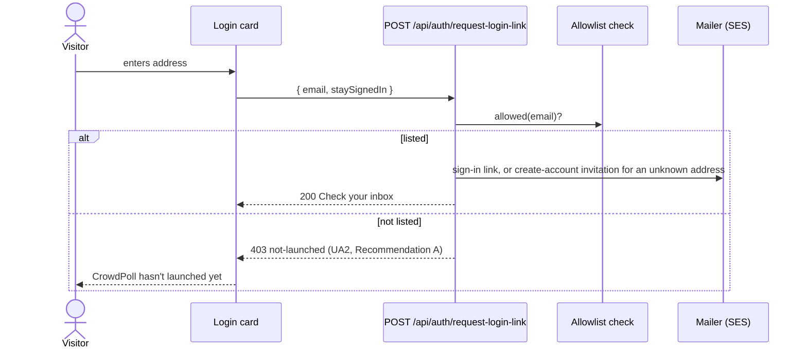
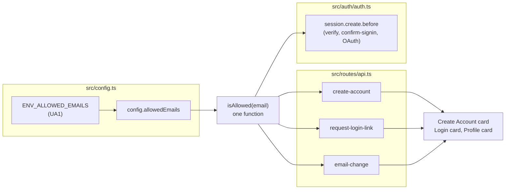

# High Level Requirements

Requirements: `requirements/20261021-143942-prelaunch-signup-allowlist/requirements.md`  
External Files: none  
Generated: 2026-10-21 2:39 PM  

The CrowdPoll webapp has been deployed to Production on DigitalOcean.  
However, it hasn't been launched to the public yet.  
We want to enable only specified email addresses to create an account and subsequently to login.  
This will be specified in an environment variable.  
If the variable exists, only the email addresses listed in it will be allowed to create an account and login.  
If the variable does not exist, any email address will be allowed.  
The environment variable will contain a comma-separated list of allowed email addresses. 

If anybody else clicks the Create Account button, they should be shown a message indicating that the web site has not been launched yet.

## Additional Requirements and Research Requests

**Instructions To The Developer**  
Enter any additional requirements or research requests under the ## Additional Requirements and Research Requests heading above.  
When you Type or Say: "Next" in the CC CLI terminal, the additional requirements and research requests will be applied to the report.  
  
You may leave these instructions here. They will be ignored when "Next" is executed.  

---

## 1. Overview and Scope

CrowdPoll runs in production but is not open to the public yet.  
This feature adds a **pre-launch allowlist**: an environment variable listing the email addresses that may create an account and sign in.  
- **Set** → only the listed addresses may create an account or sign in; anyone else is told the site has not launched yet.  
- **Not set** → today's behaviour, unchanged: any address may.  

In scope:  
- the allowlist setting, read at startup like every other `ENV_*` value;  
- the check on every path that creates an account or a session;  
- the "not launched yet" message in the browser.  

Out of scope (see the findings for the edges):  
- invitations, a waitlist or a sign-up form for the public;  
- changing the list without restarting the app (App Platform restarts it on any environment change);  
- anything a guest can already do without an account (see NC1).  

## 2. The Current Sign-Up and Sign-In Flows

Native mode (`ENV_SIGNIN_METHOD=native`, today's production setting) has three ways in, all in `src/routes/api.ts`:  
- **Create Account** (`POST /api/auth/create-account`, the Create Account card): a new address gets a pending account and a sign-in link;  
  an existing one, matched by its email key, just gets a sign-in link.  
  The response is always "Check your inbox", so the page never reveals whether an account exists.  
- **Login** (`POST /api/auth/request-login-link`, the Login card): a known address gets a sign-in link;  
  an unknown one gets a create-account invitation by email, again behind the same "Check your inbox".  
- **The sign-in link** (`GET /api/auth/verify`, or `POST /api/auth/confirm-signin` from another browser) consumes the token and creates the session.  
  BetterAuth's `session.create.before` hook in `src/auth/auth.ts` runs for every new session, native or OAuth.  

A signed-in user can also change their address (`POST /api/me/email-change`), and the OAuth phase (`ENV_SIGNIN_METHOD=oauth`) creates users and sessions through BetterAuth's social providers.  
The guest header's **Create Account To Vote** button (`app.js`) and the Login card's link lead to `/create-account`.  

## 3. Architecture Diagrams

### 3.1 The allowlist decision

### 3.2 Create Account while the allowlist is on

### 3.3 Login while the allowlist is on

### 3.4 Where the check sits

## 4. Assumptions

- The list is small (a handful of testers), so it is held in memory and checked without a database query.  
- Changing the list means changing the environment variable;  
  App Platform restarts the app when an environment variable changes, so no reload mechanism is needed.  
- The honeypot, rate limits and the email-key rule keep working as today, and run before the allowlist check, so a refused request still counts against the rate limit.  
- The variable is read the same way in development and production; tests leave it unset unless a test sets it.  
- When the site launches, the variable is removed and every behaviour returns to today's.  

## 5. Breaking Changes

All of these apply only while the variable is set; with it unset nothing changes.  
- **BC1.** An unlisted address no longer gets "Check your inbox" from Create Account (and, under UA2 Recommendation A, from Login);  
  it gets a "not launched" message instead, so the page reveals whether an address is on the list (not whether it has an account).  
- **BC2.** An existing account whose address is not listed can no longer sign in.  
- **BC3.** A signed-in user cannot change their address to an unlisted one (UA5).  
- **BC4.** Three endpoints gain a `403 not-launched` response, which `postman/openapi.json` must describe.  

## 6. Technical Debt

- **TD1.** The ways into an account are spread over `src/routes/api.ts` (644 lines) and the BetterAuth hooks in `src/auth/auth.ts`;  
  the check should be one function called from each, not a copy per route, or a later route will miss it.  
- **TD2.** Sessions are cached for `ENV_SESSION_CACHE_TTL` (5 minutes), so any rule that ends existing sessions (UA4 Recommendation B) takes effect up to 5 minutes late unless the cache entries are dropped too.  
- **TD3.** `launch.json.example` has an invalid line, `"ENV_OPENSEARCH_URL" = "http://localhost:9200",` (`=` for `:`), found while working on the production-email feature;  
  the new variable will be added beside it, so it is worth fixing at the same time.  

## 7. Findings

### 7.1 Inconsistencies

No inconsistencies were found: no requirement contradicts another.  

### 7.2 Ambiguities

**AM1. Which "Create Account button" shows the "not launched" message?**  
✅ Resolved  
✅ Requirements File Updated: 2026-10-21 2:58 PM  
**Notes**: Recommendation accepted in file 2026-10-21: Recommendation A, **the card's Create Account button: the message replaces "Check your inbox" after an unlisted address is submitted**;  
the requirements now say so under Decisions (which button (AM1)).  

The requirements say "if anybody else clicks the Create Account button" they see the message.  
There are two such buttons: the guest header's **Create Account To Vote**, which only opens `/create-account`, and the **Create Account** button on that page's card, which submits the address.  
Only the second knows who is asking.  

  - **Recommendation A** _(recommended)_: **the card's Create Account button: the message replaces "Check your inbox" after an unlisted address is submitted.**  

    ➡️ [x] **Accepted**  
    - <u>Pros</u>: listed testers still reach the form and create their accounts;  
      the message is shown only to the people it concerns.  
    - <u>Cons</u>: an unlisted visitor fills in the form before learning the site is closed.  

  - **Recommendation B**: **both: the Create Account page also says, above the form, that only invited testers can sign up for now.**  

    ➡️ [ ] **Accepted**  
    - <u>Pros</u>: visitors know before they type;  
      the refusal after submitting still applies.  
    - <u>Cons</u>: one more message to word, and `/api/config` must say whether the list is on (not who is on it).  

  - **Developer Resolution C**:  

    ➡️ [ ] **Accepted**  

**AM2. How is an address compared with the list?**  
✅ Resolved  
✅ Requirements File Updated: 2026-10-21 2:58 PM  
**Notes**: Recommendation accepted in file 2026-10-21: Recommendation A, **by email key: case, a `+tag`, and Gmail dots and `googlemail.com` are ignored, as for one-person-one-account**;  
the requirements now say so under Decisions (matching (AM2)).  

The requirements give a list of addresses but not how a typed address matches one.  
Since the production-email feature, CrowdPoll treats `j.smith+polls@googlemail.com` and `jsmith@gmail.com` as the same mailbox (`emailKey`, `src/auth/emailKey.ts`), and create-account sends an existing key's owner a sign-in link.  

  - **Recommendation A** _(recommended)_: **by email key: case, a `+tag`, and Gmail dots and `googlemail.com` are ignored, as for one-person-one-account.**  

    ➡️ [x] **Accepted**  
    - <u>Pros</u>: a tester who types their address differently from the list still gets in, since it is the same mailbox;  
      one rule for identity across the app.  
    - <u>Cons</u>: the key must be computed in TypeScript as well as SQL, and both must agree.  

  - **Recommendation B**: **exact match, ignoring case and surrounding spaces only.**  

    ➡️ [ ] **Accepted**  
    - <u>Pros</u>: simplest, and exactly what the list says.  
    - <u>Cons</u>: `John.Smith@gmail.com` on the list refuses `johnsmith@gmail.com`, the same inbox, which will look like a bug to a tester.  

  - **Developer Resolution C**:  

    ➡️ [ ] **Accepted**  

**AM3. "If the variable exists": what does a variable that is set but empty mean?**  
✅ Resolved  
✅ Requirements File Updated: 2026-10-21 2:58 PM  
**Notes**: Recommendation accepted in file 2026-10-21: Recommendation A, **empty means unset: everyone is allowed, and the startup log says so**;  
the requirements now say so under Decisions (empty value (AM3)).  

App Platform and the launch templates can hold a variable with an empty value.  
Everywhere else in `src/config.ts`, an empty value is treated as unset (`optionalVar`).  

  - **Recommendation A** _(recommended)_: **empty means unset: everyone is allowed, and the startup log says so.**  

    ➡️ [x] **Accepted**  
    - <u>Pros</u>: the same rule as every other setting;  
      the startup line (`[auth] Sign-up allowlist off` or `on, 4 addresses`) shows which applies.  
    - <u>Cons</u>: clearing the value by mistake opens the site.  

  - **Recommendation B**: **empty means nobody: the site is closed to every new account and sign-in.**  

    ➡️ [ ] **Accepted**  
    - <u>Pros</u>: fails closed.  
    - <u>Cons</u>: differs from every other setting, and also locks out the administrators unless UA6 exempts them.  

  - **Developer Resolution C**:  

    ➡️ [ ] **Accepted**  

### 7.3 Unspecified Aspects

**UA1. What is the variable called, and how is its value read?**  
✅ Resolved  
✅ Requirements File Updated: 2026-10-21 2:55 PM  
**Notes**: Recommendation accepted by "Accept all" 2026-10-21: Recommendation, **`ENV_ALLOWED_EMAILS`, comma-separated, each entry trimmed and lower-cased; an entry that is not a valid address stops the app at startup**;  
the requirements now say so under Decisions (the variable (UA1)).  

The requirements say "an environment variable" with "a comma-separated list".  

  - **Recommendation**: **`ENV_ALLOWED_EMAILS`, comma-separated, each entry trimmed and lower-cased; an entry that is not a valid address stops the app at startup.**  

    ➡️ [X] **Accepted**  
    - It follows `ENV_ADMINS`, which is read the same way.  
    - A typo in the list fails loudly at deployment rather than silently refusing a tester.  
    - The startup log gives the number of addresses, never the addresses.  
    - It is documented in `CLAUDE.md`, `README.md` and the launch templates (left unset there).  

  - **Developer Resolution B**:  

    ➡️ [ ] **Accepted**  

**UA2. What does an unlisted address get on the Login page?**  
✅ Resolved  
✅ Requirements File Updated: 2026-10-21 2:58 PM  
**Notes**: Recommendation accepted in file 2026-10-21: Recommendation A, **the same "not launched" message, and no email is sent**;  
the requirements now say so under Decisions (login page (UA2)).  

The requirements say unlisted addresses may not log in, but give a message only for Create Account.  
Today an unknown address on the Login card gets "Check your inbox" and a create-account invitation by email.  

  - **Recommendation A** _(recommended)_: **the same "not launched" message, and no email is sent.**  

    ➡️ [x] **Accepted**  
    - <u>Pros</u>: one message for both ways in;  
      no invitation is mailed for an account that could not be created.  
    - <u>Cons</u>: the page reveals whether an address is on the list (BC1).  

  - **Recommendation B**: **"Check your inbox" as today, but nothing is sent.**  

    ➡️ [ ] **Accepted**  
    - <u>Pros</u>: reveals nothing.  
    - <u>Cons</u>: an unlisted visitor waits for an email that never comes, and the two pages behave differently.  

  - **Developer Resolution C**:  

    ➡️ [ ] **Accepted**  

**UA3. Where is the check enforced?**  
✅ Resolved  
✅ Requirements File Updated: 2026-10-21 2:55 PM  
**Notes**: Recommendation accepted by "Accept all" 2026-10-21: Recommendation, **on the server, in one function (`isAllowed`) called by create-account, request-login-link, email-change and BetterAuth's `session.create.before` hook**;  
the requirements now say so under Decisions (enforcement (UA3)).  

The requirements say who is allowed, not where the rule is applied.  
A check only in the browser can be bypassed, and a check only on Create Account leaves Login, the sign-in link, email change and the OAuth phase open.  

  - **Recommendation**: **on the server, in one function (`isAllowed`) called by create-account, request-login-link, email-change and BetterAuth's `session.create.before` hook.**  

    ➡️ [X] **Accepted**  
    - The session hook runs for every new session, so the sign-in link, the confirm-signin page and the OAuth phase are covered without separate checks (UA7).  
    - The routes check first so that a refusal sends no email and creates no pending account.  
    - The browser only shows the message the API returns.  

  - **Developer Resolution B**:  

    ➡️ [ ] **Accepted**  

**UA4. What happens to accounts and sessions that already exist for unlisted addresses?**  
✅ Resolved  
✅ Requirements File Updated: 2026-10-21 2:58 PM  
**Notes**: Recommendation accepted in file 2026-10-21: Recommendation A, **new sign-ins are refused; a session that already exists runs until it ends or the user signs out**;  
the requirements now say so under Decisions (existing accounts and sessions (UA4)).  

Production is deployed, so accounts may already exist, for example from testing.  
The requirements say unlisted addresses may not log in; they do not say whether someone already signed in is signed out.  

  - **Recommendation A** _(recommended)_: **new sign-ins are refused; a session that already exists runs until it ends or the user signs out.**  

    ➡️ [x] **Accepted**  
    - <u>Pros</u>: only the sign-in paths change;  
      the accounts are kept, so they work again at launch.  
    - <u>Cons</u>: a session that started before the list was set lasts up to 30 days (`ENV_SIGNIN_COOKIE_DURATION_MAX`).  

  - **Recommendation B**: **existing sessions of unlisted users also end, at their next request.**  

    ➡️ [ ] **Accepted**  
    - <u>Pros</u>: the list takes effect at once for everyone.  
    - <u>Cons</u>: a check on every session lookup, and up to 5 minutes' lag from the session cache (TD2).  

  - **Developer Resolution C**:  

    ➡️ [ ] **Accepted**  

**UA5. Can a signed-in user change their address to an unlisted one?**  
✅ Resolved  
✅ Requirements File Updated: 2026-10-21 2:55 PM  
**Notes**: Recommendation accepted by "Accept all" 2026-10-21: Recommendation, **no: an unlisted new address gets the same "not launched" refusal, and no verification email is sent**;  
the requirements now say so under Decisions (email change (UA5)).  

The Profile card's email change (`POST /api/me/email-change`) lets a signed-in user move the account to another address.  
Without a check, a listed tester could move their account to any address.  

  - **Recommendation**: **no: an unlisted new address gets the same "not launched" refusal, and no verification email is sent.**  

    ➡️ [X] **Accepted**  
    - It keeps the rule "only listed addresses have accounts" true.  
    - The Profile card shows the message where it shows other email-change errors.  

  - **Developer Resolution B**:  

    ➡️ [ ] **Accepted**  

**UA6. Are the administrators (`ENV_ADMINS`) allowed without being listed?**  
✅ Resolved  
✅ Requirements File Updated: 2026-10-21 2:58 PM  
**Notes**: Recommendation accepted in file 2026-10-21: Recommendation A, **yes: an address in `ENV_ADMINS` is always allowed**;  
the requirements now say so under Decisions (administrators (UA6)).  

The requirements name one list.  
`ENV_ADMINS` already names the administrators, and an administrator left off the new list would be locked out of the admin pages.  

  - **Recommendation A** _(recommended)_: **yes: an address in `ENV_ADMINS` is always allowed.**  

    ➡️ [x] **Accepted**  
    - <u>Pros</u>: the administrators can never be locked out by the new list.  
    - <u>Cons</u>: the full set of allowed addresses is spread over two variables.  

  - **Recommendation B**: **no: only the new list counts; administrators must be listed too.**  

    ➡️ [ ] **Accepted**  
    - <u>Pros</u>: one list says who can get in.  
    - <u>Cons</u>: forgetting an administrator locks them out until the variable is fixed.  

  - **Developer Resolution C**:  

    ➡️ [ ] **Accepted**  

**UA7. Does the list apply in the OAuth phase too?**  
✅ Resolved  
✅ Requirements File Updated: 2026-10-21 2:55 PM  
**Notes**: Recommendation accepted by "Accept all" 2026-10-21: Recommendation, **yes: the session hook refuses a new session for an unlisted address in either mode**;  
the requirements now say so under Decisions (OAuth phase (UA7)).  

The requirements describe the native flow (Create Account, login).  
`ENV_SIGNIN_METHOD=oauth` signs users in through providers, without these pages.  

  - **Recommendation**: **yes: the session hook refuses a new session for an unlisted address in either mode.**  

    ➡️ [X] **Accepted**  
    - It comes free with UA3's session-hook check.  
    - In the OAuth phase the refusal lands on BetterAuth's error redirect, which the login page shows as the "not launched" message.  

  - **Developer Resolution B**:  

    ➡️ [ ] **Accepted**  

**UA8. What exactly does the message say, and how does the API return it?**  
✅ Resolved  
✅ Requirements File Updated: 2026-10-21 2:55 PM  
**Notes**: Recommendation accepted by "Accept all" 2026-10-21: Recommendation, **`403 { "error": "not-launched", "message": "CrowdPoll hasn't launched yet. For now, accounts are open to invited testers only." }`, shown in the card's status area**;  
the requirements now say so under Decisions (the message (UA8)).  

The requirements ask for "a message indicating that the web site has not been launched yet", without wording.  

  - **Recommendation**: **`403 { "error": "not-launched", "message": "CrowdPoll hasn't launched yet. For now, accounts are open to invited testers only." }`, shown in the card's status area.**  

    ➡️ [X] **Accepted**  
    - A stable `error` code lets the cards and the tests recognise it;  
      the `message` is shown as written.  
    - `postman/openapi.json` gains the response on the three endpoints (BC4).  
    - The wording is a draft for the developer to approve or replace.  

  - **Developer Resolution B**:  

    ➡️ [ ] **Accepted**  

### 7.4 Needs Clarification

**NC1. Should guests still see the site before launch?**  
✅ Resolved  
✅ Requirements File Updated: 2026-10-21 2:58 PM  
**Notes**: Recommendation accepted in file 2026-10-21: Recommendation A, **yes: the allowlist limits accounts and sign-ins only; what a guest sees is unchanged**;  
the requirements now say so under Decisions (guests (NC1)).  

The requirements restrict accounts only.  
Today a guest can open the home page and browse public polls without an account.  

  - **Recommendation A** _(recommended)_: **yes: the allowlist limits accounts and sign-ins only; what a guest sees is unchanged.**  

    ➡️ [x] **Accepted**  
    - <u>Pros</u>: exactly what the requirements ask;  
      a small, contained change.  
    - <u>Cons</u>: the public can see the site, and the polls testers make public, before launch.  

  - **Recommendation B**: **no: while the list is set, guests see a "coming soon" page instead of the site.**  

    ➡️ [ ] **Accepted**  
    - <u>Pros</u>: nothing is visible before launch.  
    - <u>Cons</u>: a larger feature: every page and the public data routes (TRENDING, Newest, search) need a guard, and the login page must stay reachable.  

  - **Developer Resolution C**:  

    ➡️ [ ] **Accepted**  

**NC2. Where is the production list kept?**  
✅ Resolved  
✅ Requirements File Updated: 2026-10-21 2:55 PM  
**Notes**: Recommendation accepted by "Accept all" 2026-10-21: Recommendation, **as an encrypted App Platform variable (`type: SECRET`), set in the DigitalOcean console; the repository holds only the key**;  
the requirements now say so under Decisions (keeping the list private (NC2)).  

The list holds testers' personal email addresses.  
`.do/app.yaml` is committed to the repository, and most settings are written there in plain text.  

  - **Recommendation**: **as an encrypted App Platform variable (`type: SECRET`), set in the DigitalOcean console; the repository holds only the key.**  

    ➡️ [X] **Accepted**  
    - The addresses never enter git history.  
    - It is how `ENV_SES_ACCESS_KEY_ID` and `ENV_SES_SECRET_ACCESS_KEY` are already kept.  
    - Removing the variable at launch is a console change and a restart, with no code change.  

  - **Developer Resolution B**:  

    ➡️ [ ] **Accepted**  

## 8. Requirements Report Complete Report  

- **Requirements Report Document:** requirements/20261021-143942-prelaunch-signup-allowlist/requirements-report.md  
- **Requirements Document:** requirements/20261021-143942-prelaunch-signup-allowlist/requirements.md  
- **Software Architecture Diagrams:** 4  
- **Inconsistencies:** 0  
- **Ambiguities:** 3  
- **Unspecified Aspects:** 8  
- **Needs Clarifications:** 2  
- **Research Results:** 0  
- **Breaking Changes:** 4  
- **Technical Debt items:** 3  

The requirements are ready for /speckit-specify.  
To generate specs from the requirements document, use the `/speckit-specify` skill followed by the path (relative to the project root) to the requirements file.  
At the prompt, Type:  
🟩 👉 /speckit-specify requirements/20261021-143942-prelaunch-signup-allowlist/requirements.md  
