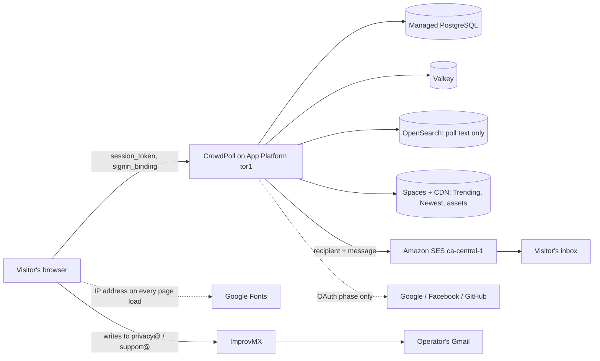
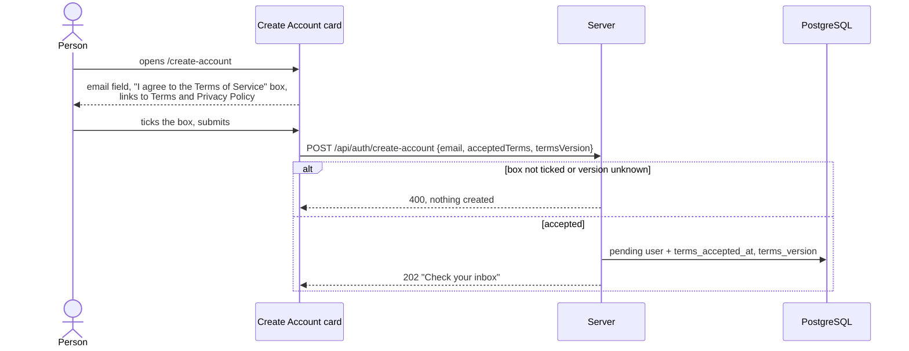
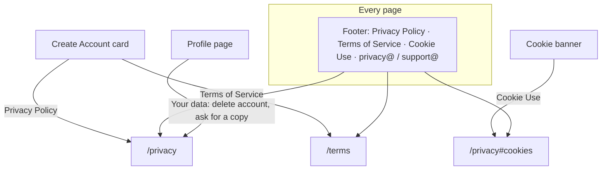

# High Level Requirements

Requirements: `requirements/20261021-204537-privacy-and-terms/requirements.md`  
External Files: none  
Generated: 2026-10-21 8:45 PM  

Please draft a privacy policy that reflects the following: 
- the one cookie policy 
- the use of emails only to verify the users identity and manage authentication sessions
- no tracking of users
- no sharing of user data with third parties

Also recommend how to implement these principles in the webapp's design to make available to users clear information about privacy practices and control over their data.

We probably also need to provide a user with the ability to delete their account and all associated data.  
Additionally, we should ensure that any data retention policies are clearly communicated to users, specifying how long their data will be kept and under what circumstances it will be deleted.  

It should mention that, in the future, there may be Poll update notification emails that they can opt-in to.

Somewhat related to this, there should be a contact method for users to reach out with privacy concerns or questions, such as a dedicated email address or a contact form on the website. 
The address for privacy concerns should be clearly provided, such as `privacy@crowdpoll.vote`.
Other questions should be directed to `support@crowdpoll.vote` or a contact form on the website.

We also need a "Terms of Service" that the users must agree to before creating an account, outlining the rules, responsibilities, and limitations of both the users and the service provider.

The Privacy Policy link and Terms of Service link should be available on the Create Account page.

The footer of the website should also include links to the Privacy Policy and Terms of Service and Cookie Use, ensuring that users can access this information from any page.

## Additional Requirements and Research Requests

**Instructions To The Developer**  
Enter any additional requirements or research requests under the ## Additional Requirements and Research Requests heading above.  
When you Type or Say: "Next" in the CC CLI terminal, the additional requirements and research requests will be applied to the report.  
  
You may leave these instructions here. They will be ignored when "Next" is executed.  

---

## 1. Overview and Scope

CrowdPoll is about to open to the public (the pre-launch allowlist, feature 20261021-143942, holds it closed until then).  
Before it opens, people need to be told plainly what the site keeps about them, and to agree to the rules of using it.  
This feature adds:  
- a **Privacy Policy** page: the cookies, what the email address is used for, no tracking, no selling or sharing of data, how long data is kept, the rights people have, and where to write (`privacy@crowdpoll.vote`);  
- a **Terms of Service** page, which a person agrees to before an account is created;  
- a **Cookie Use** notice, linked from the cookie banner and the footer;  
- a **site footer** on every page, linking the three;  
- **account deletion** from the Profile page, removing the account and the data tied to it;  
- a mention that opt-in poll update emails may come later (nothing is built for them now).  

The requirements also ask for recommendations on presenting this in the design; they are in *Research Results* (RS1).  

Out of scope:  
- the opt-in notification emails themselves;  
- analytics, consent management or any new cookie (the cookie policy stays "strictly necessary only");  
- legal advice: the drafts are a starting point that a lawyer should review before launch (NC4).  

## 2. What CrowdPoll Holds Today

The policy must describe what the code actually does, so this is the inventory it is written against (from `src/db/schema.ts`, `src/auth/auth.ts`, `src/routes/api.ts`, `src/public/app.js` and the page heads).  

| Data | Where | Why | Kept for (today) |
|---|---|---|---|
| Email address, user name, avatar, permissions, created date | `user` table | sign-in, display, admin rights | until the account is deleted (no deletion exists yet) |
| Session: token, expiry, **IP address, user agent** | `session` table (BetterAuth fills both) | keeps you signed in | up to `ENV_SIGNIN_COOKIE_DURATION_MAX` (30 days); expired rows are not swept |
| Sign-in and email-change links (hashed tokens) | `verification`, `email_change_requests` | one-time links | 15 minutes, then useless; rows are not swept |
| Rate-limit counters keyed by **IP address** | `rateLimit` table, in-process / Valkey floors | stops email abuse and request floods | the window (15 minutes); rows linger |
| Votes: email, user name, choices, time | `votes`, `vote_history` (monthly partitions) | counting, changing a vote, Participants list | for the life of the poll; history has no limit |
| Invitations and bans, by email | `poll_invitations`, `poll_bans` | private polls, moderation | for the life of the poll |
| Bookmarks and linked polls, by email | `bookmarks`, `user_polls` | Favorites, Shared With You | bookmarks: 6 months after the poll closes (`ENV_BOOKMARK_EXPIRY_MONTHS`) |
| Polls you create (with your name) | `polls` | the polls themselves | indefinitely |
| Server log lines | App Platform runtime logs | operations | masked addresses (`j•••@gmail.com`); **full IP** on the rate-limit lines (`api.ts` lines 194, 243) |
| Cookies | browser | `session_token` (≤ 30 days), `signin_binding` (15 minutes, `Path=/api/auth`) | as stated |
| Browser storage (not cookies) | `localStorage`: `cookieBannerAcknowledged`, the sign-in fallback key; `sessionStorage`: Trending/Newest copies, the admin tab | remembering the banner, cross-tab sign-out, fast reloads | until cleared / the tab closes |

Services that receive personal data on CrowdPoll's behalf:  
- **DigitalOcean** (App Platform, Managed PostgreSQL, Valkey, OpenSearch, Spaces + CDN), region `tor1` (Toronto);  
- **Amazon SES**, `ca-central-1`: every email's recipient address and content;  
- **ImprovMX** and **Gmail**: mail written to `support@`, `postmaster@` (and `privacy@`, once added) is forwarded to a Gmail inbox;  
- **Google Fonts**: every page loads its stylesheet and fonts from `fonts.googleapis.com` / `fonts.gstatic.com`, which sends each visitor's IP address to Google (RS3);  
- in the OAuth phase, **Google, Facebook and GitHub** supply the identity.  

## 3. Architecture Diagrams

### 3.1 Where personal data goes



The dotted Google Fonts edge is the one flow that is not needed to run the service (RS3, IN2).  

### 3.2 Creating an account with the Terms of Service



### 3.3 Deleting an account

```mermaid
sequenceDiagram
  actor U as Signed-in user
  participant PR as Profile page
  participant S as Server
  participant DB as PostgreSQL
  U->>PR: Delete Account
  PR-->>U: what will be removed and kept; type DELETE to confirm
  U->>PR: confirms
  PR->>S: DELETE /api/me
  S->>DB: one transaction: sessions, bookmarks, links, own polls,<br/>votes on others' polls (UA1), user row
  S->>S: drop session-cache entries, enqueue search-index removals
  S-->>PR: 200, session cookie cleared
  S-)U: "Your account was deleted" email
  PR-->>U: home page as a guest
```

### 3.4 Where the links appear



## 4. Assumptions

- The audience is mainly Canadian (DigitalOcean `tor1`, SES `ca-central-1`), so PIPEDA applies; the site is open worldwide, so the policy is written to also meet GDPR Article 13 and Article 12, which costs little extra (RS2).  
- The pages are static, the same for guests and signed-in users, and need no session.  
- "Cookie Use" also covers browser storage, because the ePrivacy rules treat `localStorage` like cookies; every item used today is strictly necessary or purely functional, so the banner stays informational.  
- Admins (`ENV_ADMINS`) and allowlisted testers are users like any other for deletion.  
- The policies are in English only.  

## 5. Breaking Changes

- **Create account requires agreement**: `POST /api/auth/create-account` refuses a request without the Terms acceptance (`400`); `postman/openapi.json` and any script that calls it change.  
- **One additive migration**: `terms_version` and `terms_accepted_at` on `user` (UA4).  
- **Deleting an account changes other people's polls** to the extent UA1 decides (their votes disappear or become anonymous).  
- **Sessions no longer store IP address and user agent**, if IN2 Recommendation A is accepted; nothing in the code reads them today.  
- **Fonts are served by CrowdPoll**, if RS3 Recommendation A is accepted: the eight page heads change, and `m3-assets.test.ts` checks may need the new font files.  

## 6. Technical Debt

- No sweep removes expired `session`, `verification`, `email_change_requests` or `rateLimit` rows, so "kept for 30 days" is not true of the database today (UA3).  
- `vote_history` grows without limit; a retention period for it is a new sweep that drops old monthly partitions (UA3).  
- Votes, invitations, bans, bookmarks and `user_polls` are keyed by **email**, not user id, so deletion (and anonymizing) must touch five tables by address, by email key where it applies.  
- The rate-limit log lines print the full client IP, unlike every other log line, which masks the address.  
- The Google Fonts `<link>` tags are copied into all eight HTML pages.  
- The cookie banner's text lives in `app.js`; the Cookie Use page will repeat it, so the two can drift unless the banner links to the page instead of restating it.  

## 7. Research Results

### 7.1 Presenting privacy information and controls

**RS1. How should the webapp present its privacy practices and give people control over their data?**  
<span style="font-size:large">✅ Resolved</span>  
✅ Requirements File Updated: 2026-10-21 9:01 PM  
**Notes**: Recommendation accepted by "Accept all" 2026-10-21: **Recommendation**, **a layered approach in five places**;  
  Decision (RS1) in the requirements lists the five places: the policy page, Create Account and Login, the cookie banner, the Profile page and the footer.  

The requirements ask for recommendations on how to build these principles into the design.  
Sources: [GDPR Article 12 — transparent information](https://gdpr-text.com/en/read/article-12/), [GDPR Article 13 — information at collection](https://gdpr-text.com/en/read/article-13/), [OPC — PIPEDA Principle 8, Openness](https://priv.gc.ca/en/privacy-topics/privacy-laws-in-canada/the-personal-information-protection-and-electronic-documents-act-pipeda/p_principle/principles/p_openness/).  
Both laws want the information concise, in plain language, easy to reach, and given **when the data is collected**, not only on a page somewhere.  
Common practice is a *layered* notice: a short summary first, the full text below it, and the same links at each point where data is collected.  

  - **Recommendation**: **a layered approach in five places.**  

    ➡️ [X] **Accepted**  
    - **The Privacy Policy page** opens with a short "In short" list (one cookie to keep you signed in, your email is used to sign you in and identify your votes, no tracking or ads, nothing sold or shared, delete your account at any time), then the full sections, each with an anchor (`#cookies`, `#retention`, `#rights`, `#contact`).  
    - **At collection**: the Create Account card carries the Terms box and both links; the Login card carries a one-line "By signing in you agree to the Terms and Privacy Policy" link line.  
    - **The cookie banner** keeps its sentence and adds a "Cookie Use" link to `/privacy#cookies`.  
    - **The Profile page** gains a "Your Data" section: Delete Account (UA2), how to ask for a copy (UA8), and a link to the policy.  
    - **The footer** on every page links the three documents and the two addresses.  

  - **Developer Resolution B**:  

    ➡️ [ ] **Accepted**  

### 7.2 What the Privacy Policy must contain

**RS2. What must the Privacy Policy say to meet PIPEDA and GDPR?**  
<span style="font-size:large">✅ Resolved</span>  
✅ Requirements File Updated: 2026-10-21 9:01 PM  
**Notes**: Recommendation accepted by "Accept all" 2026-10-21: **Recommendation**, **write the policy with these sections**;  
  Decision (RS2) in the requirements lists the ten sections.  

The requirements list four principles; the laws require more items than those.  
Sources: [GDPR Article 13](https://gdpr-text.com/en/read/article-13/), [OPC — the 10 fair information principles](https://www.priv.gc.ca/leg_c/p_principle_e.asp).  
Article 13's list is closed: who the controller is and how to reach them, the purposes and legal basis, the recipients, transfers outside the country, how long data is kept, the person's rights (access, correction, deletion, objection, complaint to a regulator), and whether giving the data is required.  
PIPEDA's Openness and Individual Access principles add: who is accountable, how to get access, and how to complain.  

  - **Recommendation**: **write the policy with these sections**, so it covers both laws.  

    ➡️ [X] **Accepted**  
    1. Who we are and how to reach us (NC1, `privacy@crowdpoll.vote`).  
    2. What we collect and why (section 2 of this report, in plain words).  
    3. The legal basis: providing the service you asked for (contract) and keeping it secure (legitimate interest).  
    4. Cookies and browser storage (IN3).  
    5. Who processes data for us, and where: DigitalOcean (Canada), Amazon SES (Canada), ImprovMX and Google (USA) for mail you send us; no selling, no advertising (IN1).  
    6. How long we keep it (UA3).  
    7. Your rights and how to use them, including deletion (UA1) and a copy (UA8), and the right to complain to the Office of the Privacy Commissioner of Canada or your local authority.  
    8. Children (NC2).  
    9. Future poll update emails: opt-in only, off unless you turn them on (UA9).  
    10. Changes to this policy and its "Last updated" date (UA5).  

  - **Developer Resolution B**:  

    ➡️ [ ] **Accepted**  

### 7.3 Google Fonts

**RS3. Do the Google Fonts links conflict with "no tracking" and "no sharing with third parties"?**  
<span style="font-size:large">✅ Resolved</span>  
✅ Requirements File Updated: 2026-10-21 9:10 PM  
**Notes**: Recommendation accepted in file 2026-10-21: **Recommendation A**, **serve the three font families from CrowdPoll itself**;  
  Decision (RS3) in the requirements records it.  

Every page head loads `https://fonts.googleapis.com/css2?family=Fraunces…Inter…Roboto` and preconnects to `fonts.gstatic.com`.  
Sources: [LG München I, 3 O 17493/20, 20 January 2022 (summary, activeMind.legal)](https://www.activemind.legal/guides/ruling-google-fonts/), [The Hacker News report](https://thehackernews.com/2022/01/german-court-rules-websites-embedding.html).  
The browser sends each visitor's IP address to Google before the page has loaded; a Munich court held that this is a transfer of personal data without a legal basis, because the fonts can be served from the site itself at no cost.  
The ruling binds only that case, but it is widely followed in Europe, and it contradicts the policy's "no sharing" sentence in any country.  

  - **Recommendation A** _(recommended)_: **serve the three font families from CrowdPoll itself.**  

    ➡️ [x] **Accepted**  
    - <u>Pros</u>: no third party sees a visitor; the policy can truthfully say nothing is shared; the files go through the existing fingerprinting and Spaces publishing.  
    - <u>Cons</u>: about 10–12 `woff2` files (the weights in use, Latin subset) to add, and an `@font-face` sheet; the eight page heads change.  

  - **Recommendation B**: **keep Google Fonts and name Google in the policy as a service the browser contacts.**  

    ➡️ [ ] **Accepted**  
    - <u>Pros</u>: no code change.  
    - <u>Cons</u>: "no sharing with third parties" is no longer true as written; European visitors' IP addresses go to Google without consent.  

  - **Developer Resolution C**:  

    ➡️ [ ] **Accepted**  

## 8. Findings

### 8.1 Inconsistencies

**IN1. "No sharing of user data with third parties" cannot be true of the services the site runs on.**  
<span style="font-size:large">✅ Resolved</span>  
✅ Requirements File Updated: 2026-10-21 9:01 PM  
**Notes**: Recommendation accepted by "Accept all" 2026-10-21: **Recommendation**, **"we never sell your data or share it for anyone else's purposes", naming the service providers**;  
  Decision (IN1) in the requirements records it.  

The requirements say no data is shared with third parties.  
The site cannot run without DigitalOcean (hosting and databases) and Amazon SES (the sign-in emails), and mail written to `privacy@` goes through ImprovMX to Gmail.  
These are processors acting for CrowdPoll, which both laws allow, but a flat "no sharing" would be untrue.  

  - **Recommendation**: **say "we never sell your data or share it for anyone else's purposes", and name the service providers that process it for us.**  

    ➡️ [X] **Accepted**  
    The policy lists DigitalOcean, Amazon SES, ImprovMX and Google (Gmail), each with what it receives and where it is, and says no advertiser, data broker or analytics company receives anything.  
    In the OAuth phase the sign-in providers are added.  
    Google Fonts is handled by RS3.  

  - **Developer Resolution B**:  

    ➡️ [ ] **Accepted**  

**IN2. "No tracking of users" while sessions store the IP address and user agent, and some logs print the full IP.**  
<span style="font-size:large">✅ Resolved</span>  
✅ Requirements File Updated: 2026-10-21 9:10 PM  
**Notes**: Recommendation accepted in file 2026-10-21: **Recommendation A**, **keep IP addresses only where security needs them, and say so**;  
  Decision (IN2) in the requirements records the session, log and rate-limit changes and the policy's definition of "no tracking".  

BetterAuth writes `ipAddress` and `userAgent` on every `session` row; nothing in CrowdPoll reads them.  
The create-account and login rate-limit lines log `client <full IP>` (`src/routes/api.ts` lines 194 and 243), and rate limits are keyed by IP.  
None of this is tracking in the advertising sense, but the policy has to either remove it or describe it.  

  - **Recommendation A** _(recommended)_: **keep IP addresses only where security needs them, and say so.**  

    ➡️ [x] **Accepted**  
    - <u>Pros</u>: stop storing IP address and user agent on sessions (empty them in `session.create.before`, and clear existing rows in the migration); mask the IP in the two log lines; rate-limit keys keep the IP for their 15-minute window only.  
      The policy defines "no tracking" as: no analytics, no advertising, no profiling, nothing that follows you to other sites; IP addresses are used briefly to stop abuse.  
    - <u>Cons</u>: a small code change, and a session can no longer be shown as "signed in from Toronto, Firefox" (no such feature exists).  

  - **Recommendation B**: **keep everything as it is and describe it in the policy.**  

    ➡️ [ ] **Accepted**  
    - <u>Pros</u>: no code change.  
    - <u>Cons</u>: CrowdPoll keeps data it never uses, for up to 30 days per session, which is harder to defend under "limit collection".  

  - **Developer Resolution C**:  

    ➡️ [ ] **Accepted**  

**IN3. "The one cookie policy" while the site sets two cookies and uses browser storage.**  
<span style="font-size:large">✅ Resolved</span>  
✅ Requirements File Updated: 2026-10-21 9:01 PM  
**Notes**: Recommendation accepted by "Accept all" 2026-10-21: **Recommendation**, **the Cookie Use section names both cookies and every storage item**;  
  Decision (IN3) in the requirements records it, with the test that keeps the list in step.  

Since the production-email feature, the site sets `session_token` and the 15-minute `signin_binding`, and the banner already says so.  
It also keeps a few items in `localStorage` and `sessionStorage` (section 2), which the ePrivacy rules treat like cookies.  

  - **Recommendation**: **the Cookie Use section names both cookies and every storage item, with purpose and lifetime, and calls them all strictly necessary or functional.**  

    ➡️ [X] **Accepted**  
    "The one cookie policy" is read as the project's rule "only strictly necessary cookies, no consent needed" (CLAUDE.md), not as a count of one.  
    A test checks that the list on the page matches the cookies the server sets, so the two cannot drift.  

  - **Developer Resolution B**:  

    ➡️ [ ] **Accepted**  

### 8.2 Ambiguities

**AM1. "Emails are used only to verify identity and manage sessions" — the address also identifies people on polls.**  
<span style="font-size:large">✅ Resolved</span>  
✅ Requirements File Updated: 2026-10-21 9:01 PM  
**Notes**: Recommendation accepted by "Accept all" 2026-10-21: **Recommendation**, **the address signs you in, sends the emails you ask for and identifies you on polls; never marketing**;  
  Decision (AM1) in the requirements records it, including invitees' addresses.  

The email address is also how CrowdPoll records votes, invitations to private polls, bans, bookmarks and admin rights, and admins see `Created By: <name> (<email>)` on poll cards.  
Poll creators also type **other people's** addresses into invitation lists, so CrowdPoll holds addresses of people who may never have signed up.  

  - **Recommendation**: **say the address is used to sign you in, to send you the emails you ask for, and to identify you on the polls you create, are invited to or vote in; never for marketing, and never shown to other users.**  

    ➡️ [X] **Accepted**  
    The policy adds that a poll's creator may enter your address to invite you, that only the creator and site admins see it, and that you can ask for it to be removed.  
    The exception "admins see it" is stated, not hidden.  

  - **Developer Resolution B**:  

    ➡️ [ ] **Accepted**  

**AM2. Is "Cookie Use" its own page or part of the Privacy Policy?**  
<span style="font-size:large">✅ Resolved</span>  
✅ Requirements File Updated: 2026-10-21 9:10 PM  
**Notes**: Recommendation accepted in file 2026-10-21: **Recommendation A**, **a section of the Privacy Policy, linked as `/privacy#cookies`**;  
  Decision (AM2) in the requirements records it.  

The footer is to link Privacy Policy, Terms of Service and Cookie Use.  

  - **Recommendation A** _(recommended)_: **a section of the Privacy Policy, linked as `/privacy#cookies`.**  

    ➡️ [x] **Accepted**  
    - <u>Pros</u>: one document to keep current; the cookie text is short (two cookies, a few storage items).  
    - <u>Cons</u>: the footer has three links to two pages.  

  - **Recommendation B**: **a separate `/cookies` page.**  

    ➡️ [ ] **Accepted**  
    - <u>Pros</u>: matches the three links one to one.  
    - <u>Cons</u>: a third page, served, styled and kept in step with the policy.  

  - **Developer Resolution C**:  

    ➡️ [ ] **Accepted**  

**AM3. What is "the footer of the website", when no page has one?**  
<span style="font-size:large">✅ Resolved</span>  
✅ Requirements File Updated: 2026-10-21 9:01 PM  
**Notes**: Recommendation accepted by "Accept all" 2026-10-21: **Recommendation**, **one small static footer on every page, below the content**;  
  Decision (AM3) in the requirements records its contents and placement.  

No page has a `<footer>` today.  
The home page grows as cards load, has a fixed header and tab bar, the guest floating buttons and the cookie banner at the bottom, and the admin pages are separate.  

  - **Recommendation**: **one small static footer, rendered by `app.js` at the end of `<body>` on every page that loads it (all eight, plus the two new ones), below the content and never fixed.**  

    ➡️ [X] **Accepted**  
    It holds: Privacy Policy · Terms of Service · Cookie Use · `privacy@crowdpoll.vote` · `support@crowdpoll.vote` · © year CrowdPoll.  
    It uses the Material 3 tokens in a new layer sheet, rides above the cookie banner's offset like the Back to Top button, and wraps to two lines on a phone.  

  - **Developer Resolution B**:  

    ➡️ [ ] **Accepted**  

**AM4. How does a person "agree" to the Terms of Service?**  
<span style="font-size:large">✅ Resolved</span>  
✅ Requirements File Updated: 2026-10-21 9:10 PM  
**Notes**: Recommendation accepted in file 2026-10-21: **Recommendation A**, **an unticked "I agree" box; Create Account disabled until ticked, and checked by the server**;  
  Decision (AM4) in the requirements records it, with the OAuth-mode box on the Login card.  

The requirements say users must agree before an account is created, but not how.  
In the OAuth phase there is no Create Account card; the first social sign-in creates the account.  

  - **Recommendation A** _(recommended)_: **an unticked "I agree to the Terms of Service and have read the Privacy Policy" box; Create Account stays disabled until it is ticked, and the server checks it too.**  

    ➡️ [x] **Accepted**  
    - <u>Pros</u>: an explicit, recorded act, the strongest form of agreement (clickwrap); in OAuth mode the Login card shows the same box above the provider buttons.  
    - <u>Cons</u>: one more click.  

  - **Recommendation B**: **a sentence under the button: "By creating an account you agree to the Terms of Service and Privacy Policy."**  

    ➡️ [ ] **Accepted**  
    - <u>Pros</u>: no extra control.  
    - <u>Cons</u>: weaker evidence of agreement; easy to miss.  

  - **Developer Resolution C**:  

    ➡️ [ ] **Accepted**  

### 8.3 Unspecified Aspects

**UA1. What does deleting an account remove, and what happens to other people's polls?**  
<span style="font-size:large">✅ Resolved</span>  
✅ Requirements File Updated: 2026-10-21 9:10 PM  
**Notes**: Recommendation accepted in file 2026-10-21: **Recommendation A**, **delete everything that is theirs; anonymize what belongs to others**;  
  Decision (UA1) in the requirements lists what is deleted, anonymized and kept.  

"Delete their account and all associated data" leaves open what "associated" means when the data is shared.  
A user's votes are part of other people's results, including closed polls whose results were exported; the polls they created hold other people's votes.  

  - **Recommendation A** _(recommended)_: **delete everything that is theirs; anonymize what belongs to others.**  

    ➡️ [x] **Accepted**  
    - <u>Pros</u>: deleted: the user row, sessions, links, bookmarks, `user_polls`, the polls they created (with their votes and search entries), invitations naming their address.  
      Anonymized: their votes on other people's polls (address and name replaced by a random placeholder, "Deleted user"), so counts and closed results stay as they were.  
      Kept: bans naming their address, so deleting an account is not a way around a ban (stated in the policy).  
    - <u>Cons</u>: the anonymized votes are no longer personal data, but some people will expect them gone.  

  - **Recommendation B**: **delete their votes too, and recount every affected poll.**  

    ➡️ [ ] **Accepted**  
    - <u>Pros</u>: nothing of theirs remains in any form.  
    - <u>Cons</u>: closed polls' results change after the fact; counters, history and published Trending objects must be recomputed.  

  - **Developer Resolution C**:  

    ➡️ [ ] **Accepted**  

**UA2. How does a user delete their account?**  
<span style="font-size:large">✅ Resolved</span>  
✅ Requirements File Updated: 2026-10-21 9:01 PM  
**Notes**: Recommendation accepted by "Accept all" 2026-10-21: **Recommendation**, **Delete Account in a "Your Data" section of the Profile page, confirmed by typing DELETE, carried out at once**;  
  Decision (UA2) in the requirements records the flow.  

The requirements ask for the ability but not where, how it is confirmed, or how fast.  

  - **Recommendation**: **a Delete Account action in a "Your Data" section of the Profile page, confirmed by typing DELETE, carried out at once.**  

    ➡️ [X] **Accepted**  
    A dialog states what is deleted and what is kept (UA1); the button is enabled only once DELETE is typed.  
    `DELETE /api/me` removes the data in one transaction, ends every session (the session cache included), clears the cookie and sends a "your account was deleted" email.  
    The person lands on the home page as a guest.  
    Signing up again later with the same address creates a new, empty account.  

  - **Developer Resolution B**:  

    ➡️ [ ] **Accepted**  

**UA3. How long is each kind of data kept?**  
<span style="font-size:large">✅ Resolved</span>  
✅ Requirements File Updated: 2026-10-21 9:01 PM  
**Notes**: Recommendation accepted by "Accept all" 2026-10-21: **Recommendation**, **publish the retention table and add a daily sweep that makes it true**;  
  Decision (UA3) in the requirements holds the table.  

The requirements ask for retention to be communicated but set no periods, and today expired rows are never removed (Technical Debt).  

  - **Recommendation**: **publish this table in the policy, and add a daily sweep that makes it true.**  

    ➡️ [X] **Accepted**  
    - Account and profile: until you delete it.  
    - Sessions: until you sign out or they expire (30 days at most); expired rows removed daily.  
    - Sign-in and email-change links: 15 minutes; removed daily.  
    - Rate-limit records: 15 minutes; removed daily.  
    - Polls and votes: as long as the poll exists; deleted with the poll or your account (UA1).  
    - Vote history (changed votes): 12 months, then the monthly partition is dropped.  
    - Bookmarks: 6 months after the poll closes (already true).  
    - Server logs: as kept by DigitalOcean App Platform (to be confirmed and stated; not confirmed by this research).  
    - Database backups: managed PostgreSQL's backup window (DigitalOcean documents 7 days of point-in-time recovery; to be confirmed), after which deleted data is gone from backups too.  
    - Mail you send us: in the operator's inbox until the matter is closed, and at most 2 years.  

  - **Developer Resolution B**:  

    ➡️ [ ] **Accepted**  

**UA4. What about accounts that exist before the Terms of Service do, and how is agreement recorded?**  
<span style="font-size:large">✅ Resolved</span>  
✅ Requirements File Updated: 2026-10-21 9:10 PM  
**Notes**: Recommendation accepted in file 2026-10-21: **Recommendation A**, **record `terms_version` and `terms_accepted_at`; accounts without the current version accept on their next visit**;  
  Decision (UA4) in the requirements records it.  

The allowlisted testers' accounts exist already, and nothing records who agreed to which version.  

  - **Recommendation A** _(recommended)_: **record `terms_version` and `terms_accepted_at` on the user; an account without the current version is asked to accept on its next visit.**  

    ➡️ [x] **Accepted**  
    - <u>Pros</u>: one mechanism covers the testers now and every later change of terms (UA5); the record proves agreement.  
    - <u>Cons</u>: a blocking "Accept the updated Terms" card for signed-in pages, and its route.  

  - **Recommendation B**: **record acceptance for new accounts only; the testers are told by email.**  

    ➡️ [ ] **Accepted**  
    - <u>Pros</u>: smaller: no prompt for existing users.  
    - <u>Cons</u>: a later change of terms needs the prompt anyway; the testers' agreement is not recorded.  

  - **Developer Resolution C**:  

    ➡️ [ ] **Accepted**  

**UA5. How are changes to the policy and the terms announced?**  
<span style="font-size:large">✅ Resolved</span>  
✅ Requirements File Updated: 2026-10-21 9:01 PM  
**Notes**: Recommendation accepted by "Accept all" 2026-10-21: **Recommendation**, **a version and "Last updated" date; material changes emailed 30 days ahead; new Terms accepted again**;  
  Decision (UA5) in the requirements records it.  

  - **Recommendation**: **each document shows a version and a "Last updated" date; a material change is emailed to every account 30 days ahead, and a new Terms version is accepted again (UA4).**  

    ➡️ [X] **Accepted**  
    The version is a constant in the code (e.g. `2026-11-01`), the same one the Create Account request carries.  
    Sending the change notice is an operator task, not a feature of this release.  

  - **Developer Resolution B**:  

    ➡️ [ ] **Accepted**  

**UA6. Where do the documents live, and who can see them?**  
<span style="font-size:large">✅ Resolved</span>  
✅ Requirements File Updated: 2026-10-21 9:01 PM  
**Notes**: Recommendation accepted by "Accept all" 2026-10-21: **Recommendation**, **two static pages, `/privacy` and `/terms`, open to everyone**;  
  Decision (UA6) in the requirements records it.  

  - **Recommendation**: **two static pages, `/privacy` and `/terms`, open to guests and users alike, in the site's style with the header and footer.**  

    ➡️ [X] **Accepted**  
    They are plain HTML in `src/public/`, served by `pages.ts` without a session check, indexable, readable without JavaScript, and fingerprinted like other assets.  
    Links from emails' footer are added too (`templates.ts` already has a footer).  

  - **Developer Resolution B**:  

    ➡️ [ ] **Accepted**  

**UA7. An email address or a contact form?**  
<span style="font-size:large">✅ Resolved</span>  
✅ Requirements File Updated: 2026-10-21 9:10 PM  
**Notes**: Recommendation accepted in file 2026-10-21: **Recommendation A**, **email addresses only; `privacy@crowdpoll.vote` added as an ImprovMX alias; no form**;  
  Decision (UA7) in the requirements records it.  

The requirements allow either for both privacy and support questions.  
`support@crowdpoll.vote` already forwards through ImprovMX; `privacy@` does not exist yet.  

  - **Recommendation A** _(recommended)_: **email addresses only: add `privacy@crowdpoll.vote` as an ImprovMX alias; no form now.**  

    ➡️ [x] **Accepted**  
    - <u>Pros</u>: no code, no spam handling, nothing new stored; one manual step (ImprovMX alias), listed in the quickstart.  
    - <u>Cons</u>: a visitor needs a mail app.  

  - **Recommendation B**: **a contact form that sends to the right address through SES.**  

    ➡️ [ ] **Accepted**  
    - <u>Pros</u>: works from any device.  
    - <u>Cons</u>: a new route, honeypot and rate limit, a new email message, and the form becomes a way to make SES send mail.  

  - **Developer Resolution C**:  

    ➡️ [ ] **Accepted**  

**UA8. Can a user get a copy of their data?**  
<span style="font-size:large">✅ Resolved</span>  
✅ Requirements File Updated: 2026-10-21 9:10 PM  
**Notes**: Recommendation accepted in file 2026-10-21: **Recommendation A**, **on request to `privacy@`, answered within 30 days**;  
  Decision (UA8) in the requirements records it.  

Both laws give a right of access (RS2); the requirements mention only deletion.  

  - **Recommendation A** _(recommended)_: **on request to `privacy@`, answered within 30 days; the Profile page says how.**  

    ➡️ [x] **Accepted**  
    - <u>Pros</u>: meets the law with no code; requests will be rare.  
    - <u>Cons</u>: manual work per request (a query by email).  

  - **Recommendation B**: **a "Download My Data" button returning JSON (profile, polls, votes, bookmarks).**  

    ➡️ [ ] **Accepted**  
    - <u>Pros</u>: self-service, immediate.  
    - <u>Cons</u>: a new route and its tests now, for a rare need.  

  - **Developer Resolution C**:  

    ➡️ [ ] **Accepted**  

**UA9. What exactly is said about future poll update emails?**  
<span style="font-size:large">✅ Resolved</span>  
✅ Requirements File Updated: 2026-10-21 9:01 PM  
**Notes**: Recommendation accepted by "Accept all" 2026-10-21: **Recommendation**, **one paragraph on future opt-in poll update emails; nothing built now**;  
  Decision (UA9) in the requirements records the wording.  

  - **Recommendation**: **one paragraph: CrowdPoll may later offer emails when a poll you follow changes; they will be off unless you turn them on, each will carry a one-click way to stop them, and this policy will be updated before they start.**  

    ➡️ [X] **Accepted**  
    Nothing is built for them in this feature; no setting is added to the Profile page.  

  - **Developer Resolution B**:  

    ➡️ [ ] **Accepted**  

**UA10. What do the Terms of Service cover?**  
<span style="font-size:large">✅ Resolved</span>  
✅ Requirements File Updated: 2026-10-21 9:01 PM  
**Notes**: Recommendation accepted by "Accept all" 2026-10-21: **Recommendation**, **the seven sections of the Terms**;  
  Decision (UA10) in the requirements lists them.  

The requirements say "rules, responsibilities and limitations of both the users and the service provider", without the rules.  

  - **Recommendation**: **these sections, drafted for the developer's review (NC4).**  

    ➡️ [X] **Accepted**  
    1. Who may use CrowdPoll (age, NC2) and one account per person.  
    2. Your content: you own the polls you create and give CrowdPoll the right to show them; polls must not be unlawful, hateful, harassing, sexual, spam or impersonation (the Acceptability Screening already rejects some).  
    3. Votes and invitations: invite only people who would expect it; do not manipulate results (multiple accounts, scripts).  
    4. What CrowdPoll may do: review, reject, close or remove polls; ban voters; suspend accounts that break the rules.  
    5. The service "as is": no guarantee of availability or of results' accuracy; limitation of liability.  
    6. Ending: you may delete your account at any time (UA2); CrowdPoll may end the service with notice.  
    7. Changes to the terms (UA5), governing law (NC3), and contact.  

  - **Developer Resolution B**:  

    ➡️ [ ] **Accepted**  

### 8.4 Needs Clarification

**NC1. Who is the operator named in the documents?**  
<span style="font-size:large">✅ Resolved</span>  
✅ Requirements File Updated: 2026-10-21 9:10 PM  
**Notes**: Recommendation accepted in file 2026-10-21: **Recommendation A**, **the developer's business name and mailing address, with `privacy@crowdpoll.vote`**;  
  Decision (NC1) in the requirements records it, with placeholders until the name is supplied.  

Both documents must name who is responsible (the "controller", and the other party to the Terms), with a postal or email contact.  
Nothing in the repository names a person or company.  

  - **Recommendation A** _(recommended)_: **the developer's business name (to be supplied), with `privacy@crowdpoll.vote` as the contact and the business's mailing address.**  

    ➡️ [x] **Accepted**  
    - <u>Pros</u>: what both laws expect; the developer writes the name under this finding's Developer Resolution, or it is a placeholder in the draft.  
    - <u>Cons</u>: a mailing address is published.  

  - **Recommendation B**: **"CrowdPoll" alone, reachable at `privacy@crowdpoll.vote`.**  

    ➡️ [ ] **Accepted**  
    - <u>Pros</u>: nothing personal published.  
    - <u>Cons</u>: a product name is not a legal entity; Article 13 asks for the controller's identity.  

  - **Developer Resolution C**:  

    ➡️ [ ] **Accepted**  

**NC2. What is the minimum age to create an account?**  
<span style="font-size:large">✅ Resolved</span>  
✅ Requirements File Updated: 2026-10-21 9:10 PM  
**Notes**: Recommendation accepted in file 2026-10-21: **Recommendation A**, **16 or older**;  
  Decision (NC2) in the requirements records it.  

  - **Recommendation A** _(recommended)_: **16 or older.**  

    ➡️ [x] **Accepted**  
    - <u>Pros</u>: GDPR's default age for a child's own consent; above COPPA's 13; no parental-consent flow needed.  
    - <u>Cons</u>: excludes younger teens; stated in the Terms and agreed by the Create Account box, not verified.  

  - **Recommendation B**: **13 or older.**  

    ➡️ [ ] **Accepted**  
    - <u>Pros</u>: the common US threshold; a wider audience.  
    - <u>Cons</u>: below GDPR's default in several EU countries, so EU 13–15-year-olds would need parental consent.  

  - **Recommendation C**: **18 or older.**  

    ➡️ [ ] **Accepted**  
    - <u>Pros</u>: simplest legally; adults only.  
    - <u>Cons</u>: the smallest audience (e.g. no school polls).  

  - **Developer Resolution D**:  

    ➡️ [ ] **Accepted**  

**NC3. Which law governs the Terms?**  
<span style="font-size:large">✅ Resolved</span>  
✅ Requirements File Updated: 2026-10-21 9:10 PM  
**Notes**: Recommendation accepted in file 2026-10-21: **Recommendation A**, **the laws of the developer's province and of Canada**;  
  Decision (NC3) in the requirements records it, with `[PROVINCE]` (Ontario assumed) until named.  

  - **Recommendation A** _(recommended)_: **the laws of the developer's province and of Canada, with its courts.**  

    ➡️ [x] **Accepted**  
    - <u>Pros</u>: matches where the service runs (`tor1`, `ca-central-1`); the province is named by the developer (Ontario is assumed in the draft until then).  
    - <u>Cons</u>: consumers elsewhere keep their local rights regardless; the clause cannot remove them.  

  - **Recommendation B**: **no governing-law clause.**  

    ➡️ [ ] **Accepted**  
    - <u>Pros</u>: shorter.  
    - <u>Cons</u>: leaves disputes over which law applies.  

  - **Developer Resolution C**:  

    ➡️ [ ] **Accepted**  

**NC4. Who writes the final legal text, and where do the drafts live until then?**  
<span style="font-size:large">✅ Resolved</span>  
✅ Requirements File Updated: 2026-10-21 9:01 PM  
**Notes**: Recommendation accepted by "Accept all" 2026-10-21: **Recommendation**, **drafts as `contracts/privacy-policy.md` and `contracts/terms-of-service.md` during `/speckit-plan`, reviewed by the developer and a lawyer**;  
  Decision (NC4) in the requirements records it.  

The requirements ask for a draft; a policy and terms that people agree to are legal documents.  

  - **Recommendation**: **the drafts are written during `/speckit-plan` as `contracts/privacy-policy.md` and `contracts/terms-of-service.md` (like the production-email feature's `email-messages.md`), reviewed by the developer, and by a lawyer before public launch; the pages are built from them.**  

    ➡️ [X] **Accepted**  
    Placeholders (`[OPERATOR NAME]`, `[PROVINCE]`) stay visible until NC1 and NC3 are answered.  
    The allowlist keeps the site closed until the review is done, so nothing waits on the lawyer except launch.  

  - **Developer Resolution B**:  

    ➡️ [ ] **Accepted**

## 9. Requirements Report Complete Report  
  
- **Requirements Report Document:** requirements/20261021-204537-privacy-and-terms/requirements-report.md  
- **Requirements Document:** requirements/20261021-204537-privacy-and-terms/requirements.md  
- **Software Architecture Diagrams:** 4  
- **Inconsistencies:** 3  
- **Ambiguities:** 4  
- **Unspecified Aspects:** 10  
- **Needs Clarifications:** 4  
- **Research Results:** 3  
- **Breaking Changes:** 5  
- **Technical Debt items:** 6  
  
The requirements are ready for /speckit-specify.  
To generate specs from the requirements document, use the `/speckit-specify` skill followed by the path (relative to the project root) to the requirements file.  
At the prompt, Type:  
🟩 👉 /speckit-specify requirements/20261021-204537-privacy-and-terms/requirements.md  
