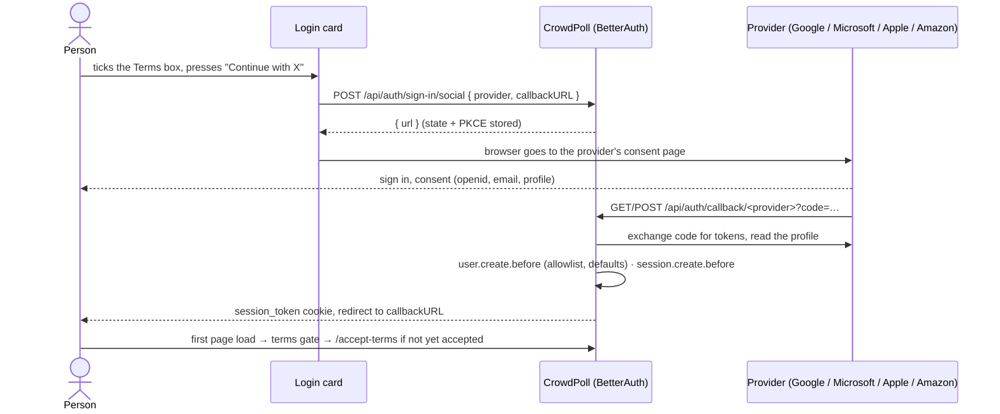
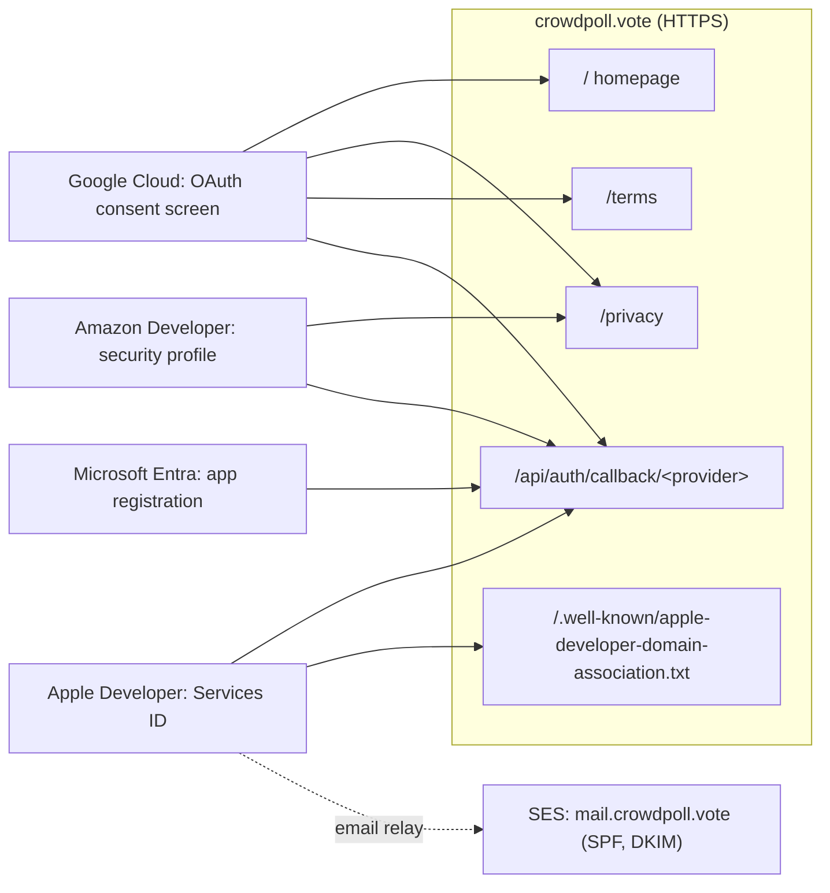
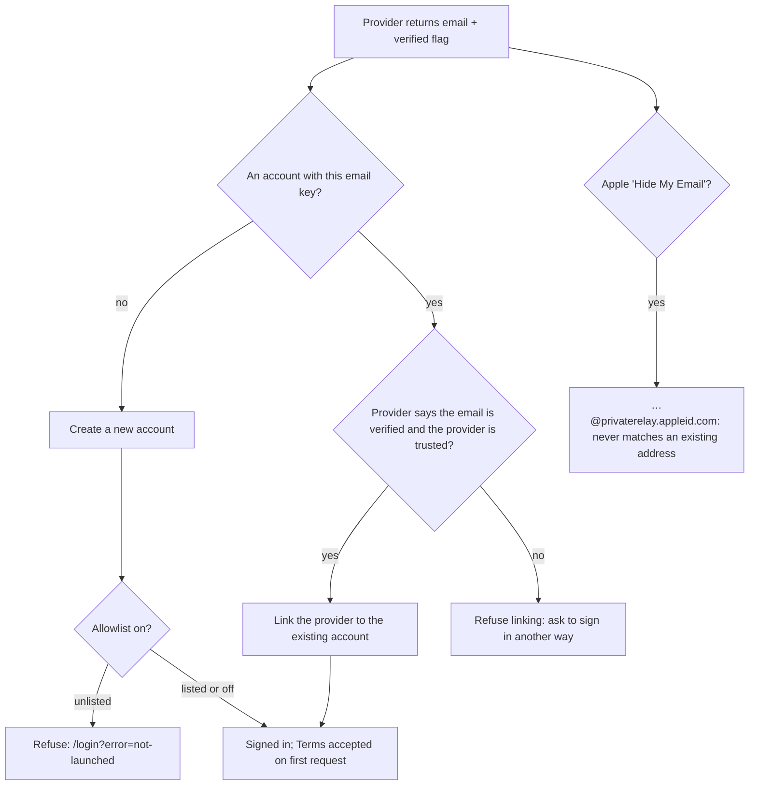
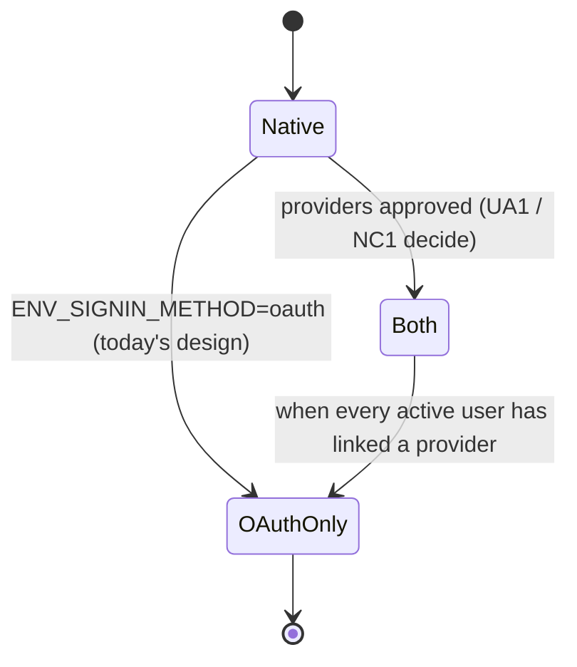

# High Level Requirements

Requirements: `requirements/20261022-131728-social-oauth-providers/requirements.md`  
External Files: none  
Generated: 2026-10-22 1:17 PM  

We are now ready to apply for Social OAuth integration.
We will initial seek approval from:
- Google
- Microsoft
- Apple
- Amazon

This requirement is for research on how to do this for the four major providers: Google, Microsoft, Apple, and Amazon.  

It is also required to analyze the CrowdPoll webapp to ensure that it will satisfy the requirements of those providers.

## Additional Requirements and Research Requests

**Instructions To The Developer**  
Enter any additional requirements or research requests under the ## Additional Requirements and Research Requests heading above.  
When you Type or Say: "Next" in the CC CLI terminal, the additional requirements and research requests will be applied to the report.  
  
You may leave these instructions here. They will be ignored when "Next" is executed.  

---

## 1. Overview and Scope

CrowdPoll signs people in today with an emailed one-time link (`ENV_SIGNIN_METHOD=native`).  
The design has always planned a switch to social OAuth sign-in once providers approve the app (CLAUDE.md, "Auth phases").  
This feature prepares that switch for four providers: **Google, Microsoft, Apple and Amazon**.  
It asks for two things:  
- **research**: what each provider requires to register and approve a web app, step by step (RS1–RS4);  
- **analysis**: whether CrowdPoll as built satisfies those requirements, and what must change (RS5).  

The privacy, terms and deletion work just finished (feature 20261021-204537) already covers much of what the providers check: a public homepage, a Privacy Policy and Terms of Service at stable URLs, account deletion and HTTPS.  

## 2. What the Code Has Today

- **BetterAuth 1.6.26** (`src/auth/auth.ts`) enables social providers only in OAuth mode, from `ENV_OAUTH_
_CLIENT_ID` / `_CLIENT_SECRET`, for **Google, Facebook and GitHub**.  
- BetterAuth ships built-in providers for **Google**, **Apple** and **Microsoft** (`microsoft-entra-id`), but **not Amazon**; Amazon needs its `generic-oauth` plugin, which is installed.  
- A social sign-in starts with `POST /api/auth/sign-in/social { provider, callbackURL }`, which returns the provider's URL; the provider returns to `/api/auth/callback/<provider>`.  
  The Login card's OAuth buttons link to `/api/auth/oauth/<provider>`, a route that does not exist.  
- `createAuth` sets `baseURL: http://localhost:<port>`.  
  BetterAuth builds each provider's redirect URI from it, so in production the providers would be sent back to `localhost`.  
- OAuth mode already: creates accounts through `user.create.before` (allowlist, profile defaults); refuses unlisted addresses before launch (`onAPIError.errorURL` is `/login`); and makes a new account accept the Terms through the terms gate on its first request.  
- Native mode is exclusive today: in OAuth mode `/create-account`, the magic-link routes and email change answer `404`.  

## 3. Architecture Diagrams

### 3.1 A social sign-in

### 3.2 What each provider is told about CrowdPoll

### 3.3 Matching a social sign-in to an account

### 3.4 Switching sign-in modes

## 4. Assumptions

- Only identity is requested from every provider: `openid`, `email`, `profile` (Amazon: `profile`). CrowdPoll reads no mailbox, contacts or files.  
- Production runs at `https://crowdpoll.vote` (a dev/test registration can use `http://localhost:8080` where the provider allows it).  
- The operator registers with each provider; this feature produces the instructions and the code changes, not the accounts.  
- The pre-launch allowlist stays on while the providers are tested, so a provider's reviewers may need a listed test address (see UA6).  

## 5. Breaking Changes

- `baseURL` becomes configurable (`ENV_PUBLIC_ORIGIN` or BetterAuth's `BETTER_AUTH_URL`); every provider's registered redirect URI depends on it.  
- The provider set changes from Google/Facebook/GitHub to Google/Microsoft/Apple/Amazon (UA4): new `ENV_OAUTH_*` names, and Apple needs a team id, key id and private key instead of a static secret.  
- The Login card's OAuth buttons change from links to `POST /api/auth/sign-in/social`.  
- Depending on NC1, the sign-in mode gains a "both" value, or native sign-in stops entirely when OAuth is switched on.  

## 6. Technical Debt

- `baseURL` hard-coded to `http://localhost:<port>` in `src/auth/auth.ts`.  
- The OAuth buttons link to a route that does not exist (`/api/auth/oauth/<provider>`); OAuth mode has never been exercised end to end, only with forged sessions in tests.  
- `socialProviders()` reads the environment directly instead of through `loadConfig`, so a half-configured provider is silently skipped instead of refusing to start.  
- Account linking is not configured: BetterAuth's defaults decide what happens when a provider returns an address that already has a native account.  

## 7. Research Results

### 7.1 Google

**RS1. How does CrowdPoll register "Sign in with Google", and what does Google check?**  
✅ Resolved  
✅ Requirements File Updated: 2026-10-22 1:30 PM  
**Notes**: Recommendation accepted in file 2026-10-22: **Recommendation**, **register with the basic scopes only, publish the consent screen to production, and verify `crowdpoll.vote` in Google Search Console**;  
  Decision (RS1) in the requirements holds the procedure.  

Sources: [Google — Verification requirements](https://support.google.com/cloud/answer/13464321), [Unverified apps and scopes (discussion)](https://ssojet.com/ciam-qna/google-oauth-consent-screen-issues-verification-requirements).  
Requesting only the basic scopes `openid`, `email` and `profile` needs no app verification and shows no "unverified app" warning; verification is required for sensitive scopes (Gmail, Drive, Calendar), which CrowdPoll does not use.  
Brand verification, when it applies, checks: a homepage on a domain you have verified, describing the app (not only a login page) and linking the same Privacy Policy as the consent screen; a demonstration video of the OAuth flow for scope reviews.  
Steps: create a Google Cloud project → OAuth consent screen (app name "CrowdPoll", support email, logo optional, homepage `https://crowdpoll.vote/`, privacy `https://crowdpoll.vote/privacy`, terms `https://crowdpoll.vote/terms`, authorized domain `crowdpoll.vote`, verified in Search Console) → audience "External", publish to "In production" → Credentials: OAuth client "Web application", redirect URI `https://crowdpoll.vote/api/auth/callback/google`.  
Not confirmed by these sources: whether adding a logo by itself triggers brand verification; check the console's prompt when uploading one.  

  - **Recommendation**: **register with the basic scopes only, publish the consent screen to production, and verify `crowdpoll.vote` in Google Search Console.**  

    ➡️ [x] **Accepted**  
    The homepage already describes CrowdPoll to a guest and links the Privacy Policy and Terms in its footer, as brand verification asks.  
    The step-by-step goes into the requirements as the Google registration procedure.  

  - **Developer Resolution B**:  

    ➡️ [ ] **Accepted**  

### 7.2 Microsoft

**RS2. How does CrowdPoll register "Sign in with Microsoft", and what does Microsoft check?**  
✅ Resolved  
✅ Requirements File Updated: 2026-10-22 1:30 PM  
**Notes**: Recommendation accepted in file 2026-10-22: **Recommendation A**, **register for personal and work accounts, and complete publisher verification through the Cloud Partner Program**;  
  Decision (RS2) in the requirements holds the procedure.  

Sources: [Publisher verification overview](https://learn.microsoft.com/en-ca/entra/identity-platform/publisher-verification-overview), [Configure an app's publisher domain](https://learn.microsoft.com/sr-latn-rs/entra/identity-platform/howto-configure-publisher-domain), [End users can no longer consent to unverified multi-tenant apps (2020)](https://blog.thoughtstuff.co.uk/2020/11/end-users-can-no-longer-grant-consent-to-unverified-multi-tenant-apps-what-this-means-for-you/).  
Steps: Microsoft Entra admin center (a free Azure tenant) → App registrations → New registration, "Accounts in any organizational directory and personal Microsoft accounts", Web redirect URI `https://crowdpoll.vote/api/auth/callback/microsoft` → client secret (it expires; renew before expiry) → publisher domain `crowdpoll.vote`.  
Since November 2020, apps from unverified publishers are shown as unverified, and users of work and school tenants can no longer consent to new multi-tenant apps from unverified publishers.  
Publisher verification is free but needs a verified Microsoft Cloud Partner Program (formerly MPN) account for the organization, associated with the app registration.  

  - **Recommendation A** _(recommended)_: **register for personal and work accounts, and complete publisher verification through the Cloud Partner Program.**  

    ➡️ [x] **Accepted**  
    - <u>Pros</u>: no "unverified" label; people signing in with a work or school account can consent.  
    - <u>Cons</u>: the Partner Program enrolment needs an organization identity (see NC2) and takes days.  

  - **Recommendation B**: **register for personal Microsoft accounts only, without publisher verification.**  

    ➡️ [ ] **Accepted**  
    - <u>Pros</u>: quickest; no partner enrolment.  
    - <u>Cons</u>: the consent screen says "unverified"; work and school accounts cannot sign in.  

  - **Developer Resolution C**:  

    ➡️ [ ] **Accepted**  

### 7.3 Apple

**RS3. How does CrowdPoll register "Sign in with Apple" for a website, and what does Apple require?**  
✅ Resolved  
✅ Requirements File Updated: 2026-10-22 1:30 PM  
**Notes**: Recommendation accepted in file 2026-10-22: **Recommendation**, **enrol, create the Services ID and key, serve the domain-association file, register `mail.crowdpoll.vote` for the relay, and sign the client secret on the server**;  
  Decision (RS3) in the requirements records it.  

Sources: [Apple — Create a Sign in with Apple private key](https://developer.apple.com/help/account/capabilities/create-a-sign-in-with-apple-private-key), [Apple — Configure private email relay service](https://developer.apple.com/help/account/configure-app-capabilities/configure-private-email-relay-service/), [Apple Developer Program enrolment](https://developer.apple.com/programs/enroll/).  
- **Membership**: the Apple Developer Program, US$99 a year; enrolling as an organization requires a D-U-N-S number.  
- **Identifiers**: an App ID with Sign in with Apple enabled, then a **Services ID** (the web client id), configured with the domain `crowdpoll.vote` and the Return URL `https://crowdpoll.vote/api/auth/callback/apple`.  
  Domain verification: serve Apple's file at `https://crowdpoll.vote/.well-known/apple-developer-domain-association.txt`.  
- **Client secret**: a private key (`.p8`) with Sign in with Apple; the client secret is a JWT signed with it, valid at most 180 days, so it must be regenerated at least every six months.  
- **Email**: a person may choose "Hide My Email" and give an `…@privaterelay.appleid.com` address.  
  To reach it, CrowdPoll's sending domain (`mail.crowdpoll.vote`) must be registered under "Sign in with Apple for Email Communication", with SPF (and DKIM when the envelope sender is another domain, as with SES).  
- Apple returns the person's name only on their first authorization, and posts the callback (`response_mode=form_post`).  

  - **Recommendation**: **enrol, create the Services ID and key, serve the domain-association file, register `mail.crowdpoll.vote` for the relay, and generate the client secret from the key at start-up (or by a script on a schedule) so it never expires unnoticed.**  

    ➡️ [x] **Accepted**  
    The configuration becomes `ENV_OAUTH_APPLE_CLIENT_ID` (the Services ID), `ENV_OAUTH_APPLE_TEAM_ID`, `ENV_OAUTH_APPLE_KEY_ID` and `ENV_OAUTH_APPLE_PRIVATE_KEY` (a secret); the server signs the JWT itself.  
    The domain-association file is a static file under `src/public/.well-known/`.  

  - **Developer Resolution B**:  

    ➡️ [ ] **Accepted**  

### 7.4 Amazon

**RS4. How does CrowdPoll register "Login with Amazon", and what does Amazon require?**  
✅ Resolved  
✅ Requirements File Updated: 2026-10-22 1:30 PM  
**Notes**: Recommendation accepted in file 2026-10-22: **Recommendation**, **a security profile with the privacy and return URLs, and Amazon through `generic-oauth`**;  
  Decision (RS4) in the requirements records the endpoints.  

Sources: [Login with Amazon — Register a security profile](https://developer.amazon.com/public/apis/engage/login-with-amazon/docs/register_security_profile.html), [Login with Amazon — Register for web](https://developer.amazon.com/docs/login-with-amazon/register-web.html).  
Steps: an Amazon Developer account → Login with Amazon → create a **security profile** (name, description, **Consent Privacy Notice URL** `https://crowdpoll.vote/privacy`, optional consent logo) → Web Settings: **Allowed Return URLs** `https://crowdpoll.vote/api/auth/callback/amazon` (HTTPS) → client id and secret.  
The `profile` scope (user id, name, email) is granted by default.  
BetterAuth has no built-in Amazon provider; its installed `generic-oauth` plugin can drive Amazon's OAuth 2.0 endpoints (authorize `https://www.amazon.com/ap/oa`, token `https://api.amazon.com/auth/o2/token`, profile `https://api.amazon.com/user/profile`).  
Not confirmed: whether Amazon's profile endpoint reports the email as verified; until it is, an Amazon sign-in should not link to an existing account automatically (UA2).  

  - **Recommendation**: **register a security profile with the privacy URL and return URL, and add Amazon through `generic-oauth` with those three endpoints.**  

    ➡️ [x] **Accepted**  
    Amazon is then marked untrusted for account linking unless its email is confirmed verified.  

  - **Developer Resolution B**:  

    ➡️ [ ] **Accepted**  

### 7.5 CrowdPoll against the providers' requirements

**RS5. Does CrowdPoll as built satisfy what the four providers require?**  
✅ Resolved  
✅ Requirements File Updated: 2026-10-22 1:30 PM  
**Notes**: Recommendation accepted in file 2026-10-22: **Recommendation**, **record the readiness table; the "Not met" rows become functional requirements**;  
  Decision (RS5) in the requirements lists them.  

Measured against RS1–RS4 and the code (section 2):  

| Requirement | Status |
|---|---|
| HTTPS on a domain you own (`crowdpoll.vote`) | Met (App Platform, custom domain) |
| Public homepage that describes the app, not only a login page | Met: `/` shows Trending and Newest to guests |
| Privacy Policy URL, linked from the homepage | Met: `/privacy`, footer link (lawyer review still open, T052) |
| Terms of Service URL | Met: `/terms` |
| Account deletion | Met: Profile → Your Data → Delete Account |
| Redirect URIs `https://crowdpoll.vote/api/auth/callback/<provider>` | **Not met**: `baseURL` is `http://localhost:<port>` |
| A working "Continue with X" button | **Not met**: the buttons link to a route that does not exist |
| Google, Microsoft, Apple, Amazon providers | **Partly**: code configures Google, Facebook, GitHub; Apple and Microsoft need adding, Amazon needs `generic-oauth` |
| Apple domain-association file at `/.well-known/` | **Not met**: nothing serves `/.well-known/` yet |
| Apple private relay delivery | **Not met**: `mail.crowdpoll.vote` not registered with Apple |
| Provider button branding (each provider's official button rules) | **Not met**: plain text buttons |
| Existing native accounts can sign in with a provider | **Undecided**: account linking not configured (UA2) |

  - **Recommendation**: **record this table in the requirements as the readiness checklist; the "Not met" rows become this feature's functional requirements.**  

    ➡️ [x] **Accepted**  
    The registrations themselves (RS1–RS4) are operator steps, recorded as a procedure, like the SES setup of the production-email feature.  

  - **Developer Resolution B**:  

    ➡️ [ ] **Accepted**  

## 8. Findings

### 8.1 Inconsistencies

**IN1. The four providers asked for differ from the three the code configures.**  
✅ Resolved  
✅ Requirements File Updated: 2026-10-22 1:30 PM  
**Notes**: Recommendation accepted in file 2026-10-22: **Recommendation**, **replace Facebook and GitHub with Microsoft, Apple and Amazon; keep Google**;  
  Decision (IN1) in the requirements records it.  

The requirements name Google, Microsoft, Apple and Amazon; `src/auth/auth.ts`, the Login card and README configure Google, Facebook and GitHub.  

  - **Recommendation**: **replace Facebook and GitHub with Microsoft, Apple and Amazon; keep Google.**  

    ➡️ [x] **Accepted**  
    Facebook and GitHub can be added later the same way; leaving them configured but unregistered only shows buttons that cannot work.  

  - **Developer Resolution B**:  

    ➡️ [ ] **Accepted**  

### 8.2 Ambiguities

**AM1. Is this feature research only, or does it also make the code ready?**  
✅ Resolved  
✅ Requirements File Updated: 2026-10-22 1:30 PM  
**Notes**: Recommendation accepted in file 2026-10-22: **Recommendation A**, **research, analysis and the code changes that make CrowdPoll ready; the production switch stays separate**;  
  Decision (AM1) in the requirements records it.  

The requirements ask for research and for an analysis of the app; they do not say whether the gaps the analysis finds (RS5) are fixed here.  

  - **Recommendation A** _(recommended)_: **research, analysis and the code changes that make CrowdPoll ready; switching production to OAuth stays a separate configuration step after approval.**  

    ➡️ [x] **Accepted**  
    - <u>Pros</u>: the registrations need working redirect URIs and buttons to be tested and reviewed; one feature delivers a testable app.  
    - <u>Cons</u>: a larger feature.  

  - **Recommendation B**: **research and the readiness report only; the code changes become a later feature.**  

    ➡️ [ ] **Accepted**  
    - <u>Pros</u>: smaller; registrations can start now.  
    - <u>Cons</u>: no provider can be tested, and Google's and Apple's reviews look at a working flow.  

  - **Developer Resolution C**:  

    ➡️ [ ] **Accepted**  

### 8.3 Unspecified Aspects

**UA1. Where does the production origin come from?**  
✅ Resolved  
✅ Requirements File Updated: 2026-10-22 1:30 PM  
**Notes**: Recommendation accepted in file 2026-10-22: **Recommendation**, **a required `ENV_PUBLIC_ORIGIN` passed as `baseURL`**;  
  Decision (UA1) in the requirements records it.  

Every provider registers the exact redirect URI; BetterAuth builds it from `baseURL`, today `http://localhost:<port>`.  

  - **Recommendation**: **a required `ENV_PUBLIC_ORIGIN` (e.g. `https://crowdpoll.vote`; `http://localhost:8080` in the templates), validated by `loadConfig` and passed as `baseURL`.**  

    ➡️ [x] **Accepted**  
    It is the same origin the email links already use (taken from the request today); one setting makes every provider's redirect URI predictable.  

  - **Developer Resolution B**:  

    ➡️ [ ] **Accepted**  

**UA2. What happens when a provider returns an address that already has a CrowdPoll account?**  
✅ Resolved  
✅ Requirements File Updated: 2026-10-22 1:30 PM  
**Notes**: Recommendation accepted in file 2026-10-22: **Recommendation**, **link automatically for a verified email from a trusted provider; never for Amazon until confirmed**;  
  Decision (UA2) in the requirements records it.  

Every tester has a native account today, keyed by email.  
BetterAuth links a social account to an existing user only when account linking allows it; it is not configured.  

  - **Recommendation**: **link automatically when the provider reports the email as verified and is trusted (Google, Microsoft, Apple); never for Amazon until its email is confirmed verified; match by email key, as create-account does.**  

    ➡️ [x] **Accepted**  
    An unmatched or untrusted sign-in creates a new account; the person can delete one of the two from the Profile page.  

  - **Developer Resolution B**:  

    ➡️ [ ] **Accepted**  

**UA3. How are Apple's "Hide My Email" addresses handled?**  
✅ Resolved  
✅ Requirements File Updated: 2026-10-22 1:30 PM  
**Notes**: Recommendation accepted in file 2026-10-22: **Recommendation**, **treat a relay address as an ordinary address and register `mail.crowdpoll.vote` with Apple**;  
  Decision (UA3) in the requirements records it.  

A relay address never matches an existing account, an allowlist entry or an `ENV_ADMINS` address, and mail to it is dropped unless the sending domain is registered with Apple.  

  - **Recommendation**: **treat a relay address as an ordinary address: register `mail.crowdpoll.vote` with Apple; the allowlist and admin lists keep working by address (testers sign in with "Share My Email"); state in the Privacy Policy that a relay address is stored as given.**  

    ➡️ [x] **Accepted**  

  - **Developer Resolution B**:  

    ➡️ [ ] **Accepted**  

**UA4. How do the sign-in buttons look?**  
✅ Resolved  
✅ Requirements File Updated: 2026-10-22 1:30 PM  
**Notes**: Recommendation accepted in file 2026-10-22: **Recommendation**, **one official-style button per provider, in a fixed order, starting the flow with `POST /api/auth/sign-in/social`**;  
  Decision (UA4) in the requirements records it.  

Each provider publishes rules for its button (logo, wording such as "Sign in with Apple", colours); reviewers check them.  

  - **Recommendation**: **one button per provider following its official guidelines (logo, wording, light/dark variants), in a fixed order Google, Apple, Microsoft, Amazon, each starting the flow with `POST /api/auth/sign-in/social`.**  

    ➡️ [x] **Accepted**  
    The logos are the providers' own marks, used under their brand terms; they are served by CrowdPoll (no third-party request).  

  - **Developer Resolution B**:  

    ➡️ [ ] **Accepted**  

**UA5. How are provider credentials configured and checked?**  
✅ Resolved  
✅ Requirements File Updated: 2026-10-22 1:35 PM  
**Notes**: Recommendation accepted in file 2026-10-22: **Recommendation**, **read them in `loadConfig`; partial settings stop the app; startup logs which providers are on**;  
  Decision (UA5) in the requirements records it.  

Today `socialProviders()` reads `ENV_OAUTH_*` directly and silently skips a provider with a missing half.  

  - **Recommendation**: **read them in `loadConfig`: a provider is on when its settings are complete, a partial set stops the app at start-up, and startup logs which providers are on (never a secret); Apple's key and Microsoft's secret are encrypted App Platform variables.**  

    ➡️ [x] **Accepted**  

  - **Developer Resolution B**:  

    ➡️ [ ] **Accepted**  

**UA6. How do the providers' reviewers get in while the site is closed?**  
✅ Resolved  
✅ Requirements File Updated: 2026-10-22 1:35 PM  
**Notes**: Recommendation accepted in file 2026-10-22: **Recommendation**, **a dedicated review account on the allowlist for each submission**;  
  Decision (UA6) in the requirements records it.  

The pre-launch allowlist refuses any unlisted address, which would include a reviewer's.  

  - **Recommendation**: **add a dedicated review account's address to `ENV_ALLOWED_EMAILS` for each submission, and give its sign-in steps in the submission notes.**  

    ➡️ [x] **Accepted**  
    Google with basic scopes and Amazon do not review the flow by hand; Apple and Microsoft verification look at the organization rather than the flow, so this matters mainly for any brand review that asks for a demonstration.  

  - **Developer Resolution B**:  

    ➡️ [ ] **Accepted**  

### 8.4 Needs Clarification

**NC1. Does email-link sign-in stay once OAuth is on?**  
✅ Resolved  
✅ Requirements File Updated: 2026-10-22 1:30 PM  
**Notes**: Recommendation accepted in file 2026-10-22: **Recommendation A**, **both: a third mode keeps the email link beside the provider buttons**;  
  Decision (NC1) in the requirements records it.  

The original design switches to OAuth exclusively (`ENV_SIGNIN_METHOD=oauth`), which turns off create-account, email links and email change.  
A person whose address belongs to none of the four providers, or who prefers email, would then have no way in.  

  - **Recommendation A** _(recommended)_: **both: a third mode keeps the email link beside the provider buttons.**  

    ➡️ [x] **Accepted**  
    - <u>Pros</u>: nobody is locked out; existing testers keep signing in as today while they link providers.  
    - <u>Cons</u>: two sign-in paths to keep secure and tested; a change from the original design.  

  - **Recommendation B**: **OAuth only, as originally designed.**  

    ➡️ [ ] **Accepted**  
    - <u>Pros</u>: one path; no emails for sign-in.  
    - <u>Cons</u>: people without an account at the four providers cannot use CrowdPoll; existing native accounts must link first.  

  - **Developer Resolution C**:  

    ➡️ [ ] **Accepted**  

**NC2. Under which identity are the developer accounts registered?**  
✅ Resolved  
✅ Requirements File Updated: 2026-10-22 1:30 PM  
**Notes**: Recommendation accepted in file 2026-10-22: **Recommendation A**, **as an organization (CrowdPoll), obtaining a D-U-N-S number first**;  
  Decision (NC2) in the requirements records it.  

Apple's organization enrolment needs a D-U-N-S number; Microsoft publisher verification needs a Cloud Partner Program organization; the Privacy Policy names the operator as "CrowdPoll".  

  - **Recommendation A** _(recommended)_: **as an organization (CrowdPoll), obtaining a D-U-N-S number first.**  

    ➡️ [x] **Accepted**  
    - <u>Pros</u>: the consent screens show "CrowdPoll", matching the policy; Microsoft publisher verification becomes possible.  
    - <u>Cons</u>: the D-U-N-S number and partner enrolment take time (often days to weeks).  

  - **Recommendation B**: **as an individual developer.**  

    ➡️ [ ] **Accepted**  
    - <u>Pros</u>: fastest start.  
    - <u>Cons</u>: Apple shows the developer's personal name as the seller/developer; Microsoft publisher verification is not available.  

  - **Developer Resolution C**:  

    ➡️ [ ] **Accepted**

## 9. Requirements Report Complete Report  
  
- **Requirements Report Document:** requirements/20261022-131728-social-oauth-providers/requirements-report.md  
- **Requirements Document:** requirements/20261022-131728-social-oauth-providers/requirements.md  
- **Software Architecture Diagrams:** 4  
- **Inconsistencies:** 1  
- **Ambiguities:** 1  
- **Unspecified Aspects:** 6  
- **Needs Clarifications:** 2  
- **Research Results:** 5  
- **Breaking Changes:** 4  
- **Technical Debt items:** 4  
  
The requirements are ready for /speckit-specify.  
To generate specs from the requirements document, use the `/speckit-specify` skill followed by the path (relative to the project root) to the requirements file.  
At the prompt, Type:  
🟩 👉 /speckit-specify requirements/20261022-131728-social-oauth-providers/requirements.md  
