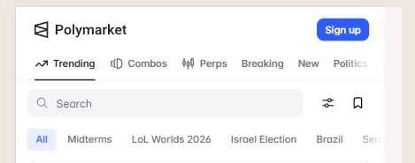
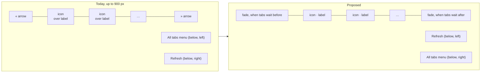
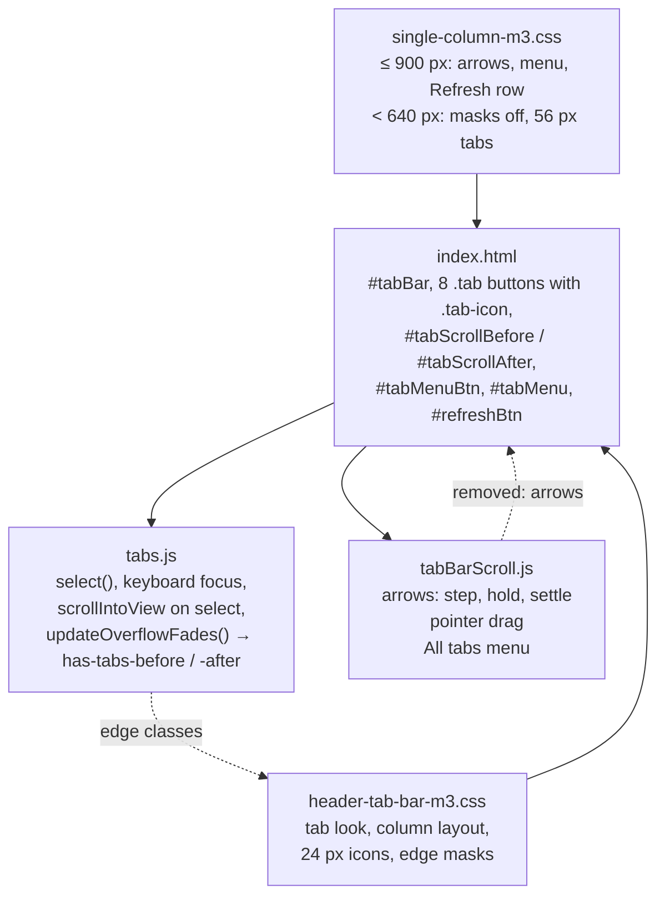
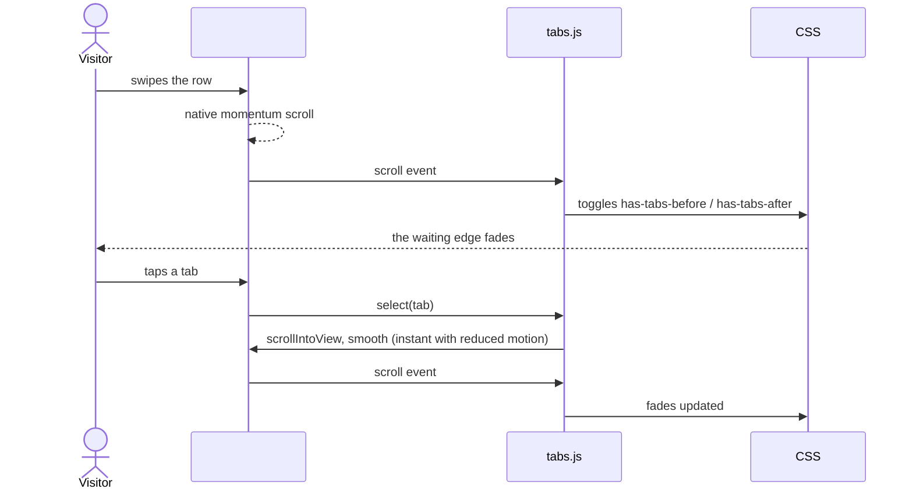
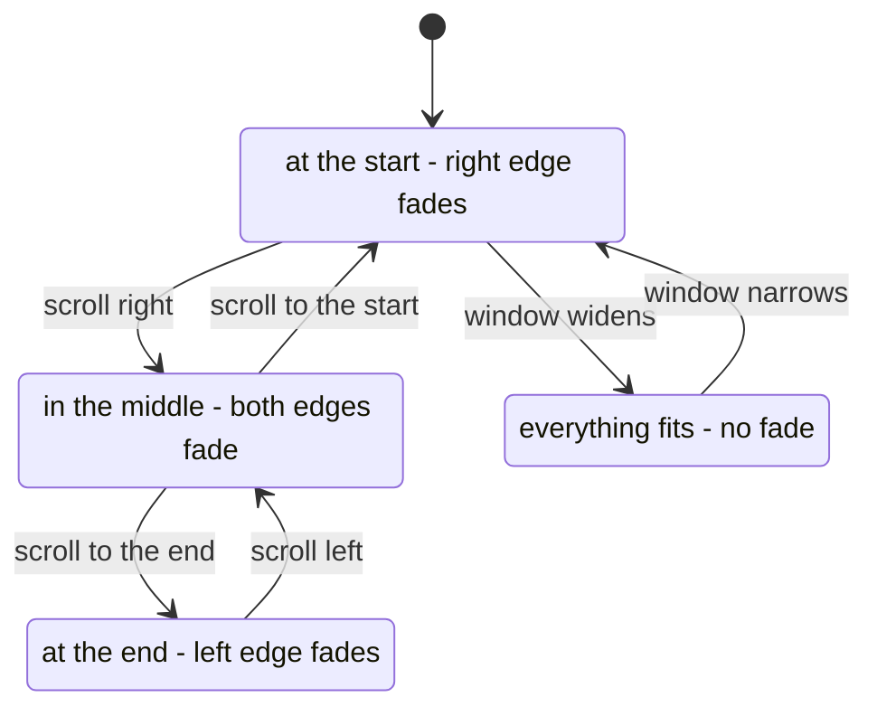

# High Level Requirements

Requirements: `requirements/20261023-155959-phone-tab-bar/requirements.md`  
External Files: `dontTrack/tab-bar-example.jpg` (linked; copied beside the requirements as `tab-bar-example.jpg`, see UA5)  
Generated: 2026-10-23 4:02 PM  

We are going to try to improved the Tab bar on the Phone interface.  
It still doesn't have a good UX.  

Let's try mimicing what is done on Polymarket.com.
That site is actually quite similar ion purpose as CrowdPoll.vote. 
It is well-designed and has a clean, intuitive interface, which makes it a good reference for improving our own Tab bar UX.

The image below shows how it appears:  

We will put the tab icon to the left of the text.  
The icon will need to be smaller than it is now. 
We will not have any arrows but rather the tab text and icon will be blurred when on the edge of the bar.  

Additionally, the tab bar should have smooth scrolling behavior, allowing users to easily navigate through tabs without abrupt jumps.

## Additional Requirements and Research Requests

**Instructions To The Developer**  
Enter any additional requirements or research requests under the ## Additional Requirements and Research Requests heading above.  
When you Type or Say: "Next" in the CC CLI terminal, the additional requirements and research requests will be applied to the report.  
  
You may leave these instructions here. They will be ignored when "Next" is executed.  

## 1. Overview and Scope

The home page's tab bar holds eight tabs: Your Polls, Shared With You, Your Votes, Trending, Newest, Watching, Live Results and Search.  
On a phone the row is wider than the screen, so it scrolls sideways.  
This feature restyles that scrolling row after Polymarket's:  
- each tab is one line, a small icon to the left of its label;  
- there are no scroll arrows;  
- an edge where more tabs wait fades the tabs out;  
- the row scrolls smoothly, by finger and when a tab is chosen.  

**What the phone bar is today** (features 030 and 031, `index.html`, `tabBarScroll.js`, `header-tab-bar-m3.css`, `single-column-m3.css`):  
- up to 900 px wide, each tab stacks a 24 px icon over its label in a 56 px tall tab;  
- « and » arrow buttons sit at both ends: a press steps two tabs (500 ms), a hold scrolls at 200 px/s, and each is `aria-disabled` at its end;  
- an "All tabs" menu button sits under the bar at the left and the Refresh button under it at the right;  
- the bar can be dragged with a pointer (`touch-action: pan-x`);  
- the edge fades exist (`has-tabs-before` / `has-tabs-after`, set by `tabs.js`), but are switched off below 640 px (`mask-image: none !important`).  

**What Polymarket shows** (`tab-bar-example.jpg`): one-line tabs, an icon of about 14 px to the left of a 14 px label, the active tab dark with an underline, no arrows, and the last visible tab ("Politics") fading out at the right edge.  

**Out of scope**: the tabs themselves (names, order, what each shows), the header, the cards, and pages other than the home page.  

## 2. The Phone Tab Bar, Today and Proposed

## 3. Components

The change is client-side only: markup, two scripts and two style layers.  
No route, configuration, data or migration is involved.  

## 4. Scrolling and the Edge Fades

## 5. Breaking Changes

- **The scroll arrows go.**  
  `#tabScrollBefore`, `#tabScrollAfter` and their step, hold and settle code in `tabBarScroll.js` are removed, with feature 030's decisions R5–R7 about them;  
  their tests in `tests/client-tab-bar-scroll.test.ts` go with them.  
- **The tabs change shape** on the phone: one line instead of icon over label.  
  Tests that pin the tab sizes (`tests/single-column-sheets.test.ts`, `tests/tab-bar-assets.test.ts`) change.  
- Nothing outside the home page changes, and no stored data or API changes.  

## 6. Technical Debt

- **The tab bar's phone rules are spread over two layers and two breakpoints.**  
  `single-column-m3.css` sets the same tab size rules once under 640 px and again under 900 px, and turns the edge masks off under 640 px with `!important` against `header-tab-bar-m3.css`.  
  This feature is a chance to keep one set of phone rules.  
- **Two scripts measure the same edges.**  
  `tabs.js` (`updateOverflowFades`) and `tabBarScroll.js` (`updateArrowStates`) each compute "tabs before" and "tabs after".  
  With the arrows gone, only `tabs.js`'s fade classes are needed.  
- **The pointer drag duplicates the browser's own touch scrolling.**  
  `tabBarScroll.js` drags the bar for every pointer, touch included; native scrolling with momentum is smoother on a phone (UA2).  

## 7. Assumptions

- "The Phone interface" means the widths where the row scrolls and has arrows today (AM1).  
- Tab names, order, icons (as drawings), guest greying and the active colour stay as they are.  
- The fade reuses `tabs.js`'s `has-tabs-before` / `has-tabs-after` classes.  
- Reduced motion turns smooth scrolling into an instant jump, as `tabBarScroll.js` does today.  

## 8. Findings

### 8.1 Inconsistencies

None found.  

### 8.2 Ambiguities

**AM1. Which widths are "the Phone interface"?**  
✅ Resolved  
✅ Requirements File Updated: 2026-10-23 5:03 PM  
**Notes**: Recommendation accepted in file 2026-10-23: Recommendation A, **up to 900 px, everywhere the row has arrows today**;  
the requirements now say the Phone interface means every width up to 900 px.  

The arrows, the All tabs menu and the Refresh row appear up to 900 px (phones and small tablets), while the single-column card layout starts below 640 px.  
The requirements say "the Phone interface" without a width.  

  - **Recommendation A** _(recommended)_: **up to 900 px, everywhere the row has arrows today.**  

    ➡️ [X] **Accepted**  
    - <u>Pros</u>: no width is left with arrows while the phone has none;  
      one set of rules replaces the two blocks of `single-column-m3.css` (Technical Debt).  
    - <u>Cons</u>: tablets between 640 and 900 px change too.  

  - **Recommendation B**: **below 640 px only, the single-column phone layout.**  

    ➡️ [ ] **Accepted**  
    - <u>Pros</u>: the smallest change.  
    - <u>Cons</u>: 640–900 px keeps arrows and stacked tabs, so two tab bar designs remain.  

  - **Developer Resolution C**:  

    ➡️ [ ] **Accepted**  

**AM2. "Blurred" at the edge: a blur, or a fade?**  
✅ Resolved  
✅ Requirements File Updated: 2026-10-23 5:03 PM  
**Notes**: Recommendation accepted in file 2026-10-23: Recommendation A, **a fade, as Polymarket does**;  
the requirements now say "blurred" means a 32 px fade from opaque to transparent at an edge where more tabs wait.  

The requirements say the tab text and icon "will be blurred" at the edge.  
Polymarket's image shows a fade: "Politics" turns transparent towards the right edge, without blurring.  
The site already has such a fade (a gradient mask on `#tabBar`), switched off below 640 px.  

  - **Recommendation A** _(recommended)_: **a fade, as Polymarket does: the last 32 px at a waiting edge go from opaque to transparent.**  

    ➡️ [X] **Accepted**  
    - <u>Pros</u>: matches the reference;  
      reuses the existing mask and edge classes;  
      cheap to draw while scrolling.  
    - <u>Cons</u>: not literally a blur.  

  - **Recommendation B**: **a blur: a strip at the edge blurs what is under it (`backdrop-filter: blur`).**  

    ➡️ [ ] **Accepted**  
    - <u>Pros</u>: literally what the requirement says.  
    - <u>Cons</u>: unlike the reference;  
      a blurred label looks like a rendering fault;  
      costlier to draw on every scroll frame on older phones.  

  - **Developer Resolution C**:  

    ➡️ [ ] **Accepted**  

**AM3. How much smaller is the icon?**  
✅ Resolved  
✅ Requirements File Updated: 2026-10-23 4:59 PM  
**Notes**: Recommendation accepted by "Accept all" 2026-10-23: Recommendation, **16 px icons, 6 px from a 14 px label, both vertically centred**;  
the requirements now give the icon size, its gap from the label and their alignment.  

Today's tab icons are 24 px.  
In the reference the icon is about the height of the 14 px label.  

  - **Recommendation**: **16 px icons, 6 px from a 14 px label, both vertically centred.**  

    ➡️ [X] **Accepted**  
    - 16 px matches the label's cap height closely, as in the reference, and keeps the drawn icons (the people, the tick, the eye, the live bars) legible.  

  - **Developer Resolution B**:  

    ➡️ [ ] **Accepted**  

### 8.3 Unspecified Aspects

**UA1. What happens to the All tabs menu button and the Refresh button under the bar?**  
✅ Resolved  
✅ Requirements File Updated: 2026-10-23 5:03 PM  
**Notes**: Recommendation accepted in file 2026-10-23: Developer Resolution C, Recommendation A with the two buttons swapped;  
the requirements now say both buttons stay under the bar, Refresh on the left and the All tabs menu on the right;  
the smooth-scrolling list no longer says "while there is one" of the menu;  
the Proposed diagram in section 2 now shows the swapped buttons.  

Below the bar, a phone shows the All tabs menu button (left) and Refresh (right).  
The requirements remove the arrows but do not mention either.  
Polymarket has neither.  

  - **Recommendation A** _(recommended)_: **keep both as they are.**  

    ➡️ [ ] **Accepted**  
    - <u>Pros</u>: the menu still reaches any of the eight tabs in two taps, which matters more once the arrows go;  
      Refresh has no other place on the phone.  
    - <u>Cons</u>: the row under the bar stays, unlike the reference.  

  - **Recommendation B**: **remove the All tabs menu, keep Refresh.**  

    ➡️ [ ] **Accepted**  
    - <u>Pros</u>: closer to the reference;  
      less code (the menu half of `tabBarScroll.js`).  
    - <u>Cons</u>: a tab off screen is reached only by swiping.  

  - **Developer Resolution C**:  

    ➡️ [X] **Accepted**  
    - Recommendation A, keep the buttons, however, switch their places: Refresh on the left, All tabs menu on the right.

**UA2. What "smooth scrolling" means.**  
✅ Resolved  
✅ Requirements File Updated: 2026-10-23 4:59 PM  
**Notes**: Recommendation accepted by "Accept all" 2026-10-23: Recommendation, **the browser's own touch scrolling, and smooth programmatic moves**;  
the requirements now say what smooth scrolling means: native touch scrolling with momentum, a chosen tab scrolled smoothly into view, no snapping, instant moves with reduced motion.  

The requirements ask for smooth scrolling "without abrupt jumps", without saying which movements.  
Today a finger drag is handled by `tabBarScroll.js`'s own pointer code, and choosing a tab brings it into view at once (`scrollIntoView` without `behavior`).  

  - **Recommendation**: **the browser's own touch scrolling, and smooth programmatic moves.**  

    ➡️ [X] **Accepted**  
    - A finger swipe uses the browser's native scrolling, with momentum (the script's drag no longer handles touch);  
    - choosing a tab, by tap, keyboard or the All tabs menu, scrolls it fully into view smoothly (`behavior: "smooth"`);  
    - no scroll snapping, so the row stops where the finger leaves it, as in the reference;  
    - with reduced motion every move is instant.  

  - **Developer Resolution B**:  

    ➡️ [ ] **Accepted**  

**UA3. Scrolling the row without arrows, by mouse and keyboard.**  
✅ Resolved  
✅ Requirements File Updated: 2026-10-23 4:59 PM  
**Notes**: Recommendation accepted by "Accept all" 2026-10-23: Recommendation, **keep the mouse drag, and let a vertical mouse wheel scroll the row sideways**;  
the requirements now say how a mouse, a pen, the wheel and the keyboard scroll the row without arrows.  

Without arrows, a narrow desktop window or a tablet with a mouse has no visible control to scroll the row.  
Keyboard users already move between tabs with the arrow keys, which scrolls the focused tab into view.  

  - **Recommendation**: **keep the mouse drag, and let a vertical mouse wheel scroll the row sideways.**  

    ➡️ [X] **Accepted**  
    - The pointer drag stays for mouse and pen only (UA2);  
    - a vertical wheel over the row scrolls it sideways while it can move, and the page otherwise;  
    - the keyboard behaviour is unchanged.  

  - **Developer Resolution B**:  

    ➡️ [ ] **Accepted**  

**UA4. The tab's height, label size and active marker.**  
✅ Resolved  
✅ Requirements File Updated: 2026-10-23 4:59 PM  
**Notes**: Recommendation accepted by "Accept all" 2026-10-23: Recommendation, **48 px tabs, a 14 px label at normal spacing, and the active marker as today**;  
the requirements now give the tab height, its padding, the label and the active marker.  

One-line tabs need a height, and the reference shows its active tab dark with an underline.  
Today a phone tab is 56 px tall, its label 90 % of 14 px with tightened letter spacing, the active tab green with a 3 px green underline.  

  - **Recommendation**: **48 px tabs, a 14 px label at normal spacing, and the active marker as today.**  

    ➡️ [X] **Accepted**  
    - 48 px is the Material 3 height for one-line tabs and a comfortable touch target;  
    - the label no longer needs shrinking, since the icon now sits beside it;  
    - the green label and 3 px underline stay, as CrowdPoll's colour, spanning the icon and label;  
    - padding of 12 px on each side of a tab.  

  - **Developer Resolution B**:  

    ➡️ [ ] **Accepted**  

**UA5. The mockup's link points into an ignored folder.**  
✅ Resolved  
✅ Requirements File Updated: 2026-10-23 4:59 PM  
**Notes**: Recommendation accepted by "Accept all" 2026-10-23: Recommendation, **link the copy, `tab-bar-example.jpg`, from `requirements.md`**;  
the image link in the requirements now points at the copy beside them.  

The requirements link `dontTrack/tab-bar-example.jpg`, a folder git ignores, so the image would not be committed and the link breaks from the requirements folder.  
The image has been copied beside the requirements as `tab-bar-example.jpg` (this report links that copy).  

  - **Recommendation**: **link the copy, `tab-bar-example.jpg`, from `requirements.md`.**  

    ➡️ [X] **Accepted**  
    - The image is then committed with the requirements, and both documents show it.  

  - **Developer Resolution B**:  

    ➡️ [ ] **Accepted**  

### 8.4 Needs Clarifications

**NC1. Should wider screens get the one-line tabs too?**  
✅ Resolved  
✅ Requirements File Updated: 2026-10-23 5:03 PM  
**Notes**: Recommendation accepted in file 2026-10-23: Recommendation A, **phone only, as written**;  
the requirements now say screens above 900 px keep today's tab bar.  

Above 900 px the tabs also stack the icon over the label (64 px tall) and fade at a waiting edge.  
The requirements cover the phone only.  

  - **Recommendation A** _(recommended)_: **phone only, as written.**  

    ➡️ [X] **Accepted**  
    - <u>Pros</u>: the desktop bar, where all eight tabs fit, is left alone;  
      the change can be judged on the phone first.  
    - <u>Cons</u>: the tabs look different on a phone and a desktop.  

  - **Recommendation B**: **one-line tabs at every width.**  

    ➡️ [ ] **Accepted**  
    - <u>Pros</u>: one design everywhere, as on Polymarket;  
      a shorter bar on the desktop.  
    - <u>Cons</u>: changes the desktop, which the requirements do not ask for.  

  - **Developer Resolution C**:  

    ➡️ [ ] **Accepted**  

## 9. Requirements Report Complete Report  
  
- **Requirements Report Document:** requirements/20261023-155959-phone-tab-bar/requirements-report.md  
- **Requirements Document:** requirements/new-20261023-154453/requirements.md → requirements/20261023-155959-phone-tab-bar/requirements.md  
- **Software Architecture Diagrams:** 4  
- **Inconsistencies:** 0  
- **Ambiguities:** 3  
- **Unspecified Aspects:** 5  
- **Needs Clarifications:** 1  
- **Research Results:** 0  
- **Breaking Changes:** 2  
- **Technical Debt items:** 3  
  
The requirements are ready for /speckit-specify.  
To generate specs from the requirements document, use the `/speckit-specify` skill followed by the path (relative to the project root) to the requirements file.  
At the prompt, Type:  
🟩 👉 /speckit-specify requirements/20261023-155959-phone-tab-bar/requirements.md  
