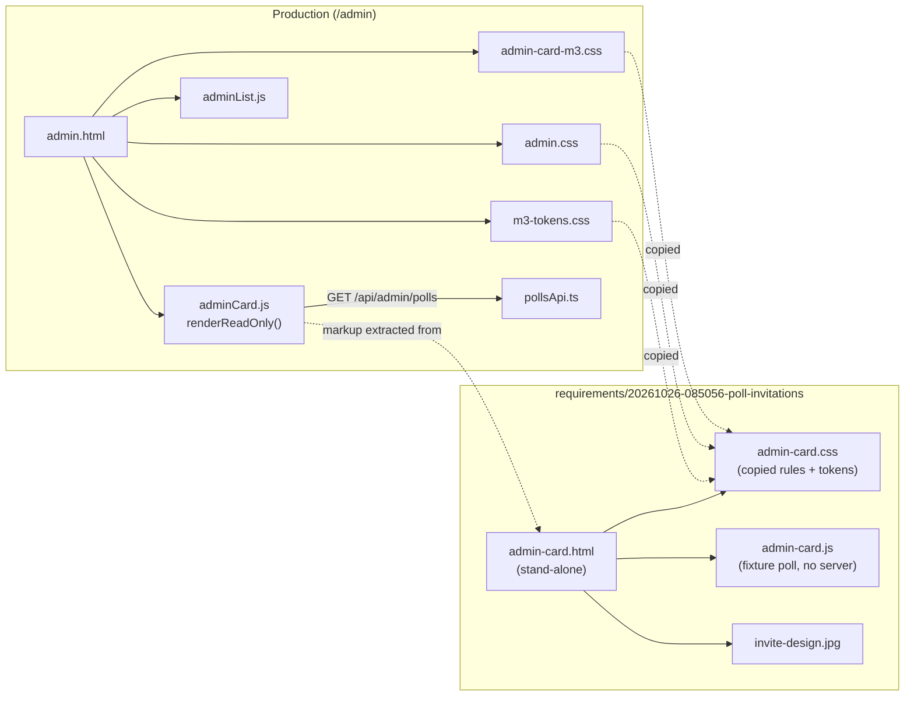
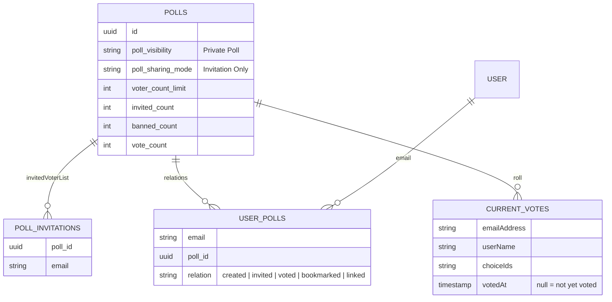
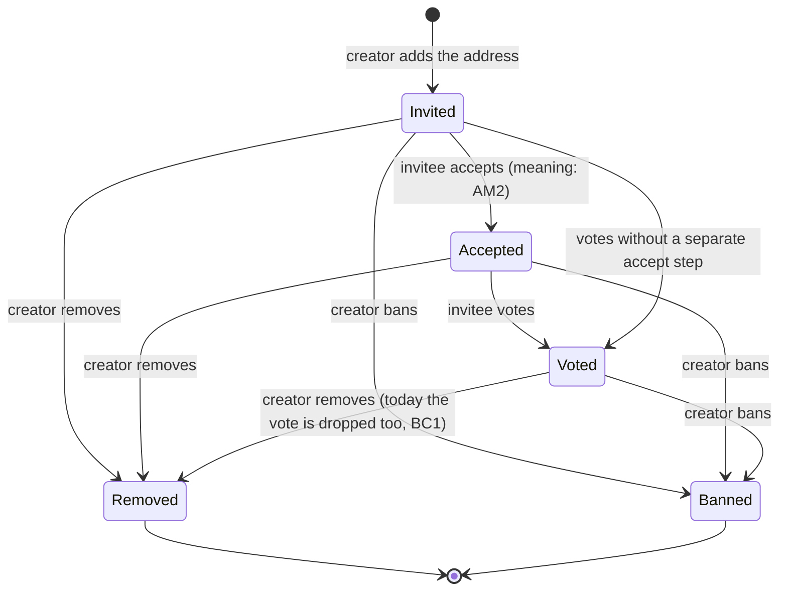
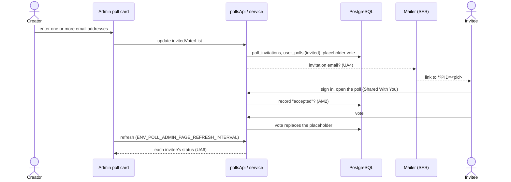

# High Level Requirements

Requirements: `requirements/20261026-085056-poll-invitations/requirements.md`  
External Files: `invite-design.jpg` (copied from `dontTrack/` by UA1)  
Generated: 2026-10-26 8:51 AM  

# Initial High-Level Requirements

We are designing the UI/UX for a Poll creator to invite users to a Poll that is "Invitation Only". 
The system should allow the creator to enter email addresses to invite and manage the list of invitees. 
The creator can see which invitees have accepted the invitation, and subsequently voted.  
The interface should be intuitive.

The first step is to extract an Admin Poll Card for a poll that has been created as "Invitation Only".
The screenshot below is a starting point.

Extract a stand-alone Admin Poll Card component from the screenshot above.  
Place the html/css/js in the requirements folder for this requirement.

## Additional Requirements and Research Requests

**Instructions To The Developer**  
Enter any additional requirements or research requests under the ## Additional Requirements and Research Requests heading above.  
When you Type or Say: "Next" in the CC CLI terminal, the additional requirements and research requests will be applied to the report.  
  
You may leave these instructions here. They will be ignored when "Next" is executed.  

✅ Applied 2026-10-26 11:27 AM: 1 requirement added to requirements.md (findings UA14, UA15); no research request.  
✅ Applied 2026-10-26 12:21 PM: 3 requirements added to requirements.md (findings IN2, AM4); no research request.  
✅ Applied 2026-10-26 12:59 PM: 1 requirement added to requirements.md (findings UA16, UA17); no research request.  
✅ Applied 2026-10-26 1:09 PM: 1 question added to requirements.md (finding UA18); no research request.  

## 1. Overview and Scope

The feature gives the creator of an **Invitation Only** poll (a `Private Poll` whose `pollSharingMode` is `Invitation Only`) a way to:  

- enter the email addresses of the people they invite;  
- manage that list (add, remove);  
- see, for each invitee, whether they have **accepted** the invitation and whether they have **voted**.  

The requirements name a **first step**: extract the admin poll card shown in the screenshot (the read-only face of an OPEN Invitation Only poll on `/admin`) as a stand-alone component — HTML, CSS and JavaScript — kept in this requirements folder.  
That stand-alone card is the canvas on which the invitation interface will then be designed.  

The screenshot shows, from top to bottom:  

- the card header: `Poll State Is: OPEN` and the icon buttons Duplicate, Copy link, Results, Delete and a kebab (more) menu;  
- the dates panel: the `Open` / `Close` / `Archive` state buttons, `Created By`, `Created`, `Launched`;  
- the counts panel: `Vote Count`, `Invitation Count` (shown only for an Invitation Only poll), `Banned Voter Count`;  
- the Settings Summary: title, subtitle and the underlined, linked sentences ("Your poll is a Private Poll. Only people you invite by email can vote. …").  

These are produced today by `renderReadOnly()` in `src/public/adminCard.js` (around line 2124), styled by `admin.css` and `admin-card-m3.css` over `m3-tokens.css`.  

## 2. What Exists Today

| Area | Today | Where |
|---|---|---|
| Invited list | `invitedVoterList: string[]` on the poll, stored in the `poll_invitations` roster; `polls.invited_count` mirrors its length | `src/polls/store.ts`, `src/db/schema.ts` |
| Writing the list | `PATCH`/update accepts `invitedVoterList` and `bannedVoterList`; banning removes an invitation; on an Invitation Only poll each invited address gets a not-yet-voted placeholder in `currentVotes`, and a removed address's vote is dropped | `src/polls/service.ts` 593–625 |
| Client that sends the list | **None.** No script in `src/public` sends `invitedVoterList`; the editor that did was replaced by the 024 Step 6 wizard | `git log -S invitedVoterList -- src/public` |
| Voting gate | an Invitation Only poll refuses a caller not on the list (`403 You are not invited to this poll.`) | `src/polls/service.ts` 351, 394 |
| Invitee's view | an `invited` row in `user_polls` puts the poll in the invitee's **Shared With You** tab; the card says "You were invited" | `src/polls/store.ts` 545, `src/polls/userPolls.ts` 87, `pollCard.js` 1061 |
| "Accepted" | **No such state.** The nearest are `linked` (opened the shared link) and `voted` | `UserPollRelation` in `src/db/schema.ts` |
| Invitation email | **None.** The email templates are sign-in, create-account, email-change, account-deleted and email-changed | `src/email/templates.ts` |
| Admin card counts | `Vote Count`, `Invitation Count` (Invitation Only only), `Banned Voter Count` | `adminCard.js` 2145–2147 |
| Participant list | the poll card's `Participants` and `Banned Voter List` sections, paged by `ENV_PARTICIPANTS_VIEWPORT_SIZE` | `pollCard.js` |
| Prototypes | stand-alone design pages live in `prototypes/<NAME>/`, served unlisted at `/prototypes/<name>/` only when named in `ENV_PROTOTYPES` | `prototypes/`, `devScripts/serve-prototypes.ts` |

## 3. Component View — the Stand-Alone Card Beside Production

The stand-alone card has no server: the poll in the screenshot becomes a fixture inside the page.  
How it is built and how it is opened are AM1 and UA2.  

## 4. Data Model — Invitations Today

An "accepted" state would need a new relation value or column (AM2); the first step adds no data.  

## 5. Invitee Lifecycle (Proposed)

## 6. Invitation Flow (Proposed, Beyond the First Step)

## 7. Breaking Changes and Technical Debt

**Breaking Changes**  

- **BC1. Removing an invitee who has voted drops their vote.**  
  `updatePoll` keeps only invited addresses on an Invitation Only poll's roll, so a removed voter's vote disappears from the counts.  
  The first step changes nothing; it matters once removal is offered in the card (UA5).  

**Technical Debt**  

- **TD1. An Invitation Only poll cannot get invitees from the interface.**  
  The server accepts `invitedVoterList`, but since 024 Step 6 no client sends it, so `Invitation Count` is always 0 for a poll created through `/admin`.  
  This feature is what closes the gap.  
- **TD2. `adminCard.js` is one 2,375-line module.**  
  `renderReadOnly()` depends on helpers shared with the wizard (`el`, `readOnlyField`, `buildSummary`, `stateButton`, `buildReadOnlyHeader`), so a stand-alone copy either carries a slice of them or duplicates their output (AM1).  

## 8. Assumptions

- The first step changes no production file: the stand-alone card lives only in this requirements folder.  
- The card's data is the screenshot's poll: OPEN, `Private Poll`, `Invitation Only`, `Users can see who voted for what`, choices `Nov 14`, `Nov 21`, 1 to 2 choices, vote can change, closes Fri, Nov 13 at 8:07 AM, and the creator shown.  
- The header icons and state buttons keep their look and hover state but do nothing in the stand-alone card.  
- The invitation interface is added to the admin card on `/admin`; the voter-facing poll card is not changed by the first step.  
- No new dependency.  

## 9. Findings

### 9.1 Inconsistencies

**IN1. Is the invitation design still to be drawn before the feature is specified?**  
✅ Resolved  
✅ Requirements File Updated: 2026-10-26 10:06 AM  
**Notes**: Recommendation accepted in file 2026-10-26: Recommendation A, the written design is the design, the feature is specified now, and extracting the stand-alone card is the plan's first task;  
the Scope bullet in requirements.md (NC1) now says so.  

The scope (NC1) says the invitation design is drawn on the stand-alone card and added under Additional Requirements, and only then is the feature specified.  
The resolved requirements now describe that design in words: the Invitees panel, its chips and paging, the add field, remove and resend, the counts, the route, the email and its limits (UA4–UA11).  
So the requirements both declare a design step still to come and already contain its result.  

  - **Recommendation A** _(recommended)_: **the written design is the design: specify the feature now, and make extracting the stand-alone card the first task of the plan, where the panel is drawn on it before production code changes.**  

    ➡️ [x] **Accepted**  
    - <u>Pros</u>: nothing waits outside the Spec Kit workflow;  
      the card is still built first, and every design decision already made is carried into the spec.  
    - <u>Cons</u>: a visual change found while drawing the panel becomes a spec change (`/speckit-clarify` or a tweak).  

  - **Recommendation B**: **keep NC1 as it stands: extract the card and draw the panel now, outside the workflow, add the drawing under Additional Requirements, then specify.**  

    ➡️ [ ] **Accepted**  
    - <u>Pros</u>: the spec starts from a picture, not only words.  
    - <u>Cons</u>: the report is ready for `/speckit-specify` but must not be used yet;  
      the extraction is done by hand, with no task or test recording it.  

  - **Developer Resolution C**:  

    ➡️ [ ] **Accepted**  

**IN2. The new heading and subject replace UA15's, and the reminder has no matching wording.**  
✅ Resolved  
✅ Requirements File Updated: 2026-10-26 12:43 PM  
**Notes**: Recommendation accepted in file 2026-10-26: Recommendation, the new subject and heading (title on its own line) replace UA15's, the reminder gets matching wording, and the layout gains an optional second heading line;  
UA15's Subject, Heading and reminder lines in requirements.md updated.  

The additional requirements of 2026-10-26 12:21 PM change the invitation's heading to `You are invited to vote in a Private Poll:` followed by `"<POLL TITLE>"` on its own line, and its subject to `<SENDER NAME> invited you to a private poll on CrowdPoll: "<POLL TITLE>"`.  
UA15, resolved, still reads `You're invited to vote` and `<creator name> invited you to a private poll on CrowdPoll`.  
UA15's reminder version takes its subject from the invitation's, with `Reminder: ` before it, and has its own heading, `A reminder about your invitation`;  
the new requirements say nothing about the reminder.  
The production layout writes the heading as one line of text, so the title on a line of its own needs the layout to accept a second heading line.  

  - **Recommendation**: **the new wording replaces UA15's: the invitation's subject is `<creator name> invited you to a private poll on CrowdPoll: "<title>"` and its heading `You are invited to vote in a Private Poll:` with `"<title>"` on the next line; the reminder's subject is `Reminder: ` followed by the invitation's, and its heading `Reminder: you are invited to vote in a Private Poll:` with `"<title>"` on the next line; the layout gains an optional second heading line, which every other email leaves out.**  

    ➡️ [x] **Accepted**  
    - The subject and the heading both name the poll, so the invitee sees which poll it is before opening the email;  
      the reminder reads as the same message, marked as a reminder.  
    - UA15's other lines are unchanged.  

  - **Developer Resolution B**:  

    ➡️ [ ] **Accepted**  

### 9.2 Ambiguities

**AM1. What is the stand-alone card extracted from?**  
✅ Resolved  
✅ Requirements File Updated: 2026-10-26 9:24 AM  
**Notes**: Recommendation accepted in file 2026-10-26: Recommendation A, capture the real markup and styles (a static snapshot of `renderReadOnly()`, the production rules in one stylesheet, a small interaction script, no server);  
added under "Resolved Requirements" in requirements.md.  

The requirements say to extract the card "from the screenshot".  
The screenshot is a picture of what `renderReadOnly()` in `adminCard.js` draws with the production stylesheets, so the card can be rebuilt from the picture, captured from the real code, or run from the real code.  

  - **Recommendation A** _(recommended)_: **capture the real markup and styles: a static HTML snapshot of `renderReadOnly()`'s output for the screenshot's poll, the rules it uses copied from `m3-tokens.css`, `admin.css` and `admin-card-m3.css` into one stylesheet, and a small script for the card's own interactions (hover, ripple, tooltips) with no server.**  

    ➡️ [x] **Accepted**  
    - <u>Pros</u>: it looks exactly like production, class names included, so the invitation design can later be carried back into `adminCard.js` and the sheets with little translation.  
    - <u>Cons</u>: it is a copy, and drifts if the production card changes before the design is done.  

  - **Recommendation B**: **rebuild the card by eye from the screenshot, with new markup and CSS.**  

    ➡️ [ ] **Accepted**  
    - <u>Pros</u>: small, clean files with nothing borrowed.  
    - <u>Cons</u>: it will differ from production in spacing, tokens and dark mode, and every design decision must be translated back by hand.  

  - **Recommendation C**: **load the real `adminCard.js` in the page and feed it the screenshot's poll from a stubbed `/api`.**  

    ➡️ [ ] **Accepted**  
    - <u>Pros</u>: always identical to production, wizard and all.  
    - <u>Cons</u>: not stand-alone: it needs the whole 2,375-line module and its page dependencies (`app.js`, `m3-ripple.js`, `tooltip-m3.js`), and the invitation design would have to be written inside that module from the start.  

  - **Developer Resolution D**:  

    ➡️ [ ] **Accepted**  

**AM2. What does "accepted the invitation" mean?**  
✅ Resolved  
✅ Requirements File Updated: 2026-10-26 9:17 AM  
**Notes**: Recommendation accepted in file 2026-10-26: Recommendation A, accepted = the invitee has signed in and opened the poll (from Shared With You or the link), no extra button;  
added under "Resolved Requirements" in requirements.md, including that opening the poll from Shared With You is recorded too.  

The creator should see "which invitees have accepted the invitation, and subsequently voted".  
The system has no acceptance today: an invited address gets an `invited` row and a not-yet-voted placeholder, and the nearest events are `linked` (the person opened the poll's link) and `voted`.  

  - **Recommendation A** _(recommended)_: **accepted = the invitee has signed in and opened the poll (from Shared With You or the link); no extra button.**  

    ➡️ [x] **Accepted**  
    - <u>Pros</u>: nothing for the invitee to learn;  
      it builds on the existing `linked` relation and the Shared With You tab.  
    - <u>Cons</u>: "opened" is weaker than a deliberate yes;  
      opening the poll from the Shared With You tab must now be recorded too.  

  - **Recommendation B**: **an explicit Accept / Decline on the invitee's poll card; voting is allowed only after Accept.**  

    ➡️ [ ] **Accepted**  
    - <u>Pros</u>: a clear answer, and the creator also learns who declined.  
    - <u>Cons</u>: an extra step before voting, a new card control and a new stored state, and a decline the creator may want to reverse.  

  - **Recommendation C**: **accepted = the invited address has a CrowdPoll account.**  

    ➡️ [ ] **Accepted**  
    - <u>Pros</u>: no new state; it can be read from `user`.  
    - <u>Cons</u>: says nothing about this poll; an existing user is "accepted" the moment they are invited.  

  - **Developer Resolution D**:  

    ➡️ [ ] **Accepted**  

**AM3. Does resending an invitation break the email's promise not to contact the invitee again?**  
✅ Resolved  
✅ Requirements File Updated: 2026-10-26 10:01 AM  
**Notes**: Recommendation accepted in file 2026-10-26: Recommendation A, one resend per invitee per poll, at least 24 hours after the last email, named in the email's promise;  
added under "Resolved Requirements" in requirements.md.  

UA4 has the invitation email say that an invitee who ignores it will not be contacted again, unless privately invited again or the law requires it.  
UA5 lets the creator resend an invitation.  
A resend to someone who chose to ignore the first email can be read as a broken promise, or as part of the same invitation.  

  - **Recommendation A** _(recommended)_: **allow one resend per invitee per poll, no sooner than 24 hours after the last email; the email's promise names it: "you may receive one reminder about this poll".**  

    ➡️ [x] **Accepted**  
    - <u>Pros</u>: the creator can nudge someone who missed the email, and the invitee is told exactly what to expect.  
    - <u>Cons</u>: one more rule to show in the card (the Resend button is greyed after its one use, with the reason).  

  - **Recommendation B**: **no resend: an invitation is emailed once; to email again the creator removes and re-adds the address.**  

    ➡️ [ ] **Accepted**  
    - <u>Pros</u>: the promise holds without qualification.  
    - <u>Cons</u>: removing and re-adding is a resend by another name, and drops a vote if the invitee has voted (BC1).  

  - **Developer Resolution C**:  

    ➡️ [ ] **Accepted**  

**AM4. What should the "ignore this email" paragraph say?**  
✅ Resolved  
✅ Requirements File Updated: 2026-10-26 12:28 PM  
**Notes**: Recommendation accepted in file 2026-10-26: Recommendation A, the given text keeping UA4's two exceptions;  
UA15's Closing 1 in requirements.md now reads "…except for up to one reminder about this poll if <creator name> re-sends it, another private invitation, or where the law requires it."  

The additional requirements of 2026-10-26 12:21 PM say "Change this paragraph", then give one text under "From:" and none under "To:":  
`If you'd rather not take part, just ignore this email. We won't contact you again, except for up to one reminder about this poll if <SENDER_NAME> re-sends it.`  
That text is not the draft's current paragraph (UA15, Closing 1), which reads `… except for one reminder about this poll if <creator name> sends it, another private invitation, or where the law requires it.`;  
so it reads as the new wording, given under the wrong label.  
The given text also leaves out two exceptions that UA4, resolved, puts in the email: being privately invited again, and where the law requires contact.  

  - **Recommendation A** _(recommended)_: **the given text becomes the new paragraph, keeping UA4's two exceptions: `If you'd rather not take part, just ignore this email. We won't contact you again, except for up to one reminder about this poll if <creator name> re-sends it, another private invitation, or where the law requires it.`**  

    ➡️ [x] **Accepted**  
    - <u>Pros</u>: takes the new wording ("up to one reminder", "re-sends") and keeps the promise exact: a later invitation to another poll, or a legally required notice, does not break it.  
    - <u>Cons</u>: a longer sentence than the one given.  

  - **Recommendation B**: **the given text exactly, and UA4 no longer promises the two exceptions in the email.**  

    ➡️ [ ] **Accepted**  
    - <u>Pros</u>: the shorter sentence, as written.  
    - <u>Cons</u>: a later private invitation to another poll, or a notice the law requires, would contact someone the email said would not be contacted again.  

  - **Recommendation C**: **keep the current paragraph (UA15, Closing 1).**  

    ➡️ [ ] **Accepted**  
    - <u>Pros</u>: nothing changes.  
    - <u>Cons</u>: ignores the requested change.  

  - **Developer Resolution D**:  

    ➡️ [ ] **Accepted**  

### 9.3 Unspecified Aspects

**UA1. The screenshot is not in the requirements folder.**  
✅ Resolved  
✅ Requirements File Updated: 2026-10-26 9:03 AM  
**Notes**: Recommendation accepted by "Accept all" 2026-10-26: Recommendation, copy the image into the requirements folder and fix the link;  
`invite-design.jpg` copied from `dontTrack/` into the folder, and the link in requirements.md is now ``.  

The requirements link `dontTrack\invite-design.jpg`, a path relative to the requirements folder that does not exist there.  
The image is at the project root's `dontTrack/invite-design.jpg`, which `.gitignore` excludes, so the link is broken in the folder and the picture is never committed with the requirements.  
The backslash also fails as a link outside Windows.  

  - **Recommendation**: **copy the image into the requirements folder as `invite-design.jpg` and change the link to ``.**  

    ➡️ [X] **Accepted**  
    - The folder then holds every file the requirements use, as the requirements layout intends, and the link works in any viewer.  
    - The original in `dontTrack/` is left where it is.  

  - **Developer Resolution B**:  

    ➡️ [ ] **Accepted**  

**UA2. How is the stand-alone card opened?**  
✅ Resolved  
✅ Requirements File Updated: 2026-10-26 9:17 AM  
**Notes**: Recommendation accepted in file 2026-10-26: Recommendation A, keep the card in the requirements folder, self-contained, opened by double-click;  
added under "Resolved Requirements" in requirements.md.  

The requirements put the HTML, CSS and JavaScript in the requirements folder.  
That folder is not served by the app, unlike `prototypes/<NAME>/`, which is served at `/prototypes/<name>/` when listed in `ENV_PROTOTYPES`.  
The production pages load fonts and sheets by root paths (`/fonts/…`, `/m3-tokens.css`), which do not resolve when a file is opened from disk.  

  - **Recommendation A** _(recommended)_: **keep it in the requirements folder, as asked, and make it self-contained: relative paths only, the Roboto `woff2` files it needs copied beside it, so `admin-card.html` opens by double-click (`file://`).**  

    ➡️ [x] **Accepted**  
    - <u>Pros</u>: matches the requirement;  
      no server, no setting, and it travels with the requirements.  
    - <u>Cons</u>: it cannot be opened on a phone over the network;  
      phone widths are checked in the browser's device toolbar.  

  - **Recommendation B**: **put it in `prototypes/INVITE-ADMIN-CARD/` and serve it with `ENV_PROTOTYPES=INVITE-ADMIN-CARD`; the requirements folder links to it.**  

    ➡️ [ ] **Accepted**  
    - <u>Pros</u>: the project's established prototype route;  
      it can be opened on a real phone and use the production fonts.  
    - <u>Cons</u>: contradicts "place the html/css/js in the requirements folder";  
      needs the dev server and a setting.  

  - **Developer Resolution C**:  

    ➡️ [ ] **Accepted**  

**UA3. Which widths and themes must the stand-alone card render?**  
✅ Resolved  
✅ Requirements File Updated: 2026-10-26 9:03 AM  
**Notes**: Recommendation accepted by "Accept all" 2026-10-26: Recommendation, light and dark themes at desktop and 390 px phone width, with a light/dark switch;  
added under "Resolved Requirements" in requirements.md.  

The production card has phone rules (below 640 px, the 420 px card column) and a dark theme (`@media (prefers-color-scheme: dark)` and `data-theme`).  
The screenshot shows only the light desktop card.  

  - **Recommendation**: **the light and dark themes, at desktop width and at phone width (390 px), using the production rules for each; a light/dark switch at the top of the page.**  

    ➡️ [X] **Accepted**  
    - The invitation interface will have to work in all four, so the canvas it is designed on should show them.  

  - **Developer Resolution B**:  

    ➡️ [ ] **Accepted**  

**UA4. How does an invitee learn they are invited?**  
✅ Resolved  
✅ Requirements File Updated: 2026-10-26 9:17 AM  
**Notes**: Recommendation accepted in file 2026-10-26: Developer Resolution C, Recommendation A (an invitation email to each newly added address, with a link to the poll) plus the email's required content;  
added under "Resolved Requirements" in requirements.md: the inviter's name and address, the poll link, "Invitation Only", anonymity when it applies, "ignore this email" with no further contact, and the GDPR terms;  
the GDPR wording may also call for a change to the Privacy Policy (`/privacy`), to be settled when the email is designed.  

The creator enters "email addresses to invite", but nothing is sent today: an invited person finds the poll only in their Shared With You tab, if they sign in.  
There is no invitation email among the templates.  

  - **Recommendation A** _(recommended)_: **send an invitation email, through the existing SES mailer and email layout, to each newly added address, with a link to `/?PID=<pid>`; addresses already invited are not emailed again.**  

    ➡️ [ ] **Accepted**  
    - <u>Pros</u>: "invite by email" means what it says;  
      the `/?PID=` sign-in flow (feature 026) already brings a signed-out invitee to the poll.  
    - <u>Cons</u>: a new message type, a send rate to bound (a creator could paste 100 addresses), and the pre-launch allowlist (`ENV_ALLOWED_EMAILS`) may refuse the invitee's sign-in.  

  - **Recommendation B**: **no email: the creator shares the poll's link; the invitee sees it in Shared With You after signing in.**  

    ➡️ [ ] **Accepted**  
    - <u>Pros</u>: no new email, no sending limits.  
    - <u>Cons</u>: an invitee who is not told never comes;  
      "accepted" is then mostly a measure of whether the creator shared the link.  

  - **Developer Resolution C**:  

    ➡️ [X] **Accepted**  
    Recommendation A, with the following additions for what must be included in the invitation email when it is designed in subsequent items in this requirement.
    - The email must indicate who has invited them, by username and email address, and that is why CrowdPoll has sent them an email.  
    - The email must have a link to the poll.
    - The email must clearly state that the invitation is for an "Invitation Only" private poll.  
    - If the Poll is anonymous to the creator, the email must indicate that the invitee's vote will be anonymous.  
    - The email will state that if the invitee does not wish to participate to simply ignore the email. In that case, CrowdPoll will not contact them in the future for any other reason except if they are privately invited in the future or as required by law.
    - The email will state any General Data Protection Regulation (GDPR) that apply to the invitee's personal data.
    

**UA5. What does "manage the list of invitees" include?**  
✅ Resolved  
✅ Requirements File Updated: 2026-10-26 9:03 AM  
**Notes**: Recommendation accepted by "Accept all" 2026-10-26: Recommendation, add many at once as validated chips, remove (confirmed when the invitee has voted), resend, capped at the voter limit, editable except when CLOSED or ARCHIVED;  
added under "Resolved Requirements" in requirements.md;  
resending depends on UA4.  

The requirements name entering addresses and managing the list, but not which operations, how many addresses, or what happens to an invitee who has already voted.  
The server today validates the list, removes banned addresses from it and caps a private poll's voters at `voterCountLimit` (at most `ENV_PRIVATE_VOTER_LIMIT_DEFAULT`, 100).  

  - **Recommendation**: **add one or many addresses at once (pasted, separated by commas, spaces or new lines; each validated and shown as a chip, duplicates and banned addresses refused with a reason), remove an invitee, and resend an invitation (if UA4 A); the list is capped at the poll's voter limit; removing an invitee who has voted asks for confirmation and says their vote will be removed (BC1).**  

    ➡️ [X] **Accepted**  
    - Banning stays where it is today (the Banned Voter List), and a ban still withdraws the invitation.  
    - Editing the list is allowed in every state but CLOSED and ARCHIVED.  

  - **Developer Resolution B**:  

    ➡️ [ ] **Accepted**  

**UA6. Where on the card does the creator see each invitee's status?**  
✅ Resolved  
✅ Requirements File Updated: 2026-10-26 9:03 AM  
**Notes**: Recommendation accepted by "Accept all" 2026-10-26: Recommendation, an `Invitees` panel below the counts with Invited / Accepted / Voted chips, paged like Participants, and an `Accepted Count`;  
added under "Resolved Requirements" in requirements.md;  
what "Accepted" means is AM2.  

The screenshot's card has only `Invitation Count`.  
The requirements do not say where the list and its statuses go, or how a long list is shown.  

  - **Recommendation**: **a new `Invitees` panel below the counts panel: the add field, then one row per invitee with the address (and name, once known) and a status chip — `Invited`, `Accepted`, `Voted` — paged by `ENV_PARTICIPANTS_VIEWPORT_SIZE` like the poll card's Participants; the counts panel gains `Accepted Count` beside `Invitation Count`; the panel is shown only for an Invitation Only poll.**  

    ➡️ [X] **Accepted**  
    - It reuses the card's panel look and the paging the creator already knows.  
    - The statuses refresh with the admin list (`ENV_POLL_ADMIN_PAGE_REFRESH_INTERVAL`).  

  - **Developer Resolution B**:  

    ➡️ [ ] **Accepted**  

**UA7. How is an invited address matched to the invitee's account?**  
✅ Resolved  
✅ Requirements File Updated: 2026-10-26 10:01 AM  
**Notes**: Recommendation accepted in file 2026-10-26: Recommendation, match invited addresses to accounts by email key everywhere the invitation is checked;  
added under "Resolved Requirements" in requirements.md.  

The voting gate and the "accepted" and "voted" statuses compare the signed-in user's address with the invited list exactly (`invitedVoterList.includes(callerEmail)`, after lower-casing).  
Account creation and email change compare addresses by email key (`emailKey`, feature 20261019-153514), so `j.doe@gmail.com` and `jdoe@gmail.com` are one account.  
An invitee invited at one spelling who signs in with the other is refused as "not invited", and never shows as accepted.  

  - **Recommendation**: **match an invited address to an account by email key everywhere the invitation is checked (the voting gate, the Shared With You row, the Accepted and Voted statuses), with the TypeScript `emailKeyOf` twin; the stored address stays as the creator typed it; two addresses with the same email key are refused as duplicates when added.**  

    ➡️ [x] **Accepted**  
    - It follows the rule the account system already uses, so an invitation reaches the person, not the spelling.  

  - **Developer Resolution B**:  

    ➡️ [ ] **Accepted**  

**UA8. What happens when an invitee is not on the pre-launch allowlist?**  
✅ Resolved  
✅ Requirements File Updated: 2026-10-26 10:01 AM  
**Notes**: Recommendation accepted in file 2026-10-26: Recommendation A, while the allowlist is on, refuse an address that is not allowed, with a reason, and send nothing;  
added under "Resolved Requirements" in requirements.md.  

While `ENV_ALLOWED_EMAILS` is set, only listed addresses (and `ENV_ADMINS`) may create an account or sign in.  
An invitation emailed to anyone else leads to `/login?error=not-launched`.  

  - **Recommendation A** _(recommended)_: **while the allowlist is on, the add field refuses an address that is not allowed, with the reason "CrowdPoll has not launched for this address yet"; no email is sent.**  

    ➡️ [x] **Accepted**  
    - <u>Pros</u>: no one is sent a link that cannot work;  
      the allowlist stays the one place that decides who gets in.  
    - <u>Cons</u>: the add field reads the allowlist, a server check on every add.  

  - **Recommendation B**: **an invitation also allows its address to sign in, as if listed.**  

    ➡️ [ ] **Accepted**  
    - <u>Pros</u>: invitations work before launch.  
    - <u>Cons</u>: any creator can let anyone in, which defeats the allowlist (feature 20261021-143942).  

  - **Developer Resolution C**:  

    ➡️ [ ] **Accepted**  

**UA9. How many invitation emails may a creator send?**  
✅ Resolved  
✅ Requirements File Updated: 2026-10-26 10:01 AM  
**Notes**: Recommendation accepted in file 2026-10-26: Recommendation, a per-creator `ENV_MAX_INVITATIONS_PER_DAY` cap (default 200) and a `Not delivered` status for failed sends;  
added under "Resolved Requirements" in requirements.md.  

A poll may hold up to its voter limit of invitees (100 by default), and a creator may own many polls.  
Each invitation is an email sent through SES, under the account's sending quota and reputation.  
The existing email rate limit (`ENV_EMAIL_RATE_LIMIT_*`) covers the sign-in endpoints only.  

  - **Recommendation**: **a per-creator cap on invitation emails, `ENV_MAX_INVITATIONS_PER_DAY` (default 200), counted over a rolling 24 hours; an add that would exceed it is refused with the time it frees up; sends run through the existing mailer one by one, and an invitee whose email failed shows `Not delivered` in the Invitees panel.**  

    ➡️ [x] **Accepted**  
    - It bounds the cost and the spam risk of one account, and tells the creator what happened to each email.  
    - The new variable is documented in `CLAUDE.md`'s table and the launch templates.  

  - **Developer Resolution B**:  

    ➡️ [ ] **Accepted**  

**UA10. Does a vote also count as accepting?**  
✅ Resolved  
✅ Requirements File Updated: 2026-10-26 10:01 AM  
**Notes**: Recommendation accepted in file 2026-10-26: Recommendation, a vote records acceptance too, and the chip shows the furthest step reached;  
added under "Resolved Requirements" in requirements.md.  

AM2 defines "accepted" as signing in and opening the poll.  
An invitee can vote from the poll card the moment they open it, and the lifecycle diagram (section 5) still shows a direct `Invited → Voted` step.  

  - **Recommendation**: **voting records acceptance too, so every voter is also accepted; the status chip shows the furthest step reached (`Voted` over `Accepted` over `Invited`); the diagram's direct `Invited → Voted` step reads as "opened and voted at once".**  

    ➡️ [x] **Accepted**  
    - The counts then always agree: `Accepted Count` ≥ `Vote Count` among invitees.  

  - **Developer Resolution B**:  

    ➡️ [ ] **Accepted**  

**UA11. Does editing the invitees of an open poll pause voting?**  
✅ Resolved  
✅ Requirements File Updated: 2026-10-26 10:01 AM  
**Notes**: Recommendation accepted in file 2026-10-26: Recommendation, a dedicated `POST /api/admin/polls/:pid/invitees` route that skips the edit session and never pauses voting;  
added under "Resolved Requirements" in requirements.md.  

UA5 lets the creator edit the list in every state but CLOSED and ARCHIVED.  
Today an edit to an existing poll goes through the edit session, which sets the poll to `EDITING` and pauses voting until it is released;  
the bar-colour change (feature 029) is the one edit with its own route that skips review.  

  - **Recommendation**: **invitee changes do not take the edit session: a dedicated route, `POST /api/admin/polls/:pid/invitees` (add, remove, resend), behind `requireOwnPoll`, changes the list, the roll placeholders and `user_polls` in one write, sends the emails, and leaves the poll's state, its review and its voting untouched.**  

    ➡️ [x] **Accepted**  
    - An invitation never needs screening, and pausing a live poll to add one person would surprise its voters.  
    - The route is described in `postman/openapi.json`.  

  - **Developer Resolution B**:  

    ➡️ [ ] **Accepted**  

**UA12. What changes in the Privacy Policy and in account deletion?**  
✅ Resolved  
✅ Requirements File Updated: 2026-10-26 10:03 AM  
**Notes**: Recommendation accepted in file 2026-10-26: Recommendation, the Privacy Policy names the invitation email and its reminder, the email links to `/privacy` for its GDPR statement, and account deletion removes invitations by email key;  
added under "Resolved Requirements" in requirements.md.  

The Privacy Policy (`/privacy`) already says a poll's creator may type someone's address to invite them, used only for that poll.  
It lists the emails CrowdPoll sends as the ones a person asks for; an invitation email and its one reminder (AM3) are sent to someone who did not ask.  
UA4 asks the email to state the GDPR terms for the invitee's data.  
Deleting an account removes the person's invitations by exact address (`src/legal/deleteAccount.ts`), while UA7 matches invitations by email key.  

  - **Recommendation**: **the Privacy Policy names the invitation email and its one reminder, sent at a poll creator's request, and how an invitee without an account has their address removed; the invitation email's GDPR statement is one sentence with a link to `/privacy`; account deletion removes invitations by email key, as UA7 matches them; `TERMS_VERSION` is not raised, since the Terms do not change.**  

    ➡️ [x] **Accepted**  
    - The policy then describes every email CrowdPoll sends, and deletion removes every invitation that could reach the account.  

  - **Developer Resolution B**:  

    ➡️ [ ] **Accepted**  

**UA13. When are invitation emails sent for a poll that is not open yet?**  
✅ Resolved  
✅ Requirements File Updated: 2026-10-26 10:17 AM  
**Notes**: Recommendation accepted in file 2026-10-26: Recommendation, no invitation email until the poll first becomes OPEN, then every pending invitation at once, with a `Not sent yet` chip until then;  
added under "Resolved Requirements" in requirements.md.  

UA5 lets the creator edit the list in every state but CLOSED and ARCHIVED, and UA4 emails each newly added address.  
A poll is not open to voters while it is `INITIALIZED`, `AWAITING APPROVAL`, `REJECTED` or `WAITING TO OPEN` (a start date in the future).  
An email sent then links to a poll the invitee cannot open or vote in, and it may still change, or never open.  

  - **Recommendation**: **addresses can be added in any of those states, but no email is sent until the poll first becomes OPEN; on that entry into OPEN every pending invitation is sent at once (counted against `ENV_MAX_INVITATIONS_PER_DAY`); an address added while the poll is OPEN is emailed straight away; until its email is sent an invitee's chip reads `Not sent yet`.**  

    ➡️ [x] **Accepted**  
    - No one is invited to a poll they cannot see, and the creator can prepare the list before launch.  
    - A poll returning to OPEN from EDITING does not resend: only invitations never sent are sent.  

  - **Developer Resolution B**:  

    ➡️ [ ] **Accepted**  

**UA14. What form does the first-draft invitation email take, and where does it live?**  
✅ Resolved  
✅ Requirements File Updated: 2026-10-26 11:31 AM  
**Notes**: Recommendation accepted in file 2026-10-26: Recommendation A, a stand-alone `invitation-email.html` in this folder, rendered by the production email layout, with anonymous-vote and reminder switches;  
added under "Resolved Requirements" in requirements.md.  

The additional requirement asks for a first draft of the invitation email template.  
It does not say whether the draft is the wording alone or the email as recipients see it, nor where it is kept.  
Every CrowdPoll email is built by one layout, `layout()` in `src/email/templates.ts`: the logo, a heading, paragraphs, one button, closing lines and a footer naming `support@crowdpoll.vote`, with inline styles.  
The admin card's design was settled on a stand-alone page in this folder (`admin-card.html`) before production changed.  

  - **Recommendation A** _(recommended)_: **a stand-alone `invitation-email.html` in this requirements folder, rendered by the production `layout()` from the draft wording (UA15), opened from disk like `admin-card.html`, with a switch for the anonymous-vote line and one for the reminder version; once approved, its wording becomes the production template.**  

    ➡️ [x] **Accepted**  
    - <u>Pros</u>: the draft is reviewed exactly as an invitee will see it, in the same layout as every other CrowdPoll email;  
      it follows the same design-first step as the admin card.  
    - <u>Cons</u>: one more file in the folder to keep in step with the wording.  

  - **Recommendation B**: **the wording only, written into `requirements.md`; the email's look is seen first when the template is implemented.**  

    ➡️ [ ] **Accepted**  
    - <u>Pros</u>: quick, and nothing to keep in step.  
    - <u>Cons</u>: the look, line lengths and the button are not reviewed until after the spec is written.  

  - **Developer Resolution C**:  

    ➡️ [ ] **Accepted**  

**UA15. What does the first-draft invitation email say?**  
✅ Resolved  
✅ Requirements File Updated: 2026-10-26 11:31 AM  
**Notes**: Recommendation accepted in file 2026-10-26: Recommendation, the draft wording (subject, preview text, heading, three paragraphs, button, two closing lines, and the reminder version);  
added under "Resolved Requirements" in requirements.md.  

UA4 lists what the email must contain, AM3 adds the one reminder, and UA12 makes its personal-data statement one sentence linking to `/privacy`.  
None of them gives the subject line, the heading, the button's text, the exact sentences, or how the reminder differs.  
`<creator name>`, `<creator email>` and `<title>` below come from the poll;  
`<link>` is the poll's link (`/?PID=<pid>`) and `<origin>` the site's address.  

  - **Recommendation**: **the first draft reads as follows.**  
    - **Subject**: `<creator name> invited you to a private poll on CrowdPoll`  
    - **Preview text**: `You're invited to vote in "<title>".`  
    - **Heading**: `You're invited to vote`  
    - **Paragraph 1**: `<creator name> (<creator email>) invited you to vote in their poll "<title>" on CrowdPoll. That's why we're writing to you.`  
    - **Paragraph 2**: `It's an Invitation Only private poll: only the people <creator name> invites can see it and vote.`  
    - **Paragraph 3**, only when the poll's votes are anonymous to the creator: `Your vote will be anonymous: <creator name> will not see how you voted.`  
    - **Button**: `Open the poll`, linking to `<link>`.  
    - **Closing 1**: `If you'd rather not take part, just ignore this email. We won't contact you again, except for one reminder about this poll if <creator name> sends it, another private invitation, or where the law requires it.`  
    - **Closing 2** (the personal-data sentence): `<creator name> gave us your address only for this poll; our Privacy Policy (<origin>/privacy) explains how we use it and how to have it removed.`  
    - **The reminder** is the same email, with the subject `Reminder: <creator name> invited you to a private poll on CrowdPoll`, the heading `A reminder about your invitation`, and Closing 1 `If you'd rather not take part, just ignore this email. This is the only reminder we'll send about this poll.`  

    ➡️ [x] **Accepted**  
    - It covers every item of UA4, the one reminder of AM3 and the single privacy sentence of UA12, in the site's existing email layout.  

  - **Developer Resolution B**:  

    ➡️ [ ] **Accepted**  

**UA16. Which values are "Poll Started" and "Poll Ends", and when are they read?**  
✅ Resolved  
✅ Requirements File Updated: 2026-10-26 1:02 PM  
**Notes**: Recommendation accepted in file 2026-10-26: Recommendation, Poll Started = `launched_at`, Poll Ends = `end_at` (left out when there is none), read when each email is sent, the last two lines before the button, plain text too;  
added under "Resolved Requirements" in requirements.md ("The poll's dates in the invitation email").  

The additional requirements of 2026-10-26 12:59 PM add, right before the "Open the poll" button, `Poll Started: <LAUNCHED DATE TIME>` and, when the poll has a close date, `Poll Ends: <CLOSE DATE TIME>`.  
A poll carries both a scheduled start (`start_at`) and the time it was launched (`launched_at`, stamped on every entry into OPEN except a return from EDITING, feature 019); the admin card shows them as `Start` and `Launched`.  
Its close date is the scheduled end, `end_at`, which the creator can change while the poll is open.  
An email is a snapshot: the invitation and its one reminder are sent at different times, and the plain-text part needs the same lines.  

  - **Recommendation**: **`Poll Started` is the poll's `launched_at` and `Poll Ends` its `end_at`, left out when the poll has no end; both are read when each email is sent, so a reminder shows the end as it is then; they are the last two lines before the button, one line each, and appear in the plain-text part in the same place.**  

    ➡️ [x] **Accepted**  
    - "Launched" is what the requirement names, and since emails are sent only while the poll is OPEN (UA13), `launched_at` is always set when one goes out.  
    - An end date changed after an email was sent is not corrected in that email; the poll card always shows the current one.  

  - **Developer Resolution B**:  

    ➡️ [ ] **Accepted**  

**UA17. In which time zone are the dates written?**  
✅ Resolved  
✅ Requirements File Updated: 2026-10-26 1:02 PM  
**Notes**: Recommendation accepted in file 2026-10-26: Recommendation A, the creator's time zone, named, sent by the admin card and stored on the poll (one new column), UTC when none is stored;  
added under "Resolved Requirements" in requirements.md ("The poll's dates in the invitation email").  

A web page shows dates in the reader's time zone, but an email is written by the server, which does not know the invitee's time zone.  
CrowdPoll stores no time zone for a poll, its creator or the invitee, and pending invitations are sent by a sweep when the poll opens (UA13), with no browser involved.  

  - **Recommendation A** _(recommended)_: **the creator's time zone, named: the admin card sends the browser's time zone (`Intl.DateTimeFormat().resolvedOptions().timeZone`) whenever it saves the poll or its invitees, the poll stores it (one new column), and the dates are written like `Monday, October 26, 2026, 12:59 PM EDT`.**  

    ➡️ [x] **Accepted**  
    - <u>Pros</u>: the times read as the creator meant them, and most invitees share the creator's time zone; the zone name makes them exact for everyone else.  
    - <u>Cons</u>: one more column and one more field on the card's requests; a poll saved before the change has no zone until it is next saved (it falls back to UTC).  

  - **Recommendation B**: **UTC, named: `Monday, October 26, 2026, 4:59 PM UTC`.**  

    ➡️ [ ] **Accepted**  
    - <u>Pros</u>: nothing stored, nothing sent; exact for every reader.  
    - <u>Cons</u>: most readers must convert it themselves, and it can show a different day from the creator's.  

  - **Developer Resolution C**:  

    ➡️ [ ] **Accepted**  

**UA18. Should a date name its zone as daylight or standard time, or by the zone alone?**  
✅ Resolved  
✅ Requirements File Updated: 2026-10-26 1:12 PM  
**Notes**: Recommendation accepted in file 2026-10-26: Recommendation B, keep the abbreviation of the zone in force on each date (`EDT`, then `EST`);  
the dates bullet under "Resolved Requirements" in requirements.md now says so; the draft email already writes them this way.  

The additional requirements of 2026-10-26 1:09 PM ask whether it is correct that the draft writes `Poll Started: Monday, October 26, 2026, 12:59 PM EDT` and `Poll Ends: Monday, November 2, 2026, 5:00 PM EST`.  
It is: daylight saving time in the US ends on Sunday, November 1, 2026, so the start is in Eastern Daylight Time (UTC−4) and the end in Eastern Standard Time (UTC−5); each date names the zone in force on that day (UA17).  
An invitee may still read two labels in one email as a mistake, and abbreviations such as `EST` or `CST` mean different zones in different countries.  

  - **Recommendation A** _(recommended)_: **name the zone without daylight or standard time, as people say it: `Monday, November 2, 2026, 5:00 PM Eastern Time` (`Intl`'s `longGeneric` name; `Central European Time`, `India Standard Time`, and `UTC` for a poll with no stored zone).**  

    ➡️ [ ] **Accepted**  
    - <u>Pros</u>: both lines carry the same label; the full name is clear in every country, and the clock time is still the local time on that day.  
    - <u>Cons</u>: a longer label; the UTC offset is not shown.  

  - **Recommendation B**: **keep the abbreviation of the zone in force on each date (`EDT`, then `EST`), as UA17 has it.**  

    ➡️ [X] **Accepted**  
    - <u>Pros</u>: nothing changes, and each label is exact.  
    - <u>Cons</u>: two labels in one email when a poll spans a clock change, and abbreviations that are ambiguous outside North America.  

  - **Developer Resolution C**:  

    ➡️ [ ] **Accepted**  

### 9.4 Needs Clarifications

**NC1. Is this feature only the first step, or the whole invitation interface?**  
✅ Resolved  
✅ Requirements File Updated: 2026-10-26 9:17 AM  
**Notes**: Recommendation accepted in file 2026-10-26: Recommendation A, the whole invitation interface, delivered in steps, specified only once the design is settled;  
added under "Resolved Requirements" in requirements.md.  

The requirements describe the whole goal (enter, manage, see accepted and voted), then say "the first step is to extract an Admin Poll Card".  
What `/speckit-specify` receives decides whether the spec covers a prototype only or a production change with server work (UA4–UA6).  

  - **Recommendation A** _(recommended)_: **the feature is the whole invitation interface, delivered in steps: step 1 extracts the stand-alone card; the invitation design is then drawn on it and added under Additional Requirements; only then is the feature specified.**  

    ➡️ [x] **Accepted**  
    - <u>Pros</u>: one feature, one spec, one report;  
      the design is settled on the stand-alone card before any production code changes.  
    - <u>Cons</u>: the report stays open longer, while the design is worked out.  

  - **Recommendation B**: **this feature is step 1 only, the stand-alone card; the invitation interface is a later feature with its own requirements.**  

    ➡️ [ ] **Accepted**  
    - <u>Pros</u>: small and done quickly.  
    - <u>Cons</u>: a spec and plan for a prototype that ships nothing;  
      UA4–UA6 and AM2 move to the later feature.  

  - **Developer Resolution C**:  

    ➡️ [ ] **Accepted**  

## 10. Requirements Report Complete Report  
  
- **Requirements Report Document:** requirements/20261026-085056-poll-invitations/requirements-report.md  
- **Requirements Document:** requirements/20261026-085056-poll-invitations/requirements.md  
- **Software Architecture Diagrams:** 4  
- **Inconsistencies:** 2  
- **Ambiguities:** 4  
- **Unspecified Aspects:** 18  
- **Needs Clarifications:** 1  
- **Research Results:** 0  
- **Breaking Changes:** 1  
- **Technical Debt items:** 2  
  
The requirements are ready for /speckit-specify.
To generate specs from the requirements document, use the `/speckit-specify` skill followed by the path (relative to the project root) to the requirements file.
At the prompt, Type:  
🟩 👉 /speckit-specify requirements/20261026-085056-poll-invitations/requirements.md  
