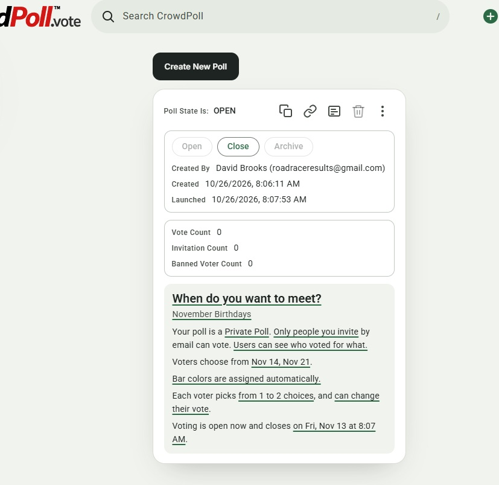

Start a new spec for these requirements called `20261026-085056-POLL-INVITATIONS`  
!! THIS FILE IS GENERATED USING THE SKILL `/speckit-requirements`. DO NOT EDIT OR DELETE THIS FILE !!  

# Initial High-Level Requirements

We are designing the UI/UX for a Poll creator to invite users to a Poll that is "Invitation Only". 
The system should allow the creator to enter email addresses to invite and manage the list of invitees. 
The creator can see which invitees have accepted the invitation, and subsequently voted.  
The interface should be intuitive.

The first step is to extract an Admin Poll Card for a poll that has been created as "Invitation Only".
The screenshot below is a starting point.


Extract a stand-alone Admin Poll Card component from the screenshot above.  
Place the html/css/js in the requirements folder for this requirement.

## Resolved Requirements

- **Scope (NC1, IN1).**  
  This feature is the whole invitation interface, delivered in steps.  
  The design is the one written in these requirements (UA4–UA12), and the feature is specified from them now.  
  Extracting the stand-alone admin poll card is the first task of the plan;  
  the Invitees panel is drawn on it before any production code changes.  
- **What the stand-alone card is extracted from (AM1).**  
  The card is captured from the real code, not redrawn from the screenshot: a static HTML snapshot of what `renderReadOnly()` in `src/public/adminCard.js` draws for the screenshot's poll, with production class names;  
  the rules it uses, copied from `m3-tokens.css`, `admin.css` and `admin-card-m3.css` into one stylesheet;  
  and a small script for the card's own interactions (hover, ripple, tooltips), with no server.  
- **Where the stand-alone card lives and how it is opened (UA2).**  
  The stand-alone card stays in this requirements folder and is self-contained: relative paths only, with the Roboto `woff2` files it needs copied beside it, so `admin-card.html` opens by double-click (`file://`).  
  Phone widths are checked in the browser's device toolbar.  
- **What "accepted the invitation" means (AM2).**  
  An invitee has accepted when they have signed in and opened the poll, from the Shared With You tab or from the poll's link;  
  there is no separate Accept button.  
  Opening the poll from the Shared With You tab is recorded as well as opening its link.  
- **How an invitee learns they are invited (UA4).**  
  - An invitation email is sent, through the existing SES mailer and email layout, to each newly added address, with a link to the poll (`/?PID=<pid>`);  
    an address already invited is not emailed again, except when the creator resends the invitation (UA5).  
  - The email's content, to be designed in a later step of this feature:  
    - it says who invited them, by user name and email address, and that this is why CrowdPoll has sent them an email;  
    - it has a link to the poll;  
    - it clearly states that the invitation is for an "Invitation Only" private poll;  
    - if the poll is anonymous to the creator, it says that the invitee's vote will be anonymous;  
    - it says that an invitee who does not wish to take part can simply ignore the email, and that CrowdPoll will then not contact them again for any other reason, unless they are privately invited again or the law requires it;  
    - it states the General Data Protection Regulation (GDPR) terms that apply to the invitee's personal data.  
- **The stand-alone card's widths and themes (UA3).**  
  The stand-alone card renders the light and dark themes, at desktop width and at phone width (390 px), using the production rules for each;  
  a light/dark switch sits at the top of the page.  
- **Managing the list of invitees (UA5).**  
  - The creator adds one or many addresses at once, pasted and separated by commas, spaces or new lines;  
    each is validated and shown as a chip, and duplicates and banned addresses are refused with a reason.  
  - The creator can remove an invitee, and resend an invitation when invitations are emailed (UA4).  
  - The list is capped at the poll's voter limit (`voterCountLimit`, at most `ENV_PRIVATE_VOTER_LIMIT_DEFAULT`).  
  - Removing an invitee who has voted asks for confirmation and says their vote will be removed.  
  - Banning stays in the Banned Voter List, and a ban still withdraws the invitation.  
  - The list can be edited in every poll state but CLOSED and ARCHIVED.  
- **Where the invitees and their statuses are shown (UA6).**  
  - A new `Invitees` panel sits below the counts panel, shown only for an Invitation Only poll.  
  - It holds the add field, then one row per invitee: the address (and name, once known) and a status chip, `Invited`, `Accepted` or `Voted`.  
  - The rows are paged by `ENV_PARTICIPANTS_VIEWPORT_SIZE`, like the poll card's Participants.  
  - The counts panel gains `Accepted Count` beside `Invitation Count`.  
  - The statuses refresh with the admin list (`ENV_POLL_ADMIN_PAGE_REFRESH_INTERVAL`).  
- **Resending an invitation (AM3).**  
  A creator may resend an invitation once per invitee per poll, no sooner than 24 hours after the last email;  
  after that the Resend button is greyed, with the reason.  
  The email's promise says so: "you may receive one reminder about this poll".  
- **Matching an invited address to an account (UA7).**  
  An invited address is matched to an account by email key (`emailKey`, with its TypeScript twin `emailKeyOf`) everywhere the invitation is checked: the voting gate, the Shared With You row, and the Accepted and Voted statuses.  
  The stored address stays as the creator typed it;  
  two addresses with the same email key are refused as duplicates when added.  
- **The pre-launch allowlist (UA8).**  
  While `ENV_ALLOWED_EMAILS` is on, the add field refuses an address that is not allowed, with the reason "CrowdPoll has not launched for this address yet", and no email is sent.  
- **Limiting invitation emails (UA9).**  
  - A creator may send at most `ENV_MAX_INVITATIONS_PER_DAY` invitation emails (default 200) in a rolling 24 hours;  
    an add that would exceed it is refused with the time it frees up.  
  - Emails are sent through the existing mailer one by one;  
    an invitee whose email failed shows `Not delivered` in the Invitees panel.  
  - The new variable is documented in `CLAUDE.md`'s table and the launch templates.  
- **A vote counts as accepting (UA10).**  
  Voting records acceptance too, so every voter is also accepted;  
  the status chip shows the furthest step reached: `Voted`, then `Accepted`, then `Invited`.  
- **Editing invitees does not pause voting (UA11).**  
  Invitee changes do not take the edit session.  
  A dedicated route, `POST /api/admin/polls/:pid/invitees` (add, remove, resend), behind `requireOwnPoll`, changes the list, the roll placeholders and `user_polls` in one write, sends the emails, and leaves the poll's state, its review and its voting untouched;  
  it is described in `postman/openapi.json`.  
- **Privacy Policy and account deletion (UA12).**  
  - The Privacy Policy (`/privacy`) names the invitation email and its one reminder, sent at a poll creator's request, and says how an invitee without an account has their address removed.  
  - The invitation email's GDPR statement is one sentence with a link to `/privacy#invitations`, the policy's section about invitations.  
  - Deleting an account removes the person's invitations by email key, as invitations are matched (UA7).  
  - `TERMS_VERSION` is not raised, since the Terms of Service do not change.  
- **Invitations before the poll is open (UA13).**  
  - Addresses can be added while the poll is `INITIALIZED`, `AWAITING APPROVAL`, `REJECTED` or `WAITING TO OPEN`, but no email is sent until the poll first becomes OPEN.  
  - On that entry into OPEN every pending invitation is sent at once, counted against `ENV_MAX_INVITATIONS_PER_DAY`;  
    an address added while the poll is OPEN is emailed straight away.  
  - Until its email is sent, an invitee's chip reads `Not sent yet`.  
  - A poll returning to OPEN from EDITING does not resend: only invitations never sent are sent.  
- **The first-draft invitation email's form (UA14).**  
  The draft is a stand-alone `invitation-email.html` in this requirements folder, rendered by the production email layout (`layout()` in `src/email/templates.ts`) from the draft wording (UA15), and opened from disk like `admin-card.html`;  
  it has a switch for the anonymous-vote line and one for the reminder version.  
  Once approved, its wording becomes the production template.  
- **The first-draft invitation email's wording (UA15).**  
  `<creator name>`, `<creator email>` and `<title>` come from the poll;  
  `<link>` is the poll's link (`/?PID=<pid>`) and `<origin>` the site's address.  
  - **Subject** (IN2): `<creator name> invited you to a private poll on CrowdPoll: "<title>"`  
  - **Preview text**: `You're invited to vote in "<title>".`  
  - **Heading** (IN2): `You are invited to vote in a Private Poll:`, with `"<title>"` on the next line;  
    the email layout gains an optional second heading line for it, which every other email leaves out.  
  - **Paragraph 1**: `<creator name> (<creator email>) invited you to vote in their poll "<title>" on CrowdPoll. That's why we're writing to you.`  
  - **Paragraph 2**: `It's an Invitation Only private poll: only the people <creator name> invites can see it and vote.`  
  - **Paragraph 3**, only when the poll's votes are anonymous to the creator: `Your vote will be anonymous: <creator name> will not see how you voted.`  
  - **Button**: `Open the poll`, linking to `<link>`.  
  - **Closing 1** (AM4): `If you'd rather not take part, just ignore this email. We won't contact you again, except for up to one reminder about this poll if <creator name> re-sends it, another private invitation, or where the law requires it.`  
  - **Closing 2** (the personal-data sentence): `<creator name> gave us your address only for this poll; our Privacy Policy (<origin>/privacy#invitations) explains how we use it and how to have it removed.`  
  - **The reminder** is the same email, with the subject `Reminder: <creator name> invited you to a private poll on CrowdPoll: "<title>"` (IN2), the heading `Reminder: you are invited to vote in a Private Poll:` with `"<title>"` on the next line (IN2), and Closing 1 `If you'd rather not take part, just ignore this email. This is the only reminder we'll send about this poll.`  
- **The poll's dates in the invitation email (UA16, UA17).**  
  - The last two lines before the `Open the poll` button, one line each and in the same place in the plain-text part, are `Poll Started: <launched>` and, only when the poll has an end, `Poll Ends: <end>`.  
  - `<launched>` is the poll's `launched_at` and `<end>` its `end_at`, both read when each email is sent, so a reminder shows the end as it is then; an email already sent is not corrected.  
  - The dates are written in the creator's time zone, named, like `Monday, October 26, 2026, 12:59 PM EDT`;  
    each date names the zone in force on that day, so a poll that spans a clock change reads `EDT` on one line and `EST` on the other (UA18).  
    The admin card sends the browser's time zone (`Intl.DateTimeFormat().resolvedOptions().timeZone`) whenever it saves the poll or its invitees, and the poll stores it in one new column;  
    a poll with no stored time zone is written in UTC.  

## Additional Requirements (2026-10-26 11:27 AM)

Design a first-draft of the Invitaion email template that will be sent to invitees of an **Invitation Only** poll.  
This must follow the accepted findings in this requirements-report.

## Additional Requirements (2026-10-26 12:21 PM)

In the email:

 Change the title IN the email 
 From:  
 "You're invited to vote"  
 To:  
 ```text
 You are invited to vote in a Private Poll:
 "<POLL TITLE>"  
 ```

 Change the Subject of the email 
 From:  
 ```text
 <SENDER NAME> invited you to a private poll on CrowdPoll
 ```  
 To:  
 ```text
 <SENDER NAME> invited you to a private poll on CrowdPoll: "<POLL TITLE>"

 ```

 Change this paragraph  
 From:
 ```
If you'd rather not take part, just ignore this email. We won't contact you again, except for up to one reminder about this poll if <SENDER_NAME> re-sends it.
 ```


 

## Additional Requirements (2026-10-26 12:59 PM)

Right before the "Open the poll" button, add:
- "Poll Started: <LAUNCHED DATE TIME>"  
- if the Poll has a close date, show "Poll Ends: <CLOSE DATE TIME>"

## Additional Requirements (2026-10-26 1:09 PM)

The email template says:

```
Poll Started: Monday, October 26, 2026, 12:59 PM EDT

Poll Ends: Monday, November 2, 2026, 5:00 PM EST
```

Is it correct that the started date has "EDT" while the end date has "EST"?

