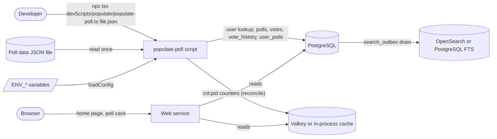
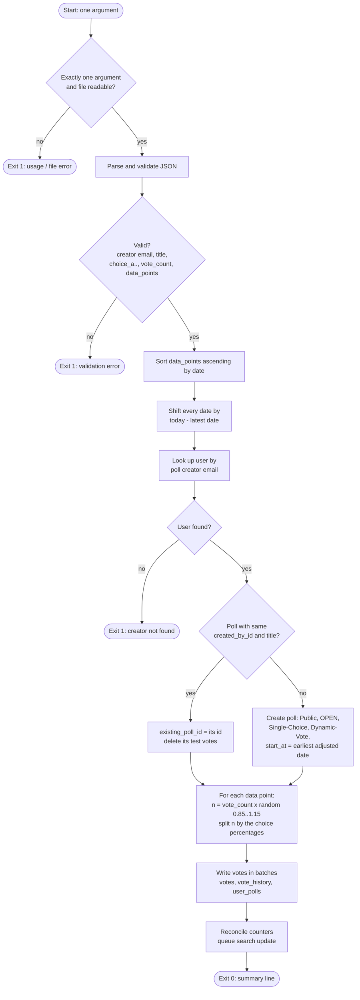
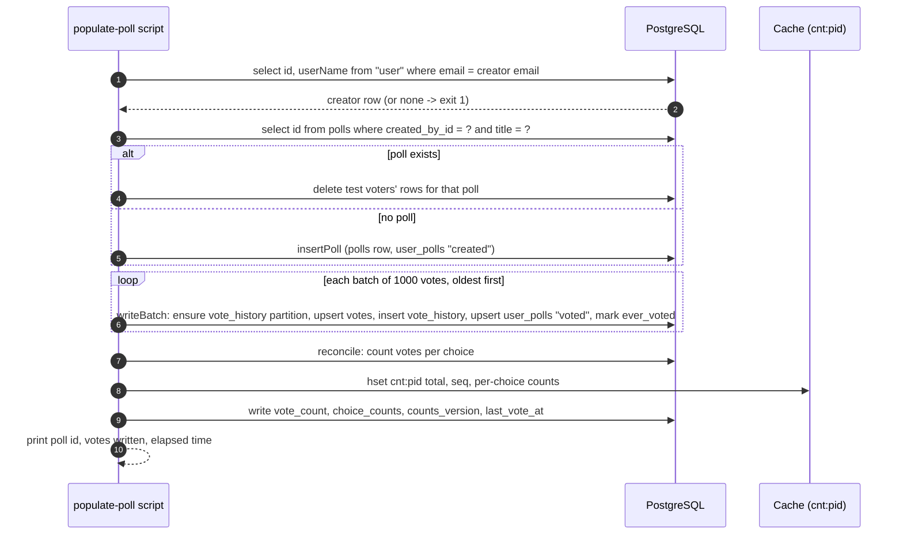
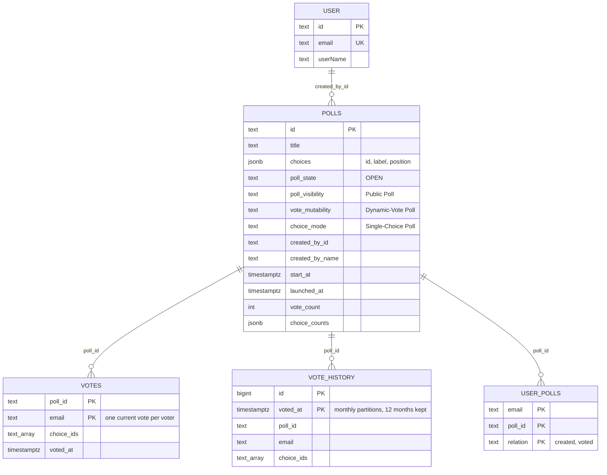

# High Level Requirements

Requirements: `requirements/20261026-152737-populate-test-poll/requirements.md`  
External Files: none (the requirements name `polldata/trump_approval_rating_over_time.json`, which lives outside this folder and is git-ignored)  
Generated: 2026-10-26 3:27 PM  

### Initial High-Level Requirements

For testing we need to create a stand-alone command line script. 
It creates a poll and pre-populates it with votes according to the following logic.  
The script will have one and only one command line argument.  

The data for the poll will be found in a json file that is the first argument to the script.  

An example of the JSON structure expected for the poll data can be found in the file `polldata/trump_approval_rating_over_time.json`.  

When the json is read in, the data_points will be sorted ascending by date.  

Then the dates will be adjusted relative to the current date, maintaining the same intervals between them.  
The greatest date in the json will become the current date.  

created_by_id= the id of the user whose email is "poll creator email" in the JSON file.  
created_by_name= the userName of the user whose email is "poll creator email" in the JSON file.  
created_by_email= the email of the user whose email is "poll creator email" in the JSON file.  
start_at = the date of the earliest adjusted date  

The first thing the script will do is to determine if a poll already exists with the same:
- created_by_id
- title (from the JSON file)

If the poll already exists with the same created_by_id and title, 
existing_poll_id will be set to the poll_id of the existing poll
else existing_poll_id will be set to null

If existing_poll_id is not null, any votes associated with that poll will be deleted where: 
poll_id matches existing_poll_id AND email like "test_%@crowdpolltest.test"

if existing_poll_id is null, a new poll will be created with the following settings:  
- title from the JSON file
- choices from the JSON file
- Dynamic-Vote Poll
- Public
- Open
- vote_anonymity=YES
- Single-Choice Poll
- Dynamic-Vote Poll
- created_by_id
- created_by_name
- created_by_email
- start_at 
- end_at null
- subtitle null

It is assumed that all other poll fields can be derived from these.  
If not, create a finding for this requirement stating which field can not be derived.  

After the poll is created, votes will be programmatically added based on the data points in the JSON file.  
The number of votes simulated for each data point will correspond to the "vote_count" in the JSON file.  
To simulate the appearance of an actual voting pattern, the number of votes for each date will be +- 15% of the "vote_count".  

The votes for each data point will be distributed among the options  
"choice_a", "choice_b", "choice_c", "choice_d" ....   
according to the values (which are actually percentages) specified in the JSON file.  
If a choice has no votes, it will still be a choice for the poll.

## Additional Requirements and Research Requests

**Instructions To The Developer**  
Enter any additional requirements or research requests under the ## Additional Requirements and Research Requests heading above.  
When you Type or Say: "Next" in the CC CLI terminal, the additional requirements and research requests will be applied to the report.  
  
You may leave these instructions here. They will be ignored when "Next" is executed.  

## 1. Overview and Scope

This feature is one **developer and test tool**: a stand-alone TypeScript command-line script that reads a poll description from a JSON file, creates (or finds) a public, open, single-choice, dynamic-vote poll owned by an existing user, and fills it with simulated votes that replay a time series (for example an approval rating) up to today.  

- **In scope**
  - reading and validating one JSON file, given as the script's single argument;
  - shifting the data points' dates so the latest one is today, keeping the intervals between them;
  - finding an existing poll by creator and title, or creating a new one;
  - removing the earlier test votes of an existing poll;
  - writing simulated votes per data point, with a ±15% spread on the count, split between the choices by the data point's percentages;
  - leaving the poll's counters, cache and search entry consistent with the votes written.
- **Out of scope**
  - any server route, page, configuration variable, migration or new dependency;
  - showing the results over time (no part of the app draws `vote_history` today);
  - creating the poll creator's account (it must already exist).
- **Precedent in the codebase**
  - `devScripts/populate/seed-polls.ts` already seeds polls and votes: it loads the configuration, runs the migrations, writes votes through `writeBatch` (`src/votes/consumer.ts`) and finishes with `reconcile` (`src/polls/counters.ts`).
    The new script follows the same path.

**Example input** (`polldata/trump_approval_rating_over_time.json`): creator `devadmin01@crowdpoll.vote`, title `Trump Approval Rating`, two choices (`Approve`, `Disapprove`), `vote_count` 123456, and 119 data points from `02/07/25` to `10/21/26` (about 20.5 months), each with percentages such as `48` / `49` that do not add up to 100.  

## 2. Context Diagram

The script runs on a developer's machine with the server's `ENV_*` variables, beside (not inside) the web service, and writes to the same stores the vote consumer writes to.  

## 3. Script Flow (Activity Diagram)

## 4. Sequence Diagram

## 5. Data Model (Entity Relationship Diagram)

The tables the script reads or writes; no column is added.  

**JSON input shape** (as in the example file):  

| Key | Type | Meaning |
|---|---|---|
| `poll creator email` | string | Email of an existing `user`; the poll's owner |
| `title` | string | The poll's title, and half of the "already exists" key |
| `choice_a`, `choice_b`, … | string | Choice labels, in order |
| `vote_count` | integer | Nominal votes per data point (see AM1) |
| `data_points[]` | array | `date` (`MM/DD/YY`) and one percentage per choice key |

## 6. Assumptions

- The script is a development tool, run by a developer with the same `ENV_*` variables as the server, in the manner of `seed-polls.ts` and `reconcile.ts`.  
- The poll is inserted directly as `OPEN`: acceptability screening and the publish flow are bypassed, as `seed-polls.ts` does.  
- Choice ids are new UUIDs (`randomUUID()`), as `createDefaultPoll` makes them.  
- "Public" means `poll_visibility = "Public Poll"`;
  "vote_anonymity=YES" means the stored value `Yes`;
  "Open" means `poll_state = "OPEN"`.  
- "subtitle null" is stored as the empty string, because `polls.subtitle` is `NOT NULL` and the app's default is `""`.  
- Test voters need no `user` rows: `writeBatch` does not filter on them (only the queue consumer's `withoutDeletedAccounts` does).  
- The run is not one transaction across all batches; a failed run is repaired by running it again, which first removes the test votes.  

## 7. Breaking Changes and Technical Debt

**Breaking changes:** none.  
The script adds a file; no route, table, configuration or behaviour of the running app changes.  

**Technical debt**  

- **TD1.** `QueuedVote` in `src/votes/consumer.ts` is not exported, so callers of `writeBatch` (the seed script, and now this one) restate its shape inline.  
- **TD2.** `seed-polls.ts` builds `polls` rows by hand instead of through `insertPoll`, so it skips the `created` relation and the projection refresh;
  the new script should not copy that.  
- **TD3.** `polldata/` is git-ignored, so the example the requirements cite is not in the repository and a test cannot rely on it.  
- **TD4.** `retentionSweep` drops vote-history partitions older than 12 months, so a data series longer than a year loses its oldest history the next day (see UA7).  

## 8. Findings

### Inconsistencies

**IN1. "Dynamic-Vote Poll" is listed twice among the new poll's settings**  
✅ Resolved  
✅ Requirements File Updated: 2026-10-26 4:14 PM  
**Notes**: Recommendation accepted in file 2026-10-26: Recommendation, list it once; no other setting was meant;  
the requirements now say so under Clarifications.  

The settings list names `Dynamic-Vote Poll` both second and eighth.  
Both mean the same setting, so nothing conflicts, but a reader may look for a second setting that was meant instead (for example `Single-Choice Poll` was already given).  

  - **Recommendation**: **list it once; no other setting was meant.**  

    ➡️ [X] **Accepted**  
    - The requirements will note beneath the list that the duplicate is the same setting.  

  - **Developer Resolution B**:  

    ➡️ [ ] **Accepted**  

**IN2. An existing poll keeps its old start date and choices while its votes are regenerated with new dates**  
✅ Resolved  
✅ Requirements File Updated: 2026-10-26 4:14 PM  
**Notes**: Recommendation accepted in file 2026-10-26: Recommendation A, on a rerun also refresh the poll from the JSON: `start_at`, `launched_at`, the choices and the fixed settings;  
added to the requirements under Clarifications.  

On a rerun only the test votes are deleted and rewritten.  
But the adjusted dates move every day (the latest data point is always "today"), so the new votes start later than the poll's stored `start_at`, and `launched_at` is stale too.  
If the JSON's choices changed since the first run, the new votes would name choices the poll does not have.  

  - **Recommendation A** _(recommended)_: **on a rerun, also refresh the poll from the JSON: `start_at`, `launched_at`, the choices and the fixed settings.**  

    ➡️ [X] **Accepted**  
    - <u>Pros</u>: the poll always matches its file and its votes;
      the poll id stays, so bookmarks, Watching and shared links survive.  
    - <u>Cons</u>: a choice dropped from the JSON loses any real (non-test) votes cast for it.  

  - **Recommendation B**: **leave the poll untouched; only its test votes are replaced.**  

    ➡️ [ ] **Accepted**  
    - <u>Pros</u>: exactly the requirements as written.  
    - <u>Cons</u>: `start_at` drifts further from the first vote on every rerun;
      a changed choice list fails the run (it must then be stopped with an error).  

  - **Developer Resolution C**:  

    ➡️ [ ] **Accepted**  

### Ambiguities

**AM1. Is `vote_count` the votes per data point or the total for the poll?**  
✅ Resolved  
✅ Requirements File Updated: 2026-10-26 4:14 PM  
**Notes**: Recommendation accepted in file 2026-10-26: Recommendation A, per data point: each data point casts `vote_count` ±15% votes;  
added to the requirements under Clarifications.  

The requirements say "the number of votes simulated for each data point will correspond to the vote_count", which reads as per data point.  
With the example (123456 votes, 119 data points) that is about 14.7 million vote events, which takes several minutes and fills `vote_history` accordingly.  
`vote_count` sits at the top level of the JSON, beside the title, which could also suggest a total.  

  - **Recommendation A** _(recommended)_: **per data point: each data point casts `vote_count` ±15% votes.**  

    ➡️ [X] **Accepted**  
    - <u>Pros</u>: matches the wording;
      every data point carries a realistic sample, so each percentage is reproduced closely.  
    - <u>Cons</u>: millions of rows for the example;
      the script must print progress.  

  - **Recommendation B**: **a total: `vote_count` is shared out over the data points (about 1037 each in the example), each ±15%.**  

    ➡️ [ ] **Accepted**  
    - <u>Pros</u>: fast;
      the poll's displayed total is close to `vote_count`.  
    - <u>Cons</u>: contradicts "for each data point".  

  - **Developer Resolution C**:  

    ➡️ [ ] **Accepted**  

**AM2. How is the ±15% spread drawn?**  
✅ Resolved  
✅ Requirements File Updated: 2026-10-26 4:14 PM  
**Notes**: Recommendation accepted in file 2026-10-26: Recommendation, a uniform random factor between 0.85 and 1.15 per data point, rounded;  
added to the requirements under Clarifications.  

"+- 15% of the vote_count" could mean a fixed choice of +15% or −15%, a normal spread, or any value in between.  

  - **Recommendation**: **for each data point, draw a uniform random factor between 0.85 and 1.15 and round `vote_count × factor` to a whole number.**  

    ➡️ [X] **Accepted**  
    - A uniform draw stays within the stated bound, which a normal spread does not, and gives an irregular look.  
    - Runs differ from each other (no fixed seed).  

  - **Developer Resolution B**:  

    ➡️ [ ] **Accepted**  

**AM3. What happens to the share the percentages leave out?**  
✅ Resolved  
✅ Requirements File Updated: 2026-10-26 4:14 PM  
**Notes**: Recommendation accepted in file 2026-10-26: Recommendation A, scale the percentages to their sum, rounded by largest remainder;  
added to the requirements under Clarifications.  

The example's percentages do not add up to 100 (`48` + `49` = 97;
the rest are "no opinion" answers in the source survey).  
A single-choice poll has no "no opinion" choice, so the missing 3% either votes for the given choices in proportion, or does not vote.  
Rounding each choice's share must also add up to the data point's vote count.  

  - **Recommendation A** _(recommended)_: **scale the percentages to their sum: every one of the data point's votes goes to a choice, in proportion; shares are rounded by largest remainder.**  

    ➡️ [X] **Accepted**  
    - <u>Pros</u>: the number of votes is exactly the ±15% count;
      the card's bars show the same ratio as the source (48:49).  
    - <u>Cons</u>: the bars read 49.5% / 50.5%, not 48% / 49%.  

  - **Recommendation B**: **take each percentage of the vote count literally; the remainder casts no vote.**  

    ➡️ [ ] **Accepted**  
    - <u>Pros</u>: the numbers match the source percentages of the vote count.  
    - <u>Cons</u>: each data point casts fewer votes than its count;
      the bars still show only the given choices, so the percentages displayed are the same as A anyway.  

  - **Developer Resolution C**:  

    ➡️ [ ] **Accepted**  

### Unspecified Aspects

**UA1. Poll fields that cannot be derived from the listed settings**  
✅ Resolved  
✅ Requirements File Updated: 2026-10-26 4:14 PM  
**Notes**: Recommendation accepted in file 2026-10-26: Recommendation, derive the unlisted fields from the app's defaults (no `created_by_email` column, `created_at = launched_at = start_at`, `subtitle = ""`);  
added to the requirements under Clarifications.  

The requirements ask for a finding naming every field that cannot be derived.  
Checked against `polls` (`src/db/schema.ts`) and `newRow` in `src/polls/store.ts`:  

- `created_by_email` **has no column**: `polls` stores `created_by_id` and `created_by_name` only, and the admin card looks the email up from `user` when it is shown (`creatorEmails`);  
- `poll_sharing_mode` is not listed (the app's default is `Anyone With The Link`);  
- `created_at` is not listed: "now" would put creation after `start_at`, 20 months later;  
- `launched_at` (the Newest tab's order) follows from `start_at` in `newRow` for an `OPEN` poll;  
- `keywords` (empty), `voter_count_limit` (null for a public poll), `closed_at` (null) and the counters follow from the defaults;  
- the choice ids are not in the JSON.  

  - **Recommendation**: **derive them as follows: no `created_by_email` stored (it is read from `user`, as now);
    `poll_sharing_mode = "Anyone With The Link"`;
    `created_at = start_at`;
    `launched_at = start_at`;
    `keywords = ""`;
    `voter_count_limit = null`;
    choice ids are new UUIDs, positions 0, 1, … in key order.**  

    ➡️ [X] **Accepted**  
    - These are the app's own defaults (`createDefaultPoll`, `newRow`), and `created_at = start_at` keeps the admin card's dates in order.  
    - A `launched_at` 20 months old puts the poll near the end of the Newest tab, as a poll launched then would be.  

  - **Developer Resolution B**:  

    ➡️ [ ] **Accepted**  

**UA2. Date format, time zone and time of day of the simulated votes**  
✅ Resolved  
✅ Requirements File Updated: 2026-10-26 4:14 PM  
**Notes**: Recommendation accepted in file 2026-10-26: Recommendation, whole-day shift to today (local), votes spread across each day and never in the future;  
added to the requirements under Clarifications.  

The dates are `MM/DD/YY` with no time.  
The requirements do not say in which time zone "today" is taken, nor at what time of day each data point's votes are cast.  
Thousands of votes stamped at exactly midnight would look artificial, and votes on today's data point must not be in the future.  

  - **Recommendation**: **parse `MM/DD/YY` as 20YY;
    shift every date by the whole number of days between the latest date and today (local date);
    spread each data point's votes at random times across that day, but never later than the moment the script runs;
    `start_at` is midnight (local) of the earliest adjusted date.**  

    ➡️ [X] **Accepted**  
    - Whole days keep the intervals exactly;
      the cap on today's votes keeps every `voted_at` in the past.  
    - A date that does not parse, or two data points on the same date, stops the script with an error.  

  - **Developer Resolution B**:  

    ➡️ [ ] **Accepted**  

**UA3. Deleting the earlier test votes leaves their history and relations behind**  
✅ Resolved  
✅ Requirements File Updated: 2026-10-26 4:14 PM  
**Notes**: Recommendation accepted in file 2026-10-26: Recommendation, delete the test voters' rows from `votes`, `vote_history` and `user_polls`, with `_` escaped;  
added to the requirements under Clarifications.  

The requirements delete only from `votes`.  
Each vote also writes a `vote_history` row and a `user_polls` "voted" row, so every rerun would add another 14 million history rows and keep stale relations;
the poll's counters would also stay at their old totals until they are recomputed.  
In SQL `LIKE`, `_` matches any character, so `test_%` also matches `testX…`.  

  - **Recommendation**: **for that poll, delete the test voters' rows from `votes`, `vote_history` and `user_polls` (relation `voted`), matching `email LIKE 'test\_%@crowdpolltest.test'` with `_` escaped;
    the counters are recomputed after the new votes are written (UA4).**  

    ➡️ [X] **Accepted**  
    - Real votes on the poll are never touched, because `crowdpolltest.test` is a reserved test domain no real account can have.  

  - **Developer Resolution B**:  

    ➡️ [ ] **Accepted**  

**UA4. Counters, caches and search after the votes are written**  
✅ Resolved  
✅ Requirements File Updated: 2026-10-26 4:14 PM  
**Notes**: Recommendation accepted in file 2026-10-26: Recommendation, `insertPoll`, `writeBatch`, then `reconcile`, with a restart note without Valkey;  
added to the requirements under Clarifications.  

The poll card reads live counters (`cnt:<pid>` in the cache) and the poll row's `vote_count` / `choice_counts`, never the `votes` table per request.  
Votes written directly to the database are invisible to both until they are recomputed.  
Without `ENV_VALKEY_URL` the running development server keeps its counters in its own memory, which a separate script cannot reach.  

  - **Recommendation**: **write votes through `writeBatch` (as `seed-polls.ts` does), then call `reconcile` for the poll, and create the poll through `insertPoll` so its projection, search entry and `created` relation are written;
    when `ENV_VALKEY_URL` is unset, the summary line tells the developer to restart the server.**  

    ➡️ [X] **Accepted**  
    - This reuses the app's own write path, so the rows are exactly the ones real votes produce.  

  - **Developer Resolution B**:  

    ➡️ [ ] **Accepted**  

**UA5. The test voters' identities**  
✅ Resolved  
✅ Requirements File Updated: 2026-10-26 4:14 PM  
**Notes**: Recommendation accepted in file 2026-10-26: Recommendation, voters `test_<n>@crowdpolltest.test` with no `user` rows;  
added to the requirements under Clarifications.  

The deletion rule implies voter addresses of the form `test_…@crowdpolltest.test`, but the requirements do not say what follows `test_`, what `user_name` a vote carries, or whether test voters need accounts.  

  - **Recommendation**: **voters are `test_<n>@crowdpolltest.test` with `user_name` `test_<n>`, `n` counting from 1;
    no `user` rows are created.**  

    ➡️ [X] **Accepted**  
    - The poll is anonymous (`vote_anonymity = Yes`), so the names are never shown;
      no accounts keeps the `user` table, sign-in and the allowlist untouched.  

  - **Developer Resolution B**:  

    ➡️ [ ] **Accepted**  

**UA6. Errors and limits**  
✅ Resolved  
✅ Requirements File Updated: 2026-10-26 4:14 PM  
**Notes**: Recommendation accepted in file 2026-10-26: Recommendation, validate everything first and exit 1 with a one-line error;  
added to the requirements under Clarifications.  

The requirements do not say what happens when the input or the database does not fit.  
Cases: no argument or more than one;
an unreadable or invalid JSON file;
no `user` with the creator's email;
more than one poll with that creator and title;
fewer than `ENV_MIN_CHOICES` or more than `ENV_MAX_CHOICES` choices;
choice keys past `choice_z` (`ENV_MAX_CHOICES` allows 50);
a data point naming a choice key the poll does not have, or missing one.  

  - **Recommendation**: **stop with a one-line error and exit code 1, before writing anything, for each case except these: a choice missing from a data point counts as 0%;
    with several matching polls the newest is used and a warning is printed;
    choice keys are read in order `choice_a` … `choice_z`, then `choice_aa`, `choice_ab`, …;
    the creator email is matched exactly, the title exactly (case included).**  

    ➡️ [X] **Accepted**  
    - Validating everything first means a bad file never leaves a half-made poll.  
    - "A choice with no votes is still a choice" is kept: a choice with 0% everywhere is created and shows zero.  

  - **Developer Resolution B**:  

    ➡️ [ ] **Accepted**  

**UA7. Vote history older than 12 months is dropped by the daily retention sweep**  
✅ Resolved  
✅ Requirements File Updated: 2026-10-26 4:14 PM  
**Notes**: Recommendation accepted in file 2026-10-26: Recommendation, accept the 12-month history retention as a known limit and print a note;  
added to the requirements under Clarifications.  

`retentionSweep` (`src/polls/sweeps.ts`) drops `vote_history` partitions older than 12 months.  
The example spans about 20.5 months, so its oldest eight months of history disappear at the next sweep.  
Nothing in the app shows `vote_history` today, and the poll's current results come from `votes`, which the sweep does not touch.  

  - **Recommendation**: **accept it as a known limit: write the full history (`writeBatch` creates the old partitions), and print a note when the data spans more than 12 months.**  

    ➡️ [X] **Accepted**  
    - Changing the retention period is a privacy decision (Privacy Policy, feature 20261021-204537) and out of scope for a test tool.  

  - **Developer Resolution B**:  

    ➡️ [ ] **Accepted**  

**UA8. Where the script lives and how it is run and tested**  
✅ Resolved  
✅ Requirements File Updated: 2026-10-26 4:14 PM  
**Notes**: Recommendation accepted in file 2026-10-26: Recommendation, `devScripts/populate/populate-poll.ts` with a `.gitignore` exception, README section and Vitest fixture tests;  
added to the requirements under Clarifications.  

The requirements do not name the script, its folder or how it is checked.  
`.gitignore` ignores `devScripts/*` and `devScripts/populate/*` except named files, and ignores `/polldata/`.  

  - **Recommendation**: **`devScripts/populate/populate-poll.ts`, run as `npx tsx devScripts/populate/populate-poll.ts <file.json>`, with `!devScripts/populate/populate-poll.ts` added to `.gitignore` and a section in `devScripts/populate/README.md`;
    its logic (date shift, count spread, share rounding) in exported functions, tested by Vitest on the embedded PostgreSQL with a small fixture under `tests/`;
    `main()` runs only when the file is the entry point;
    `polldata/` stays ignored.**  

    ➡️ [X] **Accepted**  
    - It sits beside `seed-polls.ts` and follows `file-manifest.ts`'s entry-point pattern;
      a committed fixture makes the tests independent of the ignored example.  

  - **Developer Resolution B**:  

    ➡️ [ ] **Accepted**  

**UA9. On a rerun, how are the JSON's choices matched to the poll's, and what happens to votes on a dropped choice?**  
✅ Resolved  
✅ Requirements File Updated: 2026-10-26 4:31 PM  
**Notes**: Recommendation accepted in file 2026-10-26: Recommendation, match choices by label, exactly; a kept label keeps its id, a new one gets a new UUID, and votes on a dropped choice are deleted before `reconcile`;  
added to the requirements under Clarifications.  

IN2 refreshes the existing poll's choices from the JSON.  
Choice ids are UUIDs the JSON does not carry, so the rule that keeps an unchanged choice's id is not stated.  
If every choice got a new id, every remaining (non-test) vote would name a choice the poll no longer has, and `reconcile` would still count those ids in `choice_counts`.  
IN2 says a dropped choice "loses" its votes, but not whether those votes are deleted or left pointing at nothing.  

  - **Recommendation**: **match by label, exactly: a choice whose label is still in the JSON keeps its id and takes its new position;
    a new label gets a new UUID;
    the votes (test or not) whose choice was dropped are deleted from `votes` before `reconcile` runs.**  

    ➡️ [X] **Accepted**  
    - Matching by label survives a reordering of the JSON's keys;
      deleting the orphaned votes keeps the counts equal to the choices shown.  
    - Renaming a label counts as dropping one choice and adding another.  

  - **Developer Resolution B**:  

    ➡️ [ ] **Accepted**  

**UA10. On a rerun, which write path refreshes the poll, and what if it is not OPEN?**  
✅ Resolved  
✅ Requirements File Updated: 2026-10-26 4:31 PM  
**Notes**: Recommendation accepted in file 2026-10-26: Recommendation, refresh through `updatePoll` with `pollState: "OPEN"`, clearing any edit session, then set `launched_at = start_at`, warning when the poll was not OPEN;  
added to the requirements under Clarifications.  

`updatePoll` (`src/polls/store.ts`) stamps `launched_at` with the current time only when a poll enters OPEN, and leaves it alone otherwise, so it cannot set `launched_at = start_at` as UA1 requires.  
The existing poll may since have been closed, or be in EDITING with an admin's edit session open, which IN2's "fixed settings" (OPEN) would override.  
A content change must also bump `content_version` so open cards and the search index pick it up.  

  - **Recommendation**: **refresh through `updatePoll` with the settings, choices, `start_at` and `pollState: "OPEN"`, clearing any edit session (`pollStateBeforeEditUpdate`, heartbeat and client id), then set `launched_at = start_at` and `created_at` unchanged in the same run;
    print a warning when the poll was not OPEN before.**  

    ➡️ [X] **Accepted**  
    - `updatePoll` bumps `content_version`, refreshes the projection and so reaches open cards and the search outbox, as an admin's edit does.  
    - Overriding an edit session is acceptable for a test tool, and the warning says it happened.  

  - **Developer Resolution B**:  

    ➡️ [ ] **Accepted**  

**UA11. What the script prints, and how long a run may take**  
✅ Resolved  
✅ Requirements File Updated: 2026-10-26 4:31 PM  
**Notes**: Recommendation accepted in file 2026-10-26: Recommendation, print the target first, one progress line per data point and a summary with per-choice results and elapsed time; no time limit, no index;  
added to the requirements under Clarifications.  

AM1 says the script "prints its progress", and UA4 and NC2 add lines to a summary, but neither the progress cadence nor the summary's contents are stated, so a tester cannot tell a good run from a bad one.  
With the example, a run writes about 14.7 million vote events.  
On a rerun, UA3's delete from `vote_history` has no index on `poll_id` (its key is `id, voted_at`), so it scans every partition of every poll.  

  - **Recommendation**: **print the target (origin and database host) first;
    then one progress line per data point (its adjusted date, votes cast, running total);
    and a summary: the poll id, whether it was created or refreshed, votes deleted, votes written, the final count and percentage per choice, the elapsed time, and the notes from UA4 and UA7 when they apply;
    no time limit, and no index added.**  

    ➡️ [X] **Accepted**  
    - The final per-choice percentages let the developer compare the card with the latest data point (NC1) at a glance.  
    - A `vote_history (poll_id)` index would be a migration, which this feature excludes;
      the scan only costs time on a test database.  

  - **Developer Resolution B**:  

    ➡️ [ ] **Accepted**  

**UA12. The values inside the JSON are not validated**  
✅ Resolved  
✅ Requirements File Updated: 2026-10-26 4:59 PM  
**Notes**: Recommendation accepted in file 2026-10-26: Recommendation, validate the JSON values (creator and title present, title and label limits, unique labels, `vote_count` of at least 1, non-empty `data_points`, non-negative percentages with a positive sum);  
added to the requirements under Clarifications as UA12.  

UA6 lists the file-level errors, but not the checks on the values themselves, and several resolutions depend on them.  
AM3 divides each percentage by the data point's sum, so a data point whose percentages are all 0 divides by zero.  
UA9 matches choices by label, so two choices with the same label cannot be told apart.  
A `vote_count` that is missing, zero, negative or not a whole number, or an empty `data_points`, leaves nothing to cast.  
The app limits a title to 50 characters (`TITLE_MAX`) and a choice label to 100 (`CHOICE_LABEL_MAX`) in `src/polls/service.ts`, and the poll card is built for those limits.  

  - **Recommendation**: **add to UA6's errors (one line, exit code 1, nothing written): `poll creator email` or `title` missing or empty;
    a title longer than `TITLE_MAX`;
    a choice label empty, longer than `CHOICE_LABEL_MAX`, or the same as another (compared exactly);
    `vote_count` not a whole number of at least 1;
    `data_points` missing or empty;
    a percentage that is not a number, or negative;
    a data point whose percentages add up to 0.**  

    ➡️ [X] **Accepted**  
    - Using the app's own limits means the poll the script makes is one the app could have made.  
    - Each check closes a case that AM3, UA9 or NC1 cannot handle.  

  - **Developer Resolution B**:  

    ➡️ [ ] **Accepted**  

**UA13. A new poll's search entry is queued by `reconcile`, not by `insertPoll`**  
✅ Resolved  
✅ Requirements File Updated: 2026-10-26 4:59 PM  
**Notes**: Recommendation accepted in file 2026-10-26: Recommendation, correct the wording: the search entry is queued by `reconcile`, which always runs;  
no behaviour changes;  
the UA4 clarification now names what `insertPoll` writes, and UA13 was added.  

UA4 says a new poll is created through `insertPoll` "so its projection, search entry and `created` relation are written".  
`insertPoll` (`src/polls/store.ts`) writes the row, the `created` relation and the projection, but no `search_outbox` row.  
The entry comes from `reconcile`, whose counter write queues a `counters` row in `search_outbox`;
`drainOutbox` (`src/search/outbox.ts`) indexes the whole poll for any queued row, whatever its reason.  
So the behaviour UA4 expects happens, but for a different reason, and a spec built on the wording would place the step wrongly.  

  - **Recommendation**: **correct the wording: `insertPoll` writes the row, the `created` relation and the projection;
    the search entry is queued by `reconcile` (and on a rerun also by `updatePoll`'s content-version bump), so `reconcile` must run even when no votes are written;
    no behaviour changes.**  

    ➡️ [X] **Accepted**  
    - It keeps the requirements true to the code they will be built on.  
    - Without OpenSearch the poll is searchable at once, through the stored `search` column.  

  - **Developer Resolution B**:  

    ➡️ [ ] **Accepted**  

### Needs Clarifications

**NC1. Do the same test voters change their votes over time, or does every data point bring new voters?**  
✅ Resolved  
✅ Requirements File Updated: 2026-10-26 4:14 PM  
**Notes**: Recommendation accepted in file 2026-10-26: Recommendation A, one pool of `ceil(1.15 × vote_count)` voters who change their votes over time;  
added to the requirements under Clarifications.  

The poll is a Dynamic-Vote poll: `votes` keeps one current vote per voter, and `vote_history` keeps every vote.  
This choice decides what the poll card shows at the end.  
With the example, the latest data point is 33% / 66%, while the average over all 119 data points is about 39% / 59%.  

  - **Recommendation A** _(recommended)_: **one pool of voters who change their votes: `ceil(1.15 × vote_count)` voters, of whom each data point's count vote again (chosen at random).**  

    ➡️ [X] **Accepted**  
    - <u>Pros</u>: what a Dynamic-Vote poll is for;
      the card ends close to the latest data point (an approval rating "now");
      `votes` holds about 140,000 rows, `vote_history` the whole series.  
    - <u>Cons</u>: a voter not drawn at the last data point keeps an older vote, so the final bars are near, not exactly at, the latest percentages.  

  - **Recommendation B**: **new voters for every data point: data point `i` uses voters numbered after those of data point `i − 1`.**  

    ➡️ [ ] **Accepted**  
    - <u>Pros</u>: simple;
      every vote stays current.  
    - <u>Cons</u>: the card shows the average over 20 months, not today's figure;
      `votes` holds about 14.7 million rows for one poll.  

  - **Developer Resolution C**:  

    ➡️ [ ] **Accepted**  

**NC2. Which databases may the script write to?**  
✅ Resolved  
✅ Requirements File Updated: 2026-10-26 4:14 PM  
**Notes**: Recommendation accepted in file 2026-10-26: Recommendation B, any database, the developer's responsibility, with the target origin and database host printed before writing;  
added to the requirements under Clarifications.  

It writes to whatever `ENV_DATABASE_URL` names.  
Against production it would publish a public, politically worded poll with fabricated votes on the live home page.  
With "one and only one command line argument" there is no room for a `--force` flag.  

  - **Recommendation A** _(recommended)_: **development only: refuse to run unless `ENV_PUBLIC_ORIGIN`'s host is `localhost` or `127.0.0.1`.**  

    ➡️ [ ] **Accepted**  
    - <u>Pros</u>: a mistaken production run is impossible;
      `ENV_PUBLIC_ORIGIN` is already required by the configuration.  
    - <u>Cons</u>: a shared staging site cannot be populated without changing the script.  

  - **Recommendation B**: **any database, the developer's responsibility; the script prints the target origin and database host before writing.**  

    ➡️ [X] **Accepted**  
    - <u>Pros</u>: it also serves staging and demonstrations.  
    - <u>Cons</u>: nothing stops a production run.  

  - **Developer Resolution C**:  

    ➡️ [ ] **Accepted**

## 9. Requirements Report Complete Report

- **Requirements Report Document:** requirements/20261026-152737-populate-test-poll/requirements-report.md
- **Requirements Document:** requirements/new-20261026-110829/requirements.md → requirements/20261026-152737-populate-test-poll/requirements.md
- **Software Architecture Diagrams:** 4
- **Inconsistencies:** 2
- **Ambiguities:** 3
- **Unspecified Aspects:** 8
- **Needs Clarifications:** 2
- **Research Results:** 0
- **Breaking Changes:** 0
- **Technical Debt items:** 4

The requirements are ready for /speckit-specify.
To generate specs from the requirements document, use the `/speckit-specify` skill followed by the path (relative to the project root) to the requirements file.
At the prompt, Type:
🟩 👉 /speckit-specify requirements/20261026-152737-populate-test-poll/requirements.md

## 10. Requirements Report Complete Report

- **Requirements Report Document:** requirements/20261026-152737-populate-test-poll/requirements-report.md
- **Requirements Document:** requirements/20261026-152737-populate-test-poll/requirements.md
- **Software Architecture Diagrams:** 4
- **Inconsistencies:** 2
- **Ambiguities:** 3
- **Unspecified Aspects:** 11
- **Needs Clarifications:** 2
- **Research Results:** 0
- **Breaking Changes:** 0
- **Technical Debt items:** 4

The requirements are ready for /speckit-specify.
To generate specs from the requirements document, use the `/speckit-specify` skill followed by the path (relative to the project root) to the requirements file.
At the prompt, Type:
🟩 👉 /speckit-specify requirements/20261026-152737-populate-test-poll/requirements.md

## 11. Requirements Report Complete Report

- **Requirements Report Document:** requirements/20261026-152737-populate-test-poll/requirements-report.md
- **Requirements Document:** requirements/20261026-152737-populate-test-poll/requirements.md
- **Software Architecture Diagrams:** 4
- **Inconsistencies:** 2
- **Ambiguities:** 3
- **Unspecified Aspects:** 13
- **Needs Clarifications:** 2
- **Research Results:** 0
- **Breaking Changes:** 0
- **Technical Debt items:** 4

The requirements are ready for /speckit-specify.
To generate specs from the requirements document, use the `/speckit-specify` skill followed by the path (relative to the project root) to the requirements file.
At the prompt, Type:
🟩 👉 /speckit-specify requirements/20261026-152737-populate-test-poll/requirements.md
