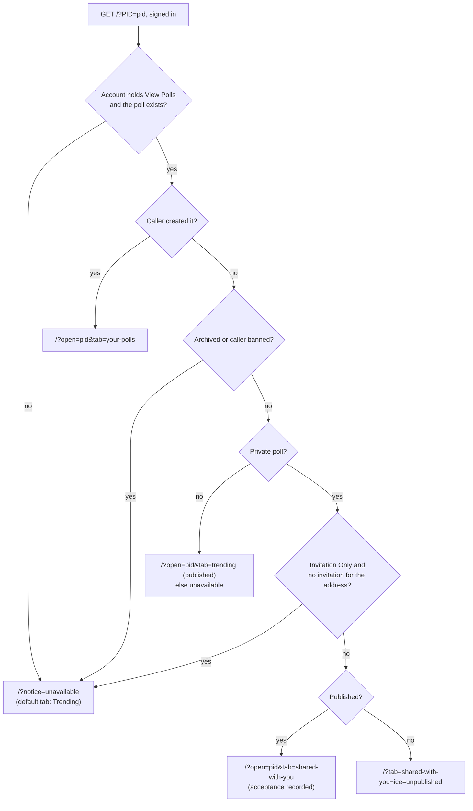
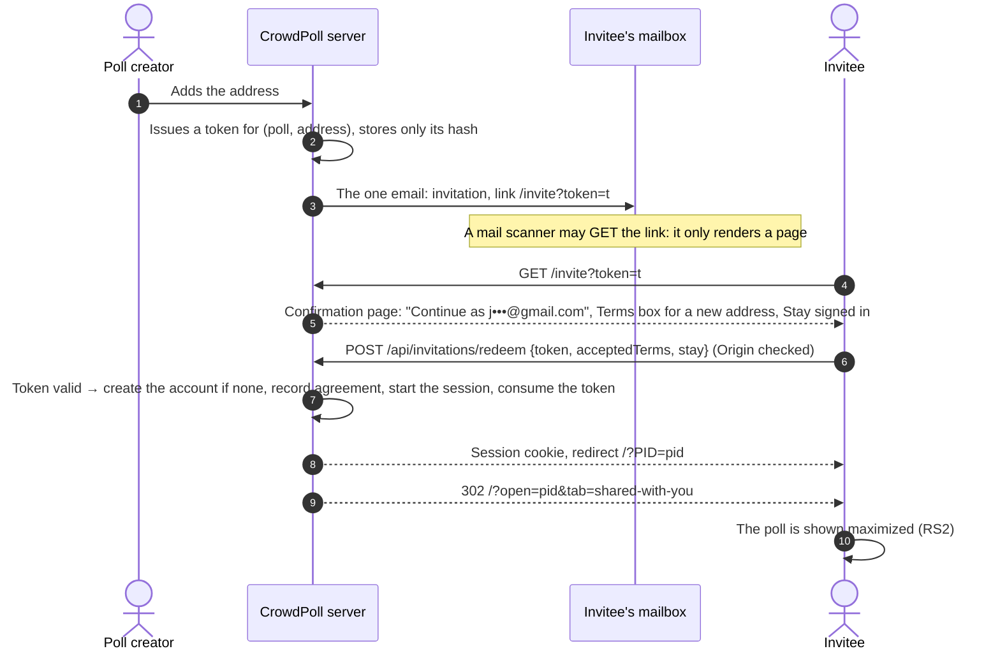
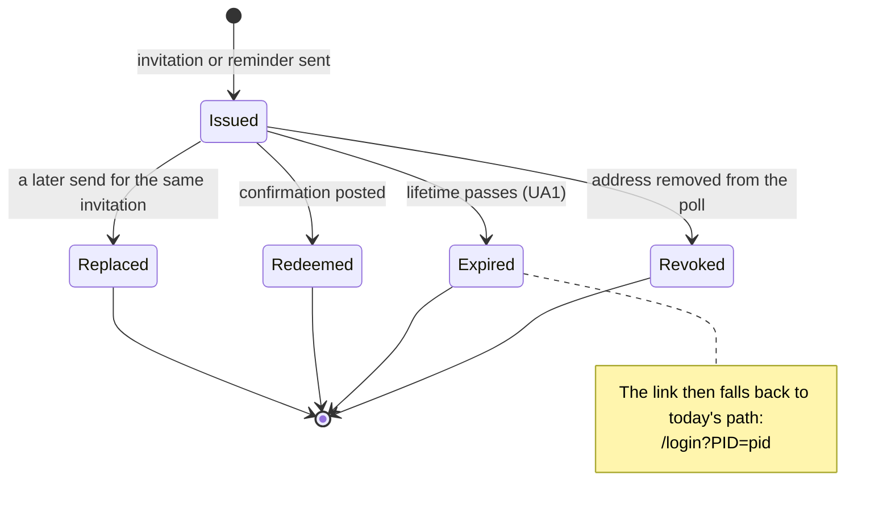
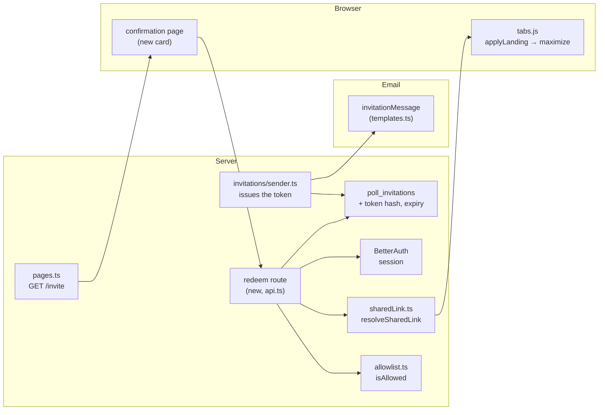

# High Level Requirements

Requirements: `requirements/20261027-133129-single-email-invite/requirements.md`  
External Files: none  
Generated: 2026-10-27 1:31 PM  

# Initial High-Level Requirements

The current procvess for a user who doesn't have an account to be invited to a poll is:
1. The poll creator generates an invitation link for the poll.
2. The invitation link is emailed to the user.
3. The user clicks on the invitation link.
4. The user is shown the Login page.
5. The user chooses to Login with email address.
6. Another email is sent to them with a signin link.
7. The user clicks on the signin link and is authenticated.
8. The user is shown the Trending tab.

Research request:  
1. How can this be done with only 1 email?  
2. How can the user be directed to the Maximize view for the poll they are invited to?

## Additional Requirements and Research Requests

**Instructions To The Developer**  
Enter any additional requirements or research requests under the ## Additional Requirements and Research Requests heading above.  
When you Type or Say: "Next" in the CC CLI terminal, the additional requirements and research requests will be applied to the report.  
  
You may leave these instructions here. They will be ignored when "Next" is executed.  
✅ Applied 2026-10-27 1:52 PM: 1 research request added to requirements.md (RS3).  

## 1. Overview

A person invited to an Invitation Only poll who has no CrowdPoll account should get from the invitation email to the poll, shown maximized, with **one email**: the invitation itself.  
Today the invitation link is `/?PID=<poll id>` (`src/invitations/sender.ts:77`).  
A visitor without a session is sent to `/login?PID=…` (`src/routes/pages.ts:78`), and the poll id then rides through the sign-in emails and back to `/?PID=…`, where `resolveSharedLink` decides the landing (`src/polls/sharedLink.ts`).  

**Scope**  
- The invitation and reminder emails of Invitation Only polls (the only polls that send them, `src/invitations/sender.ts:103`).  
- Sign-in from such an email, for an address with or without an account.  
- Where the visitor lands: the invited poll, maximized.  

**Out of scope (assumed)**  
- Link Only and public poll links shared by hand: they carry no invitation and no known address.  
- The ordinary sign-in and create-account flows, which keep their emails.  

## 2. Today's Flow, Traced in the Code

For an address with **no account**, the current flow sends **three** emails, not two: asking the Login page for a link with an unknown address sends a "create an account" email instead of a sign-in link (`src/routes/api.ts:278-281`), and the Create Account page then sends the sign-in link.  

```mermaid
sequenceDiagram
    autonumber
    actor C as Poll creator
    participant S as CrowdPoll server
    participant M as Invitee's mailbox
    actor U as Invitee (no account)
    C->>S: Adds the address to an Invitation Only poll
    S->>M: Email 1: invitation, link /?PID=pid
    U->>S: GET /?PID=pid (no session)
    S-->>U: 302 /login?PID=pid
    U->>S: POST /api/auth/request-login-link {email, pid}
    S->>M: Email 2: "create an account", link /create-account?PID=pid
    U->>S: Create Account page: name, Terms ticked, pid
    S->>S: Creates the pending account, records agreement
    S->>M: Email 3: sign-in link /api/auth/verify?token&PID=pid&bind
    U->>S: GET /api/auth/verify (same browser: signin_binding matches)
    S-->>U: Session cookie, 302 /?PID=pid
    S->>S: resolveSharedLink: adopt by email key, decide landing
    S-->>U: 302 /?open=pid&tab=shared-with-you (or /?notice=unavailable)
    U->>U: tabs.js applyLanding: selects the tab; maximizes only a card already in the grid
```

Where the visitor lands is decided in `decideSharedLink` (`src/polls/sharedLink.ts:54`):  



An invited visitor of an Invitation Only poll lands on **Shared With You**, not Trending.  
Trending is the default tab (`src/public/tabs.js:16`), so a landing on Trending means the poll was not shown (`/?notice=unavailable`, with the notice "That poll isn't available.") or the poll is public (see NC1).  

## 3. Proposed Flow: One Email

The invitation email carries a personal **invitation sign-in token**, so the click both proves the address and opens the poll (RS1).  



The token's life:  



The parts involved:  



## 4. Assumptions

- Only Invitation Only polls send invitations, so only they carry a token.  
- The confirmation page reuses the look of the existing sign-in cards (`confirm-signin.html`, `createAccountCard.js`).  
- The existing `/?PID=` link keeps working, for emails already sent and for expired tokens.  
- A new account created by redeeming a token starts with an empty name, as the Create Account path does today for a pending account, and the default permissions.  
- No new dependency: the token is a random value hashed with the existing `hashToken`.  

## 5. Breaking Changes

- **The invitation and reminder emails' link changes** from `/?PID=<pid>` to a token link.  
  Emails already sent keep their `/?PID=` link, which keeps today's behaviour.  
- **`poll_invitations` gains columns** (the token hash and its expiry): one additive migration.  

## 6. Technical Debt

- **A second sign-in path.** Redeeming a token signs a browser in without the `signin_binding` cookie, which today binds every emailed sign-in link to the browser that asked for it.  
  The confirmation page and its `Origin`-checked POST take that role for this path, so the two paths must be kept in step (rate limits, allowlist, Terms, session shaping in `completeSignIn`).  
- **`applyLanding` maximizes only a card already in the grid** (`src/public/tabs.js:1027`); a poll mounted by `mountLinkedPoll` is left in the grid, so the two cases behave differently today.  
- **Three emails for an unknown address** on the Login page is by design (it never reveals whether an address is registered), but it is the longest path a new invitee can take.  

## 7. Research Results

### RS1

**RS1. How can this be done with only 1 email?**  
<span style="font-size:large">✅ Resolved</span>  
✅ Requirements File Updated: 2026-10-27 2:05 PM  
**Notes**: Recommendation accepted in file 2026-10-27: Recommendation A, a personal invitation token in the link, redeemed by a confirmation page;  
added under Requirements Decisions.  

The invitation email already goes to the invitee's address, so a click on a link inside it proves control of that address exactly as a sign-in link does.  
Putting a personal sign-in token in the invitation link makes the invitation the only email.  
Sources: [Stytch — email magic links](https://stytch.com/docs/b2b/guides/magic-links/overview), [Stytch — protected email magic links](https://stytch.com/docs/b2b/guides/magic-links/protected-eml), [Supabase discussion #41618 — links consumed by email scanners](https://github.com/orgs/supabase/discussions/41618), [SuperTokens — passwordless invite link flow](https://supertokens.com/docs/authentication/passwordless/invite-link-flow.md), [Laravel email magic link package](https://laravel-news.com/package/pushery-email-magic-link-for-laravel), [BetterAuth magic link plugin](https://better-auth.com/docs/beta/plugins/magic-link).  
What the research found:  
- Invite systems commonly create the account on the first use of the invited address's link, with no separate sign-up form (SuperTokens: create the user first, then send the link).  
- Mail security scanners follow links in incoming mail and can consume a single-use token before the person clicks (Stytch, Supabase #41618); the standard defence is a link whose GET only shows a confirmation page, with the token consumed by a POST from that page (Laravel package, ackify).  
  CrowdPoll already does this for sign-in links that open in another browser (`/confirm-signin`, `POST /api/auth/confirm-signin` with an `Origin` check).  
- BetterAuth's magic-link tokens live 15 minutes here (`LINK_EXPIRY_SECONDS`, `src/auth/auth.ts:35`), far too short for an invitation read days later, so the invitation needs its own token, not a BetterAuth magic link minted at send time.  
- In `oauth` mode there is no emailed sign-in at all: an invitee already needs only the invitation email and a provider sign-in.  
I could not confirm how Slack or Notion implement their invitation links; the search found no primary source for them.  

  - **Recommendation A** _(recommended)_: **a personal invitation token in the link, redeemed by a confirmation page.**  

    ➡️ [X] **Accepted**  
    - Each invitation or reminder send issues a random token for that poll and address; only its hash is stored on `poll_invitations`, with an expiry.  
    - The link is `/invite?token=…`; its GET only shows a confirmation card ("Continue as j•••@gmail.com", the Terms box for an address without an account, Stay signed in).  
    - The card's POST checks the token, the allowlist and `Origin`, creates the account if there is none, records agreement, starts the session as `completeSignIn` does, consumes the token and lands on the poll.  
    - <u>Pros</u>: one email and one click (two with the confirmation); safe against mail scanners; works for invitees with and without an account; no new dependency.  
    - <u>Cons</u>: a second sign-in path to keep in step with the first; a forwarded invitation lets its reader sign in as the invitee (UA4).  
  - **Recommendation B**: **send the sign-in link directly when an invited address asks the Login page.**  

    ➡️ [ ] **Accepted**  
    - When `request-login-link` gets an unknown address that holds an invitation to the poll in `pid`, create the pending account and send the sign-in link instead of the "create an account" email.  
    - <u>Pros</u>: small change; no new token or route.  
    - <u>Cons</u>: still two emails, not one; it reveals that the address was invited to whoever types it with that poll id.  
  - **Recommendation C**: **let an invitee vote from the invitation link without an account.**  

    ➡️ [ ] **Accepted**  
    - <u>Pros</u>: no sign-in at all.  
    - <u>Cons</u>: votes, invitations, adoption, Shared With You and the Terms gate are all keyed to a signed-in account; this would be a new identity model, far beyond this feature.  
  - **Developer Resolution D**:  

    ➡️ [ ] **Accepted**  
    

### RS2

**RS2. How can the user be directed to the Maximize view for the poll they are invited to?**  
<span style="font-size:large">✅ Resolved</span>  
✅ Requirements File Updated: 2026-10-27 2:05 PM  
**Notes**: Recommendation accepted in file 2026-10-27: Recommendation, maximize the landed poll in both cases;  
added under Requirements Decisions, with NC1.  

The server already sends a signed-in invitee to `/?open=<pid>&tab=shared-with-you` (`src/polls/sharedLink.ts:76`), and `applyLanding` in `src/public/tabs.js:1019` reads it.  
It maximizes the poll only when the tab's grid already holds its card (`grid.maximize`, line 1027).  
Otherwise `mountLinkedPoll` fetches `GET /api/me/polls/:pid` and mounts it as a retained card (line 1028), not maximized.  
Maximizing is `grid.maximize(pid)`, the same call the card's own Maximize button makes (`onMaximize`, line 188).  

  - **Recommendation**: **maximize the landed poll in both cases.**  

    ➡️ [X] **Accepted**  
    - After `mountLinkedPoll` mounts the card, call `grid.maximize(landing.pid)` as the other branch does, for every landing that names a poll (Shared With You, Your Polls, Trending).  
    - The maximized view's own close (a click on the active tab, Escape) returns to the tab, as for any maximized card.  
  - **Developer Resolution B**:  

    ➡️ [ ] **Accepted**  

### RS3

**RS3. How is an invitation handled when its email is forwarded to another address?**  
<span style="font-size:large">✅ Resolved</span>  
✅ Requirements File Updated: 2026-10-27 2:05 PM  
**Notes**: Developer Resolution C accepted in file 2026-10-27: Recommendation A, with the "Stay" notice extended to suggest asking the poll creator to resend the invitation to the current address;  
added under Requirements Decisions.  

The question: an invitation to `email1@example.com` is forwarded to `email2@example.com`; CrowdPoll's own `user1@crowdpoll.vote` is forwarded by ImprovMX to `crowdpollvote@gmail.com`.  
Sources: the codebase (`src/polls/sharedLink.ts`, `src/invitations/invitations.ts`, `src/auth/emailKey.ts`).  
What the code does today:  
- The invitation is stored for the address it was sent to; forwarding is invisible to CrowdPoll.  
- Opening `/?PID=` from the Gmail inbox while signed in as `crowdpollvote@gmail.com` finds no invitation for that address: the email key only folds case and Gmail-style dots and plus tags within one address, never across domains.  
  The poll is not shown, and the visitor lands on Trending with "That poll isn't available." This is very likely what step 8 of the requirements describes (NC1).  
- Signing in as `user1@crowdpoll.vote` instead works today: its sign-in email is forwarded to the same Gmail inbox, and that account then holds the invitation.  
- With the accepted token link (RS1 A, UA4), the click signs in the **invited** address, `user1@crowdpoll.vote`, whoever reads the mailbox; in a browser signed in as `crowdpollvote@gmail.com` the confirmation card asks before switching (UA2).  
  The person ends up with two accounts, one per address, and the poll lives under `user1@crowdpoll.vote`.  

  - **Recommendation A** _(recommended)_: **the invitation stays with the invited address; forwarding changes nothing.**  

    ➡️ [ ] **Accepted**  
    - The token signs in `user1@crowdpoll.vote`; a browser signed in as another address gets the UA2 choice.  
    - "Stay as <current address>" then shows a clearer notice than today's: "This invitation is for u•••@crowdpoll.vote. Sign out and continue as that address to see the poll."  
    - <u>Pros</u>: one rule, consistent with UA4; a stranger who receives a forwarded email cannot move the invitation to their own account.  
    - <u>Cons</u>: a person who reads several addresses in one inbox has one account per invited address.  
  - **Recommendation B**: **the signed-in account may take the invitation over.**  

    ➡️ [ ] **Accepted**  
    - The confirmation card offers "Accept this invitation as crowdpollvote@gmail.com": the invitation row, its `invited` row and placeholder vote move to that address, as adoption does today, and the poll creator sees the new address in the invitees list.  
    - <u>Pros</u>: one account per person, whatever addresses forward to them.  
    - <u>Cons</u>: anyone a forwarded invitation reaches can take the seat; it contradicts UA4 as accepted; the creator's list changes without their action.  
  - **Developer Resolution C**:  

    ➡️ [X] **Accepted**  
    Recommendation A with the addition: with an addition to the message  
    "This invitation is for u•••@crowdpoll.vote. Sign out and continue as that address to see the poll. Or ask the poll creator to resend the invitation to your current address."

## 8. Findings

### Inconsistencies

**IN1. What does "Stay as <current address>" show?**  
<span style="font-size:large">✅ Resolved</span>  
✅ Requirements File Updated: 2026-10-27 2:12 PM  
**Notes**: Recommendation accepted in file 2026-10-27: Recommendation A, the confirmation card shows the RS3 message itself and "Stay" then leaves for the current account's home;  
the RS3 and UA2 decisions in the requirements now say so.  

UA2 says "Stay as <current address>" follows today's `/?PID=` path for the current account.  
For an address with no invitation, that path ends on Trending with the generic notice "That poll isn't available."  
RS3 says choosing to stay shows "This invitation is for <masked invited address>. Sign out and continue as that address to see the poll. Or ask the poll creator to resend the invitation to your current address."  
The two cannot both be what the visitor sees.  

  - **Recommendation A** _(recommended)_: **the confirmation card shows the RS3 message itself; "Stay" then leaves for the current account's home.**  

    ➡️ [X] **Accepted**  
    - The card for a browser signed in as another address shows the RS3 text above its two buttons, so the visitor reads it before choosing.  
    - "Stay as <current address>" goes to `/` for the current account, with no further notice; "Sign out and continue" signs in the invited address as UA2 says.  
    - <u>Pros</u>: the masked address never travels in a URL, and the existing landing notices stay as they are.  
    - <u>Cons</u>: the message is gone once the visitor has left the card.  
  - **Recommendation B**: **"Stay" lands with a new notice carrying the RS3 text.**  

    ➡️ [ ] **Accepted**  
    - A new landing notice kind (for example `notice=other-address`) whose text names the masked invited address.  
    - <u>Pros</u>: the message is shown where the visitor ends up.  
    - <u>Cons</u>: the masked address must ride in the URL or be looked up again; a third landing notice to maintain.  
  - **Developer Resolution C**:  

    ➡️ [ ] **Accepted**  


**IN2. Where does an older email's link go once a reminder has replaced its token?**  
<span style="font-size:large">✅ Resolved</span>  
✅ Requirements File Updated: 2026-10-27 2:34 PM  
**Notes**: Recommendation accepted in file 2026-10-27: Recommendation A, the link carries the poll id beside the token;  
the RS1, UA5 and UA9 decisions now give the link as `/invite?PID=<poll id>&token=<token>` and send any token that does not sign in to `/?PID=<poll id>`.  

UA5 says an older email's link "falls back to today's `/?PID=` path".  
UA5 also says the token hash is overwritten at each send, so the older token no longer matches any row; UA9 sends a token that matches no row to `/login?error=invalid-link`.  
An invitee who clicks the first invitation after a reminder would therefore see "invalid link", not the poll, which UA5 does not intend.  

  - **Recommendation A** _(recommended)_: **the link carries the poll id beside the token.**  

    ➡️ [X] **Accepted**  
    - The link is `/invite?PID=<poll id>&token=<token>`.  
    - A token that does not sign in (superseded, used, expired or revoked) falls back to `/?PID=<poll id>`, which already decides what may be shown; only a link without a valid poll id goes to `/login?error=invalid-link`.  
    - Used tokens no longer need to stay findable on their row (UA9 simplifies to one current hash).  
    - <u>Pros</u>: every old email keeps working; no history of tokens to store; the poll id is already public in today's links.  
    - <u>Cons</u>: the link is slightly longer.  
  - **Recommendation B**: **keep every token's hash, marked superseded, so it can still be found.**  

    ➡️ [ ] **Accepted**  
    - <u>Pros</u>: the link stays `/invite?token=…`.  
    - <u>Cons</u>: a growing list of hashes per invitation, kept until the row goes.  
  - **Developer Resolution C**:  

    ➡️ [ ] **Accepted**  

### Ambiguities

**AM1. How many emails does the current flow send?**  
<span style="font-size:large">✅ Resolved</span>  
✅ Requirements File Updated: 2026-10-27 1:52 PM  
**Notes**: Recommendation accepted in file 2026-10-27: Recommendation, record the current flow as traced in the code;  
the requirements now list the three emails for an invitee without an account, two with one, and the goal of one, under Requirements Decisions.  

The requirements describe two emails: the invitation (step 2) and a sign-in link (step 6).  
For an address with no account, the Login page sends a "create an account" email instead (`src/routes/api.ts:278-281`); the Create Account page then sends the sign-in link, so there are three emails and an extra page (section 2).  
For an address that already has an account, the flow is as described: two emails.  

  - **Recommendation**: **record the current flow as traced in the code.**  

    ➡️ [X] **Accepted**  
    - Add to the requirements that an invitee without an account today receives three emails (invitation, "create an account", sign-in link), and one with an account two, and that the goal is one in both cases.  
  - **Developer Resolution B**:  

    ➡️ [ ] **Accepted**  

### Unspecified Aspects

**UA1. How long does an invitation link sign someone in?**  
<span style="font-size:large">✅ Resolved</span>  
✅ Requirements File Updated: 2026-10-27 1:52 PM  
**Notes**: Recommendation accepted in file 2026-10-27: Recommendation A, until the poll closes, at most 30 days, and used once;  
added under Requirements Decisions, with the fallback to today's `/?PID=` link.  

Sign-in links expire after 15 minutes; an invitation may be opened days later, and a poll may stay open for weeks.  

  - **Recommendation A** _(recommended)_: **until the poll closes, at most 30 days, and used once.**  

    ➡️ [X] **Accepted**  
    - The token signs in once; after that, or once expired, the same link behaves as today's `/?PID=` link (sign in the usual way, then the poll).  
    - <u>Pros</u>: covers a poll's whole life without leaving a sign-in credential valid indefinitely.  
    - <u>Cons</u>: a second click from the same email after the first sign-out needs an ordinary sign-in.  
  - **Recommendation B**: **a fixed 7 days, reusable until then.**  

    ➡️ [ ] **Accepted**  
    - <u>Pros</u>: the invitee can come back from the same email on another device within the week.  
    - <u>Cons</u>: a reusable credential is worth more to whoever else reads the email (UA4).  
  - **Developer Resolution C**:  

    ➡️ [ ] **Accepted**  

**UA2. What happens when the browser is already signed in as someone else?**  
<span style="font-size:large">✅ Resolved</span>  
✅ Requirements File Updated: 2026-10-27 1:52 PM  
**Notes**: Recommendation accepted in file 2026-10-27: Recommendation, ask before switching;  
added under Requirements Decisions.  

The token names one address; the browser that opens it may hold a session for a different account (a shared computer, a second address).  

  - **Recommendation**: **ask before switching.**  

    ➡️ [X] **Accepted**  
    - Signed in as the invited address (by email key): skip the confirmation and go straight to the poll, maximized.  
    - Signed in as another address: the confirmation card says so and offers "Sign out and continue as j•••@gmail.com" or "Stay as <current address>", which follows today's `/?PID=` path for the current account.  
  - **Developer Resolution B**:  

    ➡️ [ ] **Accepted**  

**UA3. How does a new invitee accept the Terms and give a name?**  
<span style="font-size:large">✅ Resolved</span>  
✅ Requirements File Updated: 2026-10-27 1:52 PM  
**Notes**: Recommendation accepted in file 2026-10-27: Recommendation, the Terms box on the confirmation card and the name later;  
added under Requirements Decisions.  

Every account must accept the current Terms before use (the Terms gate), and Create Account asks for a name and the Terms box today.  

  - **Recommendation**: **the Terms box on the confirmation card; the name later.**  

    ➡️ [X] **Accepted**  
    - For an address without an account, the confirmation card shows the same Terms box as Create Account, and its button stays disabled until it is ticked; redeeming records the agreement as Create Account does (`recordAgreement`).  
    - The name is left empty, as for a pending account today, and can be set on the Profile page; an existing account that has not accepted the current Terms goes through `/accept-terms?next=` as now.  
  - **Developer Resolution B**:  

    ➡️ [ ] **Accepted**  

**UA4. What may a forwarded invitation do?**  
<span style="font-size:large">✅ Resolved</span>  
✅ Requirements File Updated: 2026-10-27 1:52 PM  
**Notes**: Recommendation accepted in file 2026-10-27: Recommendation, limit the token to the invited address and to one use, and show the address before signing in;  
added under Requirements Decisions.  

Whoever holds the invitation email can open its link; with a sign-in token in it, they could sign in as the invitee.  
The same is true of a sign-in link today, but that lives 15 minutes and is bound to the requesting browser.  

  - **Recommendation**: **limit the token to the invited address and to one use, and show the address before signing in.**  

    ➡️ [X] **Accepted**  
    - The token can only sign in the address it was issued for; it is consumed on use and revoked when the address is removed from the poll or a later email replaces it (UA5).  
    - The confirmation card names the masked address, and the invitation email's text says the link signs the reader in and should not be forwarded.  
    - Redeeming is rate-limited like the other sign-in routes, and the token is never logged.  
  - **Developer Resolution B**:  

    ➡️ [ ] **Accepted**  

**UA5. Do reminders and Resend carry their own token?**  
<span style="font-size:large">✅ Resolved</span>  
✅ Requirements File Updated: 2026-10-27 1:52 PM  
**Notes**: Recommendation accepted in file 2026-10-27: Recommendation, each email carries a new token and only the newest one works;  
added under Requirements Decisions.  

Invitations can be reminded and resent; each email could carry the same token or a new one.  

  - **Recommendation**: **each email carries a new token, and only the newest one works.**  

    ➡️ [X] **Accepted**  
    - One token hash per invitation row, overwritten at each send; an older email's link falls back to today's `/?PID=` path.  
    - A removed address loses its token with its invitation row; adding it back (R15 history) issues a new one only when an email is sent.  
  - **Developer Resolution B**:  

    ➡️ [ ] **Accepted**  

**UA6. Which sign-in modes use the one-email link?**  
<span style="font-size:large">✅ Resolved</span>  
✅ Requirements File Updated: 2026-10-27 1:52 PM  
**Notes**: Recommendation accepted in file 2026-10-27: Recommendation, `native` and `both` only, `oauth` keeps today's link;  
added under Requirements Decisions.  

`ENV_SIGNIN_METHOD` may be `native`, `oauth` or `both`; in `oauth` there is no emailed sign-in, and every account comes from a provider.  

  - **Recommendation**: **`native` and `both` only; `oauth` keeps today's link.**  

    ➡️ [X] **Accepted**  
    - With `oauth`, the invitation link stays `/?PID=`, leading to the provider sign-in, which already needs no second email.  
    - With `both`, the token link signs in by email; the confirmation card also offers the providers for an invitee who prefers them.  
  - **Developer Resolution B**:  

    ➡️ [ ] **Accepted**  

**UA7. What does the invitation email say about the link?**  
<span style="font-size:large">✅ Resolved</span>  
✅ Requirements File Updated: 2026-10-27 2:24 PM  
**Notes**: Recommendation accepted in file 2026-10-27: Recommendation, one sentence under the button, in both messages;  
added under Requirements Decisions.  

UA4 adds to the invitation email that the link signs the reader in and should not be forwarded.  
The invitation and reminder wording (M1, M2 of the Poll Invitations feature) was approved word for word, so the added sentence needs its wording.  

  - **Recommendation**: **one sentence under the button, in both messages.**  

    ➡️ [X] **Accepted**  
    - "This button signs you in to CrowdPoll as <invited address>. Please don't forward this email."  
    - The address is shown in full: the email goes to that address, so it reveals nothing new.  
    - With `oauth`, where the link is still `/?PID=` (UA6), the sentence is left out.  
  - **Developer Resolution B**:  

    ➡️ [ ] **Accepted**  

**UA8. Does an invitee already signed in as the invited address use up the token?**  
<span style="font-size:large">✅ Resolved</span>  
✅ Requirements File Updated: 2026-10-27 2:30 PM  
**Notes**: Recommendation accepted in file 2026-10-27: Recommendation, yes: that visit consumes it;  
added under Requirements Decisions.  

UA2 shows the poll at once, with no confirmation, to a browser signed in as the invited address.  
The requirements do not say whether that visit consumes the token, which otherwise stays able to sign someone in for up to 30 days.  

  - **Recommendation**: **yes: that visit consumes it.**  

    ➡️ [X] **Accepted**  
    - The token has done its job; consuming it on this GET is safe, because a mail scanner never holds the invitee's session.  
    - Later clicks on the same link, from any browser, behave as today's `/?PID=` link (UA1).  
  - **Developer Resolution B**:  

    ➡️ [ ] **Accepted**  

**UA9. Where does an unusable invitation link go?**  
<span style="font-size:large">✅ Resolved</span>  
✅ Requirements File Updated: 2026-10-27 2:30 PM  
**Notes**: Recommendation accepted in file 2026-10-27: Recommendation, keep used tokens findable and send an unknown one to the sign-in page's invalid-link message;  
added under Requirements Decisions.  

UA1 says a used or expired link behaves as `/?PID=`, which needs the poll id; so the token must still be found after use.  
The requirements do not say what happens when it cannot be found at all: the address was removed from the poll (UA4, UA5), the poll was deleted, or the link is mistyped.  

  - **Recommendation**: **keep used tokens findable; send an unknown one to the sign-in page's invalid-link message.**  

    ➡️ [X] **Accepted**  
    - A used or expired token stays on its invitation row, marked used, so its poll id is still known; only a later send (UA5) or the row's removal replaces it.  
    - A token that matches no row redirects to `/login?error=invalid-link` (the existing message), or to `/` for a signed-in browser, with no hint whether the poll exists.  
  - **Developer Resolution B**:  

    ➡️ [ ] **Accepted**  

**UA10. Does the confirmation card's "Stay signed in" box start ticked?**  
<span style="font-size:large">✅ Resolved</span>  
✅ Requirements File Updated: 2026-10-27 2:30 PM  
**Notes**: Recommendation accepted in file 2026-10-27: Recommendation, as on the Login page;  
added under Requirements Decisions.  

The confirmation card offers Stay signed in (RS1); the Login page starts its box as `ENV_STAY_SIGNED_IN` says.  

  - **Recommendation**: **as on the Login page.**  

    ➡️ [X] **Accepted**  
    - The box starts ticked when `ENV_STAY_SIGNED_IN` is `1`, clear otherwise, and shapes the session exactly as the Login page's box does.  
  - **Developer Resolution B**:  

    ➡️ [ ] **Accepted**  

### Needs Clarifications

**NC1. Why did the invitee land on the Trending tab?**  
<span style="font-size:large">✅ Resolved</span>  
✅ Requirements File Updated: 2026-10-27 2:05 PM  
**Notes**: Developer Resolution C accepted in file 2026-10-27 (the invited user is shown the "Shared With You" tab), then replaced in file 2026-10-27 by Recommendation A, require the poll, maximized, in every case it may be shown;  
added under Requirements Decisions.  

Step 8 says the user is shown Trending.  
An invited visitor of an Invitation Only poll is sent to Shared With You (`src/polls/sharedLink.ts:76`); Trending is reached only when the poll is public, or when the poll was not shown (`/?notice=unavailable`, the notice "That poll isn't available.", on the default tab).  
"Not shown" happens when the signed-in address holds no invitation to the poll (for example a different address from the invited one), the account lacks View Polls, or the poll is archived or the address banned.  

  - **Recommendation A** _(recommended)_: **treat step 8 as the problem to fix, and require the poll, maximized, in every case it may be shown.**  

    ➡️ [X] **Accepted**  
    - Add the requirement that the invitee lands on the invited poll, maximized (RS2); where it cannot be shown, the existing notice explains why.  
    - The token link (RS1) removes the most likely cause, signing in with a different address than the invited one, because it signs in the invited address.  
    - <u>Pros</u>: fixes what the developer saw whatever its cause.  
    - <u>Cons</u>: the exact cause of the observed run stays unconfirmed.  
  - **Recommendation B**: **reproduce the run first and record its cause.**  

    ➡️ [ ] **Accepted**  
    - Check the server log line `[link] Poll link opened: <tab or notice>` (`src/routes/pages.ts:82`) for that sign-in, and record which case it was.  
    - <u>Pros</u>: a known cause.  
    - <u>Cons</u>: delays the requirements for a fact Recommendation A makes moot.  
  - **Developer Resolution C**:  

    ➡️ [ ] **Accepted**  
    

**NC2. Does an invitation get past the pre-launch allowlist?**  
<span style="font-size:large">✅ Resolved</span>  
✅ Requirements File Updated: 2026-10-27 1:52 PM  
**Notes**: Recommendation accepted in file 2026-10-27: Recommendation A, the allowlist still applies;  
added under Requirements Decisions.  

While `ENV_ALLOWED_EMAILS` is set, only listed addresses (and admins) may create an account or sign in; an invited address that is not listed is refused (`403 not-launched`).  
Invitations are sent regardless of the allowlist today.  

  - **Recommendation A** _(recommended)_: **the allowlist still applies.**  

    ➡️ [X] **Accepted**  
    - Redeeming checks `isAllowed` like every other sign-in, and an unlisted invitee sees the existing "not launched" message.  
    - <u>Pros</u>: one rule; the allowlist stays the only gate before launch.  
    - <u>Cons</u>: a creator can invite people who cannot yet come in.  
  - **Recommendation B**: **an invitation admits its address.**  

    ➡️ [ ] **Accepted**  
    - <u>Pros</u>: invitations work fully before launch.  
    - <u>Cons</u>: any account that may create polls could admit anyone, which defeats the allowlist.  
  - **Developer Resolution C**:  

    ➡️ [ ] **Accepted**  

## 9. Requirements Report Complete Report  
  
- **Requirements Report Document:** requirements/20261027-133129-single-email-invite/requirements-report.md  
- **Requirements Document:** requirements/20261027-133129-single-email-invite/requirements.md  
- **Software Architecture Diagrams:** 5  
- **Inconsistencies:** 2  
- **Ambiguities:** 1  
- **Unspecified Aspects:** 10  
- **Needs Clarifications:** 2  
- **Research Results:** 3  
- **Breaking Changes:** 2  
- **Technical Debt items:** 3  
  
The requirements are ready for /speckit-specify.  
To generate specs from the requirements document, use the `/speckit-specify` skill followed by the path (relative to the project root) to the requirements file.  
At the prompt, Type:  
🟩 👉 /speckit-specify requirements/20261027-133129-single-email-invite/requirements.md  
