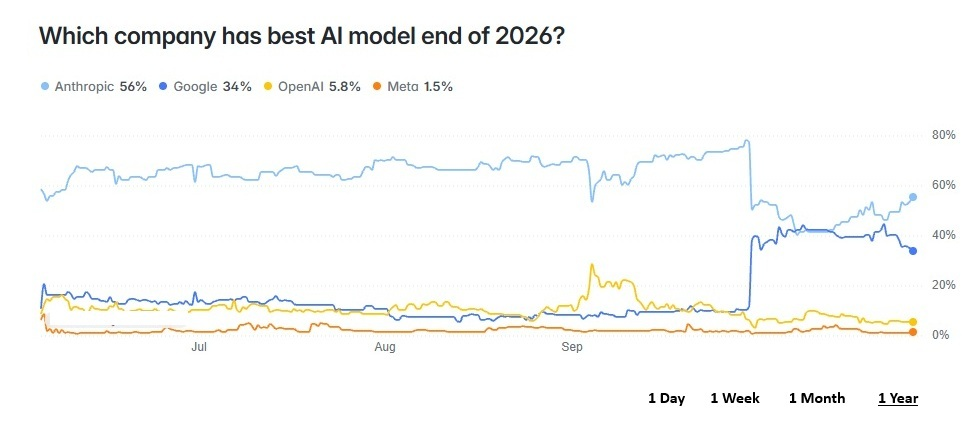
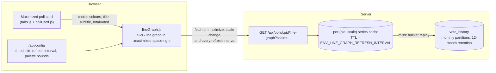
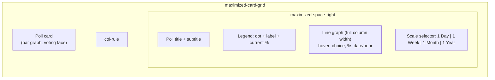
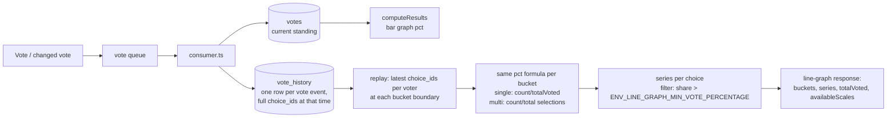
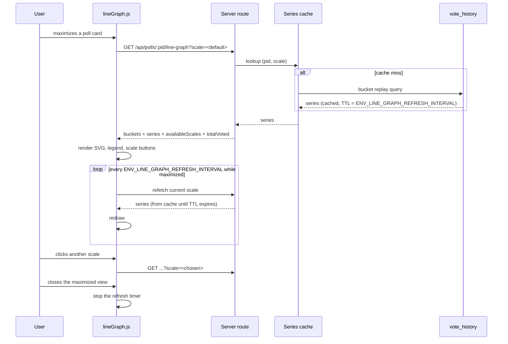

# High Level Requirements

Requirements: `requirements/20261027-151601-poll-line-graph/requirements.md`  
External Files: `line-graph-example.jpg` (copied beside the requirements from `dontTrack/line-graph-example.jpg`)  
Generated: 2026-10-27 3:16 PM  

# Initial High-Level Requirements

The objective of this requirement is to add a line graph to the right column of the Maximized Poll page.

An example of the kind of line graph is shown in the image:  

This is adapted from:
https://polymarket.com/event/which-company-has-best-ai-model-end-of-2026

The line graph will map the percentage of votes at discrete time point on the X-axis.  
The choices for XAxis scale are:
- 1 Year, or ALL
- 1 month
- 1 week
- 1 day

One Year
- x axis discrete points are day
- the max is one year even if the data spans more. (currently the data is purged greater than 1 year)
- if the data spans less than a month then 1 Year is not available

1 Month
- if the data spans less than 1 week, then 1 Month is not available
- x axis discrete points are day

1 Week
- if the data spans less than 1 day, then 1 Week is not available
- x axis discrete points are hour

1 Day
- x axis discrete points are hour

Y Axis is Percentage of vote at the corresponding time point on the X-axis.

The lines are the choices that have great than 1% of the vote (this is an ENV variable, e.g., ENV_LINE_GRAPH_MIN_VOTE_PERCENTAGE)

Each line is assigned a color coreesponging to the color used on the bar graph.  
This ensures consistency between the bar graph and the line graph, making it easier for users to associate each choice with its corresponding line.  

Poll title and subtitle are rendered.

There will be the same # votes displayed on the line graph as on the bar graph, ensuring consistency in the representation of voting data.  

The bar graph will be rendere3d to occupy the full width of the right column container of the maximized poll page.  

Mosuing ove the graph will render the Choice corresponding to the line at the hovered time point, along with the percentage of votes it has received,  
and the date, or date/hour, depending on the X-axis scale.  

Research: how should these graphs be cached so that they can be efficiently rendered without repeatedly fetching and processing the same data.  
The can be a refresh interval that is appropriate for updating the graph with the latest voting data without causing excessive load on the server.
The refresh interval should be configurable, allowing adjustments based on the expected frequency of voting activity and server capacity.
Environment variable ENV_LINE_GRAPH_REFRESH_INTERVAL will define the refresh interval for updating the graph with the latest voting data.

## Additional Requirements and Research Requests

**Instructions To The Developer**  
Enter any additional requirements or research requests under the ## Additional Requirements and Research Requests heading above.  
When you Type or Say: "Next" in the CC CLI terminal, the additional requirements and research requests will be applied to the report.  
  
You may leave these instructions here. They will be ignored when "Next" is executed.  

## 1. Overview

The feature fills the maximized poll view's empty right column (`.maximized-space-right`, today a grey placeholder) with a vote-history line graph.  
The graph shows, for each choice above a configurable share threshold, the percentage of the vote that choice held at each discrete time point, over a selectable trailing window (1 Day, 1 Week, 1 Month, 1 Year).  
Hovering reveals the choice, its percentage and the date (or date and hour) at the hovered point.  

The codebase already holds everything the graph needs:  

- **The time series exists.** Every vote event — first votes and changed votes alike — inserts a `vote_history` row (`poll_id`, `email`, `choice_ids[]`, `voted_at`), partitioned monthly by `voted_at` and purged after 12 months by `retentionSweep`;  
  replaying a poll's rows in time order, keeping each voter's latest `choice_ids`, reconstructs the exact standing at any instant (the same standing `computeResults` reads from `votes`).  
- **The colours exist.** `pollCard.js` assigns each choice its bar colour via `expandPalette` + `paletteOffsetFor(pid)` + `assignResultColors` (manual colours and the fixed yes/no colours included);  
  the line graph reuses the per-choice hex the card already computed, so the two graphs cannot disagree.  
- **The percentage formula exists.** `computeResults` defines pct as `count / totalVoted` for single-choice polls and `count / total selections` for multiple-choice polls;  
  each time point applies the same formula to the replayed standing, so the graph's newest point always matches the bar graph.  
- **The surface exists.** The maximized grid (`<template id="maximizedCardGrid">`) renders the poll card in the left column, a `.col-rule`, and the right column the graph will occupy;  
  below a 767.98 px container width the rule hides and the right column wraps under the card at full width.  

## 2. UI Composition

The right column renders, top to bottom: the poll title and subtitle, a legend (one entry per drawn line: colour dot, choice label, current percentage), the graph itself at the column's full width, and the scale selector (1 Day, 1 Week, 1 Month, 1 Year), with unavailable scales absent or disabled.  
The total vote count shown equals the bar graph's `totalVoted`.  

**Scale availability and bucketing** (from the requirements; span = time from the poll's first vote to now):  

| Scale | X-axis bucket | Points (max) | Available when |
|---|---|---|---|
| 1 Day | hour | 24 | always |
| 1 Week | hour | 168 | span ≥ 1 day |
| 1 Month | day | ~31 | span ≥ 1 week |
| 1 Year | day | ~366 | span ≥ 1 month |

Lines drawn: choices whose share exceeds `ENV_LINE_GRAPH_MIN_VOTE_PERCENTAGE` (default 1%).  
Each line's colour is the choice's bar-graph colour (manual colour, yes/no semantic colour, or the poll's palette assignment).  

## 3. Data Flow and Time-Series Derivation

- A changed vote on a dynamic poll inserts a new `vote_history` row carrying the voter's full new `choice_ids`;  
  the replay therefore counts each voter once per bucket, with their then-current selection, exactly as the bar graph counts them now.  
- The newest bucket is computed to "now", so the graph's right edge equals the bar graph's current standing and the displayed vote count matches.  
- The 12-month purge bounds every window: the 1 Year scale can never ask for data the retention sweep has removed.  

## 4. Refresh and Caching Sequence

The cache and refresh design is the subject of research request RS1 (see *7. Research Results*).  

## 5. Breaking Changes

None found.  
The feature is additive: one new read-only endpoint, one new browser module and stylesheet addition, two new `ENV_*` settings, and (if RS1's recommendation is accepted) one additive index migration on `vote_history`.  
No existing route, table, contract or behaviour changes.  

## 6. Technical Debt

- **`vote_history` has no per-poll index.** Its primary key is `(id, voted_at)`;  
  a per-poll range query (`poll_id`, `voted_at`) scans every row of the touched partitions.  
  The graph query needs an additive index on `(poll_id, voted_at)` (a normal additive migration, applied to each partition);  
  without it every cache miss scans whole partitions.  
- **`.maximized-space-right` carries placeholder styling** (hard-coded `#E6E6E6`, Inter at a literal 13 px) that predates the Material 3 merge and violates its no-literal-font-size rule;  
  this feature replaces that placeholder, which retires the debt.  

## 7. Research Results

### RS1. How should the line-graph series be cached, and how often refreshed?

✅ Resolved  
✅ Requirements File Updated: 2026-10-27 3:41 PM  
**Notes**: Recommendation accepted in file 2026-10-27: Recommendation A, a read-through cache keyed by (poll id, scale) with TTL = `ENV_LINE_GRAPH_REFRESH_INTERVAL` and the browser refetching on the same interval;  
the requirements now record the caching design, the `60000` ms default and the `/api/config` exposure beneath the research request.  

The requirements ask how the graphs should be cached so they render without repeatedly fetching and processing the same data, with a configurable refresh interval (`ENV_LINE_GRAPH_REFRESH_INTERVAL`) that updates the graph without excessive server load.  
Sources: the codebase's own load patterns — the per-query search cache (`ENV_SEARCH_CACHE_TTL`, 10 s, served from Valkey in production and in-process in development), the TRENDING/Newest publishers (recompute every `ENV_TRENDING_POLLS_RECOMPUTE_INTERVAL`, published as static objects with a CDN `max-age` equal to the interval), the Live Results floor (`ENV_MIN_LIVE_REFRESH_INTERVAL`), the counter flush (`ENV_COUNTER_FLUSH_INTERVAL`, 2 s), and the budget controller and per-instance shedding that bound all dynamic traffic.  
Findings: the series is per-poll and per-scale, so a published-object design like TRENDING (one object per poll per scale, republished on an interval for every open poll) would compute graphs nobody is looking at;  
the search cache's read-through TTL design fits better: nothing is computed until a viewer asks, every viewer of the same poll and scale within the TTL shares one computation, and the TTL doubles as the staleness bound, so the client refresh interval and the cache TTL can be the same setting.  
Historical buckets never change (votes are never backdated), so only the newest bucket is genuinely volatile;  
a TTL as long as a trending recompute (60 s) keeps the graph at most one minute stale, which matches the "discrete points are hours/days" granularity — a graph whose finest bucket is an hour does not need 2-second freshness.  

  - **Recommendation A** _(recommended)_: **a read-through cache keyed by (poll id, scale), TTL = `ENV_LINE_GRAPH_REFRESH_INTERVAL`, default 60000 ms, with the browser refetching on the same interval.**  

    ➡️ [X] **Accepted**  
    - <u>Pros</u>: reuses the existing cache seam (Valkey in production, in-process in development) exactly as the search cache does;  
      computes only what is viewed, shares one computation across all viewers of a poll within the TTL, and needs no sweep, no publisher and no new infrastructure;  
      the refresh interval and the staleness bound are one setting, so the graph is never staler than one client refresh.  
    - <u>Cons</u>: a cache miss pays the full bucket-replay query (bounded by the new `(poll_id, voted_at)` index);  
      N polls viewed simultaneously cost N queries per TTL, though each is a single-poll index range scan.  
  - **Recommendation B**: **precompute and publish per-poll series objects to Spaces + CDN on an interval, like TRENDING.**  

    ➡️ [ ] **Accepted**  
    - <u>Pros</u>: zero query cost at view time; survives instance restarts; CDN absorbs all read traffic.  
    - <u>Cons</u>: computes four scales for every open poll on every interval whether or not anyone is looking — the opposite of this feature's access pattern (one poll maximized at a time);  
      needs a new sweep, a new published-object family and cache-busting; far more moving parts for the same staleness bound.  
  - **Developer Resolution C**:  

    ➡️ [ ] **Accepted**  

## 8. Findings

### 8.1 Inconsistencies

**IN1. "The bar graph will be rendered to occupy the full width of the right column" names the wrong graph.**  
✅ Resolved  
✅ Requirements File Updated: 2026-10-27 3:41 PM  
**Notes**: Recommendation accepted in file 2026-10-27: read the sentence as naming the line graph;  
the requirements sentence now reads "The line graph will be rendered to occupy the full width of the right column container of the maximized poll page".  

The requirements introduce the feature as a line graph in the right column, and the bar graph is the existing poll card in the left column.  
The sentence "The bar graph will be rendere3d to occupy the full width of the right column container of the maximized poll page" contradicts that: the bar graph cannot be in both columns.  

  - **Recommendation**: **read the sentence as "The line graph will be rendered to occupy the full width of the right column container", and correct it in the requirements.**  

    ➡️ [X] **Accepted**  
    - Every other statement in the document places the line graph in the right column and leaves the bar graph where it is;  
      the sentence also carries a typo ("rendere3d"), which marks it as a hurried line rather than an intended second meaning.  
  - **Developer Resolution B**:  

    ➡️ [ ] **Accepted**  

### 8.2 Ambiguities

**AM1. What does "percentage of votes at a time point" measure — the cumulative standing, or the votes cast in that bucket?**  
✅ Resolved  
✅ Requirements File Updated: 2026-10-27 3:41 PM  
**Notes**: Recommendation accepted in file 2026-10-27: cumulative standing, replayed from `vote_history` with the bar graph's percentage formula;  
the requirements now define the percentage at a time point beneath the Y Axis line.  

The Y value at a time point could be (a) the share each choice held at that instant, counting every voter's latest vote up to then — the running standing, as in the Polymarket example — or (b) the share of only the votes cast within that hour or day.  
The requirement "the same # votes displayed on the line graph as on the bar graph" only makes sense under (a), where the newest point equals the bar graph, but the document never says so.  

  - **Recommendation**: **cumulative standing: at each bucket boundary, replay `vote_history` keeping each voter's latest `choice_ids`, and apply `computeResults`'s percentage formula to that standing.**  

    ➡️ [X] **Accepted**  
    - It matches the Polymarket example (lines move smoothly and end at the current standing);  
      the graph's right edge then equals the bar graph exactly, satisfying the same-vote-count requirement;  
      per-bucket counting would make sparse polls unreadable (most buckets hold zero votes) and could never match the bar graph.  
  - **Developer Resolution B**:  

    ➡️ [ ] **Accepted**  

**AM2. Is the largest scale labelled "1 Year", "ALL", or both?**  
✅ Resolved  
✅ Requirements File Updated: 2026-10-27 3:41 PM  
**Notes**: Recommendation accepted in file 2026-10-27: Recommendation A, one button, always labelled "1 Year";  
the scale list's first entry now says so and notes the 12-month purge.  

The scale list says "1 Year, or ALL" — it is unclear whether these are two separate buttons, one button with a conditional label, or one name chosen over the other.  
Since `vote_history` is purged after 12 months, "ALL" and "1 Year" can never show different data.  

  - **Recommendation A** _(recommended)_: **one button, always labelled "1 Year".**  

    ➡️ [X] **Accepted**  
    - <u>Pros</u>: one stable label; honest about the window (data older than a year is gone, so "ALL" would overpromise);  
      matches the example image, whose selected control reads "1 Year".  
    - <u>Cons</u>: for a poll younger than a year, "1 Year" shows the poll's whole life, where "ALL" might read more naturally.  
  - **Recommendation B**: **one button whose label is "ALL" while the poll's data spans less than a year, and "1 Year" after.**  

    ➡️ [ ] **Accepted**  
    - <u>Pros</u>: the label always describes exactly what is shown.  
    - <u>Cons</u>: the label changes over a poll's life, and two names for one control complicate documentation and tests.  
  - **Developer Resolution C**:  

    ➡️ [ ] **Accepted**  

**AM3. When is the `ENV_LINE_GRAPH_MIN_VOTE_PERCENTAGE` threshold evaluated?**  
✅ Resolved  
✅ Requirements File Updated: 2026-10-27 3:41 PM  
**Notes**: Recommendation accepted in file 2026-10-27: the threshold is evaluated on the current standing, and a qualifying choice is drawn across the whole window;  
the requirements now say so beneath the threshold line.  

"The lines are the choices that have greater than 1% of the vote" does not say measured when: a choice's share changes over the window, so a line could qualify by its current share, by its share at any point in the window, or per point (drawn only where it exceeds the threshold).  

  - **Recommendation**: **evaluate on the current standing (the bar graph's percentage): a choice whose current share exceeds the threshold is drawn across the whole window; others are omitted entirely.**  

    ➡️ [X] **Accepted**  
    - The legend then agrees with the bar graph a viewer sees beside it;  
      lines that start or stop mid-window (per-point filtering) read as data gaps, and "qualified at any point" lets long-dead choices clutter the graph.  
  - **Developer Resolution B**:  

    ➡️ [ ] **Accepted**  

**AM4. What exactly does hover show — the nearest line only, or every line at the hovered time?**  
✅ Resolved  
✅ Requirements File Updated: 2026-10-27 3:41 PM  
**Notes**: Recommendation accepted in file 2026-10-27: Recommendation A, a vertical crosshair with a tooltip listing every drawn line;  
the requirements now describe the crosshair beneath the hover paragraph.  

"Mousing over the graph will render the Choice corresponding to the line at the hovered time point" reads as one choice, but with several lines close together "the line" is ambiguous, and the Polymarket example shows a crosshair reporting the whole standing at the hovered time.  

  - **Recommendation A** _(recommended)_: **a vertical crosshair at the hovered time with a tooltip listing every drawn line's choice and percentage (colour dot + label + %), plus the date (or date and hour) once.**  

    ➡️ [X] **Accepted**  
    - <u>Pros</u>: matches the example's behaviour; no ambiguity when lines overlap;  
      one hover answers the question a viewer actually has ("what was the standing then?").  
    - <u>Cons</u>: a poll with many qualifying choices makes a tall tooltip.  
  - **Recommendation B**: **highlight only the line nearest the pointer, showing that one choice, its percentage and the date.**  

    ➡️ [ ] **Accepted**  
    - <u>Pros</u>: smallest tooltip; literal reading of the requirement.  
    - <u>Cons</u>: near-overlapping lines are hard to pick with a pointer and impossible to pick by touch;  
      comparing choices at a moment takes several hovers.  
  - **Developer Resolution C**:  

    ➡️ [ ] **Accepted**  

### 8.3 Unspecified Aspects

**UA1. The data source and transport are unspecified.**  
✅ Resolved  
✅ Requirements File Updated: 2026-10-27 3:41 PM  
**Notes**: Recommendation accepted in file 2026-10-27: one new read-only endpoint `GET /api/polls/:pid/line-graph?scale=1d|1w|1m|1y` computed from `vote_history`;  
recorded under "Resolved Details" in the requirements.  

The requirements describe the graph but not where the browser gets the series: no endpoint, no response shape, no statement that `vote_history` is the source.  

  - **Recommendation**: **one new read-only endpoint, `GET /api/polls/:pid/line-graph?scale=1d|1w|1m|1y`, answering `{ scale, availableScales, totalVoted, buckets: [timestamps], series: [{ choiceId, label, color?, points: [pct] }] }`, computed from `vote_history` by the bucket replay in section 3, with the poll's read-access rules applied (the same visibility the card's results obey).**  

    ➡️ [X] **Accepted**  
    - The server owns the replay (the browser never sees voter emails, which `vote_history` rows carry);  
      `availableScales` lets the client draw the selector without a second request;  
      the endpoint joins `postman/openapi.json` as every route must.  
  - **Developer Resolution B**:  

    ➡️ [ ] **Accepted**  

**UA2. The default scale and the meaning of "data spans" are unspecified.**  
✅ Resolved  
✅ Requirements File Updated: 2026-10-27 3:49 PM  
**Notes**: Recommendation accepted in file 2026-10-27: span runs from the poll's first `vote_history` row to now, and the default scale is the largest available one;  
recorded under "Resolved Details" in the requirements.  

The requirements give per-scale availability rules but not which scale a freshly maximized card shows, nor whether "the data spans" is measured from the poll's first vote, its launch, or its creation.  

  - **Recommendation**: **span = time from the poll's first `vote_history` row to now, and the default scale is the largest available one.**  

    ➡️ [X] **Accepted**  
    - First vote is the first point the graph can draw, so it is the only span the availability rules can act on without empty leading stretches;  
      the largest scale shows the poll's whole story on open, as the example (1 Year selected) does.  
  - **Developer Resolution B**:  

    ➡️ [ ] **Accepted**  

**UA3. Behaviour with no or almost no voting data is unspecified.**  
✅ Resolved  
✅ Requirements File Updated: 2026-10-27 3:41 PM  
**Notes**: Recommendation accepted in file 2026-10-27: a quiet placeholder replaces the axes while fewer than two time points exist;  
recorded under "Resolved Details" in the requirements.  

A poll with no votes, or whose votes all arrived within a single hour, gives the smallest scale fewer than two points;  
the requirements do not say what renders then.  

  - **Recommendation**: **with fewer than two time points on every available scale, render the title, subtitle and a quiet placeholder line ("Not enough voting data to graph yet") instead of axes; the graph appears on a later refresh once two points exist.**  

    ➡️ [X] **Accepted**  
    - An empty axes frame reads as a bug;  
      the placeholder keeps the right column stable so the layout does not jump when data arrives.  
  - **Developer Resolution B**:  

    ➡️ [ ] **Accepted**  

**UA4. Dark-mode rendering is unspecified.**  
✅ Resolved  
✅ Requirements File Updated: 2026-10-27 3:41 PM  
**Notes**: Recommendation accepted in file 2026-10-27: the assigned bar-fill hex in both themes, Material 3 tokens for the chrome;  
recorded under "Resolved Details" in the requirements.  

The bar graph derives separate light and dark variants (`barColorsOf` returns both);  
the requirements say only that line colours correspond to the bar graph's, not which variant a dark page uses, nor how axes, gridlines and the tooltip are themed.  

  - **Recommendation**: **lines use the choice's assigned hex (the bar's fill colour) in both themes; axes, gridlines, labels, crosshair and tooltip use the existing Material 3 tokens, so the chrome follows the theme while the data colours stay identical to the bars.**  

    ➡️ [X] **Accepted**  
    - The assigned hexes are saturated mid-tones that read on both surfaces, and identical data colours in both themes is what "corresponding to the bar graph" most directly means;  
      tokenised chrome keeps the stylesheet free of literal colours, as `m3-assets.test.ts` requires.  
  - **Developer Resolution B**:  

    ➡️ [ ] **Accepted**  

**UA5. The defaults and units of the two new settings are unspecified.**  
✅ Resolved  
✅ Requirements File Updated: 2026-10-27 3:41 PM  
**Notes**: Recommendation accepted in file 2026-10-27: `ENV_LINE_GRAPH_MIN_VOTE_PERCENTAGE` defaults to `1`, `ENV_LINE_GRAPH_REFRESH_INTERVAL` to `60000` ms floored at `ENV_MIN_LIVE_REFRESH_INTERVAL`, both sent in `/api/config`;  
the defaults now appear beneath the threshold line and the research request.  

`ENV_LINE_GRAPH_MIN_VOTE_PERCENTAGE` is introduced with an example value (1%) and `ENV_LINE_GRAPH_REFRESH_INTERVAL` with no value or unit at all.  

  - **Recommendation**: **`ENV_LINE_GRAPH_MIN_VOTE_PERCENTAGE` defaults to `1` (whole percent, 0 disables the filter); `ENV_LINE_GRAPH_REFRESH_INTERVAL` defaults to `60000` ms (the trending recompute's cadence), floored at `ENV_MIN_LIVE_REFRESH_INTERVAL`; both are sent to the browser in `/api/config`.**  

    ➡️ [X] **Accepted**  
    - Milliseconds match every other interval setting in the table;  
      a 60 s refresh suits a graph whose finest bucket is an hour, and the floor keeps a misconfigured value from outpacing the Live Results floor.  
  - **Developer Resolution B**:  

    ➡️ [ ] **Accepted**  

**UA6. Narrow-viewport behaviour is unspecified.**  
✅ Resolved  
✅ Requirements File Updated: 2026-10-27 3:41 PM  
**Notes**: Recommendation accepted in file 2026-10-27: the existing wrap is kept and the graph renders below the card at full width on narrow viewports;  
recorded under "Resolved Details" in the requirements.  

Below a 767.98 px container width the maximized grid already hides the column rule and wraps the right column under the card;  
the requirements do not say whether the graph follows that or is hidden on phones.  

  - **Recommendation**: **keep the existing wrap: the graph renders below the card at full width on narrow viewports, with hover served by touch (tap places the crosshair).**  

    ➡️ [X] **Accepted**  
    - The wrap behaviour is already built and tested for the maximized grid;  
      hiding the graph on phones would silently drop the feature for the single-column audience the last two features worked to serve.  
  - **Developer Resolution B**:  

    ➡️ [ ] **Accepted**  

**UA7. The legend is unspecified.**  
✅ Resolved  
✅ Requirements File Updated: 2026-10-27 3:41 PM  
**Notes**: Recommendation accepted in file 2026-10-27: a legend above the graph with one entry per drawn line plus the total vote count;  
recorded under "Resolved Details" in the requirements.  

The example image shows a legend (colour dot, choice name, current percentage) above the graph, and the requirements require title, subtitle and vote count, but never mention a legend;  
without one, line identity is only discoverable by hover, which touch devices cannot do casually.  

  - **Recommendation**: **render a legend above the graph: one entry per drawn line with its colour dot, choice label and current percentage, plus the total vote count; entries wrap on narrow columns.**  

    ➡️ [X] **Accepted**  
    - It is in the example image the requirements point to;  
      it is the accessible, hover-free reading of the graph and the natural place for the required vote count.  
  - **Developer Resolution B**:  

    ➡️ [ ] **Accepted**  

**UA8. The time zone of the X-axis buckets and labels is unspecified.**  
✅ Resolved  
✅ Requirements File Updated: 2026-10-27 4:01 PM  
**Notes**: Recommendation accepted in file 2026-10-27: Recommendation A, UTC buckets on the server, viewer-local axis and crosshair labels in the browser;  
recorded under "Resolved Details" in the requirements.  

Day buckets need a midnight and hour labels need a zone, and the requirements do not say whose.  
The project already holds two conventions: poll dates are shown in the creator's time zone (`polls.time_zone`, feature 20261026-085056-POLL-INVITATIONS), while a browser would naturally format in the viewer's local time.  
The accepted caching design (RS1) shares one series per (poll id, scale) across all viewers, so bucketing by each viewer's zone would either fragment the cache or mislabel shared buckets — the bucketing zone must be viewer-independent, and only the labelling is free.  

  - **Recommendation A** _(recommended)_: **bucket on the server in UTC; the response carries UTC timestamps, and the browser formats the axis and crosshair labels in the viewer's local time.**  

    ➡️ [X] **Accepted**  
    - <u>Pros</u>: one shared cache entry per poll and scale;  
      labels read naturally to every viewer;  
      hour buckets are zone-independent anyway, and on a 24-point-plus axis a day bucket's UTC edges sit at most half a day from any viewer's midnight.  
    - <u>Cons</u>: a "day" point does not align exactly with the viewer's calendar day;  
      two viewers can see different hour labels for the same point (the same instant), which matters only when comparing screenshots.  
  - **Recommendation B**: **bucket and label in the poll creator's time zone (`polls.time_zone`, UTC when null), as `formatPollDate` already does for poll dates.**  

    ➡️ [ ] **Accepted**  
    - <u>Pros</u>: matches the project's existing poll-date convention;  
      day points align with the creator's calendar days, and every viewer sees identical labels.  
    - <u>Cons</u>: labels can read oddly to viewers in other zones (an hourly point named in a zone they are not in);  
      the zone must travel in the response so the browser can format it.  
  - **Developer Resolution C**:  

    ➡️ [ ] **Accepted**  

### 8.4 Needs Clarifications

**NC1. How is the graph drawn — a hand-rolled SVG module, or a charting library?**  
✅ Resolved  
✅ Requirements File Updated: 2026-10-27 3:41 PM  
**Notes**: Recommendation accepted in file 2026-10-27: Recommendation A, a hand-rolled inline-SVG module (`lineGraph.js`), no new dependency;  
recorded under "Resolved Details" in the requirements.  

The project has avoided new dependencies for several features running ("No new dependency" is a recurring plan constraint, and the constitution asks for the minimum code that solves the problem);  
a time-series chart with hover is squarely what charting libraries do, so this is a genuine fork with scope implications either way.  

  - **Recommendation A** _(recommended)_: **a hand-rolled inline-SVG module (`lineGraph.js`), no new dependency: polylines, four or five Y gridlines, hour/day X labels, a crosshair built from the existing tooltip patterns.**  

    ➡️ [X] **Accepted**  
    - <u>Pros</u>: keeps the zero-framework, zero-dependency front end the whole codebase maintains;  
      full control of Material 3 theming and the bar-colour mapping;  
      the needed feature set (fixed scales, one hover behaviour, ≤ 366 points) is small enough to own.  
    - <u>Cons</u>: axis-label placement, crosshair hit-testing and touch handling are real work a library gives for free;  
      future chart wishes (zoom, pan, export) would each be hand-built too.  
  - **Recommendation B**: **adopt a small charting library (for example Chart.js or uPlot) as the project's first front-end dependency.**  

    ➡️ [ ] **Accepted**  
    - <u>Pros</u>: hover, scales, resizing and touch come solved and tested;  
      less bespoke code to maintain.  
    - <u>Cons</u>: breaks the codebase's no-dependency front-end pattern and adds bundle weight to the home page for one view;  
      theming a library to Material 3 tokens and the exact bar colours is its own work;  
      the jsdom test suites would need the library stubbed or loaded.  
  - **Developer Resolution C**:  

    ➡️ [ ] **Accepted**  

**NC2. Does the graph obey the same visibility rules as the poll's results?**  
✅ Resolved  
✅ Requirements File Updated: 2026-10-27 3:41 PM  
**Notes**: Recommendation accepted in file 2026-10-27: the graph follows the card's results visibility, enforced server-side at the endpoint;  
recorded under "Resolved Details" in the requirements.  

Poll results are not always shown to every viewer (a card can present its voting face, and access rules govern who sees a poll at all);  
a history graph reveals the standing over time, so showing it to a viewer the card would not show results to would leak them.  

  - **Recommendation**: **the graph renders exactly when the maximized card may show its results face to this viewer, and the endpoint enforces the same server-side access rule; otherwise the right column shows the title, subtitle and a note that results are not available yet.**  

    ➡️ [X] **Accepted**  
    - One rule, owned by the server, keeps the graph from becoming a side channel around whatever result-visibility behaviour the card has;  
      the client check alone would not survive a direct request to the endpoint.  
  - **Developer Resolution B**:  

    ➡️ [ ] **Accepted**  

## 9. Requirements Report Complete Report  
  
- **Requirements Report Document:** requirements/20261027-151601-poll-line-graph/requirements-report.md  
- **Requirements Document:** requirements/new-20261027-143227/requirements.md → requirements/20261027-151601-poll-line-graph/requirements.md  
- **Software Architecture Diagrams:** 4  
- **Inconsistencies:** 1  
- **Ambiguities:** 4  
- **Unspecified Aspects:** 8  
- **Needs Clarifications:** 2  
- **Research Results:** 1  
- **Breaking Changes:** 0  
- **Technical Debt items:** 2  
  
The requirements are ready for /speckit-specify.  
To generate specs from the requirements document, use the `/speckit-specify` skill followed by the path (relative to the project root) to the requirements file.  
At the prompt, Type:  
🟩 👉 /speckit-specify requirements/20261027-151601-poll-line-graph/requirements.md  