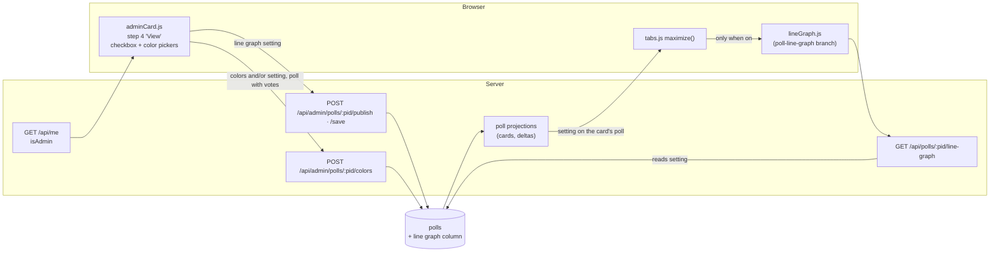
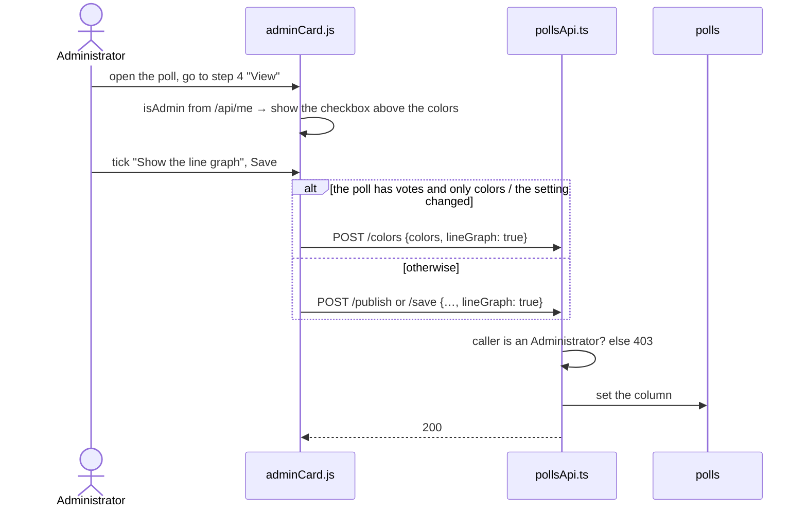
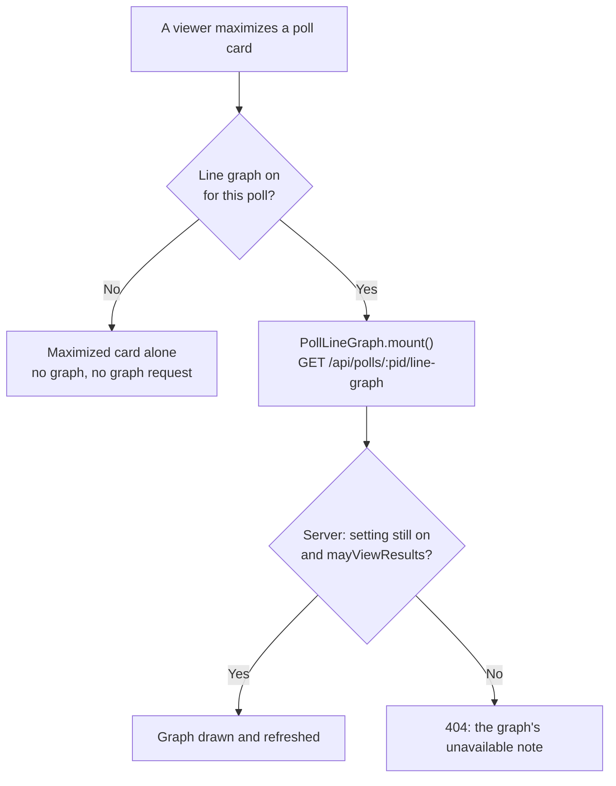
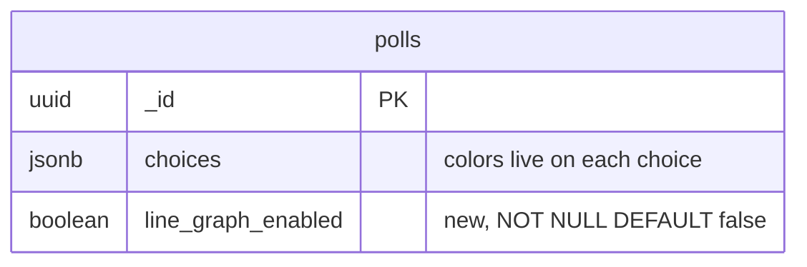

# High Level Requirements

Requirements: `requirements/20261028-114023-line-graph-toggle/requirements.md`  
External Files: none  
Generated: 2026-10-28 11:40 AM  

We have derermined that some Polls are not appropriate for a line graph.  
By default, every poll will not have line graph enabled.  
There will be a checkbox on the Poll creation/editing interface to enable the line graph.  
This checkbox will only be available to one of the Admin Users.    

The checkbox will be on the Current Poll Card tab called "Colors".  
This tab will be renamed to "View".  
The "View" tab will now contain the checkbox to enable the line graph for the poll.  
For  Admin Users, this appear above colors selectors.  

Of course, a database field will be needed to be added to the polls table.

## Additional Requirements and Research Requests

**Instructions To The Developer**  
Enter any additional requirements or research requests under the ## Additional Requirements and Research Requests heading above.  
When you Type or Say: "Next" in the CC CLI terminal, the additional requirements and research requests will be applied to the report.  
  
You may leave these instructions here. They will be ignored when "Next" is executed.  

## 1. Overview and Scope

The line graph is drawn in the maximized poll view, to the right of the card.  
It plots each choice's share of the votes over time.  
It was built on the branch `origin/poll-line-graph` (feature `specs/20261027-151601-POLL-LINE-GRAPH`), which is **not merged into `dev`**.  
On that branch every poll shows the graph.  
This feature turns it into a per-poll setting that is off by default and that only an Administrator can switch on.  

**In scope:**  

- a new `polls` column, false by default, holding whether the poll shows the line graph;  
- the admin card wizard's step 4, "Colors", renamed "View";  
- a checkbox on that step, above the color pickers, shown to Administrators only;  
- saving the setting through the existing poll write paths;  
- the maximized view drawing the graph only when the setting is on.  

**Out of scope:** how the graph is drawn, its data, scales, colors and refresh, which stay as the line graph feature built them.  

### Current code this touches

| Area | File | Today |
|---|---|---|
| Wizard steps | `src/public/adminCard.js:351` | `WIZARD_STEPS` step 4 is `{ name: "Colors", short: "Colors" }` |
| Colors step | `src/public/adminCard.js:1338` | `buildColorsStep()` shows only the color pickers, or "Add your choices first…" |
| Settings Summary | `src/public/adminCard.js:790` | `buildColorsSummaryLine()` describes the bar colors |
| Colors-only save | `src/routes/pollsApi.ts:339` | `POST /api/admin/polls/:pid/colors` changes colors on a poll with votes, without review |
| Fields after votes | `src/routes/pollsApi.ts:500` | `UPDATE_FIELDS` lists what may change once a poll has votes |
| Administrator rule | `src/polls/service.ts:750` | `isAdminEmail` (`ENV_ADMINS`); the browser reads `isAdmin` from `GET /api/me` (`adminList.js:474`) |
| Graph mount | `src/public/tabs.js` (branch) | `maximize()` always calls `window.PollLineGraph?.mount(...)` |
| Graph route | `src/routes/tabsApi.ts` (branch) | `GET /api/polls/:pid/line-graph` serves any poll `mayViewResults` allows |
| Migrations | `src/db/migrations/` | the last is `011-invitation-tokens.ts` |

## 2. Architecture Diagrams

### 2.1 Components

### 2.2 An Administrator switches the graph on

### 2.3 Maximizing a poll

### 2.4 Data

## 3. Breaking Changes

- **BC1. Polls stop showing the graph.**  
  On the `poll-line-graph` branch every maximized poll shows a graph.  
  After this feature none does until an Administrator switches it on, including the test polls made with `devScripts/populate/populate-poll.ts`.  
- **BC2. Step 4 is renamed.**  
  The circle and the step heading read "View" instead of "Colors".  
  `tests/client-admin-wizard.test.ts:437` expects the circle labels `"Who", "Title", "Choices", "Colors", "How", "When"` and must change.  

## 4. Technical Debt

- **TD1. The line graph lives on an unmerged branch.**  
  `origin/poll-line-graph` last merged `dev` on 2026-10-27; every day apart adds merge work, in `tabs.js`, `tabsApi.ts`, `api.ts` and `CLAUDE.md` in particular.  
- **TD2. The `/colors` route's name.**  
  If it also carries the line graph setting, its name no longer says everything it does.  
  Renaming it would touch `adminCard.js`, the route, `postman/openapi.json` and its tests, for no change in behavior.  
- **TD3. Step-number literals in `adminCard.js`.**  
  Steps are referred to by number (`answered.has(4)`, `part(…, 4, "colors")`); the rename leaves the number alone, so nothing moves, but the literals stay.  

## 5. Assumptions

- The column is `polls.line_graph_enabled boolean NOT NULL DEFAULT false`, added by one additive migration, `012-line-graph`; existing rows take the default.  
- The checkbox's label is "Show the line graph", in the wizard's checkbox style; its wording can change in `/speckit-specify`.  
- The setting does not change the poll's state, does not pause voting and does not send the poll back for Acceptability Screening.  
- The graph itself is unchanged: data, scales, colors, threshold and refresh stay as the line graph feature specified them.  

## 6. Findings

### 6.1 Inconsistencies

None found.

### 6.2 Ambiguities

**AM1. Who is "one of the Admin Users"?**  
✅ Resolved  
✅ Requirements File Updated: 2026-10-28 11:50 AM  
**Notes**: Recommendation accepted in file 2026-10-28: Recommendation A, any Administrator (`isAdminEmail`); creators who are not Administrators never see or change it;  
the requirements now say so under Resolved Decisions.  

The requirement says the checkbox "will only be available to one of the Admin Users".  
It can be read as any Administrator (an `ENV_ADMINS` address, the rule `isAdminEmail` already applies), or as one particular admin.  
Poll creators who are not Administrators (users holding `Create Poll` and `View Polls`) also use the wizard.  

  - **Recommendation A** _(recommended)_: **any Administrator (`isAdminEmail`); creators who are not Administrators never see or change it.**  

    ➡️ [x] **Accepted**  
    - <u>Pros</u>: it is the rule every other admin-only control uses, the browser already learns it from `GET /api/me`, and it needs no new setting.  
    - <u>Cons</u>: every address in `ENV_ADMINS` gets the control, not one person.  

  - **Recommendation B**: **one named administrator, set by a new `ENV_LINE_GRAPH_ADMIN` setting.**  

    ➡️ [ ] **Accepted**  
    - <u>Pros</u>: exactly one person decides which polls show a graph.  
    - <u>Cons</u>: a new setting and a second admin rule to keep in step with `ENV_ADMINS`.  

  - **Developer Resolution C**:  

    ➡️ [ ] **Accepted**  

**AM2. What does a creator who is not an Administrator see on the "View" step?**  
✅ Resolved  
✅ Requirements File Updated: 2026-10-28 11:50 AM  
**Notes**: Recommendation accepted in file 2026-10-28: Recommendation A, the checkbox is absent for creators who are not Administrators;  
the requirements now say so under Resolved Decisions.  

The requirement places the checkbox above the color pickers "for Admin Users", and says nothing of anyone else.  

  - **Recommendation A** _(recommended)_: **the checkbox is absent; the step shows only the color pickers, as today.**  

    ➡️ [x] **Accepted**  
    - <u>Pros</u>: matches how the admin-only Poll Administration link is handled (absent, not disabled); nothing to explain to a creator.  
    - <u>Cons</u>: a creator cannot tell from the step that the setting exists.  

  - **Recommendation B**: **the checkbox is shown disabled, with the hint "Only an Administrator can change this."**  

    ➡️ [ ] **Accepted**  
    - <u>Pros</u>: a creator sees whether their poll shows a graph.  
    - <u>Cons</u>: a control they can never use; the Settings Summary (UA5) can tell them instead.  

  - **Developer Resolution C**:  

    ➡️ [ ] **Accepted**  

**AM3. Which "tab" is renamed?**  
✅ Resolved  
✅ Requirements File Updated: 2026-10-28 11:50 AM  
**Notes**: Recommendation accepted in file 2026-10-28: Recommendation, step 4 renamed "View" in its circle and heading;  
the requirements now say so under Resolved Decisions.  

The requirement speaks of "the Current Poll Card tab called Colors".  
The admin card has no tabs: "Colors" is step 4 of the six-step wizard, named both in its circle (`short`) and in its heading (`name`), and the Settings Summary's colors line links to it.  

  - **Recommendation**: **rename wizard step 4 to "View" in both its circle and its heading; the step keeps its number and the Settings Summary keeps linking to it.**  

    ➡️ [x] **Accepted**  
    - The color picker popover keeps its own accessible name, "Colors".  

  - **Developer Resolution B**:  

    ➡️ [ ] **Accepted**  

**AM4. One name for the setting.**  
✅ Resolved  
✅ Requirements File Updated: 2026-10-28 12:20 PM  
**Notes**: Recommendation accepted in file 2026-10-28: Recommendation, `lineGraphEnabled` everywhere in JSON and `line_graph_enabled` for the column;  
the requirements now say so under Resolved Decisions.  

The resolutions name the setting three ways: `lineGraphEnabled` on the poll projections (UA6), `lineGraph` in the request bodies of diagram 2.2, and the column `line_graph_enabled` (Assumptions).  
Two names in the API invite a request field that the server silently ignores.  

  - **Recommendation**: **`lineGraphEnabled` everywhere in JSON (request bodies, projections, admin rows, `postman/openapi.json`) and `line_graph_enabled` for the column.**  

    ➡️ [x] **Accepted**  
    - Diagram 2.2's `lineGraph: true` reads as `lineGraphEnabled: true`.  

  - **Developer Resolution B**:  

    ➡️ [ ] **Accepted**  

### 6.3 Unspecified Aspects

**UA1. What does a poll with the graph off show when maximized?**  
✅ Resolved  
✅ Requirements File Updated: 2026-10-28 11:50 AM  
**Notes**: Recommendation accepted in file 2026-10-28: Recommendation A, no graph, no request, the pre-graph layout, and `404` from the graph route;  
the requirements now say so under Resolved Decisions.  

The requirement says when the graph is enabled, not what happens otherwise.  
The maximized view keeps a right-hand space for the graph.  

  - **Recommendation A** _(recommended)_: **no graph, no graph request, and the maximized card laid out as it was before the line graph; the graph route also answers `404` for such a poll.**  

    ➡️ [x] **Accepted**  
    - <u>Pros</u>: no empty panel; the server enforces the setting, so a hand-made request cannot get the series; `404` is the route's existing answer for every refusal.  
    - <u>Cons</u>: the maximized layout has two forms to test.  

  - **Recommendation B**: **the browser skips the graph; the route keeps serving any poll.**  

    ➡️ [ ] **Accepted**  
    - <u>Pros</u>: no server change to the route.  
    - <u>Cons</u>: the setting is only cosmetic, and the series of a poll judged unsuitable stays available.  

  - **Developer Resolution C**:  

    ➡️ [ ] **Accepted**  

**UA2. Can the setting change once a poll has votes, or while it is open?**  
✅ Resolved  
✅ Requirements File Updated: 2026-10-28 11:50 AM  
**Notes**: Recommendation accepted in file 2026-10-28: Recommendation, changeable in every state, in `UPDATE_FIELDS` and the colors-only path;  
the requirements now say so under Resolved Decisions.  

Once a poll has votes only `UPDATE_FIELDS` may change, and a colors-only change goes through `POST /api/admin/polls/:pid/colors`, without review or `AWAITING APPROVAL`.  
The requirement does not say when the setting may change.  

  - **Recommendation**: **it may change in every state, votes or not; it joins `UPDATE_FIELDS`, and the colors-only path accepts it too, so changing it never sends the poll for review or pauses voting beyond the open edit session.**  

    ➡️ [x] **Accepted**  
    - A graph is most useful, and its unsuitability most visible, after votes arrive.  
    - The setting changes how results are shown, not what was voted on, like a bar color.  

  - **Developer Resolution B**:  

    ➡️ [ ] **Accepted**  

**UA3. What does the server do with the setting from someone who is not an Administrator?**  
✅ Resolved  
✅ Requirements File Updated: 2026-10-28 11:50 AM  
**Notes**: Recommendation accepted in file 2026-10-28: Recommendation, sent only for an Administrator, `403` from anyone else, absent leaves it unchanged;  
the requirements now say so under Resolved Decisions.  

A creator may edit their own poll after an Administrator switched its graph on.  
The requirement does not say how the server keeps the setting safe.  

  - **Recommendation**: **the browser sends the setting only for an Administrator; the server refuses a request that carries it from anyone else with `403`, and a request without it leaves the stored value as it is.**  

    ➡️ [x] **Accepted**  
    - A creator's save never switches an Administrator's choice off by accident.  

  - **Developer Resolution B**:  

    ➡️ [ ] **Accepted**  

**UA4. What do existing polls get?**  
✅ Resolved  
✅ Requirements File Updated: 2026-10-28 11:50 AM  
**Notes**: Recommendation accepted in file 2026-10-28: Recommendation, existing polls off, `DEFAULT false`, no backfill;  
the requirements now say so under Resolved Decisions.  

"By default, every poll will not have line graph enabled" covers new polls; existing polls are not mentioned.  

  - **Recommendation**: **every existing poll is off too: the migration adds the column with `DEFAULT false` and no backfill (Breaking Change BC1).**  

    ➡️ [x] **Accepted**  
    - An Administrator switches it on for the polls that suit it, the line graph test poll included.  

  - **Developer Resolution B**:  

    ➡️ [ ] **Accepted**  

**UA5. Does the Settings Summary or the read-only card show the setting?**  
✅ Resolved  
✅ Requirements File Updated: 2026-10-28 11:50 AM  
**Notes**: Recommendation accepted in file 2026-10-28: Recommendation A, "The line graph is shown." on the summary's "View" line when on;  
the requirements now say so under Resolved Decisions.  

Step 4's summary line describes the bar colors; the requirement does not say whether it mentions the graph.  

  - **Recommendation A** _(recommended)_: **when the graph is on, the summary's "View" line adds "The line graph is shown.", for everyone who sees the card; nothing is added when it is off.**  

    ➡️ [x] **Accepted**  
    - <u>Pros</u>: a creator learns that their poll shows a graph without a control they cannot use; off, the default, adds no text.  
    - <u>Cons</u>: one more summary sentence to test.  

  - **Recommendation B**: **the summary never mentions it.**  

    ➡️ [ ] **Accepted**  
    - <u>Pros</u>: no change to the summary.  
    - <u>Cons</u>: an Administrator has to open step 4 to see the setting.  

  - **Developer Resolution C**:  

    ➡️ [ ] **Accepted**  

**UA6. How does the home page learn the setting?**  
✅ Resolved  
✅ Requirements File Updated: 2026-10-28 11:50 AM  
**Notes**: Recommendation accepted in file 2026-10-28: Recommendation, `lineGraphEnabled` on the projections, copied by `deltaClient.js`, read by `tabs.js`;  
the requirements now say so under Resolved Decisions.  

`tabs.js` decides at maximize time; it has the card's poll, from the poll projections and the delta updates.  

  - **Recommendation**: **the poll projections carry `lineGraphEnabled`, `deltaClient.js` copies it, and `tabs.js` mounts the graph only when it is true; a change reaches open cards on their next content refresh.**  

    ➡️ [x] **Accepted**  
    - No extra request on maximize, and the same path bar colors already take.  

  - **Developer Resolution B**:  

    ➡️ [ ] **Accepted**  

**UA7. Is the checkbox shown before the poll has choices?**  
✅ Resolved  
✅ Requirements File Updated: 2026-10-28 11:50 AM  
**Notes**: Recommendation accepted in file 2026-10-28: Recommendation, the checkbox shown first in every case, the note in place of the pickers;  
the requirements now say so under Resolved Decisions.  

Today step 4 shows only "Add your choices first, then come back to choose their colors." while there are no choices.  

  - **Recommendation**: **yes: for an Administrator the checkbox is shown first in every case, and the "Add your choices first" note takes the place of the color pickers below it.**  

    ➡️ [x] **Accepted**  
    - The setting does not depend on the choices.  

  - **Developer Resolution B**:  

    ➡️ [ ] **Accepted**  

**UA8. How does the admin card learn the stored setting?**  
✅ Resolved  
✅ Requirements File Updated: 2026-10-28 12:20 PM  
**Notes**: Recommendation accepted in file 2026-10-28: Recommendation, the admin list and search rows carry `lineGraphEnabled` for every caller who may see the row;  
the requirements now say so under Resolved Decisions.  

The checkbox and the Settings Summary line (UA5) must show the stored value, but UA6 covers only the home page's poll projections.  
The admin card reads each poll from the rows of `GET /api/admin/polls` and of the admin search.  

  - **Recommendation**: **the admin list and search rows carry `lineGraphEnabled` for every poll, for every caller who may see the row; the checkbox starts from it, and the summary line reads it.**  

    ➡️ [x] **Accepted**  
    - A creator's rows carry it too, so the summary line can tell them (UA5); only the checkbox is Administrator-only.  

  - **Developer Resolution B**:  

    ➡️ [ ] **Accepted**  

**UA9. What happens to a graph already on screen when an Administrator switches it off?**  
✅ Resolved  
✅ Requirements File Updated: 2026-10-28 12:20 PM  
**Notes**: Recommendation accepted in file 2026-10-28: Recommendation B, the graph stays until the view is closed, and a `404` from its refresh shows its existing note;  
the requirements now say so under Resolved Decisions.  

A maximized poll keeps its graph and refreshes it on a timer.  
On the `poll-line-graph` branch a `404` from the graph route stops the timer and shows the note that results are unavailable (`lineGraph.js:239`), which misdescribes a graph that was switched off.  

  - **Recommendation A** _(recommended)_: **when a content refresh brings `lineGraphEnabled: false` for the maximized poll, `tabs.js` unmounts the graph and the view takes the graph-less layout; switched on, it mounts on the next maximize, not mid-view.**  

    ➡️ [ ] **Accepted**  
    - <u>Pros</u>: the viewer never sees a misleading note; the switch takes effect within one content refresh.  
    - <u>Cons</u>: the layout changes under a viewer who is looking at it.  

  - **Recommendation B**: **the graph stays until the view is closed; a `404` from its refresh shows its existing note.**  

    ➡️ [x] **Accepted**  
    - <u>Pros</u>: no new code in `tabs.js`.  
    - <u>Cons</u>: viewers are told the results are unavailable when they are not.  

  - **Developer Resolution C**:  

    ➡️ [ ] **Accepted**  

### 6.4 Needs Clarifications

**NC1. Is the line graph merged before this feature, or brought in with it?**  
✅ Resolved  
✅ Requirements File Updated: 2026-10-28 11:50 AM  
**Notes**: Recommendation accepted in file 2026-10-28: Recommendation A, merge `poll-line-graph` into `dev` first and build on it, both in the same push;  
the requirements now say so under Resolved Decisions.  

The graph exists only on `origin/poll-line-graph` (39 files, about 3,900 lines, including its own spec, tests and two settings).  
`dev` has no line graph, so this feature has nothing to switch on there.  

  - **Recommendation A** _(recommended)_: **merge `poll-line-graph` into `dev` first; this feature is built on top of it and only adds the setting.**  

    ➡️ [x] **Accepted**  
    - <u>Pros</u>: each feature keeps its own spec and review; this one stays small.  
    - <u>Cons</u>: between the two merges every maximized poll on `dev` shows a graph; merging them in the same push avoids that, since pushing `dev` deploys.  

  - **Recommendation B**: **build this feature on the `poll-line-graph` branch and merge both together.**  

    ➡️ [ ] **Accepted**  
    - <u>Pros</u>: `dev` never shows a graph on every poll.  
    - <u>Cons</u>: one large merge mixing two features, and the branch keeps drifting from `dev` meanwhile (TD1).  

  - **Developer Resolution C**:  

    ➡️ [ ] **Accepted**  

## 7. Requirements Report Complete Report  
  
- **Requirements Report Document:** requirements/20261028-114023-line-graph-toggle/requirements-report.md  
- **Requirements Document:** requirements/20261028-114023-line-graph-toggle/requirements.md  
- **Software Architecture Diagrams:** 4  
- **Inconsistencies:** 0  
- **Ambiguities:** 4  
- **Unspecified Aspects:** 9  
- **Needs Clarifications:** 1  
- **Research Results:** 0  
- **Breaking Changes:** 2  
- **Technical Debt items:** 3  
  
The requirements are ready for /speckit-specify.  
To generate specs from the requirements document, use the `/speckit-specify` skill followed by the path (relative to the project root) to the requirements file.  
At the prompt, Type:  
🟩 👉 /speckit-specify requirements/20261028-114023-line-graph-toggle/requirements.md  
