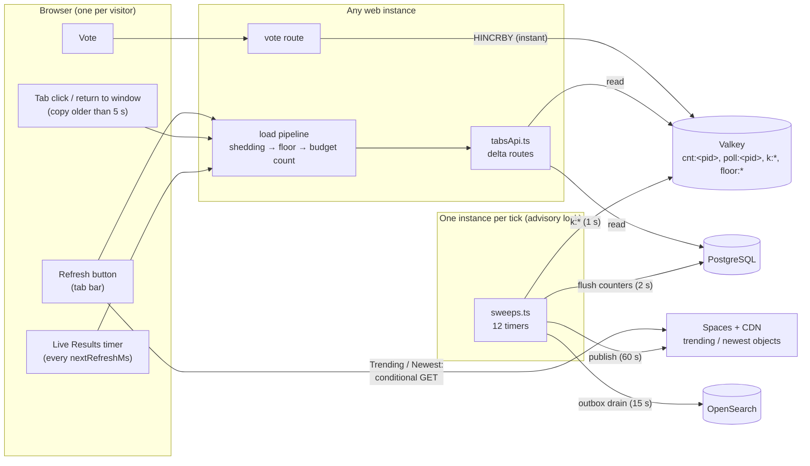
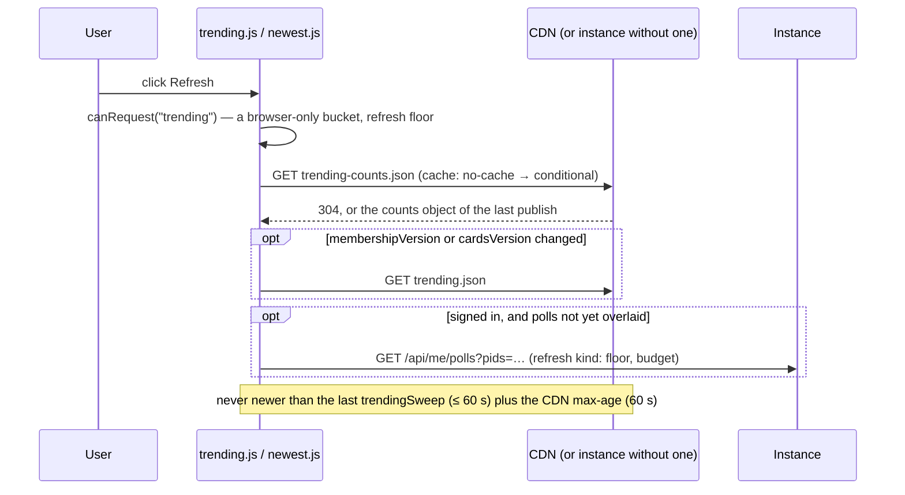
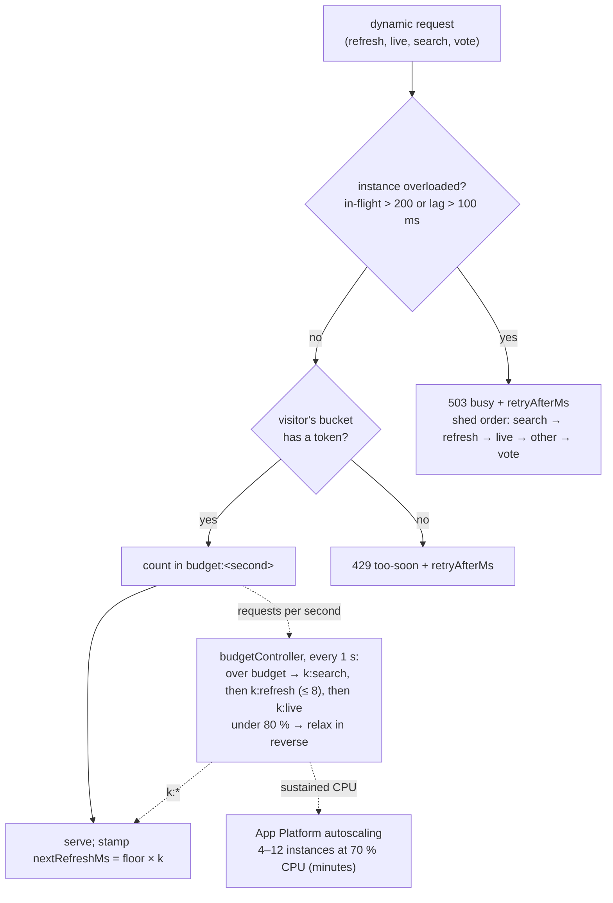
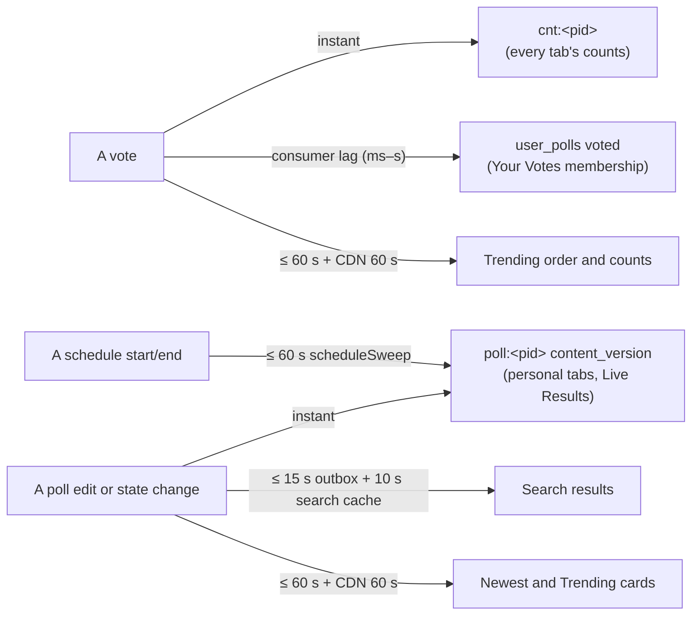

# High Level Requirements

Requirements: `requirements/20261028-151716-refresh-mechanisms/requirements.md`  
External Files: none  
Generated: 2026-10-28 3:18 PM  

This is a Research Request requirement.  

The developers of the CrowdPoll webapp are having a difficult time determining the logic around the various Refreshes:
- the background swepps that are done on a schedule
- the Refresh button that the user can click on demand

Please generate the architecture around these refresh mechanisms.  

Explain the load impact various refresh mechanisms have on the system.  
Explain what clicking the Refresh button does and how it differs from the background sweeps.  
What are the limit on what the Refresh button does for the user.

## Additional Requirements and Research Requests

**Instructions To The Developer**  
Enter any additional requirements or research requests under the ## Additional Requirements and Research Requests heading above.  
When you Type or Say: "Next" in the CC CLI terminal, the additional requirements and research requests will be applied to the report.  
  
You may leave these instructions here. They will be ignored when "Next" is executed.  

## 1. Overview and Scope

The request is for research and documentation, not a behaviour change.  
It asks for four things:  

- the architecture of every refresh mechanism (RS1);  
- the load each one puts on the system (RS2);  
- what the Refresh button does, and how it differs from the background sweeps (RS3);  
- the limits on what the Refresh button can do for a user (RS4).  

Everything below was read from the code on branch `refresh-research` (`src/polls/sweeps.ts`, `src/load/*`, `src/routes/tabsApi.ts`, `src/refresh/deltas.ts`, `src/live/registry.ts`, `src/public/tabs.js`, `trending.js`, `liveResults.js`), and checked against `ARCHITECTURE.md`.  
Numbers are the configured defaults from `CLAUDE.md`'s settings table unless stated otherwise.  

**The one idea that explains most of the confusion:**  
there are two kinds of "refresh", and they never call each other.  

- **Sweeps produce data.**  
  They run on the server, on a timer, on exactly one instance of the fleet at a time (an advisory lock), whether or not anybody is looking.  
  They write: counters into poll rows, the TRENDING and Newest objects, the search index, poll states.  
- **Refreshes read data.**  
  They are started by a browser (a press of Refresh, a tab click, the Live Results timer), are paid per visitor, and read what the sweeps and the vote path have already produced.  
  Pressing Refresh never runs a sweep, and can never show anything newer than the last sweep that feeds that tab.  

A third mechanism sits between them: the **vote path**.  
A vote moves the live counters in the cache at once (`HINCRBY cnt:<pid>`), so the counts a refresh reads are always current, even though the poll row is only written by the counter-flush sweep two seconds later.  

### Terms used

| Term | Meaning |
|---|---|
| Sweep | A server timer in `src/polls/sweeps.ts`, run under `pg_try_advisory_xact_lock(<lock>)`, so one instance runs each tick and the others skip it |
| Refresh-kind request | Any dynamic request whose kind is `refresh`: personal-tab refresh, Search tab Refresh, bookmark, Live Results add/remove, the overlay call |
| Live-kind request | `POST /api/live/refresh`, the Live Results timer |
| Floor | The per-visitor minimum interval of a kind (`ENV_MIN_*_INTERVAL`), held as a token bucket with a burst allowance |
| `k` | The fleet's stretch multiplier per kind (`k:search`, `k:refresh`, `k:live`), set by the budget controller |
| `nextRefreshMs` | `floor × k`, sent on every dynamic response; the browser's bucket refills at this rate |
| Delta | The version-keyed answer of a refresh: `304`, changed counters, changed cards, or a new order |

## 2. Architecture Diagrams

### 2.1 Context: who produces data, who reads it



Reads flow left to right on demand.  
Writes flow from the vote route (instantly, into the cache) and from the sweeps (on their timers, into PostgreSQL, the CDN and the search index).  

### 2.2 The sweeps (server side, scheduled)

| Sweep | Interval (default) | Lock | What it produces | Who reads it |
|---|---|---|---|---|
| `budgetController` | 1 s | 8 | `k:search`, `k:refresh`, `k:live` in the cache | every dynamic response (`nextRefreshMs`) |
| `counterFlushSweep` | 2 s | 3 | poll rows' `vote_count`, `choice_counts` from `cnt:<pid>` for the dirty set | admin pages, rankings, exports; **not** the tabs, which read the live counters |
| `pollsAwaitingApprovalSweep` | 5 s | 1 | screening results: AWAITING APPROVAL → OPEN or REJECTED | every tab, through `content_version` |
| `invitationSweep` | 5 s | 12 | invitation emails | invitees |
| `outboxDrainSweep` | 15 s | 5 | the OpenSearch index | the Search tab |
| `staleEditUpdateSweep` | 20 s (2 × heartbeat) | 9 | releases abandoned edit sessions | every tab |
| `scheduleSweep` | 60 s | 2 | start/end transitions, next month's `vote_history` partition | every tab |
| `trendingSweep` | 60 s | 4 | `trending-counts.json` every run, `trending.json` when `cardsVersion` changes | the Trending tab |
| `newestSweep` | 60 s (and at start) | 10 | `newest-counts.json`, `newest.json` | the Newest tab |
| `bookmarkRemovalSweep` | daily | 6 | expired bookmarks removed | Watching |
| `reconcileSweep` | daily | 7 | yesterday's dirty polls recounted from `votes` | correctness only |
| `retentionSweep` | daily | 11 | expired sessions, links, rate-limit rows, old partitions removed | nobody (housekeeping) |

Not a sweep, but continuous: the **vote consumer** runs on every instance (`XREADGROUP`, batches of 500) and writes `votes`, `vote_history` and the `user_polls` `voted` rows.  

```mermaid
gantt
  title One minute of sweep ticks (defaults), fleet-wide
  dateFormat  ss
  axisFormat  %S s
  section every second
  budgetController        :a1, 00, 60s
  section 2 s
  counterFlushSweep       :a2, 00, 60s
  section 5 s
  approval + invitations  :a3, 00, 60s
  section 15 s
  outboxDrainSweep        :a4, 00, 60s
  section 20 s
  staleEditUpdateSweep    :a5, 00, 60s
  section 60 s
  schedule, trending, newest :milestone, a6, 59, 0s
```



### 2.3 Pressing Refresh on a personal tab (Your Polls, Shared With You, Your Votes, Watching)

```mermaid
sequenceDiagram
  participant U as User
  participant T as tabs.js
  participant I as Instance (tabsApi.ts)
  participant C as Valkey
  participant PG as PostgreSQL

  U->>T: click Refresh
  T->>T: canRequest? (browser bucket: 5 tokens, 1 per nextRefreshMs)
  alt no token
    Note over T: button is already disabled; nothing is sent
  else token left
    T->>T: spend("refresh")
    T->>I: POST /api/tabs/<tab>/refresh { membershipVersion, versions{pid:[content,counts]} }
    I->>I: shedding.withKind("refresh") → 503 busy if overloaded
    I->>C: floor:refresh:s:<session> takeToken(5, 5000 ms) → 429 too-soon if empty
    I->>C: INCR budget:<second>
    I->>PG: one indexed query: user_polls ⨝ polls (≤ 200 rows)
    Note over I,PG: Shared With You also adopts invitations and marks them accepted (writes)
    I->>C: poll:<pid> projections, cnt:<pid> live counters
    I->>I: computeDelta(client versions, current)
    alt nothing moved
      I-->>T: 304
    else something moved
      I-->>T: 200 { order?, cards, counters, nextRefreshMs }
    end
    T->>T: settle(nextRefreshMs) — bucket refills at floor × k:refresh
  end
```

The Search tab's Refresh is the same shape, against `POST /api/search/refresh`: it runs the search again (served from the search cache for 10 s), but it is counted as a refresh-kind request, not a search.  

### 2.4 Pressing Refresh on Trending or Newest



### 2.5 The Live Results loop (the only automatic refresh)

```mermaid
sequenceDiagram
  participant L as liveResults.js
  participant I as Instance
  participant C as Valkey

  loop every nextRefreshMs (2 s × k:live), only while visible and not idle
    L->>I: POST /api/live/refresh { versions }
    I->>I: shedding "live", floor:live (2 s, burst 1), budget:live count
    I->>C: live:<session> list (≤ 5 polls), touch live:active
    I->>C: poll:<pid>, cnt:<pid> (cache only in steady state)
    I-->>L: 304 or { counters, cards, nextRefreshMs }
  end
  Note over L: hidden page → timer paused; 30 min without interaction → idle prompt; Cancel or an expired registration closes the tab
```

### 2.6 How the fleet limits refreshes (three bounds at three speeds)



### 2.7 How fresh is what a Refresh shows?



## 3. Assumptions

- The deliverable is an explanation, so no code, route, configuration or data change is assumed (see NC1).  
- "The Refresh button" means the tab bar's Refresh control (`#refreshBtn`), which acts on whichever tab is active; Live Results hides it because it refreshes itself.  
- Load figures use the defaults: 4–12 instances, `ENV_SERVER_MAX_REFRESH_PER_INSTANCE_PER_SECOND` 1,250, cap 15,000, floors refresh 5 s / live 2 s / search 2 s / vote 2 s, bursts refresh 5 / search 3 / live and vote 1, `ENV_MAX_STRETCH` 8.  
- Production has a CDN for the Trending and Newest objects; development serves them from the instance.  

## 4. Research Results

### 4.1 The architecture of the refresh mechanisms

**RS1. What are the refresh mechanisms, and how do they fit together?**  
<span style="font-size:large">✅ Resolved</span>  
✅ Requirements File Updated: 2026-10-28 3:22 PM  
**Notes**: Recommendation accepted by "Accept all" 2026-10-28: Recommendation, record the five-mechanism model as the architecture found;  
the requirements now list the five mechanisms under Research Results and Decisions.  

The requirements ask for the architecture around the scheduled sweeps and the on-demand Refresh button.  
Sources: `src/polls/sweeps.ts` (the twelve schedules, `guardTick`, `withAdvisoryLock`), `src/routes/tabsApi.ts` (the `dynamic(kind)` pipeline and every delta route), `src/refresh/deltas.ts` (`computeDelta`), `src/public/tabs.js` (buckets, `KIND_OF`, `updateRefreshButton`, `onReturnToWindow`, the broadcast channel), `src/public/trending.js`, `src/public/liveResults.js`, `ARCHITECTURE.md` (*Refresh model and the three load bounds*, *Sweeps*).  
There are five mechanisms, in three groups:  

- **Server sweeps** (section 2.2): twelve timers, each tick run by one instance under an advisory lock; they write, on a schedule, regardless of visitors.  
- **The vote path and consumer**: a vote moves `cnt:<pid>` in the cache at once, and the consumer writes rows in batches; this is why counts are always live.  
- **Browser-initiated refreshes**, all reading through the same delta protocol:  
  - the **Refresh button** (sections 2.3 and 2.4);  
  - **implicit refreshes** that the user causes without pressing Refresh: a tab click when the tab's copy is older than the manual floor (5 s) or empty, returning to the window (focus or `visibilitychange`) on a personal tab whose copy is older than the floor, and a bookmark change (in this or another window, via the `crowdpoll-tabs` broadcast channel) that marks the personal tabs due;  
  - the **Live Results timer** (section 2.5), the only refresh with no user action.  
- Every browser-initiated request carries what it holds (`membershipVersion` and `[contentVersion, countsVersion]` per poll) and gets back only what moved, or `304`.  
- Sweeps and refreshes are joined only through stored data: the cache, PostgreSQL, the CDN objects and the search index.  

  - **Recommendation**: **record this five-mechanism model (sweeps, vote path, Refresh button, implicit refreshes, Live Results timer) in the requirements as the architecture found.**  

    ➡️ [X] **Accepted**  
    - It gives the developers one vocabulary for "refresh", and section 2 holds the diagrams.  

  - **Developer Resolution B**:  

    ➡️ [ ] **Accepted**  

### 4.2 The load each mechanism puts on the system

**RS2. What load does each refresh mechanism put on the system?**  
<span style="font-size:large">✅ Resolved</span>  
✅ Requirements File Updated: 2026-10-28 3:22 PM  
**Notes**: Recommendation accepted by "Accept all" 2026-10-28: Recommendation, record the load table at the default settings;  
the requirements now summarize the load model under Research Results and Decisions.  

The requirements ask for the load impact of the various refresh mechanisms.  
Sources: `src/load/budget.ts` (`effectiveBudget`, `nextRefreshMs`), `src/load/controller.ts` (`controllerTick`), `src/load/floors.ts`, `src/load/shedding.ts`, `src/routes/tabsApi.ts`, the settings table in `CLAUDE.md`.  
The fleet's request budget is 1,250 dynamic requests per second per live instance, capped at 15,000: 5,000/s at 4 instances, 15,000/s at 12.  
Per mechanism:  

| Mechanism | Who pays | Rate, at most | Cost of one | Scales with |
|---|---|---|---|---|
| Sweeps (all twelve) | one instance per tick, fleet-wide | fixed by their intervals | small, bounded queries; the flush is one `UPDATE … FROM (VALUES …)` for the polls voted on in the last 2 s; the controller reads cache keys only | polls changed, never visitors |
| Live Results timer | each open, visible, non-idle Live tab | 1 per 2 s × `k:live` (0.5/s) | cache reads only in steady state (`live:<session>`, `poll:<pid>`, `cnt:<pid>` for ≤ 5 polls) | open Live tabs: 10,000 active tabs = 5,000/s, the whole 4-instance budget |
| Refresh on a personal tab | one visitor | burst 5, then 1 per 5 s × `k:refresh` (0.2/s) | one indexed PostgreSQL query (`user_polls ⨝ polls`, ≤ 200 rows) + cache reads; Shared With You also adopts and marks invitations (writes) | signed-in visitors pressing Refresh or switching tabs |
| Refresh on Search | one visitor | same refresh bucket | one search, answered from the 10 s search cache when identical, otherwise one engine query (also counted against the 2,000/s search sub-budget) | visitors |
| Refresh on Trending / Newest | the CDN | browser-enforced 1 per 5 s, burst 5 | 1–2 conditional GETs to the CDN (no instance cost), plus `/api/me/polls` only for polls not yet overlaid | nothing on the fleet in production |
| Implicit refreshes (tab click, return to window, bookmark due) | one visitor | the same refresh bucket as the button | as the matching tab's Refresh | visitors |
| Votes (for comparison) | one visitor | 1 per 2 s, never stretched or shed first | cache only; rows written later in batches | votes |

- **Sweeps are a constant background cost.**  
  They do not grow with visitors, run on one instance per tick, and are paused while the cache is unreachable.  
- **Refreshes are the variable cost**, and Live Results is the largest, because it is the only one that repeats without a user action.  
  That is why the controller sizes `k:live` from the number of open Live tabs (`live:active`) and their measured activity, so its demand fits what is left of the budget.  
- **The Refresh button is cheap by design**: deltas are usually `304` or a few counters, Trending and Newest never touch an instance in production, and the per-visitor bucket bounds each visitor to 5 requests at once and 0.2/s sustained across all refresh-kind requests.  
- **Under load the system stretches before it refuses**: over budget, the controller raises `k:search`, then `k:refresh` (up to 8, so a 40 s interval), then `k:live`, and relaxes in the reverse order below 80 % of the budget; an overloaded instance sheds search first and votes last.  

  - **Recommendation**: **record the table above as the load model, at the default settings, in the requirements.**  

    ➡️ [X] **Accepted**  
    - It shows the developers where load comes from (Live Results first, then personal-tab refreshes) and which knob bounds each one.  

  - **Developer Resolution B**:  

    ➡️ [ ] **Accepted**  

### 4.3 What the Refresh button does, and how it differs from the sweeps

**RS3. What does clicking Refresh do, and how does it differ from the background sweeps?**  
<span style="font-size:large">✅ Resolved</span>  
✅ Requirements File Updated: 2026-10-28 3:22 PM  
**Notes**: Recommendation accepted by "Accept all" 2026-10-28: Recommendation, Refresh only reads what the sweeps and the vote path produced, and neither triggers the other;  
the requirements now say so under Research Results and Decisions.  

The requirements ask what Refresh does and how it differs from the sweeps.  
Sources: `src/public/tabs.js` (the click handler, `canRequest`, `spend`, `settle`, `drain`, `updateRefreshButton`), `src/public/trending.js` (`refresh`), `src/routes/tabsApi.ts` (`personalTabRoute`, `answerSearch`), `src/refresh/deltas.ts`.  
Clicking Refresh asks the server (or the CDN) "what changed in the tab I am looking at since my copy?", and redraws only that:  

1. The browser checks its own token bucket for the tab's kind; with none left the button is already disabled, and nothing is sent.  
2. It spends a token and sends what it holds: the membership version and each poll's `[contentVersion, countsVersion]`.  
3. The instance checks shedding (`503 busy`), the visitor's floor bucket (`429 too-soon`), counts the request in the budget, reads the tab's list and the live counters, and answers `304` or a delta.  
4. The browser merges the delta, and the response's `nextRefreshMs` sets how fast its bucket refills.  

How it differs from the sweeps:  

| | Refresh button | Sweeps |
|---|---|---|
| Started by | a visitor | a timer on every instance; one wins the lock |
| Runs on | the instance the load balancer picks (or the CDN) | exactly one instance per tick |
| Does | reads, and returns a delta for one tab | writes: counters, states, published objects, the search index |
| Costs | per visitor, bounded by the floor | fixed, independent of visitors |
| Can it make the other happen sooner? | no: it never runs a sweep | no: a sweep never pushes to a browser |
| Shows | the newest data the sweeps and the vote path have produced | — |

  - **Recommendation**: **record that Refresh only reads what the sweeps and the vote path have already produced, and that neither one triggers the other.**  

    ➡️ [X] **Accepted**  
    - This is the single fact most likely to clear up the developers' confusion.  

  - **Developer Resolution B**:  

    ➡️ [ ] **Accepted**  

### 4.4 The limits on what the Refresh button does for the user

**RS4. What are the limits on what the Refresh button can do for a user?**  
<span style="font-size:large">✅ Resolved</span>  
✅ Requirements File Updated: 2026-10-28 3:22 PM  
**Notes**: Recommendation accepted by "Accept all" 2026-10-28: Recommendation, record both the rate limits and the freshness limits;  
the requirements now list both under Research Results and Decisions.  

The requirements ask what the limits are on the Refresh button.  
Sources: `src/load/floors.ts`, `src/load/shedding.ts`, `src/load/pageLoads.ts`, `src/public/tabs.js`, `src/public/trending.js`, `src/search/search.ts`, the settings table in `CLAUDE.md`.  
There are two kinds of limit: how often it can be pressed, and how fresh its answer can be.  

**How often:**  

- **The manual floor with a burst**: 5 presses back to back, then 1 per 5 s (`ENV_MIN_MANUAL_REFRESH_INTERVAL`, `ENV_MANUAL_REFRESH_BURST`), per session (per address for a guest).  
  The bucket is shared by every refresh-kind request of that session, across its windows: the button, tab clicks with a stale copy, return-to-window checks, bookmarks, Live Results add/remove and the overlay call.  
- **Stretching under load**: `k:refresh` up to 8 lengthens the interval the browser waits to 40 s; the button stays disabled meanwhile.  
- **Refusals**: `429 too-soon` when the server's bucket is empty (another window spent it), `503 busy` when the instance sheds; each carries `retryAfterMs`, the browser empties its bucket for that long and shows nothing.  
- **Page loads**: 120 per minute per session (`ENV_PAGE_LOADS_PER_MINUTE`) on the instance-served Trending and Newest objects, then `429 too-many-loads`.  
- **Live Results has no Refresh button**: it is hidden on that tab, because the timer refreshes it.  

**How fresh:**  

- **Counts are always live** on every tab, because they are read from `cnt:<pid>`, which a vote moves at once.  
- **Trending and Newest** can never be newer than their last publish: up to 60 s since the recompute plus up to 60 s of CDN `max-age`; pressing Refresh every 5 s within that minute returns the same objects.  
- **Search** returns identical results for 10 s (`ENV_SEARCH_CACHE_TTL`), and a new or edited public poll reaches the index only after the outbox drain (up to 15 s).  
- **Your Votes** lists a new vote only once the vote consumer has written its `user_polls` row (normally within milliseconds; `queued` above 2 s of lag).  
- **Scheduled start and end** show only after the next `scheduleSweep` (up to 60 s).  
- **Size**: at most 200 polls per tab (`ENV_MAX_POLLS_SEARCH_RESULTS`), Newest 50, Trending 200.  
- **Who**: the personal tabs need a signed-in session and the `View Polls` permission; a guest's Refresh works on Trending, Newest and Search only.  

  - **Recommendation**: **record both lists, rate limits and freshness limits, in the requirements as the limits of the Refresh button.**  

    ➡️ [X] **Accepted**  
    - The freshness limits explain the most common surprise: a Refresh that is allowed but shows nothing new.  

  - **Developer Resolution B**:  

    ➡️ [ ] **Accepted**  

## 5. Breaking Changes

None.  
The requirements ask for research and documentation only; no behaviour is changed.  

## 6. Technical Debt

Found while researching; none is in scope unless NC1 says otherwise.  

- **TD1. The stretched interval is advisory only.**  
  `floors.ts` takes tokens at the base floor (`config.floors[kind]`, 5 s for refresh); `k:refresh` reaches the browser only as `nextRefreshMs`.  
  A well-behaved browser waits up to 40 s under load, but a client that ignores `nextRefreshMs` is still held only to the 5 s floor.  
- **TD2. `ARCHITECTURE.md` says "Nothing refreshes on its own except the Live Results tab."**  
  Personal tabs also confirm themselves on return to the window (`onReturnToWindow`, on `focus` and `visibilitychange`) and after a bookmark change (`markDue`, also from another window over the broadcast channel).  
  Each is user-caused and floor-bound, but the sentence hides them, which is part of the developers' confusion.  
- **TD3. The Trending and Newest floor is enforced in the browser only.**  
  By design, since the objects come from the CDN; without a CDN the instance serves them under the page-load limit (120 per minute) and an ETag, not the refresh floor.  
- **TD4. Refreshing Shared With You writes.**  
  `adoptInvitations` and `markAccepted` run on every refresh of that tab, so a read path costs writes (each invitation is marked accepted once, so steady-state writes are few).  
- **TD5. The floors are shorter than the data they guard.**  
  Refresh may be pressed every 5 s, but Trending and Newest change once a minute and Search results are cached for 10 s, so many allowed presses return nothing new.  

## 7. Findings

### 7.1 Inconsistencies

None found.  

### 7.2 Ambiguities

**AM1. Which on-demand refreshes does "the Refresh button" cover?**  

The requirements name "the Refresh button that the user can click on demand".  
The code sends the same refresh-kind requests, on the same per-visitor bucket, for a tab click with a stale copy, a return to the window and a bookmark change.  
Leaving them out would explain the button but not why the button is sometimes disabled after the user did not press it.  

  - **Recommendation A** _(recommended)_: **cover the button and every implicit refresh that shares its bucket.**  

    ➡️ [ ] **Accepted** <span style="font-size:smaller ;padding-left:50px"><i>(you may mark <b>[X] Accepted</b> here, or Type/Say "<b>Accept</b>" in the CC CLI terminal)</i></span>  
    - <u>Pros</u>: explains every request that spends the user's allowance, and why the button can be disabled before it is pressed.  
    - <u>Cons</u>: a slightly wider explanation than literally asked.  

  - **Recommendation B**: **cover the tab bar's Refresh button only.**  

    ➡️ [ ] **Accepted** <span style="font-size:smaller ;padding-left:50px"><i>(you may mark <b>[X] Accepted</b> here, or Type/Say "<b>Accept</b>" in the CC CLI terminal)</i></span>  
    - <u>Pros</u>: exactly the wording of the request.  
    - <u>Cons</u>: leaves the shared bucket, and so the button's disabled moments, unexplained.  

  - **Developer Resolution C**:  

    ➡️ [ ] **Accepted**  
    - you may enter your own resolution here and check the box above when done  
    - then Type or Say "Next" in the CC CLI terminal to have it applied  

**AM2. Which mechanisms count as "background sweeps"?**  

The requirements say "the background sweeps that are done on a schedule".  
Three things run without a click: the twelve server sweeps, the vote consumer (continuous, on every instance) and the Live Results timer (in the browser, on `nextRefreshMs`).  
Only the first are sweeps in the code's sense, but the other two are what users and developers most often mistake for them.  

  - **Recommendation A** _(recommended)_: **treat the twelve server sweeps as the sweeps, and explain the vote consumer and the Live Results timer beside them as the other two things that run without a click.**  

    ➡️ [ ] **Accepted** <span style="font-size:smaller ;padding-left:50px"><i>(you may mark <b>[X] Accepted</b> here, or Type/Say "<b>Accept</b>" in the CC CLI terminal)</i></span>  
    - <u>Pros</u>: matches the code's names and still answers the likely confusion.  
    - <u>Cons</u>: none of note.  

  - **Recommendation B**: **the twelve server sweeps only.**  

    ➡️ [ ] **Accepted** <span style="font-size:smaller ;padding-left:50px"><i>(you may mark <b>[X] Accepted</b> here, or Type/Say "<b>Accept</b>" in the CC CLI terminal)</i></span>  
    - <u>Pros</u>: narrowest reading.  
    - <u>Cons</u>: leaves out Live Results, the largest refresh load.  

  - **Developer Resolution C**:  

    ➡️ [ ] **Accepted**  
    - you may enter your own resolution here and check the box above when done  
    - then Type or Say "Next" in the CC CLI terminal to have it applied  

**AM3. Does "the limits on what the Refresh button does" mean rate limits, freshness limits, or both?**  
<span style="font-size:large">✅ Resolved</span>  
✅ Requirements File Updated: 2026-10-28 3:22 PM  
**Notes**: Recommendation accepted by "Accept all" 2026-10-28: Recommendation, answer both rate limits and freshness limits, as RS4 does;  
the requirements now name both kinds in the RS4 entry.  

"What are the limit on what the Refresh button does for the user" can mean how often it may be pressed, or what it can show when pressed.  
The two have different causes: floors and stretching on one side, sweep intervals, the CDN and caches on the other.  

  - **Recommendation**: **answer both, as RS4 does: how often (floor, burst, stretch, refusals) and how fresh (per tab).**  

    ➡️ [X] **Accepted**  
    - The freshness limits are the ones users notice; the rate limits are the ones developers tune.  

  - **Developer Resolution B**:  

    ➡️ [ ] **Accepted**  

### 7.3 Unspecified Aspects

**UA1. At what scale, and in what units, should load be explained?**  
<span style="font-size:large">✅ Resolved</span>  
✅ Requirements File Updated: 2026-10-28 3:22 PM  
**Notes**: Recommendation accepted by "Accept all" 2026-10-28: Recommendation, per request and per visitor at the defaults, fleet budget at 4 and 12 instances, naming each bounding setting;  
the requirements now say so under Research Results and Decisions.  

"Explain the load impact" does not say whether per request, per visitor or for the fleet, nor at which settings.  
The defaults vary widely between 4 and 12 instances, and every interval is configurable.  

  - **Recommendation**: **explain load per request and per visitor at the default settings, with the fleet budget at 4 and at 12 instances, and name the setting that bounds each mechanism (as RS2 does).**  

    ➡️ [X] **Accepted**  
    - Concrete numbers at known settings are testable; the setting names let the developers redo the sums for other values.  

  - **Developer Resolution B**:  

    ➡️ [ ] **Accepted**  

### 7.4 Needs Clarifications

**NC1. What is the deliverable: this report only, an update to `ARCHITECTURE.md`, or code changes too?**  

The requirements say "This is a Research Request requirement" and ask for explanations, not behaviour.  
This report already holds the architecture and answers, but `ARCHITECTURE.md` is where the developers look, and its *Refresh model* section has the gap noted in TD2.  
The technical debt found (TD1–TD5) could become changes, but none was asked for.  
The answer also decides whether `/speckit-specify` is needed at all: a documentation-only change has no user-facing behaviour to specify.  

  - **Recommendation A** _(recommended)_: **documentation only: this report, plus an update to `ARCHITECTURE.md`'s *Refresh model* and *Sweeps* sections (the five mechanisms, the load table, the freshness limits, and the TD2 correction); no code change, and TD1–TD5 recorded for a later feature.**  

    ➡️ [ ] **Accepted** <span style="font-size:smaller ;padding-left:50px"><i>(you may mark <b>[X] Accepted</b> here, or Type/Say "<b>Accept</b>" in the CC CLI terminal)</i></span>  
    - <u>Pros</u>: puts the answer where developers look; no risk to behaviour.  
    - <u>Cons</u>: the debts stay until a later feature picks them up.  

  - **Recommendation B**: **this report only.**  

    ➡️ [ ] **Accepted** <span style="font-size:smaller ;padding-left:50px"><i>(you may mark <b>[X] Accepted</b> here, or Type/Say "<b>Accept</b>" in the CC CLI terminal)</i></span>  
    - <u>Pros</u>: nothing else changes.  
    - <u>Cons</u>: `ARCHITECTURE.md` keeps the misleading sentence, and the explanation lives in a requirements folder.  

  - **Recommendation C**: **documentation, plus fixes for the technical debt (for example, enforcing the stretched floor on the server, TD1).**  

    ➡️ [ ] **Accepted** <span style="font-size:smaller ;padding-left:50px"><i>(you may mark <b>[X] Accepted</b> here, or Type/Say "<b>Accept</b>" in the CC CLI terminal)</i></span>  
    - <u>Pros</u>: closes the gaps found.  
    - <u>Cons</u>: turns a research request into a behaviour change that needs its own requirements, tests and load checks.  

  - **Developer Resolution D**:  

    ➡️ [ ] **Accepted**  
    - you may enter your own resolution here and check the box above when done  
    - then Type or Say "Next" in the CC CLI terminal to have it applied  
