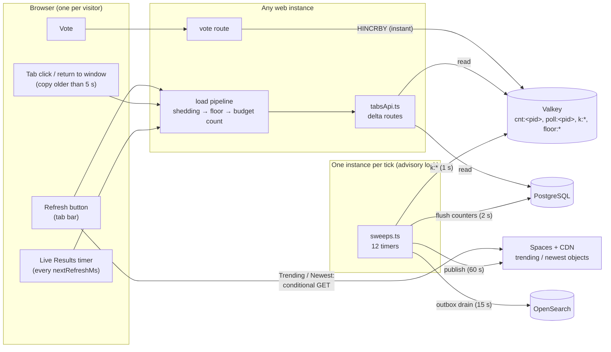
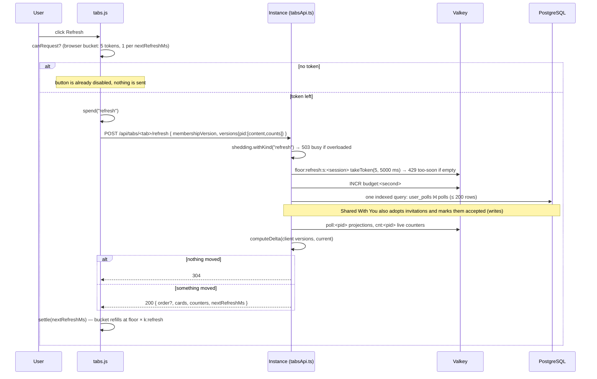
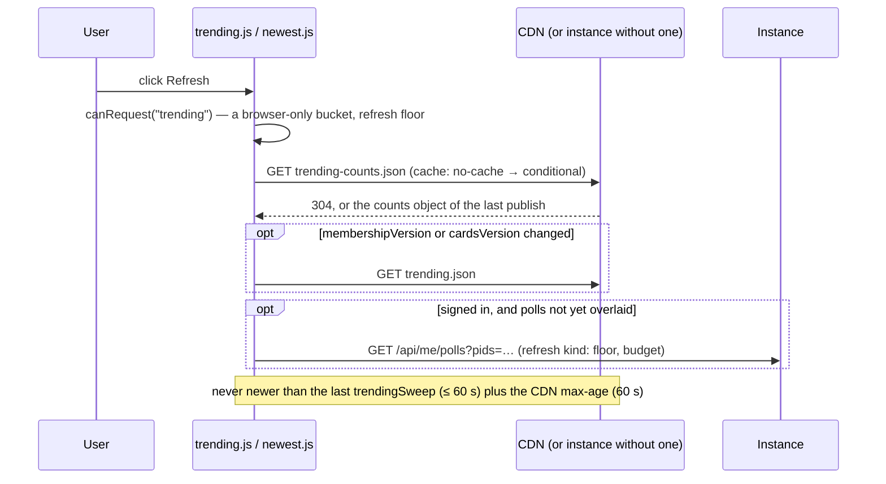
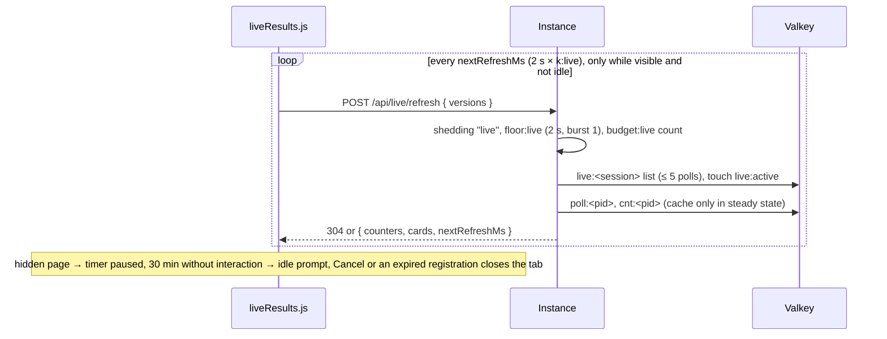
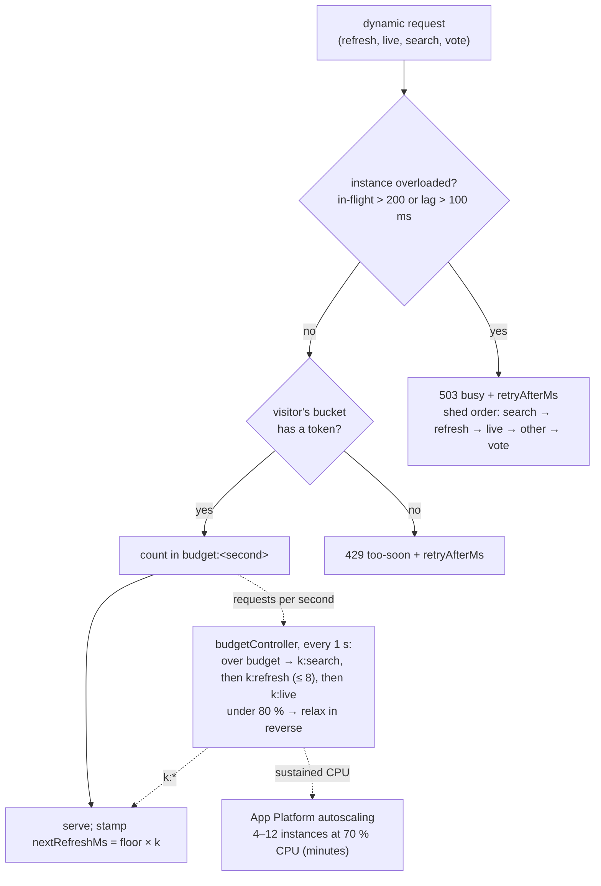
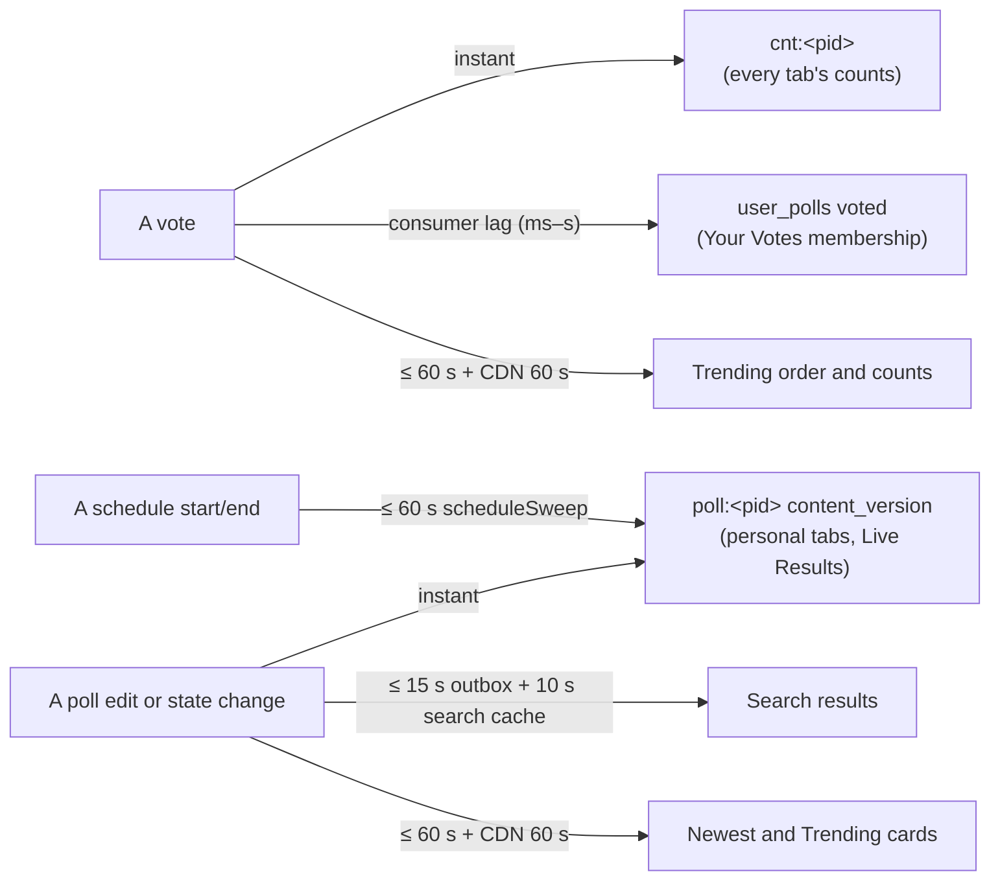

# High Level Requirements

Requirements: `requirements/20261028-151716-refresh-mechanisms/requirements.md`  
External Files: none  
Generated: 2026-10-28 3:18 PM  

This is a Research Request requirement.  

The developers of the CrowdPoll webapp are having a difficult time determining the logic around the various Refreshes:
- the background swepps that are done on a schedule
- the Refresh button that the user can click on demand

Please generate the architecture around these refresh mechanisms.  

Explain the load impact various refresh mechanisms have on the system.  
Explain what clicking the Refresh button does and how it differs from the background sweeps.  
What are the limit on what the Refresh button does for the user.

## Additional Requirements and Research Requests

**Instructions To The Developer**  
Enter any additional requirements or research requests under the ## Additional Requirements and Research Requests heading above.  
When you Type or Say: "Next" in the CC CLI terminal, the additional requirements and research requests will be applied to the report.  
  
You may leave these instructions here. They will be ignored when "Next" is executed.  

✅ Applied 2026-10-28 4:15 PM: 1 research request added to requirements.md (six terminology questions, RS5); 2 diagram parse errors fixed (2.3 and 2.5: a `;` in a sequence-diagram note ends the statement, replaced by `,`).  
✅ Applied 2026-10-28 6:34 PM: 2 research requests added to requirements.md (Question 1, RS6; Question 2, RS7).  
✅ Applied 2026-10-28 7:08 PM: 1 research request added to requirements.md (which sweeps could run less often unnoticed, RS8).  
✅ Applied 2026-10-28 7:17 PM: 1 research request added to requirements.md (improving refreshes for load and speed, RS9).  
✅ Applied 2026-10-28 8:56 PM: 1 requirement added to requirements.md ("Implement RS8 and RS9"; findings IN1, IN2, AM4, UA2–UA6).  

## 1. Overview and Scope

The request is for research and documentation, not a behaviour change.  
It asks for four things:  

- the architecture of every refresh mechanism (RS1);  
- the load each one puts on the system (RS2);  
- what the Refresh button does, and how it differs from the background sweeps (RS3);  
- the limits on what the Refresh button can do for a user (RS4).  

Everything below was read from the code on branch `refresh-research` (`src/polls/sweeps.ts`, `src/load/*`, `src/routes/tabsApi.ts`, `src/refresh/deltas.ts`, `src/live/registry.ts`, `src/public/tabs.js`, `trending.js`, `liveResults.js`), and checked against `ARCHITECTURE.md`.  
Numbers are the configured defaults from `CLAUDE.md`'s settings table unless stated otherwise.  

**The one idea that explains most of the confusion:**  
there are two kinds of "refresh", and they never call each other.  

- **Sweeps produce data.**  
  They run on the server, on a timer, on exactly one instance of the fleet at a time (an advisory lock), whether or not anybody is looking.  
  They write: counters into poll rows, the TRENDING and Newest objects, the search index, poll states.  
- **Refreshes read data.**  
  They are started by a browser (a press of Refresh, a tab click, the Live Results timer), are paid per visitor, and read what the sweeps and the vote path have already produced.  
  Pressing Refresh never runs a sweep, and can never show anything newer than the last sweep that feeds that tab.  

A third mechanism sits between them: the **vote path**.  
A vote moves the live counters in the cache at once (`HINCRBY cnt:<pid>`), so the counts a refresh reads are always current, even though the poll row is only written by the counter-flush sweep two seconds later.  

### Terms used

| Term | Meaning |
|---|---|
| Sweep | A server timer in `src/polls/sweeps.ts`, run under `pg_try_advisory_xact_lock(<lock>)`, so one instance runs each tick and the others skip it |
| Refresh-kind request | Any dynamic request whose kind is `refresh`: personal-tab refresh, Search tab Refresh, bookmark, Live Results add/remove, the overlay call |
| Live-kind request | `POST /api/live/refresh`, the Live Results timer |
| Floor | The per-visitor minimum interval of a kind (`ENV_MIN_*_INTERVAL`), held as a token bucket with a burst allowance |
| `k` | The fleet's stretch multiplier per kind (`k:search`, `k:refresh`, `k:live`), set by the budget controller |
| `nextRefreshMs` | `floor × k`, sent on every dynamic response; the browser's bucket refills at this rate |
| Delta | The version-keyed answer of a refresh: `304`, changed counters, changed cards, or a new order |

## 2. Architecture Diagrams

### 2.1 Context: who produces data, who reads it

Reads flow left to right on demand.  
Writes flow from the vote route (instantly, into the cache) and from the sweeps (on their timers, into PostgreSQL, the CDN and the search index).  

### 2.2 The sweeps (server side, scheduled)

| Sweep | Interval (default) | Lock | What it produces | Who reads it |
|---|---|---|---|---|
| `budgetController` | 1 s | 8 | `k:search`, `k:refresh`, `k:live` in the cache | every dynamic response (`nextRefreshMs`) |
| `counterFlushSweep` | 2 s | 3 | poll rows' `vote_count`, `choice_counts` from `cnt:<pid>` for the dirty set | admin pages, rankings, exports; **not** the tabs, which read the live counters |
| `pollsAwaitingApprovalSweep` | 5 s | 1 | screening results: AWAITING APPROVAL → OPEN or REJECTED | every tab, through `content_version` |
| `invitationSweep` | 5 s | 12 | invitation emails | invitees |
| `outboxDrainSweep` | 15 s | 5 | the OpenSearch index | the Search tab |
| `staleEditUpdateSweep` | 20 s (2 × heartbeat) | 9 | releases abandoned edit sessions | every tab |
| `scheduleSweep` | 60 s | 2 | start/end transitions, next month's `vote_history` partition | every tab |
| `trendingSweep` | 60 s | 4 | `trending-counts.json` every run, `trending.json` when `cardsVersion` changes | the Trending tab |
| `newestSweep` | 60 s (and at start) | 10 | `newest-counts.json`, `newest.json` | the Newest tab |
| `bookmarkRemovalSweep` | daily | 6 | expired bookmarks removed | Watching |
| `reconcileSweep` | daily | 7 | yesterday's dirty polls recounted from `votes` | correctness only |
| `retentionSweep` | daily | 11 | expired sessions, links, rate-limit rows, old partitions removed | nobody (housekeeping) |

Not a sweep, but continuous: the **vote consumer** runs on every instance (`XREADGROUP`, batches of 500) and writes `votes`, `vote_history` and the `user_polls` `voted` rows.  

```mermaid
gantt
  title One minute of sweep ticks (defaults), fleet-wide
  dateFormat  ss
  axisFormat  %S s
  section every second
  budgetController        :a1, 00, 60s
  section 2 s
  counterFlushSweep       :a2, 00, 60s
  section 5 s
  approval + invitations  :a3, 00, 60s
  section 15 s
  outboxDrainSweep        :a4, 00, 60s
  section 20 s
  staleEditUpdateSweep    :a5, 00, 60s
  section 60 s
  schedule, trending, newest :milestone, a6, 59, 0s
```

### 2.3 Pressing Refresh on a personal tab (Your Polls, Shared With You, Your Votes, Watching)

The Search tab's Refresh is the same shape, against `POST /api/search/refresh`: it runs the search again (served from the search cache for 10 s), but it is counted as a refresh-kind request, not a search.  

### 2.4 Pressing Refresh on Trending or Newest

### 2.5 The Live Results loop (the only automatic refresh)

### 2.6 How the fleet limits refreshes (three bounds at three speeds)

### 2.7 How fresh is what a Refresh shows?

## 3. Assumptions

- The deliverable is an explanation, so no code, route, configuration or data change is assumed (see NC1).  
- "The Refresh button" means the tab bar's Refresh control (`#refreshBtn`), which acts on whichever tab is active; Live Results hides it because it refreshes itself.  
- Load figures use the defaults: 4–12 instances, `ENV_SERVER_MAX_REFRESH_PER_INSTANCE_PER_SECOND` 1,250, cap 15,000, floors refresh 5 s / live 2 s / search 2 s / vote 2 s, bursts refresh 5 / search 3 / live and vote 1, `ENV_MAX_STRETCH` 8.  
- Production has a CDN for the Trending and Newest objects; development serves them from the instance.  

## 4. Research Results

### 4.1 The architecture of the refresh mechanisms

**RS1. What are the refresh mechanisms, and how do they fit together?**  
✅ Resolved  
✅ Requirements File Updated: 2026-10-28 3:22 PM  
**Notes**: Recommendation accepted by "Accept all" 2026-10-28: Recommendation, record the five-mechanism model as the architecture found;  
the requirements now list the five mechanisms under Research Results and Decisions.  

The requirements ask for the architecture around the scheduled sweeps and the on-demand Refresh button.  
Sources: `src/polls/sweeps.ts` (the twelve schedules, `guardTick`, `withAdvisoryLock`), `src/routes/tabsApi.ts` (the `dynamic(kind)` pipeline and every delta route), `src/refresh/deltas.ts` (`computeDelta`), `src/public/tabs.js` (buckets, `KIND_OF`, `updateRefreshButton`, `onReturnToWindow`, the broadcast channel), `src/public/trending.js`, `src/public/liveResults.js`, `ARCHITECTURE.md` (*Refresh model and the three load bounds*, *Sweeps*).  
There are five mechanisms, in three groups:  

- **Server sweeps** (section 2.2): twelve timers, each tick run by one instance under an advisory lock; they write, on a schedule, regardless of visitors.  
- **The vote path and consumer**: a vote moves `cnt:<pid>` in the cache at once, and the consumer writes rows in batches; this is why counts are always live.  
- **Browser-initiated refreshes**, all reading through the same delta protocol:  
  - the **Refresh button** (sections 2.3 and 2.4);  
  - **implicit refreshes** that the user causes without pressing Refresh: a tab click when the tab's copy is older than the manual floor (5 s) or empty, returning to the window (focus or `visibilitychange`) on a personal tab whose copy is older than the floor, and a bookmark change (in this or another window, via the `crowdpoll-tabs` broadcast channel) that marks the personal tabs due;  
  - the **Live Results timer** (section 2.5), the only refresh with no user action.  
- Every browser-initiated request carries what it holds (`membershipVersion` and `[contentVersion, countsVersion]` per poll) and gets back only what moved, or `304`.  
- Sweeps and refreshes are joined only through stored data: the cache, PostgreSQL, the CDN objects and the search index.  

  - **Recommendation**: **record this five-mechanism model (sweeps, vote path, Refresh button, implicit refreshes, Live Results timer) in the requirements as the architecture found.**  

    ➡️ [X] **Accepted**  
    - It gives the developers one vocabulary for "refresh", and section 2 holds the diagrams.  

  - **Developer Resolution B**:  

    ➡️ [ ] **Accepted**  

### 4.2 The load each mechanism puts on the system

**RS2. What load does each refresh mechanism put on the system?**  
✅ Resolved  
✅ Requirements File Updated: 2026-10-28 3:22 PM  
**Notes**: Recommendation accepted by "Accept all" 2026-10-28: Recommendation, record the load table at the default settings;  
the requirements now summarize the load model under Research Results and Decisions.  

The requirements ask for the load impact of the various refresh mechanisms.  
Sources: `src/load/budget.ts` (`effectiveBudget`, `nextRefreshMs`), `src/load/controller.ts` (`controllerTick`), `src/load/floors.ts`, `src/load/shedding.ts`, `src/routes/tabsApi.ts`, the settings table in `CLAUDE.md`.  
The fleet's request budget is 1,250 dynamic requests per second per live instance, capped at 15,000: 5,000/s at 4 instances, 15,000/s at 12.  
Per mechanism:  

| Mechanism | Who pays | Rate, at most | Cost of one | Scales with |
|---|---|---|---|---|
| Sweeps (all twelve) | one instance per tick, fleet-wide | fixed by their intervals | small, bounded queries; the flush is one `UPDATE … FROM (VALUES …)` for the polls voted on in the last 2 s; the controller reads cache keys only | polls changed, never visitors |
| Live Results timer | each open, visible, non-idle Live tab | 1 per 2 s × `k:live` (0.5/s) | cache reads only in steady state (`live:<session>`, `poll:<pid>`, `cnt:<pid>` for ≤ 5 polls) | open Live tabs: 10,000 active tabs = 5,000/s, the whole 4-instance budget |
| Refresh on a personal tab | one visitor | burst 5, then 1 per 5 s × `k:refresh` (0.2/s) | one indexed PostgreSQL query (`user_polls ⨝ polls`, ≤ 200 rows) + cache reads; Shared With You also adopts and marks invitations (writes) | signed-in visitors pressing Refresh or switching tabs |
| Refresh on Search | one visitor | same refresh bucket | one search, answered from the 10 s search cache when identical, otherwise one engine query (also counted against the 2,000/s search sub-budget) | visitors |
| Refresh on Trending / Newest | the CDN | browser-enforced 1 per 5 s, burst 5 | 1–2 conditional GETs to the CDN (no instance cost), plus `/api/me/polls` only for polls not yet overlaid | nothing on the fleet in production |
| Implicit refreshes (tab click, return to window, bookmark due) | one visitor | the same refresh bucket as the button | as the matching tab's Refresh | visitors |
| Votes (for comparison) | one visitor | 1 per 2 s, never stretched or shed first | cache only; rows written later in batches | votes |

- **Sweeps are a constant background cost.**  
  They do not grow with visitors, run on one instance per tick, and are paused while the cache is unreachable.  
- **Refreshes are the variable cost**, and Live Results is the largest, because it is the only one that repeats without a user action.  
  That is why the controller sizes `k:live` from the number of open Live tabs (`live:active`) and their measured activity, so its demand fits what is left of the budget.  
- **The Refresh button is cheap by design**: deltas are usually `304` or a few counters, Trending and Newest never touch an instance in production, and the per-visitor bucket bounds each visitor to 5 requests at once and 0.2/s sustained across all refresh-kind requests.  
- **Under load the system stretches before it refuses**: over budget, the controller raises `k:search`, then `k:refresh` (up to 8, so a 40 s interval), then `k:live`, and relaxes in the reverse order below 80 % of the budget; an overloaded instance sheds search first and votes last.  

  - **Recommendation**: **record the table above as the load model, at the default settings, in the requirements.**  

    ➡️ [X] **Accepted**  
    - It shows the developers where load comes from (Live Results first, then personal-tab refreshes) and which knob bounds each one.  

  - **Developer Resolution B**:  

    ➡️ [ ] **Accepted**  

### 4.3 What the Refresh button does, and how it differs from the sweeps

**RS3. What does clicking Refresh do, and how does it differ from the background sweeps?**  
✅ Resolved  
✅ Requirements File Updated: 2026-10-28 3:22 PM  
**Notes**: Recommendation accepted by "Accept all" 2026-10-28: Recommendation, Refresh only reads what the sweeps and the vote path produced, and neither triggers the other;  
the requirements now say so under Research Results and Decisions.  

The requirements ask what Refresh does and how it differs from the sweeps.  
Sources: `src/public/tabs.js` (the click handler, `canRequest`, `spend`, `settle`, `drain`, `updateRefreshButton`), `src/public/trending.js` (`refresh`), `src/routes/tabsApi.ts` (`personalTabRoute`, `answerSearch`), `src/refresh/deltas.ts`.  
Clicking Refresh asks the server (or the CDN) "what changed in the tab I am looking at since my copy?", and redraws only that:  

1. The browser checks its own token bucket for the tab's kind; with none left the button is already disabled, and nothing is sent.  
2. It spends a token and sends what it holds: the membership version and each poll's `[contentVersion, countsVersion]`.  
3. The instance checks shedding (`503 busy`), the visitor's floor bucket (`429 too-soon`), counts the request in the budget, reads the tab's list and the live counters, and answers `304` or a delta.  
4. The browser merges the delta, and the response's `nextRefreshMs` sets how fast its bucket refills.  

How it differs from the sweeps:  

| | Refresh button | Sweeps |
|---|---|---|
| Started by | a visitor | a timer on every instance; one wins the lock |
| Runs on | the instance the load balancer picks (or the CDN) | exactly one instance per tick |
| Does | reads, and returns a delta for one tab | writes: counters, states, published objects, the search index |
| Costs | per visitor, bounded by the floor | fixed, independent of visitors |
| Can it make the other happen sooner? | no: it never runs a sweep | no: a sweep never pushes to a browser |
| Shows | the newest data the sweeps and the vote path have produced | — |

  - **Recommendation**: **record that Refresh only reads what the sweeps and the vote path have already produced, and that neither one triggers the other.**  

    ➡️ [X] **Accepted**  
    - This is the single fact most likely to clear up the developers' confusion.  

  - **Developer Resolution B**:  

    ➡️ [ ] **Accepted**  

### 4.4 The limits on what the Refresh button does for the user

**RS4. What are the limits on what the Refresh button can do for a user?**  
✅ Resolved  
✅ Requirements File Updated: 2026-10-28 3:22 PM  
**Notes**: Recommendation accepted by "Accept all" 2026-10-28: Recommendation, record both the rate limits and the freshness limits;  
the requirements now list both under Research Results and Decisions.  

The requirements ask what the limits are on the Refresh button.  
Sources: `src/load/floors.ts`, `src/load/shedding.ts`, `src/load/pageLoads.ts`, `src/public/tabs.js`, `src/public/trending.js`, `src/search/search.ts`, the settings table in `CLAUDE.md`.  
There are two kinds of limit: how often it can be pressed, and how fresh its answer can be.  

**How often:**  

- **The manual floor with a burst**: 5 presses back to back, then 1 per 5 s (`ENV_MIN_MANUAL_REFRESH_INTERVAL`, `ENV_MANUAL_REFRESH_BURST`), per session (per address for a guest).  
  The bucket is shared by every refresh-kind request of that session, across its windows: the button, tab clicks with a stale copy, return-to-window checks, bookmarks, Live Results add/remove and the overlay call.  
- **Stretching under load**: `k:refresh` up to 8 lengthens the interval the browser waits to 40 s; the button stays disabled meanwhile.  
- **Refusals**: `429 too-soon` when the server's bucket is empty (another window spent it), `503 busy` when the instance sheds; each carries `retryAfterMs`, the browser empties its bucket for that long and shows nothing.  
- **Page loads**: 120 per minute per session (`ENV_PAGE_LOADS_PER_MINUTE`) on the instance-served Trending and Newest objects, then `429 too-many-loads`.  
- **Live Results has no Refresh button**: it is hidden on that tab, because the timer refreshes it.  

**How fresh:**  

- **Counts are always live** on every tab, because they are read from `cnt:<pid>`, which a vote moves at once.  
- **Trending and Newest** can never be newer than their last publish: up to 60 s since the recompute plus up to 60 s of CDN `max-age`; pressing Refresh every 5 s within that minute returns the same objects.  
- **Search** returns identical results for 10 s (`ENV_SEARCH_CACHE_TTL`), and a new or edited public poll reaches the index only after the outbox drain (up to 15 s).  
- **Your Votes** lists a new vote only once the vote consumer has written its `user_polls` row (normally within milliseconds; `queued` above 2 s of lag).  
- **Scheduled start and end** show only after the next `scheduleSweep` (up to 60 s).  
- **Size**: at most 200 polls per tab (`ENV_MAX_POLLS_SEARCH_RESULTS`), Newest 50, Trending 200.  
- **Who**: the personal tabs need a signed-in session and the `View Polls` permission; a guest's Refresh works on Trending, Newest and Search only.  

  - **Recommendation**: **record both lists, rate limits and freshness limits, in the requirements as the limits of the Refresh button.**  

    ➡️ [X] **Accepted**  
    - The freshness limits explain the most common surprise: a Refresh that is allowed but shows nothing new.  

  - **Developer Resolution B**:  

    ➡️ [ ] **Accepted**  

### 4.5 Terminology

**RS5. What do "overlay call", "personal tab", "fleet", "stretch multiplier", "shedding" and "dirty poll" mean?**  
✅ Resolved  
✅ Requirements File Updated: 2026-10-28 6:34 PM  
**Notes**: Recommendation accepted in file 2026-10-28: Recommendation, record these six definitions in the requirements as a glossary;  
the requirements now hold the six definitions under Research Results and Decisions (Glossary).  

The developer asked for six terms used in this report to be defined.  
Sources: `src/public/tabs.js` (`createOverlayFetcher`, `PERSONAL_TABS`), `src/routes/tabsApi.ts` (`GET /api/me/polls`, `personalTabRoute`), `src/load/budget.ts`, `src/load/controller.ts`, `src/load/shedding.ts`, `src/polls/counters.ts` (`DIRTY_KEY`, `dirtyDayKey`, `flushDirty`), `src/polls/sweeps.ts` (`reconcileSweep`), `.do/app.yaml` via `ARCHITECTURE.md` (*Deployment*).  

- **Overlay call**: `GET /api/me/polls?pids=…`.  
  Trending, Newest and Live Results send the same cards to everybody, so they carry nothing about the viewer.  
  For a signed-in viewer, the browser then asks for its own state on those polls, the overlay: whether it voted and for which choices, whether it watches the poll, and whether it may watch it.  
  It is asked only for polls the tab has not overlaid yet, and it is a refresh-kind request, so it spends a token of the same bucket as the Refresh button.  
- **Personal tab**: a tab whose list depends on who is signed in: Your Polls, Shared With You, Your Votes and Watching.  
  Each is one query over the viewer's `user_polls` relations, needs a signed-in session, and is refreshed through `POST /api/tabs/<tab>/refresh`.  
  (`tabs.js` also counts Live Results among its personal tabs for sign-in purposes, but it has its own route and its own timer.)  
- **Fleet**: all the web instances running at a moment: the one App Platform service, autoscaled between 4 and 12 identical instances.  
  They share one PostgreSQL, one Valkey, one OpenSearch and one CDN; "fleet-wide" means summed over all of them, as the request budget is.  
- **Stretch multiplier** (`k`): a whole number of at least 1 per kind (`k:search`, `k:refresh`, `k:live`), stored in Valkey and set every second by the budget controller.  
  The interval a browser is told to wait is `floor × k` (`nextRefreshMs`): with the refresh floor of 5 s, `k:refresh = 3` means 15 s.  
  It rises when the fleet is over its request budget (search first, then refresh, then live) and falls back below 80 % of it; `k:search` and `k:refresh` stop at `ENV_MAX_STRETCH` (8), `k:live` has no cap.  
- **Shedding**: one instance refusing a request at once with `503 busy` and a `retryAfterMs`, instead of queuing it, because it is overloaded (more than 200 requests in flight or more than 100 ms of event-loop lag) or cannot reach the cache.  
  The more overloaded it is, the more kinds it refuses, cheapest to lose first: search, then refresh, then live, then other, and votes last; `/healthz` is never shed.  
  It acts per instance in milliseconds, where the stretch multiplier acts fleet-wide in seconds.  
- **Dirty poll**: a poll whose live counters a vote has moved since they were last written to its row.  
  Each vote adds the poll's id to the `dirty` set and to that day's `dirty:day:<YYYY-MM-DD>` set (kept 48 hours).  
  Every 2 s the counter-flush sweep takes the `dirty` set and writes those polls' counters to their rows.  
  Each night the reconcile sweep reads yesterday's day set and recounts those polls from the `votes` table, correcting any drift between the counters and the stored votes; a poll nobody voted on that day is not dirty and is not recounted.  

  - **Recommendation**: **record these six definitions in the requirements as a glossary.**  

    ➡️ [X] **Accepted**  
    - They are the terms the rest of the report and `ARCHITECTURE.md` use without defining.  

  - **Developer Resolution B**:  

    ➡️ [ ] **Accepted**  

### 4.6 Ordering between sweep intervals

**RS6. Must the `counterFlushSweep` interval be lower than the `pollsAwaitingApprovalSweep` interval?**  
✅ Resolved  
✅ Requirements File Updated: 2026-10-28 7:08 PM  
**Notes**: Recommendation accepted in file 2026-10-28: Recommendation, record that the two intervals are independent and name the only enforced interval rules;  
the requirements now hold this under Research Results and Decisions (Ordering between intervals).  

The developer asked whether the counter flush (2 s) has to run more often than the screening sweep (5 s).  
Sources: `src/config.ts` (`loadConfig`, every `ConfigError` check), `src/polls/sweeps.ts` (`pollsAwaitingApprovalSweep`, `counterFlushSweep`, `SWEEP_LOCKS`, the schedule list), `src/polls/counters.ts` (`flushDirty`), `CLAUDE.md` (settings table).  

**No.** The two sweeps are independent, and nothing checks or relies on their order:  

- **They touch different data.**  
  The counter flush writes `vote_count` and `choice_counts` of the dirty polls from `cnt:<pid>`.  
  The screening sweep claims one poll awaiting approval per tick, screens its title and choices, and moves it to OPEN or REJECTED; it never reads or writes a counter.  
- **They never wait for each other.**  
  Each runs on its own timer under its own advisory lock (1 and 3), so a tick of one neither starts nor blocks a tick of the other.  
- **`loadConfig` does not compare them.**  
  Either can be set higher or lower than the other and the app starts.  
- Section 2.2 lists the sweeps from the shortest interval to the longest, which is only a reading order, not a rule.  

The only ordering rules between interval settings are these:  

| Rule | Enforced? | Why |
|---|---|---|
| `ENV_BUDGET_CONTROLLER_INTERVAL` ≤ the smallest floor (`ENV_MIN_LIVE_REFRESH_INTERVAL`, `ENV_MIN_MANUAL_REFRESH_INTERVAL`, `ENV_MIN_SEARCH_INTERVAL`, `ENV_MIN_VOTE_INTERVAL`) | Yes: `loadConfig` stops the app | the multipliers must change at least as often as a browser may ask again |
| `ENV_NEWEST_POLLS_RECOMPUTE_INTERVAL` ≥ 1000 | Yes: `loadConfig` stops the app | a lower value would republish the Newest objects many times a second |
| `ENV_MIN_MANUAL_REFRESH_INTERVAL` ≥ `ENV_COUNTER_FLUSH_INTERVAL` | **No**: stated in `CLAUDE.md` only | a Refresh would otherwise come back sooner than a flush; but the tabs read the live counters (section 2.2), so breaking it changes nothing a tab shows |

  - **Recommendation**: **record that the two intervals are independent, and that the only enforced interval rules are the controller ≤ smallest floor and Newest ≥ 1 s.**  

    ➡️ [X] **Accepted**  
    - It answers Question 1, and keeps the documented-only manual-floor rule from being taken for an enforced one.  

  - **Developer Resolution B**:  

    ➡️ [ ] **Accepted**  

### 4.7 The settings that define the intervals

**RS7. Which `ENV_` variables define the refresh and sweep intervals?**  
✅ Resolved  
✅ Requirements File Updated: 2026-10-28 9:22 PM  
**Notes**: Recommendation accepted in file 2026-10-28: Recommendation, record the table of settings, noting the sweeps that have no setting;  
the requirements now list every interval setting under Research Results and Decisions (The interval settings).  

The developer asked for the setting behind each interval in this report.  
Sources: `src/config.ts` (`intVar` calls and defaults), `src/polls/sweeps.ts` (the schedule list, `INVITATION_SWEEP_INTERVAL_MS`, `DAY_MS`), `ARCHITECTURE.md` (*Sweeps*), `CLAUDE.md` (settings table).  
All values are in milliseconds.  

**Sweeps (server timers):**  

| Sweep | Lock | Setting | Default |
|---|---|---|---|
| `budgetController` | 8 | `ENV_BUDGET_CONTROLLER_INTERVAL` | 1000 |
| `counterFlushSweep` | 3 | `ENV_COUNTER_FLUSH_INTERVAL` | 2000 |
| `pollsAwaitingApprovalSweep` | 1 | `ENV_POLL_APPROVAL_POLLING_INTERVAL` | 5000 |
| `invitationSweep` | 12 | none: `INVITATION_SWEEP_INTERVAL_MS` in `sweeps.ts` | 5000 |
| `outboxDrainSweep` | 5 | `ENV_OUTBOX_DRAIN_INTERVAL` | 15000 |
| `staleEditUpdateSweep` | 9 | 2 × `ENV_POLL_EDIT_UPDATE_HEARTBEAT_INTERVAL` | 20000 |
| `scheduleSweep` | 2 | `ENV_POLL_DATE_CHECK_POLLING_INTERVAL` | 60000 |
| `trendingSweep` | 4 | `ENV_TRENDING_POLLS_RECOMPUTE_INTERVAL` (also the CDN `max-age` and the browser copy's lifetime) | 60000 |
| `newestSweep` | 10 | `ENV_NEWEST_POLLS_RECOMPUTE_INTERVAL` (likewise) | 60000 |
| `bookmarkRemovalSweep`, `reconcileSweep`, `retentionSweep` | 6, 7, 11 | none: `DAY_MS` in `sweeps.ts` | 86400000 |

**Refreshes (per visitor, multiplied by `k` under load):**  

| Interval | Setting | Default | Burst |
|---|---|---|---|
| Refresh button, tab clicks, bookmarks, overlay call | `ENV_MIN_MANUAL_REFRESH_INTERVAL` | 5000 | `ENV_MANUAL_REFRESH_BURST` (5) |
| Live Results timer | `ENV_MIN_LIVE_REFRESH_INTERVAL` | 2000 | 1 |
| Search | `ENV_MIN_SEARCH_INTERVAL` | 2000 | `ENV_SEARCH_BURST` (3) |
| Vote | `ENV_MIN_VOTE_INTERVAL` | 2000 | 1 |
| Largest `k` for search and manual refresh | `ENV_MAX_STRETCH` | 8 | |

**Other intervals that bound what a refresh shows:**  

| Interval | Setting | Default |
|---|---|---|
| Identical search answered from the cache | `ENV_SEARCH_CACHE_TTL` | 10000 |
| Admin poll list refresh | `ENV_POLL_ADMIN_PAGE_REFRESH_INTERVAL` | 5000 |
| Live Results idle prompt | `ENV_MAX_IDLE_TIME` | 1800000 |
| `Retry-After` with a `503 busy` | `ENV_SHED_RETRY_AFTER` | 2000 |

  - **Recommendation**: **record this table of settings in the requirements, noting that the invitation sweep and the three daily sweeps have no setting.**  

    ➡️ [X] **Accepted**  
    - It answers Question 2 and gives the developers one place to look up each interval.  

  - **Developer Resolution B**:  

    ➡️ [ ] **Accepted**  

### 4.8 Sweeps that could run less often

**RS8. Which sweeps could run less often without a user noticing?**  
✅ Resolved  
✅ Requirements File Updated: 2026-10-28 7:17 PM  
**Notes**: Recommendation accepted in file 2026-10-28: Recommendation, record the assessment and change nothing now;  
the requirements now hold it under Research Results and Decisions (Sweeps that could run less often).  

The developer asked for an opinion.  
Sources: `src/polls/sweeps.ts` (each sweep's tick), `src/polls/counters.ts` (`flushDirty`, `readLiveCounts`), `src/trending/recompute.ts` (ranks by the row's `vote_count`), `src/routes/pollsApi.ts` (`sendPendingInvitations` on save of an open poll), `src/invitations/sender.ts`, section 2.2 and RS2.  
Before the table, one caution: sweeps are a fixed background cost that does not grow with visitors (RS2), so running them less often saves little; the cost that grows with load is the refreshes.  
The question is therefore mostly about database writes and log volume, not capacity.  

| Sweep | Now | Could be | Would a user notice? | Why |
|---|---|---|---|---|
| `counterFlushSweep` | 2 s | 10 s | **No** | No tab reads the flushed row: the tabs and Live Results read the live counters. The row feeds the Trending ranking (recomputed every 60 s, then up to 60 s on the CDN), the admin pages and the exports, so 10 s more is lost in that minute. Fewer, larger `UPDATE`s. The cost: if Valkey is lost, up to 10 s of counts are missing from the rows until the nightly reconcile, instead of 2 s. It also breaks the documented-only rule in RS6, harmlessly |
| `invitationSweep` | 5 s | 30 s | **No** | Saving an open poll already sends its pending invitations at once from the route; the sweep only picks up polls that opened on their schedule and emails waiting for the daily allowance. Email delivery itself takes seconds to minutes. Needs a code change: the interval is the constant `INVITATION_SWEEP_INTERVAL_MS` |
| `outboxDrainSweep` | 15 s | 30 s | **Barely** | A new or edited poll is findable in Search up to 30 s later instead of 15 s. Only its creator, searching for it at once, could see the difference |
| `pollsAwaitingApprovalSweep` | 5 s | — | **Yes** | It screens one poll per tick, so a longer interval delays each creator's publish and lowers throughput (12 polls a minute at 5 s) |
| `staleEditUpdateSweep` | 20 s | — | **Yes** | Voting stays paused on an abandoned edit until this releases it |
| `scheduleSweep` | 60 s | — | **Yes** | Scheduled starts and ends already land up to 60 s late |
| `trendingSweep`, `newestSweep` | 60 s | — | **Yes** | Each is also the CDN `max-age`, so the lists would be visibly staler; publishing costs little |
| `budgetController` | 1 s | — | Under load | It must not exceed the smallest floor (2 s, enforced), and slower reactions to a surge mean more `503 busy` |
| the three daily sweeps | daily | — | — | Already as infrequent as their purpose allows |

  - **Recommendation**: **record this assessment: `counterFlushSweep` (to 10 s) and `invitationSweep` (to 30 s) could run less often unnoticed, `outboxDrainSweep` (to 30 s) almost so, and the others should stay as they are; change nothing now, because the saving is small.**  

    ➡️ [X] **Accepted**  
    - It answers the question without committing the project to a configuration or code change; either change can be made later, alone.  

  - **Developer Resolution B**:  

    ➡️ [ ] **Accepted**  

### 4.9 Making refreshes cheaper and faster

**RS9. Can the refreshes cause less load and feel less slow to the user?**  
✅ Resolved  
✅ Requirements File Updated: 2026-10-28 8:52 PM  
**Notes**: Recommendation accepted in file 2026-10-28: Recommendation, record items 1 to 5 as candidates for a follow-up feature and change nothing in this research;  
the requirements now list the five candidates under Research Results and Decisions.  

The developer asked whether the refreshes can be improved on both counts.  
Sources: `src/routes/tabsApi.ts` (`personalTabRoute`, `personalListing`, `/api/live/refresh`), `src/refresh/deltas.ts` (`computeDelta`), `src/polls/versions.ts` (`refreshProjection`), `src/polls/counters.ts` (`readLiveCounts`), `src/trending/publish.ts` (`Cache-Control`), `src/public/tabs.js` (`updateRefreshButton`, `dynamicRequest`), `src/public/liveResults.js`.  

**Yes.** Not one of these changes the delta protocol, a route or a setting the browser sees.  
What makes a refresh slow today, and what costs load, are mostly the same few things:  

| # | Today | Improvement | Load | What the user sees |
|---|---|---|---|---|
| 1 | A personal-tab refresh loads every poll row of the tab (up to 200, `selectAll`), their overlay, bans, invitations and watch rights, and **only then** compares versions. A `304` costs the server as much as a full answer | Keep a per-user "tab version" in the cache, bumped whenever one of the user's `user_polls` rows or a listed poll's content changes; when it matches, skip the database and read only the live counts from the cache (counts move without changing the version). The hard part is the bump on a content change, which must reach every user listing that poll | **Large**: most refreshes would cost two cache reads and no query | `304` or a counters-only answer in a few milliseconds |
| 2 | `personalListing` writes each readable poll's projection to the cache **one at a time** (`for … await refreshProjection`), up to 200 sequential round trips, on every refresh, `304` included | Write them in one pipelined call, and only when the poll's `content_version` differs from the cached projection's | Medium: up to 200 cache writes fewer per refresh | Up to 200 round trips shorter (on the order of 100 ms or more) |
| 3 | Live Results asks every `floor × k` (2 s) whether or not anything changed | Back off on consecutive `304`s (2 s → 4 s → 8 s, at most 10 s) and return to the floor on the first change or on any user action | **Large**: Live Results is the largest variable cost (RS2), and a quiet poll is most of the time | A quiet poll's first new vote shows up to 10 s later; a busy poll is unchanged |
| 4 | Trending and Newest are recomputed every 60 s **and** kept 60 s by the CDN (`max-age` = the interval), so a list can be up to 120 s old | Publish with a short `max-age` (for example 10 s); the CDN fetches from Spaces, not from the fleet | **None** on the fleet; a few more Spaces reads | The lists are at most about 70 s old instead of 120 s |
| 5 | When the burst is spent, the Refresh button is simply disabled until the bucket refills, with no reason given | Show the wait (a countdown or a tooltip) and keep the last answer on screen | None | Waiting is explained instead of looking broken |

Not recommended: pushing changes to the browser (Server-Sent Events or WebSockets).  
It would end the polling for Live Results, but it keeps a connection open per tab on every instance and needs a fan-out from the vote path, which is a new architecture rather than an improvement.  

  - **Recommendation**: **record items 1 to 5 as candidates for a follow-up feature, in that order of value (1 and 3 cut load most, 2 and 4 cut waiting most, 5 explains it), and change nothing in this research.**  

    ➡️ [X] **Accepted**  
    - Each item is independent and can be specified alone; this research stays documentation only, as NC1 recommends.  

  - **Developer Resolution B**:  

    ➡️ [ ] **Accepted**  

## 5. Breaking Changes

None.  
The requirements ask for research and documentation only; no behaviour is changed.  

## 6. Technical Debt

Found while researching; none is in scope unless NC1 says otherwise.  

- **TD1. The stretched interval is advisory only.**  
  `floors.ts` takes tokens at the base floor (`config.floors[kind]`, 5 s for refresh); `k:refresh` reaches the browser only as `nextRefreshMs`.  
  A well-behaved browser waits up to 40 s under load, but a client that ignores `nextRefreshMs` is still held only to the 5 s floor.  
- **TD2. `ARCHITECTURE.md` says "Nothing refreshes on its own except the Live Results tab."**  
  Personal tabs also confirm themselves on return to the window (`onReturnToWindow`, on `focus` and `visibilitychange`) and after a bookmark change (`markDue`, also from another window over the broadcast channel).  
  Each is user-caused and floor-bound, but the sentence hides them, which is part of the developers' confusion.  
- **TD3. The Trending and Newest floor is enforced in the browser only.**  
  By design, since the objects come from the CDN; without a CDN the instance serves them under the page-load limit (120 per minute) and an ETag, not the refresh floor.  
- **TD4. Refreshing Shared With You writes.**  
  `adoptInvitations` and `markAccepted` run on every refresh of that tab, so a read path costs writes (each invitation is marked accepted once, so steady-state writes are few).  
- **TD5. The floors are shorter than the data they guard.**  
  Refresh may be pressed every 5 s, but Trending and Newest change once a minute and Search results are cached for 10 s, so many allowed presses return nothing new.  

## 7. Findings

### 7.1 Inconsistencies

**IN1. "Implement RS8 and RS9" conflicts with the research-only scope and with the decisions RS8 and RS9 record.**  
✅ Resolved  
✅ Requirements File Updated: 2026-10-28 9:22 PM  
**Notes**: Recommendation A accepted in file 2026-10-28: Recommendation A, this feature now includes implementing RS8 and RS9;  
the requirements gain a Scope and Changes to Make section, and the RS8 and RS9 entries are now changes to make; the note on NC1 in this recommendation is superseded by NC1's own resolution (C).  

The added requirement (2026-10-28 8:56 PM) asks for RS8 and RS9 to be implemented.  
The original requirements say "This is a Research Request requirement"; section 1 and section 5 say no behaviour is changed;  
the accepted RS8 and RS9 entries in `requirements.md` both end "nothing is changed now / in this research";  
and NC1's Recommendations A and B are documentation only.  
Both cannot hold: either this feature now changes behaviour, or the implementation belongs to another feature.  

  - **Recommendation A** _(recommended)_: **this feature now includes implementing RS8 and RS9: the RS8 and RS9 entries in `requirements.md` become changes to make (the "nothing is changed" sentences are replaced), and NC1 should be answered with a Developer Resolution "documentation plus the RS8 and RS9 changes; TD1–TD5 stay for later".**  

    ➡️ [X] **Accepted**  
    - <u>Pros</u>: does what was asked, in the folder that already holds the research; `/speckit-specify` then has a behaviour to specify.  
    - <u>Cons</u>: the folder's name and first paragraph still read as research only.  

  - **Recommendation B**: **keep this feature as research only, and start the implementation as a new feature (`/speckit-requirements NEW`) that cites RS8 and RS9.**  

    ➡️ [ ] **Accepted**  
    - <u>Pros</u>: each feature has one purpose; the research can be closed now.  
    - <u>Cons</u>: one more round of requirements before any change.  

  - **Developer Resolution C**:  

    ➡️ [ ] **Accepted**  

**IN2. A 10 s counter flush breaks the rule that the manual floor must not be below the flush interval.**  
✅ Resolved  
✅ Requirements File Updated: 2026-10-28 9:22 PM  
**Notes**: Recommendation accepted in file 2026-10-28: Recommendation, remove the manual-floor sentence from `CLAUDE.md` and add no check;  
the requirements now list it under Scope and Changes to Make (The manual-floor rule).  

RS8 moves `ENV_COUNTER_FLUSH_INTERVAL` from 2000 to 10000.  
`CLAUDE.md`'s settings table says `ENV_MIN_MANUAL_REFRESH_INTERVAL` (5000) "must not be below `ENV_COUNTER_FLUSH_INTERVAL`".  
RS6 found that `loadConfig` does not enforce this and that the tabs read the live counters, so breaking it changes nothing a user sees, but the documentation would then contradict the configuration.  

  - **Recommendation**: **remove that sentence from `CLAUDE.md`'s `ENV_MIN_MANUAL_REFRESH_INTERVAL` row, and add no check to `loadConfig`.**  

    ➡️ [X] **Accepted**  
    - The rule protects nothing in the current code (RS6); keeping it would forbid the RS8 change.  

  - **Developer Resolution B**:  

    ➡️ [ ] **Accepted**  

### 7.2 Ambiguities

**AM1. Which on-demand refreshes does "the Refresh button" cover?**  
✅ Resolved  
✅ Requirements File Updated: 2026-10-28 9:22 PM  
**Notes**: Recommendation A accepted in file 2026-10-28: Recommendation A, cover the button and every implicit refresh that shares its bucket;  
the requirements now say so under Research Results and Decisions.  

The requirements name "the Refresh button that the user can click on demand".  
The code sends the same refresh-kind requests, on the same per-visitor bucket, for a tab click with a stale copy, a return to the window and a bookmark change.  
Leaving them out would explain the button but not why the button is sometimes disabled after the user did not press it.  

  - **Recommendation A** _(recommended)_: **cover the button and every implicit refresh that shares its bucket.**  

    ➡️ [X] **Accepted**  
    - <u>Pros</u>: explains every request that spends the user's allowance, and why the button can be disabled before it is pressed.  
    - <u>Cons</u>: a slightly wider explanation than literally asked.  

  - **Recommendation B**: **cover the tab bar's Refresh button only.**  

    ➡️ [ ] **Accepted**  
    - <u>Pros</u>: exactly the wording of the request.  
    - <u>Cons</u>: leaves the shared bucket, and so the button's disabled moments, unexplained.  

  - **Developer Resolution C**:  

    ➡️ [ ] **Accepted**  

**AM2. Which mechanisms count as "background sweeps"?**  
✅ Resolved  
✅ Requirements File Updated: 2026-10-28 9:22 PM  
**Notes**: Recommendation A accepted in file 2026-10-28: Recommendation A, the twelve server sweeps, with the vote consumer and the Live Results timer explained beside them;  
the requirements now say so under Research Results and Decisions.  

The requirements say "the background sweeps that are done on a schedule".  
Three things run without a click: the twelve server sweeps, the vote consumer (continuous, on every instance) and the Live Results timer (in the browser, on `nextRefreshMs`).  
Only the first are sweeps in the code's sense, but the other two are what users and developers most often mistake for them.  

  - **Recommendation A** _(recommended)_: **treat the twelve server sweeps as the sweeps, and explain the vote consumer and the Live Results timer beside them as the other two things that run without a click.**  

    ➡️ [X] **Accepted**  
    - <u>Pros</u>: matches the code's names and still answers the likely confusion.  
    - <u>Cons</u>: none of note.  

  - **Recommendation B**: **the twelve server sweeps only.**  

    ➡️ [ ] **Accepted**  
    - <u>Pros</u>: narrowest reading.  
    - <u>Cons</u>: leaves out Live Results, the largest refresh load.  

  - **Developer Resolution C**:  

    ➡️ [ ] **Accepted**  

**AM3. Does "the limits on what the Refresh button does" mean rate limits, freshness limits, or both?**  
✅ Resolved  
✅ Requirements File Updated: 2026-10-28 3:22 PM  
**Notes**: Recommendation accepted by "Accept all" 2026-10-28: Recommendation, answer both rate limits and freshness limits, as RS4 does;  
the requirements now name both kinds in the RS4 entry.  

"What are the limit on what the Refresh button does for the user" can mean how often it may be pressed, or what it can show when pressed.  
The two have different causes: floors and stretching on one side, sweep intervals, the CDN and caches on the other.  

  - **Recommendation**: **answer both, as RS4 does: how often (floor, burst, stretch, refusals) and how fresh (per tab).**  

    ➡️ [X] **Accepted**  
    - The freshness limits are the ones users notice; the rate limits are the ones developers tune.  

  - **Developer Resolution B**:  

    ➡️ [ ] **Accepted**  

**AM4. Which sweep changes does "Implement RS8" mean, and where is each interval changed?**  
✅ Resolved  
✅ Requirements File Updated: 2026-10-28 9:22 PM  
**Notes**: Recommendation A accepted in file 2026-10-28: Recommendation A, flush to 10 s and invitation sweep to 30 s, outbox drain unchanged;  
the requirements now list the files to change under Scope and Changes to Make (Sweep intervals).  

RS8 says `counterFlushSweep` (2 s → 10 s) and `invitationSweep` (5 s → 30 s) could run less often unnoticed, and `outboxDrainSweep` (15 s → 30 s) "almost so".  
It does not say whether the third is included, nor how each value changes:  
the flush and drain intervals are settings (`config.ts` defaults, `.do/app.yaml`, `launch.json.example`, `devScripts.example/launch-dev.ps1`, the tables in `CLAUDE.md` and `README.md`, and `ARCHITECTURE.md`'s "every 2 s"), while the invitation interval is the constant `INVITATION_SWEEP_INTERVAL_MS` in `sweeps.ts`.  

  - **Recommendation A** _(recommended)_: **change the flush to 10 s and the invitation sweep to 30 s; leave the outbox drain at 15 s. Change the flush's code default, `.do/app.yaml`, both templates and every document that states 2 s; keep the invitation interval a constant (no new setting).**  

    ➡️ [X] **Accepted**  
    - <u>Pros</u>: only the two changes RS8 found unnoticeable; no new setting.  
    - <u>Cons</u>: the outbox drain's small saving is left.  

  - **Recommendation B**: **all three, with the outbox drain at 30 s as well.**  

    ➡️ [ ] **Accepted**  
    - <u>Pros</u>: the largest saving RS8 allows.  
    - <u>Cons</u>: a new or edited poll can take up to 30 s to be found in Search, which its creator may notice.  

  - **Developer Resolution C**:  

    ➡️ [ ] **Accepted**  

**AM5. Which technical debts does "fixes for the technical debt" (NC1 C) cover, and how is each fixed?**  
✅ Resolved  
✅ Requirements File Updated: 2026-10-28 10:08 PM  
**Notes**: Recommendation A accepted in file 2026-10-28: Recommendation A, fix TD1, TD2, TD4 and TD5 as in the table, and record TD3 as by design;  
the requirements now list each fix under Scope and Changes to Make (Technical-debt fixes).  

NC1's Recommendation C names only TD1 as an example.  
The five debts differ: one is a server change, one is documentation already in scope, one is by design, and two can ride on changes already decided (UA2, UA5).  

| Debt | Fix it? | How |
|---|---|---|
| TD1 the stretched interval is advisory only | Yes | `floors.ts` takes tokens at `floor × k` (`budget.nextRefreshMs(kind)`) instead of `config.floors[kind]`, so a client that ignores `nextRefreshMs` is held to the stretched interval. Browsers that obey it see no difference |
| TD2 `ARCHITECTURE.md` says only Live Results refreshes on its own | Yes | Already part of the documentation in scope (NC1) |
| TD3 the Trending and Newest floor is browser-only | No | By design: the objects come from the CDN; recorded as such in `ARCHITECTURE.md` |
| TD4 refreshing Shared With You writes | Yes | Run `adoptInvitations` and `markAccepted` only when the per-user tab version (UA2) shows a change, or the key is missing |
| TD5 the floors are shorter than the data | Partly | On Trending and Newest, the Refresh button stays disabled until the copy is older than the CDN `max-age` (10 s after UA5); Search keeps its 10 s cache. No floor setting changes |

  - **Recommendation A** _(recommended)_: **fix TD1, TD2, TD4 and TD5 as in the table, and record TD3 as by design.**  

    ➡️ [X] **Accepted**  
    - <u>Pros</u>: every debt is settled; TD4 and TD5 cost little because UA2 and UA5 do most of the work.  
    - <u>Cons</u>: TD1 changes what a misbehaving client is allowed, so it needs a load test of its own.  

  - **Recommendation B**: **fix TD1 and TD2 only; record TD3, TD4 and TD5 for later.**  

    ➡️ [ ] **Accepted**  
    - <u>Pros</u>: the smallest change that closes the load gap (TD1) and the documentation gap (TD2).  
    - <u>Cons</u>: Shared With You keeps writing on refresh, and Refresh on Trending and Newest keeps returning nothing new.  

  - **Developer Resolution C**:  

    ➡️ [ ] **Accepted**  

### 7.3 Unspecified Aspects

**UA1. At what scale, and in what units, should load be explained?**  
✅ Resolved  
✅ Requirements File Updated: 2026-10-28 3:22 PM  
**Notes**: Recommendation accepted by "Accept all" 2026-10-28: Recommendation, per request and per visitor at the defaults, fleet budget at 4 and 12 instances, naming each bounding setting;  
the requirements now say so under Research Results and Decisions.  

"Explain the load impact" does not say whether per request, per visitor or for the fleet, nor at which settings.  
The defaults vary widely between 4 and 12 instances, and every interval is configurable.  

  - **Recommendation**: **explain load per request and per visitor at the default settings, with the fleet budget at 4 and at 12 instances, and name the setting that bounds each mechanism (as RS2 does).**  

    ➡️ [X] **Accepted**  
    - Concrete numbers at known settings are testable; the setting names let the developers redo the sums for other values.  

  - **Developer Resolution B**:  

    ➡️ [ ] **Accepted**  

**UA2. How does the per-user tab version (RS9 item 1) learn that something changed?**  
✅ Resolved  
✅ Requirements File Updated: 2026-10-28 9:22 PM  
**Notes**: Recommendation A accepted in file 2026-10-28: Recommendation A, a per-user relations version plus the cached projections' content versions;  
the requirements now hold the design under Refresh improvements, item 1.  

RS9 names the hard part: a poll's content change must reach every user who lists it.  
Two facts from the code make a design without fan-out possible: the store already rewrites a poll's cached projection on every poll write (`src/polls/store.ts`, `refreshProjection`), and `user_polls` is written in a handful of places (`upsertRelation` in `userPolls.ts`, which the vote consumer uses for its `voted` rows, plus direct writes in `bookmarks.ts`, `invitations.ts`, `store.ts` and `deleteAccount.ts`).  
What also moves a personal tab: bans and the invitation list (the vote-blocked reason) and the `View Polls` permission.  

  - **Recommendation A** _(recommended)_: **a per-user relations version in the cache (`tabs:v:<userId>`), bumped at every `user_polls` write and every ban or invitation change for that user's email key; a refresh reads it plus the cached projections' `contentVersion`s for the user's listed polls, and when all match what the browser holds it answers from the live counts alone, without touching PostgreSQL. A missing key means "changed" (full answer).**  

    ➡️ [X] **Accepted**  
    - <u>Pros</u>: no fan-out (content changes are read from the projections, which are already current); never staler than today.  
    - <u>Cons</u>: every `user_polls`, ban and invitation write site must bump the version; a missed one shows a stale tab until the next real change.  

  - **Recommendation B**: **cache each user's finished listing for the manual floor (5 s) and answer from it.**  

    ➡️ [ ] **Accepted**  
    - <u>Pros</u>: one change in one route.  
    - <u>Cons</u>: saves only the bursts (a press within 5 s); a tab can show a membership or overlay up to 5 s old, for example after the user's own vote.  

  - **Developer Resolution C**:  

    ➡️ [ ] **Accepted**  

**UA3. What exactly replaces the per-refresh projection writes (RS9 item 2)?**  
✅ Resolved  
✅ Requirements File Updated: 2026-10-28 9:22 PM  
**Notes**: Recommendation accepted in file 2026-10-28: Recommendation, write only missing projections, in one multi-key read and one pipelined write;  
the requirements now hold it under Refresh improvements, item 2.  

`personalListing` (and the Search route, `tabsApi.ts` line 216) rewrite every listed poll's projection on every request.  
Since the store already rewrites a projection on every poll write, these writes only matter when a projection is missing from the cache (evicted, or a cache restart).  

  - **Recommendation**: **write only the projections missing from the cache, found with one multi-key read and written in one pipelined call; leave the store's writes as they are.**  

    ➡️ [X] **Accepted**  
    - Keeps the cache self-healing, and turns up to 200 sequential writes into one read and, usually, no write.  

  - **Developer Resolution B**:  

    ➡️ [ ] **Accepted**  

**UA4. What counts as a "user action" that resets the Live Results back-off (RS9 item 3), and is the server affected?**  
✅ Resolved  
✅ Requirements File Updated: 2026-10-28 9:22 PM  
**Notes**: Recommendation accepted in file 2026-10-28: Recommendation, doubling back-off from `nextRefreshMs` to 10 s, reset by a change or a user action, no server change;  
the requirements now hold it under Refresh improvements, item 3.  

RS9 says the timer backs off on consecutive `304`s (2 s → 4 s → 8 s, at most 10 s) and returns to the floor "on the first change or on any user action".  
On the server side, `live.touch` keeps a tab registered until `now + nextRefreshMs + ENV_MAX_IDLE_TIME` (30 min), so a 10 s wait cannot expire it, and the budget controller's activity factor will read backed-off tabs as less active, which is the intended effect.  

  - **Recommendation**: **the back-off doubles the wait after each `304` from `nextRefreshMs` up to 10 s (never below `nextRefreshMs`, so the server's stretch still wins); any `200`, a vote, an add or remove in the tab, and a return to the window (focus or `visibilitychange`) reset it to `nextRefreshMs`; no server change.**  

    ➡️ [X] **Accepted**  
    - All in `liveResults.js`; a busy poll never backs off, and a user returning to the tab sees fresh counts at once.  

  - **Developer Resolution B**:  

    ➡️ [ ] **Accepted**  

**UA5. Does a shorter CDN `max-age` (RS9 item 4) also shorten the browser's copy, and is it a setting?**  
✅ Resolved  
✅ Requirements File Updated: 2026-10-28 9:22 PM  
**Notes**: Recommendation A accepted in file 2026-10-28: Recommendation A, `max-age` = the smaller of the interval and 10 s, browser copy unchanged;  
the requirements now hold it under Refresh improvements, item 4.  

`publish.ts` sets `max-age` to the recompute interval (60 s), and `trending.js` keeps its `sessionStorage` copy for the same interval, so a tab click within 60 s shows the copy without fetching; only Refresh refetches (after the 5 s floor).  
A shorter `max-age` alone therefore helps Refresh, not tab clicks.  
`CLAUDE.md` documents `ENV_TRENDING_POLLS_RECOMPUTE_INTERVAL` and `ENV_NEWEST_POLLS_RECOMPUTE_INTERVAL` as "also the CDN `max-age`".  

  - **Recommendation A** _(recommended)_: **`max-age` = the smaller of the interval and 10 s, a constant in `publish.ts`; the browser copy keeps its 60 s lifetime; update the two settings' descriptions.**  

    ➡️ [X] **Accepted**  
    - <u>Pros</u>: Refresh on Trending or Newest shows a list at most about 70 s old; tab clicks cost nothing more.  
    - <u>Cons</u>: a tab click can still show a copy up to 60 s old.  

  - **Recommendation B**: **the same `max-age`, and the browser copy's lifetime also 10 s.**  

    ➡️ [ ] **Accepted**  
    - <u>Pros</u>: tab clicks are as fresh as Refresh.  
    - <u>Cons</u>: up to six times as many CDN fetches per visitor (still no fleet cost).  

  - **Developer Resolution C**:  

    ➡️ [ ] **Accepted**  

**UA6. How is the Refresh button's wait shown (RS9 item 5)?**  
✅ Resolved  
✅ Requirements File Updated: 2026-10-28 9:22 PM  
**Notes**: Recommendation A accepted in file 2026-10-28: Recommendation A, a tooltip reading "Refresh available in N s";  
the requirements now hold it under Refresh improvements, item 5.  

RS9 says "a countdown or tooltip" without choosing.  
The button is disabled by `updateRefreshButton` in `tabs.js`; the site's tooltips come from `data-tooltip` (`tooltip-m3.js`).  

  - **Recommendation A** _(recommended)_: **while the button is disabled, its tooltip reads "Refresh available in N s", updated each second while shown; no visible change otherwise.**  

    ➡️ [X] **Accepted**  
    - <u>Pros</u>: uses the existing tooltip; nothing moves in the tab bar.  
    - <u>Cons</u>: on a phone a tooltip needs a long press, so few will see it.  

  - **Recommendation B**: **a small countdown on the button itself (the seconds left beside the icon) while it is disabled.**  

    ➡️ [ ] **Accepted**  
    - <u>Pros</u>: visible on every device.  
    - <u>Cons</u>: changes the button's width or look in the tab bar, which the phone layout fixes closely.  

  - **Developer Resolution C**:  

    ➡️ [ ] **Accepted**  

### 7.4 Needs Clarifications

**NC1. What is the deliverable: this report only, an update to `ARCHITECTURE.md`, or code changes too?**  
✅ Resolved  
✅ Requirements File Updated: 2026-10-28 9:22 PM  
**Notes**: Recommendation C accepted in file 2026-10-28: Recommendation C, documentation plus fixes for the technical debt;  
the requirements' Scope entry now includes the documentation, the RS8 and RS9 changes and fixes for TD1–TD5; which debts and how is left open as finding AM5.  

The requirements say "This is a Research Request requirement" and ask for explanations, not behaviour.  
This report already holds the architecture and answers, but `ARCHITECTURE.md` is where the developers look, and its *Refresh model* section has the gap noted in TD2.  
The technical debt found (TD1–TD5) could become changes, but none was asked for.  
The answer also decides whether `/speckit-specify` is needed at all: a documentation-only change has no user-facing behaviour to specify.  

  - **Recommendation A** _(recommended)_: **documentation only: this report, plus an update to `ARCHITECTURE.md`'s *Refresh model* and *Sweeps* sections (the five mechanisms, the load table, the freshness limits, and the TD2 correction); no code change, and TD1–TD5 recorded for a later feature.**  

    ➡️ [ ] **Accepted**  
    - <u>Pros</u>: puts the answer where developers look; no risk to behaviour.  
    - <u>Cons</u>: the debts stay until a later feature picks them up.  

  - **Recommendation B**: **this report only.**  

    ➡️ [ ] **Accepted**  
    - <u>Pros</u>: nothing else changes.  
    - <u>Cons</u>: `ARCHITECTURE.md` keeps the misleading sentence, and the explanation lives in a requirements folder.  

  - **Recommendation C**: **documentation, plus fixes for the technical debt (for example, enforcing the stretched floor on the server, TD1).**  

    ➡️ [X] **Accepted**  
    - <u>Pros</u>: closes the gaps found.  
    - <u>Cons</u>: turns a research request into a behaviour change that needs its own requirements, tests and load checks.  

  - **Developer Resolution D**:  

    ➡️ [ ] **Accepted**  

## 8. Requirements Report Complete Report  
  
- **Requirements Report Document:** requirements/20261028-151716-refresh-mechanisms/requirements-report.md  
- **Requirements Document:** requirements/20261028-151716-refresh-mechanisms/requirements.md  
- **Software Architecture Diagrams:** 7  
- **Inconsistencies:** 2  
- **Ambiguities:** 5  
- **Unspecified Aspects:** 6  
- **Needs Clarifications:** 1  
- **Research Results:** 9  
- **Breaking Changes:** 0  
- **Technical Debt items:** 5  
  
The requirements are ready for /speckit-specify.
To generate specs from the requirements document, use the `/speckit-specify` skill followed by the path (relative to the project root) to the requirements file.
At the prompt, Type:  
🟩 👉 /speckit-specify requirements/20261028-151716-refresh-mechanisms/requirements.md  
