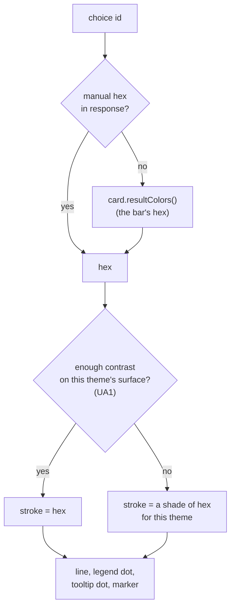
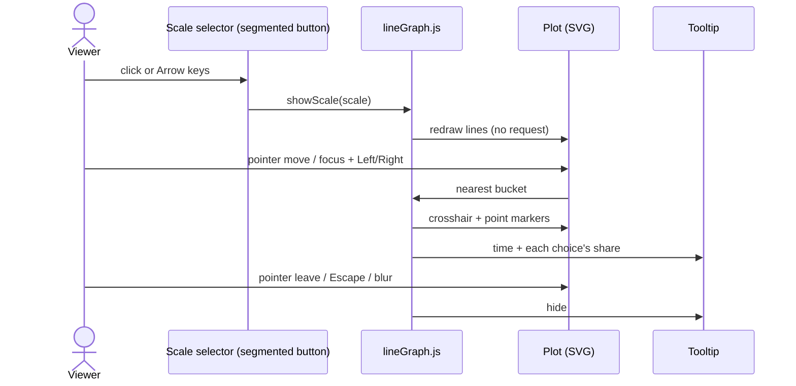
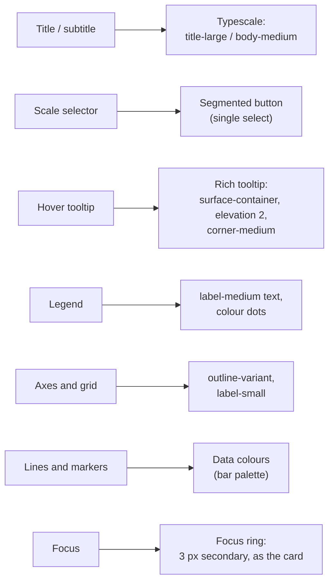

# High Level Requirements

Requirements: `requirements/20261028-183546-line-graph-m3/requirements.md`  
External Files: none  
Generated: 2026-10-28 6:37 PM  

Update the line graph so that it adheres to Material 3 design guidelines and functionality.  
Also, colors that are consistend with the CrowdPoll webapp should be used, ensuring visual consistency across the platform.  

## Additional Requirements and Research Requests

**Instructions To The Developer**  
Enter any additional requirements or research requests under the ## Additional Requirements and Research Requests heading above.  
When you Type or Say: "Next" in the CC CLI terminal, the additional requirements and research requests will be applied to the report.  
  
You may leave these instructions here. They will be ignored when "Next" is executed.  

## 1. Overview and Scope

The maximized poll view's vote-history line graph (feature `20261027-151601-POLL-LINE-GRAPH`) is restyled to follow Material 3 and the CrowdPoll palette.  
The graph is already built from M3 tokens in places (typography, `on-surface`, `outline-variant`), but several parts are plain HTML controls with no M3 component behind them.  
This feature is a client-side restyle, plus whatever interaction the M3 components bring with them.  

- **In scope**:  
  - the graph's chrome: title, subtitle, notes, legend, axes, grid lines, crosshair, tooltip and the scale selector;  
  - how the lines and the hover point are drawn (stroke, joins, markers);  
  - the line colours as they appear in the light and dark themes;  
  - states (hover, focus, pressed), focus rings and keyboard use of the graph's controls.  
- **Out of scope (assumed)**:  
  - the series the server computes (`GET /api/polls/:pid/line-graph`, the tally, the cache, the threshold);  
  - the mount seam in `tabs.js`, the refresh timer and the failure notes' wording;  
  - the bar graph's own colours (`assignResultColors`, `barColorsOf`), which stay as they are;  
  - the pending `20261028-114023-line-graph-toggle` feature (whether a poll shows the graph at all).  

### Current code this touches

| File | Today |
|---|---|
| `src/public/lineGraph.js` (332 lines) | Builds the graph as inline SVG; scale buttons are `button.line-graph-scale` with an underline when `is-selected`; tooltip follows the pointer only; 2 px polylines, no markers; height fixed at 280 px |
| `src/public/line-graph-m3.css` (158 lines) | M3 tokens for text and grid; the tooltip has an 8 px corner and a 1 px border, no elevation; the title uses a literal `clamp(18px, …)` |
| `src/public/pollCard.js` | `resultColors()` hands the graph the bar colours; `contrastRatio`, `darkShadeOf`, `lightShadeFor` already exist there |
| `src/public/pollCard-m3.css` | `.maximized-space-right` panel: `surface`, `outline-variant` border, `corner-medium` |
| `src/public/m3-tokens.css` | Colour roles for both themes, `--md-sys-elevation-2/3`, shape, state-layer and motion tokens |
| `src/polls/barPalette.ts` | The 18 manual colours a creator may pick |
| `tests/line-graph-ui.test.ts` | Asserts on `.line-graph-scale` and `is-selected` |

## 2. Architecture Diagrams

### 2.1 Components

```mermaid
flowchart LR
  subgraph Browser["index.html (maximized view)"]
    tabs["tabs.js<br/>maximize() / unmount()"]
    card["pollCard.js<br/>resultColors()"]
    lg["lineGraph.js<br/>render: legend, SVG, tooltip, scales"]
    css["line-graph-m3.css<br/>(restyled)"]
    tok["m3-tokens.css<br/>colour roles, elevation,<br/>shape, state, motion"]
    rip["m3-ripple.js<br/>M3Ripple.add()"]
  end
  api["GET /api/polls/:pid/line-graph<br/>(unchanged)"]
  tabs -->|mount(el, ctx)| lg
  card -->|bar hexes| lg
  api -->|series, manual hexes| lg
  css --> lg
  tok --> css
  rip -.->|state layers on controls| lg
```

### 2.2 Where a line's colour comes from



### 2.3 Using the graph



### 2.4 Graph parts and the M3 element each follows



## 3. Breaking Changes

- **"Identical hexes in both themes" (POLL-LINE-GRAPH R9) would change** if UA1's Recommendation A is accepted: in the dark theme a line too dark for the surface would be drawn in a lighter shade of its bar's colour.  
  The line would then no longer be the exact hex of its bar, though it is derived from it.  
- **The scale selector's markup changes** (UA2): `button.line-graph-scale` with `is-selected` becomes an M3 segmented button.  
  `tests/line-graph-ui.test.ts` asserts on the old class names and must be updated.  
- No HTTP, data, configuration or migration change.  

## 4. Technical Debt

- **Contrast helpers live in `pollCard.js`** (`contrastRatio`, `darkShadeOf`, `lightShadeFor`).  
  `lineGraph.js` is a separate module and cannot call them without either a global export or a copy.  
- **Fixed geometry in script**: the plot is 280 px high with padding written in `renderSvg()`, not tokens or CSS.  
- **The legend dot and the tooltip dot are built twice** with the same code.  
- **A literal font size** in `.line-graph-title` (`clamp(18px, 1.8vw, …)`), against the layers' "no literal font size" rule that `m3-assets.test.ts` checks for other sheets.  
- **`tabs.css` still holds a `.maximized-space-right` rule** (flex sizing), although POLL-LINE-GRAPH said its placeholder rules would go; only the placeholder look was removed.  
- **No shared M3 segmented-button style** exists in the codebase; the one built here is the first.  

## 5. Assumptions

- The graph stays hand-rolled SVG with no new dependency, as POLL-LINE-GRAPH decided.  
- "Consistent with the CrowdPoll webapp" keeps each line the colour of its bar (AM2).  
- Both themes are supported, by the tokens already in `m3-tokens.css`, under `data-theme` and `prefers-color-scheme`.  
- The graph's container panel (`.maximized-space-right`) keeps its current look.  
- Reduced-motion settings are honoured by any motion added.  

## 6. Findings

### 6.1 Inconsistencies

None found.  

### 6.2 Ambiguities

**AM1. What does "adheres to Material 3 design guidelines and functionality" mean for a chart?**  
<span style="font-size:large">✅ Resolved</span>  
✅ Requirements File Updated: 2026-10-28 6:45 PM  
**Notes**: Recommendation accepted by "Accept" 2026-10-28: Recommendation A, map each graph part to the nearest M3 element, look and behaviour both;  
`requirements.md` gains a "Resolved Decisions" section listing the M3 element each part follows, with state layers, the focus ring and keyboard use on every control.  

Material 3 has no chart or line-graph component.  
Its guidelines cover components (segmented buttons, tooltips, chips), colour roles, typography, shape, elevation, state layers and motion, which can be applied to the graph's parts.  
"Functionality" could mean only the look of those parts, or also the interaction each M3 component brings (keyboard use, states, focus).  

  - **Recommendation A** _(recommended)_: **map each graph part to the nearest M3 element, look and behaviour both, as in diagram 2.4.**  

    ➡️ [X] **Accepted**  
    - <u>Pros</u>: testable part by part;  
      the controls gain M3 states and keyboard use;  
      it matches how the rest of the site layered M3 (024, 027).  
    - <u>Cons</u>: some interaction work (UA2, UA5), not only CSS.  

  - **Recommendation B**: **visual only: M3 tokens, shape, elevation and typography, with today's interaction.**  

    ➡️ [ ] **Accepted**  
    - <u>Pros</u>: CSS-only, smallest change.  
    - <u>Cons</u>: the scale selector and tooltip keep behaving unlike M3 components;  
      "functionality" is not addressed.  

  - **Developer Resolution C**:  

    ➡️ [ ] **Accepted**  

**AM2. Which colours must be "consistent with the CrowdPoll webapp"?**  
<span style="font-size:large">✅ Resolved</span>  
✅ Requirements File Updated: 2026-10-28 6:55 PM  
**Notes**: Recommendation accepted in file 2026-10-28: Recommendation A, chrome from the app's M3 colour roles, each line keeps its bar's colour;  
`requirements.md` "Resolved Decisions" gains which colours come from where.  

The graph has two kinds of colour: the chrome (text, grid, tooltip, controls) and the data (one line per choice).  
Today the chrome already uses M3 tokens, and each line uses its bar's colour, so the lines can never disagree with the bars (POLL-LINE-GRAPH R7).  
The requirement could also be read as recolouring the lines from the app's green brand palette.  

  - **Recommendation A** _(recommended)_: **chrome from the app's M3 colour roles;  
    each line keeps its bar's colour (adjusted only where UA1 requires).**  

    ➡️ [X] **Accepted**  
    - <u>Pros</u>: the graph and the bar graph beside it read as one;  
      manual colours chosen by the creator are honoured.  
    - <u>Cons</u>: the data colours are not a tonal M3 palette.  

  - **Recommendation B**: **recolour the lines from an M3-derived palette built on the brand primary.**  

    ➡️ [ ] **Accepted**  
    - <u>Pros</u>: a unified tonal look.  
    - <u>Cons</u>: a line no longer matches its bar;  
      manual colours are ignored;  
      reverses POLL-LINE-GRAPH R7 (a breaking change).  

  - **Developer Resolution C**:  

    ➡️ [ ] **Accepted**  

### 6.3 Unspecified Aspects

**UA1. Several line colours are nearly invisible on one of the two themes.**  
<span style="font-size:large">✅ Resolved</span>  
✅ Requirements File Updated: 2026-10-28 6:55 PM  
**Notes**: Recommendation accepted in file 2026-10-28: Recommendation A, per theme, a colour under 3:1 is drawn in the nearest shade of itself that reaches 3:1, dots and markers alike;  
`requirements.md` "Resolved Decisions" gains the rule and notes it replaces "identical hexes in both themes".  

Each line is drawn in the same hex in both themes.  
Against the dark surface (`#0F1511`) these automatic colours fall below the 3:1 non-text contrast of WCAG 1.4.11: `#000000` 1.14, `#404040` 1.78, `#880015` 1.81, `#800080` 1.96, `#0808FD` 2.17, `#006120` (Yes) 2.40, `#1A539E` 2.44.  
Against the light surface (`#FFFFFF`): `#FC8E45` 2.31 and `#FF6601` 2.94;  
and the manual colours `#FFFF00` 1.07, `#E0E0E0` 1.32, `#E3E335` 1.37, `#06D400` 2.01, `#FF91CB` 2.07, `#9E9E9E` 2.68.  
The bars avoid this because each sits on a tinted track; a 2 px line has no track.  

  - **Recommendation A** _(recommended)_: **per theme, a colour under 3:1 on the surface is drawn in the nearest shade of itself that reaches 3:1;  
    the legend, tooltip dots and markers use the same shade.**  

    ➡️ [X] **Accepted**  
    - <u>Pros</u>: every line is visible in both themes;  
      each line still reads as its bar's hue;  
      colours already at 3:1 are unchanged.  
    - <u>Cons</u>: the shade is not the bar's exact hex;  
      replaces "identical hexes in both themes" (a breaking change);  
      the contrast helpers must be shared with `lineGraph.js`.  

  - **Recommendation B**: **keep the exact hex, and draw each line over a 4 px casing in the contrasting surface tone.**  

    ➡️ [ ] **Accepted**  
    - <u>Pros</u>: the hex stays exact.  
    - <u>Cons</u>: a light casing on a dark surface looks like a second line;  
      crossing lines get cluttered.  

  - **Recommendation C**: **leave the colours as they are.**  

    ➡️ [ ] **Accepted**  
    - <u>Pros</u>: no change.  
    - <u>Cons</u>: black and dark lines vanish in the dark theme, yellow in the light one.  

  - **Developer Resolution D**:  

    ➡️ [ ] **Accepted**  

**UA2. What should the scale selector (1 Day / 1 Week / 1 Month / 1 Year) look and behave like?**  
<span style="font-size:large">✅ Resolved</span>  
✅ Requirements File Updated: 2026-10-28 6:47 PM  
**Notes**: Recommendation accepted by "Accept all" 2026-10-28: Recommendation, an M3 single-select segmented button;  
`requirements.md` "Resolved Decisions" gains the scale selector's look, states, keys and `aria-pressed`, still with no request on a click.  

Today it is a row of text buttons; the selected one is underlined in `primary`.  
M3's control for picking one of two to five options is the single-select segmented button.  

  - **Recommendation**: **an M3 single-select segmented button: 40 px high, `outline` border, full-pill ends, the selected segment `secondary-container` with a check mark, `label-large` text, state layers via `M3Ripple`, the card's focus ring, Arrow keys move between segments;  
    the available scales only, as today, and a click still sends no request.**  

    ➡️ [X] **Accepted**  
    - It is the M3 component for this job, and it keeps `aria-pressed` so screen readers announce the choice.  
    - Its markup replaces `.line-graph-scale` (see Breaking Changes).  

  - **Developer Resolution B**:  

    ➡️ [ ] **Accepted**  

**UA3. How should the hover tooltip be styled and placed?**  
<span style="font-size:large">✅ Resolved</span>  
✅ Requirements File Updated: 2026-10-28 6:47 PM  
**Notes**: Recommendation accepted by "Accept all" 2026-10-28: Recommendation, an M3 rich tooltip kept inside the plot;  
`requirements.md` "Resolved Decisions" gains its tokens, padding, type and the flip near an edge.  

Today it is a box with an 8 px corner and a 1 px border, centred on the crosshair, so near either edge it can spill out of the panel.  

  - **Recommendation**: **an M3 rich tooltip: `surface-container`, `--md-sys-elevation-2`, `corner-medium`, no border, 12 px × 16 px padding, the time in `title-small`, rows in `body-medium`;  
    kept inside the plot by flipping to the other side of the crosshair near an edge.**  

    ➡️ [X] **Accepted**  
    - It uses tokens the site already defines, and the tooltip is always fully readable.  

  - **Developer Resolution B**:  

    ➡️ [ ] **Accepted**  

**UA4. How are the lines and the hovered point drawn, and does anything move?**  
<span style="font-size:large">✅ Resolved</span>  
✅ Requirements File Updated: 2026-10-28 6:55 PM  
**Notes**: Recommendation accepted in file 2026-10-28: Recommendation A, 2 px round-joined lines, 4 px markers with a `surface` ring at the crosshair, no animation;  
`requirements.md` "Resolved Decisions" gains how lines and markers are drawn.  

Today the lines are 2 px polylines with no point markers, and a scale change or refresh redraws them at once.  

  - **Recommendation A** _(recommended)_: **2 px lines with round joins and caps;  
    at the crosshair, a 4 px-radius marker on each line, in the line's colour with a 2 px `surface` ring;  
    no animation.**  

    ➡️ [X] **Accepted**  
    - <u>Pros</u>: the hovered values are easy to find;  
      a refresh every minute never makes the graph jump about.  
    - <u>Cons</u>: no M3 motion.  

  - **Recommendation B**: **as A, plus a 300 ms emphasized-decelerate transition of the lines on a scale change (not on a refresh), off under reduced motion.**  

    ➡️ [ ] **Accepted**  
    - <u>Pros</u>: uses M3 motion tokens.  
    - <u>Cons</u>: point counts differ between scales, so lines must be resampled to animate;  
      more code to test.  

  - **Developer Resolution C**:  

    ➡️ [ ] **Accepted**  

**UA5. Can the graph's values be read without a pointer?**  
<span style="font-size:large">✅ Resolved</span>  
✅ Requirements File Updated: 2026-10-28 6:47 PM  
**Notes**: Recommendation accepted by "Accept all" 2026-10-28: Recommendation, a focusable plot with Left/Right, Home/End and Escape and a polite live region;  
`requirements.md` "Resolved Decisions" gains the keyboard reading of values.  

The tooltip appears only on pointer move or press;  
the SVG is a single `role="img"` with a label, so keyboard and screen-reader users get no values.  

  - **Recommendation**: **the plot takes focus (one Tab stop, the card's focus ring);  
    Left/Right move the crosshair one bucket, Home/End to the ends, Escape or blur hides it;  
    the tooltip's text is announced through a polite live region.**  

    ➡️ [X] **Accepted**  
    - It brings the graph in line with the M3 accessibility guidance the rest of the site follows, and it reuses the existing crosshair code.  

  - **Developer Resolution B**:  

    ➡️ [ ] **Accepted**  

**UA6. How will "adheres to Material 3" be verified?**  
<span style="font-size:large">✅ Resolved</span>  
✅ Requirements File Updated: 2026-10-28 6:47 PM  
**Notes**: Recommendation accepted by "Accept all" 2026-10-28: Recommendation, token-only sheet, a 3:1 contrast test over both palettes, jsdom tests and a hand check;  
`requirements.md` "Resolved Decisions" gains how the feature is verified.  

The requirement has no success criterion.  

  - **Recommendation**: **the graph's sheet uses only M3 tokens (no literal colour or font size, checked as `m3-assets.test.ts` does);  
    every drawn line meets 3:1 on both themes' surface (a unit test over both palettes);  
    jsdom tests for the segmented button, the tooltip and the keyboard;  
    and a hand check in light and dark at 1400, 900 and 375 px.**  

    ➡️ [X] **Accepted**  
    - Each part of the requirement then has a check that passes or fails.  

  - **Developer Resolution B**:  

    ➡️ [ ] **Accepted**  

**UA7. What about the title, legend and axes?**  
<span style="font-size:large">✅ Resolved</span>  
✅ Requirements File Updated: 2026-10-28 6:47 PM  
**Notes**: Recommendation accepted by "Accept all" 2026-10-28: Recommendation, title/subtitle from tokens, `label-large` legend with 12 px dots, a 0 % baseline in `outline`;  
`requirements.md` "Resolved Decisions" gains the title, legend and axes.  

The title uses a literal `clamp(18px, …)`;  
the legend is dots and text with the vote total pushed right;  
axis labels are `label-small` in `on-surface-variant`, grid lines `outline-variant`.  

  - **Recommendation**: **title `title-large` and subtitle `body-medium` from tokens only;  
    legend entries in `label-large` with 12 px dots, the share in `on-surface-variant`;  
    axes and grid kept as today, with the 0 % baseline in `outline`.**  

    ➡️ [X] **Accepted**  
    - It removes the literal size and gives the chart a defined baseline, with little change elsewhere.  

  - **Developer Resolution B**:  

    ➡️ [ ] **Accepted**  

### 6.4 Needs Clarifications

**NC1. Should the legend let a viewer hide and show lines?**  
<span style="font-size:large">✅ Resolved</span>  
✅ Requirements File Updated: 2026-10-28 6:55 PM  
**Notes**: Recommendation accepted in file 2026-10-28: Recommendation A, the legend stays a static key, restyled only;  
`requirements.md` "Resolved Decisions" says lines cannot be hidden or shown.  

M3 filter chips would let a viewer toggle each choice's line, which is new functionality, not a restyle.  
Polls can have up to 50 choices, and the threshold already hides choices under 1 %.  

  - **Recommendation A** _(recommended)_: **no: the legend stays a static key, restyled only.**  

    ➡️ [X] **Accepted**  
    - <u>Pros</u>: keeps the feature a restyle;  
      nothing new to remember across refreshes.  
    - <u>Cons</u>: a busy graph cannot be decluttered.  

  - **Recommendation B**: **yes: each legend entry is an M3 filter chip that hides or shows its line, in memory only, reset on close.**  

    ➡️ [ ] **Accepted**  
    - <u>Pros</u>: lets a viewer focus on two or three choices.  
    - <u>Cons</u>: larger scope;  
      the tooltip and markers must skip hidden lines;  
      must survive the minute refresh.  

  - **Developer Resolution C**:  

    ➡️ [ ] **Accepted**  

## 7. Requirements Report Complete Report  
  
- **Requirements Report Document:** requirements/20261028-183546-line-graph-m3/requirements-report.md  
- **Requirements Document:** requirements/new-20261028-182952/requirements.md → requirements/20261028-183546-line-graph-m3/requirements.md  
- **Software Architecture Diagrams:** 4  
- **Inconsistencies:** 0  
- **Ambiguities:** 2  
- **Unspecified Aspects:** 7  
- **Needs Clarifications:** 1  
- **Research Results:** 0  
- **Breaking Changes:** 2  
- **Technical Debt items:** 6  
  
The requirements are ready for /speckit-specify.  
To generate specs from the requirements document, use the `/speckit-specify` skill followed by the path (relative to the project root) to the requirements file.  
At the prompt, Type:  
🟩 👉 /speckit-specify requirements/20261028-183546-line-graph-m3/requirements.md  
