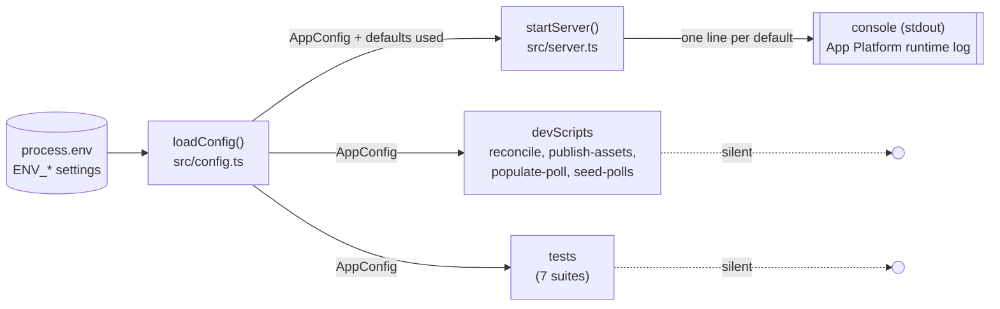
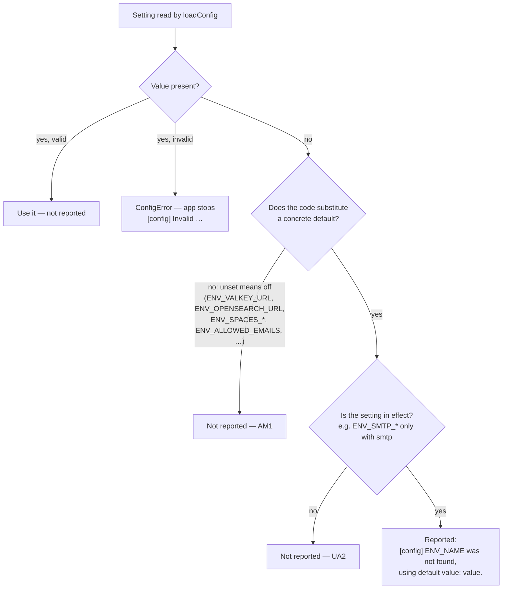
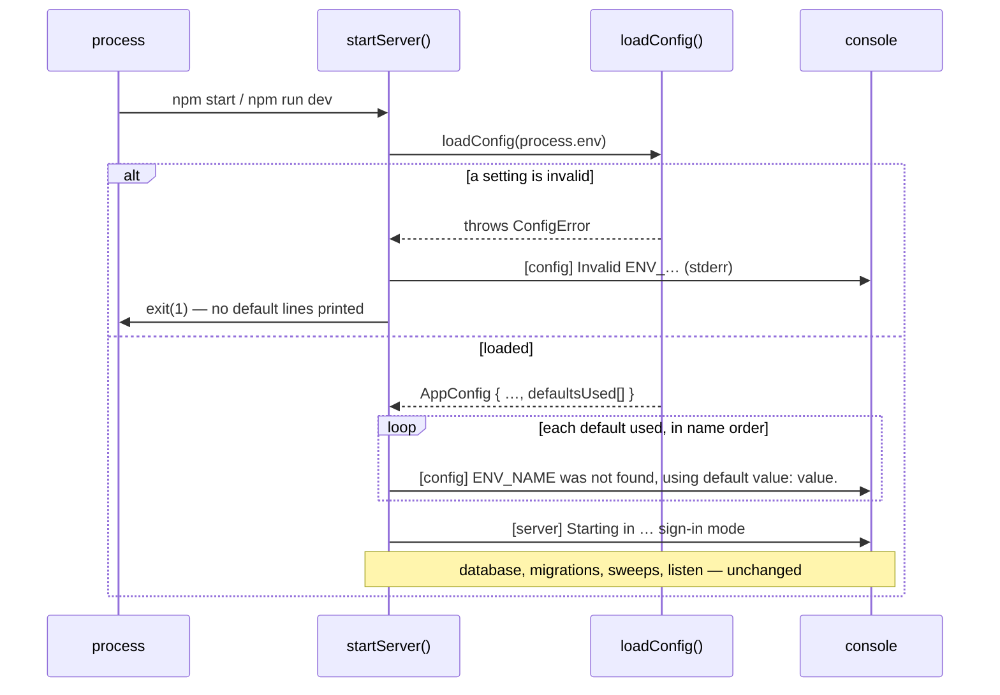
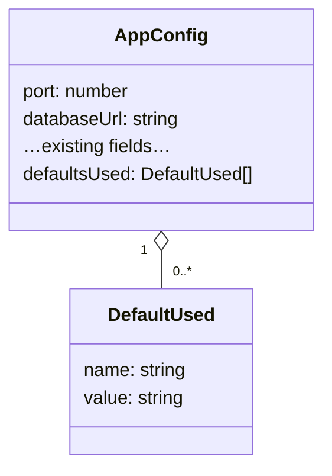

# High Level Requirements

Requirements: `requirements/20261029-150117-log-env-defaults/requirements.md`  
External Files: none  
Generated: 2026-10-29 3:01 PM  

# Initial High-Level Requirements

When the webapp server launches,  
Print a console log line if an environment variable is not found and the proram uses the default.  

The message should be:
ENV_NAME was not found, using default value: <default value>.

## Additional Requirements and Research Requests

**Instructions To The Developer**  
Enter any additional requirements or research requests under the ## Additional Requirements and Research Requests heading above.  
When you Type or Say: "Next" in the CC CLI terminal, the additional requirements and research requests will be applied to the report.  
  
You may leave these instructions here. They will be ignored when "Next" is executed.  

## 3. Overview and Scope

At start-up the server reads every `ENV_*` setting once, in `loadConfig` (`src/config.ts`).  
When a setting is absent, the code silently substitutes a default.  
This feature makes each substitution visible: the server prints one console line per setting it filled in with a default.  

- **In scope**
  - The web server's start-up (`startServer` in `src/server.ts`), after the configuration has loaded successfully.  
  - Every setting for which `loadConfig` substitutes a concrete value: 52 numeric settings (`intVar` / `nonNegativeIntVar`) and six text settings read with `??` (`ENV_SIGNIN_METHOD`, `ENV_DATABASE_URL`, `ENV_EMAIL_TRANSPORT`, `ENV_ADMINS`, `ENV_SMTP_HOST`, `ENV_EMAIL_FROM`).  
- **Out of scope**
  - Any change to which default is used, how a value is validated, or what an invalid value does (it still stops the app with a `[config]` error).  
  - The developer scripts that also call `loadConfig` (`reconcile`, `publish-assets`, `populate-poll`, `seed-polls`) and the test suites.  
  - The browser, routes, data and migrations.  

What it means in practice:  

- **Production** (`.do/app.yaml` sets almost every setting): only the settings left out of the spec are reported; today those with a default are `ENV_SMTP_HOST` and `ENV_SMTP_PORT` (see UA2).  
- **Development** (`devScripts/launch-dev.ps1` sets nearly everything): a handful of lines at most.  
- **A bare start** (no settings but the two required ones): about 58 lines.  

## 4. Architecture Diagrams

### 4.1 Context: who reads the configuration, and who prints

`loadConfig` only records what it defaulted; the server is the one caller that prints it, so scripts and tests stay quiet (UA1).

### 4.2 Deciding whether a setting is reported

"No value present" follows what the code already does: for numbers an empty string counts as absent, for the `??` text settings only a missing variable does (AM2).

### 4.3 Start-up sequence

### 4.4 Data shape added to the configuration

`value` is the default as text, exactly as the code holds it (`2592000000`, `CrowdPoll <no-reply@mail.crowdpoll.vote>`), masked where NC1 requires.

## 5. Settings With a Default

Settings that would be reported when absent (numbers as the code holds them, without separators):  

| Group | Settings (default) |
|---|---|
| Server, database, sign-in | `ENV_PORT` (8080), `ENV_DATABASE_URL` (postgres://localhost:5432/app01), `ENV_SIGNIN_METHOD` (native), `ENV_ADMINS` (roadraceresults@gmail.com — see NC1), `ENV_MAX_SIGNIN_COOKIE_DURATION` (2592000000), `ENV_SESSION_CACHE_TTL` (300000) |
| Email | `ENV_EMAIL_TRANSPORT` (smtp), `ENV_SMTP_HOST` (sandbox.smtp.mailtrap.io), `ENV_SMTP_PORT` (2525), `ENV_EMAIL_FROM` (CrowdPoll <no-reply@mail.crowdpoll.vote>), `ENV_EMAIL_SEND_TIMEOUT` (10000), `ENV_EMAIL_RATE_LIMIT_WINDOW_MINUTES` (15), `ENV_EMAIL_RATE_LIMIT_MAX_REQUESTS_PER_WINDOW` (2), `ENV_MAX_INVITATIONS_PER_DAY` (200) |
| Polls | `ENV_SCREENING_CALL_TIMEOUT`, `ENV_POLL_APPROVAL_SWEEP_INTERVAL`, `ENV_POLL_DATE_CHECK_SWEEP_INTERVAL`, `ENV_POLL_EDIT_HEARTBEAT_INTERVAL`, `ENV_MAX_ACCEPTABILITY_SCREENING_ATTEMPTS`, `ENV_POLL_ADMIN_PAGE_REFRESH_INTERVAL`, `ENV_PARTICIPANTS_VIEWPORT_SIZE`, `ENV_MAX_PRIVATE_POLL_VOTERS`, `ENV_MIN_CHOICES`, `ENV_MAX_CHOICES` |
| Tabs and search | `ENV_MAX_POLLS_SEARCH_RESULTS`, `ENV_MAX_POLLS_ADMIN_SEARCH_RESULTS`, `ENV_MAX_TRENDING_POLLS`, `ENV_TRENDING_POLLS_RECOMPUTE_SWEEP_INTERVAL`, `ENV_MAX_NEWEST_POLLS`, `ENV_NEWEST_POLLS_RECOMPUTE_SWEEP_INTERVAL`, `ENV_SEARCH_CACHE_TTL`, `ENV_OUTBOX_DRAIN_SWEEP_INTERVAL`, `ENV_LINE_GRAPH_MIN_VOTE_PERCENTAGE`, `ENV_LINE_GRAPH_REFRESH_INTERVAL` |
| Load bounds | the four `ENV_MIN_*_REFRESH_INTERVAL`, `ENV_MANUAL_REFRESH_BURST`, `ENV_SEARCH_BURST`, `ENV_MAX_VOTES_PER_IP_PER_MINUTE`, `ENV_MAX_LIVE_RESULTS_PER_USER`, `ENV_LIVE_RESULTS_MAX_IDLE_TIME`, `ENV_SERVER_MAX_*` (four), `ENV_BUDGET_CONTROLLER_SWEEP_INTERVAL`, `ENV_MAX_REFRESH_AND_SEARCH_STRETCH`, `ENV_BUDGET_LOWER_THRESHOLD_PERCENT`, `ENV_INSTANCE_MAX_INFLIGHT`, `ENV_INSTANCE_MAX_EVENT_LOOP_LAG`, `ENV_SHED_RETRY_AFTER` |
| Votes and sweeps | `ENV_COUNTER_FLUSH_SWEEP_INTERVAL`, `ENV_INVITATION_SWEEP_INTERVAL`, `ENV_VOTE_BATCH_SIZE`, `ENV_VOTE_QUEUE_LAG_NOTICE`, `ENV_MAX_BOOKMARKS_PER_USER`, `ENV_BOOKMARK_EXPIRY_MONTHS`, `ENV_PAGE_LOADS_PER_MINUTE` |

Settings with **no** default value, where absence switches a capability off or picks a fallback (AM1): `ENV_VALKEY_URL`, `ENV_OPENSEARCH_URL`, `ENV_SPACES_*`, `ENV_DATABASE_CA_CERT`, `ENV_ALLOWED_EMAILS`, `ENV_EMAIL_ASSET_ORIGIN`, `ENV_PROTOTYPES`, `ENV_STAY_SIGNED_IN`, `ENV_SMTP_USER`/`ENV_SMTP_PASS`, `ENV_OAUTH_*`.  
Required settings (`ENV_BETTER_AUTH_SECRET`, `ENV_PUBLIC_ORIGIN`, and `ENV_SES_*` with `ses`) have no default: absent, the app stops, as today.  

## 6. Assumptions

- "Launches" means the web server's `startServer`, not the build or the developer scripts.  
- "Not found" never changes behaviour: whatever value the code uses today, it uses after this feature.  
- `proram` in the requirement is a typo for `program`.  
- `ENV_NAME` and `<default value>` are placeholders for the setting's name and its default.  
- The lines go to the same console every other start-up line goes to; on App Platform that is the runtime log.  
- No new setting, route, dependency or migration.  

## 7. Breaking Changes

None.  
The feature adds console output only; every default, validation rule and error stays as it is.  
(Recommendation B of AM2 would be one, and is not recommended.)  

## 8. Technical Debt

- **TD1. Defaults live in four places.**  
  Each default is a literal inside `loadConfig`, and is repeated in the CLAUDE.md settings table, `devScripts.example/launch-dev.ps1`, `launch.json.example` and `.do/app.yaml`.  
  Nothing checks that they agree; the new lines at least show the code's value at run time.  
- **TD2. Empty values are read two ways.**  
  `intVar`, `nonNegativeIntVar` and `optionalVar` treat `""` as absent; the six `env.X ?? default` reads do not, so `ENV_ADMINS=""` means no administrators rather than the default.  
  This feature reports what the code does and leaves that difference in place (AM2).  
- **TD3. Text settings have no helper.**  
  The six `??` reads must each be routed through one small helper (e.g. `textVar(env, name, fallback)`) so that they can record a default, as `intVar` will.  

## 9. Findings

### 9.1 Inconsistencies

None found.  

### 9.2 Ambiguities

**AM1. Which settings count as "the program uses the default"?**  
✅ Resolved  
✅ Requirements File Updated: 2026-10-29 4:53 PM  
**Notes**: Recommendation accepted in file 2026-10-29: Recommendation B, also report the "unset means off" settings, naming the behaviour;  
the requirements' Decisions section lists each such setting and its `none (…)` wording;  
the all-or-none groups (`ENV_SPACES_*`, each provider's `ENV_OAUTH_*`) are one line each.  
Sections 4.2 and 5 and NC2's line count were written for Recommendation A and are not rewritten; the next run checks them.  

Some settings get a concrete value when absent (`ENV_PORT` → 8080).  
Others have no value at all: absent, they switch something off or pick a fallback (`ENV_VALKEY_URL` unset → the in-process cache; `ENV_ALLOWED_EMAILS` unset → everyone may sign in).  
The message `using default value: <default value>` only reads well for the first kind.  

  - **Recommendation A** _(recommended)_: **report only settings for which the code substitutes a concrete value.**  

    ➡️ [ ] **Accepted**  
    - <u>Pros</u>: every line has a real value to name; the 58 settings of section 5, nothing else.  
    - <u>Cons</u>: an operator who forgets `ENV_VALKEY_URL` in production is not told by this feature (other start-up lines, such as `[search] … is serving home search`, already show some of these choices).  

  - **Recommendation B**: **also report the "unset means off" settings, naming the behaviour.**  

    ➡️ [X] **Accepted**  
    - <u>Pros</u>: a missing service URL is visible at once.  
    - <u>Cons</u>: needs a second wording (e.g. `ENV_VALKEY_URL was not found, using default value: none (in-process cache).`), and adds about ten lines on every development start, where these are unset on purpose.  

  - **Developer Resolution C**:  

    ➡️ [ ] **Accepted**  

**AM2. Is a setting that is present but empty "not found"?**  
✅ Resolved  
✅ Requirements File Updated: 2026-10-29 4:53 PM  
**Notes**: Recommendation accepted in file 2026-10-29: Recommendation A, report exactly when the code uses the default, as it does today;  
the requirements' Decisions section says so; no behaviour changes.  

For numbers, `ENV_PORT=""` already means the default.  
For the six text settings read with `??`, an empty value is used as it is (`ENV_ADMINS=""` means no administrators).  

  - **Recommendation A** _(recommended)_: **report exactly when the code uses the default, as it does today.**  

    ➡️ [X] **Accepted**  
    - <u>Pros</u>: the log never says a default is used when it is not; no behaviour changes.  
    - <u>Cons</u>: the empty-value difference (TD2) stays.  

  - **Recommendation B**: **treat an empty text setting as absent too, and report it.**  

    ➡️ [ ] **Accepted**  
    - <u>Pros</u>: one rule for every setting.  
    - <u>Cons</u>: a breaking change beyond logging: `ENV_ADMINS=""` would start granting the default administrator.  

  - **Developer Resolution C**:  

    ➡️ [ ] **Accepted**  

**AM3. What exactly does the line look like?**  
✅ Resolved  
✅ Requirements File Updated: 2026-10-29 4:53 PM  
**Notes**: Recommendation accepted in file 2026-10-29: Recommendation A, `[config] ENV_PORT was not found, using default value: 8080.`;  
the requirements' Decisions section gives the line and how the value is written.  

Every other start-up line carries an area prefix (`[server]`, `[config]`, `[db]`).  
The requirement gives the text without one, and does not say how a value is written (`2592000000` or `2,592,000,000`; quoted or not) or whether the final period stays after a value such as `CrowdPoll <no-reply@mail.crowdpoll.vote>`.  

  - **Recommendation A** _(recommended)_: **`[config] ENV_PORT was not found, using default value: 8080.`**  

    ➡️ [X] **Accepted**  
    - <u>Pros</u>: matches the `[config]` prefix of the configuration errors, so `grep '\[config\]'` finds both; the value is written as the code holds it, unquoted, with no separators, followed by the period.  
    - <u>Cons</u>: a value ending in a period would show two; none does today.  

  - **Recommendation B**: **exactly the text given, with no prefix.**  

    ➡️ [ ] **Accepted**  
    - <u>Pros</u>: word for word as requested.  
    - <u>Cons</u>: the only start-up line without an area prefix, harder to filter in the App Platform log.  

  - **Developer Resolution C**:  

    ➡️ [ ] **Accepted**  

**AM4. Is the line information or a warning?**  
✅ Resolved  
✅ Requirements File Updated: 2026-10-29 3:05 PM  
**Notes**: Recommendation accepted by "Accept all" 2026-10-29: Recommendation, `console.log`, like the other start-up lines;  
the requirements' new Decisions section says so.  

`console.log` writes to stdout; `console.warn` to stderr, which App Platform shows like an error stream.  
Using a default is normal in development and for most settings.  

  - **Recommendation**: **`console.log`, like the other start-up lines.**  

    ➡️ [X] **Accepted**  
    - A default is not a fault; the configuration errors stay on `console.error`.  

  - **Developer Resolution B**:  

    ➡️ [ ] **Accepted**  

### 9.3 Unspecified Aspects

**UA1. Where are the defaults recorded, and who prints them?**  
✅ Resolved  
✅ Requirements File Updated: 2026-10-29 3:05 PM  
**Notes**: Recommendation accepted by "Accept all" 2026-10-29: Recommendation, `loadConfig` records the defaults in `AppConfig.defaultsUsed`; only `startServer` prints them;  
the requirements' Decisions section says so.  

`loadConfig` is also called by four developer scripts (one of them, `publish-assets`, during the build) and by seven test suites.  
Printing inside `loadConfig` would put these lines in every script run and every test.  

  - **Recommendation**: **`loadConfig` records the defaults in `AppConfig.defaultsUsed`; only `startServer` prints them.**  

    ➡️ [X] **Accepted**  
    - `intVar`, `nonNegativeIntVar` and a new text helper (TD3) push `{ name, value }` onto a list built in `loadConfig`; `loadConfig` stays free of side effects and the scripts and tests print nothing new.  

  - **Developer Resolution B**:  

    ➡️ [ ] **Accepted**  

**UA2. Are defaults reported for settings that are not in effect?**  
✅ Resolved  
✅ Requirements File Updated: 2026-10-29 4:53 PM  
**Notes**: Recommendation accepted in file 2026-10-29: Recommendation A, report a default only when its setting is in effect;  
the requirements' Decisions section names the conditions: the `ENV_SMTP_*` settings only with `smtp`, the `ENV_OAUTH_*` settings only with `oauth` or `both`.  

`ENV_SMTP_HOST` and `ENV_SMTP_PORT` get defaults even when `ENV_EMAIL_TRANSPORT=ses`, where they are never used.  
Production sets `ses` and leaves both out, so it would print two lines about a mail server it does not use.  

  - **Recommendation A** _(recommended)_: **report a default only when its setting is in effect.**  

    ➡️ [X] **Accepted**  
    - <u>Pros</u>: every line is about something the server does; today this affects only `ENV_SMTP_HOST`/`ENV_SMTP_PORT` (reported only with `smtp`), so production prints none.  
    - <u>Cons</u>: one condition to keep in step if another conditional setting is added.  

  - **Recommendation B**: **report every default the code substitutes.**  

    ➡️ [ ] **Accepted**  
    - <u>Pros</u>: simplest; no condition.  
    - <u>Cons</u>: two misleading lines on every production instance start.  

  - **Developer Resolution C**:  

    ➡️ [ ] **Accepted**  

**UA3. When, and in what order, are the lines printed?**  
✅ Resolved  
✅ Requirements File Updated: 2026-10-29 3:05 PM  
**Notes**: Recommendation accepted by "Accept all" 2026-10-29: Recommendation, after the configuration loads, before `[server] Starting in …`, sorted by setting name, none when the configuration is invalid;  
the requirements' Decisions section says so.  

The requirement says "when the webapp server launches" but not relative to the other start-up lines, nor what happens when the configuration is invalid.  

  - **Recommendation**: **after the configuration loads, before `[server] Starting in …`, sorted by setting name; none when the configuration is invalid.**  

    ➡️ [X] **Accepted**  
    - An invalid setting stops the app with its one `[config]` error line, as today; sorting makes two starts easy to compare.  

  - **Developer Resolution B**:  

    ➡️ [ ] **Accepted**  

**UA4. How is the feature verified?**  
✅ Resolved  
✅ Requirements File Updated: 2026-10-29 3:05 PM  
**Notes**: Recommendation accepted by "Accept all" 2026-10-29: Recommendation, unit tests on `loadConfig`, plus one on the line text;  
the requirements' Decisions section lists the cases, with the empty-value case written to follow AM2, which is still open.  

The requirement gives no success criterion.  

  - **Recommendation**: **unit tests on `loadConfig`, plus one on the line text.**  

    ➡️ [X] **Accepted**  
    - `loadConfig` with only the two required settings lists every setting of section 5 with its default (the SMTP pair only with `smtp`); a setting given a value is not listed; an empty number setting is listed, an empty text setting is not (AM2); the formatted line matches AM3's text exactly.  

  - **Developer Resolution B**:  

    ➡️ [ ] **Accepted**  

### 9.4 Needs Clarifications

**NC1. Should `ENV_ADMINS`' default address be printed in full?**  
✅ Resolved  
✅ Requirements File Updated: 2026-10-29 4:53 PM  
**Notes**: Recommendation accepted in file 2026-10-29: Recommendation A, mask it with `maskAddress`;  
the requirements' Decisions section says so.  

The default is a personal address (`roadraceresults@gmail.com`).  
Earlier features keep addresses out of the logs: the allowlist logs only a count, and mail logs mask recipients with `maskAddress` (`r•••@gmail.com`).  

  - **Recommendation A** _(recommended)_: **mask it with `maskAddress`: `[config] ENV_ADMINS was not found, using default value: r•••@gmail.com.`**  

    ➡️ [X] **Accepted**  
    - <u>Pros</u>: keeps the logs free of full addresses, as every other log line is.  
    - <u>Cons</u>: the line no longer shows the exact value (it is in the source and CLAUDE.md).  

  - **Recommendation B**: **print it in full.**  

    ➡️ [ ] **Accepted**  
    - <u>Pros</u>: exact; the address is already public in the repository.  
    - <u>Cons</u>: the only full address in the runtime logs.  

  - **Developer Resolution C**:  

    ➡️ [ ] **Accepted**  

**NC2. One line per setting, even when many are missing?**  
✅ Resolved  
✅ Requirements File Updated: 2026-10-29 4:53 PM  
**Notes**: Recommendation accepted in file 2026-10-29: Recommendation A, one line per setting, as requested;  
the requirements' Decisions section says so.  

A start with only the required settings prints about 58 lines.  

  - **Recommendation A** _(recommended)_: **one line per setting, as requested.**  

    ➡️ [X] **Accepted**  
    - <u>Pros</u>: each line is searchable by setting name; production and the development template print none or a few.  
    - <u>Cons</u>: a bare start is noisy.  

  - **Recommendation B**: **one summary line naming every defaulted setting and its value.**  

    ➡️ [ ] **Accepted**  
    - <u>Pros</u>: one line however many are missing.  
    - <u>Cons</u>: not the requested message; a very long line that log viewers truncate.  

  - **Developer Resolution C**:  

    ➡️ [ ] **Accepted**  

## 10. Requirements Report Complete Report  
  
- **Requirements Report Document:** requirements/20261029-150117-log-env-defaults/requirements-report.md  
- **Requirements Document:** requirements/new-20261029-145850/requirements.md → requirements/20261029-150117-log-env-defaults/requirements.md  
- **Software Architecture Diagrams:** 4  
- **Inconsistencies:** 0  
- **Ambiguities:** 4  
- **Unspecified Aspects:** 4  
- **Needs Clarifications:** 2  
- **Research Results:** 0  
- **Breaking Changes:** 0  
- **Technical Debt items:** 3  
  
The requirements are ready for /speckit-specify.  
To generate specs from the requirements document, use the `/speckit-specify` skill followed by the path (relative to the project root) to the requirements file.  
At the prompt, Type:  
🟩 👉 /speckit-specify requirements/20261029-150117-log-env-defaults/requirements.md  
