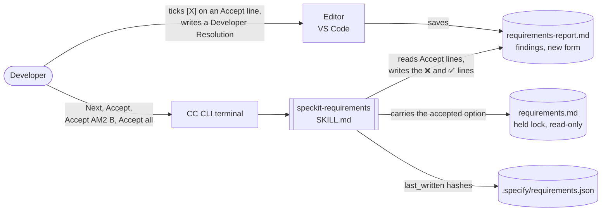
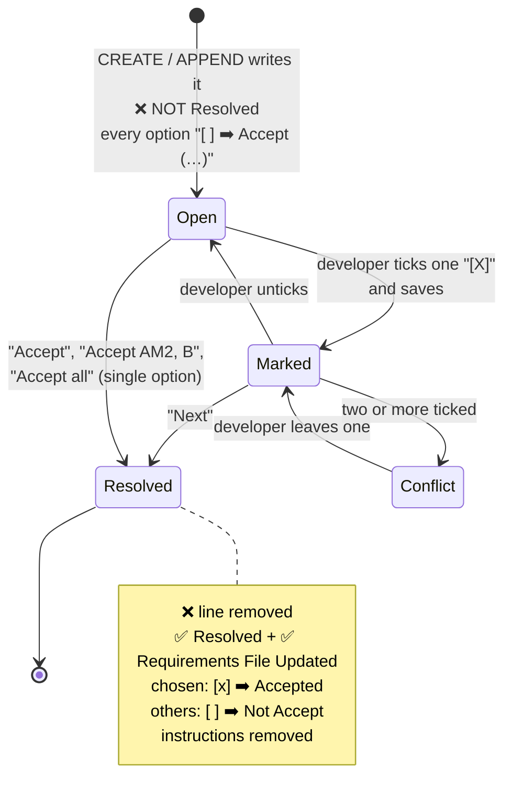
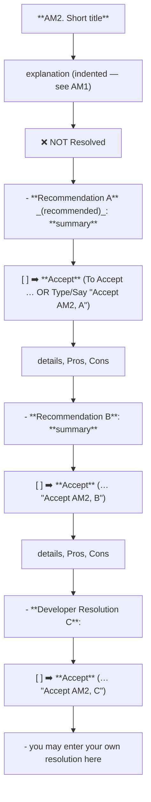
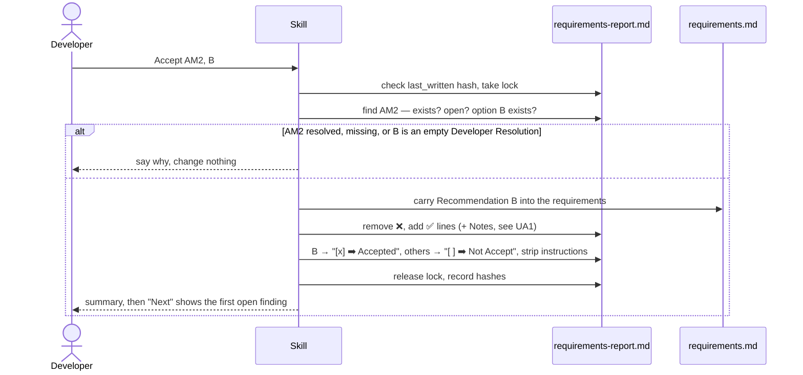

# High Level Requirements

Requirements: `requirements/20261029-154817-readable-finding-layout/requirements.md`  
External Files: none  
Generated: 2026-10-29 3:48 PM  

Update the skill at `.claude\skills\speckit-requirements` with the high-level requirements described here.  

The goals is to make the plain Maarkdown text to be more readable and easier for the user  
to see which Findings have not been Resolved yet and  
to Accept a recommendation in teh file.  

The new template for a finding before it has been resolved is:

```markdown
**FINDING1. Short Title For Finding**  

    Multi-line explanation of the finding goes here.
    Line 2
    line 3

❌ NOT Resolved 

  - **Recommendation A** _(recommended)_: **short description of recommendation A**  
     
    [ ] ➡️ **Accept** (To Accept, you may: mark <b>[X]</b> on this line, save the file, then Type/Say "<b>next</b>" in the CC CLI terminal, OR Type/Say "<b>Accept FINDING1, A</b>" in CC CLI)

    Details go here if applicable.
    - <u>Pros</u>: pros go here.
    - <u>Cons</u>: cons go here.


  - **Recommendation B**: **short description of recommendation B**  

    [ ] ➡️ **Accept** (To Accept, you may: mark <b>[X]</b> on this line, save the file, then Type/Say "<b>next</b>" in the CC CLI terminal, OR Type/Say "<b>Accept FINDING1, B</b>" in CC CLI)

    Details go here if applicable.
    - <u>Pros</u>: pros go here.
    - <u>Cons</u>: cons go here.


  - **Developer Resolution C**:  

    [ ] ➡️ **Accept** (To Accept, you may: mark <b>[X]</b> on this line, save the file, then Type/Say "<b>next</b>" in the CC CLI terminal, OR Type/Say "<b>Accept FINDING1, C</b>" in CC CLI)
    
    - you may enter your own resolution here

```

And the template for a  resolved finding is:  

```markdown
**FINDING1. Short Title For Finding**  
<span style="font-size:large" ><b>
✅ Resolved</b></span>  
✅ Requirements File Updated: 2026-10-29 3:05 PM  

    Multi-line explanation of the finding goes here.
    Line 2
    line 3

  - **Recommendation A** _(recommended)_: **short description of recommendation A**  
     
    [x] ➡️ **Accepted**

    Details go here if applicable.
    - <u>Pros</u>: pros go here.
    - <u>Cons</u>: cons go here.


  - **Recommendation B**: **short description of recommendation B**  

    [ ] ➡️ **Not Accept**

    Details go here if applicable.
    - <u>Pros</u>: pros go here.
    - <u>Cons</u>: cons go here.


  - **Developer Resolution C**:  

    [ ] ➡️ **Not Accept**
    
    - you may enter your own resolution here


```

Notice that the text after ➡️ has been changed to "Accepted" or "Not Accept" depending on the status of the recommendation.  
Also, the instructions after "Accept" have been removed.  
The blank lines in the markdown are important for readability even if they do not affect the rendered output.  


## Additional Requirements and Research Requests

**Instructions To The Developer**  
Enter any additional requirements or research requests under the ## Additional Requirements and Research Requests heading above.  
When you Type or Say: "Next" in the CC CLI terminal, the additional requirements and research requests will be applied to the report.  
  
You may leave these instructions here. They will be ignored when "Next" is executed.  

✅ Applied 2026-10-29 4:21 PM: a Mermaid parse error reported in diagram 2.1 (not a requirement, nothing added to requirements.md);  
the diagram's labels are now quoted, and diagram 2.3's `&quot;` entities are now `#quot;`.  

## 1. Overview and Scope

The feature changes how `/speckit-requirements` lays out a finding in `requirements-report.md`, so that, in the raw Markdown file as well as rendered:

- **an open finding is visible at a glance**, by a new `❌ NOT Resolved` line under its explanation;  
- **the accept box comes first on its line**, `[ ] ➡️ **Accept**`, followed by plain instructions that name both ways to accept;  
- **a recommendation can be accepted by id**, with a new command form, `Accept <FINDING_ID>, <LETTER>` (e.g. `Accept AM2, B`), instead of only the first open finding;  
- **a resolved finding reads as a record**: the `❌` line goes, `✅ Resolved` and `✅ Requirements File Updated` take its place under the title, the chosen line reads `[x] ➡️ **Accepted**`, every other line `[ ] ➡️ **Not Accept**`, and the instructions are removed;  
- **blank lines are part of the layout**, for raw-file readability.

**In scope**: the one file `.claude/skills/speckit-requirements/SKILL.md` — its *Finding layout*, the *Research Results* example, *Resolution of Findings*, *Prompting The Developer*, and every sentence that quotes the old `➡️ [ ] **Accepted**` line (about 25 places, lines 48–680).  
**Out of scope, as written**: `speckit-analyze-findings` and `speckit-clarify-findings`, which use the same layout (see NC1); the content of findings; the requirements document; every other part of the skill (normalizing, locks, APPEND, the Complete Report).

### Terms used

- **Finding** — an Inconsistency (`IN`), Ambiguity (`AM`), Unspecified Aspect (`UA`), Needs Clarification (`NC`) or Research Result (`RS`); `FINDING1` in the requirements stands for such an id.  
- **Option** — a lettered Recommendation, or the Developer Resolution.  
- **Accept line** — the `[ ] ➡️ **Accept** (…)` line under an option.  
- **Old form / new form** — the layout the skill writes today, and the layout these requirements describe.

## 2. Architecture Diagrams

### 2.1 Context: who writes what



### 2.2 The life of a finding



### 2.3 Anatomy of an open finding (new form)



### 2.4 "Accept AM2, B" (the new command form)



## 3. Assumptions

- `FINDING1` in the requirements is a placeholder for the real id (`IN1`, `AM2`, `RS3`, …); ids, numbering and categories are unchanged.  
- The new layout applies to every finding category, Research Results included; Breaking Changes and Technical Debt items are not findings and get no `❌` line.  
- The `<b>…</b>` tags in the Accept line are kept as written: they render in VS Code's preview and on GitHub.  
- The resolved form's `<span style="font-size:large" ><b>` wrapping `✅ Resolved` across a line break is intended, and the skill recognizes `✅ Resolved` wherever it sits in that span.  
- The existing commands, "Next", "Accept", "Accept X" and "Accept all", keep their meaning; `Accept <ID>, <LETTER>` is added beside them.  
- The *Writing text into the files* rules (a break after each sentence, two trailing spaces) still apply to every line the skill writes outside a code block.  
- The typos in the requirements ("Maarkdown", "teh", "goals is") are not part of what is to be built.

## 4. Breaking Changes

- **BC1. The report format changes.** A report written in the new form cannot be read by the skill as it is today, and the reworked skill must still read the old form, or it loses track of the old reports' open findings: `requirements/20261028-151716-refresh-mechanisms/requirements-report.md` has 3 open findings in the old form (see NC2).  
- **BC2. Open/resolved detection changes**, if the `**Notes**:` line is dropped (UA1): today a finding without a `**Notes**:` line, but with `✅ Resolved`, counts as marked resolved by hand.  
- **BC3. The checkbox moves** from after `➡️` to before it, so every pattern in the skill that looks for `➡️ [X] **Accepted**` must change.

## 5. Technical Debt

- **TD1. The layout is spelled out in about 25 places** in `SKILL.md` (lines 48, 55, 280, 392–506, 542–565, 680): every one must change together, and the change is a good moment to say it once, in *Finding layout*, and refer to it elsewhere.  
- **TD2. Three skills duplicate the layout**: `speckit-analyze-findings` (9 places) and `speckit-clarify-findings` (7 places) copy the old form; changing only one leaves three slightly different formats for the same developer (see NC1).  
- **TD3. Small faults in the current text**: line 48 reads "a a first step"; the Research Results example's hint says "in the console" where the others say "in the CC CLI terminal"; *Requirements Report Complete Report* is called *Architecture Complete Report* in three places.

## 6. Findings

### 6.1 Inconsistencies

**IN1. Is the ticked box `[X]` or `[x]`?**  
<span style="font-size:large">✅ Resolved</span>  
✅ Requirements File Updated: 2026-10-29 4:21 PM  
**Notes**: Recommendation accepted in file 2026-10-29: Developer Resolution B, a box is ticked when it holds `x` or `X` with any spaces around it, and the skill always writes `[X]`;  
the requirements now say so under Decisions, The checkbox.  

The Accept line tells the developer to "mark **[X]**".  
The resolved form shows the chosen option as `[x] ➡️ **Accepted**`, lower case.  
The skill today writes `[X]` and its examples read `[X]`.  

  - **Recommendation**: **read either case as ticked; the skill always writes `[X]`, as the instructions say.**  

    ➡️ [ ] **Accepted**  
    - Developers type either, and Markdown task lists treat both as ticked;  
    one written form keeps the files consistent with the instruction the developer reads.  

  - **Developer Resolution B**:  

    ➡️ [x] **Accepted**  
    - The recommendation, plus what the developer enters is case-insensitive and there could be one or more spaces before opr after the "X":  
    "[  x]", "[x ]", "[ X     ]

### 6.2 Ambiguities

**AM1. Should the indented explanation render as a code block?**  
<span style="font-size:large">✅ Resolved</span>  
✅ Requirements File Updated: 2026-10-29 4:21 PM  
**Notes**: Recommendation accepted in file 2026-10-29: Recommendation A, indent the explanation as a block quote;  
the requirements now say so under Decisions, The layout.  

The template indents the explanation by four spaces after a blank line.  
In Markdown that is a code block: it renders in a monospace box, and links, `code`, **bold** and `<u>` inside it show as raw text.  
Research Results put their sources' links in the explanation, so those links would stop working.  

  - **Recommendation A** _(recommended)_: **indent the explanation as a block quote, `> ` at the start of each line.**  

    ➡️ [X] **Accepted**  
    - <u>Pros</u>: it stands apart from the title and options in the raw file and when rendered, and links and formatting still work.  
    - <u>Cons</u>: a `> ` marker instead of plain spaces.  

  - **Recommendation B**: **plain, unindented lines, each ending with two spaces.**  

    ➡️ [ ] **Accepted**  
    - <u>Pros</u>: today's rendering, links working.  
    - <u>Cons</u>: no visual offset in the raw file, which the requirements ask for.  

  - **Recommendation C**: **keep the four-space indent, as written, and accept the code block.**  

    ➡️ [ ] **Accepted**  
    - <u>Pros</u>: exactly the template; reads cleanly raw.  
    - <u>Cons</u>: monospace when rendered; links, file names in backticks and emphasis show as raw characters.  

  - **Developer Resolution D**:  

    ➡️ [ ] **Accepted**  

**AM2. Is "Not Accept" the intended wording?**  
<span style="font-size:large">✅ Resolved</span>  
✅ Requirements File Updated: 2026-10-29 4:21 PM  
**Notes**: Recommendation accepted in file 2026-10-29: Recommendation A, "Not Accepted", parallel with "Accepted";  
the requirements now say so under Decisions, The layout.  

The resolved form marks every option not chosen `[ ] ➡️ **Not Accept**`, and the requirements repeat it.  
The chosen one reads `Accepted`, past tense.  

  - **Recommendation A** _(recommended)_: **"Not Accepted", parallel with "Accepted".**  

    ➡️ [X] **Accepted**  
    - <u>Pros</u>: reads as a record of what happened.  
    - <u>Cons</u>: differs from the wording written twice in the requirements.  

  - **Recommendation B**: **"Not Accept", exactly as written.**  

    ➡️ [ ] **Accepted**  
    - <u>Pros</u>: the template as the developer drew it.  
    - <u>Cons</u>: mixes tenses on neighbouring lines.  

  - **Developer Resolution C**:  

    ➡️ [ ] **Accepted**  

**AM3. Does a resolved finding keep the Developer Resolution's instruction line?**  
<span style="font-size:large">✅ Resolved</span>  
✅ Requirements File Updated: 2026-10-29 4:21 PM  
**Notes**: Recommendation accepted in file 2026-10-29: Recommendation, remove the instruction line on resolving, keeping the developer's text;  
the requirements now say so under Decisions, The layout.  

The resolved template still shows `- you may enter your own resolution here` under the Developer Resolution.  
The requirements also say "the instructions after Accept have been removed", and the skill today removes the Developer Resolution's instruction lines on resolving.  

  - **Recommendation**: **remove the instruction line on resolving, keeping any text the developer wrote there.**  

    ➡️ [x] **Accepted**  
    - A resolved finding then holds no instructions at all, and an unused Developer Resolution reads as an empty option.  

  - **Developer Resolution B**:  

    ➡️ [ ] **Accepted**  

**AM4. What exactly may the developer type for "Accept FINDING1, A"?**  
<span style="font-size:large">✅ Resolved</span>  
✅ Requirements File Updated: 2026-10-29 4:21 PM  
**Notes**: Recommendation accepted in file 2026-10-29: Recommendation, `Accept <ID>[,] [<LETTER>]`, case-insensitive, comma optional, old forms kept;  
the requirements now say so under Decisions, Commands.  

The new form is shown once, with a comma and a space.  
It does not say whether the comma is required, whether case matters (`accept am2 b`), whether the id alone is enough, or whether "Accept" and "Accept X" (the first open finding) remain.  

  - **Recommendation**: **`Accept <ID>[,] [<LETTER>]`, case-insensitive, comma optional; the id alone takes the single or recommended option, as a plain "Accept" does; "Accept" and "Accept X" keep acting on the current finding.**  

    ➡️ [x] **Accepted**  
    - Spoken input rarely carries a comma; keeping the old forms breaks nothing a developer already does.  

  - **Developer Resolution B**:  

    ➡️ [ ] **Accepted**  

### 6.3 Unspecified Aspects

**UA1. Does the resolved form keep the `**Notes**:` line?**  
<span style="font-size:large">✅ Resolved</span>  
✅ Requirements File Updated: 2026-10-29 4:21 PM  
**Notes**: Recommendation accepted in file 2026-10-29: Recommendation A, keep the `**Notes**:` line;  
the requirements now say so under Decisions, The layout.  

The resolved template has `✅ Resolved` and `✅ Requirements File Updated`, but no `**Notes**:` line.  
Today the Notes line records how and when the option was accepted and what changed in `requirements.md`, and its absence is how a finding marked resolved by hand is detected.  

  - **Recommendation A** _(recommended)_: **keep the `**Notes**:` line under the two `✅` lines.**  

    ➡️ [x] **Accepted**  
    - <u>Pros</u>: the report keeps saying what changed in the requirements, which `/speckit-specify` reviewers read; hand-marking is still detected.  
    - <u>Cons</u>: one more line than the template.  

  - **Recommendation B**: **drop it, as in the template; a finding is resolved when it has both `✅` lines.**  

    ➡️ [ ] **Accepted**  
    - <u>Pros</u>: shorter resolved findings.  
    - <u>Cons</u>: the only record of what changed in `requirements.md` is git history; BC2.  

  - **Developer Resolution C**:  

    ➡️ [ ] **Accepted**  

**UA2. What does the resolved form show when the requirements did not change?**  
<span style="font-size:large">✅ Resolved</span>  
✅ Requirements File Updated: 2026-10-29 4:21 PM  
**Notes**: Recommendation accepted in file 2026-10-29: Recommendation, keep the `Unchanged` variant;  
the requirements now say so under Decisions, The layout.  

The template shows only `✅ Requirements File Updated: <date>`.  
The skill today writes `✅ Requirements File Unchanged (no edit needed): <date>` when the accepted option needed no edit.  

  - **Recommendation**: **keep the `Unchanged` variant in the same place.**  

    ➡️ [x] **Accepted**  
    - Writing "Updated" when nothing was edited would be false.  

  - **Developer Resolution B**:  

    ➡️ [ ] **Accepted**  

**UA3. How does a finding with a single recommendation look, and what does its Accept line say?**  
<span style="font-size:large">✅ Resolved</span>  
✅ Requirements File Updated: 2026-10-29 4:21 PM  
**Notes**: Recommendation accepted in file 2026-10-29: Recommendation A, a single `**Recommendation**` stays unlettered and its Accept line says `Accept <ID>`;  
the requirements now say so under Decisions, The layout.  

The templates show lettered Recommendations A and B only.  
Today a finding with one recommendation labels it `**Recommendation**`, with no letter, and its Developer Resolution is `B`; the new Accept line needs something to put after the id.  

  - **Recommendation A** _(recommended)_: **keep `**Recommendation**` unlettered; its Accept line says `Accept AM3`, and `Accept AM3, A` is taken to mean the same.**  

    ➡️ [x] **Accepted**  
    - <u>Pros</u>: the shortest command; "Accept all" still sees one option.  
    - <u>Cons</u>: two ways to say the same thing.  

  - **Recommendation B**: **always letter options, `**Recommendation A**` even when alone.**  

    ➡️ [ ] **Accepted**  
    - <u>Pros</u>: one uniform command form.  
    - <u>Cons</u>: a lone "A" suggests a missing "B".  

  - **Developer Resolution C**:  

    ➡️ [ ] **Accepted**  

**UA4. What decides whether a finding is open: the `❌` line or the `✅` line?**  
<span style="font-size:large">✅ Resolved</span>  
✅ Requirements File Updated: 2026-10-29 4:21 PM  
**Notes**: Recommendation accepted in file 2026-10-29: Recommendation, the `✅ Resolved` line alone decides, and "Next" keeps the `❌` line in step;  
the requirements now say so under Decisions, Open and resolved.  

The `❌ NOT Resolved` line is new, and the developer may delete or keep it by hand.  
The requirements do not say what a finding with both lines, or with neither, is.  

  - **Recommendation**: **the `✅ Resolved` line alone decides, as today; `❌ NOT Resolved` is for reading only, and "Next" restores it on an open finding that lacks it and removes it from a resolved one.**  

    ➡️ [x] **Accepted**  
    - Keeps one rule for open and resolved, and the hand-marked check unchanged; the marker never drifts from the truth for long.  

  - **Developer Resolution B**:  

    ➡️ [ ] **Accepted**  

**UA5. What does "Accept <ID>, <LETTER>" do for a finding that is not the current one, is already resolved, or does not exist?**  
<span style="font-size:large">✅ Resolved</span>  
✅ Requirements File Updated: 2026-10-29 4:21 PM  
**Notes**: Recommendation accepted in file 2026-10-29: Recommendation, any open finding may be named, anything else is reported and nothing changes, then "Next" runs;  
the requirements now say so under Decisions, Commands.  

Today "Accept" acts only on the first open finding.  
The new form can name any finding.  

  - **Recommendation**: **any open finding may be named, in any order; a resolved or unknown id, an unknown letter, or an empty Developer Resolution is reported and nothing changes; after resolving, "Next" runs and shows the first open finding.**  

    ➡️ [x] **Accepted**  
    - Changing an already-resolved finding would mean undoing an edit to `requirements.md`, which the skill has no step for.  

  - **Developer Resolution B**:  

    ➡️ [ ] **Accepted**  

**UA6. Do the terminal prompts and the command list change too?**  
<span style="font-size:large">✅ Resolved</span>  
✅ Requirements File Updated: 2026-10-29 4:21 PM  
**Notes**: Recommendation accepted in file 2026-10-29: Recommendation, add the new form to *Resolution of Findings* and show the current id in the prompts;  
the requirements now say so under Decisions, Commands.  

*Prompting The Developer* lists "Accept" and "Accept X"; *Resolution of Findings* describes three commands.  
The requirements add a command form but do not mention these sections.  

  - **Recommendation**: **add `Accept <ID>, <LETTER>` to *Resolution of Findings*, and show the current finding's id in the prompts' Accept lines (e.g. `Type/Say 👉 "Accept AM2, B"`).**  

    ➡️ [x] **Accepted**  
    - The terminal then teaches the same command the file does.  

  - **Developer Resolution B**:  

    ➡️ [ ] **Accepted**  

**UA7. Which blank lines are part of the layout?**  
<span style="font-size:large">✅ Resolved</span>  
✅ Requirements File Updated: 2026-10-29 4:21 PM  
**Notes**: Recommendation accepted in file 2026-10-29: Recommendation, write the template's spacing as rules, blank lines empty;  
the requirements now say so under Decisions, The layout.  

The requirements say "the blank lines in the markdown are important", and the templates show them, but some template lines hold only spaces and some end with one space, not two.  

  - **Recommendation**: **write the template's spacing as rules: one blank line after the title block, after the explanation, after the `❌` line, after each option's label and after each Accept line; two blank lines between options; blank lines are empty, never spaces.**  

    ➡️ [x] **Accepted**  
    - Stated rules are applied the same way every run; whitespace-only lines are invisible in an editor and churn diffs.  

  - **Developer Resolution B**:  

    ➡️ [ ] **Accepted**  

### 6.4 Needs Clarifications

**NC1. Should `speckit-analyze-findings` and `speckit-clarify-findings` change too?**  
<span style="font-size:large">✅ Resolved</span>  
✅ Requirements File Updated: 2026-10-29 4:21 PM  
**Notes**: Recommendation accepted in file 2026-10-29: Recommendation A, this skill only now, the other two as a follow-up;  
the requirements now say so under Decisions, Scope and compatibility.  

The requirements name `.claude\skills\speckit-requirements` only.  
The other two findings skills use the same layout, the same "Next" / "Accept" / "Accept all" commands, and the same developer reads all three.  

  - **Recommendation A** _(recommended)_: **this skill only now; record the other two as a follow-up.**  

    ➡️ [ ] **Accepted**  
    - <u>Pros</u>: the scope asked for; the new form is tried in one skill before it spreads.  
    - <u>Cons</u>: for a while, two layouts across the workflow (TD2).  

  - **Recommendation B**: **all three skills, in this feature.**  

    ➡️ [x] **Accepted**  
    - <u>Pros</u>: one layout everywhere at once.  
    - <u>Cons</u>: three times the change, beyond what the requirements name.  

  - **Developer Resolution C**:  

    ➡️ [ ] **Accepted**  

**NC2. What happens to reports already written in the old form?**  
<span style="font-size:large">✅ Resolved</span>  
✅ Requirements File Updated: 2026-10-29 4:21 PM  
**Notes**: Recommendation accepted in file 2026-10-29: Recommendation A, read both forms, a report keeps the form it was created in;  
the requirements now say so under Decisions, Scope and compatibility.  

Ten reports exist; nine are fully resolved, and `requirements/20261028-151716-refresh-mechanisms/requirements-report.md` has 3 open findings in the old form.  
"Next", "Accept" and APPEND may still run on such a report.  

  - **Recommendation A** _(recommended)_: **read both forms; a report keeps the form it was created in, so APPEND and resolving an old-form finding write the old form.**  

    ➡️ [ ] **Accepted**  
    - <u>Pros</u>: no report mixes two forms, and resolved history is never rewritten.  
    - <u>Cons</u>: the skill keeps the old form's rules as well.  

  - **Recommendation B**: **read both; write only the new form, converting a report's open findings the first time a command touches it.**  

    ➡️ [ ] **Accepted**  
    - <u>Pros</u>: one form going forward.  
    - <u>Cons</u>: a converted report mixes old resolved findings with new open ones, and conversion rewrites findings, which the skill otherwise never does.  

  - **Recommendation C**: **new form only; old reports are not supported.**  

    ➡️ [x] **Accepted**  
    - <u>Pros</u>: the simplest skill.  
    - <u>Cons</u>: the refresh-mechanisms report's open findings could no longer be resolved by the skill.  

  - **Developer Resolution D**:  

    ➡️ [ ] **Accepted**

## 7. Requirements Report Complete Report  
  
- **Requirements Report Document:** requirements/20261029-154817-readable-finding-layout/requirements-report.md  
- **Requirements Document:** requirements/20261029-154817-readable-finding-layout/requirements.md  
- **Software Architecture Diagrams:** 4  
- **Inconsistencies:** 1  
- **Ambiguities:** 4  
- **Unspecified Aspects:** 7  
- **Needs Clarifications:** 2  
- **Research Results:** 0  
- **Breaking Changes:** 3  
- **Technical Debt items:** 3  
  
The requirements are ready for /speckit-specify.  
To generate specs from the requirements document, use the `/speckit-specify` skill followed by the path (relative to the project root) to the requirements file.  
At the prompt, Type:  
🟩 👉 /speckit-specify requirements/20261029-154817-readable-finding-layout/requirements.md  
