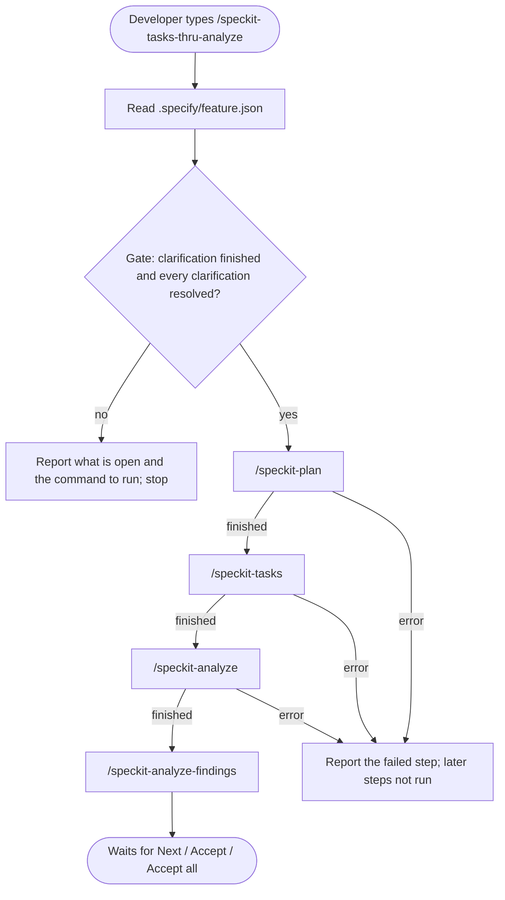
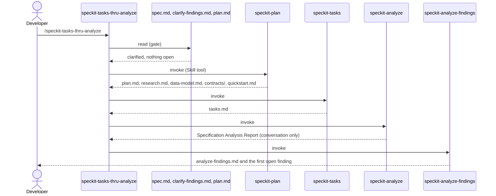
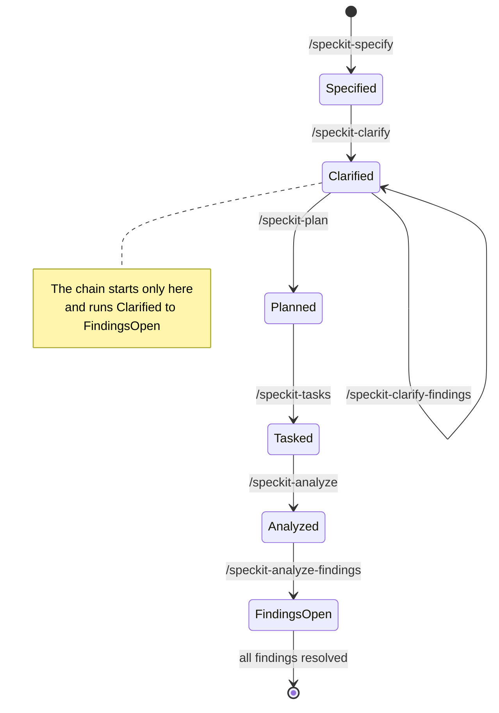
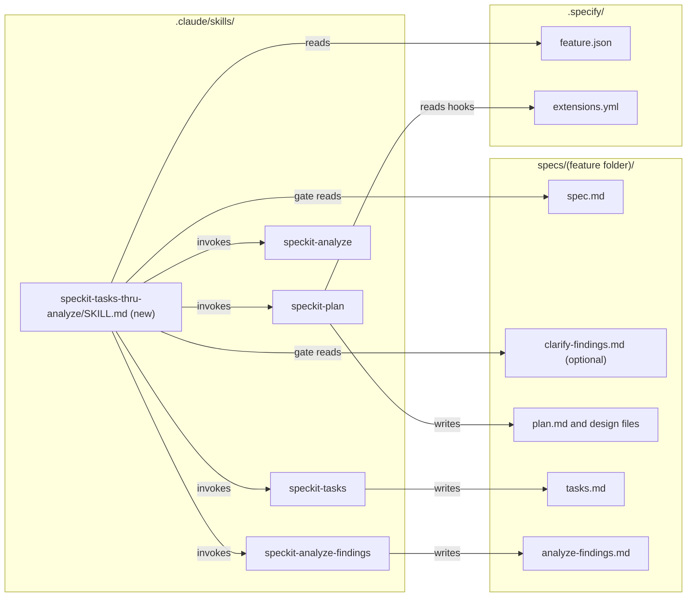

# High Level Requirements

Requirements: `requirements/20261029-171759-plan-analyze-chain/requirements.md`  
External Files: none  
Generated: 2026-10-29 5:17 PM  

Create a skill called /speckit-tasks-thru-analyze

The first thing it will do is check if /speckit-clarify was the most recent skill executed, 
and only proceed if all clarifications have been resolved.  

If that check passes, 
it will then execute the sequence of skills: /speckit-plan, /speckit-tasks, /speckit-analyze, and /speckit-analyze-findings
These are run synchronoulsy, i.e. start one when the previous one finishes

## Additional Requirements and Research Requests

**Instructions To The Developer**  
Enter any additional requirements or research requests under the ## Additional Requirements and Research Requests heading above.  
When you Type or Say: "Next" in the CC CLI terminal, the additional requirements and research requests will be applied to the report.  
  
You may leave these instructions here. They will be ignored when "Next" is executed.  

## 3. Overview and Scope

The feature adds one new skill to `.claude/skills/`, which runs four existing Spec Kit skills one after another for the current feature, after a gate.  
It is a convenience: today the developer types the four commands in turn (or asks for them in one sentence, as was done for feature `20261029-154817-READABLE-FINDING-LAYOUT`).  

- **In scope**:  
  - a new skill folder and `SKILL.md`;  
  - a gate that checks the feature is at the end of clarification, with every clarification resolved;  
  - running `/speckit-plan`, `/speckit-tasks`, `/speckit-analyze` and `/speckit-analyze-findings`, each started only when the one before it has finished.  
- **Out of scope** (assumed):  
  - any change to the four skills it runs, or to `/speckit-clarify`;  
  - any CrowdPoll code, configuration, data or migration change;  
  - running `/speckit-implement` (the chain stops at the findings of `/speckit-analyze`).  

What exists today, which the requirements depend on:  

- Every Spec Kit skill finds the current feature through `.specify/feature.json` (`feature_directory`).  
- No skill records which skill ran last: the `.specify/*.json` files hold only `last_written` hashes, and `.specify/feature.json` only the feature folder.  
- `/speckit-clarify` writes its answers into `spec.md` (`## Clarifications` → `### Session YYYY-MM-DD`); its questions and Completion Report live only in the conversation, unless `/speckit-clarify-findings` captures them into `clarify-findings.md`.  
- `/speckit-plan` keeps an existing `plan.md` (`setup-plan.ps1`: "Plan already exists … skipping template copy") and offers an optional `after_plan` hook (`speckit.agent-context.update`) from `.specify/extensions.yml`.  
- `/speckit-analyze` is read-only and ends by asking "Would you like me to suggest concrete remediation edits for the top N issues?".  
- `/speckit-analyze-findings` captures the report `/speckit-analyze` printed **in this conversation** into `analyze-findings.md`, then waits for "Next", "Accept" or "Accept all".  
- The bundled `.specify/workflows/speckit/workflow.yml` already chains specify → plan → tasks → implement with review gates, through the `specify` CLI's workflow engine, not through Claude Code skills.  

## 4. Architecture Diagrams

### 4.1 The chain (flowchart)

### 4.2 One run, in order (sequence)

### 4.3 Where the feature stands (state)

### 4.4 Files read and written (component)

## 5. Findings

### 5.1 Inconsistencies

**IN1. The skill's name says "tasks thru analyze", but its first step is `/speckit-plan`**  
<b>
✅ Resolved</b>  
✅ Requirements File Updated: 2026-10-29 5:22 PM  
**Notes**: Recommendation accepted by "Accept IN1, A" 2026-10-29: Recommendation A, name it `/speckit-plan-thru-analyze`;  
the requirements' first line now names `/speckit-plan-thru-analyze`, and a Decisions section records the change.  

> The requirements name the skill `/speckit-tasks-thru-analyze`.  
> The sequence they give starts with `/speckit-plan`, so the name leaves out the first of the four steps it runs.  
> A developer looking for "the command that plans" would not find it by name.  

  - **Recommendation A** _(recommended)_: **name it `/speckit-plan-thru-analyze`.**  

    [X] ➡️ **Accepted**

    - <u>Pros</u>: the name says where the chain starts and ends, matching the steps it runs.  
    - <u>Cons</u>: it differs from the name in the requirements as first written.  

  - **Recommendation B**: **keep `/speckit-tasks-thru-analyze`.**  

    [ ] ➡️ **Not Accepted**

    - <u>Pros</u>: no change to the requirements.  
    - <u>Cons</u>: the name hides that the skill plans, and suggests it starts at `/speckit-tasks`.  

  - **Developer Resolution C**:  

    [ ] ➡️ **Not Accepted**

### 5.2 Ambiguities

**AM1. How does the skill know `/speckit-clarify` was "the most recent skill executed"?**  
<b>
✅ Resolved</b>  
✅ Requirements File Updated: 2026-10-29 5:26 PM  
**Notes**: Recommendation accepted in file 2026-10-29: Recommendation A, read it from the feature's files;  
the Decisions section now names the check: a `### Session` under `## Clarifications` in `spec.md`, and no `plan.md` yet.  

> No skill records which skill ran last: `.specify/feature.json` holds only the feature folder, and the other `.specify/*.json` files only file hashes.  
> A new session, or a compacted one, has no memory of earlier commands.  
> `/speckit-clarify-findings`, which the journey lists as an optional step after `/speckit-clarify`, would also break a literal "most recent" rule.  

  - **Recommendation A** _(recommended)_: **read it from the feature's files: `spec.md` has a `## Clarifications` section with at least one `### Session` heading, and `plan.md` does not exist yet.**  

    [X] ➡️ **Accepted**

    - <u>Pros</u>: it works in any session, needs no change to any other skill, and allows `/speckit-clarify-findings` in between;  
      a missing `plan.md` also keeps the chain from running twice over a planned feature.  
    - <u>Cons</u>: a clarify run that asked nothing ("No critical ambiguities detected") writes no session, so it would not pass;  
      re-planning a feature means deleting `plan.md` first.  

  - **Recommendation B**: **require `/speckit-clarify` (or `/speckit-clarify-findings`) to have run earlier in this conversation.**  

    [ ] ➡️ **Not Accepted**

    - <u>Pros</u>: it is the literal reading of the requirement.  
    - <u>Cons</u>: it fails after a new session or a compaction, even when the feature is ready.  

  - **Recommendation C**: **have every Spec Kit skill record its name in a new `.specify/last-skill.json`, and read that.**  

    [ ] ➡️ **Not Accepted**

    - <u>Pros</u>: an exact answer that survives sessions.  
    - <u>Cons</u>: it edits every skill, including the bundled ones that `specify` upgrades may overwrite.  

  - **Developer Resolution D**:  

    [ ] ➡️ **Not Accepted**

**AM2. What counts as "all clarifications have been resolved"?**  
<b>
✅ Resolved</b>  
✅ Requirements File Updated: 2026-10-29 5:26 PM  
**Notes**: Recommendation accepted in file 2026-10-29: Recommendation A, no `[NEEDS CLARIFICATION` marker and no open finding in `clarify-findings.md`;  
the Decisions section now defines "all clarifications have been resolved" this way.  

> Clarification leaves traces in up to three places: `[NEEDS CLARIFICATION]` markers in `spec.md`, the coverage summary of `/speckit-clarify` (Deferred and Outstanding categories, in the conversation only), and the findings in `clarify-findings.md` when `/speckit-clarify-findings` was run.  
> The requirements do not say which of these the gate reads.  

  - **Recommendation A** _(recommended)_: **`spec.md` has no `[NEEDS CLARIFICATION` marker, and, when `clarify-findings.md` exists for the feature, it has no open finding (no finding without its `✅ Resolved` line).**  

    [X] ➡️ **Accepted**

    - <u>Pros</u>: both are in files, so the gate gives the same answer in any session;  
      it honours the optional `/speckit-clarify-findings` step when the developer used it.  
    - <u>Cons</u>: Deferred or Outstanding categories that were never captured into `clarify-findings.md` are not seen.  

  - **Recommendation B**: **as A, and also require `clarify-findings.md` to exist.**  

    [ ] ➡️ **Not Accepted**

    - <u>Pros</u>: every Deferred and Outstanding category is seen and decided before planning.  
    - <u>Cons</u>: it makes the optional `/speckit-clarify-findings` step mandatory.  

  - **Recommendation C**: **only the `[NEEDS CLARIFICATION` markers in `spec.md`.**  

    [ ] ➡️ **Not Accepted**

    - <u>Pros</u>: the simplest check.  
    - <u>Cons</u>: open findings in `clarify-findings.md` would be planned over.  

  - **Developer Resolution D**:  

    [ ] ➡️ **Not Accepted**

### 5.3 Unspecified Aspects

**UA1. What the developer sees when the gate fails**  
<b>
✅ Resolved</b>  
✅ Requirements File Updated: 2026-10-29 5:26 PM  
**Notes**: Recommendation accepted in file 2026-10-29: Recommendation, stop before any step and show what is open and the command to run next;  
the Decisions section now says so.  

> The requirements say the skill proceeds only if the check passes, but not what it does otherwise.  

  - **Recommendation**: **stop before any step runs, change no file, and show which condition failed, what is open (the markers or finding ids), and the command to run next (`/speckit-clarify` or `/speckit-clarify-findings`).**  

    [X] ➡️ **Accepted**

    - The developer can act on the message at once, and nothing is half-planned.  

  - **Developer Resolution B**:  

    [ ] ➡️ **Not Accepted**

**UA2. The questions the four skills ask along the way**  
<b>
✅ Resolved</b>  
✅ Requirements File Updated: 2026-10-29 5:26 PM  
**Notes**: Recommendation accepted in file 2026-10-29: Recommendation A, run straight through;  
the Decisions section now says hooks are listed but not run, the remediation question is not asked, and the chain ends at the first prompt of `/speckit-analyze-findings`.  

> "Start one when the previous one finishes" does not say what "finishes" means for a skill that ends with a question.  
> `/speckit-plan` offers the optional `after_plan` hook (`Execute speckit.agent-context.update?`);  
> `/speckit-analyze` ends by asking whether to suggest remediation edits;  
> `/speckit-analyze-findings` ends waiting for "Next", "Accept" or "Accept all".  

  - **Recommendation A** _(recommended)_: **run straight through: optional hooks are listed but not run, the remediation question of `/speckit-analyze` is not asked (`/speckit-analyze-findings` replaces it), and the chain ends at the first prompt of `/speckit-analyze-findings`.**  

    [X] ➡️ **Accepted**

    - <u>Pros</u>: one command, no stops, which is the point of the skill;  
      the developer resolves the analysis findings as usual afterwards.  
    - <u>Cons</u>: the agent context is not refreshed by the hook (it can be run by hand, and `/speckit-plan` already updates `CLAUDE.md`).  

  - **Recommendation B**: **pause at each question and wait for the developer's answer.**  

    [ ] ➡️ **Not Accepted**

    - <u>Pros</u>: nothing is skipped.  
    - <u>Cons</u>: the developer must stay at the terminal, which the chain is meant to avoid.  

  - **Developer Resolution C**:  

    [ ] ➡️ **Not Accepted**

**UA3. A step that fails part-way**  
<b>
✅ Resolved</b>  
✅ Requirements File Updated: 2026-10-29 5:26 PM  
**Notes**: Recommendation accepted in file 2026-10-29: Recommendation, stop the chain at the failed step;  
the Decisions section now says so.  

> `/speckit-plan` stops with an ERROR on a failed constitution gate or an unresolved clarification;  
> `/speckit-tasks` and `/speckit-analyze` stop when their prerequisites are missing.  
> The requirements do not say whether the chain carries on.  

  - **Recommendation**: **stop the chain at the failed step, run none of the later steps, and report the step, its error, and the steps already finished, so the developer can fix it and run the remaining skills by hand.**  

    [X] ➡️ **Accepted**

    - Each later step needs the files of the one before it, so carrying on would only add errors.  

  - **Developer Resolution B**:  

    [ ] ➡️ **Not Accepted**

**UA4. Arguments**  
<b>
✅ Resolved</b>  
✅ Requirements File Updated: 2026-10-29 5:26 PM  
**Notes**: Recommendation accepted in file 2026-10-29: Recommendation, text after the command goes to `/speckit-plan`;  
the Decisions section now says so.  

> `/speckit-plan` accepts optional guidance after its name; the others take none, or none that the chain needs.  
> The requirements do not say whether the new skill takes any.  

  - **Recommendation**: **any text after the command is passed to `/speckit-plan` as its guidance; nothing is passed to the other three.**  

    [X] ➡️ **Accepted**

    - It keeps what `/speckit-plan` offers today, at no cost when unused.  

  - **Developer Resolution B**:  

    [ ] ➡️ **Not Accepted**

**UA5. How the skill runs the others, and how progress shows**  
<b>
✅ Resolved</b>  
✅ Requirements File Updated: 2026-10-29 5:26 PM  
**Notes**: Recommendation accepted in file 2026-10-29: Recommendation, one `SKILL.md` that invokes each skill with the `Skill` tool and prints a step line;  
the Decisions section now says so, with the folder `.claude/skills/speckit-plan-thru-analyze/`.  

> The requirements do not say how one skill starts another, or what the developer sees between steps.  

  - **Recommendation**: **one `SKILL.md` in `.claude/skills/<name>/`, user-invocable, with the `Skill` tool allowed; it invokes each skill with the `Skill` tool, one at a time, and prints `Step <n> of 4: /<skill>` before each and a one-line result after it.**  

    [X] ➡️ **Accepted**

    - It is the same mechanism Claude Code uses when the developer types each command, so each skill behaves exactly as it does alone;  
      the step lines show where a long run is.  

  - **Developer Resolution B**:  

    [ ] ➡️ **Not Accepted**

### 5.4 "Needs Clarification" Items

**NC1. Should the new skill be listed where the workflow is described?**  
<b>
✅ Resolved</b>  
✅ Requirements File Updated: 2026-10-29 5:26 PM  
**Notes**: Recommendation accepted in file 2026-10-29: Recommendation A, list it in the `/speckit-requirements NEW` journey message and in `CLAUDE.md`;  
the Decisions section now says so.  

> The journey message of `/speckit-requirements NEW` and the Spec Kit Workflow block of `CLAUDE.md` list the skills in order.  
> Neither would mention the new shortcut unless it is added.  

  - **Recommendation A** _(recommended)_: **add it to both, as an alternative to running the four skills one by one.**  

    [X] ➡️ **Accepted**

    - <u>Pros</u>: developers find the shortcut where they read the workflow.  
    - <u>Cons</u>: two more files change, one of them `.claude/skills/speckit-requirements/SKILL.md`.  

  - **Recommendation B**: **add it to neither; the skill list in Claude Code is enough.**  

    [ ] ➡️ **Not Accepted**

    - <u>Pros</u>: the feature touches one new file only.  
    - <u>Cons</u>: the shortcut is easy to miss.  

  - **Developer Resolution C**:  

    [ ] ➡️ **Not Accepted**

## 6. Breaking Changes

None found.  
The skill is new, and the four skills it runs are not changed.  

## 7. Technical Debt

- **No run history.** Spec Kit skills record no "last skill run", so the gate has to infer the feature's stage from its files (see AM1).  
- **The analysis report lives in the conversation.** `/speckit-analyze-findings` captures the report `/speckit-analyze` printed in the conversation;  
  a long chain that triggers a compaction between the two could lose it.  
  Running the two back to back, as the chain does, keeps that window short.  
- **One long turn.** Four skills in one run use a large share of the context window, which makes the compaction above more likely on large features.  

## 8. Requirements Report Complete Report  
  
- **Requirements Report Document:** requirements/20261029-171759-plan-analyze-chain/requirements-report.md  
- **Requirements Document:** requirements/new-20261029-171610/requirements.md → requirements/20261029-171759-plan-analyze-chain/requirements.md  
- **Software Architecture Diagrams:** 4  
- **Inconsistencies:** 1  
- **Ambiguities:** 2  
- **Unspecified Aspects:** 5  
- **Needs Clarifications:** 1  
- **Research Results:** 0  
- **Breaking Changes:** 0  
- **Technical Debt items:** 3  
  
The requirements are ready for /speckit-specify.  
To generate specs from the requirements document, use the `/speckit-specify` skill followed by the path (relative to the project root) to the requirements file.  
At the prompt, Type:  
🟩 👉 /speckit-specify requirements/20261029-171759-plan-analyze-chain/requirements.md  
