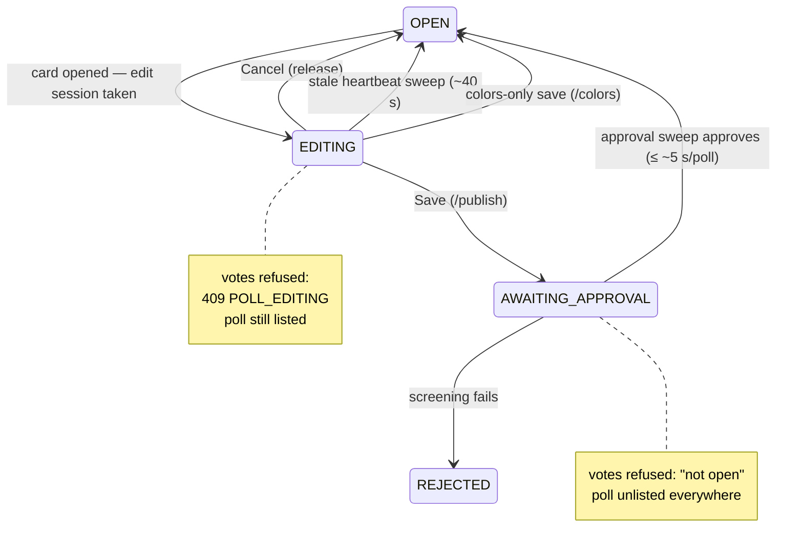
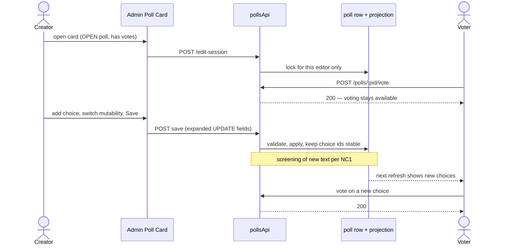
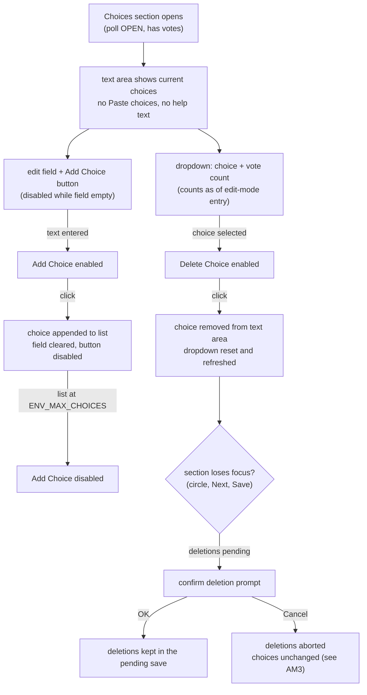
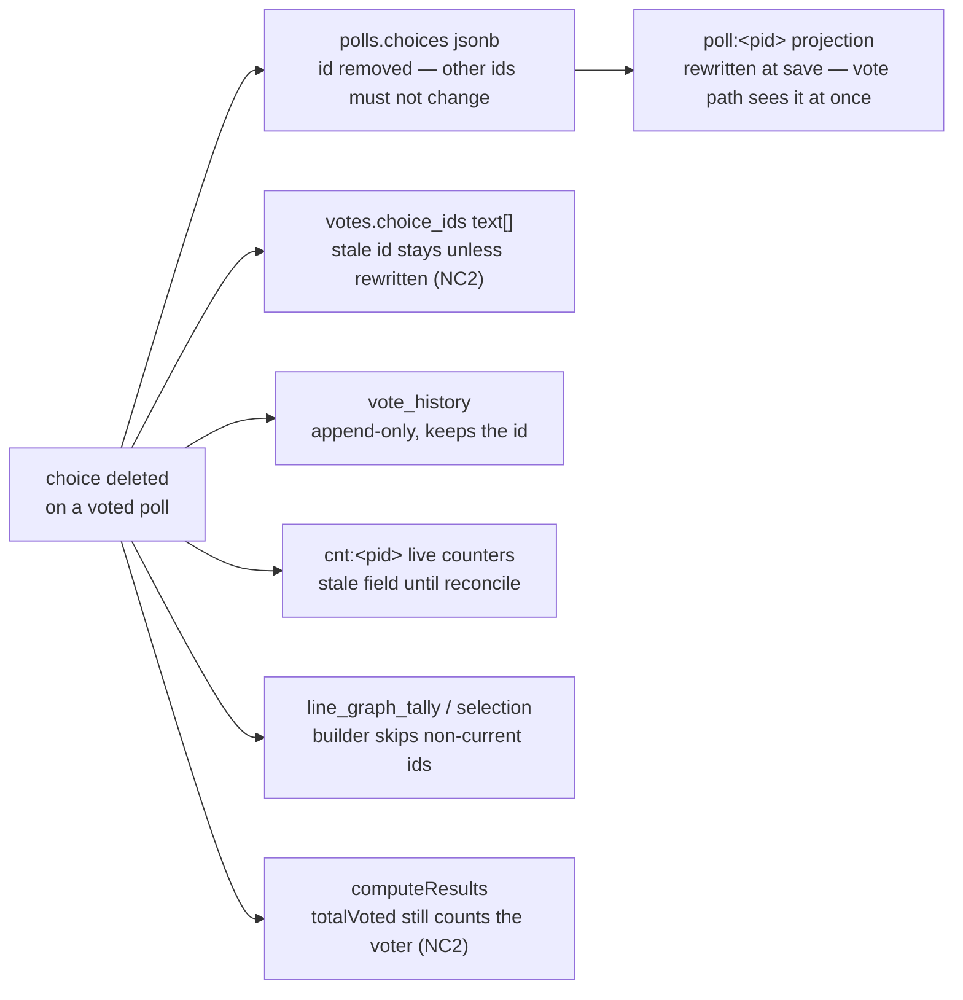

# High Level Requirements

Requirements: `requirements/20261029-225209-editing-poll-available/requirements.md`  
External Files: none  
Generated: 2026-10-29 10:52 PM  

Currently, the Admin Poll Card allows certain Poll settings to be updated when a poll is active, and has received votes.  
These settings include:  
- title  
- subtitle  
- choice colors for bars and lines in graphs
- available of line graph
- end date

However, when the Admin Poll Card is in editing mode, the poll is made unavailable for voting.

One requirement is to make the poll available for voting while the Poll settings are being edited.  
If that isn't possible then the time must be minimized during which the poll is unavailable for voting.  

A second requirement is to allow additional settings to be updated while the poll is active and has received votes.  
When the Admin Poll Card is "Saved" the new settings will take effect. Or as soon as made possible by the current Intervals and Sweeps mechanism.

The additional settings are as follows:

1. Choices can be added while the poll is active and has received votes.  
When the poll is "Open":
the "Choices" section of the Admin Poll Card,   
will not have a "Paste Choices" button, and will not have the help text, "One choice per line. Press Enter after each choice. For emoji press Win + .".  
There will be an "Add Choice" button, on the row where the "Paste Choices" button would have been.  
There will be an edit field to the left of the "Add Choice" button.  
Initially the "Add Choice" button will be disabled until text is entered into the edit field.  
When the "Add Choice" button is clicked, the text from the edit field will be appened to the list of Choices.  
The edit field will then be cleared and the "Add Choice" button will be disabled again until new text is entered.  
If the number of Choices is equal to the maximum allowed, the "add Choice" button will be disabled.  
There will be a "Delete Choice" button below the "Add Choice" row.  
To the left of the "Delete Choice" button will be a dropdown box with a list of existing choices, each with its current vote count (current when the Admin Poll Card went into edit mode).  
The "Delete Choice" button will be disabled until a choice is selected from the dropdown box.  
The "Delete Choice" button will remove the selected choice from the list of Choices shown in the Choices text area, and the dropdown box will be unselected and the choices in it will be updated accordingly.  
When the "Choices" section loses focus, either by clicking the circle for another section, clicking the "Next" button, or clicking the "Save" button,  
the user will be prompted to confirm deletion of choices, if any.  
Clicking "Cancel" will, of course, abort the deletion process and leave the choices unchanged.  

2. If the "Open" poll is a "Private" poll it can be switched between "Invitation Only" and "Anyone with the Link".  
If it was switched away from "Invitation Only" to "Anyone with the Link", the poll will remain accessible to those who have the link, but new invitations will not be required.  
The record of "Invitations" will remain unchanged, showing who was invited while the poll was in "Invitation Only" mode.  
If it was switched from "Anyone with the Link" to "Invitation Only", new invitations will be required for those who wish to access the poll.  
Even if a user has voted, the will no longer have access to the poll unless they receive an invitation.  
This is not an ideal situation, but is the the decision of the poll creator.  
Note: a Private poll cannot be made public while it is active, and a Public poll cannot be made private while it is active.  

3. If a poll is Single Choice, it can be changed to multiple choice once it is open and even if it has received votes.  
But if it is multiple choice, it cannot be changed to single choice once it is open.  

4. The options for Vote Mutability, Dynamic and Final can be switched while the poll is open and even if it has received votes.  
Once again, this isn't ideal, but it is the decision of the poll creator.  

## Additional Requirements and Research Requests

**Instructions To The Developer**  
Enter any additional requirements or research requests under the ## Additional Requirements and Research Requests heading above.  
When you Type or Say: "Next" in the CC CLI terminal, the additional requirements and research requests will be applied to the report.  
  
You may leave these instructions here. They will be ignored when "Next" is executed.  

✅ Applied 2026-10-30 9:16 AM: 1 requirement added to requirements.md (findings IN1, AM4, AM5, UA10); 0 research requests.  

## 3. Overview and Scope

The feature changes what the Admin Poll Card may do to a poll that is OPEN and has received votes, and what that costs voters.  
Today, opening the card on such a poll takes an edit session that moves the poll to `EDITING` (`POST /api/admin/polls/:pid/edit-session`, `src/routes/pollsApi.ts:240`), and the vote endpoint refuses with `409 POLL_EDITING` for as long as the card is open (`validateVoteChoicesAndState`, `src/polls/service.ts:442`).  
Saving anything but colours then goes through `POST /api/admin/polls/:pid/publish`, which sets `AWAITING APPROVAL`: the poll drops out of every listing and refuses votes until the approval sweep (every `ENV_POLL_APPROVAL_SWEEP_INTERVAL`, 5 s) re-opens it.  
Only the colours-only save (`POST /api/admin/polls/:pid/colors`, feature 029) restores `OPEN` at once.

The feature asks for two things:

1. **Voting stays available while the card is open** — or, failing that, the unavailable window is minimized.  
2. **More settings become editable on an OPEN poll with votes**, taking effect at Save (or on the next sweep tick where a sweep governs them):  
   - choices may be **added** (a new Add Choice field and button replacing Paste choices and its help text) and **deleted** (a dropdown of choices with their vote counts, a Delete Choice button, and a confirmation when the section is left);  
   - a Private poll may switch between **Invitation Only** and **Anyone With The Link** (never Private ↔ Public while active);  
   - **Single-Choice → Multiple-Choice** is allowed once open; the reverse is not;  
   - **Vote Mutability** (Dynamic ↔ Final) may be switched.

Today the server freezes `choiceMode`, `voteMutability`, `pollVisibility`, `pollSharingMode`, `voteAnonymity` and `keywords` once a poll has ever been voted on (`validatePollFields`, `src/polls/service.ts:480-667`), and `/publish` in UPDATE mode allows only `title`, `subtitle`, `startAt`, `endAt`, `invitedVoterList`, `bannedVoterList`, `voterCountLimit` and `colors` (`UPDATE_FIELDS`, `src/routes/pollsApi.ts:500`).  
Choice labels are refused outright with votes, and `replaceChoices` reissues every choice id on each save (`src/polls/service.ts:928-964`) — safe only because it never runs on a voted poll.  
Votes, live counters (`cnt:<pid>`), `vote_history` and the line-graph tally are all keyed by those choice ids, so adding and deleting choices on a voted poll needs a path that keeps existing ids stable.

Out of scope (stated or implied by the requirements): making a Private poll Public or a Public poll Private while active; editing choice **labels** of a voted poll; any change to the voting rules themselves.

| Setting (OPEN poll with votes) | Today | Required |
|---|---|---|
| title, subtitle, end date, colors, invitees, bans, voter limit | editable | unchanged |
| line graph availability | not on this branch (separate feature) | premise only — see NC3 |
| add a choice | frozen | editable (Add Choice UI) |
| delete a choice | frozen | editable (Delete Choice UI + confirm) |
| Invitation Only ↔ Anyone With The Link (Private) | frozen | editable |
| Private ↔ Public | frozen | stays frozen |
| Single-Choice → Multiple-Choice | frozen | editable |
| Multiple-Choice → Single-Choice | frozen | stays frozen |
| Vote Mutability (Dynamic ↔ Final) | frozen | editable |
| Voting while the card is open | refused (`409 POLL_EDITING`) | available |

## 4. Architecture Diagrams

### 4.1 Edit lifecycle and vote availability (state)

Today's states around an edit of an OPEN, voted poll.  
The boxes the feature must change are the two in which voting is refused.

### 4.2 A save while voters keep voting (sequence)

The target flow: the voter is never refused, and the saved settings take effect at Save (or after screening, per NC1).

### 4.3 The Choices section on an OPEN poll (flowchart)

### 4.4 What a deleted choice touches (flowchart)

Every store keyed by choice id that a deletion ripples into.

## 5. Findings

### 5.1 Inconsistencies

**IN1. Point 1's Add Choice / Delete Choice controls contradict the Additional Requirement of 2026-10-30.**  
<b>
✅ Resolved</b>  
✅ Requirements File Updated: 2026-10-30 9:20 AM  
**Notes**: Recommendation accepted by "Accept all" 2026-10-30: Recommendation, the Additional Requirement supersedes point 1's UI and the Add/Delete controls are not built;  
a superseded note now sits under point 1 in the requirements document, pointing at the Additional Requirements section.  

> Point 1 specifies that an open poll's Choices section loses the Paste choices button and the help text, and gains an Add Choice field and button and a Delete Choice dropdown with a Delete Choice button.  
> The Additional Requirement of 2026-10-30 says instead that the user "will simply edit the Choices in the same textbox that exists now", with the current and new choices merged when the section loses focus to determine which are added, deleted and unchanged.  
> Both cannot hold: one replaces the choices editor, the other keeps it.  

  - **Recommendation**: **the Additional Requirement supersedes point 1's UI: the Choices step keeps today's textbox, Paste choices button and help text in every state; additions, deletions and unchanged choices are determined by the merge on focus loss, and the Add Choice / Delete Choice controls are not built.**  

    [X] ➡️ **Accepted**

    - The resolution marks point 1's control-by-control description in the requirements document as superseded, so no later phase builds the old UI.  

  - **Developer Resolution B**:  

    [ ] ➡️ **Not Accepted**

### 5.2 Ambiguities

**AM1. Which polls get the new Add Choice / Delete Choice controls?**  
<b>
✅ Resolved</b>  
✅ Requirements File Unchanged (no edit needed): 2026-10-30 10:52 AM  
**Notes**: Developer Resolution C accepted by ticked box 2026-10-30: the requirement for the new Add Choice / Delete Choice controls has been eliminated (superseded by the Additional Requirement, see IN1),  
so the question of which polls get them is moot; the superseded note under point 1 already records this, so no further edit was needed.  

> Point 1 is introduced with "Choices can be added while the poll is active and has received votes", but the UI description that follows is scoped "When the poll is 'Open'".  
> The two conditions differ: an OPEN poll that has never been voted on is in EDIT mode today (`editModeFor`, `src/polls/service.ts:208`), with the full choices text area, the Paste choices button and free editing of every setting.  
> It is unclear whether such a poll keeps that editor or gets the new restricted controls.  

  - **Recommendation A**: **every OPEN poll, votes or not, gets the Add/Delete controls.**  

    [ ] ➡️ **Not Accepted**

    - <u>Pros</u>: matches the literal wording "When the poll is 'Open'"; one rule keyed on poll state.  
    - <u>Cons</u>: removes free text-area editing from open polls with zero votes, which works today and harms no voter;  
      a vote can arrive at any moment anyway, so the state can flip mid-edit.  

  - **Recommendation B** _(recommended)_: **only an OPEN poll that has ever been voted on (UPDATE mode) gets the new controls; an open poll with no votes keeps today's full editor.**  

    [ ] ➡️ **Not Accepted**

    - <u>Pros</u>: reuses the existing EDIT/UPDATE seam (`polls.ever_voted`), so the client and server change in one place each;  
      no ability that exists today is taken away.  
    - <u>Cons</u>: "When the poll is 'Open'" must be read as shorthand for "active and has received votes".  

  - **Developer Resolution C**:  

    [X] ➡️ **Accepted**

    - the requirement for the new controls has been eliminated

**AM2. Do the new "once it is open" freezes bind an open poll with no votes?**  
<b>
✅ Resolved</b>  
✅ Requirements File Updated: 2026-10-30 10:52 AM  
**Notes**: Recommendation B accepted by ticked box 2026-10-30: the freezes stay keyed on "has ever been voted on", exactly as every existing freeze is, and the new wording only loosens what it names;  
the requirements now say so under "Accepted Resolutions (2026-10-30)".  

> Point 3 says a Multiple-Choice poll "cannot be changed to single choice once it is open", and point 2's note says Private ↔ Public cannot change "while it is active".  
> Today those fields are frozen only once the poll has ever been voted on (`validatePollFields`, `src/polls/service.ts:502,531`); an OPEN poll with zero votes may still change them.  
> It is unclear whether the new wording is meant to tighten that to all OPEN polls.  

  - **Recommendation A**: **the freezes apply to every OPEN poll, votes or not.**  

    [ ] ➡️ **Not Accepted**

    - <u>Pros</u>: matches the literal wording;  
      a viewer who already holds the link never sees the poll change shape under them.  
    - <u>Cons</u>: removes an ability open-but-unvoted polls have today, beyond what the feature needs.  

  - **Recommendation B** _(recommended)_: **the freezes stay keyed on "has ever been voted on", exactly as every existing freeze is; the new wording only loosens what it names.**  

    [X] ➡️ **Accepted**

    - <u>Pros</u>: surgical — only the named relaxations change;  
      consistent with AM1's recommended reading, and with the existing `ever_voted` seam.  
    - <u>Cons</u>: "once it is open" in the requirements must be read as "once it has votes".  

  - **Developer Resolution C**:  

    [ ] ➡️ **Not Accepted**

**AM3. What exactly does Cancel on the deletion confirmation abort?**  
<b>
✅ Resolved</b>  
✅ Requirements File Updated: 2026-10-30 10:52 AM  
**Notes**: Recommendation B accepted by ticked box 2026-10-30: Cancel reverts the whole Choices section to the state it had when the card entered edit mode;  
the requirements now say so under "Accepted Resolutions (2026-10-30)".  

> The requirements say the confirmation appears when the Choices section loses focus, and "Clicking 'Cancel' will, of course, abort the deletion process and leave the choices unchanged".  
> "Leave the choices unchanged" can be read two ways: only the pending deletions are undone (added choices stay), or the whole Choices section reverts.  
> It is also unspecified whether the prompt reappears every time focus leaves the section while deletions are still pending.  

  - **Recommendation A** _(recommended)_: **Cancel undoes only the pending deletions; added choices stay; the prompt returns whenever the section is left with deletions pending.**  

    [ ] ➡️ **Not Accepted**

    - <u>Pros</u>: matches "abort the deletion process" literally;  
      additions are harmless and losing them on Cancel would surprise.  
    - <u>Cons</u>: "leave the choices unchanged" then means "unchanged by deletion" only.  

  - **Recommendation B**: **Cancel reverts the whole Choices section to the state it had when the card entered edit mode.**  

    [X] ➡️ **Accepted**

    - <u>Pros</u>: "leave the choices unchanged" is honoured word for word.  
    - <u>Cons</u>: silently discards additions the creator made on purpose.  

  - **Developer Resolution C**:  

    [ ] ➡️ **Not Accepted**

**AM4. How does the choices merge tell an edited line from a deletion plus an addition?**  
<b>
✅ Resolved</b>  
✅ Requirements File Updated: 2026-10-30 10:52 AM  
**Notes**: Recommendation A accepted by ticked box 2026-10-30: the merge matches by exact label after trimming, so a rename is a deletion plus an addition, made visible by the confirmation prompt;  
the requirements now say so under "Accepted Resolutions (2026-10-30)".  

> The Additional Requirement of 2026-10-30 lets the creator edit choices freely in the textbox and derives additions, deletions and unchanged choices from a merge on focus loss.  
> A changed line can be read two ways: a rename of an existing choice, or the deletion of one choice and the addition of another.  
> Choice labels are frozen on a voted poll today, and votes are keyed by choice id, so the reading decides whether that choice's votes survive.  

  - **Recommendation A** _(recommended)_: **match by exact label after trimming: a line equal to a current label keeps that choice and its id; a line matching no current label is an addition; a current label with no matching line is a deletion (with its votes, per NC2); a "rename" is therefore a deletion plus an addition, which the confirmation prompt makes visible.**  

    [X] ➡️ **Accepted**

    - <u>Pros</u>: deterministic, needs no guessing, and the same rule the populate script already uses to match choices;  
      the confirmation prompt gives the creator the chance to catch an accidental "rename".  
    - <u>Cons</u>: fixing a typo in a voted choice's label costs that choice its votes.  

  - **Recommendation B**: **detect a rename by line position (a changed line in an unchanged position) and refuse the save, telling the creator a voted choice's label cannot change and to delete and re-add it instead.**  

    [ ] ➡️ **Not Accepted**

    - <u>Pros</u>: no votes are ever lost to an accidental edit.  
    - <u>Cons</u>: position-based detection misfires when lines are reordered or inserted above, refusing legitimate saves with a confusing message.  

  - **Developer Resolution C**:  

    [ ] ➡️ **Not Accepted**

**AM5. Does every deletion need confirmation, or only deletions of choices with votes?**  
<b>
✅ Resolved</b>  
✅ Requirements File Updated: 2026-10-30 10:52 AM  
**Notes**: Recommendation A accepted by ticked box 2026-10-30: the prompt appears only when at least one deleted choice has votes, naming those choices and their counts, and zero-vote deletions apply without a prompt;  
the requirements now say so under "Accepted Resolutions (2026-10-30)".  

> Point 1 says the user is prompted "to confirm deletion of choices, if any".  
> The Additional Requirement of 2026-10-30 says "the same logic for confirming the deletion of choices that have received votes will be applied", prompting "as necessary".  
> The two wordings differ on whether deleting a choice with zero votes is confirmed.  

  - **Recommendation A** _(recommended)_: **the prompt appears only when at least one deleted choice has votes (per the UA3 snapshot), naming those choices and their counts; zero-vote deletions apply without a prompt.**  

    [X] ➡️ **Accepted**

    - <u>Pros</u>: matches the newer wording, and only interrupts when something irreversible is at stake.  
    - <u>Cons</u>: deleting the wrong zero-vote choice goes unconfirmed (though it is recoverable by re-adding it).  

  - **Recommendation B**: **every deletion is confirmed, with vote counts shown where they exist.**  

    [ ] ➡️ **Not Accepted**

    - <u>Pros</u>: one consistent behaviour, matching point 1's original wording.  
    - <u>Cons</u>: extra prompts for harmless deletions.  

  - **Developer Resolution C**:  

    [ ] ➡️ **Not Accepted**

### 5.3 Unspecified Aspects

**UA1. Choice ids must stay stable on a voted poll.**  
<b>
✅ Resolved</b>  
✅ Requirements File Updated: 2026-10-30 7:51 AM  
**Notes**: Recommendation accepted by "Accept all" 2026-10-30: Recommendation, choices on a voted poll change by id and every surviving choice keeps its id, label and position;  
the requirements now state the choice-identity invariant under "Accepted Resolutions (2026-10-30)".  

> The requirements do not say how added and deleted choices relate to the existing ones in storage.  
> `replaceChoices` reissues every choice id with `randomUUID()` on each save (`src/polls/service.ts:928-964`), which its own comments say is safe only for a never-voted poll;  
> votes (`votes.choice_ids`), live counters (`cnt:<pid>`), `vote_history` and `line_graph_tally` are all keyed by those ids.  
> Reissuing ids on a voted poll would orphan every existing vote.  

  - **Recommendation**: **on a voted poll, choices are changed by id — additions append new ids, deletions remove one id, and every surviving choice keeps its id, label and position, as `applyChoiceColors` already does for colours.**  

    [X] ➡️ **Accepted**

    - The requirements document should state the invariant: an existing choice's identity never changes while a poll has votes;  
      the whole-list `replaceChoices` path stays reserved for polls without votes.  

  - **Developer Resolution B**:  

    [ ] ➡️ **Not Accepted**

**UA2. How voting stays available while the card is open.**  
<b>
✅ Resolved</b>  
✅ Requirements File Updated: 2026-10-30 7:51 AM  
**Notes**: Recommendation accepted by "Accept all" 2026-10-30: Recommendation, keep the edit session for exclusivity and expiry but stop refusing votes while `EDITING` with a stashed `OPEN`;  
the requirements now say so under "Accepted Resolutions (2026-10-30)".  

> The requirements ask that the poll stay votable during editing but do not say what becomes of the edit session.  
> Today the session moves the poll to `EDITING`, and `validateVoteChoicesAndState` refuses votes with `409 POLL_EDITING` (`src/polls/service.ts:442-472`);  
> the poll card then shows "This poll is momentarily unavailable to cast a vote" and hides the vote controls (`src/public/pollCard.js:1100-1160`).  
> The session also gives the editor exclusivity (a second opener gets `LOCKED`) and feeds the stale-heartbeat sweep.  

  - **Recommendation**: **keep the edit session for exclusivity and expiry, but stop refusing votes while a poll is `EDITING` with a stashed state of `OPEN`; the voter-facing "momentarily unavailable" flow disappears for open polls.**  

    [X] ➡️ **Accepted**

    - One editor at a time is still guaranteed, abandoned sessions still expire, and voters vote against the unchanged projection until Save;  
      the only code that changes course is the `POLL_EDITING` refusal and the poll card's editing face.  

  - **Developer Resolution B**:  

    [ ] ➡️ **Not Accepted**

**UA3. Where the Delete dropdown's vote counts come from.**  
<b>
**Notes**: Recommendation accepted by "Accept all" 2026-10-30: Recommendation, the counts are returned once in the edit-session response and held by the card for the session's life;  
the requirements now say so under "Accepted Resolutions (2026-10-30)".  

> The dropdown shows each choice "with its current vote count (current when the Admin Poll Card went into edit mode)", but the source is unspecified.  
> Candidates: the poll row's flushed `choice_counts` (up to one flush interval stale), the live counters `cnt:<pid>`, or `computeResults`.  

  - **Recommendation**: **the server returns the counts once, in the edit-session response, read through the existing results path (`computeResults` over the live counters), and the card holds them for the session's life.**  

    [ ] ➡️ **Not Accepted**

    - One snapshot, taken exactly at edit-mode entry as the requirements say, with no new polling while the card is open.  

  - **Developer Resolution B**:  

    [x] ➡️ **Not Accepted**
    - this finding is outdated, because the requirement for new controls has been removed

**UA4. Colour and position of an added choice.**  
<b>
✅ Resolved</b>  
✅ Requirements File Updated: 2026-10-30 7:51 AM  
**Notes**: Recommendation accepted by "Accept all" 2026-10-30: Recommendation, an added choice is appended at the end with no manual colour (Automatic);  
the requirements now say so under "Accepted Resolutions (2026-10-30)".  

> The requirements do not say what colour an added choice gets or where it sits.  
> Colours are either a manual palette hex on the choice or Automatic by display order (feature 029);  
> position drives the automatic palette index.  

  - **Recommendation**: **an added choice is appended at the end with no manual colour (Automatic), and the Colors step lists it like any other choice for the creator to colour before or after saving.**  

    [X] ➡️ **Accepted**

    - Appending keeps every existing choice's position, so no existing Automatic bar changes colour (the 029 palette-index rule is preserved).  

  - **Developer Resolution B**:  

    [ ] ➡️ **Not Accepted**

**UA5. What the switch to "Invitation Only" does to existing voters' data.**  
<b>
✅ Resolved</b>  
✅ Requirements File Updated: 2026-10-30 7:51 AM  
**Notes**: Recommendation accepted by "Accept all" 2026-10-30: Recommendation, votes stay counted, relations and Participants rows are kept, only access is refused until invited;  
the requirements now say so under "Accepted Resolutions (2026-10-30)".  

> The requirements say a voter without an invitation loses access, but not what happens to their vote, their Participants row, or their tab relations.  
> Today Invitation Only maintains placeholder `votes` rows for invitees (`src/polls/service.ts:615-624`), access runs through `poll_invitations` (`src/polls/access.ts`), and the voter-count limit applies to private polls.  

  - **Recommendation**: **votes already cast stay counted and visible in results; `user_polls` relations and Participants rows are kept; only access (viewing, voting, watching) is refused until the address is invited, at which point everything reconnects by email key.**  

    [X] ➡️ **Accepted**

    - Counts never silently change because of a sharing-mode switch, matching the requirement that the invitation record also stays unchanged in the other direction;  
      the requirements document should state this explicitly.  

  - **Developer Resolution B**:  

    [ ] ➡️ **Not Accepted**

**UA6. What a mode or mutability switch means for votes already cast.**  
<b>
✅ Resolved</b>  
✅ Requirements File Updated: 2026-10-30 7:51 AM  
**Notes**: Recommendation accepted by "Accept all" 2026-10-30: Recommendation, existing votes are kept exactly as cast and the new rules apply only from the save onward;  
the requirements now record the three visible consequences under "Accepted Resolutions (2026-10-30)".  

> Point 3 and 4 allow switching Single → Multiple and Dynamic ↔ Final with votes, but the effect on existing votes and displays is unstated.  
> Single → Multiple changes the percentage base in `computeResults` and the line graph, so bars can sum past 100 % the moment the save lands;  
> Dynamic → Final freezes every existing voter's vote as it stands;  
> Final → Dynamic lets every past voter change their vote from then on.  

  - **Recommendation**: **existing votes are kept exactly as cast; the new rules apply only to votes from the save onward, and the requirements document records the three visible consequences above as accepted.**  

    [X] ➡️ **Accepted**

    - No stored vote is rewritten, so the change is reversible and auditable;  
      this matches the requirements' own "this isn't ideal, but it is the decision of the poll creator".  

  - **Developer Resolution B**:  

    [ ] ➡️ **Not Accepted**

**UA7. When each saved setting takes effect.**  
<b>
✅ Resolved</b>  
✅ Requirements File Updated: 2026-10-30 7:51 AM  
**Notes**: Recommendation accepted by "Accept all" 2026-10-30: Recommendation, record the actual timings — at Save, one date-check sweep for schedules, one invitation sweep for emails, screened text per NC1;  
the requirements now state them under "Accepted Resolutions (2026-10-30)".  

> "When the Admin Poll Card is 'Saved' the new settings will take effect. Or as soon as made possible by the current Intervals and Sweeps mechanism" names no concrete timings.  
> Today every save rewrites the `poll:<pid>` projection in the same transaction, so the vote path sees changes at once;  
> open cards catch up on their next refresh via `contentVersion`;  
> an `endAt` change is enforced by the date-check sweep, up to `ENV_POLL_DATE_CHECK_SWEEP_INTERVAL` (60 s) later;  
> new invitations go out via the invitation sweep (30 s) or at once when the poll is open.  

  - **Recommendation**: **record the actual timings in the requirements: settings and choices take effect at Save (projection rewrite); schedule changes within one date-check sweep; invitation emails within one invitation sweep; screened text per NC1.**  

    [X] ➡️ **Accepted**

    - This turns the vague sentence into testable expectations without changing any sweep.  

  - **Developer Resolution B**:  

    [ ] ➡️ **Not Accepted**

**UA8. A lower bound on Delete Choice is unstated.**  
<b>
✅ Resolved</b>  
✅ Requirements File Updated: 2026-10-30 7:51 AM  
**Notes**: Recommendation accepted by "Accept all" 2026-10-30: Recommendation, Delete Choice is disabled when deleting would leave fewer than `ENV_MIN_CHOICES` choices, enforced on both sides;  
the requirements now say so under "Accepted Resolutions (2026-10-30)".  

> The Add Choice button is specified to disable at the maximum (`ENV_MAX_CHOICES`), but nothing bounds deletion.  
> A published poll must hold at least `ENV_MIN_CHOICES` (default 2) choices; unlimited deletion could take a live poll below it.  

  - **Recommendation**: **the Delete Choice button is disabled when deleting would leave fewer than `ENV_MIN_CHOICES` choices, and the server refuses such a save with the same rule.**  

    [X] ➡️ **Accepted**

    - Mirrors the existing publish bound, enforced on both sides as every other bound is.  

  - **Developer Resolution B**:  

    [ ] ➡️ **Not Accepted**

**UA9. Validation rules for the Add Choice field.**  
<b>
✅ Resolved</b>  
✅ Requirements File Updated: 2026-10-30 7:51 AM  
**Notes**: Recommendation accepted by "Accept all" 2026-10-30: Recommendation, an added label is trimmed, capped at 100 characters and refused as a duplicate of a current label;  
the requirements now say so under "Accepted Resolutions (2026-10-30)".  

> The requirements do not give the added choice's label rules.  
> Today an existing poll's choice labels are capped at 100 characters (`CHOICE_LABEL_MAX`), a new poll's wizard at 40 (`WIZARD_CHOICE_MAX`), paste de-duplicates, and labels are trimmed (`src/public/adminCard.js:441,1261`).  

  - **Recommendation**: **an added label is trimmed, capped at the existing-poll limit of 100 characters, and refused when it duplicates a current choice's label (exact match after trimming); the Add Choice button stays disabled for an invalid value.**  

    [X] ➡️ **Accepted**

    - The same rules the choices editor already applies, so a poll edited both ways stays consistent.  

  - **Developer Resolution B**:  

    [ ] ➡️ **Not Accepted**

**UA10. Diagram 4.3 depicts the superseded Add Choice / Delete Choice controls.**  
<b>
✅ Resolved</b>  
✅ Requirements File Unchanged (no edit needed): 2026-10-30 9:20 AM  
**Notes**: Recommendation accepted by "Accept all" 2026-10-30: Recommendation, the Additional Requirement and findings IN1, AM4 and AM5 are authoritative over diagram 4.3;  
the diagram is redrawn the next time a report is regenerated for these requirements, and nothing in the requirements document needed to change.  

> Section 4.3 draws the Add Choice field and button and the Delete Choice dropdown from point 1.  
> The Additional Requirement of 2026-10-30 replaces that flow with free edits in the existing textbox, merged on focus loss.  
> An appended report never rewrites an existing section or diagram, so the mismatch is recorded here instead.  

  - **Recommendation**: **treat the Additional Requirement (and findings IN1, AM4, AM5) as authoritative over diagram 4.3; the diagram is redrawn the next time /speckit-requirements regenerates a report for these requirements.**  

    [X] ➡️ **Accepted**

    - No change to the requirements document is needed; the stale diagram is a known reading hazard only.  

  - **Developer Resolution B**:  

    [ ] ➡️ **Not Accepted**

### 5.4 "Needs Clarification" Items

**NC1. Must a save on an open, voted poll still pass Acceptability Screening before taking effect — and may the poll stay OPEN meanwhile?**  

> Today every non-colours save of a voted poll sets `AWAITING APPROVAL` (`src/routes/pollsApi.ts:556-563`): the poll is unlisted everywhere and refuses votes until the approval sweep approves it.  
> New choice labels, titles and subtitles are exactly what the screener reads (`src/polls/screening.ts:41-45`), so skipping screening entirely would let unreviewed text onto a live poll.  
> This is the heart of requirement 1 (minimize unavailability), so it needs a decision.  

❌ NOT Resolved

  - **Recommendation A** _(recommended)_: **the poll stays OPEN with its old content; the saved changes are screened in the background and take effect when approved (normally within one approval sweep, ~5 s); a rejection leaves the poll running unchanged and tells the creator.**  

    [x] ➡️ **Accept** (To Accept, you may: mark <b>[X]</b> on this line, save the file, then Type/Say "<b>next</b>" in the CC CLI terminal, OR Type/Say "<b>Accept NC1, A</b>" in CC CLI)

    - <u>Pros</u>: zero voter-visible unavailability; unreviewed text never shows; matches "take effect when Saved, or as soon as made possible by the Sweeps mechanism".  
    - <u>Cons</u>: needs a place to hold the pending (unapproved) changes, a new mechanism;  
      two saves in quick succession need a rule.  

  - **Recommendation B**: **changes apply at Save and the poll stays OPEN; screening runs afterwards, and a failed screening reverts the text and notifies the creator.**  

    [ ] ➡️ **Accept** (To Accept, you may: mark <b>[X]</b> on this line, save the file, then Type/Say "<b>next</b>" in the CC CLI terminal, OR Type/Say "<b>Accept NC1, B</b>" in CC CLI)

    - <u>Pros</u>: simplest data path — the save is one ordinary update; settings that carry no text (mutability, sharing mode) need no screening at all.  
    - <u>Cons</u>: unreviewed text is publicly visible for up to a sweep interval;  
      reverting after votes were cast against new choices is messy.  

  - **Recommendation C**: **keep today's `AWAITING APPROVAL` pause, accepting a short unavailable window as the "minimized" fallback of requirement 1.**  

    [ ] ➡️ **Accept** (To Accept, you may: mark <b>[X]</b> on this line, save the file, then Type/Say "<b>next</b>" in the CC CLI terminal, OR Type/Say "<b>Accept NC1, C</b>" in CC CLI)

    - <u>Pros</u>: no new mechanism.  
    - <u>Cons</u>: the poll vanishes from every tab and refuses votes for seconds per save, and approval re-stamps `launched_at`, pushing an old poll to the top of Newest.  

  - **Developer Resolution D**:  

    [ ] ➡️ **Accept** (To Accept, you may: mark <b>[X]</b> on this line, save the file, then Type/Say "<b>next</b>" in the CC CLI terminal, OR Type/Say "<b>Accept NC1, D</b>" in CC CLI)

    - you may enter your own resolution here  

**NC2. What happens to votes already cast for a deleted choice?**  

> Votes store raw choice ids (`votes.choice_ids`), so after a deletion the stale id either stays in the rows or is rewritten.  
> If it stays: `computeResults` drops the choice but `totalVoted` still counts its voters, so single-choice percentages stop adding to 100;  
> a Final-Vote voter whose only choice was deleted can never vote again;  
> live counters keep the stale field until a reconcile.  
> The populate-test-poll script already deletes votes for a dropped choice, which suggests a precedent.  

❌ NOT Resolved

  - **Recommendation A** _(recommended)_: **the deleted id is removed from every affected vote in the same transaction; a vote left empty counts as not-voted, so that voter (Dynamic or Final) may vote again; counters and the line-graph tally are rebuilt for the poll.**  

    [x] ➡️ **Accept** (To Accept, you may: mark <b>[X]</b> on this line, save the file, then Type/Say "<b>next</b>" in the CC CLI terminal, OR Type/Say "<b>Accept NC2, A</b>" in CC CLI)

    - <u>Pros</u>: percentages stay consistent, nobody is locked out by a choice they can no longer hold, and the confirm-deletion prompt gives the creator fair warning.  
    - <u>Cons</u>: votes are destroyed (history keeps them); the save transaction does more work on a large poll.  

  - **Recommendation B**: **votes keep the stale id; the choice simply stops being displayed and counted, and its voters remain counted in the total.**  

    [ ] ➡️ **Accept** (To Accept, you may: mark <b>[X]</b> on this line, save the file, then Type/Say "<b>next</b>" in the CC CLI terminal, OR Type/Say "<b>Accept NC2, B</b>" in CC CLI)

    - <u>Pros</u>: no stored vote is touched; deletion is trivially cheap and reversible by re-adding the id.  
    - <u>Cons</u>: totals and percentages become silently misleading;  
      Final-Vote voters of the deleted choice are locked out forever.  

  - **Developer Resolution C**:  

    [ ] ➡️ **Accept** (To Accept, you may: mark <b>[X]</b> on this line, save the file, then Type/Say "<b>next</b>" in the CC CLI terminal, OR Type/Say "<b>Accept NC2, C</b>" in CC CLI)

    - you may enter your own resolution here  

**NC3. The premise lists "availability of line graph" as editable today, but that feature is not on this branch.**  

> The requirements' opening list of currently-editable settings includes "available of line graph".  
> No `line_graph_enabled` setting exists in this branch's code or migrations; the line-graph-toggle feature exists only as requirements (`requirements/20261028-114023-line-graph-toggle/`) and was developed in a separate folder.  
> It must be decided whether this feature depends on merging that one first, or simply must not conflict with it.  

❌ NOT Resolved

  - **Recommendation A** _(recommended)_: **treat the line-graph toggle as out of scope: this feature neither implements nor depends on it, and the premise line is corrected to a note that the toggle arrives with its own feature.**  

    [x] ➡️ **Accept** (To Accept, you may: mark <b>[X]</b> on this line, save the file, then Type/Say "<b>next</b>" in the CC CLI terminal, OR Type/Say "<b>Accept NC3, A</b>" in CC CLI)

    - <u>Pros</u>: no cross-branch dependency; the fix-migrations tooling already handles the eventual merge order.  
    - <u>Cons</u>: the "currently editable" list in this document stays aspirational until that merge.  

  - **Recommendation B**: **make merging the line-graph-toggle branch a prerequisite of this feature.**  

    [ ] ➡️ **Accept** (To Accept, you may: mark <b>[X]</b> on this line, save the file, then Type/Say "<b>next</b>" in the CC CLI terminal, OR Type/Say "<b>Accept NC3, B</b>" in CC CLI)

    - <u>Pros</u>: the premise becomes literally true before work starts.  
    - <u>Cons</u>: couples two otherwise independent features and delays this one.  

  - **Developer Resolution C**:  

    [ ] ➡️ **Accept** (To Accept, you may: mark <b>[X]</b> on this line, save the file, then Type/Say "<b>next</b>" in the CC CLI terminal, OR Type/Say "<b>Accept NC3, C</b>" in CC CLI)

    - you may enter your own resolution here  

## 6. Breaking Changes

- **Voting during edits**: the `409 POLL_EDITING` refusal and the poll card's "momentarily unavailable" face disappear for OPEN polls;  
  any client or test relying on them changes behaviour.  
- **Deleted choices** (per NC2's resolution) can remove cast votes from results — a first for CrowdPoll, where votes have only ever been removed by bans and account deletion.  
- **Access loss on sharing-mode switch**: a voter on an Anyone-With-The-Link poll can lose access when it switches to Invitation Only — stated and accepted in the requirements.  
- **API contract**: `/publish` (or a new route) accepts fields in UPDATE mode that it refuses today (`labels`/choice changes, `choiceMode`, `voteMutability`, `pollSharingMode`);  
  `postman/openapi.json` must follow.  
- **Choice-id invariant**: `replaceChoices`'s reissue-all behaviour is no longer the only write path for choices;  
  code that assumes ids change on every save (none known) would break.  

## 7. Technical Debt

- The client's `canChange`/`lockStep` duplicate the server's `validatePollFields` freezes;  
  every relaxation must be made in both places, and they can drift.  
- `polls.ever_voted` is never cleared, even when every vote is deleted, so an emptied poll still edits in UPDATE mode.  
- Stale choice ids linger in the `cnt:<pid>` hash until an operator `reconcile`;  
  `rebuildLineGraphTally` exists but has no admin-path caller — choice deletion will need one or both wired in.  
- The card's review note ("Saving sends your poll to be reviewed again.") already shows for colours-only saves that are not reviewed;  
  the expanded no-review paths widen that inaccuracy unless the note becomes conditional.  
- Approval after `AWAITING APPROVAL` re-stamps `launched_at` (`src/polls/store.ts:671-677`), so any save path that still passes through approval bumps an old poll to the top of Newest.  
