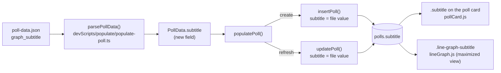
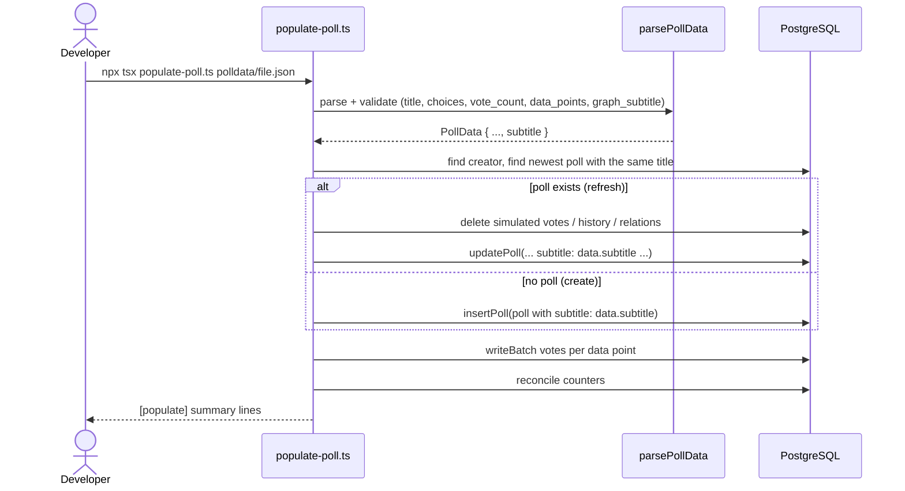
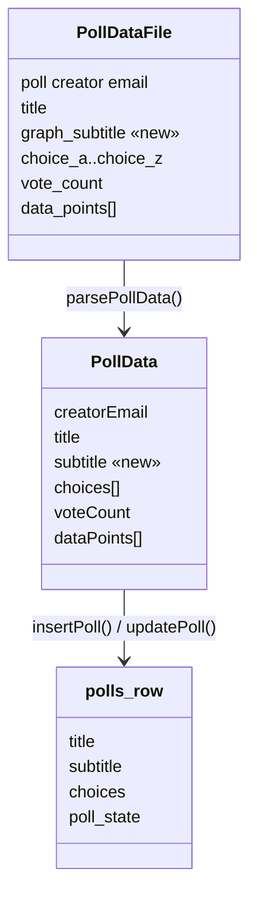
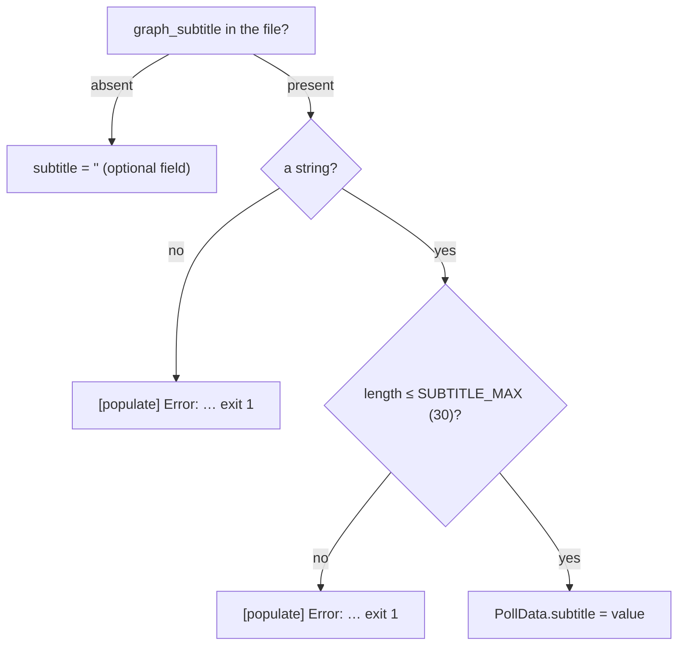

# High Level Requirements

Requirements: `requirements/20261030-123029-populate-graph-subtitle/requirements.md`  
External Files: none  
Generated: 2026-10-30 12:30 PM  

A small change is required for the script "devScripts/populate/populate-poll.ts" to accommodate the new "graph_subtitle" field in the poll data JSON files.

## Additional Requirements and Research Requests

**Instructions To The Developer**  
Enter any additional requirements or research requests under the ## Additional Requirements and Research Requests heading above.  
When you Type or Say: "Next" in the CC CLI terminal, the additional requirements and research requests will be applied to the report.  
  
You may leave these instructions here. They will be ignored when "Next" is executed.  

## 1. Overview and Scope

`devScripts/populate/populate-poll.ts` (feature 20261026-152737-POPULATE-TEST-POLL) creates or refreshes one demonstration poll from a JSON data file and replays its time series as simulated votes.  
The poll data JSON files now carry a `graph_subtitle` field (both files under `polldata/` hold `"graph_subtitle": "Poll for Demonstration Purposes"`).  
Today `parsePollData` does not read the field;  
unknown top-level keys are silently ignored, so the script neither stores nor rejects it.  
The script hard-codes `subtitle: ""` on both the create path (`createDefaultPoll` + `Object.assign`) and the refresh path (`updatePoll`).  

The natural destination for the field is the poll's existing `subtitle` column:  
the poll card renders it under the title (`pollCard.js`, `.subtitle`), and the maximized view's line graph renders it as `.line-graph-subtitle` (`lineGraph.js` line 458), which is currently always blank for populated polls.  

Scope: the developer script and its documentation and tests only.  
No server route, configuration, data-schema or migration change;  
no new dependency.  

## 2. Architecture Diagrams

### 2.1 Data flow — where `graph_subtitle` travels

### 2.2 Script run — create and refresh paths

### 2.3 Field mapping — file key → parsed data → stored column

### 2.4 Validation decision for the new field

## 3. Design Notes

- `parsePollData` gains an optional `graph_subtitle` read, validated like `title` (a string, bounded by `SUBTITLE_MAX` from `src/polls/service.ts`);  
  the parsed value lands on `PollData.subtitle`.  
- Both write paths replace the hard-coded `subtitle: ""` with `data.subtitle`, so a rerun refreshes the subtitle as it refreshes the title and choices.  
- The poll card and the maximized view's line graph display the stored subtitle with no change of their own.  
- `devScripts/populate/README.md`'s key table and `tests/fixtures/populate-poll.json` document and exercise the new key.  

## 4. Breaking Changes

- None.  
  The field is new and the script is a developer tool;  
  an existing data file without `graph_subtitle` keeps working (the poll's subtitle stays empty), and no server code, route, schema or configuration changes.  

## 5. Technical Debt

- The two files under `polldata/` have drifted from the documented input format in more than the new field (see finding NC2);  
  `polldata/` is git-ignored, so the drift is invisible to history and tests.  
- `parsePollData` silently ignores unknown top-level keys, so a misspelled key (e.g. `graph_subtittle`) is dropped without a warning;  
  out of scope here, but worth a future strict-key check.  

## 6. Findings

### 6.1 Inconsistencies

None found.

### 6.2 Ambiguities

**AM1. What does "accommodate the new graph_subtitle field" mean?**  
<b>
✅ Resolved</b>  
✅ Requirements File Updated: 2026-10-30 12:40 PM  
**Notes**: Recommendation accepted in file 2026-10-30: Recommendation A, store it as the poll's `subtitle`, written on create and on refresh;  
the requirements now record it under Resolved Clarifications.  

> The requirement says the script must "accommodate" the field but not what becomes of its value.  
> Today the script ignores unknown top-level keys, so `graph_subtitle` is already tolerated — it is just never stored.  
> The poll's `subtitle` column is the natural destination: the poll card shows it under the title, and the maximized view's line graph already renders a `.line-graph-subtitle` line (`lineGraph.js`), blank today for every populated poll.  

  - **Recommendation A** _(recommended)_: **store it as the poll's `subtitle`, written on create and on refresh.**  

    [X] ➡️ **Accepted**

    - <u>Pros</u>: the value becomes visible exactly where a graph subtitle belongs — under the card title and on the line graph — with no browser change at all.  
    - <u>Cons</u>: the demonstration polls' appearance changes (a subtitle appears where there was none).  

  - **Recommendation B**: **accept the key but ignore its value (validation only).**  

    [ ] ➡️ **Not Accepted**

    - <u>Pros</u>: the smallest possible change;  
      nothing a visitor sees is affected.  
    - <u>Cons</u>: the field would exist in the files for nothing, since the script already ignores unknown keys today — "accommodate" would change no behaviour.  

  - **Developer Resolution C**:  

    [ ] ➡️ **Not Accepted**

### 6.3 Unspecified Aspects

**UA1. Is `graph_subtitle` required or optional in a data file?**  
<b>
✅ Resolved</b>  
✅ Requirements File Updated: 2026-10-30 12:40 PM  
**Notes**: Recommendation accepted in file 2026-10-30: Recommendation, optional — an absent or empty field means an empty subtitle, and existing files keep working;  
the requirements now record it under Resolved Clarifications.  

> The requirement does not say whether a file without the field is still valid.  
> The tests' fixture (`tests/fixtures/populate-poll.json`) and any older data file do not carry it.  

  - **Recommendation**: **optional — an absent or empty field means an empty subtitle, and existing files keep working.**  

    [X] ➡️ **Accepted**

    - This matches how the poll itself treats `subtitle` (it may be empty) and keeps every existing file and the test fixture valid unchanged.  

  - **Developer Resolution B**:  

    [ ] ➡️ **Not Accepted**

**UA2. What happens to the subtitle on a rerun (refresh) of an existing poll?**  
<b>
✅ Resolved</b>  
✅ Requirements File Updated: 2026-10-30 12:40 PM  
**Notes**: Recommendation accepted in file 2026-10-30: Recommendation, a rerun applies the file's value, like the title and choices, and a file without the field clears the subtitle;  
the requirements now record it under Resolved Clarifications.  

> The refresh path calls `updatePoll` with a hard-coded `subtitle: ""` today, so any subtitle would be wiped on every rerun.  
> The requirement does not say whether a rerun applies the file's subtitle, or what a rerun with a file that lacks the field does.  

  - **Recommendation**: **a rerun applies the file's value, like the title and choices;  
    a file without the field clears the subtitle.**  

    [X] ➡️ **Accepted**

    - "The file is the source of truth on every run" is the script's existing rule for every other field (R4 of the populate feature), so the subtitle should follow it;  
      no special case to remember.  

  - **Developer Resolution B**:  

    [ ] ➡️ **Not Accepted**

**UA3. Which documentation and tests cover the new field?**  
<b>
✅ Resolved</b>  
✅ Requirements File Updated: 2026-10-30 12:40 PM  
**Notes**: Recommendation accepted in file 2026-10-30: Recommendation, add `graph_subtitle` to the README key table, to the test fixture, and to the parse/populate tests;  
the requirements now record it under Resolved Clarifications.  

> The input format is documented in the key table of `devScripts/populate/README.md` and exercised by `tests/fixtures/populate-poll.json` and the populate test suite.  
> The requirement names none of them.  

  - **Recommendation**: **add `graph_subtitle` to the README key table, to the test fixture, and to the parse/populate tests (stored on create, applied on refresh, length validation).**  

    [X] ➡️ **Accepted**

    - The README table is the format's only documentation and the fixture is its only executable example;  
      leaving either behind would make the field undiscoverable.  

  - **Developer Resolution B**:  

    [ ] ➡️ **Not Accepted**

### 6.4 Needs Clarifications

**NC1. The files' subtitle value is longer than the poll subtitle limit.**  
<b>
✅ Resolved</b>  
✅ Requirements File Updated: 2026-10-30 12:40 PM  
**Notes**: Recommendation accepted in file 2026-10-30: Recommendation A, the script enforces `SUBTITLE_MAX` like it enforces `TITLE_MAX` — an over-long value is one `[populate] Error:` line and exit 1 — and the two data files' value is shortened;  
the requirements now record it under Resolved Clarifications.  

> `"Poll for Demonstration Purposes"` is 31 characters;  
> `SUBTITLE_MAX` in `src/polls/service.ts` is 30, enforced on every subtitle saved through the admin card.  
> If the script stores the value as the poll's subtitle (AM1 A), it must decide what to do with an over-long value;  
> writing 31 characters directly would create a poll the admin card cannot re-save without shortening it.  

  - **Recommendation A** _(recommended)_: **the script enforces `SUBTITLE_MAX` like it enforces `TITLE_MAX` — an over-long value is one `[populate] Error:` line and exit 1 — and the two data files' value is shortened (e.g. "For Demonstration Purposes", 26 characters).**  

    [X] ➡️ **Accepted**

    - <u>Pros</u>: the populated poll obeys the same limit as every hand-made poll, and the error follows the script's validate-before-any-write rule (C4).  
    - <u>Cons</u>: the current data files fail until their value is shortened (a one-line edit in each, and `polldata/` is git-ignored, so no commit is needed).  

  - **Recommendation B**: **the script truncates an over-long value to 30 characters and notes it in the summary.**  

    [ ] ➡️ **Not Accepted**

    - <u>Pros</u>: the current files run unchanged.  
    - <u>Cons</u>: silent data mangling ("Poll for Demonstration Purpose") contradicts the script's explicit-error style;  
      no other field is truncated.  

  - **Developer Resolution C**:  

    [ ] ➡️ **Not Accepted**

**NC2. The data files diverge from the documented input format in more than `graph_subtitle`.**  
<b>
✅ Resolved</b>  
✅ Requirements File Updated: 2026-10-30 12:40 PM  
**Notes**: Recommendation accepted in file 2026-10-30: Recommendation A, the scope is `graph_subtitle` only, and the data files are brought back to the documented keys, keeping their new `graph_subtitle`;  
the requirements now record it under Resolved Clarifications.  

> The requirement calls `graph_subtitle` "the new field", but both files under `polldata/` differ from the format `parsePollData` and the README define in several more ways:  
> `graph_title` instead of `title`;  
> `label_a`/`label_b` instead of `choice_a`/`choice_b`;  
> data-point keys `a`/`b` instead of the choice keys;  
> and no `poll creator email` and no `vote_count`, which the script requires.  
> As they stand, both files fail on `"poll creator email" is missing or empty` before `graph_subtitle` is even reached.  
> The scope of this feature needs to be decided: the field alone, or the whole new file shape.  

  - **Recommendation A** _(recommended)_: **the scope is `graph_subtitle` only;  
    the data files are brought back to the documented keys (`title`, `choice_a`/`choice_b`, choice-keyed data points, plus `poll creator email` and `vote_count`), keeping their new `graph_subtitle`.**  

    [X] ➡️ **Accepted**

    - <u>Pros</u>: it matches the requirement's "small change", keeps one documented format, and `poll creator email` and `vote_count` have to come from somewhere in any case — the files cannot run without them.  
    - <u>Cons</u>: the two data files must be edited by hand (they are git-ignored, so only the local copies).  

  - **Recommendation B**: **the script accepts the new shape too: `graph_title` as the title, `label_<x>` as the choice labels, bare `<x>` data-point keys — with `poll creator email` and `vote_count` still required in the file.**  

    [ ] ➡️ **Not Accepted**

    - <u>Pros</u>: files exported in the new shape run with only two keys added by hand.  
    - <u>Cons</u>: two input formats to document, validate and test is well beyond "a small change", and the format fork would live in every future edit of the script.  

  - **Developer Resolution C**:  

    [ ] ➡️ **Not Accepted**

## 7. Requirements Report Complete Report  
  
- **Requirements Report Document:** requirements/20261030-123029-populate-graph-subtitle/requirements-report.md  
- **Requirements Document:** requirements/20261030-123029-populate-graph-subtitle/requirements.md  
- **Software Architecture Diagrams:** 4  
- **Inconsistencies:** 0  
- **Ambiguities:** 1  
- **Unspecified Aspects:** 3  
- **Needs Clarifications:** 2  
- **Research Results:** 0  
- **Breaking Changes:** 0  
- **Technical Debt items:** 2  
  
The requirements are ready for /speckit-specify.
To generate specs from the requirements document, use the `/speckit-specify` skill followed by the path (relative to the project root) to the requirements file.
At the prompt, Type:  
🟩 👉 /speckit-specify requirements/20261030-123029-populate-graph-subtitle/requirements.md  

