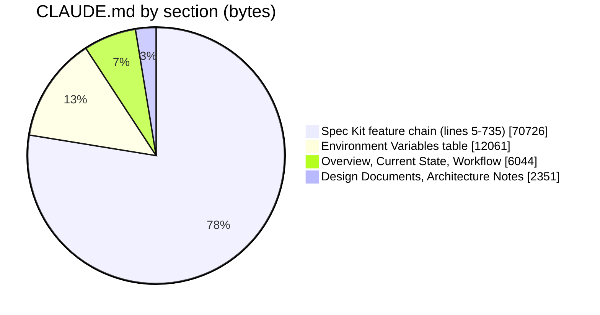
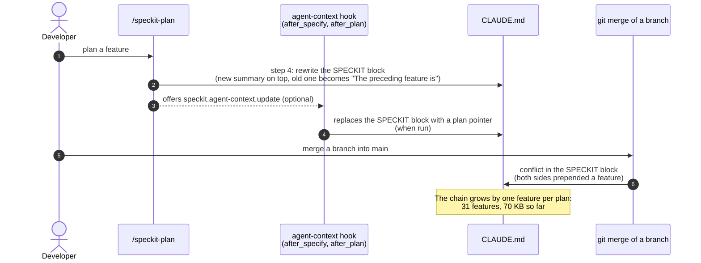

# High Level Requirements

Requirements: `requirements/20261101-042151-concise-claude-md/requirements.md`  
External Files: none  
Generated: 2026-11-01 4:21 AM  

In CC CLI, when we run /usage, we see a suggestion:
```
  37%  Trim C:\crowdPoll\editing-poll-available\CLAUDE.md · 21k tokens per request
```

Please make suggestions for reducing the size of CLAUDE.md.  

Currently, CLAUDE,md give a complete description of how the Crowdpoll webapp works internally, as well as the various features and functionalities it provides.  

We could like to maintain that complete version in a file called CLAUDE_COMPLETE.md, that is to be used by developers.   

Then we would like CLAUDE.md to be a consise version that is sent with almost every request sent to the AI model.  
REducing the token count is important to improve performance and efficiency when interacting with the AI model, as well as reduce costs associated with token usage.  
The concise version should focus on the key aspects of the Crowdpoll webapp, including its main features, core functionalities, and essential internal workings, while omitting detailed explanations and less critical information.  

## Additional Requirements and Research Requests

**Instructions To The Developer**  
Enter any additional requirements or research requests under the ## Additional Requirements and Research Requests heading above.  
When you Type or Say: "Next" in the CC CLI terminal, the additional requirements and research requests will be applied to the report.  
  
You may leave these instructions here. They will be ignored when "Next" is executed.  

## 1. Overview and Scope

The feature splits the project's instruction file in two:

- **`CLAUDE_COMPLETE.md`** — the full description that `CLAUDE.md` holds today, kept for developers and opened by the AI only when a task needs it.
- **`CLAUDE.md`** — a concise version, loaded into every request, holding only what most tasks need.

In scope:

- creating `CLAUDE_COMPLETE.md` from today's `CLAUDE.md`;
- rewriting `CLAUDE.md` as the concise version;
- changing whatever writes to `CLAUDE.md` today (the Spec Kit plan step and its agent-context hooks), so the concise file does not grow back.

Out of scope: any CrowdPoll code, configuration, data or migration change.  
The suggestions this report makes are in section 5, *Proposed Structure*, and in the findings.

## 2. Where the Tokens Go Today

Measured on `main` (2026-11-01): `CLAUDE.md` is **907 lines, 91,300 bytes**, about **21,000 tokens** per request (the `/usage` figure; about 4.3 bytes per token).  
The Claude Code documentation recommends **under 200 lines** per `CLAUDE.md` (RS1).



| Section | Lines | Bytes | Share | What it is |
|---|---|---|---|---|
| `<!-- SPECKIT START -->` … `<!-- SPECKIT END -->` | 731 | 70,726 | 78% | The current plan's summary, then 31 earlier features chained by "The preceding feature is …", each with its "Decisions that are easy to get wrong" |
| Environment Variables | 84 | 12,061 | 13% | One table row per `ENV_*` setting, duplicating `src/config.ts` and the launch templates |
| Project Overview, Current State, Spec Kit Workflow | 72 | 6,044 | 7% | Stack, layout, commands, the skill order |
| Key Design Documents, Architecture Notes | 15 | 2,351 | 3% | Where requirements live; auth phases, cookie banner, API contract |

The feature chain is the problem: it grows by about 2–3 KB with every feature planned, and most of it describes features finished weeks ago, already recorded in their own `specs/<feature>/plan.md`.

## 3. How Claude Code Loads Instruction Files

```mermaid
flowchart LR
    subgraph EVERY["Loaded into every request"]
        CM["CLAUDE.md<br/>(project root)"]
        CL["CLAUDE.local.md<br/>(if present)"]
        MEM["Auto memory MEMORY.md<br/>(first 200 lines / 25 KB)"]
        IMP["Any file CLAUDE.md @imports"]
        RU["Unscoped .claude/rules/*.md"]
    end
    subgraph DEMAND["Loaded only when matching files are touched"]
        SUB["CLAUDE.md in a subdirectory"]
        PR[".claude/rules/*.md with paths:"]
    end
    subgraph NEVER["Never loaded automatically"]
        CC["CLAUDE_COMPLETE.md<br/>(named in backticks, not imported)"]
        PL["specs/*/plan.md, README.md,<br/>ARCHITECTURE.md"]
    end
    CM -- "@path import" --> IMP
    CM -. "`CLAUDE_COMPLETE.md` mentioned in backticks:<br/>read with the Read tool when a task needs it" .-> CC
```

- Everything in the first box costs tokens on every request.
- An `@CLAUDE_COMPLETE.md` import would put the whole file back in the first box and save nothing (RS1);
  the concise file must name it in backticks instead.
- Subdirectory `CLAUDE.md` files and path-scoped rules cost tokens only when a task touches their files (RS1).

## 4. Who Writes CLAUDE.md



- `/speckit-plan` step 4 (`.claude/skills/speckit-plan/SKILL.md:158`) is what grew the chain: each plan wrote its summary and pushed the previous one down.
- The agent-context extension (`.specify/extensions/agent-context/`) can also rewrite the block, from its `after_specify` and `after_plan` hooks, which are optional and prompt first.
- Every branch merge so far has conflicted in this block (the `editing-poll-available` merge did on 2026-11-01).

## 5. Proposed Structure

```mermaid
flowchart TB
    subgraph Root["Repository root"]
        CM["CLAUDE.md — concise<br/>≤ 200 lines, ≈ 4k tokens"]
        CC["CLAUDE_COMPLETE.md — complete<br/>today's CLAUDE.md, kept up to date"]
    end
    subgraph Specs["specs/ and requirements/"]
        P["specs/&lt;feature&gt;/plan.md<br/>research, contracts, quickstart"]
    end
    CM -- "names in backticks" --> CC
    CM -- "points to the current plan" --> P
    CC -- "chain of every feature's<br/>easy-to-get-wrong decisions" --> P
    PlanSkill["/speckit-plan step 4"] -- "current-plan pointer<br/>+ current feature's decisions" --> CM
    PlanSkill -- "full summary, prepended to the chain" --> CC
```



Suggested outline of the concise `CLAUDE.md` (sizes are targets):

| # | Section | Lines | Content |
|---|---|---|---|
| 1 | Header | 3 | What the file is, and that `CLAUDE_COMPLETE.md` (in backticks) holds the full description, every earlier feature's decisions and the full settings table |
| 2 | SPECKIT block | ≤ 20 | The current plan's path and its "Decisions that are easy to get wrong" (NC1); no chain |
| 3 | Project Overview | ≤ 10 | Stack, purpose, sign-in modes, deployment target, with `README.md` and `ARCHITECTURE.md` named |
| 4 | Layout | ≤ 20 | Today's *Current State* bullets, trimmed |
| 5 | Commands | ≤ 15 | Today's command block |
| 6 | Spec Kit Workflow | ≤ 15 | The skill order, PowerShell variant |
| 7 | Configuration rules | ≤ 8 | `ENV_*` only, validated once by `loadConfig`; intervals in ms except the minutes setting; templates git-ignored; production secrets set in the console; the full table in `CLAUDE_COMPLETE.md` and `src/config.ts` (UA4) |
| 8 | Cross-feature invariants | ≤ 30 | The decisions that still bind new work, condensed from the chain (UA2) |
| 9 | Architecture notes | ≤ 10 | Cookie policy and the Cookie Use test, `postman/openapi.json` in sync, auth-phase constraint |

The suggestions, in the order of the tokens they save:

1. **Move the feature chain to `CLAUDE_COMPLETE.md`** — about 67 KB (≈ 15k tokens) of the 70 KB block.
2. **Move the Environment Variables table** — about 11 KB (≈ 2.5k tokens), keeping eight lines of rules.
3. **Trim the overview and layout prose** — about 2 KB.
4. **Stop the regrowth** by changing `/speckit-plan` step 4 (UA3).
5. **Never `@import` the complete file** (RS1).

## 6. Assumptions

- Token figures are estimated at about 4.3 bytes per token, from the `/usage` figure for today's file.
- `CLAUDE_COMPLETE.md` lives at the repository root, beside `CLAUDE.md`, and is committed.
- The feature changes only Markdown files and Spec Kit skill files; no CrowdPoll code, test of the app, configuration or migration changes.
- Each branch folder under `C:\crowdPoll\` has its own copy of `CLAUDE.md`; the change is made on `main` and reaches a branch when that branch merges `main` (UA5).

## 7. Research Results

### How Claude Code loads instruction files

**RS1. Which instruction files cost tokens on every request, and which only on demand?**  

> The requirements ask how to cut the per-request cost of `CLAUDE.md` while keeping a complete version available.  
> Source: [Claude Code — How Claude remembers your project](https://code.claude.com/docs/en/memory).  
> `CLAUDE.md` and `CLAUDE.local.md` in the working directory and above it are loaded at launch, into every session.  
> The documentation's size guidance: "target under 200 lines per CLAUDE.md file. Longer files consume more context and reduce adherence."  
> `@path` imports "help you organize a long file but don't reduce its context cost, because imported files load together with the CLAUDE.md that imports them";  
> a path written in backticks is not imported.  
> `CLAUDE.md` files in subdirectories, and `.claude/rules/*.md` files with a `paths:` field, load only when Claude reads or edits a matching file.  

❌ NOT Resolved

  - **Recommendation**: **record these loading rules as constraints: the concise `CLAUDE.md` stays under 200 lines and names `CLAUDE_COMPLETE.md` only in backticks, never as an `@` import.**  

    [ ] ➡️ **Accept** (To Accept, you may: mark <b>[X]</b> on this line, save the file, then Type/Say "<b>next</b>" in the CC CLI terminal, OR Type/Say "<b>Accept RS1</b>" in CC CLI)

    - An import would load the complete file on every request and undo the feature.  
    - Path-scoped rules are available if a later need arises (see UA4, option B).  


  - **Developer Resolution B**:  

    [ ] ➡️ **Accept** (To Accept, you may: mark <b>[X]</b> on this line, save the file, then Type/Say "<b>next</b>" in the CC CLI terminal, OR Type/Say "<b>Accept RS1, B</b>" in CC CLI)

    - you may enter your own resolution here  

## 8. Findings

### Inconsistencies

None found.

### Ambiguities

**AM1. Is `CLAUDE_COMPLETE.md` kept up to date, or a one-time snapshot?**  

> The requirements say "maintain that complete version" in `CLAUDE_COMPLETE.md`.  
> "Maintain" can mean keeping it current as features are added, or keeping today's text as an archive.  
> Today the only writer of the long content is `/speckit-plan` step 4 (section 4).  

❌ NOT Resolved

  - **Recommendation A** _(recommended)_: **kept up to date: every later plan prepends its full summary to the chain in `CLAUDE_COMPLETE.md`, as it does in `CLAUDE.md` today.**  

    [ ] ➡️ **Accept** (To Accept, you may: mark <b>[X]</b> on this line, save the file, then Type/Say "<b>next</b>" in the CC CLI terminal, OR Type/Say "<b>Accept AM1, A</b>" in CC CLI)

    - <u>Pros</u>: the complete file stays complete, and developers keep one place to read every feature's decisions.  
    - <u>Cons</u>: `/speckit-plan` must write to two files (UA3).  


  - **Recommendation B**: **a snapshot: `CLAUDE_COMPLETE.md` is today's `CLAUDE.md`, frozen; later features are documented only in their own `specs/<feature>/`.**  

    [ ] ➡️ **Accept** (To Accept, you may: mark <b>[X]</b> on this line, save the file, then Type/Say "<b>next</b>" in the CC CLI terminal, OR Type/Say "<b>Accept AM1, B</b>" in CC CLI)

    - <u>Pros</u>: no skill change beyond trimming what `CLAUDE.md` receives.  
    - <u>Cons</u>: the file goes stale with the first new feature, and its name promises "complete".  


  - **Developer Resolution C**:  

    [ ] ➡️ **Accept** (To Accept, you may: mark <b>[X]</b> on this line, save the file, then Type/Say "<b>next</b>" in the CC CLI terminal, OR Type/Say "<b>Accept AM1, C</b>" in CC CLI)

    - you may enter your own resolution here  

**AM2. Does the AI ever read `CLAUDE_COMPLETE.md`, or is it for developers only?**  

> The requirements say the complete version "is to be used by developers".  
> Yet much of what it holds (an earlier feature's decisions, a setting's default) is exactly what the AI needs when a task touches that area.  

❌ NOT Resolved

  - **Recommendation A** _(recommended)_: **both: the concise `CLAUDE.md` tells the AI to open `CLAUDE_COMPLETE.md` (named in backticks) when a task touches an earlier feature's area or a setting.**  

    [ ] ➡️ **Accept** (To Accept, you may: mark <b>[X]</b> on this line, save the file, then Type/Say "<b>next</b>" in the CC CLI terminal, OR Type/Say "<b>Accept AM2, A</b>" in CC CLI)

    - <u>Pros</u>: the knowledge stays reachable at no per-request cost;  
      a read costs tokens only in the sessions that need it.  
    - <u>Cons</u>: the AI must judge when to open it, and may sometimes not.  


  - **Recommendation B**: **developers only: `CLAUDE.md` does not mention `CLAUDE_COMPLETE.md`.**  

    [ ] ➡️ **Accept** (To Accept, you may: mark <b>[X]</b> on this line, save the file, then Type/Say "<b>next</b>" in the CC CLI terminal, OR Type/Say "<b>Accept AM2, B</b>" in CC CLI)

    - <u>Pros</u>: matches the requirement's wording literally.  
    - <u>Cons</u>: the AI loses the earlier features' decisions unless it happens to read their `plan.md`.  


  - **Developer Resolution C**:  

    [ ] ➡️ **Accept** (To Accept, you may: mark <b>[X]</b> on this line, save the file, then Type/Say "<b>next</b>" in the CC CLI terminal, OR Type/Say "<b>Accept AM2, C</b>" in CC CLI)

    - you may enter your own resolution here  

### Unspecified Aspects

**UA1. How small must the concise `CLAUDE.md` be?**  

> The requirements ask for a "concise version" but give no size, so success cannot be tested.  
> Today's file is 907 lines and about 21k tokens;  
> the documentation recommends under 200 lines (RS1).  

❌ NOT Resolved

  - **Recommendation**: **at most 200 lines and 16 KB (about 4k tokens, an 80% cut), checked by a test that fails when `CLAUDE.md` exceeds either limit.**  

    [ ] ➡️ **Accept** (To Accept, you may: mark <b>[X]</b> on this line, save the file, then Type/Say "<b>next</b>" in the CC CLI terminal, OR Type/Say "<b>Accept UA1</b>" in CC CLI)

    - The limit makes the requirement testable, and the test stops the file creeping back up feature by feature.  
    - The section 5 outline fits in about 150 lines.  


  - **Developer Resolution B**:  

    [ ] ➡️ **Accept** (To Accept, you may: mark <b>[X]</b> on this line, save the file, then Type/Say "<b>next</b>" in the CC CLI terminal, OR Type/Say "<b>Accept UA1, B</b>" in CC CLI)

    - you may enter your own resolution here  

**UA2. Which content stays in the concise `CLAUDE.md`?**  

> "Key aspects … main features, core functionalities, and essential internal workings" leaves the selection open.  
> The chain mixes decisions that bind any new work (vote counters are never written to a poll row per vote;  
> every `vote_history` writer keeps the line-graph tally;  
> a new cookie needs a Cookie Use row) with details of one finished feature.  

❌ NOT Resolved

  - **Recommendation**: **keep the section 5 outline; its "Cross-feature invariants" section holds only rules a change elsewhere could break, at most 30 one-line bullets, each naming the file or test that enforces it.**  

    [ ] ➡️ **Accept** (To Accept, you may: mark <b>[X]</b> on this line, save the file, then Type/Say "<b>next</b>" in the CC CLI terminal, OR Type/Say "<b>Accept UA2</b>" in CC CLI)

    - The test for a bullet: "would a task in another area break this without knowing it?"  
      If not, it stays in `CLAUDE_COMPLETE.md` only.  
    - *Current State*'s "Every feature in the Spec Kit block above is implemented" is reworded, since the block no longer lists them.  


  - **Developer Resolution B**:  

    [ ] ➡️ **Accept** (To Accept, you may: mark <b>[X]</b> on this line, save the file, then Type/Say "<b>next</b>" in the CC CLI terminal, OR Type/Say "<b>Accept UA2, B</b>" in CC CLI)

    - you may enter your own resolution here  

**UA3. How does the next `/speckit-plan` avoid regrowing `CLAUDE.md`?**  

> `/speckit-plan` step 4 rewrites the SPECKIT block of `CLAUDE.md` with each plan, pushing the previous summary down the chain (section 4).  
> Unchanged, it rebuilds the chain in the concise file at 2–3 KB per feature.  
> The agent-context extension's hooks also write the block, from `context_file: CLAUDE.md` in its config.  

❌ NOT Resolved

  - **Recommendation A** _(recommended)_: **change step 4 of `.claude/skills/speckit-plan/SKILL.md`: prepend the full summary to the chain in `CLAUDE_COMPLETE.md`, and replace the SPECKIT block of `CLAUDE.md` with the current plan's path and its decisions only, moving the previous feature's decisions to `CLAUDE_COMPLETE.md`.**  

    [ ] ➡️ **Accept** (To Accept, you may: mark <b>[X]</b> on this line, save the file, then Type/Say "<b>next</b>" in the CC CLI terminal, OR Type/Say "<b>Accept UA3, A</b>" in CC CLI)

    - <u>Pros</u>: the concise block stays one feature long;  
      the complete file stays complete (AM1 A);  
      the agent-context hooks keep working, since they only rewrite the block's pointer.  
    - <u>Cons</u>: a local edit to a Spec Kit skill, to be kept if Spec Kit is upgraded.  


  - **Recommendation B**: **point the agent-context extension at `CLAUDE_COMPLETE.md` (`context_file`) and have step 4 write only there; `CLAUDE.md` gets no SPECKIT block.**  

    [ ] ➡️ **Accept** (To Accept, you may: mark <b>[X]</b> on this line, save the file, then Type/Say "<b>next</b>" in the CC CLI terminal, OR Type/Say "<b>Accept UA3, B</b>" in CC CLI)

    - <u>Pros</u>: the concise file is never written by a skill.  
    - <u>Cons</u>: the AI no longer sees which feature is current, or its decisions, without opening another file.  


  - **Developer Resolution C**:  

    [ ] ➡️ **Accept** (To Accept, you may: mark <b>[X]</b> on this line, save the file, then Type/Say "<b>next</b>" in the CC CLI terminal, OR Type/Say "<b>Accept UA3, C</b>" in CC CLI)

    - you may enter your own resolution here  

**UA4. Where does the Environment Variables table go?**  

> The table is 84 lines and 12 KB, 13% of the file, and duplicates `src/config.ts`.  
> The requirements do not say whether settings count as "essential internal workings".  

❌ NOT Resolved

  - **Recommendation A** _(recommended)_: **`CLAUDE_COMPLETE.md` only; the concise file keeps the eight-line *Configuration rules* section (section 5, row 7) naming where the full table is.**  

    [ ] ➡️ **Accept** (To Accept, you may: mark <b>[X]</b> on this line, save the file, then Type/Say "<b>next</b>" in the CC CLI terminal, OR Type/Say "<b>Accept UA4, A</b>" in CC CLI)

    - <u>Pros</u>: two files, as the requirements describe;  
      `src/config.ts` is the source of truth the AI reads when it changes a setting anyway.  
    - <u>Cons</u>: a task about a setting needs one extra read.  


  - **Recommendation B**: **a path-scoped rule, `.claude/rules/environment.md`, with `paths:` covering `src/config.ts`, `.do/app.yaml`, `launch.json.example`, `devScripts.example/**` and `tests/config.test.ts`, loaded only when those files are touched (RS1).**  

    [ ] ➡️ **Accept** (To Accept, you may: mark <b>[X]</b> on this line, save the file, then Type/Say "<b>next</b>" in the CC CLI terminal, OR Type/Say "<b>Accept UA4, B</b>" in CC CLI)

    - <u>Pros</u>: the table appears exactly when configuration work starts, at no other cost.  
    - <u>Cons</u>: a third instruction file to keep in step, beyond what the requirements name.  


  - **Recommendation C**: **keep the table in the concise `CLAUDE.md`.**  

    [ ] ➡️ **Accept** (To Accept, you may: mark <b>[X]</b> on this line, save the file, then Type/Say "<b>next</b>" in the CC CLI terminal, OR Type/Say "<b>Accept UA4, C</b>" in CC CLI)

    - <u>Pros</u>: no lookup for settings.  
    - <u>Cons</u>: 84 of the 200 lines (UA1) go to one table.  


  - **Developer Resolution D**:  

    [ ] ➡️ **Accept** (To Accept, you may: mark <b>[X]</b> on this line, save the file, then Type/Say "<b>next</b>" in the CC CLI terminal, OR Type/Say "<b>Accept UA4, D</b>" in CC CLI)

    - you may enter your own resolution here  

**UA5. How do the other branch folders get the concise file?**  

> The `/usage` warning names `C:\crowdPoll\editing-poll-available\CLAUDE.md`, a branch folder;  
> each folder under `C:\crowdPoll\` has its own copy.  
> A branch planned before this feature merges with its own feature prepended to the old, long block, which will conflict with the new files.  

❌ NOT Resolved

  - **Recommendation**: **make the change on `main` only; each branch folder gets it by merging `main`, resolving the conflict by keeping the concise `CLAUDE.md` and moving the branch's own feature summary into `CLAUDE_COMPLETE.md`'s chain, as UA3 does for new plans.**  

    [ ] ➡️ **Accept** (To Accept, you may: mark <b>[X]</b> on this line, save the file, then Type/Say "<b>next</b>" in the CC CLI terminal, OR Type/Say "<b>Accept UA5</b>" in CC CLI)

    - It follows the existing merge practice, and the quickstart can carry the one-paragraph conflict recipe.  


  - **Developer Resolution B**:  

    [ ] ➡️ **Accept** (To Accept, you may: mark <b>[X]</b> on this line, save the file, then Type/Say "<b>next</b>" in the CC CLI terminal, OR Type/Say "<b>Accept UA5, B</b>" in CC CLI)

    - you may enter your own resolution here  

### Needs Clarifications

**NC1. Does the current feature's "Decisions that are easy to get wrong" stay in the concise `CLAUDE.md`?**  

> While a feature is being implemented and tweaked, its decisions are what the AI most often needs.  
> They run 10–25 lines (1–3 KB) per feature.  

❌ NOT Resolved

  - **Recommendation A** _(recommended)_: **yes, the current feature's decisions only, at most 20 lines; they move to `CLAUDE_COMPLETE.md` when the next feature is planned.**  

    [ ] ➡️ **Accept** (To Accept, you may: mark <b>[X]</b> on this line, save the file, then Type/Say "<b>next</b>" in the CC CLI terminal, OR Type/Say "<b>Accept NC1, A</b>" in CC CLI)

    - <u>Pros</u>: the guidance is in front of the AI exactly while it matters, for about 500 tokens.  
    - <u>Cons</u>: the block's size varies with each feature.  


  - **Recommendation B**: **no, only the current plan's path; its decisions are read from `plan.md` when needed.**  

    [ ] ➡️ **Accept** (To Accept, you may: mark <b>[X]</b> on this line, save the file, then Type/Say "<b>next</b>" in the CC CLI terminal, OR Type/Say "<b>Accept NC1, B</b>" in CC CLI)

    - <u>Pros</u>: the smallest file.  
    - <u>Cons</u>: the "easy to get wrong" warnings are easy to miss.  


  - **Developer Resolution C**:  

    [ ] ➡️ **Accept** (To Accept, you may: mark <b>[X]</b> on this line, save the file, then Type/Say "<b>next</b>" in the CC CLI terminal, OR Type/Say "<b>Accept NC1, C</b>" in CC CLI)

    - you may enter your own resolution here  

## 9. Breaking Changes

- **The AI stops seeing earlier features' decisions by default.**  
  Work that relied on the chain being in context must now open `CLAUDE_COMPLETE.md` or the feature's `plan.md` (AM2).
- **`/speckit-plan` step 4 writes differently** (UA3): the concise block is replaced, not extended.
- **Branches planned before this feature conflict on merge** in `CLAUDE.md`, as described in UA5.

## 10. Technical Debt

- **The feature chain duplicates every `plan.md`**: 31 summaries restate decisions already recorded in each feature's own `specs/<feature>/` folder.
- **Two writers of one block**: `/speckit-plan` step 4 and the agent-context hooks both rewrite the SPECKIT block, with different content.
- **The Environment Variables table duplicates `src/config.ts`** and the launch templates, and must be edited by hand with each new setting.
