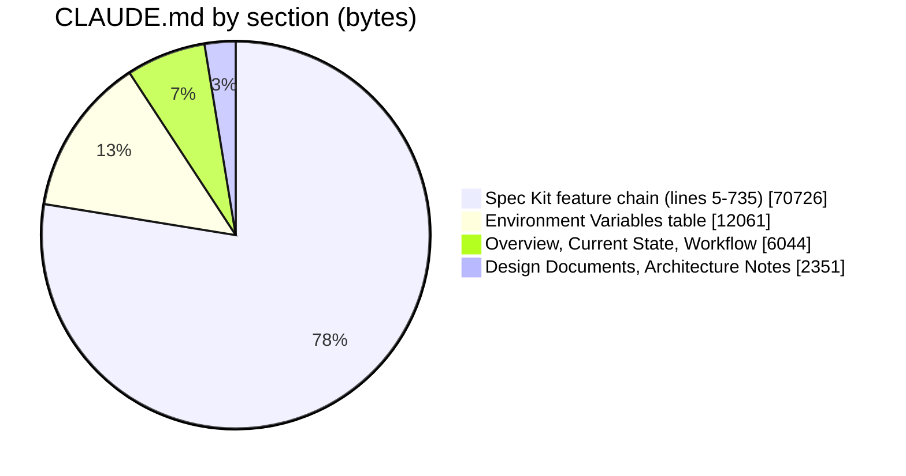
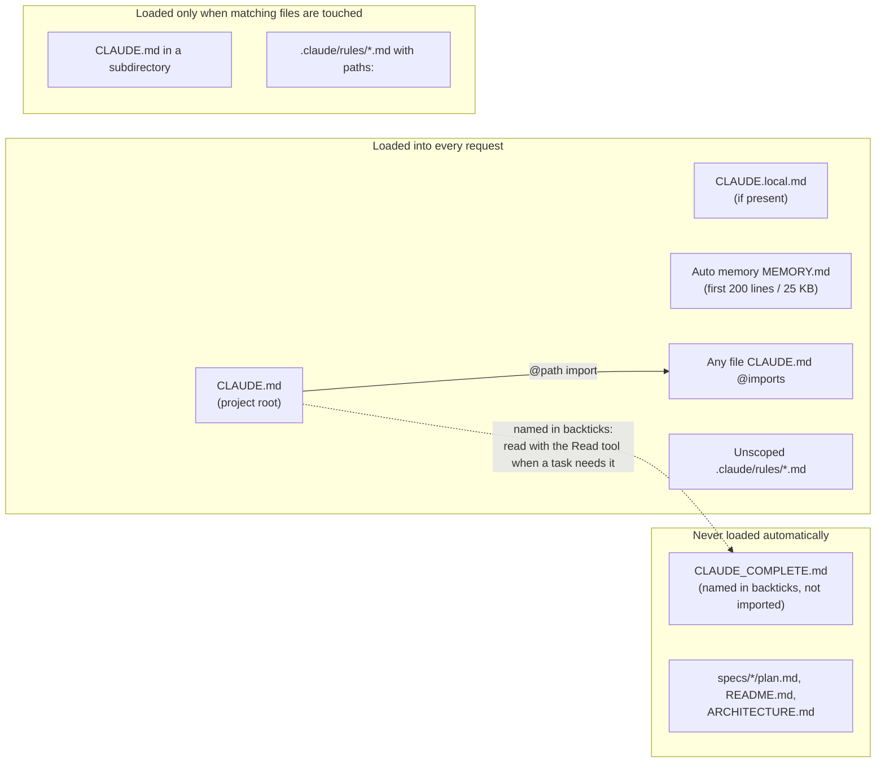
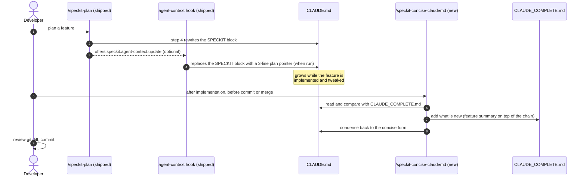
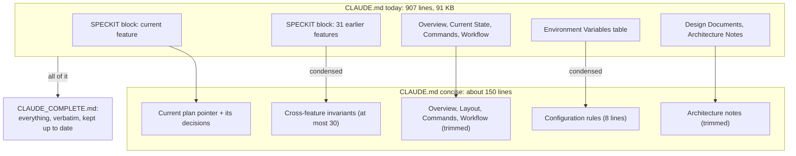
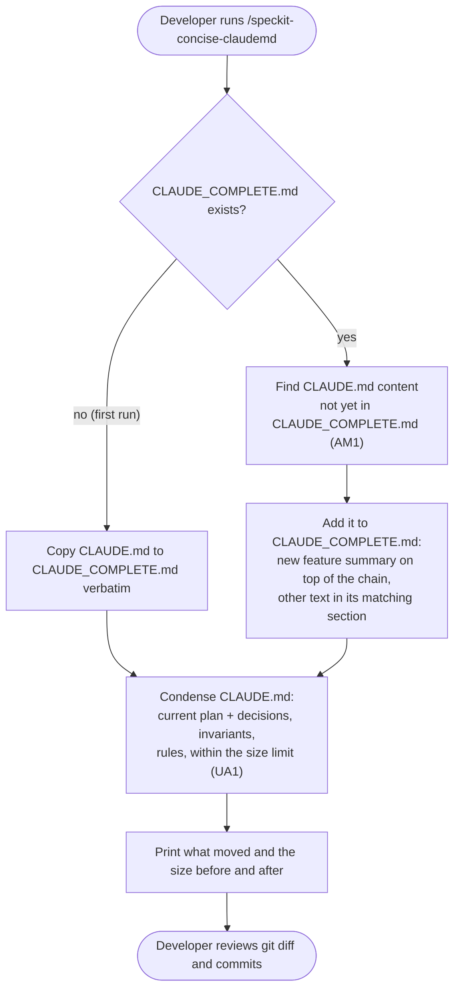

# High Level Requirements

Requirements: `requirements/20261101-042151-concise-claude-md/requirements.md`  
External Files: none  
Generated: 2026-11-01 4:21 AM  
Findings restarted: 2026-11-01 10:04 AM (at the developer's request)  

In CC CLI, when we run /usage, we see a suggestion:
```
  37%  Trim C:\crowdPoll\editing-poll-available\CLAUDE.md · 21k tokens per request
```

Please make suggestions for reducing the size of CLAUDE.md.  

Currently, CLAUDE,md give a complete description of how the Crowdpoll webapp works internally, as well as the various features and functionalities it provides.  

We could like to maintain that complete version in a file called CLAUDE_COMPLETE.md, that is to be used by developers.   

Then we would like CLAUDE.md to be a consise version that is sent with almost every request sent to the AI model.  
REducing the token count is important to improve performance and efficiency when interacting with the AI model, as well as reduce costs associated with token usage.  
The concise version should focus on the key aspects of the Crowdpoll webapp, including its main features, core functionalities, and essential internal workings, while omitting detailed explanations and less critical information.  

## Additional Requirements and Research Requests

**Instructions To The Developer**  
Enter any additional requirements or research requests under the ## Additional Requirements and Research Requests heading above.  
When you Type or Say: "Next" in the CC CLI terminal, the additional requirements and research requests will be applied to the report.  
  
You may leave these instructions here. They will be ignored when "Next" is executed.  

✅ Applied 2026-11-01 9:50 AM: Mermaid lexical error in diagram 3 fixed (backticks removed from the dashed edge's label); a fix to the report, not a requirement, so requirements.md is unchanged and no finding was added.  
✅ Applied 2026-11-01 10:04 AM: 4 requirements added to requirements.md (no change to the shipped Spec Kit skills; the custom skill `/speckit-concise-claudemd`, run by hand after implementation, before commit or merge, moving new content to `CLAUDE_COMPLETE.md`; findings restarted). Sections 1 and 4–11 rewritten and the findings regenerated, as requested: RS1–RS2, AM1–AM3, UA1–UA8, NC1. The earlier ticks (AM1 A, UA1's Developer Resolution with no text, UA2) went with the old findings; their new counterparts are AM2, UA1 and UA2.  

## 1. Overview and Scope

The feature splits the project's instruction file in two, and adds one custom skill that keeps them split:

- **`CLAUDE_COMPLETE.md`** — the full description that `CLAUDE.md` holds today, kept for developers and opened by the AI only when a task needs it.
- **`CLAUDE.md`** — a concise version, loaded into every request, holding only what most tasks need.
- **`/speckit-concise-claudemd`** — a custom skill the developer runs by hand after a feature is implemented, before it is committed or merged.
  It finds what was added to `CLAUDE.md` since the last run, copies it into `CLAUDE_COMPLETE.md`, and condenses `CLAUDE.md` back to its concise form.

In scope:

- creating `CLAUDE_COMPLETE.md` from today's `CLAUDE.md`;
- rewriting `CLAUDE.md` as the concise version;
- the new skill, `.claude/skills/speckit-concise-claudemd/SKILL.md`.

Out of scope:

- **any change to the Spec Kit skills and extensions shipped from GitHub** (`/speckit-plan`, `/speckit-specify`, the agent-context extension and the rest), which keep writing to `CLAUDE.md` as they do today (Additional Requirements, 2026-11-01);
- any CrowdPoll code, configuration, data or migration change.

The content analysis is in section 5, *What Stays and What Moves*.

## 2. Where the Tokens Go Today

Measured on `main` (2026-11-01): `CLAUDE.md` is **907 lines, 91,300 bytes**, about **21,000 tokens** per request (the `/usage` figure; about 4.3 bytes per token).  
The Claude Code documentation recommends **under 200 lines** per `CLAUDE.md` (RS1).



| Section | Lines | Bytes | Share | What it is |
|---|---|---|---|---|
| `<!-- SPECKIT START -->` … `<!-- SPECKIT END -->` | 731 | 70,726 | 78% | The current plan's summary, then 31 earlier features chained by "The preceding feature is …", each with its "Decisions that are easy to get wrong" |
| Environment Variables | 84 | 12,061 | 13% | One table row per `ENV_*` setting, duplicating `src/config.ts` and the launch templates |
| Project Overview, Current State, Spec Kit Workflow | 72 | 6,044 | 7% | Stack, layout, commands, the skill order |
| Key Design Documents, Architecture Notes | 15 | 2,351 | 3% | Where requirements live; auth phases, cookie banner, API contract |

The feature chain is the problem: it grows by about 2–3 KB with every feature planned, and most of it describes features finished weeks ago, already recorded in their own `specs/<feature>/plan.md`.

## 3. How Claude Code Loads Instruction Files



- Everything in the first box costs tokens on every request.
- An `@CLAUDE_COMPLETE.md` import would put the whole file back in the first box and save nothing (RS1);
  the concise file must name it in backticks instead.
- Subdirectory `CLAUDE.md` files and path-scoped rules cost tokens only when a task touches their files (RS1).

## 4. Who Writes CLAUDE.md



- The shipped `/speckit-plan` step 4 asks only to "update the plan reference" between the markers, and the agent-context script writes a three-line pointer;
  the 70 KB chain grew because each plan run followed the pattern already in the block (RS2).
- Neither shipped writer changes; the new skill cleans up after them.
- Every branch merge so far has conflicted in this block (the `editing-poll-available` merge did on 2026-11-01).

## 5. What Stays and What Moves



Content analysis of today's `CLAUDE.md`, section by section:

| Today's section | Bytes | Concise `CLAUDE.md` | `CLAUDE_COMPLETE.md` | Why |
|---|---|---|---|---|
| SPECKIT block, current feature (EDITING-POLL-AVAILABLE) | ≈ 3,000 | kept: plan path and its decisions, at most 20 lines (UA3) | kept | What the AI most needs while the feature is implemented and tweaked |
| SPECKIT block, 31 earlier features | ≈ 67,700 | moved; the rules a change elsewhere could still break are condensed into *Cross-feature invariants* (UA2) | kept, verbatim | Finished work, already in each `specs/<feature>/plan.md` |
| Project Overview | ≈ 2,000 | kept, trimmed to the stack, sign-in modes, deployment target and pointers to `README.md` and `ARCHITECTURE.md` | kept | Needed for nearly every task |
| Current State (layout) | ≈ 2,300 | kept, trimmed; "Every feature in the Spec Kit block above is implemented" reworded | kept | Where things live |
| Commands | ≈ 900 | kept as is | kept | Used constantly |
| Spec Kit Workflow | ≈ 850 | kept, with `/speckit-concise-claudemd` added (UA7) | kept | Workflow order |
| Environment Variables table | 12,061 | moved; eight lines of rules stay (UA4) | kept | Duplicates `src/config.ts` |
| Key Design Documents | ≈ 1,100 | trimmed to the folder rule | kept | Mostly history of the older flat form |
| Architecture Notes | ≈ 1,250 | kept | kept | Cookie, API-contract and auth-phase rules bind every change |

Estimated result: about 150 lines and 16 KB (about 4k tokens), an 80% cut.

## 6. A Run of `/speckit-concise-claudemd`



## 7. Assumptions

- Token figures are estimated at about 4.3 bytes per token, from the `/usage` figure for today's file.
- `CLAUDE_COMPLETE.md` lives at the repository root, beside `CLAUDE.md`, and is committed.
- "The /speckit skills shipped from GitHub" are the Spec Kit skills and extensions installed from `github/spec-kit`
  (`speckit-specify`, `-clarify`, `-plan`, `-tasks`, `-analyze`, `-implement`, `-checklist`, `-constitution`, `-taskstoissues`, `-agent-context-update` and `.specify/extensions/agent-context/`);
  the project's own skills (`speckit-requirements`, `speckit-tweak`, `speckit-analyze-findings`, `speckit-clarify-findings`, `speckit-plan-thru-analyze`, `speckit-file-remote`) may change.
- The feature changes only Markdown files and adds one skill; no CrowdPoll code, test of the app, configuration or migration changes.
- Each branch folder under `C:\crowdPoll\` has its own copy of `CLAUDE.md`; the change is made on `main` and reaches a branch when that branch merges `main` (UA6).

## 8. Research Results

### How Claude Code loads instruction files


**RS1. Which instruction files cost tokens on every request, and which only on demand?**  
<span style="font-size:large" ><b>
✅ Resolved</b></span>  
✅ Requirements File Updated: 2026-11-01 10:49 AM  
**Notes**: Recommendation accepted in file 2026-11-01: Developer Resolution B;  
the Recommendation's loading rules stand (`CLAUDE_COMPLETE.md` is named only in backticks, never `@`-imported), without a 200-line limit;  
each run of the skill prints the lines and tokens of `CLAUDE.md` and of `CLAUDE_COMPLETE.md`, before and after it runs.  
Tokens are an estimate (about 4 characters per token), as no tokenizer runs locally.  
Requirements: Resolutions, RS1.  

> The requirements ask how to cut the per-request cost of `CLAUDE.md` while keeping a complete version available.  
> Source: [Claude Code — How Claude remembers your project](https://code.claude.com/docs/en/memory).  
> `CLAUDE.md` and `CLAUDE.local.md` in the working directory and above it are loaded at launch, into every session.  
> The documentation's size guidance: "target under 200 lines per CLAUDE.md file. Longer files consume more context and reduce adherence."  
> `@path` imports "help you organize a long file but don't reduce its context cost, because imported files load together with the CLAUDE.md that imports them";  
> a path written in backticks is not imported.  
> `CLAUDE.md` files in subdirectories, and `.claude/rules/*.md` files with a `paths:` field, load only when Claude reads or edits a matching file.  

  - **Recommendation**: **record these loading rules as constraints: the concise `CLAUDE.md` stays under 200 lines and names `CLAUDE_COMPLETE.md` only in backticks, never as an `@` import.**  

    [ ] ➡️ **Not Accepted**

    - An import would load the complete file on every request and undo the feature.  
    - Path-scoped rules are available if a later need arises (see UA4, option B).  


  - **Developer Resolution B**:  

    [X] ➡️ **Accepted**

    - The "Recommendation" above, except that it can't be tested as a line count of 200. If the project requires a longer `CLAUDE.md` to provide every prompt to the AI, it may do so. While using the /speckit-consice-claudmd skill, the developer will monitor the size of the `CLAUDE.md` file to ensure it remains manageable.  The skill will output; 1. the number of lines and number of tokens before executing it, 2. the number of lines and number of tokens after executing it, 3. the number of lines and number of tokens in CLAUDE_COMPLETE.md before executing, 4. the number of lines and number of tokens in CLAUDE_COMPLETE.md after executing it.


### What the shipped Spec Kit writes into CLAUDE.md

**RS2. Do the shipped skills grow the chain, or does the chain grow by imitation?**  
<span style="font-size:large" ><b>
✅ Resolved</b></span>  
✅ Requirements File Updated: 2026-11-01 10:49 AM  
**Notes**: Recommendation accepted in file 2026-11-01: Recommendation: the skill treats whatever lies between the markers as input, whatever its form;  
Requirements: Resolutions, RS2.  

> Read in the repository on 2026-11-01:  
> `.claude/skills/speckit-plan/SKILL.md` step 4 says only: "Update the plan reference between the `<!-- SPECKIT START -->` and `<!-- SPECKIT END -->` markers in `CLAUDE.md` to point to the plan file".  
> `.specify/extensions/agent-context/scripts/powershell/update-agent-context.ps1` replaces everything between the markers with three lines naming the current `plan.md`.  
> Neither asks for a feature summary or a chain;  
> the 31-feature chain grew because each plan run followed the pattern already in the block ("Decisions that are easy to get wrong", "The preceding feature is").  
> With the shipped skills unchanged, the next `/speckit-plan` will still write into the block, and may still write a summary there by imitation.  

  - **Recommendation**: **the skill treats whatever lies between the markers as input, whatever its form: a three-line pointer, a summary, or a summary with the previous feature pushed down; it never assumes one format.**  

    [X] ➡️ **Accepted**

    - That keeps it working whether a plan run, the agent-context hook, or a hand edit wrote the block last.  
    - The short block it leaves (UA3) is the pattern later plan runs will see, which nudges them toward a short block too.  


  - **Developer Resolution B**:  

    [ ] ➡️ **Not Accepted**


## 9. Findings

### Inconsistencies

None found.

### Ambiguities

**AM1. What does a run of `/speckit-concise-claudemd` move?**  
<span style="font-size:large" ><b>
✅ Resolved</b></span>  
✅ Requirements File Updated: 2026-11-01 10:49 AM  
**Notes**: Recommendation accepted in file 2026-11-01: Recommendation A: by difference;  
Requirements: Resolutions, AM1.  

> The requirement: the skill "will analyze the CLAUDE.md file and add new content in order to transfer some of it to CLAUDE_COMPLETE.md".  
> It can mean copying what was added to `CLAUDE.md` since the last run into the complete file, then condensing;  
> or treating `CLAUDE_COMPLETE.md` as the source and regenerating the concise file from it each time.  

  - **Recommendation A** _(recommended)_: **by difference: anything in `CLAUDE.md` not yet in `CLAUDE_COMPLETE.md` (a new feature summary, a hand-added note, a changed command) is added to the complete file in its matching section, a new feature summary on top of the chain; then `CLAUDE.md` is condensed.**  

    [X] ➡️ **Accepted**

    - <u>Pros</u>: nothing written to `CLAUDE.md` by a shipped skill or by hand is ever lost;  
    - <u>Cons</u>: the skill must match sections between two files whose texts differ by design.  


  - **Recommendation B**: **by regeneration: the developer and the skills write only to `CLAUDE_COMPLETE.md`; each run rebuilds `CLAUDE.md` from it.**  

    [ ] ➡️ **Not Accepted**

    - <u>Pros</u>: one source of truth, and the concise file is always derived the same way;  
    - <u>Cons</u>: the shipped skills write to `CLAUDE.md`, not the complete file, so their output would have to be moved first anyway.  


  - **Developer Resolution C**:  

    [ ] ➡️ **Not Accepted**


**AM2. Is `CLAUDE_COMPLETE.md` kept up to date, or a one-time snapshot?**  
<span style="font-size:large" ><b>
✅ Resolved</b></span>  
✅ Requirements File Updated: 2026-11-01 10:49 AM  
**Notes**: Recommendation accepted in file 2026-11-01: Recommendation A: kept up to date;  
Requirements: Resolutions, AM2.  

> The requirements say "maintain that complete version" and "preserving the full details in the complete version".  
> With the new skill, "maintain" most naturally means kept current by each run.  
> Before the restart, Recommendation A of the earlier AM1 (kept up to date) was ticked.  

  - **Recommendation A** _(recommended)_: **kept up to date: each run of `/speckit-concise-claudemd` adds the new content (AM1), so `CLAUDE_COMPLETE.md` always holds every feature's full summary, newest first.**  

    [X] ➡️ **Accepted**

    - <u>Pros</u>: the file stays complete, and developers keep one place to read every feature's decisions;  
    - <u>Cons</u>: it keeps growing, which costs nothing per request but makes it long to read.  


  - **Recommendation B**: **a snapshot: today's `CLAUDE.md`, frozen; later features are documented only in their own `specs/<feature>/`.**  

    [ ] ➡️ **Not Accepted**

    - <u>Pros</u>: the skill only condenses `CLAUDE.md`;  
    - <u>Cons</u>: the file goes stale with the first new feature, and its name promises "complete".  


  - **Developer Resolution C**:  

    [ ] ➡️ **Not Accepted**


**AM3. Does the AI ever read `CLAUDE_COMPLETE.md`, or is it for developers only?**  
<span style="font-size:large" ><b>
✅ Resolved</b></span>  
✅ Requirements File Updated: 2026-11-01 10:49 AM  
**Notes**: Recommendation accepted in file 2026-11-01: Developer Resolution C;  
`CLAUDE_COMPLETE.md` is never sent as context: it is not imported and not loaded automatically, and `CLAUDE.md` does not tell the AI to read it;  
`CLAUDE.md` names it once, in backticks, for developers.  
On the question asked: the `/usage` advice can be followed because most of today's file is history (31 finished features, 78%) that a typical request does not need;  
what the AI needs on every request stays in the concise `CLAUDE.md`, and an earlier feature's details remain in its own `specs/<feature>/plan.md`.  
Requirements: Resolutions, AM3.  

> The requirements say the complete version "is to be used by developers".  
> Yet much of what it holds (an earlier feature's decisions, a setting's default) is exactly what the AI needs when a task touches that area.  

  - **Recommendation A** _(recommended)_: **both: the concise `CLAUDE.md` tells the AI to open `CLAUDE_COMPLETE.md` (named in backticks) when a task touches an earlier feature's area or a setting.**  

    [ ] ➡️ **Not Accepted**

    - <u>Pros</u>: the knowledge stays reachable at no per-request cost;  
    -   a read costs tokens only in the sessions that need it.  
    - <u>Cons</u>: the AI must judge when to open it, and may sometimes not.  


  - **Recommendation B**: **developers only: `CLAUDE.md` does not mention `CLAUDE_COMPLETE.md`.**  

    [ ] ➡️ **Not Accepted**

    - <u>Pros</u>: matches the requirement's wording literally.  
    - <u>Cons</u>: the AI loses the earlier features' decisions unless it happens to read their `plan.md`.  


  - **Developer Resolution C**:  

    [X] ➡️ **Accepted**

    - The suggestion from /usage, as cited in the Initial Requirements, is to trim CLAUDE.md. That is the purpose of this current feature. If the CLAUDE.md can't be trimmed because it contains exactly what the AI needs, then why is /usage recommending something that can't be done. If the CLAUDE_COMPLETE.md is sent as context to the AI, then there is no point in trying to trim CLAUDE.md itself.


### Unspecified Aspects

**UA1. How small must the concise `CLAUDE.md` be, and what checks it?**  
<span style="font-size:large" ><b>
✅ Resolved</b></span>  
✅ Requirements File Updated: 2026-11-01 10:49 AM  
**Notes**: Recommendation accepted in file 2026-11-01: Developer Resolution C;  
no size limit is enforced, tested, or written into the skill as a line count;  
the skill reports the sizes (RS1) and keeps `CLAUDE.md` concise by judgement.  
Requirements: Resolutions, UA1.  

> The requirements ask for a "concise version" but give no size, so success cannot be tested.  
> Today's file is 907 lines and about 21k tokens; the documentation recommends under 200 lines (RS1).  
> Before the restart, the earlier UA1's Developer Resolution was ticked with no text written, so its recommendation (a Vitest test) may not be wanted.  

  - **Recommendation A** _(recommended)_: **at most 200 lines and 16 KB (about 4k tokens); the skill checks it at the end of each run and reports the size before and after, naming the section to cut when the limit is exceeded; no test in `tests/`.**  

    [ ] ➡️ **Not Accepted**

    - <u>Pros</u>: the check runs exactly when the file is rewritten, and the app's test suite stays about the app;  
    - <u>Cons</u>: nothing stops a hand edit or a plan run from pushing it over until the skill runs again.  


  - **Recommendation B**: **the same limits, also checked by a Vitest test that fails when `CLAUDE.md` exceeds either.**  

    [ ] ➡️ **Not Accepted**

    - <u>Pros</u>: `npm test` catches growth even when the skill is not run;  
    - <u>Cons</u>: the test fails between a `/speckit-plan` run and the skill's run, which is the normal state while a feature is implemented.  


  - **Developer Resolution C**:  

    [X] ➡️ **Accepted**

    - RS1 covers this. A specific size can not be enforced strictly because the content may vary, but the skill ensures it remains concise by checking the size at the end of each run. No tests for size. No mention in the skill of specific line counts. 


**UA2. Which content stays in the concise `CLAUDE.md`?**  
<span style="font-size:large" ><b>
✅ Resolved</b></span>  
✅ Requirements File Updated: 2026-11-01 10:49 AM  
**Notes**: Recommendation accepted in file 2026-11-01: Developer Resolution B;  
the *Cross-feature invariants* section stays, with no bullet count tested or named in the skill.  
Requirements: Resolutions, UA2.  

> "Key aspects … main features, core functionalities, and essential internal workings" leaves the selection open.  
> The chain mixes decisions that bind any new work (vote counters are never written to a poll row per vote;  
> every `vote_history` writer keeps the line-graph tally;  
> a new cookie needs a Cookie Use row) with details of one finished feature.  
> Before the restart, this recommendation was ticked.  

  - **Recommendation**: **keep the section 5 outline; its "Cross-feature invariants" section holds only rules a change elsewhere could break, at most 30 one-line bullets, each naming the file or test that enforces it; the skill adds a bullet when a new feature's decisions include such a rule.**  

    [ ] ➡️ **Not Accepted**

    - The test for a bullet: "would a task in another area break this without knowing it?"  
    -   If not, it stays in `CLAUDE_COMPLETE.md` only.  


  - **Developer Resolution B**:  

    [X] ➡️ **Accepted**

    - similar to the resolution in RS1, a specific number of one-line bullets will not be something tested, and a specific number of one-line bullets will not be mentioned in the skill; the focus is on maintaining concise and relevant content.


**UA3. What does the skill leave between the SPECKIT markers?**  
<span style="font-size:large" ><b>
✅ Resolved</b></span>  
✅ Requirements File Updated: 2026-11-01 10:49 AM  
**Notes**: Recommendation accepted in file 2026-11-01: Developer Resolution C;  
the SPECKIT block keeps the current plan's path and its "Decisions that are easy to get wrong", concise, with no line count.  
Requirements: Resolutions, UA3.  

> While a feature is implemented and tweaked, its decisions are what the AI most often needs; they run 10–25 lines (1–3 KB) per feature.  
> The skill runs after implementation, so the block it leaves serves the tweaks and the next feature's planning.  

  - **Recommendation A** _(recommended)_: **the current plan's path and its "Decisions that are easy to get wrong", at most 20 lines; the full summary and every earlier feature go to `CLAUDE_COMPLETE.md`.**  

    [ ] ➡️ **Not Accepted**

    - <u>Pros</u>: the guidance is in front of the AI while it matters, for about 500 tokens;  
    - <u>Cons</u>: the block's size varies with each feature.  


  - **Recommendation B**: **only the current plan's path, as the shipped agent-context script writes it; its decisions are read from `plan.md` when needed.**  

    [ ] ➡️ **Not Accepted**

    - <u>Pros</u>: the smallest file, and the same form the shipped script produces;  
    - <u>Cons</u>: the "easy to get wrong" warnings are easy to miss.  


  - **Developer Resolution C**:  

    [X] ➡️ **Accepted**

    - The resolution is to follow the guidance from RS1: the content between the SPECKIT markers should be concise and focused on the current plan's path and its "Decisions that are easy to get wrong", without enforcing a strict line count.


**UA4. Where does the Environment Variables table go?**  
<span style="font-size:large" ><b>
✅ Resolved</b></span>  
✅ Requirements File Updated: 2026-11-01 10:49 AM  
**Notes**: Recommendation accepted in file 2026-11-01: Recommendation B: a path-scoped rule, `.claude/rules/environment.md`;  
the table also stays in `CLAUDE_COMPLETE.md` (AM2), and the skill keeps the rule file in step when a setting is added.  
Requirements: Resolutions, UA4.  

> The table is 84 lines and 12 KB, 13% of the file, and duplicates `src/config.ts`.  
> The requirements do not say whether settings count as "essential internal workings".  

  - **Recommendation A** _(recommended)_: **`CLAUDE_COMPLETE.md` only; the concise file keeps an eight-line *Configuration rules* section: `ENV_*` only, validated once by `loadConfig`; intervals in ms except the minutes setting; templates git-ignored; production secrets in the console; the full table in `CLAUDE_COMPLETE.md` and `src/config.ts`.**  

    [ ] ➡️ **Not Accepted**

    - <u>Pros</u>: two files, as the requirements describe; `src/config.ts` is what the AI reads when it changes a setting anyway;  
    - <u>Cons</u>: a task about a setting needs one extra read.  


  - **Recommendation B**: **a path-scoped rule, `.claude/rules/environment.md`, with `paths:` covering `src/config.ts`, `.do/app.yaml`, `launch.json.example`, `devScripts.example/**` and `tests/config.test.ts`, loaded only when those files are touched (RS1).**  

    [X] ➡️ **Accepted**

    - <u>Pros</u>: the table appears exactly when configuration work starts, at no other cost;  
    - <u>Cons</u>: a third instruction file for the skill to keep in step, beyond what the requirements name.  


  - **Recommendation C**: **keep the table in the concise `CLAUDE.md`.**  

    [ ] ➡️ **Not Accepted**

    - <u>Pros</u>: no lookup for settings.  
    - <u>Cons</u>: 84 of the 200 lines (UA1) go to one table.  


  - **Developer Resolution D**:  

    [ ] ➡️ **Not Accepted**


**UA5. Who makes the first split?**  
<span style="font-size:large" ><b>
✅ Resolved</b></span>  
✅ Requirements File Updated: 2026-11-01 10:49 AM  
**Notes**: Recommendation accepted in file 2026-11-01: Recommendation: the skill's first run makes the split;  
Requirements: Resolutions, UA5.  

> `CLAUDE_COMPLETE.md` does not exist yet.  
> The first split could be done by hand as part of this feature, or by the skill's first run.  

  - **Recommendation**: **the skill's first run: when `CLAUDE_COMPLETE.md` is absent it copies `CLAUDE.md` to it verbatim, then condenses `CLAUDE.md`; implementing this feature ends with that first run on `main`.**  

    [X] ➡️ **Accepted**

    - One code path for the first split and every later one, so the first run also tests the skill.  
    - Section 6 shows both branches of a run.  


  - **Developer Resolution B**:  

    [ ] ➡️ **Not Accepted**


**UA6. How do branch folders and merges work with the two files?**  
<span style="font-size:large" ><b>
✅ Resolved</b></span>  
✅ Requirements File Updated: 2026-11-01 10:49 AM  
**Notes**: Recommendation accepted in file 2026-11-01: Recommendation: change on `main`, rerun the skill after a merge conflict;  
Requirements: Resolutions, UA6.  

> The `/usage` warning names `C:\crowdPoll\editing-poll-available\CLAUDE.md`, a branch folder; each folder under `C:\crowdPoll\` has its own copy.  
> The skill runs before a merge, so two branches that each ran it both add a summary to the top of the chain in `CLAUDE_COMPLETE.md`, and both rewrite the SPECKIT block in `CLAUDE.md`.  

  - **Recommendation**: **make the change on `main`; a branch gets it by merging `main`. On a conflict, keep both chain entries in `CLAUDE_COMPLETE.md` (newest first) and either side of `CLAUDE.md`, then run `/speckit-concise-claudemd` again, which restores the concise form; the skill's instructions carry this recipe.**  

    [X] ➡️ **Accepted**

    - The skill already reconciles the two files by difference (AM1 A), so a rerun after a merge is the natural repair.  
    - A branch planned before this feature merges with its old long block; the rerun moves it, as it would a new plan's summary.  


  - **Developer Resolution B**:  

    [ ] ➡️ **Not Accepted**


**UA7. Where is the new skill listed, and how is it invoked?**  
<span style="font-size:large" ><b>
✅ Resolved</b></span>  
✅ Requirements File Updated: 2026-11-01 10:49 AM  
**Notes**: Recommendation accepted in file 2026-11-01: Developer Resolution B;  
On the question asked: no, a request does not need the workflow list, so the *Spec Kit Workflow* list moves to `CLAUDE_COMPLETE.md` only;  
the concise file keeps the one line saying Spec Kit uses the PowerShell scripts.  
The journey message of `/speckit-requirements` becomes the developer's list, ending with `/speckit-concise-claudemd (recommended)`.  
The skill is user-invocable with `disable-model-invocation: true`, as the requirement says it is used manually.  
This supersedes the *Spec Kit Workflow* row of section 5.  
Requirements: Resolutions, UA7.  

> The requirement names the skill and says it "will be used manually by the developer".  
> The workflow is listed in `CLAUDE.md`'s *Spec Kit Workflow* block and in the new-feature journey message of `/speckit-requirements` (a project skill, not shipped).  

  - **Recommendation**: **`.claude/skills/speckit-concise-claudemd/SKILL.md` with `user-invocable: true` and `disable-model-invocation: true`, so only the developer starts it; listed after `/speckit-tweak` in the *Spec Kit Workflow* block of both files and in the journey message of `/speckit-requirements`.**  

    [ ] ➡️ **Not Accepted**

    - `disable-model-invocation` matches "used manually": the AI cannot start it on its own.  
    - No shipped skill is edited; `/speckit-requirements` is the project's own.  


  - **Developer Resolution B**:  

    [X] ➡️ **Accepted**

    - is there any reason why a generic prompt to the AI would need to know the specific details of the developer's workflow, given that the skill is manually invoked and the developer reviews changes before committing? Having said this, the /speckit-requirements skill outputs this to the CC CLI console:
```
    ⚪ A new feature journey has started taking you through the following skills:
⚪ /speckit-requirements
⚪ /speckit-specify
⚪ /speckit-clarify
⚪ /speckit-clarify-findings (optional)
⚪ /speckit-plan
⚪ /speckit-tasks
⚪ /speckit-analyze
⚪ /speckit-analyze-findings (optional)
⚪ (or /speckit-plan-thru-analyze, which runs /speckit-plan through /speckit-analyze-findings in one go)
⚪ /speckit-implement
⚪ /speckit-tweaks (optional)
```
This will be updated to:
```
⚪ A new feature journey has started taking you through the following skills:
⚪ /speckit-requirements
⚪ /speckit-specify
⚪ /speckit-clarify
⚪ /speckit-plan
⚪ /speckit-tasks
⚪ /speckit-analyze
⚪ /speckit-analyze-findings (recommended)
⚪ (or /speckit-plan-thru-analyze, which runs /speckit-plan through /speckit-analyze-findings in one go)
⚪ /speckit-implement
⚪ /speckit-tweaks (optional)
⚪ /speckit-concise-claudemd (recommended)
```


**UA8. Does the skill write at once, or ask first?**  
<span style="font-size:large" ><b>
✅ Resolved</b></span>  
✅ Requirements File Updated: 2026-11-01 10:49 AM  
**Notes**: Recommendation accepted in file 2026-11-01: Recommendation: write both files, then print what changed;  
Requirements: Resolutions, UA8.  

> The skill rewrites both instruction files.  
> The requirements do not say whether the developer approves the result before it is written.  

  - **Recommendation**: **write both files, then print what moved (per section), what was condensed, and the size before and after; the developer reviews with `git diff` before committing, as the requirement places the run before a commit.**  

    [X] ➡️ **Accepted**

    - Git is the undo; a confirmation prompt would add a step to every run.  
    - Nothing is committed or staged by the skill.  


  - **Developer Resolution B**:  

    [ ] ➡️ **Not Accepted**


**UA9. When does `/speckit-tweak` show the reminder to run `/speckit-concise-claudemd`?**
<span style="font-size:large" ><b>
✅ Resolved</b></span>  
✅ Requirements File Updated: 2026-11-01 10:55 AM  
**Notes**: Recommendation accepted in file 2026-11-01: Recommendation B, show the two lines every time "All tweaks resolved" is reported;  
no state file is kept.  
Requirements: Resolutions, UA9.  

> NC1 adds two lines to the "All tweaks resolved" message: "`CLAUDE.md` has grown as this feature has been implemented" and the instruction to run the skill.
> NC1's condition was "`CLAUDE.md` is over the limit (UA1)", but UA1 removed the limit, so there is nothing to compare against.
> Shown unconditionally, the first line may be untrue when `CLAUDE.md` did not change.

  - **Recommendation A** _(recommended)_: **show the two lines when `CLAUDE.md` has more lines than the last run of `/speckit-concise-claudemd` left it with; each run records that count and the file's hash in `.specify/concise-claudemd.json`; with no record (never run), show them.**

    [ ] ➡️ **Not Accepted**

    - <u>Pros</u>: the message is true whenever it is shown, and needs no size limit;
    - <u>Cons</u>: one small state file, written by the skill and read by `/speckit-tweak`.


  - **Recommendation B**: **show the two lines every time "All tweaks resolved" is reported.**

    [X] ➡️ **Accepted**

    - <u>Pros</u>: no state; the message appears once per feature, at the right moment;
    - <u>Cons</u>: "has grown" is sometimes untrue, and the reminder comes back on every later "Next" once all tweaks are resolved.


  - **Developer Resolution C**:

    [ ] ➡️ **Not Accepted**


### Needs Clarifications

**NC1. What happens when the developer forgets to run the skill?**  
<span style="font-size:large" ><b>
✅ Resolved</b></span>  
✅ Requirements File Updated: 2026-11-01 10:49 AM  
**Notes**: Recommendation accepted in file 2026-11-01: Developer Resolution C;  
`/speckit-tweak` (a project skill) adds the developer's wording to its "All tweaks resolved" message.  
With no size limit (UA1), when it is shown is left open: new finding UA9.  
Requirements: Resolutions, NC1.  

> The skill is manual by requirement.  
> Forgotten, `CLAUDE.md` keeps whatever the plan run wrote, and the next plan run may add more (RS2).  

  - **Recommendation A** _(recommended)_: **accept it: the file grows by one feature until the next run, which moves everything new at once (AM1 A); no reminder.**  

    [ ] ➡️ **Not Accepted**

    - <u>Pros</u>: exactly what the requirement asks, and no extra machinery;  
    - <u>Cons</u>: a forgotten run costs a few thousand tokens per request until it is noticed.  


  - **Recommendation B**: **a reminder: `/speckit-tweak` (a project skill) suggests running `/speckit-concise-claudemd` when it reports "All tweaks resolved" and `CLAUDE.md` is over the limit (UA1).**  

    [ ] ➡️ **Not Accepted**

    - <u>Pros</u>: the reminder comes at the point the requirement names, after implementation and tweaks;  
    - <u>Cons</u>: a second project skill changes.  


  - **Developer Resolution C**:  

    [X] ➡️ **Accepted**

    - Recommendation B, except that the wording is: 
```    
All tweaks resolved.  
Add TWEAK### to <tweaks_file_directory>/<tweaks_file_name> if there are more tweaks.  
`CLAUDE.md` has grown as this feature has been implemented.  
Execute `/speckit-concise-claudemd` to trim it and transfer important details to `CLAUDE_COMPLETE.md`.
```    
    "All tweaks resolved" and `CLAUDE.md` is over the limit (UA1)."


## 10. Breaking Changes

- **The AI stops seeing earlier features' decisions by default.**  
  Work that relied on the chain being in context must now open `CLAUDE_COMPLETE.md` or the feature's `plan.md` (AM3).
- **`CLAUDE.md` is concise only after a run.** Between a `/speckit-plan` run and `/speckit-concise-claudemd`, the shipped skills may make it longer again (RS2, NC1).
- **Branches planned before this feature conflict on merge** in `CLAUDE.md`, as described in UA6.

## 11. Technical Debt

- **The feature chain duplicates every `plan.md`**: 31 summaries restate decisions already recorded in each feature's own `specs/<feature>/` folder.
- **Two shipped writers of one block, unchanged by design**: `/speckit-plan` step 4 and the agent-context hooks both rewrite the SPECKIT block, with different content; the new skill cleans up after both.
- **The Environment Variables table duplicates `src/config.ts`** and the launch templates, and must be edited by hand with each new setting.

## 12. Requirements Report Complete Report

- **Requirements Report Document:** requirements/20261101-042151-concise-claude-md/requirements-report.md
- **Requirements Document:** requirements/20261101-042151-concise-claude-md/requirements.md
- **Software Architecture Diagrams:** 5
- **Inconsistencies:** 0
- **Ambiguities:** 3
- **Unspecified Aspects:** 9
- **Needs Clarifications:** 1
- **Research Results:** 2
- **Breaking Changes:** 3
- **Technical Debt items:** 3

The requirements are ready for /speckit-specify.
To generate specs from the requirements document, use the `/speckit-specify` skill followed by the path (relative to the project root) to the requirements file.
At the prompt, Type:
🟩 👉 /speckit-specify requirements/20261101-042151-concise-claude-md/requirements.md
