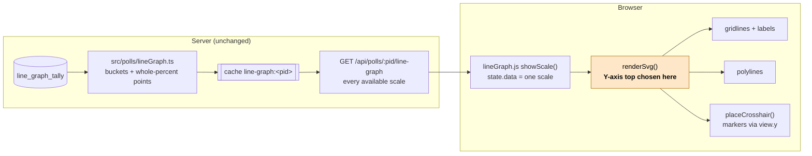
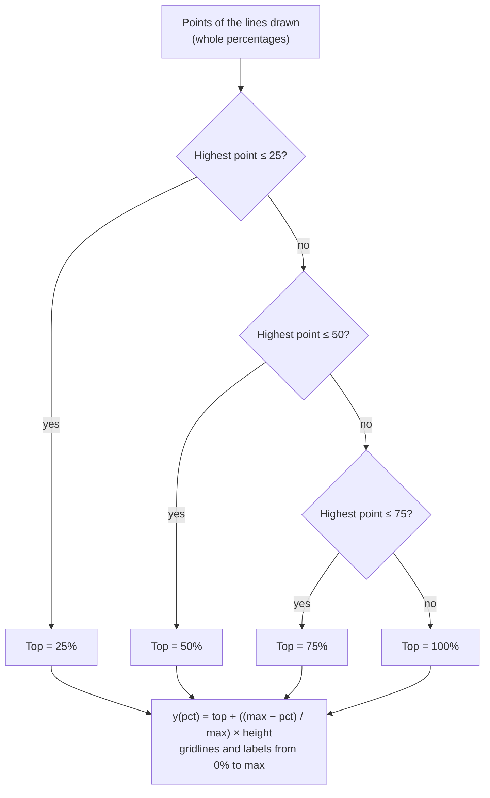
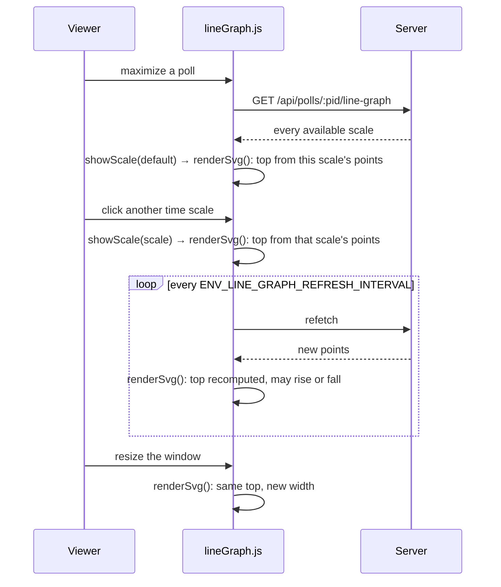

# High Level Requirements

Requirements: `requirements/20261101-150208-adaptive-y-axis/requirements.md`  
External Files: none  
Generated: 2026-11-01 3:02 PM  

The Y-axis of the Line Graph that appears on the Maximized Poll page,  
should be adjusted to avoid having a large part of the graph appear empty or unused.  

Here are the rules:
If every datapoint is 25% opr less, the max of the Y-axis will be 25%.  
else if every datapoint is 50% or less, the max of the Y-axis will be 50%.  
else if every datapoint is 75% or less, the max of the Y-axis will be 75%.  
else 
the max of the Y-axis will be 100%.     

## Additional Requirements and Research Requests

**Instructions To The Developer**  
Enter any additional requirements or research requests under the ## Additional Requirements and Research Requests heading above.  
When you Type or Say: "Next" in the CC CLI terminal, the additional requirements and research requests will be applied to the report.  
  
You may leave these instructions here. They will be ignored when "Next" is executed.  

## 1. Overview

The maximized poll view draws a line graph of each choice's share over time (features POLL-LINE-GRAPH and
LINE-GRAPH-M3).  
Today its Y axis always runs from 0% to 100%, with gridlines and labels at 0, 25, 50, 75 and 100%.  
In a poll with many choices every line can sit below 25%, so three quarters of the plot is empty.  

This feature picks the top of the Y axis from the data being drawn: the smallest of 25%, 50%, 75% and 100% that
every point is at or below.  
The bottom stays at 0%.  

**Scope**  
- The Y axis of the line graph in the maximized poll view: its top, its gridlines and its labels.  
- The lines, the crosshair markers and the tooltip follow the new axis; the values they show do not change.  

**Out of scope**  
- The server, the `/api/polls/:pid/line-graph` response, the tally and the cache: the points already arrive as
  whole percentages (0–100), so the browser can choose the axis from them.  
- The bar graph on the poll card, the X axis, the time-scale selector and the colours.  

**Where it lives today** (`src/public/lineGraph.js`, `renderSvg()`):  
- `const y = (pct) => pad.top + ((100 - pct) / 100) * innerHeight;` maps a share to a height, with `100` fixed.  
- `for (const pct of [0, 25, 50, 75, 100])` draws the gridlines and labels; the 0% line carries
  `line-graph-baseline`.  
- `state.view.y` is the same mapping, reused by `placeCrosshair()` for the markers.  

## 2. Component View

Which parts take part, and the one that changes.

## 3. Choosing the Top of the Y Axis

The rule as written, applied to every point of every line drawn.

"Every point is X% or less" is the same test as "the highest point is X% or less", so the browser needs only the
highest point.  

## 4. When the Axis Is Chosen

The axis is chosen each time the graph is drawn, so it can change while the graph is open.

## 5. Design Notes

- **Change in one function.** `renderSvg()` computes the top (`max`) from `data.series`, then uses it in `y()`, in the
  gridline loop and in the labels. `view.y` carries the same mapping, so the crosshair markers stay on the lines with
  no change to `placeCrosshair()`.  
- **No new state, request, setting or stylesheet rule.** The gridline classes (`line-graph-grid`,
  `line-graph-baseline`) and the M3 tokens in `line-graph-m3.css` are reused.  
- **The tooltip and the live region keep the real percentages** (`series.points[index] + '%'`); only the drawing
  scale changes.  
- **Contract C5 of POLL-LINE-GRAPH** ("The Y axis spans 0–100% with four or five gridlines") is superseded by this
  feature; its new wording follows the resolution of UA1.  
- **Tests**: `tests/line-graph-ui.test.ts` checks the 0% baseline against the `0%` label, which still holds; new
  tests cover each of the four tops and the gridlines of each.  

## 6. Assumptions

- The points are whole percentages from 0 to 100 (`Math.round((count / share) * 100)` in `src/polls/lineGraph.ts`),
  so no point is above 100% and the four tops cover every case.  
- "The Line Graph that appears on the Maximized Poll page" is the graph mounted by `tabs.js` `maximize()` through
  `window.PollLineGraph.mount(...)`; there is no other line graph.  
- A line that touches the top of the axis (a point exactly at 25%, 50% or 75%) is acceptable: the plot keeps its
  12 px top padding, so the line is not clipped.  

## 7. Breaking Changes

- **Documented UI contract**: POLL-LINE-GRAPH `contracts/ui-contracts.md` C5 promises a 0–100% Y axis. This feature
  changes that on purpose. No API, stored data or setting changes.  

## 8. Technical Debt

- **Fixed axis constants in `renderSvg()`**: the `100` in `y()` and the `[0, 25, 50, 75, 100]` list are written
  inline. This feature replaces them with values derived from the chosen top, which leaves the function easier to
  change, not harder.  

## 9. Findings

### 9.1 Inconsistencies

None found.

### 9.2 Ambiguities

**AM1. Which points decide the top of the axis?**  
<b>
✅ Resolved</b>  
✅ Requirements File Updated: 2026-11-01 3:23 PM  
**Notes**: Recommendation accepted in file 2026-11-01: Recommendation A, every point of every line drawn, in the time scale shown;  
the requirements' *Resolutions* section says so.  

> The rule says "every datapoint".  
> The response holds every available time scale (1 Day, 1 Week, 1 Month, 1 Year), but only one is drawn at a time;  
> and only the choices above `ENV_LINE_GRAPH_MIN_VOTE_PERCENTAGE` are drawn.  
> The points that count decide whether the axis changes when the viewer switches the time scale.  

  - **Recommendation A** _(recommended)_: **every point of every line drawn, in the time scale shown.**  

    [X] ➡️ **Accepted**

    - <u>Pros</u>: the axis fits exactly what is on screen, which is what "empty or unused" is about;  
      a choice that is not drawn cannot stretch the axis.  
    - <u>Cons</u>: the axis may change when the viewer switches the time scale, e.g. a choice that peaked at 60% a
      month ago gives 75% on 1 Month and 25% on 1 Day.  

  - **Recommendation B**: **every point of every line drawn, across all the time scales in the response.**  

    [ ] ➡️ **Not Accepted**

    - <u>Pros</u>: the axis does not change on a scale switch.  
    - <u>Cons</u>: a short scale can be mostly empty again because of a peak that only a longer scale shows.  

  - **Developer Resolution C**:  

    [ ] ➡️ **Not Accepted**

**AM2. "25% opr less" is read as "25% or less".**  
<b>
✅ Resolved</b>  
✅ Requirements File Updated: 2026-11-01 3:21 PM  
**Notes**: Recommendation accepted by "Accept all" 2026-11-01: Recommendation, read it as "25% or less";  
"opr" is corrected to "or" in the requirements.  

> The first rule reads "If every datapoint is 25% opr less".  
> The other rules say "or less", so "opr" is taken to be a typing slip.  

  - **Recommendation**: **read it as "25% or less", and correct the word in the requirements.**  

    [X] ➡️ **Accepted**

    - A point exactly at 25% then gives a 25% axis, as a point exactly at 50% gives 50%.  

  - **Developer Resolution B**:  

    [ ] ➡️ **Not Accepted**

### 9.3 Unspecified Aspects

**UA1. Which gridlines and labels does a shorter axis show?**  
<b>
✅ Resolved</b>  
✅ Requirements File Updated: 2026-11-01 3:23 PM  
**Notes**: Recommendation accepted in file 2026-11-01: Recommendation A, five equal steps up to a 25%, 50% or 75% top, and today's 25% steps up to 100%;  
the requirements' *Resolutions* section says so;  
POLL-LINE-GRAPH contract C5 becomes "five or six gridlines".  

> Today the gridlines and labels are at 0, 25, 50, 75 and 100%, and contract C5 promises "four or five gridlines".  
> With a 25% top only the 0% and 25% lines would remain, which gives the reader little to measure against.  

  - **Recommendation A** _(recommended)_: **five equal steps up to a 25%, 50% or 75% top (every 5%, 10% or 15%), and today's 25% steps up to 100%.**  

    [X] ➡️ **Accepted**

    - <u>Pros</u>: every label is a whole, round percentage (0, 5, 10, 15, 20, 25%; 0, 10 … 50%; 0, 15 … 75%);  
      the 100% graph looks exactly as today.  
    - <u>Cons</u>: a shorter axis has six gridlines instead of five, so C5 becomes "five or six gridlines".  

  - **Recommendation B**: **four equal steps (quarters of the top) at every top.**  

    [ ] ➡️ **Not Accepted**

    - <u>Pros</u>: always five gridlines, as C5 says today.  
    - <u>Cons</u>: a 25% top gives 6.25, 12.5 and 18.75%, shown rounded (6%, 13%, 19%), which reads as uneven.  

  - **Developer Resolution C**:  

    [ ] ➡️ **Not Accepted**

**UA2. Does the axis change while the graph is open?**  
<b>
✅ Resolved</b>  
✅ Requirements File Updated: 2026-11-01 3:21 PM  
**Notes**: Recommendation accepted by "Accept all" 2026-11-01: Recommendation, choose the top on every draw;  
the requirements' new *Resolutions* section says so.  

> An open graph refetches every `ENV_LINE_GRAPH_REFRESH_INTERVAL` (60 s by default), and is redrawn on a scale
> switch and on a resize.  
> A refresh can push a point over a step, or, with a 1 Day scale, let the highest point fall below one.  

  - **Recommendation**: **choose the top on every draw, so it can rise or fall after a refresh; the crosshair stays where it is, as today.**  

    [X] ➡️ **Accepted**

    - The axis then always fits the points on screen, with no remembered state;  
      a change happens at most once a refresh interval, with no animation (as LINE-GRAPH-M3 R6).  

  - **Developer Resolution B**:  

    [ ] ➡️ **Not Accepted**

**UA3. What is the top when no line is drawn, or every point is 0%?**  
<b>
✅ Resolved</b>  
✅ Requirements File Updated: 2026-11-01 3:21 PM  
**Notes**: Recommendation accepted by "Accept all" 2026-11-01: Recommendation, the rule applies as written (top 25%);  
the requirements' *Resolutions* section says so.  

> A graph can have buckets but no line, when no choice passes the vote threshold, or lines that are all at 0%.  

  - **Recommendation**: **the rule applies as written: with no point above 25%, the top is 25%.**  

    [X] ➡️ **Accepted**

    - It needs no special case, and the sparse-data note ("fewer than two buckets") is unchanged.  

  - **Developer Resolution B**:  

    [ ] ➡️ **Not Accepted**

**UA4. Where is the top chosen: in the browser or on the server?**  
<b>
✅ Resolved</b>  
✅ Requirements File Updated: 2026-11-01 3:21 PM  
**Notes**: Recommendation accepted by "Accept all" 2026-11-01: Recommendation, in the browser, in `lineGraph.js` `renderSvg()`;  
the requirements' *Resolutions* section says so.  

> The requirements do not say.  
> The server already sends every point, as a whole percentage, for every scale.  

  - **Recommendation**: **in the browser, in `lineGraph.js` `renderSvg()`; no server, response, cache or API change.**  

    [X] ➡️ **Accepted**

    - It is one function, computed from data the browser already holds;  
      `postman/openapi.json` and the server tests stay as they are.  

  - **Developer Resolution B**:  

    [ ] ➡️ **Not Accepted**

### 9.4 Needs Clarifications

None found.

## 10. Requirements Report Complete Report  
  
- **Requirements Report Document:** requirements/20261101-150208-adaptive-y-axis/requirements-report.md  
- **Requirements Document:** requirements/new-20261101-145907/requirements.md → requirements/20261101-150208-adaptive-y-axis/requirements.md  
- **Software Architecture Diagrams:** 3  
- **Inconsistencies:** 0  
- **Ambiguities:** 2  
- **Unspecified Aspects:** 4  
- **Needs Clarifications:** 0  
- **Research Results:** 0  
- **Breaking Changes:** 1  
- **Technical Debt items:** 1  
  
The requirements are ready for /speckit-specify.  
To generate specs from the requirements document, use the `/speckit-specify` skill followed by the path (relative to the project root) to the requirements file.  
At the prompt, Type:  
🟩 👉 /speckit-specify requirements/20261101-150208-adaptive-y-axis/requirements.md  
