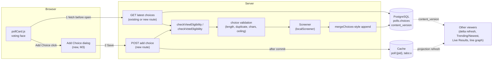
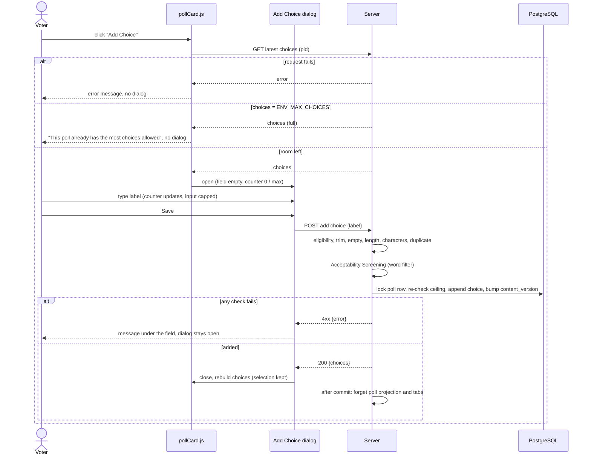
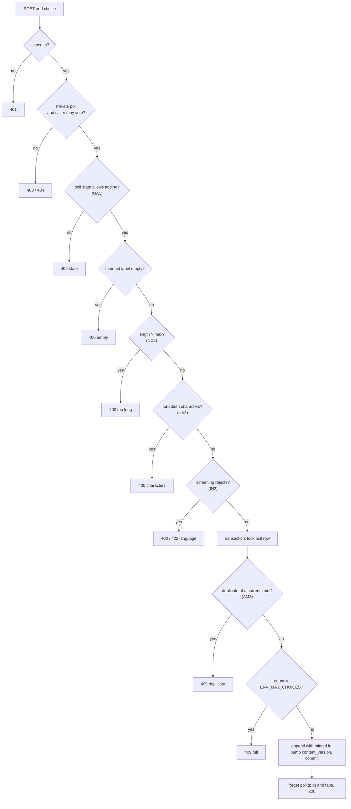
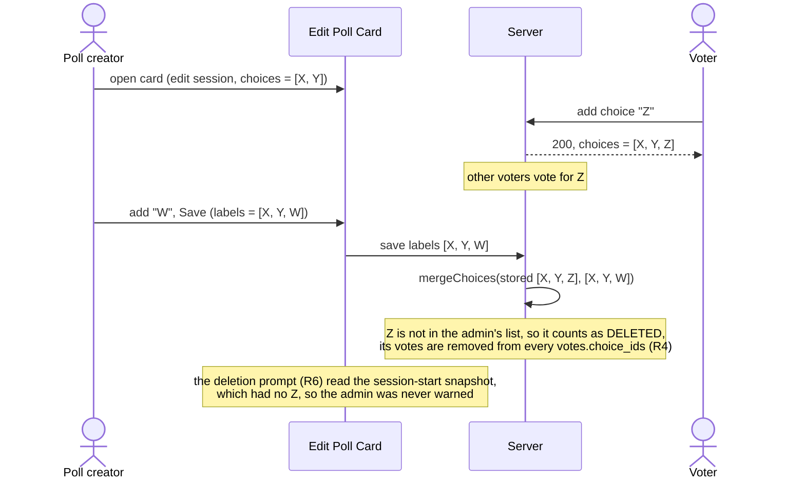

# High Level Requirements

Requirements: `requirements/20261101-181626-user-add-choices/requirements.md`  
External Files: none  
Generated: 2026-11-01 6:16 PM  

A previous requirement , `20261029-225209-editing-poll-available`, allowed for Choices to be added and removed on a Poll that ha received votes.  
That requirement has been implemented and can only be done by an Admin.  

This requirement allows users of a Private poll to add Choices, whether the poll has received votes or not.  
The UI/UX for this is being made available on the Voting side of the Poll Card.  
There will be a button, with the label "Add Choice", on the row of the "Submit Vote" button, and it will be centered.  

When the "Add Choice" button is clicked, a modal dialog with an edit field will appear, allowing the user to enter the new choice.  
The style of the modal dialog will match the existing webapp design, adhering to Material 3 design principles, ensuring consistency in the user interface.  

The dialog will enforce the maximum Choice text length of CHOICE_LABEL_MAX characters. This will be enforced while the user is typing in the field.  
The same UI/UX will be used as used on the Edit Poll Card for field that have a limit. i.e. <length> / CHOICE_LABEL_MAX.  

The dialog will have a "Save" and "Cancel" button.  
The "Save" button will send the new Choice to the server to be validated and added to the poll if it passes validation.  
The validation will ensure that the new Choice is not empty, does not exceed the maximum length of CHOICE_LABEL_MAX characters, and does not duplicate an existing Choice in the poll.  
It will also be checked for any invalid characters or formatting that is not allowed in a Choice.  
It will also check that the Choice passes the same inappropriate words filter that is used when the Edit Poll Card is saved.  
If any of these validations fail, an appropriate error message will be displayed to the user, indicating the reason for the failure, and the user will be able to correct the input before attempting to save again.  

Immediately before launching the "Add Choice" dialog, the client will query the server to get the most recent list of Choices.  
This needs to be done to minimize the chances that the Poll Admin has changed the Poll Choices using the Poll Edit Card since the Poll was updaed in the last scheduled sweep.  
If the Poll already has the maximum number of allowed Choices, the "Add Choice" dialog will not be launched, and an appropriate message will be displayed to the user.  

The dialog will use the most recent list of Choices retrieved from the server to ensure that the user is working with the latest data.  
If the server returns an error or fails to provide the latest list of Choices, an appropriate error message will be displayed to the user, and the "Add Choice" dialog will not be launched.  

Of course, there will be no way to absolutely guarantee that the list of Choices has not changed between the time it is retrieved from the server and the time the new Choice is added.  
However, this approach minimizes the chances of conflicts and ensures that users are working with the most up-to-date information available.  
The rule will be that the last to save; a User Add Choice or a Poll Admin Edit Poll Card action, will take precedence.  
In all cases the server will ensure that the number of Choices in a Poll does not exceed the maximum allowed, regardless of whether the changes are made by a User adding a Choice or a Poll Admin editing the Poll.  
Additionally, if a User attempts to add a Choice when the Poll has already reached the maximum number of allowed Choices, the server will reject the addition and return an appropriate error message, ensuring that the Poll remains within the defined constraints.  

In summary, the process for adding a Choice involves several layers of validation and checks to ensure data integrity and consistency.  

After a Choice is added successfully, the client will update the local view to reflect the new Choice.  
The other users viewing the poll or attempting to vote will have the poll updated according to the existing sweeps and refreshes. 

## Additional Requirements and Research Requests

**Instructions To The Developer**  
Enter any additional requirements or research requests under the ## Additional Requirements and Research Requests heading above.  
When you Type or Say: "Next" in the CC CLI terminal, the additional requirements and research requests will be applied to the report.  
  
You may leave these instructions here. They will be ignored when "Next" is executed.  

✅ Applied 2026-11-01 6:54 PM: 1 requirement added to requirements.md (finding AM4); 1 diagram correction (section 5: the `;` in a sequence-diagram note ends a Mermaid statement, so the note was cut and the diagram failed to render; it now reads `,`).  

## 1. Overview and Scope

Today only the poll's creator (or an Administrator) changes a poll's choices, through the Edit Poll Card.  
On an ever-voted poll that save goes through `mergeChoices` (survivors keep their id; additions get minted ids), and the merged list waits in `polls.pending_update` until the approval sweep screens and applies it (feature `20261029-225209-EDITING-POLL-AVAILABLE`, R2–R4).  

This feature lets a **voter of a Private poll** add one choice from the poll card's voting face:  

- an **Add Choice** button, centred on the row of `Submit vote`;  
- a Material 3 modal dialog with one text field, a `<length> / <max>` counter (the `m3-field-counter` the admin card already uses), and **Save** / **Cancel**;  
- a server round trip **before** the dialog opens, to read the latest choices and refuse at once when the poll is full;  
- a server round trip **on Save**, which validates (empty, length, duplicate, characters, the Acceptability Screening word filter, the choice ceiling `ENV_MAX_CHOICES`) and adds the choice;  
- the adding voter's card updates at once; every other viewer sees the new choice through the existing refreshes, because the write is an ordinary content write (`content_version` bump).  

Out of scope as written: public polls, guests, renaming or deleting choices by voters, and any change to the admin's own Edit Poll Card flow except where findings IN1 and UA1 say it must change.  

What exists and is reused:  

| Concern | Existing code |
|---|---|
| Choice length limit | `CHOICE_LABEL_MAX = 100` (`src/polls/service.ts:33`, copied in `adminCard.js:10`); the wizard caps new polls at `WIZARD_CHOICE_MAX = 40` (`adminCard.js:520`) |
| Choice ceiling | `ENV_MAX_CHOICES` (`config.maxChoices`) |
| Merging by id | `mergeChoices` (`src/polls/service.ts:990`) |
| Word filter | `Screener` / `localScreener` and `screenWithTimeout` (`src/polls/screening.ts`), today run only by the approval sweep |
| Who may vote | `checkVoteEligibility` (banned, Invitation Only invite list, voter limit) and `checkViewEligibility` (`src/polls/service.ts`) |
| Field counter | `m3-field-counter`, `"<n> / <max>"` (`adminCard.js:1142`, `1172`) |
| Vote row | `.actions` holding `.back-btn` and `.submit-vote-btn` (`pollCard.js:1596–1605`) |

## 2. Component Diagram

## 3. Sequence: Adding a Choice

## 4. Decision Flow: Server Validation on Save

## 5. Sequence: A Voter's Addition Racing an Admin Save

This is the case the requirements' "last to save takes precedence" rule governs (finding IN1).

## 6. Breaking Changes

- **The choice list is no longer written only by the poll's owner.**  
  Every reader that assumes `polls.choices` changes only through an admin save, an edit session or the approval sweep must accept a voter's write: the edit session's choice snapshot (R6/R7 of the preceding feature) and the admin card's open wizard can be out of date while they are open.  
- **The deletion prompt's guarantee weakens.**  
  The preceding feature prompts only when a deleted choice has votes, using the session-start `choiceCounts`; a choice added after the session started has no entry, so without a change it can be deleted without a prompt (see IN1).  
- **The API gains a route** (and maybe a second one, UA4), so `postman/openapi.json` changes; no existing route changes its shape.  

## 7. Technical Debt

- `CHOICE_LABEL_MAX` is duplicated in `src/public/adminCard.js:10`; the new dialog would be a third copy unless the limit is sent in `/api/config` (as `minChoices`/`maxChoices` already are).  
- Acceptability Screening runs only inside the approval sweep; calling it from a request path means giving it a second caller with its own timeout handling (`screenWithTimeout`, `ENV_SCREENING_CALL_TIMEOUT`).  
- Choice validation is written twice (`replaceChoices` and `mergeChoices` each check count, length and uniqueness); an add path should share one validator rather than add a third copy.  
- The voting face's `.actions` row was sized for two controls (008 FR-007 ties both buttons' width to the `Submit vote` label); a third, centred button needs that row's layout revisited at phone width (single-column layout up to 640 px).  

## 8. Findings

### 8.1 Inconsistencies

**IN1. "Last to save takes precedence" lets an admin save silently delete a voter's choice and its votes**  
<b>
✅ Resolved</b>  
✅ Requirements File Updated: 2026-11-01 6:54 PM  
**Notes**: Recommendation accepted in file 2026-11-01: Recommendation A, the admin save deletes only what the admin deleted;  
the requirements now say the creator's save finds deletions against the session-start Choices and keeps voters' additions, with the ceiling checked on the combined list.  

> The requirements make the last save win between a voter's Add Choice and the creator's Edit Poll Card save.  
> The Edit Poll Card sends the whole label list it holds, and `mergeChoices` treats every stored label missing from that list as a deletion.  
> A card opened before a voter added "Z" never holds "Z", so the creator's next save deletes it, removes its votes from every ballot (R4 of the preceding feature), and skips the deletion prompt, whose snapshot predates "Z" (R6).  
> That contradicts the requirements' own aim to "minimize the chances of conflicts" and to keep "data integrity", because the creator never chose to delete "Z".  

  - **Recommendation A** _(recommended)_: **the admin save deletes only what the admin deleted.**  

    [X] ➡️ **Accepted**

    - <u>Pros</u>: a choice added after the card opened survives the creator's save; the merge compares the admin's list with the session-start list to find deletions, then applies them to the current stored list, so "last save wins" still holds for every choice both sides touched.  
    - <u>Cons</u>: the merge becomes three-way (session-start, stored, submitted); the server must keep the session-start labels (already held for `choiceCounts`); the ceiling check runs on the combined list, so an admin save can be refused `409` when voters filled the poll meanwhile.  

  - **Recommendation B**: **literal last save wins, with a warning.**  

    [ ] ➡️ **Not Accepted**

    - <u>Pros</u>: no change to `mergeChoices`; the admin save refuses with `409 CHOICES_CHANGED` when the stored list differs from the session-start list, and the card reloads the current list so the creator decides with the deletion prompt.  
    - <u>Cons</u>: the creator loses unsaved edits to the choices on a reload, or must redo them; a busy poll can refuse the creator repeatedly.  

  - **Recommendation C**: **literal last save wins, no protection.**  

    [ ] ➡️ **Not Accepted**

    - <u>Pros</u>: exactly as written, nothing new to build on the admin side.  
    - <u>Cons</u>: voters' choices and the votes on them disappear without anyone deciding to delete them.  

  - **Developer Resolution D**:  

    [ ] ➡️ **Not Accepted**

**IN2. The word filter is asked for at Save time, but today it runs later, in the approval sweep**  
<b>
✅ Resolved</b>  
✅ Requirements File Updated: 2026-11-01 6:54 PM  
**Notes**: Recommendation accepted in file 2026-11-01: Recommendation A, screen the new label inside the add request;  
the requirements now say the same `Screener` runs in the add request, the verdict shows in the dialog, and a timeout answers `503`.  

> The requirements want Save to check the "same inappropriate words filter" as the Edit Poll Card and show the failure in the dialog, so the voter can correct it.  
> On an ever-voted poll, the Edit Poll Card does not screen at save: a changed choice list waits in `pending_update` and the approval sweep screens it seconds later (preceding feature, R2).  
> Both cannot hold: either the add request screens synchronously, or the dialog cannot show the filter's verdict.  

  - **Recommendation A** _(recommended)_: **screen the new label inside the add request.**  

    [X] ➡️ **Accepted**

    - <u>Pros</u>: the dialog shows the verdict at once; the same `Screener` interface is called with `choiceLabels: [label]` through `screenWithTimeout` and `ENV_SCREENING_CALL_TIMEOUT`; `localScreener` makes no network call, so it is instant; the choice is added directly, with no `pending_update`.  
    - <u>Cons</u>: a timeout or a thrown screener must have its own answer (`503`, "try again"); if the screener is later replaced by a hosted model, every Save waits for it.  

  - **Recommendation B**: **queue the addition in `pending_update`, as the creator's save does.**  

    [ ] ➡️ **Not Accepted**

    - <u>Pros</u>: one screening path for every choice change.  
    - <u>Cons</u>: the voter cannot correct a rejected label in the dialog; while one addition waits, every further save is refused `409 PENDING_REVIEW` (R8), including the creator's, and the requirement that the card update at once cannot hold.  

  - **Developer Resolution C**:  

    [ ] ➡️ **Not Accepted**

### 8.2 Ambiguities

**AM1. Who are the "users of a Private poll"?**  
<b>
✅ Resolved</b>  
✅ Requirements File Updated: 2026-11-01 6:54 PM  
**Notes**: Recommendation accepted in file 2026-11-01: Recommendation, anyone who may vote on the poll now, plus its creator;  
the requirements now list the eligibility rules and that the server re-checks them.  

> A Private poll is shared either "Anyone With The Link" or "Invitation Only".  
> It is not said whether the creator, a banned voter, a voter who has already voted, or a viewer the voter limit (`voterCountLimit`) would refuse may add a choice.  

  - **Recommendation**: **anyone who may vote on the poll now, plus its creator.**  

    [X] ➡️ **Accepted**

    - A signed-in user who passes `checkViewEligibility` and `checkVoteEligibility` (not banned; invited, for Invitation Only; within the voter limit or already a voter), and who has the `Vote on Polls` permission; the poll's creator always may.  
    - Guests never see the button; the server re-checks every rule, so a hidden button is never the only guard.  

  - **Developer Resolution B**:  

    [ ] ➡️ **Not Accepted**

**AM2. Where exactly is the button, and when is it shown?**  
<b>
✅ Resolved</b>  
✅ Requirements File Updated: 2026-11-01 6:54 PM  
**Notes**: Recommendation accepted in file 2026-11-01: Recommendation, centred on the row, as an M3 outlined (secondary) button, shown only to users who may add;  
the requirements now place and style the button and say when it is absent.  

> "On the row of the Submit Vote button, and it will be centered" can mean centred on the whole row (between the back arrow at the left and `Submit vote` at the right) or centred in the space left beside them.  
> It is not said whether the button is hidden or disabled when the user may not add a choice, nor how it fits the phone layout, where the row is narrow.  

  - **Recommendation**: **centred on the row, as an M3 outlined (secondary) button, shown only to users who may add.**  

    [X] ➡️ **Accepted**

    - Centred on the row's width, between the back arrow and `Submit vote`, so `Submit vote` stays the one filled (primary) button.  
    - Absent, not disabled, for users who may not add (AM1) and on public polls; the label stays one line at phone width, and the row keeps its height.  

  - **Developer Resolution B**:  

    [ ] ➡️ **Not Accepted**

**AM3. What counts as a duplicate choice?**  
<b>
✅ Resolved</b>  
✅ Requirements File Updated: 2026-11-01 6:54 PM  
**Notes**: Recommendation accepted in file 2026-11-01: Recommendation A, ignore case and repeated spaces for a voter's addition;  
the requirements now give that comparison, and keep the exact one for the creator's saves.  

> The requirements forbid a choice that duplicates an existing one, but not how labels are compared.  
> The server today compares trimmed labels exactly (`mergeChoices`), so "Pizza" and "pizza" are different choices, and so are "Deep dish" and "Deep  dish".  

  - **Recommendation A** _(recommended)_: **ignore case and repeated spaces for a voter's addition.**  

    [X] ➡️ **Accepted**

    - <u>Pros</u>: stops near-copies by voters who did not look closely; the creator's own saves keep today's exact rule, so no stored poll becomes invalid.  
    - <u>Cons</u>: two rules exist: a voter is refused "pizza" next to "Pizza", but a creator may still save both.  

  - **Recommendation B**: **exact trimmed match, as today.**  

    [ ] ➡️ **Not Accepted**

    - <u>Pros</u>: one rule everywhere; `mergeChoices` already enforces it.  
    - <u>Cons</u>: "Pizza" and "pizza" can sit side by side and split the vote.  

  - **Developer Resolution C**:  

    [ ] ➡️ **Not Accepted**

**AM4. Is `MAX_CHOICE_LABEL_LENGTH` the new limit for voters' additions, a new name for `CHOICE_LABEL_MAX`, or a setting?**  
<b>
✅ Resolved</b>  
✅ Requirements File Updated: 2026-11-01 7:07 PM  
**Notes**: Recommendation accepted in file 2026-11-01: Developer Resolution D, `MAX_CHOICE_LABEL_LENGTH` was a slip for `WIZARD_CHOICE_MAX`;  
the requirements now name `WIZARD_CHOICE_MAX` (40) as the limit for voters' additions, moved to `src/polls/service.ts` beside `CHOICE_LABEL_MAX` and sent in `/api/config`.  

> The additional requirement says the Choice limit is `MAX_CHOICE_LABEL_LENGTH`, not `CHOICE_LABEL_MAX`.  
> No constant of that name exists in the code.  
> NC2 limits a voter's addition to 40 characters by a new constant beside `CHOICE_LABEL_MAX` (100), which stays for the creator's saves of existing polls.  
> It is not said whether `MAX_CHOICE_LABEL_LENGTH` is that new constant, a new name for `CHOICE_LABEL_MAX`, or an operator setting.  

  - **Recommendation A** _(recommended)_: **the name of NC2's new constant: `MAX_CHOICE_LABEL_LENGTH = 40`, for voters' additions.**  

    [ ] ➡️ **Not Accepted**

    - <u>Pros</u>: it matches NC2 and the new-poll wizard's 40;  
      `CHOICE_LABEL_MAX` and every existing check stay as they are;  
      the constant lives in `src/polls/service.ts` and is sent in `/api/config`.  
    - <u>Cons</u>: two length constants with similar names.  

  - **Recommendation B**: **rename `CHOICE_LABEL_MAX` to `MAX_CHOICE_LABEL_LENGTH` everywhere.**  

    [ ] ➡️ **Not Accepted**

    - <u>Pros</u>: one name for the Choice limit.  
    - <u>Cons</u>: it touches existing code and tests (`service.ts`, `adminCard.js`);  
      NC2's 40-character constant for voters still needs a name of its own.  

  - **Recommendation C**: **a setting, `ENV_MAX_CHOICE_LABEL_LENGTH` (default 40, at most `CHOICE_LABEL_MAX`).**  

    [ ] ➡️ **Not Accepted**

    - <u>Pros</u>: the operator can change it without a release.  
    - <u>Cons</u>: one more setting (the CLAUDE.md table, the templates, the `[config]` default line), and the client must read it from `/api/config`.  

  - **Developer Resolution D**:  

    [X] ➡️ **Accepted**

    - we mistakenly typed "MAX_CHOICE_LABEL_LENGTH" but should have entered"WIZARD_CHOICE_MAX"

### 8.3 Unspecified Aspects

**UA1. In which poll states may a choice be added?**  
<b>
✅ Resolved</b>  
✅ Requirements File Updated: 2026-11-01 6:54 PM  
**Notes**: Recommendation accepted in file 2026-11-01: Recommendation, only while the poll is open to voting; refuse during an edit session or a pending review;  
the requirements now allow additions only in raw OPEN with no `pending_update`, and give the `409` wording.  

> The requirements say "whether the poll has received votes or not", but not which poll states allow it.  
> A poll may be WAITING TO OPEN, OPEN, CLOSED, AWAITING APPROVAL, EDITING (shown to voters as OPEN, R1 of the preceding feature), or OPEN with a change waiting in `pending_update`.  

  - **Recommendation**: **only while the poll is open to voting; refuse during an edit session or a pending review.**  

    [X] ➡️ **Accepted**

    - Allowed when the raw `pollState` is OPEN and `pending_update` is null; every other state, including EDITING, answers `409` with "The poll's choices are being edited. Try again shortly." (EDITING) or the state's own wording.  
    - Refusing while the creator's card holds the edit session removes most of IN1's race; IN1 still covers a card opened after the addition is read.  

  - **Developer Resolution B**:  

    [ ] ➡️ **Not Accepted**

**UA2. How does adding a choice relate to the user's vote?**  
<b>
✅ Resolved</b>  
✅ Requirements File Updated: 2026-11-01 6:54 PM  
**Notes**: Recommendation accepted in file 2026-11-01: Recommendation, adding never votes; the button is offered only to users who can still vote;  
the requirements now say the Choice appears unselected and the Final-Vote case is refused.  

> It is not said whether the new choice is selected for the user, whether adding it counts as a vote, or what happens on a Final-Vote poll the user has already voted on, where they could never vote for what they added.  

  - **Recommendation**: **adding never votes; the button is offered only to users who can still vote.**  

    [X] ➡️ **Accepted**

    - The new choice appears last on the voting face, unselected; the user's current selection (`pendingSelection`) is kept; they vote with `Submit vote` as usual.  
    - On a Final-Vote poll the user has voted on, the button is absent and the server refuses; the creator is not bound by this.  

  - **Developer Resolution B**:  

    [ ] ➡️ **Not Accepted**

**UA3. Which characters or formatting are "not allowed in a Choice"?**  
<b>
✅ Resolved</b>  
✅ Requirements File Updated: 2026-11-01 6:54 PM  
**Notes**: Recommendation accepted in file 2026-11-01: Recommendation, one line of printable text;  
the requirements now list the refused characters, for voters' additions only.  

> The requirements ask for a check against invalid characters or formatting, but no such rule exists today: a choice is any trimmed, non-empty string up to the length limit.  

  - **Recommendation**: **one line of printable text.**  

    [X] ➡️ **Accepted**

    - The label is trimmed; it may not hold line breaks, tabs or other control characters (Unicode category `Cc`), nor zero-width or bidirectional-override characters (`U+200B–U+200F`, `U+202A–U+202E`, `U+2066–U+2069`), which can hide or reorder text.  
    - Emoji and every script are allowed; HTML is stored as typed and always shown as text, as titles are.  
    - The rule applies to voters' additions only, so no stored poll becomes invalid.  

  - **Developer Resolution B**:  

    [ ] ➡️ **Not Accepted**

**UA4. What does the "query before launching" read, and what does the user see?**  
<b>
✅ Resolved</b>  
✅ Requirements File Updated: 2026-11-01 6:54 PM  
**Notes**: Recommendation accepted in file 2026-11-01: Recommendation, reuse the user's poll read, and use the list for the counter and early checks;  
the requirements now name `GET /api/me/polls/:pid` and the two messages.  

> The requirements ask for the latest choices before the dialog opens, but not which route serves them, how it is rate-limited, what the dialog does with the list, nor the wording of the "poll is full" and "could not load" messages.  

  - **Recommendation**: **reuse the user's poll read, and use the list for the counter and early checks.**  

    [X] ➡️ **Accepted**

    - The card calls the existing `GET /api/me/polls/:pid` (manual-refresh floor and burst), which answers the current choices; no new read route.  
    - The card rebuilds its choices from the answer, so the user sees what they are adding to; the dialog checks duplicates against it while typing, but Save is still decided by the server.  
    - Messages, shown in the card's existing message area: "This poll already has the most choices allowed (<max>)." and "Couldn't load the latest choices. Try again."  

  - **Developer Resolution B**:  

    [ ] ➡️ **Not Accepted**

**UA5. How is the new choice written, and how do the other views learn of it?**  
<b>
✅ Resolved</b>  
✅ Requirements File Updated: 2026-11-01 6:54 PM  
**Notes**: Recommendation accepted in file 2026-11-01: Recommendation, an ordinary content write, appended like a `mergeChoices` addition;  
the requirements now describe the transaction, the after-commit cache and outbox work, and the answer.  

> "Updated according to the existing sweeps and refreshes" holds only if the addition is written like a content change; its id, position, colour, the cached projections and the line graph are not specified.  

  - **Recommendation**: **an ordinary content write, appended like a `mergeChoices` addition.**  

    [X] ➡️ **Accepted**

    - One transaction with the poll row locked (`select … for update`), re-checking the ceiling and duplicates, then appending `{ id: randomUUID(), label, position: max + 1 }` with no `color` (Automatic) and bumping `content_version`.  
    - After commit: delete the `poll:<pid>` projection and the affected users' `tabs:v` (`forgetTabs`), queue a `search_outbox` row, and let the line graph pick the choice up from the next vote (no tally rebuild is needed for an empty choice).  
    - The answer carries the poll's new choices, so the adding user's card redraws at once.  

  - **Developer Resolution B**:  

    [ ] ➡️ **Not Accepted**

**UA6. How does the dialog behave?**  
<b>
✅ Resolved</b>  
✅ Requirements File Updated: 2026-11-01 6:54 PM  
**Notes**: Recommendation accepted in file 2026-11-01: Recommendation, an M3 basic dialog with the admin card's outlined field;  
the requirements now give its focus, keys, counter, Save state and error display.  

> The requirements give the dialog's field, counter and two buttons, but not its keyboard and focus behaviour, what happens to typing past the limit, nor whether Save is disabled for an empty field.  

  - **Recommendation**: **an M3 basic dialog with the admin card's outlined field.**  

    [X] ➡️ **Accepted**

    - `role="dialog"`, `aria-modal="true"`, titled "Add Choice"; focus moves to the field and returns to the button on close; Enter saves, Escape and Cancel close without saving.  
    - The field takes no more than the limit (a paste is cut to fit), the counter reads `<n> / <max>`, and Save stays disabled while the trimmed text is empty or a request is in flight.  
    - A server refusal shows under the field in the M3 error style and keeps the text; only M3 tokens are used, so the sheet passes `m3-assets.test.ts`.  

  - **Developer Resolution B**:  

    [ ] ➡️ **Not Accepted**

### 8.4 Needs Clarifications

**NC1. Is adding choices always on for Private polls, or does the creator turn it on?**  
<b>
✅ Resolved</b>  
✅ Requirements File Updated: 2026-11-01 6:54 PM  
**Notes**: Recommendation accepted in file 2026-11-01: Recommendation A, a per-poll setting, off by default;  
the requirements now add "Voters may add choices" to the How step, with its migration.  

> As written, every Private poll, existing ones included, gains the button.  
> A creator whose poll asks a fixed question ("Which date works?") may not want voters to extend it.  

  - **Recommendation A** _(recommended)_: **a per-poll setting, off by default.**  

    [X] ➡️ **Accepted**

    - <u>Pros</u>: no existing poll changes behaviour; "Voters may add choices" sits in the admin card's How step beside the other Private-only settings, and may change after votes (like sharing mode).  
    - <u>Cons</u>: one additive migration (a boolean column) and one more field on the admin card, the projections and `postman/openapi.json`.  

  - **Recommendation B**: **always on for every Private poll.**  

    [ ] ➡️ **Not Accepted**

    - <u>Pros</u>: exactly as written; no migration or setting.  
    - <u>Cons</u>: creators cannot prevent it, and existing polls change without their creator choosing it.  

  - **Developer Resolution C**:  

    [ ] ➡️ **Not Accepted**

**NC2. Is the limit 100 characters (`CHOICE_LABEL_MAX`) or 40 (what a creator may type for a new poll)?**  
<b>
✅ Resolved</b>  
✅ Requirements File Updated: 2026-11-01 6:54 PM  
**Notes**: Recommendation accepted in file 2026-11-01: Recommendation A, 40, the new-poll limit;  
the requirements now limit voters' additions to 40 by a new constant beside `CHOICE_LABEL_MAX`;  
its name is the subject of the new finding AM4.  

> The requirements name `CHOICE_LABEL_MAX`, which is 100 on the server.  
> The admin card's wizard caps a new poll's choices at `WIZARD_CHOICE_MAX = 40` (`adminCard.js:520`), keeping 100 only so older labels are not cut.  
> A voter could therefore add a label more than twice as long as the creator may write.  

  - **Recommendation A** _(recommended)_: **40, the new-poll limit.**  

    [X] ➡️ **Accepted**

    - <u>Pros</u>: a voter's label fits the bars and the line graph's legend as a creator's does; the server enforces it for additions (a new constant beside `CHOICE_LABEL_MAX`, sent in `/api/config` with it).  
    - <u>Cons</u>: the requirements' wording changes from `CHOICE_LABEL_MAX` to that constant.  

  - **Recommendation B**: **100, `CHOICE_LABEL_MAX`, as written.**  

    [ ] ➡️ **Not Accepted**

    - <u>Pros</u>: no new constant; the server's existing check applies.  
    - <u>Cons</u>: voters may write labels the creator could not have written, which wrap to several lines on the card.  

  - **Developer Resolution C**:  

    [ ] ➡️ **Not Accepted**

**NC3. How many choices may one user add to a poll?**  
<b>
✅ Resolved</b>  
✅ Requirements File Updated: 2026-11-01 6:54 PM  
**Notes**: Recommendation accepted in file 2026-11-01: Recommendation C, no per-user limit; only the vote floor `ENV_MIN_VOTE_REFRESH_INTERVAL` between requests;  
the requirements now say so.  

> Nothing bounds one user's additions below the poll's ceiling (`ENV_MAX_CHOICES`, 50), so one voter could fill a poll with choices and stop everyone else, the creator included, from adding any.  

  - **Recommendation A** _(recommended)_: **one choice per user per poll.**  

    [ ] ➡️ **Not Accepted**

    - <u>Pros</u>: simple to explain; the button disappears once the user has added one, and the server refuses a second with `409`.  
    - <u>Cons</u>: the poll must remember who added each choice (see NC4); a user whose choice the creator deleted cannot add another.  

  - **Recommendation B**: **a setting, `ENV_MAX_ADDED_CHOICES_PER_USER` (default 1).**  

    [ ] ➡️ **Not Accepted**

    - <u>Pros</u>: the operator can raise it without a release.  
    - <u>Cons</u>: one more setting (CLAUDE.md table, templates, `[config]` default line).  

  - **Recommendation C**: **no per-user limit; only the vote floor `ENV_MIN_VOTE_REFRESH_INTERVAL` between requests.**  

    [X] ➡️ **Accepted**

    - <u>Pros</u>: as written; nothing is remembered about who added what.  
    - <u>Cons</u>: one user can fill the poll in under two minutes.  

  - **Developer Resolution D**:  

    [ ] ➡️ **Not Accepted**

**NC4. Is it recorded who added a choice, and who may remove it?**  
<b>
✅ Resolved</b>  
✅ Requirements File Updated: 2026-11-01 6:54 PM  
**Notes**: Recommendation accepted in file 2026-11-01: Recommendation A, keep the adder's user id on the choice; the creator removes it with the Edit Poll Card;  
the requirements now add `addedBy`, the "Added by" label, and its privacy and account-deletion handling.  

> The word filter catches only a short list of terms, so an unpleasant label can pass it.  
> The requirements do not say whether the poll keeps who added each choice, whether the creator sees it, or how such a choice is removed.  

  - **Recommendation A** _(recommended)_: **keep the adder's user id on the choice; the creator removes it with the Edit Poll Card.**  

    [X] ➡️ **Accepted**

    - <u>Pros</u>: `addedBy` (a user id, inside the `polls.choices` JSON, no migration) supports NC3's limit and lets the creator ban the author; the admin card shows "Added by <username>" beside the choice; deletion is the existing flow with its vote prompt.  
    - <u>Cons</u>: it is personal data, so the Privacy Policy names it, and account deletion (PRIVACY-AND-TERMS R8) must clear it.  

  - **Recommendation B**: **record nothing; the creator removes any choice with the Edit Poll Card.**  

    [ ] ➡️ **Not Accepted**

    - <u>Pros</u>: no personal data added.  
    - <u>Cons</u>: no per-user limit (NC3 must be C), and no way to tell who wrote an abusive label.  

  - **Developer Resolution C**:  

    [ ] ➡️ **Not Accepted**

## 9. Requirements Report Complete Report  
  
- **Requirements Report Document:** requirements/20261101-181626-user-add-choices/requirements-report.md  
- **Requirements Document:** requirements/new-20261101-123722/requirements.md → requirements/20261101-181626-user-add-choices/requirements.md  
- **Software Architecture Diagrams:** 4  
- **Inconsistencies:** 2  
- **Ambiguities:** 4  
- **Unspecified Aspects:** 6  
- **Needs Clarifications:** 4  
- **Research Results:** 0  
- **Breaking Changes:** 3  
- **Technical Debt items:** 4  
  
The requirements are ready for /speckit-specify.  
To generate specs from the requirements document, use the `/speckit-specify` skill followed by the path (relative to the project root) to the requirements file.  
At the prompt, Type:  
🟩 👉 /speckit-specify requirements/20261101-181626-user-add-choices/requirements.md  
