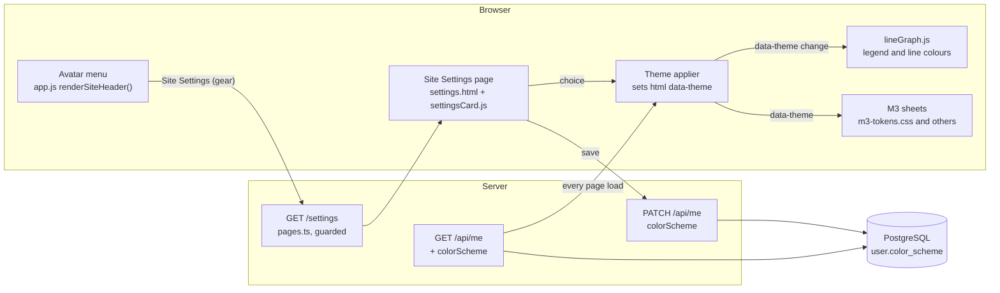
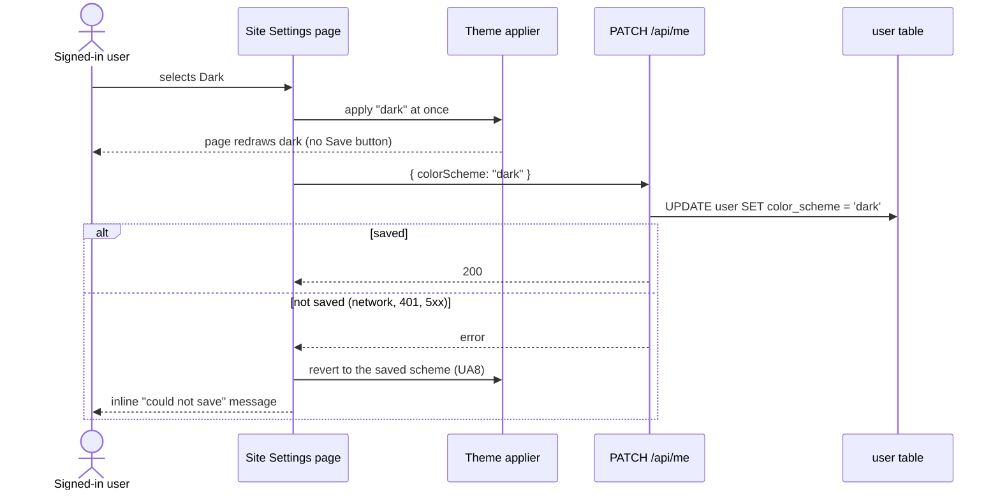
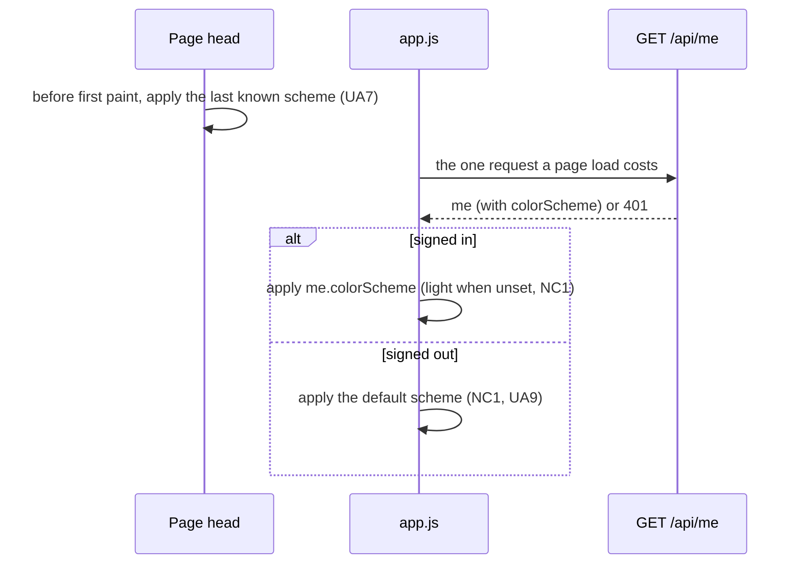

# High Level Requirements

Requirements: `requirements/20261102-134601-site-settings/requirements.md`  
External Files: `dontTrack/poll-admin-icon.jpg` (linked, but not in the requirements folder: it is in the git-ignored top-level `dontTrack/` folder; see UA2)  
Generated: 2026-11-02 1:46 PM  

Add a menu item to the Avatar menu for accessing user settings, called "Site Settings"   
The icon for iot (in the menu) will be what is currently used for "Poll Administration" - a typical gear icon.  

The new icon for "Poll Administration" will be created from the image in:  
  
It will be in a dark colored circle the same as the gear icon does now.  

The "Site Settings" menu item will not be disabled for Guests.  

When Signed In users click the menu item, a user settings page will be displayed  
that has the same styling and layout as the "Profile" page.  
The title will be "Site Settings" and the icon on the page's card will be the gear icon in a dark colored circle, the same as in the menu (although in this context if be the same size as the icon on the Profile page).  
All the other fields, labels and buttons that are on the Profile page will not bew on the new Site Settings page.  

Currently, the only setting available on the Site Settings page will be a "Color Scheme" settings,  
that allows the user to choice between "Light (default)" and "Dark" color schemes.  
The setting will be applied immediately when the user selects a color scheme.  
There will be no need for a "Save" button.  
When the Color Schme is changed: 
- the new setting will be sent to the server to be saved in the user' record in the database
- the new color scheme will be applied to the user interface immediately

## Additional Requirements and Research Requests

**Instructions To The Developer**  
Enter any additional requirements or research requests under the ## Additional Requirements and Research Requests heading above.  
When you Type or Say: "Next" in the CC CLI terminal, the additional requirements and research requests will be applied to the report.  
  
You may leave these instructions here. They will be ignored when "Next" is executed.  

## 1. Overview

The feature adds a per-account **Site Settings** page, reached from the avatar menu, whose first and only setting is the **Color Scheme** (Light or Dark).  
It also gives **Poll Administration** a new menu icon (a checklist), freeing the gear for Site Settings.  

- **In scope**:  
  - a "Site Settings" item in the avatar menu, with the gear icon now used by Poll Administration;  
  - a new checklist icon for "Poll Administration", drawn from `poll-admin-icon.jpg` in a dark circle;  
  - a Site Settings page styled like the Profile page, titled "Site Settings", with the gear icon on its card;  
  - a "Color Scheme" control (Light (default), Dark), applied at once with no Save button;  
  - the choice saved to the user's record in the database.  
- **Out of scope** (assumed): any other setting; colour schemes beyond light and dark; changing the Profile page itself.  
- **What exists today** (from the codebase):  
  - The avatar menu is built in `src/public/app.js` `renderSiteHeader()` for signed-in users only: Edit Profile, Create Poll (disabled without permission), Poll Administration (only with permission), Logout. A signed-out visitor sees a "Log In" button and no menu.  
  - Menu icons are inline SVG glyphs in `app.js` (`PROFILE_GLYPH`, `CREATE_POLL_GLYPH`, `ADMIN_GLYPH`, `LOGOUT_GLYPH`); the gear is `ADMIN_GLYPH`, used only in that menu item.  
  - A dark scheme already exists: `m3-tokens.css` and five other M3 sheets switch to dark under `@media (prefers-color-scheme: dark)` unless `<html data-theme="light">`, and force it with `<html data-theme="dark">`. So today the site follows the device's setting, except `admin.html` and `admin-results.html`, which are pinned to light.  
  - `lineGraph.js` reads `prefers-color-scheme` directly to redraw its legend and lines.  
  - `/profile` is guarded in `src/routes/pages.ts` (a guest is redirected to `/login`); `GET /api/me` and `PATCH /api/me` serve the profile.  
  - The `user` table (`src/db/schema.ts` `UserTable`) has no setting columns; the last migration is `015-voters-add-choices`.  

## 2. Component View

## 3. Changing the Color Scheme

## 4. Applying the Scheme on Every Page Load

## 5. Design Notes

- **One switch.** The scheme is carried by the `data-theme` attribute on `<html>`, which every M3 sheet already honours; the feature sets it rather than adding new dark rules.  
- **Storage.** One nullable column, `color_scheme`, on the `user` table, added by an additive migration `016-…` (UA5); `NULL` means "never chosen".  
- **API.** `GET /api/me` returns `colorScheme`; `PATCH /api/me` accepts it beside `userName`; `postman/openapi.json` follows (UA5).  
- **Page.** `/settings` reuses the Profile page's card shell (`cardShell.js`, `card-shell-m3.css`, `profile-editor-m3.css`), with the gear in the slot where the Profile card shows the avatar.  
- **Invariants touched.**  
  - A new browser storage key needs a Cookie Use row in `privacy.html` (`tests/cookie-use-list.test.ts`), if UA7 A is taken.  
  - `m3-assets.test.ts` pins each page's stylesheets: the new page needs its `LAYER_ORDER` entry.  
  - The terms gate runs before every router; `PATCH /api/me` is already behind it.  

## 6. Assumptions

- "Guests" means signed-out visitors (the codebase's term), unless AM1 says otherwise.  
- "The same size as the icon on the Profile page" means the size of the avatar on the Profile card.  
- The setting belongs to the account, not the device: it follows the user to every browser they sign in on.  
- The typos in the requirements ("iot", "if be", "bew", "choice", "Schme", "user'") are read as "it", "it will be", "be", "choose", "Scheme", "user's".  
- No new dependency and no new `ENV_*` setting.  

## 7. Breaking Changes

- **Default scheme on dark devices** (if NC1 A is accepted): the site follows the device's dark setting today; with "Light (default)", visitors and users who never chose see the light scheme even on a dark device.  
- **Admin pages no longer pinned to light** (if UA6 A is accepted): `admin.html` and `admin-results.html` lose `data-theme="light"`, so a user who chose Dark sees them dark.  
- **Poll Administration's icon changes** from the gear to a checklist; users who look for the gear will now find Site Settings there.  
- `GET /api/me` gains a field and `PATCH /api/me` accepts one more: additive, not breaking.  

## 8. Technical Debt

- **Dark rules are written twice** in each M3 sheet, once under `@media (prefers-color-scheme: dark) { :root:not([data-theme="light"]) … }` and once under `:root[data-theme="dark"]`. If the site stops following the device (NC1 A), the media-query copies become dead code that should be removed.  
- **`lineGraph.js` reads `prefers-color-scheme` itself** instead of the page's scheme, so it can disagree with a chosen scheme (UA11).  
- **`admin.html` and `admin-results.html` pin `data-theme="light"`**, and `admin.css` predates the M3 tokens: its dark rendering has never been reviewed (UA6).  

## 9. Findings

### 9.1 Inconsistencies

None found.

### 9.2 Ambiguities

**AM1. Who sees the "Site Settings" item — what does "not disabled for Guests" mean?**  
<b>
✅ Resolved</b>  
✅ Requirements File Updated: 2026-11-02 2:25 PM  
**Notes**: Recommendation accepted in file 2026-11-02: Recommendation A, **enabled for every signed-in user, whatever their permissions; signed-out visitors have no avatar menu, so no item.**;  
the requirements now say who sees the item.  

> The requirements say the item "will not be disabled for Guests", and that "Signed In users" who click it see the page.  
> In the codebase a guest is a signed-out visitor, and a signed-out visitor has no avatar menu at all: the header shows only a "Log In" button.  
> The sentence most likely contrasts the item with "Create Poll", which is shown disabled to signed-in users without permission to create polls.  

  - **Recommendation A** _(recommended)_: **enabled for every signed-in user, whatever their permissions; signed-out visitors have no avatar menu, so no item.**  

    [X] ➡️ **Accepted**

    - <u>Pros</u>: it matches "When Signed In users click the menu item", needs no new header control, and the setting is saved to a user record, which a guest has not got.  
    - <u>Cons</u>: a signed-out visitor cannot choose a scheme.  

  - **Recommendation B**: **also give signed-out visitors a Site Settings entry (e.g. a gear beside "Log In"), their choice kept in the browser only.**  

    [ ] ➡️ **Not Accepted**

    - <u>Pros</u>: everyone can read the site in Dark.  
    - <u>Cons</u>: a new header control on every page, a guest-reachable `/settings`, a browser-only storage path beside the database one, and rules for merging the two at sign-in.  

  - **Developer Resolution C**:  

    [ ] ➡️ **Not Accepted**

### 9.3 Unspecified Aspects

**UA1. Where in the avatar menu does "Site Settings" go?**  
<b>
✅ Resolved</b>  
✅ Requirements File Updated: 2026-11-02 2:13 PM  
**Notes**: Recommendation accepted by "Accept all" 2026-11-02: Recommendation, **directly after "Edit Profile", before Create Poll.**;  
the requirements now place the item under "Resolved Requirements".  

> The menu today is Edit Profile, Create Poll, Poll Administration (with permission), then Logout, which the code keeps last.  
> The requirements do not place the new item.  

  - **Recommendation**: **directly after "Edit Profile", so the two account items sit together, before Create Poll.**  

    [X] ➡️ **Accepted**

    - Account items (Edit Profile, Site Settings) come first, poll items next, and Logout stays last.  

  - **Developer Resolution B**:  

    [ ] ➡️ **Not Accepted**

**UA2. The new icon's source image is in a git-ignored folder, and its link does not resolve.**  
<b>
✅ Resolved</b>  
✅ Requirements File Updated: 2026-11-02 2:13 PM  
**Notes**: Recommendation accepted by "Accept all" 2026-11-02: Recommendation, **copy the image into the requirements folder and fix the link.**;  
`poll-admin-icon.jpg` was copied into the requirements folder and the link now points to it.  

> The requirements embed `dontTrack/poll-admin-icon.jpg`, a path relative to the requirements folder, where no such file exists.  
> The image is in the project's top-level `dontTrack/` folder, which `.gitignore` excludes, so it would be lost to anyone else reading the requirements.  
> It shows three ticked check boxes, each followed by a bar (the middle bar shorter), in black on white.  

  - **Recommendation**: **copy the image into the requirements folder as `poll-admin-icon.jpg` and change the link to ``.**  

    [X] ➡️ **Accepted**

    - The requirements folder holds every image the requirements use, and it is committed, so the link works for every reader and for /speckit-specify.  

  - **Developer Resolution B**:  

    [ ] ➡️ **Not Accepted**

**UA3. How is the new "Poll Administration" icon drawn?**  
<b>
✅ Resolved</b>  
✅ Requirements File Updated: 2026-11-02 2:13 PM  
**Notes**: Recommendation accepted by "Accept all" 2026-11-02: Recommendation, **redraw the image as an inline SVG glyph; the gear moves to `SETTINGS_GLYPH`.**;  
the requirements now describe both glyphs under "Resolved Requirements".  

> The requirements say it is "created from the image" and sits "in a dark colored circle the same as the gear icon does now".  
> Every menu icon today is an inline 64×64 SVG glyph in `app.js`: a `currentColor` circle with the figure drawn in `var(--paper)`, so it follows the colour scheme.  
> A JPEG would not follow the scheme and would blur at menu size.  

  - **Recommendation**: **redraw the image as an inline SVG glyph (`ADMIN_GLYPH`): a `currentColor` circle with three paper-coloured ticked boxes and bars, the middle bar shorter, as in the image; the gear moves to a new `SETTINGS_GLYPH`.**  

    [X] ➡️ **Accepted**

    - It matches the other menu icons, scales cleanly, and turns with the colour scheme; the gear glyph is reused unchanged for Site Settings, in the menu and on the page's card.  

  - **Developer Resolution B**:  

    [ ] ➡️ **Not Accepted**

**UA4. What is the page's address, and what happens to a signed-out visitor who opens it?**  
<b>
✅ Resolved</b>  
✅ Requirements File Updated: 2026-11-02 2:13 PM  
**Notes**: Recommendation accepted by "Accept all" 2026-11-02: Recommendation, **`/settings`, guarded like `/profile`.**;  
the requirements now give the address and the redirect to `/login`.  

> The requirements describe the page but not its URL, nor what a signed-out visitor sees if they open it directly (a bookmark, a link, a session that expired).  

  - **Recommendation**: **`/settings`, guarded like `/profile`: a request without a session is redirected to `/login`.**  

    [X] ➡️ **Accepted**

    - It follows the Profile page's precedent in `src/routes/pages.ts`, and the page has nothing to show without an account.  

  - **Developer Resolution B**:  

    [ ] ➡️ **Not Accepted**

**UA5. How is the setting stored and sent?**  
<b>
✅ Resolved</b>  
✅ Requirements File Updated: 2026-11-02 2:13 PM  
**Notes**: Recommendation accepted by "Accept all" 2026-11-02: Recommendation, **a nullable `color_scheme` column, migration `016-…`, read by `GET /api/me` and set by `PATCH /api/me`.**;  
the requirements now describe the column, its values and the two requests.  

> The requirements say the setting is "saved in the user's record in the database", but not the column, its values, or the request that saves and reads it.  

  - **Recommendation**: **a nullable `color_scheme` text column (`'light'` or `'dark'`, `NULL` = never chosen) on the `user` table, added by an additive migration `016-…`; `GET /api/me` returns it as `colorScheme`, and `PATCH /api/me` accepts `{ colorScheme }` and refuses any other value with `400`; `postman/openapi.json` follows.**  

    [X] ➡️ **Accepted**

    - `GET /api/me` is already the one request every page load makes, so the scheme arrives with no extra request;  
      `PATCH /api/me` already edits the profile, so no new route passes the terms gate;  
      a check constraint keeps the column to the two values, and account deletion removes it with the row.  

  - **Developer Resolution B**:  

    [ ] ➡️ **Not Accepted**

**UA6. Which pages does the Dark scheme apply to?**  
<b>
✅ Resolved</b>  
✅ Requirements File Updated: 2026-11-02 2:25 PM  
**Notes**: Recommendation accepted in file 2026-11-02: Recommendation A, **every page, admin pages included.**;  
the requirements now remove the admin pages' light pin and call for a Dark review of `admin.css`.  

> "Applied to the user interface" does not say whether it covers every page.  
> `admin.html` and `admin-results.html` are pinned to light today (`<html data-theme="light">`), and `admin.css` predates the M3 tokens, so their dark rendering has never been reviewed.  

  - **Recommendation A** _(recommended)_: **every page, admin pages included: remove the light pin and fix whatever `admin.css` draws wrongly in dark.**  

    [X] ➡️ **Accepted**

    - <u>Pros</u>: the choice means the same everywhere; no glaring light page between dark ones.  
    - <u>Cons</u>: the admin pages need a dark review and probably some fixes, which widens the feature.  

  - **Recommendation B**: **every page except the two admin pages, which stay light for now (recorded as technical debt).**  

    [ ] ➡️ **Not Accepted**

    - <u>Pros</u>: smaller and safer; admin pages are unchanged.  
    - <u>Cons</u>: a poll creator who chose Dark gets light admin pages.  

  - **Developer Resolution C**:  

    [ ] ➡️ **Not Accepted**

**UA7. How is a flash of the wrong scheme avoided when a page loads?**  
<b>
✅ Resolved</b>  
✅ Requirements File Updated: 2026-11-02 2:25 PM  
**Notes**: Recommendation accepted in file 2026-11-02: Recommendation A, **a `localStorage` copy of the choice, applied in each page's `<head>` before paint.**;  
the requirements now describe the copy, its correction by `/api/me` and its Cookie Use row.  

> Pages are static HTML; the user's choice arrives with `GET /api/me`, after the page has first painted.  
> A user who chose Dark would see every page flash light before it turns dark.  

  - **Recommendation A** _(recommended)_: **keep a copy of the choice in `localStorage` (`colorScheme`), applied by a few lines at the top of each page's `<head>` before the stylesheets paint; the database stays the source of truth, and `/api/me` corrects the copy on every load. The key gets a Cookie Use row in `privacy.html`.**  

    [X] ➡️ **Accepted**

    - <u>Pros</u>: no flash after the first load on a device; static pages stay static.  
    - <u>Cons</u>: an inline script in every page's head, and one more storage key to declare.  

  - **Recommendation B**: **the server writes `data-theme` into the HTML for a signed-in request.**  

    [ ] ➡️ **Not Accepted**

    - <u>Pros</u>: correct from the first paint, no browser storage.  
    - <u>Cons</u>: every page becomes a per-user response (a session lookup and a template per page), which the static, cache-friendly page design avoids.  

  - **Recommendation C**: **accept the flash.**  

    [ ] ➡️ **Not Accepted**

    - <u>Pros</u>: nothing to build.  
    - <u>Cons</u>: a white flash on every page for every Dark user.  

  - **Developer Resolution D**:  

    [ ] ➡️ **Not Accepted**

**UA8. What happens when the choice cannot be saved?**  
<b>
✅ Resolved</b>  
✅ Requirements File Updated: 2026-11-02 2:13 PM  
**Notes**: Recommendation accepted by "Accept all" 2026-11-02: Recommendation, **go back to the last saved scheme and show an inline message.**;  
the requirements now say what a failed save does, `401` included.  

> The scheme is applied at once and saved in the background; the requirements do not say what happens when the save fails (offline, session expired, server error).  

  - **Recommendation**: **go back to the last saved scheme, reselect it in the control, and show an inline message under the control ("Your color scheme could not be saved. Please try again."); a `401` sends the user to `/login`, as the Profile page does.**  

    [X] ➡️ **Accepted**

    - The screen never shows a choice the next page load would undo, and the user knows to try again.  

  - **Developer Resolution B**:  

    [ ] ➡️ **Not Accepted**

**UA9. What do other open tabs, other devices and signing out do?**  
<b>
✅ Resolved</b>  
✅ Requirements File Updated: 2026-11-02 2:13 PM  
**Notes**: Recommendation accepted by "Accept all" 2026-11-02: Recommendation, **other tabs switch at once, other devices on next load, Logout returns to the default.**;  
the requirements now cover other tabs, other devices and Logout.  

> The requirements cover the page where the choice is made, not the user's other open tabs, other devices, or what is shown after Logout.  

  - **Recommendation**: **other tabs of the same browser switch at once (the `storage` event, or the session broadcast `app.js` already sends); other devices switch on their next page load; Logout returns the browser to the default scheme and clears the stored copy.**  

    [X] ➡️ **Accepted**

    - It is what users expect from one browser, costs nothing across devices, and a shared computer does not keep the last user's choice after they sign out.  

  - **Developer Resolution B**:  

    [ ] ➡️ **Not Accepted**

**UA10. What form does the "Color Scheme" control take?**  
<b>
✅ Resolved</b>  
✅ Requirements File Updated: 2026-11-02 2:13 PM  
**Notes**: Recommendation accepted by "Accept all" 2026-11-02: Recommendation, **an M3 radio group, "Light (default)" and "Dark".**;  
the requirements now describe the control.  

> The requirements name two choices, applied when selected, but not the control.  

  - **Recommendation**: **an M3 radio group labelled "Color Scheme" with two options, "Light (default)" and "Dark", the saved one selected when the page opens.**  

    [X] ➡️ **Accepted**

    - Both choices are visible at once, the keyboard and screen readers handle a radio group natively, and it leaves room for more options later.  

  - **Developer Resolution B**:  

    [ ] ➡️ **Not Accepted**

**UA11. The line graph follows the device's scheme, not the chosen one.**  
<b>
✅ Resolved</b>  
✅ Requirements File Updated: 2026-11-02 2:13 PM  
**Notes**: Recommendation accepted by "Accept all" 2026-11-02: Recommendation, **the graph follows `<html data-theme>` through a `MutationObserver`.**;  
the requirements now say the graph follows the page scheme.  

> `lineGraph.js` listens to `matchMedia('(prefers-color-scheme: dark)')` to redraw its legend and lines.  
> With a chosen scheme, a user on a dark device who chose Light (or the reverse) would get a graph coloured for the wrong scheme, and no redraw when they switch.  

  - **Recommendation**: **the graph reads the page's scheme from `<html data-theme>` and redraws when that attribute changes (a `MutationObserver`), in place of the media query.**  

    [X] ➡️ **Accepted**

    - One source of truth for the whole page; the graph switches with the rest of the page, including while the Site Settings choice is made in another tab.  

  - **Developer Resolution B**:  

    [ ] ➡️ **Not Accepted**

### 9.4 Needs Clarifications

**NC1. What does "Light (default)" mean for a user who never chose, and for signed-out visitors?**  
<b>
✅ Resolved</b>  
✅ Requirements File Updated: 2026-11-02 2:25 PM  
**Notes**: Recommendation accepted in file 2026-11-02: Recommendation A, **Light, as written, whatever the device says.**;  
the requirements now make Light the default for everyone who has not chosen Dark, and drop the `prefers-color-scheme` dark rules.  

> The requirements make Light the default.  
> Today the site has no default of its own: it follows the device, so a visitor whose phone or computer is set to dark already sees the dark scheme.  
> Making Light the default changes that for everyone who has not chosen, signed-out visitors included.  

  - **Recommendation A** _(recommended)_: **Light, as written: a user who never chose, and every signed-out visitor, sees Light whatever the device says; only a signed-in user who chose Dark sees Dark. The media-query dark rules are removed.**  

    [X] ➡️ **Accepted**

    - <u>Pros</u>: it is what the requirements say; the site looks the same for everyone until they choose; one set of dark rules instead of two.  
    - <u>Cons</u>: a breaking change for visitors on dark devices, who lose the dark scheme they get today.  

  - **Recommendation B**: **follow the device until the user chooses: the options become "Device (default)", "Light" and "Dark", and signed-out visitors keep following the device.**  

    [ ] ➡️ **Not Accepted**

    - <u>Pros</u>: nothing changes for anyone who does not choose; it is the common pattern on other sites.  
    - <u>Cons</u>: a third option the requirements did not ask for, and the two copies of the dark rules stay.  

  - **Developer Resolution C**:  

    [ ] ➡️ **Not Accepted**

## 10. Requirements Report Complete Report  
  
- **Requirements Report Document:** requirements/20261102-134601-site-settings/requirements-report.md  
- **Requirements Document:** requirements/new-20261102-132535/requirements.md → requirements/20261102-134601-site-settings/requirements.md  
- **Software Architecture Diagrams:** 3  
- **Inconsistencies:** 0  
- **Ambiguities:** 1  
- **Unspecified Aspects:** 11  
- **Needs Clarifications:** 1  
- **Research Results:** 0  
- **Breaking Changes:** 4  
- **Technical Debt items:** 3  
  
The requirements are ready for /speckit-specify.  
To generate specs from the requirements document, use the `/speckit-specify` skill followed by the path (relative to the project root) to the requirements file.  
At the prompt, Type:  
🟩 👉 /speckit-specify requirements/20261102-134601-site-settings/requirements.md  
