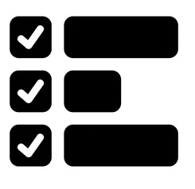

Start a new spec for these requirements called `20261102-134601-SITE-SETTINGS`  
!! THIS FILE IS GENERATED USING THE SKILL `/speckit-requirements`. DO NOT EDIT OR DELETE THIS FILE !!  

# Initial High-Level Requirements

Add a menu item to the Avatar menu for accessing user settings, called "Site Settings"   
The icon for iot (in the menu) will be what is currently used for "Poll Administration" - a typical gear icon.  

The new icon for "Poll Administration" will be created from the image in:  
  
It will be in a dark colored circle the same as the gear icon does now.  

The "Site Settings" menu item will not be disabled for Guests.  

When Signed In users click the menu item, a user settings page will be displayed  
that has the same styling and layout as the "Profile" page.  
The title will be "Site Settings" and the icon on the page's card will be the gear icon in a dark colored circle, the same as in the menu (although in this context if be the same size as the icon on the Profile page).  
All the other fields, labels and buttons that are on the Profile page will not bew on the new Site Settings page.  

Currently, the only setting available on the Site Settings page will be a "Color Scheme" settings,  
that allows the user to choice between "Light (default)" and "Dark" color schemes.  
The setting will be applied immediately when the user selects a color scheme.  
There will be no need for a "Save" button.  
When the Color Schme is changed: 
- the new setting will be sent to the server to be saved in the user' record in the database
- the new color scheme will be applied to the user interface immediately

## Resolved Requirements (2026-11-02 2:13 PM)

- **Menu position** (UA1): "Site Settings" comes directly after "Edit Profile", before "Create Poll";  
  Logout stays last.  
- **Icon image** (UA2): the source image is `poll-admin-icon.jpg` in this folder (copied from the git-ignored `dontTrack/`).  
- **Icons** (UA3): the new "Poll Administration" icon is an inline SVG glyph (`ADMIN_GLYPH`), a `currentColor` circle with three paper-coloured ticked boxes and bars, the middle bar shorter, as in the image;  
  the gear moves, unchanged, to a new `SETTINGS_GLYPH`, used in the menu and on the Site Settings card.  
- **Page address** (UA4): the page is `/settings`, guarded like `/profile`: a request without a session is redirected to `/login`.  
- **Storage and API** (UA5): a nullable `color_scheme` text column (`light` or `dark`, `NULL` = never chosen, kept to those values by a check constraint) on the `user` table, added by an additive migration `016-…`;  
  `GET /api/me` returns it as `colorScheme`;  
  `PATCH /api/me` accepts `{ colorScheme }` and refuses any other value with `400`;  
  `postman/openapi.json` follows.  
- **Failed save** (UA8): when the choice cannot be saved, the page goes back to the last saved scheme, reselects it in the control, and shows an inline message under the control ("Your color scheme could not be saved. Please try again.");  
  a `401` sends the user to `/login`, as the Profile page does.  
- **Other tabs, other devices, Logout** (UA9): other tabs of the same browser switch at once;  
  other devices switch on their next page load;  
  Logout returns the browser to the default scheme and clears any stored copy.  
- **Control** (UA10): an M3 radio group labelled "Color Scheme" with two options, "Light (default)" and "Dark", the saved one selected when the page opens.  
- **Line graph** (UA11): `lineGraph.js` reads the page scheme from `<html data-theme>` and redraws when that attribute changes (a `MutationObserver`), in place of the `prefers-color-scheme` media query.  
- **Who sees the item** (AM1): "Site Settings" is shown, and never disabled, for every signed-in user, whatever their permissions;  
  signed-out visitors ("Guests") have no avatar menu, so they get no item.  
- **Pages covered** (UA6): the chosen scheme applies to every page, the admin pages included;  
  `admin.html` and `admin-results.html` lose their `data-theme="light"` pin, and whatever `admin.css` draws wrongly in Dark is fixed.  
- **No flash on load** (UA7): a copy of the choice is kept in `localStorage` (`colorScheme`) and applied by a few lines at the top of each page's `<head>`, before the stylesheets paint;  
  the database stays the source of truth, and `/api/me` corrects the copy on every load;  
  the key gets a Cookie Use row in `privacy.html`.  
- **Default scheme** (NC1): Light, as written: a user who never chose, and every signed-out visitor, sees Light whatever the device says;  
  only a signed-in user who chose Dark sees Dark;  
  the `prefers-color-scheme` dark rules are removed.  
