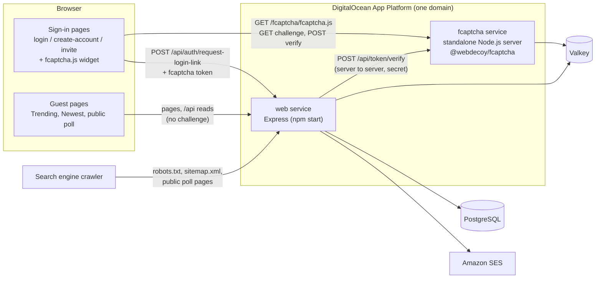
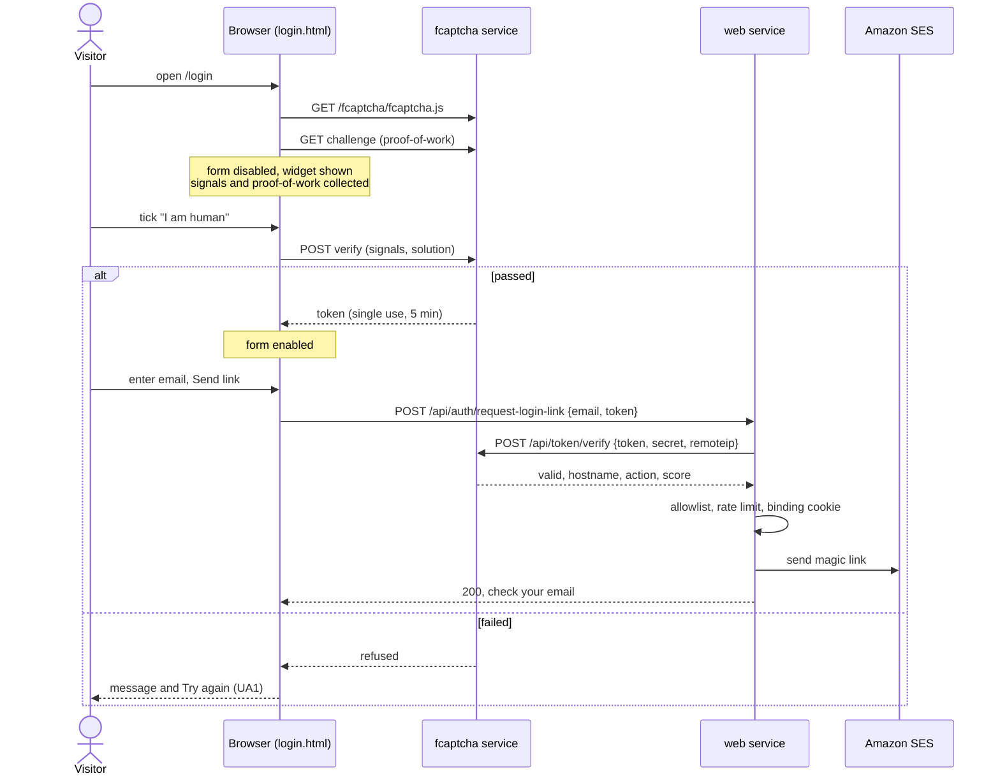
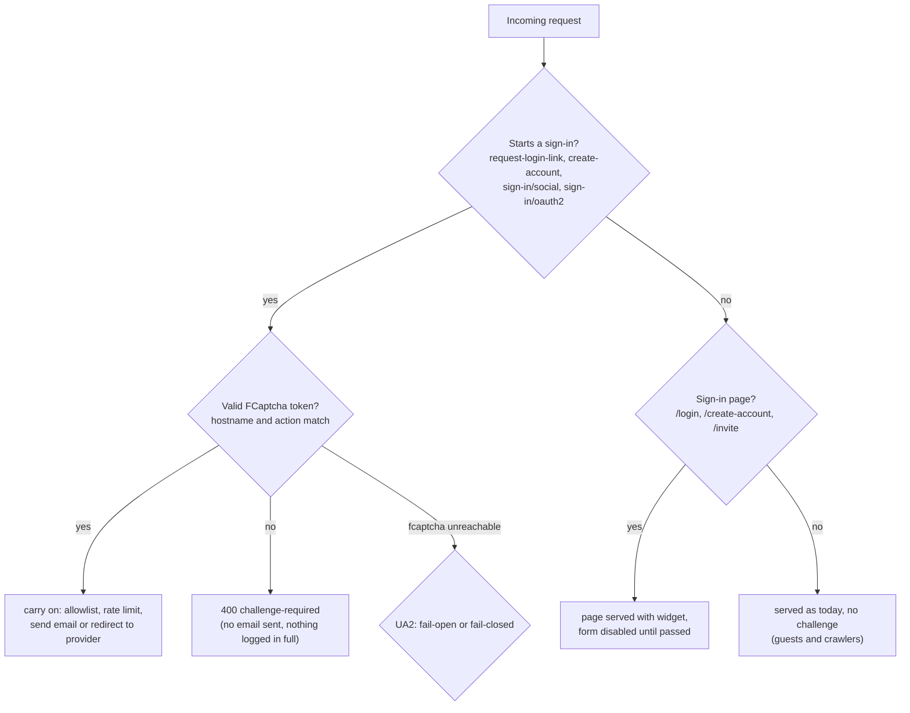

# High Level Requirements

Requirements: `requirements/20261102-144053-fcaptcha-and-seo/requirements.md`  
External Files: none  
Generated: 2026-11-02 2:43 PM  

The site will use the npm library fcaptcha to prevent Bots and AI Agents from accessing the site as a signed in user.  

https://github.com/WebDecoy/FCaptcha

The reason we want to use FCaptcha rather than some third-party service is to eliminate any privacy concerns of using a third-party service.  
Please research to ensure that this approach is effective while maintaining user privacy.

Before the "Login" page is displayed, the fcaptcha challenge should be presented to the user to verify that they are not a bot or AI agent.  

We want to deploy FCaptcha using its standalone node.js server mode (not using Docker or Kubernetes).

As followup requirements-report Findings, ask questions regarding the various options for deploying FCaptcha, and provide recommendations based on effectiveness and privacy considerations.  

We would like the color mode of the FCaptcha challenge to match the site's color scheme, if possible.

A related requirement, is that we do want to encourage Search Engine Optimization (SEO) fopr the site to ensure that the polls are indexed by search engines.  
Add whatever is needed to ensure this.

## Additional Requirements and Research Requests

**Instructions To The Developer**  
Enter any additional requirements or research requests under the ## Additional Requirements and Research Requests heading above.  
When you Type or Say: "Next" in the CC CLI terminal, the additional requirements and research requests will be applied to the report.  
  
You may leave these instructions here. They will be ignored when "Next" is executed.  

## 1. Overview and Scope

The feature has two parts that pull in opposite directions, and the design has to keep them apart:  

- **Keep automated sign-ins out.**  
  A self-hosted FCaptcha challenge stands in front of signing in.  
  Only a browser that passes it may ask for a sign-in email, create an account or start a social sign-in.  
  FCaptcha runs as its own standalone Node.js process (`@webdecoy/fcaptcha`, not Docker or Kubernetes), and its widget script is served from CrowdPoll's own domain, so no page makes a third-party request.  
- **Let search engines in.**  
  Public polls must be reachable, readable and listed for crawlers, which are bots too.  
  So the challenge guards only the sign-in path, never the pages a guest can already browse.  

**In scope:**  

- The challenge before the sign-in form, on every page that leads to a sign-in (`/login`, `/create-account`, `/invite`).  
- Server-side checking of the FCaptcha token on every API route that sends a sign-in email or starts a session.  
- A second App Platform component running the standalone FCaptcha server, with its settings and secrets.  
- The widget following the site's light or dark colour scheme.  
- The Privacy Policy wording for what FCaptcha measures in the browser.  
- SEO: `robots.txt`, `sitemap.xml`, page titles and descriptions, canonical links, social preview tags, structured data and a crawlable page per public poll.  

**Out of scope (assumed):**  

- Challenging a visitor who is already signed in, or each vote (see AM2).  
- Any third-party CAPTCHA or bot-management service.  
- Paid search, analytics or search-console tooling beyond what the site serves itself.  

**Assumptions:**  

- Guests keep what they have today: Trending, Newest, search and opening a poll maximized, all without a challenge.  
- The existing defences stay: the sign-in email rate limit, the pre-launch allowlist (`isAllowed`) and the `signin_binding` cookie.  
- Development and the test suites run without the FCaptcha server, as they run today without Valkey or OpenSearch (see UA3).  

## 2. Component Diagram



- The browser reaches FCaptcha under a path of CrowdPoll's own domain, so the widget and its calls are same-origin (NC1).  
- The web service checks each token with FCaptcha server to server, using a secret the browser never sees.  
- FCaptcha keeps its short-lived state in the existing Valkey, so it can run more than one instance (NC2).  

## 3. Sequence: Signing In Through the Challenge



- The token is checked again by the server at submit, so skipping the page and calling the API directly gets nothing (IN1).  
- A token is single-use and lasts 5 minutes, so a visitor who waits longer is asked to pass the challenge again (UA1).  

## 4. Decision Flow: Which Requests Are Challenged



- Clicking the emailed link (`/api/auth/verify`, `/api/auth/confirm-signin`) and the OAuth callbacks are not challenged: they finish a sign-in a challenged request started.  

## 5. Sequence: A Search Engine Indexing a Public Poll

```mermaid
sequenceDiagram
  participant C as Crawler
  participant W as web service
  participant DB as PostgreSQL
  C->>W: GET /robots.txt
  W-->>C: allow /, /poll/, disallow /admin, /profile, /api; Sitemap URL
  C->>W: GET /sitemap.xml
  W->>DB: public, published polls (id, title, last change)
  W-->>C: urlset of /poll/:pid
  C->>W: GET /poll/:pid
  W->>DB: poll title, description, choices
  alt public and published
    W-->>C: 200 HTML with title, description, canonical,<br/>Open Graph, JSON-LD, choices in the markup
  else private, unpublished or missing
    W-->>C: 404 (never 403)
  end
```

- The poll page sends the visitor's browser on to the live, maximized poll; the crawler reads the same address's server-written HTML (IN3, UA5).  

## 6. Research Results

### 6.1 Is FCaptcha effective against bots and AI agents while keeping user privacy?

**RS1. Is self-hosted FCaptcha effective against bots and AI agents while keeping user privacy?**  
<span style="font-size:large" ><b>
✅ Resolved</b></span>  
✅ Requirements File Updated: 2026-11-02 2:53 PM  
**Notes**: Recommendation accepted by "Accept all" 2026-11-02: Recommendation, **adopt FCaptcha as one layer of friction, not as a guarantee.**;  
the requirements now record it under "Decisions", RS1.  

> The requirements ask whether FCaptcha, self-hosted, keeps bots and AI agents from signing in without the privacy cost of a third-party service.  
> Sources: [FCaptcha README](https://github.com/WebDecoy/FCaptcha), [COMPLIANCE.md](https://github.com/WebDecoy/FCaptcha/blob/main/COMPLIANCE.md), [issue #87](https://github.com/WebDecoy/FCaptcha/issues/87), [npm @webdecoy/fcaptcha](https://www.npmjs.com/package/@webdecoy/fcaptcha), [npm @webdecoy/fcaptcha-client](https://www.npmjs.com/package/@webdecoy/fcaptcha-client), ["Broken Gates" (arXiv 2607.18659)](https://arxiv.org/pdf/2607.18659), [multi-layer fingerprinting study (arXiv 2606.30119)](https://arxiv.org/pdf/2606.30119).  
> **What it is:** an MIT-licensed, self-hosted, puzzle-free challenge (checkbox or invisible), version 1.46.1 of 2026-10-21, requiring Node 22 or later and Express 5, as CrowdPoll does.  
> It combines a short SHA-256 proof-of-work with 40+ behavioural signals (pointer path, tremor, timing, typing cadence) and environment signals (webdriver and automation flags, headless and DevTools-protocol tells, canvas, WebGL, audio and font measurements, TLS fingerprint, datacenter IP ranges).  
> **Effectiveness:** it claims to catch Selenium, Puppeteer, Playwright and similar tools, and vision or DevTools-driven agents.  
> Its own README says a stealth agent that patches `navigator.webdriver` early is not expected to be caught, and its 0% false-positive figure comes from 14 scripted personas.  
> Issue #87, still open, shows a stealth Playwright run scoring like a human and passing in invisible mode.  
> Independent 2026 studies found that no CAPTCHA, Turnstile and reCAPTCHA included, reliably stops current AI browser agents;  
> some agents pass by simply clicking the checkbox.  
> **Privacy:** no cookies, no localStorage, "no telemetry, no phone-home", nothing written to disk, all state in memory for 5 minutes to 1 hour.  
> The widget can be served from CrowdPoll's own domain, so the site keeps its no-third-party-request rule.  
> But it does fingerprint the browser, and its compliance notes leave the lawful basis to the site (see IN2).  
> **Maturity:** about 230 stars, weekly releases, but effectively one maintainer, with Go, Python and Node servers kept in step by hand (see UA6).  
> **Alternatives:** ALTCHA, Cap.js and mCaptcha collect less (proof-of-work only) but only add cost, which an agent in a real browser pays easily;  
> Cloudflare Turnstile has stronger signals but is a third-party request.  
> These comparisons were not checked against each project's own documentation in this run.  

  - **Recommendation**: **adopt FCaptcha as one layer of friction, not as a guarantee.**  

    [X] ➡️ **Accepted**

    - It is the only self-hosted option found that targets agents driving real browsers, and it keeps every request on CrowdPoll's own domain.  
    - The requirements will say it raises the cost of automated sign-ins and is kept alongside the existing defences (sign-in email rate limit, allowlist, `signin_binding`), not in place of them.  
    - Its fingerprinting is disclosed in the Privacy Policy (IN2), and the token is always checked on the server (IN1).  


  - **Developer Resolution B**:  

    [ ] ➡️ **Not Accepted**

## 7. Breaking Changes

- **The sign-in API routes require a token.**  
  `POST /api/auth/request-login-link`, `POST /api/auth/create-account`, `POST /api/auth/sign-in/social` and `POST /api/auth/sign-in/oauth2` refuse a request without a valid FCaptcha token once the challenge is on.  
  Any script, Postman request or load test that signs in this way stops working against an environment with the challenge on;  
  `postman/openapi.json` gains the token field and the refusal.  
- **A guest opening a public poll's address no longer always lands on `/login`.**  
  If IN3's recommendation is accepted, a public, published poll gets a page any guest or crawler can read;  
  today `/?PID=…` sends every guest to sign in.  
- **The Privacy Policy changes.**  
  It must describe what the challenge measures in the browser (IN2).  
  Whether that needs a new `TERMS_VERSION` acceptance is decided there.  

## 8. Technical Debt

- **No security headers.**  
  The site sends no Content-Security-Policy, so nothing in the browser enforces the no-third-party rule;  
  a CSP limiting scripts and connections to the site's own origin would make the FCaptcha path and the rule checkable.  
- **Every page is a static file filled in by browser scripts.**  
  Crawlers see little of a poll today, and there is no server-side templating;  
  the poll page for crawlers (UA5) is the first page written on the server.  
- **`trust proxy` is `true`.**  
  The web service believes any `X-Forwarded-For`, and FCaptcha's IP signals and IP binding need the real client address;  
  App Platform's edge sets it in a header of its own (believed to be `do-connecting-ip`, to be confirmed in the plan).  
- **A second component deployed by hand.**  
  Autodeploy is off, so the web service and the FCaptcha service must be deployed together whenever their versions or settings must agree.  
- **A single-maintainer dependency** on the sign-in path, with weekly releases (UA6).  

## 9. Findings

### 9.1 Inconsistencies

**IN1. A challenge "before the Login page is displayed" does not keep bots from signing in.**  
<span style="font-size:large" ><b>
✅ Resolved</b></span>  
✅ Requirements File Updated: 2026-11-02 2:53 PM  
**Notes**: Recommendation accepted by "Accept all" 2026-11-02: Recommendation, **check the FCaptcha token on the server, on every route that starts a sign-in.**;  
the requirements now record it under "Decisions", IN1.  

> The goal is to keep bots and AI agents from using the site as a signed-in user.  
> But a challenge shown on a page is only a page: a script can call `POST /api/auth/request-login-link` (or `create-account`, `sign-in/social`, `sign-in/oauth2`) directly and never load `/login`.  
> The requirement as written guards the door and leaves the window open.  

  - **Recommendation**: **check the FCaptcha token on the server, on every route that starts a sign-in.**  

    [X] ➡️ **Accepted**

    - The page shows the challenge, and the form sends the token it yields.  
    - `request-login-link`, `create-account`, `sign-in/social` and `sign-in/oauth2` check it with the FCaptcha server (`POST /api/token/verify`), and require the `hostname` to be the site's and the `action` to match the route, before the allowlist, the rate limit or any email.  
    - A missing, expired, reused or failed token answers `400` with a code the page understands (`challenge-required`), sends nothing and logs no full address.  
    - The routes that finish a sign-in (`verify`, `confirm-signin`, the OAuth callbacks) are not challenged.  


  - **Developer Resolution B**:  

    [ ] ➡️ **Not Accepted**


**IN2. "Eliminate any privacy concerns" conflicts with FCaptcha's browser fingerprinting.**  
<span style="font-size:large" ><b>
✅ Resolved</b></span>  
✅ Requirements File Updated: 2026-11-02 3:15 PM  
**Notes**: Recommendation accepted in file 2026-11-02: Recommendation A, **keep the full checks, as a security measure, and disclose them.**;  
the requirements now record it under "Decisions", IN2.  

> The reason for self-hosting is to remove privacy concerns.  
> Self-hosting removes the third party, but FCaptcha still reads canvas, WebGL, audio and font measurements and the TLS fingerprint, and its compliance notes say: "Assess the fingerprinting under your own lawful basis."  
> Under the ePrivacy rules, reading such information from a device can need consent unless it is strictly necessary, and the Privacy Policy today says only that three strictly necessary cookies are used.  

  - **Recommendation A** _(recommended)_: **keep the full checks, as a security measure, and disclose them.**  

    [X] ➡️ **Accepted**

    - <u>Pros</u>: the strongest checks;  
      the measurements are taken only on the sign-in pages, only to tell people from programs, kept in memory for at most an hour and never sent elsewhere, which fits "strictly necessary" for security;  
      the Privacy Policy gains a short "Bot check" section saying exactly that.  
    - <u>Cons</u>: it is still fingerprinting, and the Privacy Policy must say so plainly;  
      the "strictly necessary" basis is a legal judgement the developer should confirm.  


  - **Recommendation B**: **use only the proof-of-work and behavioural checks, with no fingerprinting.**  

    [ ] ➡️ **Not Accepted**

    - <u>Pros</u>: closest to "no privacy concerns".  
    - <u>Cons</u>: no documented setting turns fingerprinting off, so it means patching or forking the widget;  
      weaker against the headless browsers it exists to catch.  


  - **Developer Resolution C**:  

    [ ] ➡️ **Not Accepted**


**IN3. Polls cannot be indexed while a guest opening a poll is sent to sign in.**  
<span style="font-size:large" ><b>
✅ Resolved</b></span>  
✅ Requirements File Updated: 2026-11-02 2:53 PM  
**Notes**: Recommendation accepted by "Accept all" 2026-11-02: Recommendation, **give each public, published poll a crawlable address that no challenge stands in front of.**;  
the requirements now record it under "Decisions", IN3.  

> The requirements want the polls indexed by search engines.  
> Today a poll's address is `/?PID=…`, and the server sends every visitor without a session to `/login?PID=…`;  
> guests see a poll only by opening it from Trending, Newest or search, inside the page's scripts.  
> A crawler following a poll link lands on the sign-in page, which now holds a bot challenge, so no poll could be indexed.  

  - **Recommendation**: **give each public, published poll a crawlable address that no challenge stands in front of.**  

    [X] ➡️ **Accepted**

    - A new page, `/poll/<PID>`, written on the server, holds the poll's title, description and choices in plain HTML;  
      a browser's script then opens the live poll maximized, as a guest opening it from Trending sees it now.  
    - It answers `404` for a private, unpublished or missing poll, by the existing access rules (`mayViewResults`).  
    - `/?PID=…` keeps its behaviour for signed-in users and private polls;  
      for a guest and a public, published poll it sends them to `/poll/<PID>` instead of `/login`.  
    - The challenge stays on the sign-in pages only, so crawlers never meet it.  


  - **Developer Resolution B**:  

    [ ] ➡️ **Not Accepted**

### 9.2 Ambiguities

**AM1. What does "before the Login page is displayed" look like to the visitor?**  
<span style="font-size:large" ><b>
✅ Resolved</b></span>  
✅ Requirements File Updated: 2026-11-02 3:15 PM  
**Notes**: Recommendation accepted in file 2026-11-02: Recommendation A, **a separate challenge page before `/login`.**;  
the requirements now record it under "Decisions", AM1.  

> It can mean a separate challenge page shown before the sign-in page, the sign-in page itself with its form held back until the challenge is passed, or a check the visitor never sees.  
> A token lasts 5 minutes and is single-use, which bears on each.  

  - **Recommendation A**: **a separate challenge page before `/login`.**  

    [X] ➡️ **Accepted**

    - <u>Pros</u>: the most literal reading.  
    - <u>Cons</u>: an extra page and redirect;  
      the token must be carried to the next page, and a visitor who takes more than 5 minutes there must go back.  


  - **Recommendation B** _(recommended)_: **the challenge at the top of the sign-in card, with the form disabled until it is passed.**  

    [ ] ➡️ **Not Accepted**

    - <u>Pros</u>: one page, nothing to carry;  
      nothing can be submitted before the challenge, which is what the requirement is after;  
      an expired token simply shows the challenge again in place.  
    - <u>Cons</u>: the form is visible, though unusable, before the challenge.  


  - **Recommendation C**: **an invisible check run when the form is submitted.**  

    [ ] ➡️ **Not Accepted**

    - <u>Pros</u>: no extra step for people.  
    - <u>Cons</u>: nothing is "presented" as the requirement asks;  
      FCaptcha's own open issue #87 shows a stealth agent passing in invisible mode (see NC3).  


  - **Developer Resolution D**:  

    [ ] ➡️ **Not Accepted**


**AM2. Which pages and moments are challenged, besides `/login`?**  
<span style="font-size:large" ><b>
✅ Resolved</b></span>  
✅ Requirements File Updated: 2026-11-02 2:53 PM  
**Notes**: Recommendation accepted by "Accept all" 2026-11-02: Recommendation, **challenge once, at the start of every sign-in, and never a signed-in user.**;  
the requirements now record it under "Decisions", AM2.  

> Signing in also starts from `/create-account`, from an invitation (`/invite`), and, in `oauth` or `both` mode, from the provider buttons.  
> "Accessing the site as a signed-in user" could also mean challenging people already signed in, or each vote.  

  - **Recommendation**: **challenge once, at the start of every sign-in, and never a signed-in user.**  

    [X] ➡️ **Accepted**

    - The challenge appears on `/login`, `/create-account` and `/invite`, in front of the email form and the provider buttons alike, in every `ENV_SIGNIN_METHOD`.  
    - `/confirm-signin`, the emailed link and the provider callbacks are not challenged.  
    - A signed-in session (up to 30 days) is never challenged again;  
      votes keep their own defences (rate buckets and load shedding).  


  - **Developer Resolution B**:  

    [ ] ➡️ **Not Accepted**


**AM3. What does "match the site's color scheme" mean?**  
<span style="font-size:large" ><b>
✅ Resolved</b></span>  
✅ Requirements File Updated: 2026-11-02 2:53 PM  
**Notes**: Recommendation accepted by "Accept all" 2026-11-02: Recommendation, **use `data-theme="auto"`, so the widget is light or dark as the page is.**;  
the requirements now record it under "Decisions", AM3.  

> The site has no colour setting of its own: its Material 3 tokens follow the device's light or dark preference (`prefers-color-scheme`).  
> The widget offers `light`, `dark` and `auto`, where `auto` reads the device preference once, when it is drawn, and no documented way to restyle it further.  

  - **Recommendation**: **use `data-theme="auto"`, so the widget is light or dark as the page is.**  

    [X] ➡️ **Accepted**

    - Matching means the same light or dark mode, not the site's exact colours;  
      the card around the widget uses the site's own M3 tokens.  
    - If the device switches mode while the page is open, the widget keeps its mode until it is drawn again;  
      that is accepted.  


  - **Developer Resolution B**:  

    [ ] ➡️ **Not Accepted**

### 9.3 Unspecified Aspects

**UA1. What does a visitor see when the challenge fails or the token expires?**  
<span style="font-size:large" ><b>
✅ Resolved</b></span>  
✅ Requirements File Updated: 2026-11-02 2:53 PM  
**Notes**: Recommendation accepted by "Accept all" 2026-11-02: Recommendation, **say so plainly and let them try again, with no lock-out.**;  
the requirements now record it under "Decisions", UA1.  

> The requirements do not say what happens to a person the check takes for a program, or whose 5-minute token runs out before they submit.  
> FCaptcha's false-positive rate is not independently measured, so some real people will fail.  

  - **Recommendation**: **say so plainly and let them try again, with no lock-out.**  

    [X] ➡️ **Accepted**

    - A failed check shows "We couldn't confirm you're a person. Please try again." with a Try again control, announced to screen readers.  
    - An expired or spent token (including a `challenge-required` answer from the server) shows the challenge again in place, keeping what was typed.  
    - After repeated failures the message adds the support address, `support@crowdpoll.vote`.  
    - Failures are logged with the masked IP (`maskIp`) and the reasons FCaptcha gives, never an email address.  


  - **Developer Resolution B**:  

    [ ] ➡️ **Not Accepted**


**UA2. What happens when the FCaptcha server cannot be reached?**  
<span style="font-size:large" ><b>
✅ Resolved</b></span>  
✅ Requirements File Updated: 2026-11-02 3:15 PM  
**Notes**: Recommendation accepted in file 2026-11-02: Recommendation B, **fail open, logged, with the existing limits still applied.**;  
the requirements now record it under "Decisions", UA2.  

> FCaptcha becomes a second service on the sign-in path.  
> If it is down, or its Valkey is, the requirements do not say whether signing in stops or goes ahead unchecked.  

  - **Recommendation A**: **fail closed: no sign-in until the challenge is back.**  

    [ ] ➡️ **Not Accepted**

    - <u>Pros</u>: no unchecked sign-in, ever.  
    - <u>Cons</u>: an outage of the bot check is an outage of signing in, for everyone.  


  - **Recommendation B** _(recommended)_: **fail open, logged, with the existing limits still applied.**  

    [X] ➡️ **Accepted**

    - <u>Pros</u>: people can still sign in;  
      the sign-in email rate limit, the allowlist and `signin_binding` still apply;  
      each skipped check is logged and counted on `/healthz`, so an outage is seen.  
    - <u>Cons</u>: a bot that can take FCaptcha down gets through for the length of the outage.  
    - Only an unreachable FCaptcha counts: a token FCaptcha answers as invalid is always refused.  


  - **Developer Resolution C**:  

    [ ] ➡️ **Not Accepted**


**UA3. Which settings does the challenge add, and how do development and the tests run?**  
<span style="font-size:large" ><b>
✅ Resolved</b></span>  
✅ Requirements File Updated: 2026-11-02 2:53 PM  
**Notes**: Recommendation accepted by "Accept all" 2026-11-02: Recommendation, **add a small set of `ENV_FCAPTCHA_*` settings, with the challenge off unless configured.**;  
the requirements now record it under "Decisions", UA3.  

> Every setting is an `ENV_*` variable validated by `loadConfig`.  
> Development needs PostgreSQL only and `npm test` needs no local services, but the challenge needs a running FCaptcha server and a shared secret.  

  - **Recommendation**: **add a small set of `ENV_FCAPTCHA_*` settings, with the challenge off unless configured.**  

    [X] ➡️ **Accepted**

    - `ENV_FCAPTCHA_ENABLED` (default `false`), `ENV_FCAPTCHA_URL` (the FCaptcha server as the web service reaches it), `ENV_FCAPTCHA_SITE_KEY` and `ENV_FCAPTCHA_VERIFY_SECRET` (an encrypted console variable, never in `.do/app.yaml`).  
    - Turning it on without the URL or secret stops the app with a `ConfigError`.  
    - The FCaptcha service's own variables (`FCAPTCHA_SECRET`, `FCAPTCHA_VERIFY_SECRET`, `FCAPTCHA_SITE_KEYS`, `FCAPTCHA_ALLOWED_HOSTNAMES`, `REDIS_URL`, `TRUSTED_PROXIES`) are set on its component;  
      they keep FCaptcha's names, since that program reads them.  
    - Tests stub the verify call;  
      one `*.integration.test.ts` runs against a real FCaptcha server when its URL is given, and skips otherwise.  
    - `.claude/rules/environment.md`, the `.example` launch templates and `postman/openapi.json` are updated.  


  - **Developer Resolution B**:  

    [ ] ➡️ **Not Accepted**


**UA4. Which polls, and which parts of a poll, may search engines index?**  
<span style="font-size:large" ><b>
✅ Resolved</b></span>  
✅ Requirements File Updated: 2026-11-02 2:53 PM  
**Notes**: Recommendation accepted by "Accept all" 2026-11-02: Recommendation, **only public polls that have been published (open or closed), and only what a guest already sees.**;  
the requirements now record it under "Decisions", UA4.  

> "Ensure that the polls are indexed" does not say which polls.  
> CrowdPoll has public and private polls, anonymous polls, and polls not yet launched or rejected.  

  - **Recommendation**: **only public polls that have been published (open or closed), and only what a guest already sees.**  

    [X] ➡️ **Accepted**

    - Private, draft, pending, rejected and deleted polls are never listed or served to crawlers, and answer `404`.  
    - The indexed page holds the title, description, choices and the published results a guest may see (`mayViewResults`), never who created it, who added a choice or who voted.  
    - A poll that turns private or is deleted leaves the sitemap at once and answers `404`, so search engines drop it.  


  - **Developer Resolution B**:  

    [ ] ➡️ **Not Accepted**


**UA5. What exactly is "whatever is needed" for SEO?**  
<span style="font-size:large" ><b>
✅ Resolved</b></span>  
✅ Requirements File Updated: 2026-11-02 2:53 PM  
**Notes**: Recommendation accepted by "Accept all" 2026-11-02: Recommendation, **the standard set, served by the web service itself.**;  
the requirements now record it under "Decisions", UA5.  

> The site serves no `robots.txt` and no sitemap;  
> most pages have a bare `<title>` (`CrowdPoll`, `Login`), no description, no canonical link and no social preview tags;  
> and poll content is drawn by browser scripts.  

  - **Recommendation**: **the standard set, served by the web service itself.**  

    [X] ➡️ **Accepted**

    - `robots.txt`: allow `/`, `/poll/`, `/privacy`, `/terms`;  
      disallow `/api/`, `/admin`, `/profile`, `/login`, `/create-account`, `/invite`, `/confirm-signin`, `/accept-terms`;  
      name the sitemap.  
    - `sitemap.xml`: every indexable poll (UA4) with its last change, plus the home page, built from PostgreSQL and cached briefly;  
      a sitemap index once it passes 50,000 addresses.  
    - Every public page: a descriptive `<title>`, a `<meta name="description">` and a `<link rel="canonical">` on the production domain.  
    - Each poll page (IN3): Open Graph and Twitter card tags for link previews (no image, or a site image, so no third-party fetch), and schema.org JSON-LD for the question and its choices.  
    - Sign-in, admin and profile pages carry `<meta name="robots" content="noindex">`.  
    - Success is measured by the indexed poll count in the search engines' own consoles, set up by the developer outside the site.  


  - **Developer Resolution B**:  

    [ ] ➡️ **Not Accepted**


**UA6. How is the FCaptcha version chosen and kept up to date?**  
<span style="font-size:large" ><b>
✅ Resolved</b></span>  
✅ Requirements File Updated: 2026-11-02 2:53 PM  
**Notes**: Recommendation accepted by "Accept all" 2026-11-02: Recommendation, **pin exact versions, update deliberately.**;  
the requirements now record it under "Decisions", UA6.  

> FCaptcha sits on the sign-in path, releases about weekly, and is effectively the work of one maintainer.  
> The requirements do not say how a version is adopted or updated.  

  - **Recommendation**: **pin exact versions, update deliberately.**  

    [X] ➡️ **Accepted**

    - `@webdecoy/fcaptcha` and `@webdecoy/fcaptcha-client` are pinned to the same exact version (1.46.1 today) with a committed lock file.  
    - The widget script is served by the FCaptcha service itself, never from a CDN, so client and server always match.  
    - An update is a reviewed change: read its release notes, run the integration test, deploy both components together.  


  - **Developer Resolution B**:  

    [ ] ➡️ **Not Accepted**

### 9.4 Needs Clarifications

**NC1. Where does the standalone FCaptcha server run?**  
<span style="font-size:large" ><b>
✅ Resolved</b></span>  
✅ Requirements File Updated: 2026-11-02 3:15 PM  
**Notes**: Recommendation accepted in file 2026-11-02: Recommendation A, **a second App Platform service in the same app, routed at `/fcaptcha` on the site's domain.**;  
the requirements now record it under "Decisions", NC1.  

> The requirements choose FCaptcha's standalone Node.js server, not Docker or Kubernetes.  
> CrowdPoll runs as one App Platform service from this repository, so the server needs a home, and the browser must reach it on the site's own domain to keep pages free of third-party requests.  

  - **Recommendation A** _(recommended)_: **a second App Platform service in the same app, routed at `/fcaptcha` on the site's domain.**  

    [X] ➡️ **Accepted**

    - <u>Pros</u>: a folder in this repository (e.g. `fcaptcha-server/`) holds a `package.json` depending on `@webdecoy/fcaptcha` and a start script, built by App Platform's Node buildpack like the web service;  
      App Platform's ingress sends `/fcaptcha/*` to it, so the widget is same-origin with no CORS;  
      the web service reaches it privately for token checks;  
      it scales on its own.  
    - <u>Cons</u>: a second component to pay for and deploy;  
      its verify routes are on the public path unless restricted (the verify secret guards them).  


  - **Recommendation B**: **an internal-only service, reached through the web service.**  

    [ ] ➡️ **Not Accepted**

    - <u>Pros</u>: nothing of FCaptcha is exposed directly;  
      the web service proxies only the widget, challenge and verify paths.  
    - <u>Cons</u>: every challenge request passes through the web service;  
      the proxy must pass the real client IP and the request details FCaptcha reads, or its network signals weaken.  


  - **Recommendation C**: **a separate Droplet running Node under a process manager.**  

    [ ] ➡️ **Not Accepted**

    - <u>Pros</u>: full control of the machine.  
    - <u>Cons</u>: a server to patch, secure and give TLS and a sub-domain;  
      outside App Platform's autoscaling and health checks.  


  - **Developer Resolution D**:  

    [ ] ➡️ **Not Accepted**


**NC2. Does FCaptcha keep its state in Valkey, so it can run more than one instance?**  
<span style="font-size:large" ><b>
✅ Resolved</b></span>  
✅ Requirements File Updated: 2026-11-02 3:15 PM  
**Notes**: Recommendation accepted in file 2026-11-02: Recommendation A, **use the existing Valkey, under its own key prefix, and autoscale 1 to 3 instances.**;  
the requirements now record it under "Decisions", NC2.  

> Without `REDIS_URL` FCaptcha keeps challenges and spent tokens in one process, so a second instance would not know them.  
> With it, a Valkey outage refuses every challenge.  

  - **Recommendation A** _(recommended)_: **use the existing Valkey, under its own key prefix, and autoscale 1 to 3 instances.**  

    [X] ➡️ **Accepted**

    - <u>Pros</u>: no new datastore;  
      a spent token stays spent whichever instance answers;  
      survives an instance restart.  
    - <u>Cons</u>: Valkey becomes part of the sign-in path (see UA2).  


  - **Recommendation B**: **one instance, state in memory.**  

    [ ] ➡️ **Not Accepted**

    - <u>Pros</u>: simplest and cheapest.  
    - <u>Cons</u>: a restart forgets live challenges;  
      one instance must carry every sign-in at a launch spike.  


  - **Developer Resolution C**:  

    [ ] ➡️ **Not Accepted**


**NC3. Checkbox or invisible widget?**  
<span style="font-size:large" ><b>
✅ Resolved</b></span>  
✅ Requirements File Updated: 2026-11-02 3:15 PM  
**Notes**: Recommendation accepted in file 2026-11-02: Recommendation A, **checkbox.**;  
the requirements now record it under "Decisions", NC3.  

> FCaptcha runs as a checkbox the visitor ticks, or invisibly.  
> The checkbox gathers pointer and timing signals from the tick itself;  
> issue #87 shows a stealth agent passing in invisible mode.  

  - **Recommendation A** _(recommended)_: **checkbox.**  

    [X] ➡️ **Accepted**

    - <u>Pros</u>: it is "presented" as the requirement asks;  
      more behavioural signal;  
      keyboard and screen-reader operable (`role="checkbox"`, WCAG 2.2 AA checks in its CI).  
    - <u>Cons</u>: one more click to sign in.  


  - **Recommendation B**: **invisible.**  

    [ ] ➡️ **Not Accepted**

    - <u>Pros</u>: no extra step.  
    - <u>Cons</u>: weaker, by FCaptcha's own open issue;  
      nothing is presented.  


  - **Developer Resolution C**:  

    [ ] ➡️ **Not Accepted**


**NC4. How strict should FCaptcha be, and what may it log?**  
<span style="font-size:large" ><b>
✅ Resolved</b></span>  
✅ Requirements File Updated: 2026-11-02 2:53 PM  
**Notes**: Recommendation accepted by "Accept all" 2026-11-02: Recommendation, **strict on what is proven, off for what is experimental, and no verdict log.**;  
the requirements now record it under "Decisions", NC4.  

> FCaptcha can bind a token to the visitor's IP, restrict tokens to listed hostnames, block on its experimental checks, and log each verdict.  
> Each choice trades effectiveness against false positives or privacy.  

  - **Recommendation**: **strict on what is proven, off for what is experimental, and no verdict log.**  

    [X] ➡️ **Accepted**

    - `FCAPTCHA_ALLOWED_HOSTNAMES` lists the production domain only, and the web service also checks `hostname` and `action`.  
    - Tokens are bound to the client IP, with `TRUSTED_PROXIES` set so FCaptcha reads the address App Platform's edge reports, not a forged `X-Forwarded-For`.  
    - `FCAPTCHA_EXPERIMENTAL_BLOCKING` stays off;  
      the default score threshold is used and revisited only with evidence.  
    - `FCAPTCHA_LOG_VERDICTS` stays off, so FCaptcha keeps no per-visitor record beyond its in-memory windows;  
      the web service logs only masked outcomes (UA1).  
    - `FCAPTCHA_INSECURE_DEV_MODE` is never set in production.  


  - **Developer Resolution B**:  

    [ ] ➡️ **Not Accepted**


## 10. Requirements Report Complete Report  
  
- **Requirements Report Document:** requirements/20261102-144053-fcaptcha-and-seo/requirements-report.md  
- **Requirements Document:** requirements/new-20261102-142238/requirements.md → requirements/20261102-144053-fcaptcha-and-seo/requirements.md  
- **Software Architecture Diagrams:** 4  
- **Inconsistencies:** 3  
- **Ambiguities:** 3  
- **Unspecified Aspects:** 6  
- **Needs Clarifications:** 4  
- **Research Results:** 1  
- **Breaking Changes:** 3  
- **Technical Debt items:** 5  
  
The requirements are ready for /speckit-specify.
To generate specs from the requirements document, use the `/speckit-specify` skill followed by the path (relative to the project root) to the requirements file.
At the prompt, Type:  
🟩 👉 /speckit-specify requirements/20261102-144053-fcaptcha-and-seo/requirements.md  
