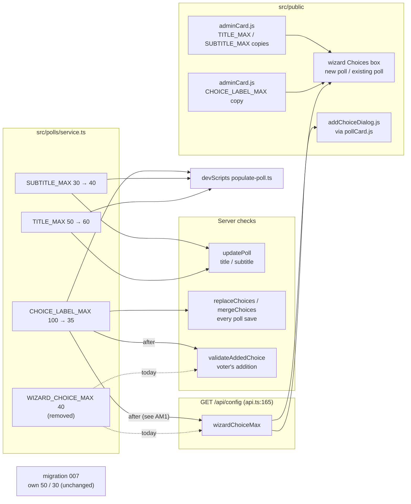
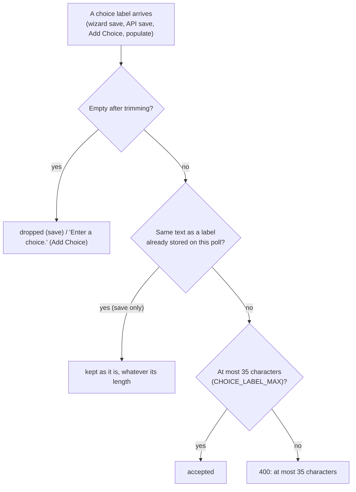

# High Level Requirements

Requirements: `requirements/20261102-154952-field-length-limits/requirements.md`  
External Files: none  
Generated: 2026-11-02 3:49 PM  

This feature simply changes the size limits for subtitles, titles, and choice labels in the application.  

SUBTITLE
The maximum subtitle length is currently 30 characters. It isn't an ENV_* setting.  
It's a hard-coded constant in two places:
Server: service.ts:32 sets SUBTITLE_MAX = 30. Saves are checked against it at service.ts:503, and the populate script imports it from here.
Browser: adminCard.js:520 has its own copy of SUBTITLE_MAX = 30, which the admin card's subtitle field uses.
**Increase that to 40 characters.**


TITLE
The maximum title length is 50 characters.  
Like the subtitle limit, it's a hard-coded constant rather than an ENV_* setting, and it appears in the same two places:
Server: service.ts:31 sets TITLE_MAX = 50.
Browser: adminCard.js:519 has its own copy, TITLE_MAX = 50, which the admin card uses.
**Increase that to 60 characters.**

CHOICE LABEL
The maximum choice label length is 100 characters. It's also a hard-coded constant, not an ENV_* setting:
Server: service.ts:33 sets CHOICE_LABEL_MAX = 100.
Browser: adminCard.js:10 has its own copy, CHOICE_LABEL_MAX = 100, which the admin card uses.

There is also a 40-character limit applied in two places:
- A new poll's Choices box in the admin wizard	40	runtime.wizardChoiceMax (adminCard.js:1409)
- A voter's added choice (the Add Choice dialog on the poll card)	40	the dialog and the server's validateAddedChoice (service.ts:975)

An existing poll's Choices box in the wizard	100	CHOICE_LABEL_MAX (adminCard.js:1409), so labels already saved at up to 100 aren't cut.
Server check on every poll save	100	CHOICE_LABEL_MAX (service.ts:33)
The 40 is WIZARD_CHOICE_MAX at service.ts:35. It isn't an ENV_* setting either. The server sends it to the browser as wizardChoiceMax in /api/config (api.ts:165).

So in practice a new poll's choices are limited to 40 characters. A poll save sent straight to the API is only checked against 100, though, because the server doesn't apply the 40 to poll saves. It applies it only to choices voters add.

This one requires a bit more work to clean it up.  
The 40-character limit is applied in multiple places and is not as straightforward to change as the subtitle and title limits.

**Change CHOICE_LABEL_MAX to 35 characters.**  
**Eliminate WIZARD_CHOICE_MAX and use CHOICE_LABEL_MAX instead.**  

Labels already saved at up to 100 characters won't be cut, but new labels will be limited to 35 characters.

## Additional Requirements and Research Requests

**Instructions To The Developer**  
Enter any additional requirements or research requests under the ## Additional Requirements and Research Requests heading above.  
When you Type or Say: "Next" in the CC CLI terminal, the additional requirements and research requests will be applied to the report.  
  
You may leave these instructions here. They will be ignored when "Next" is executed.  

## 1. Overview and Scope

The feature changes three length limits, all hard-coded constants (none is an `ENV_*` setting):

| Field | Today | After | Where it is enforced |
|---|---|---|---|
| Title | 50 | **60** | `TITLE_MAX` in `src/polls/service.ts:31` (save check, line 500) and its copy in `src/public/adminCard.js:519` |
| Subtitle | 30 | **40** | `SUBTITLE_MAX` in `src/polls/service.ts:32` (save check, line 503) and its copy in `src/public/adminCard.js:520` |
| Choice label (server, every poll save) | 100 | **35** for new labels | `CHOICE_LABEL_MAX` in `src/polls/service.ts:33`, checked in `replaceChoices` (line 1072) and `mergeChoices` (line 1119) |
| Choice label (new poll's wizard, voter's Add Choice) | 40 | **35** | `WIZARD_CHOICE_MAX` in `src/polls/service.ts:35` → `wizardChoiceMax` in `/api/config` (`src/routes/api.ts:165`) → `adminCard.js:1409`, `pollCard.js:1501`, `addChoiceDialog.js:18` |
| Choice label (existing poll's wizard box) | 100 | stored labels not cut | `CHOICE_LABEL_MAX` copy in `src/public/adminCard.js:10`, used at line 1409 |

- **In scope:**  
  - the two increases (title 60, subtitle 40);  
  - one choice-label limit of 35 for every newly entered label, wherever it is entered (new poll's wizard, existing poll's wizard, API save, voter's Add Choice, populate script);  
  - removing `WIZARD_CHOICE_MAX`, so only `CHOICE_LABEL_MAX` remains;  
  - the browser copies, fallbacks, tests, `postman/openapi.json`, `README.md` and `CLAUDE.md` that state the old numbers.  
- **Out of scope:**  
  - cutting labels, titles or subtitles already stored (no data migration);  
  - making any of the limits an `ENV_*` setting;  
  - the keyword, email and search-box limits (200).  

The other places these numbers appear, found in the codebase:

- `devScripts/populate/populate-poll.ts:10` imports `TITLE_MAX`, `SUBTITLE_MAX` and `CHOICE_LABEL_MAX`, so the populate script follows the server values.  
- `src/db/migrations/007-title-lengths.ts:3-4` has its own `TITLE_MAX = 50` and `SUBTITLE_MAX = 30`: a migration already applied, which must not change.  
- `src/public/tabs.js:195`, `src/public/pollCard.js:1501`, `src/public/addChoiceDialog.js:18` and `src/public/adminCard.js:40` each fall back to a literal `40` when `/api/config` gives no `wizardChoiceMax`.  
- `README.md:47` says a voter types "a choice of up to 40" characters.  
- `postman/openapi.json` gives `maxLength` 50 (title), 30 (subtitle) and 100 (choice label) in several schemas, and documents `wizardChoiceMax` (40) in the `/api/config` response (line 1662).  
- `tests/client-admin-wizard.test.ts:1172-1173` pins 30 and 50, `tests/client-add-choice.test.ts:285` pins 40, and `tests/client-admin-wizard.test.ts:1723` tests "caps a new poll's choices at wizardChoiceMax from /api/config".  

## 2. Where Each Limit Lives Today and After the Change



## 3. Saving an Existing Poll that Holds a Long Label

The requirement that stored labels "won't be cut" meets the rule that every save is checked against `CHOICE_LABEL_MAX`.
The flow below shows the save once IN1 is resolved with its recommendation: stored labels keep their length, and only new labels are held to 35.

```mermaid
sequenceDiagram
  actor Creator
  participant Wizard as adminCard.js wizard
  participant API as PATCH /api/admin/polls/:pid
  participant Svc as mergeChoices / replaceChoices
  participant DB as polls.choices

  Creator->>Wizard: opens an existing poll (a stored label of 72 characters)
  Wizard->>Wizard: Choices box shows the 72-character line uncut
  Creator->>Wizard: adds a new line of 50 characters
  Wizard->>Wizard: the new line is cut to 35 as it is typed
  Creator->>Wizard: Save
  Wizard->>API: labels (72-character stored label, 35-character new label)
  API->>Svc: validate
  Svc->>Svc: stored label (same text) → kept, not length-checked
  Svc->>Svc: new label → at most 35
  Svc->>DB: save; the stored choice keeps its id and votes
  API-->>Wizard: 200
```

## 4. Checking One Choice Label



## 5. Assumptions

- Lengths keep being counted as they are today: JavaScript string length (UTF-16 code units) after trimming, in the browser and on the server.  
- No migration is needed: raising the title and subtitle limits leaves every stored value valid, and stored choice labels are kept as they are.  
- `src/db/migrations/007-title-lengths.ts` keeps its own constants (50 and 30); an applied migration is never changed.  
- The voter's Add Choice dialog, today capped at 40, is capped at 35, as the requirement to use `CHOICE_LABEL_MAX` everywhere implies.  
- No new dependency, setting, route or migration.  

## 6. Breaking Changes

- **Choice labels of 36 to 100 characters are refused on new input**: an API client (or populate file) that saves new labels of that length gets `400` where it was accepted before.  
- **A voter's added choice of 36 to 40 characters is refused** (`CHOICE_TOO_LONG`), where 40 was the limit.  
- **`/api/config` changes**: `wizardChoiceMax` is renamed or re-valued (see AM1); a client reading it sees a different name or the value 35.  
- **`postman/openapi.json` schemas change**: title `maxLength` 60, subtitle 40, choice label 35.  

## 7. Technical Debt

- **Duplicated constants**: `TITLE_MAX`, `SUBTITLE_MAX` and `CHOICE_LABEL_MAX` are written twice, in `src/polls/service.ts` and `src/public/adminCard.js`, with nothing tying the two together (see UA1).  
- **Scattered fallbacks**: the literal `40` appears as a fallback in `tabs.js:195`, `pollCard.js:1501`, `addChoiceDialog.js:18` and `adminCard.js:40`.  
- **Choice identity by label text**: `mergeChoices` keeps a stored choice only when its line's text matches exactly, so any tool that cuts a stored label turns it into a deletion plus an addition, losing its votes; the length limit must never cut a stored label (see IN1).  
- **Migration 007** carries copies of the old limits; they are history and must stay, but a search for `TITLE_MAX` finds them.  

## 8. Findings

### Inconsistencies

**IN1. Lowering CHOICE_LABEL_MAX to 35 would cut or refuse labels already saved at up to 100**  
<span style="font-size:large" ><b>
✅ Resolved</b></span>  
✅ Requirements File Updated: 2026-11-02 4:15 PM  
**Notes**: Recommendation accepted in file 2026-11-02: Recommendation A, 35 applies to new labels only; a label whose text matches a stored label is exempt, in the browser and on the server.  
The requirements now state, under Decisions, that only newly entered labels are held to 35 and stored labels are never cut.  

> The requirements say both "Change CHOICE_LABEL_MAX to 35 characters" and "Labels already saved at up to 100 characters won't be cut".  
> Today `CHOICE_LABEL_MAX` is what lets stored labels survive: the existing poll's wizard box caps each line at it (`adminCard.js:1409`), and `replaceChoices` and `mergeChoices` check every label of every save against it (`service.ts:1072`, `service.ts:1119`).  
> With the constant at 35, opening an existing poll would cut a 72-character stored label to 35 in the box;  
> on an ever-voted poll `mergeChoices` would then treat it as a deletion plus an addition, and its votes would be lost.  
> A save sent straight to the API with the stored label uncut would be refused with `400`.  

  - **Recommendation A** _(recommended)_: **35 applies to new labels only; a label whose text matches a stored label is exempt, in the browser and on the server.**  

    [X] ➡️ **Accepted**

    - <u>Pros</u>: keeps both requirements;  
      no stored label is cut, so no votes are lost;  
      one limit (35) for everything newly typed.  
    - <u>Cons</u>: the existing poll's wizard box must cap lines per line (a stored line at its own length, any other at 35) rather than with one number;  
      `replaceChoices` and `mergeChoices` need the stored labels to decide which lines are exempt.  


  - **Recommendation B**: **cut every stored label to 35 with a migration.**  

    [ ] ➡️ **Not Accepted**

    - <u>Pros</u>: one simple check everywhere afterwards.  
    - <u>Cons</u>: contradicts "won't be cut";  
      changes what voters chose, may make two labels identical, and changes poll content (search re-index, `content_version`).  


  - **Developer Resolution C**:  

    [ ] ➡️ **Not Accepted**


### Ambiguities

**AM1. What happens to `wizardChoiceMax` in `/api/config` once WIZARD_CHOICE_MAX is eliminated?**  
<span style="font-size:large" ><b>
✅ Resolved</b></span>  
✅ Requirements File Updated: 2026-11-02 4:15 PM  
**Notes**: Recommendation accepted in file 2026-11-02: Recommendation A, rename it `choiceLabelMax`, sent from `CHOICE_LABEL_MAX` (35); the browser reads it, falling back to 35.  
The requirements now state the rename and the 35 fallback under Decisions.  

> The requirements say to eliminate `WIZARD_CHOICE_MAX` and use `CHOICE_LABEL_MAX` instead.  
> The browser learns the limit from `/api/config` as `wizardChoiceMax` (`api.ts:165`), read by `adminCard.js:48`, `tabs.js:195` and `pollCard.js:1501`, and documented in `postman/openapi.json`.  
> It is not said whether that field is renamed, kept under its old name with the value 35, or dropped in favour of browser copies.  

  - **Recommendation A** _(recommended)_: **rename it `choiceLabelMax`, sent from `CHOICE_LABEL_MAX` (35); the browser reads it, falling back to 35.**  

    [X] ➡️ **Accepted**

    - <u>Pros</u>: the name says what it is, with no "wizard" left in it;  
      the server stays the one source of the value;  
      the four literal `40` fallbacks become one `35`.  
    - <u>Cons</u>: a renamed field in a public response (listed under Breaking Changes);  
      `openapi.json` and the wizard test that names `wizardChoiceMax` change.  


  - **Recommendation B**: **keep the name `wizardChoiceMax`, now sending `CHOICE_LABEL_MAX` (35).**  

    [ ] ➡️ **Not Accepted**

    - <u>Pros</u>: no renamed field;  
      the smallest change.  
    - <u>Cons</u>: the name no longer matches its meaning (it now covers every new label, not just the wizard's).  


  - **Developer Resolution C**:  

    [ ] ➡️ **Not Accepted**


### Unspecified Aspects

**UA1. How the browser copies of the limits are kept equal to the server's**  
<span style="font-size:large" ><b>
✅ Resolved</b></span>  
✅ Requirements File Updated: 2026-11-02 4:15 PM  
**Notes**: Recommendation accepted in file 2026-11-02: Recommendation A, update the copies to 60, 40 and 35, and add a test that reads both files and fails when they differ.  
The requirements now state the new copies and the agreement test under Decisions.  

> `adminCard.js` holds its own `TITLE_MAX`, `SUBTITLE_MAX` (lines 519-520) and `CHOICE_LABEL_MAX` (line 10).  
> The requirements name them, but say nothing about keeping them in step with `src/polls/service.ts` beyond this change.  

  - **Recommendation A** _(recommended)_: **update the copies to 60, 40 and 35, and add a test that reads both files and fails when they differ.**  

    [X] ➡️ **Accepted**

    - <u>Pros</u>: stays within this feature's small scope;  
      the next change of a limit cannot miss a copy.  
    - <u>Cons</u>: the duplication remains, only guarded.  


  - **Recommendation B**: **send `titleMax`, `subtitleMax` and `choiceLabelMax` in `/api/config` and drop the copies.**  

    [ ] ➡️ **Not Accepted**

    - <u>Pros</u>: one source of truth.  
    - <u>Cons</u>: more fields and fallbacks in the browser;  
      wider than "simply changes the size limits".  


  - **Developer Resolution C**:  

    [ ] ➡️ **Not Accepted**


**UA2. Whether the poll card and other views show a 60-character title and 40-character subtitle well**  
<span style="font-size:large" ><b>
✅ Resolved</b></span>  
✅ Requirements File Updated: 2026-11-02 4:15 PM  
**Notes**: Recommendation accepted in file 2026-11-02: Recommendation, keep today's wrapping and styling; check every view at 360 px width with a 60-character title and a 40-character subtitle, and fix only what overflows.  
The requirements now list the views to check under Decisions.  

> Longer titles and subtitles appear on the poll card, the maximized card, the admin card, search results and the line graph's subtitle.  
> The requirements do not say how a longer value should be shown, for example at phone width.  

  - **Recommendation**: **keep today's wrapping and styling; check every view at 360 px width with a 60-character title and a 40-character subtitle, and fix only what overflows.**  

    [X] ➡️ **Accepted**

    - No design change is expected;  
      the check makes "nothing overflows" testable.  


  - **Developer Resolution B**:  

    [ ] ➡️ **Not Accepted**


**UA3. Which documents and messages state the old numbers and must change with them**  
<span style="font-size:large" ><b>
✅ Resolved</b></span>  
✅ Requirements File Updated: 2026-11-02 4:15 PM  
**Notes**: Recommendation accepted in file 2026-11-02: Recommendation, update all of them to 60, 40 and 35 (choice labels: "new labels at most 35"), and leave migration 007's constants as they are.  
The requirements now list the documents and tests to update under Decisions.  

> The old limits appear outside the code that enforces them: `README.md:47` ("up to 40"), `postman/openapi.json` (`maxLength` 50, 30 and 100, and the `wizardChoiceMax` description), the decision line in `CLAUDE.md` ("The limit is `WIZARD_CHOICE_MAX` (40)"), the tests that pin 30, 50 and 40, and the error messages built from the constants.  
> The requirements do not list them.  

  - **Recommendation**: **update all of them to 60, 40 and 35 (choice labels: "new labels at most 35"), and leave migration 007's constants as they are.**  

    [X] ➡️ **Accepted**

    - The project's invariant "`postman/openapi.json` follows the routes" requires the schema change;  
      the error messages follow by themselves, since they are built from the constants.  


  - **Developer Resolution B**:  

    [ ] ➡️ **Not Accepted**


**UA4. The populate script's choice labels**  
<span style="font-size:large" ><b>
✅ Resolved</b></span>  
✅ Requirements File Updated: 2026-11-02 4:15 PM  
**Notes**: Recommendation accepted in file 2026-11-02: Recommendation, let it follow `CHOICE_LABEL_MAX` (35), since it creates new polls, whose labels are all new.  
The requirements now state the populate script's limits under Decisions.  

> `devScripts/populate/populate-poll.ts` imports `CHOICE_LABEL_MAX` and refuses a label longer than it (line 86).  
> At 35, a populate file with labels of 36 to 100 characters that worked before is refused.  
> The requirements do not mention the script.  

  - **Recommendation**: **let it follow `CHOICE_LABEL_MAX` (35), since it creates new polls, whose labels are all new.**  

    [X] ➡️ **Accepted**

    - No code change is needed beyond the constant;  
      its title and subtitle checks rise to 60 and 40 the same way.  


  - **Developer Resolution B**:  

    [ ] ➡️ **Not Accepted**


### Needs Clarifications

None found.

## 9. Requirements Report Complete Report  
  
- **Requirements Report Document:** requirements/20261102-154952-field-length-limits/requirements-report.md  
- **Requirements Document:** requirements/new-20261102-152803/requirements.md → requirements/20261102-154952-field-length-limits/requirements.md  
- **Software Architecture Diagrams:** 3  
- **Inconsistencies:** 1  
- **Ambiguities:** 1  
- **Unspecified Aspects:** 4  
- **Needs Clarifications:** 0  
- **Research Results:** 0  
- **Breaking Changes:** 4  
- **Technical Debt items:** 4  
  
The requirements are ready for /speckit-specify.  
To generate specs from the requirements document, use the `/speckit-specify` skill followed by the path (relative to the project root) to the requirements file.  
At the prompt, Type:  
🟩 👉 /speckit-specify requirements/20261102-154952-field-length-limits/requirements.md  
