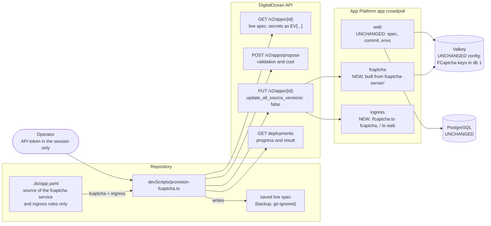
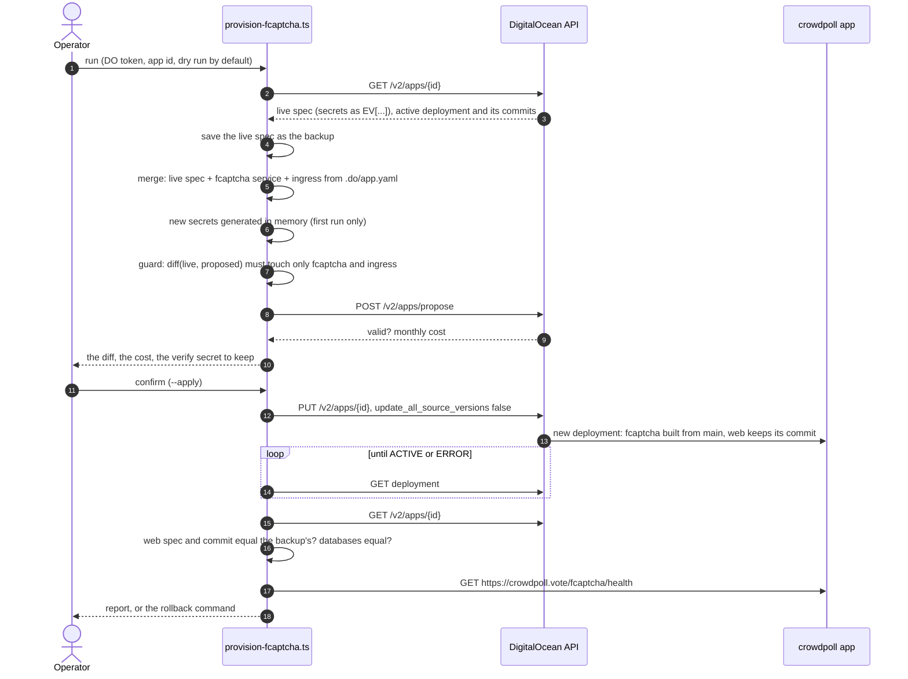
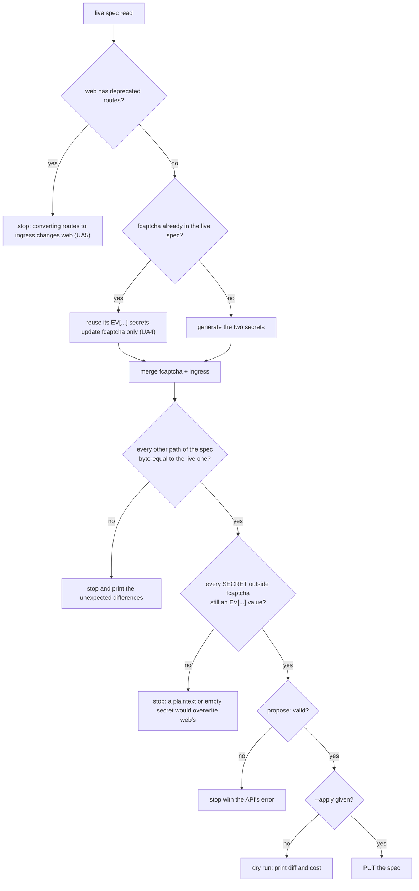

# High Level Requirements

Requirements: `requirements/20261103-114927-provision-fcaptcha-service/requirements.md`  
External Files: none  
Generated: 2026-11-03 11:49 AM  

We are ready to provision the `fcaptcha` service and the required `ingress` on Digital Ocean.  
The .do/app.yaml has the necessary settings.  
We will put the set FCAPTCHA secrets in the file when used.  

We want to be absolutely sure that the current `web` service and the databases are not changed in any way.  

How do we automatically do that provisioning without clicking around the console?

## Additional Requirements and Research Requests

**Instructions To The Developer**  
Enter any additional requirements or research requests under the ## Additional Requirements and Research Requests heading above.  
When you Type or Say: "Next" in the CC CLI terminal, the additional requirements and research requests will be applied to the report.  
  
You may leave these instructions here. They will be ignored when "Next" is executed.  

✅ Applied 2026-11-03 12:26 PM: 1 requirement added to requirements.md, withdrawing "`web` and the databases must not change" and choosing Terraform (findings IN4, IN5, UA7, UA8, NC1, NC2, NC3);  
1 research result added for Terraform (RS3).  

## 1. Overview and Scope

The previous feature (`specs/20261102-144053-FCAPTCHA-AND-SEO`) wrote the `fcaptcha` service and the `ingress` rules into `.do/app.yaml`, but nothing has been provisioned on DigitalOcean yet.  
This feature adds them to the running `crowdpoll` app from the command line, in one repeatable run, and proves that nothing else in the app changed.  

The difficulty is that App Platform has no "add one component" call: every change replaces the app's **whole** spec.  
So "add `fcaptcha`" is really "submit a complete spec in which everything except `fcaptcha` and `ingress` is exactly what is live today".  

**In scope:**  

- A provisioning script (a named dev script, e.g. `devScripts/provision-fcaptcha.ts`, run with `tsx`) that:  
  - reads the live spec of the `crowdpoll` app;  
  - adds the `fcaptcha` service and the `ingress` rules taken from `.do/app.yaml`, and nothing else;  
  - puts the two FCaptcha secrets into the submitted spec without writing them to any committed file;  
  - refuses to submit unless the only differences from the live spec are the `fcaptcha` service and `ingress`;  
  - submits the update so that existing components keep their current source commit;  
  - checks the result afterwards.  
- A saved copy of the live spec before the change, for rollback.  
- The `.gitignore` line the new dev script needs (`!devScripts/<file>`), and the README's deployment notes.  

**Out of scope (assumed):**  

- Turning the human check on in `web` (`ENV_FCAPTCHA_ENABLED`, `ENV_FCAPTCHA_URL`, `ENV_FCAPTCHA_SITE_KEY`, `ENV_FCAPTCHA_VERIFY_SECRET` on `web`): that changes `web`, which this feature must not do (see IN1).  
- Deploying new `web` code from `main`.  
- Any change to the PostgreSQL or Valkey clusters, the domain, DNS or the CDN.  
- Infrastructure-as-code for the whole app (Terraform, Pulumi): see RS1.  

**Assumptions:**  

- `main` on GitHub (`roadraceresults/crowdpoll`) already holds `fcaptcha-server/` (commit `1141ae5`), so App Platform can build the new service from it.  
- The operator has a DigitalOcean account allowed to update the app, and can create an API token.  
- Valkey database 1 is unused today (the web service uses database 0).  

## 2. Component Diagram

What the run reads, what it writes, and which parts of the app it may and may not touch.  

## 3. Sequence: One Provisioning Run

## 4. Decision Flow: When the Run Refuses to Submit

## 5. Research Results

### 5.1 How can the provisioning be done without the console?

**RS1. How can the `fcaptcha` service and the ingress be provisioned automatically, without clicking around the console?**  
<b>
✅ Resolved</b>  
✅ Requirements File Updated: 2026-11-03 1:32 PM  
**Notes**: Recommendation accepted in file 2026-11-03: Recommendation C, **Terraform (`digitalocean_app`) for the whole app.**;  
the requirements now record it under "Decisions (2026-11-03 1:32 PM)", RS1.  

> The requirements ask for an automated way to add the service and the ingress to the existing app.  
> Sources: [doctl apps update](https://docs.digitalocean.com/reference/doctl/reference/apps/update/), [PyDo apps.update (API body)](https://docs.digitalocean.com/reference/pydo/reference/apps/update/), [App spec reference](https://docs.digitalocean.com/products/app-platform/reference/app-spec/), [Community: resubmitting secrets](https://www.digitalocean.com/community/questions/error-with-dolt-secret-env-value-must-not-be-encrypted-before-app-is-created).  
> Every route — `doctl apps update --spec`, the API's `PUT /v2/apps/{id}`, Terraform's `digitalocean_app`, the `digitalocean/app_action` GitHub Action — submits the app's **complete** spec, which replaces the live one.  
> The API's `update_all_source_versions` (doctl's `--update-sources`) defaults to false: "only newly added sources will be updated", so existing components keep their deployed commit and only the new `fcaptcha` is built from `main`.  
> SECRET values are encrypted on first submission, and later submissions must send the encrypted value back; sending `""` (as `.do/app.yaml` holds) would overwrite a live secret.  
> Terraform or Pulumi would take ownership of the whole app, including `web` and the database attachments, which needs an import and is a larger change than this feature.  
> On this machine `doctl.exe` (installed by winget) is refused by Windows Application Control (see UA1), so the CLI cannot be used as it stands.  

  - **Recommendation A** _(recommended)_: **a `tsx` script calling the DigitalOcean REST API directly, merging into the live spec.**  

    [ ] ➡️ **Not Accepted**

    - <u>Pros</u>: no binary to install or unblock (Node's `fetch` is enough);  
      it starts from the live spec, so `web`, the domains and the encrypted secrets are carried over exactly;  
      the guard of section 4 is ordinary, testable TypeScript;  
      `update_all_source_versions: false` keeps `web` on its commit.  
    - <u>Cons</u>: a YAML parser is needed to read `.do/app.yaml` (a dev dependency, e.g. `yaml`), or the script carries the two blocks itself.  

  - **Recommendation B**: **the same merge, submitted with `doctl apps update --spec - --wait` (no `--update-sources`).**  

    [ ] ➡️ **Not Accepted**

    - <u>Pros</u>: the officially documented CLI, with `--wait` built in.  
    - <u>Cons</u>: `doctl` is blocked on this machine (UA1);  
      the merge and the guard still need a script around it.  

  - **Recommendation C**: **Terraform (`digitalocean_app`) for the whole app.**  

    [X] ➡️ **Accepted**

    - <u>Pros</u>: a plan shows every difference before it is applied, and the app becomes code.  
    - <u>Cons</u>: it must first import and describe all of `web` and the databases exactly, so the first apply is the riskiest change to `web` of all;  
      it adds a tool, state storage and secrets handling the project does not have.  

  - **Developer Resolution D**:  

    [ ] ➡️ **Not Accepted**

### 5.2 How can we be sure that `web` and the databases do not change?

**RS2. What makes a spec update leave `web` and the databases exactly as they are?**  
<b>
✅ Resolved</b>  
✅ Requirements File Updated: 2026-11-03 12:06 PM  
**Notes**: Recommendation accepted by "Accept all" 2026-11-03: Recommendation, **a guard before submitting and a check after, both comparing against the saved live spec.**;  
the requirements now record it under "Decisions", RS2.  

> The requirements ask to be "absolutely sure" that `web` and the databases are not changed.  
> Sources: [App spec reference](https://docs.digitalocean.com/products/app-platform/reference/app-spec/), [PyDo apps.update](https://docs.digitalocean.com/reference/pydo/reference/apps/update/).  
> Three things could change `web` through a spec update: a difference in its component spec (envs, size, scaling, routes), a new source commit, or a secret resubmitted in plaintext or empty.  
> The first is prevented by copying `web` from the live spec, not from `.do/app.yaml`;  
> the second by `update_all_source_versions: false`;  
> the third by requiring every SECRET outside `fcaptcha` to be the live `EV[...]` value.  
> The `databases` entries attach existing clusters by `cluster_name`; copied unchanged from the live spec, the update does not resize, upgrade or re-create them.  
> Could not be confirmed from the documentation: whether a deployment in which `web` is unchanged still replaces `web`'s instances (a rolling restart of the same build). See AM2.  

  - **Recommendation**: **a guard before submitting and a check after, both comparing against the saved live spec.**  

    [X] ➡️ **Accepted**

    - Before: the proposed spec, with `services[fcaptcha]` and `ingress` removed, must equal the live spec (after the same removal) as canonical JSON; any other difference stops the run.  
    - Before: every SECRET env outside `fcaptcha` must be an `EV[...]` value.  
    - Submit with `update_all_source_versions: false`.  
    - After: the new active deployment's `web` commit must equal the previous one, and `web`'s component spec and `databases` must equal the backup's; otherwise the run prints the rollback (re-submit the backup).  

  - **Developer Resolution B**:  

    [ ] ➡️ **Not Accepted**

### 5.3 What does Terraform need to provision CrowdPoll on DigitalOcean?

**RS3. What does provisioning CrowdPoll with Terraform involve?**  
<b>
✅ Resolved</b>  
✅ Requirements File Updated: 2026-11-03 1:32 PM  
**Notes**: Recommendation accepted in file 2026-11-03: Recommendation, **adopt the existing resources by import, pin the provider, and prove the two unknowns first.**;  
the requirements record the pinned provider, the `terraform version` check and the Valkey gap; the import step is replaced by NC2's fresh stack.  

> The additional requirements (2026-11-03 12:26 PM) choose Terraform to provision all of CrowdPoll, `web` and the databases included.  
> Sources: [digitalocean_app resource](https://github.com/digitalocean/terraform-provider-digitalocean/blob/main/docs/resources/app.md), [digitalocean_database_cluster resource](https://github.com/digitalocean/terraform-provider-digitalocean/blob/main/docs/resources/database_cluster.md), [DigitalOcean Terraform reference](https://docs.digitalocean.com/reference/terraform/reference/).  
> Existing resources are adopted with `terraform import` by id (`digitalocean_app`, `digitalocean_database_cluster`), so nothing has to be re-created;  
> a major `version` change on a cluster upgrades it in place rather than replacing it.  
> The `digitalocean_app` resource supports `ingress` rules (`match.path.prefix`, `preserve_path_prefix`) and `env` of type `SECRET`, and waits up to 30 minutes for the deployment.  
> The provider's documentation lists the app `database` engines as `MYSQL`, `PG`, `REDIS`, `MONGODB`, `KAFKA`, `OPENSEARCH`, with no `VALKEY`, while the live spec attaches Valkey as `engine: VALKEY` (the cluster resource does support `engine = "valkey"`); whether the app resource accepts it could not be confirmed.  
> A `SECRET` value given to Terraform is stored in the Terraform state in plain text, so the state is itself a secret (UA8).  
> Whether `terraform.exe` runs under this machine's Application Control policy, which blocks `doctl.exe` (UA1), is not known.  

  - **Recommendation**: **adopt the existing resources by import, pin the provider, and prove the two unknowns first.**  

    [X] ➡️ **Accepted**

    - Pin `digitalocean/digitalocean` to an exact version in `required_providers`.  
    - First step of the plan: `terraform version` on this machine (or OpenTofu's `tofu version`), and an import of the app followed by `terraform plan`, which must show no change before anything is edited.  
    - If the app resource refuses `VALKEY`, the Valkey attachment stays as the live spec has it and is reported as a provider gap, not worked around by hand.  

  - **Developer Resolution B**:  

    [ ] ➡️ **Not Accepted**

## 6. Breaking Changes

- **`/fcaptcha/*` stops reaching `web` in production.**  
  With the ingress, App Platform sends every path under `/fcaptcha` to the new service.  
  `web` serves nothing there in production today (its `/fcaptcha` proxy runs only with `ENV_PUBLIC_ORIGIN` on `localhost`), so no user-visible route changes.  
- **The README's "change it in both places" rule becomes "the script merges from `.do/app.yaml`".**  
  The console spec stays the one App Platform builds from; `.do/app.yaml` becomes the source of the blocks the script adds, not a spec that is ever submitted whole.  

- **All test data is lost.**  
  The fresh stack (NC2, UA9) starts with empty databases: every test account, poll, vote, invitation and session is gone, and test users sign up again and accept the Terms.  
- **`.do/app.yaml` is removed** (IN5).  
  Anything that reads it, and the README's rule that a change is made both there and in the console, give way to `infra/`.  

## 7. Technical Debt

- **`.do/app.yaml` is not the live spec.**  
  It has no `domains`, its SECRET values are `""`, and the README describes `web` autoscaling 4–12 while the file says 1–1.  
  Submitting it as it is would remove the domain and blank every secret (IN3).  
- **`doctl` cannot run on the operator's machine** under the current Application Control policy (UA1).  
- **Deploys are still by hand** and the two services' shared settings (the verify secret, the site key) must be kept equal by the operator.  
- **The verify secret is needed again later**: turning the check on in `web` needs the same `ENV_FCAPTCHA_VERIFY_SECRET`, and an encrypted value cannot be read back from App Platform (IN2).  

## 8. Findings

### 8.1 Inconsistencies

**IN1. `.do/app.yaml` changes `web`, and `web` must not change.**  
<b>
✅ Resolved</b>  
✅ Requirements File Updated: 2026-11-03 12:06 PM  
**Notes**: Recommendation accepted by "Accept all" 2026-11-03: Recommendation, **provision only the `fcaptcha` service and `ingress`; `web` keeps its live spec.**;  
the requirements now record it under "Decisions", IN1, with turning the check on named out of scope.  

> The requirements say `.do/app.yaml` "has the necessary settings" and also that `web` must not change "in any way".  
> But `.do/app.yaml`'s `web` already carries four new variables: `ENV_FCAPTCHA_ENABLED=1`, `ENV_FCAPTCHA_URL=${fcaptcha.PRIVATE_URL}`, `ENV_FCAPTCHA_SITE_KEY` and `ENV_FCAPTCHA_VERIFY_SECRET`.  
> Taking those would change `web`'s environment and, at its next deploy, turn the human check on.  

  - **Recommendation**: **provision only the `fcaptcha` service and `ingress`; `web` keeps its live spec, and turning the check on is a later, separate step.**  

    [X] ➡️ **Accepted**

    - The script takes from `.do/app.yaml` only `services[name=fcaptcha]` and `ingress`.  
    - The four `web` variables stay in `.do/app.yaml` as the description of the later step, which the requirements name as out of scope.  

  - **Developer Resolution B**:  

    [ ] ➡️ **Not Accepted**

**IN2. "Put the FCaptcha secrets in the file" conflicts with "secrets are never in `.do/app.yaml`".**  
<b>
✅ Resolved</b>  
✅ Requirements File Updated: 2026-11-03 1:32 PM  
**Notes**: Recommendation accepted in file 2026-11-03: Recommendation C, **a git-ignored local file read by the script.**;  
under Terraform the file is a git-ignored variables file of `sensitive` variables, recorded with UA8 in the requirements.  

> The requirements say "We will put the set FCAPTCHA secrets in the file when used."  
> The project rule (CLAUDE.md, *Configuration rules*) is that production secrets are encrypted console variables, never in `.do/app.yaml`, which is committed and pushed to GitHub.  
> It is also unclear which file is meant, and who creates the secrets.  
> The verify secret must be kept: `web` will need the same value when the check is turned on, and App Platform never shows it again.  

  - **Recommendation A** _(recommended)_: **the script generates both secrets in memory, sends them only in the API request, and prints the verify secret once for the password manager.**  

    [ ] ➡️ **Not Accepted**

    - <u>Pros</u>: no secret ever touches a file;  
      App Platform encrypts them on submission, so the live spec and the backup hold only `EV[...]` values.  
    - <u>Cons</u>: if the printed verify secret is lost, it must be rotated on `fcaptcha` (a rerun with `--rotate-secrets`) before `web` can be configured.  

  - **Recommendation B**: **the operator supplies both secrets through environment variables of the session (`ENV_FCAPTCHA_SECRET`, `ENV_FCAPTCHA_VERIFY_SECRET`), generated as the FCaptcha quickstart shows.**  

    [ ] ➡️ **Not Accepted**

    - <u>Pros</u>: the operator holds the values before the run and can store them first.  
    - <u>Cons</u>: values typed into a shell may land in its history;  
      the script must still check their length (at least 32 bytes) and that they differ.  

  - **Recommendation C**: **a git-ignored local file (e.g. `devScripts/fcaptcha-secrets.local.json`) read by the script.**  

    [X] ➡️ **Accepted**

    - <u>Pros</u>: closest to "in the file";  
      the value is there later for `web`.  
    - <u>Cons</u>: a plaintext production secret on disk, one `.gitignore` mistake away from GitHub.  

  - **Developer Resolution D**:  

    [ ] ➡️ **Not Accepted**

**IN3. ".do/app.yaml has the necessary settings" — but submitting it would change `web`, the domain and every secret.**  
<b>
✅ Resolved</b>  
✅ Requirements File Updated: 2026-11-03 12:06 PM  
**Notes**: Recommendation accepted by "Accept all" 2026-11-03: Recommendation, **`.do/app.yaml` is the source of the two added blocks only.**;  
the requirements now record it under "Decisions", IN3, with the allowed-hostnames check.  

> App Platform replaces the whole spec on each update (RS1).  
> `.do/app.yaml` has no `domains` section, holds `""` for every SECRET (`ENV_DATABASE_URL`, `ENV_BETTER_AUTH_SECRET`, the SES keys, …), and the README itself says the console spec, not the file, is what App Platform builds.  
> Submitting the file as it is would detach `crowdpoll.vote` and blank `web`'s secrets, the opposite of the requirement.  

  - **Recommendation**: **`.do/app.yaml` is the source of the two added blocks only; the submitted spec is always the live spec plus those blocks.**  

    [X] ➡️ **Accepted**

    - The guard of RS2 enforces it.  
    - The script also checks that `ENV_FCAPTCHA_ALLOWED_HOSTNAMES` names every domain of the live spec's `domains` (e.g. a `www` alias), and stops if one is missing.  

  - **Developer Resolution B**:  

    [ ] ➡️ **Not Accepted**

**IN4. Resolved decisions rest on the withdrawn "`web` and the databases must not change".**  
<b>
✅ Resolved</b>  
✅ Requirements File Updated: 2026-11-03 1:32 PM  
**Notes**: Recommendation accepted in file 2026-11-03: Recommendation, **record those decisions in the requirements as superseded by the Terraform approach.**;  
the requirements now list the superseded decisions and what still holds, under IN4.  

> The additional requirements (2026-11-03 12:26 PM) withdraw that requirement and choose Terraform for the whole app.  
> IN1, IN3, RS2, AM1, UA3, UA4 and UA5 were resolved to protect `web` and the databases from any change, and describe a merge script that Terraform replaces;  
> the diagrams of sections 2, 3 and 4 draw that script.  
> Open findings shaped by the same requirement: RS1 (Terraform is option C), AM2 (a restart of `web` no longer matters) and UA1 (where the tool runs).  

  - **Recommendation**: **record those decisions in the requirements as superseded by the Terraform approach; the plan reviewed by `terraform plan` takes the place of the guard.**  

    [X] ➡️ **Accepted**

    - In `requirements.md` the Decisions IN1, IN3, RS2, AM1, UA3, UA4 and UA5 are marked superseded, keeping only what still holds: the custom-scoped token (UA2), the allowed-hostnames check (IN3), and the after-deploy checks of `/fcaptcha/health` and `/healthz` (UA3).  
    - `terraform plan` is the dry run, `terraform apply` the submit, and reverting the configuration and applying again the rollback.  
    - RS1, AM2 and UA1 stay open for the developer (Terraform is RS1, C; AM2, A matches the new requirement).  
    - The specification draws the Terraform flow in place of sections 2–4.  

  - **Developer Resolution B**:  

    [ ] ➡️ **Not Accepted**

**IN5. `.do/app.yaml` and a Terraform configuration would be two descriptions of the same app.**  
<b>
✅ Resolved</b>  
✅ Requirements File Updated: 2026-11-03 1:32 PM  
**Notes**: Recommendation accepted in file 2026-11-03: Recommendation A, **Terraform becomes the only description; `.do/app.yaml` is deleted.**;  
the requirements now record it under IN5.  

> Today `.do/app.yaml` describes the app (imperfectly, see IN3), and the README says a change must be made both there and in the console.  
> With Terraform, the `digitalocean_app` resource holds the spec, in HCL.  
> Keeping both invites the drift IN3 found.  

  - **Recommendation A** _(recommended)_: **Terraform becomes the only description; `.do/app.yaml` is deleted and the README, ARCHITECTURE and CLAUDE.md say so.**  

    [X] ➡️ **Accepted**

    - <u>Pros</u>: one source of truth, and no console edits;  
      the README's "change it in both places" rule goes away.  
    - <u>Cons</u>: the spec is read in HCL rather than in App Platform's own YAML format.  

  - **Recommendation B**: **keep `.do/app.yaml` and have Terraform read it (`yamldecode`) into the app resource's blocks.**  

    [ ] ➡️ **Not Accepted**

    - <u>Pros</u>: the familiar YAML stays the file people edit.  
    - <u>Cons</u>: the app resource takes nested HCL blocks, so the conversion needs `dynamic` blocks for every section;  
      secrets still cannot live in it.  

  - **Developer Resolution C**:  

    [ ] ➡️ **Not Accepted**

### 8.2 Ambiguities

**AM1. What does "the databases are not changed in any way" cover?**  
<b>
✅ Resolved</b>  
✅ Requirements File Updated: 2026-11-03 12:06 PM  
**Notes**: Recommendation accepted by "Accept all" 2026-11-03: Recommendation, **it means the clusters' configuration and the `databases` entries of the spec.**;  
the requirements now record it under "Decisions", AM1.  

> The new service connects to the existing Valkey cluster (`${valkey-tor1-crowdpoll.DATABASE_URL}/1`) and stores its short-lived challenge state there.  
> "Not changed" could mean the clusters' configuration (size, version, users, trusted sources, eviction policy), or also their contents.  

  - **Recommendation**: **it means the clusters' configuration and the `databases` entries of the spec; FCaptcha's keys in Valkey database 1 are expected.**  

    [X] ➡️ **Accepted**

    - The `databases` entries are copied unchanged from the live spec, and the run makes no call to the databases API.  
    - Trusted sources are granted to the app as a whole, so the new component needs no firewall change.  
    - PostgreSQL is not used by `fcaptcha` at all; database 0 of Valkey is not touched.  

  - **Developer Resolution B**:  

    [ ] ➡️ **Not Accepted**

**AM2. Does a redeploy of `web` with the same build count as "changed"?**  
<b>
✅ Resolved</b>  
✅ Requirements File Updated: 2026-11-03 1:32 PM  
**Notes**: Recommendation accepted in file 2026-11-03: Recommendation A, **"unchanged" means the same component spec, commit and environment; a rolling replacement is acceptable.**;  
the requirements now record it under AM2.  

> An app update creates one deployment for the whole app.  
> It is not confirmed whether App Platform then replaces `web`'s instance with a new one running the same commit, build and environment (a rolling restart, with no downtime at one instance).  
> If even that is ruled out, the requirement may not be achievable on App Platform.  

  - **Recommendation A** _(recommended)_: **"unchanged" means the same component spec, commit and environment; a rolling replacement of the same build is acceptable.**  

    [X] ➡️ **Accepted**

    - <u>Pros</u>: achievable and checkable (RS2's after-checks);  
      the 30-second termination grace period already lets a retiring instance finish its votes.  
    - <u>Cons</u>: Live Results connections on the old instance reconnect once.  

  - **Recommendation B**: **no restart of `web` at all; the run is done at a quiet hour and stops if the deployment would replace `web`.**  

    [ ] ➡️ **Not Accepted**

    - <u>Pros</u>: the strictest reading of the requirement.  
    - <u>Cons</u>: App Platform gives no way to exclude a component from a deployment, so this may make the feature impossible; it can only be learned by running it.  

  - **Developer Resolution C**:  

    [ ] ➡️ **Not Accepted**

**AM3. "OpenSearch if it is used": is it used?**  
<b>
✅ Resolved</b>  
✅ Requirements File Updated: 2026-11-03 1:56 PM  
**Notes**: Recommendation accepted in file 2026-11-03: Recommendation, **no OpenSearch cluster now; `ENV_OPENSEARCH_URL` stays unset.**;  
the requirements now record it under "Decisions (2026-11-03 1:56 PM)", AM3.  

> NC1 has Terraform manage OpenSearch "if it is used".  
> `.do/app.yaml` sets no `ENV_OPENSEARCH_URL`, so production today serves the home search from PostgreSQL full-text search, the documented fallback.  
> Whether the fresh stack provisions a cluster is left open.  

  - **Recommendation**: **no OpenSearch cluster now; `ENV_OPENSEARCH_URL` stays unset, and adding one later is a Terraform change of its own.**  

    [X] ➡️ **Accepted**

    - A managed OpenSearch cluster is the largest monthly cost of the stack and nothing uses it yet.  
    - The search outbox and the PostgreSQL fallback already work without it.  

  - **Developer Resolution B**:  

    [ ] ➡️ **Not Accepted**

### 8.3 Unspecified Aspects

**UA1. `doctl` is blocked on the operator's machine.**  
<b>
✅ Resolved</b>  
✅ Requirements File Updated: 2026-11-03 1:37 PM  
**Notes**: Recommendation accepted in file 2026-11-03: Developer Resolution C, **`doctl` is not used; Terraform runs on this machine.**;  
the requirements now record it under "Decisions (2026-11-03 1:37 PM)", UA1, with the Application Control check of RS3 and the OpenTofu fallback.  

> `doctl.exe` (winget, `%LOCALAPPDATA%\Microsoft\WinGet\Links`) fails with "An Application Control policy has blocked this file", from PowerShell and from Git Bash alike.  
> Sources: [Microsoft — Smart App Control has blocked part of this app](https://support.microsoft.com/en-us/topic/smart-app-control-has-blocked-part-of-this-app-0729fff1-48bf-4b25-aa97-632fe55ccca2).  
> Smart App Control has no per-file allow list: it can only be turned off as a whole.  
> The requirements do not say where the provisioning runs.  

  - **Recommendation A** _(recommended)_: **no `doctl`: the script uses the REST API through Node's `fetch` (RS1, A), on this machine.**  

    [ ] ➡️ **Not Accepted**

    - <u>Pros</u>: Node already runs here; nothing to unblock; the machine's protection stays on.  
    - <u>Cons</u>: the script owns a little more code (polling the deployment).  

  - **Recommendation B**: **run it from a GitHub Actions workflow started by hand (`workflow_dispatch`), with the token as a repository secret.**  

    [ ] ➡️ **Not Accepted**

    - <u>Pros</u>: `doctl` and the token live off the laptop; a log of every run.  
    - <u>Cons</u>: a long-lived app-update token stored at GitHub;  
      the dry-run review step becomes a two-job approval.  

  - **Developer Resolution C**:  

    [X] ➡️ **Accepted**

    - doctl is not used: Terraform's provider calls the DigitalOcean API directly. Terraform runs on this machine. Whether terraform.exe runs under the Application Control policy is checked first (RS3); if it is blocked, OpenTofu is tried, then Smart App Control's setting is reviewed.

**UA2. Which credential does the script use, and where is it kept?**  
<b>
✅ Resolved</b>  
✅ Requirements File Updated: 2026-11-03 12:06 PM  
**Notes**: Recommendation accepted by "Accept all" 2026-11-03: Recommendation, **a custom-scoped token, short expiry, `DIGITALOCEAN_TOKEN` in the session only.**;  
the requirements now record it under "Decisions", UA2.  

> The API needs a DigitalOcean token able to update the app.  
> A full-access personal token could also delete the app or the database clusters.  

  - **Recommendation**: **a custom-scoped token (apps read and update only), short expiry, passed in the session as `DIGITALOCEAN_TOKEN` and never written to a file.**  

    [X] ➡️ **Accepted**

    - It is a dev script's input, not an app setting, so it is not an `ENV_*` variable and not in `loadConfig`.  
    - The app is found by name (`crowdpoll`) or by `--app-id`; the script logs neither the token nor any decrypted value.  
    - The token is revoked (or left to expire) after the run.  

  - **Developer Resolution B**:  

    [ ] ➡️ **Not Accepted**

**UA3. What proves the run succeeded, and how is it undone?**  
<b>
✅ Resolved</b>  
✅ Requirements File Updated: 2026-11-03 12:06 PM  
**Notes**: Recommendation accepted by "Accept all" 2026-11-03: Recommendation, **dry run by default, `--apply` to submit, checks after, and the backup as the rollback.**;  
the requirements now record it under "Decisions", UA3.  

> The requirements ask to be sure nothing else changed, but name no check, no review step before the change, and no way back.  

  - **Recommendation**: **dry run by default, `--apply` to submit, checks after, and the backup as the rollback.**  

    [X] ➡️ **Accepted**

    - Without `--apply` the script prints the spec diff and the propose endpoint's monthly cost (the new `apps-d-1vcpu-1gb`, 1–3 instances) and submits nothing.  
    - The live spec is saved before each submit to a git-ignored file (e.g. `devScripts/app-spec-backups/<timestamp>.json`, encrypted values only).  
    - After the deployment is `ACTIVE`: RS2's checks, `GET https://crowdpoll.vote/fcaptcha/health` answers, `GET /fcaptcha/fcaptcha.js` loads, and `/healthz` of `web` answers as before (quickstart D2).  
    - On a failed deployment or a failed check, the script prints the command that re-submits the backup (`--restore <file>`), which removes `fcaptcha` and `ingress` again.  

  - **Developer Resolution B**:  

    [ ] ➡️ **Not Accepted**

**UA4. What does a second run do?**  
<b>
✅ Resolved</b>  
✅ Requirements File Updated: 2026-11-03 12:06 PM  
**Notes**: Recommendation accepted by "Accept all" 2026-11-03: Recommendation, **the script is idempotent and stays the way `fcaptcha` is changed.**;  
the requirements now record it under "Decisions", UA4.  

> The requirements describe a one-time provisioning.  
> But `fcaptcha` will need updates (a new FCaptcha version in `fcaptcha-server/`, a changed setting), and a rerun must not regenerate the secrets by accident.  

  - **Recommendation**: **the script is idempotent and stays the way `fcaptcha` is changed.**  

    [X] ➡️ **Accepted**

    - With `fcaptcha` already live, a rerun keeps its `EV[...]` secrets and replaces only its other fields with `.do/app.yaml`'s; with no difference it submits nothing.  
    - `--rotate-secrets` generates new ones (IN2).  
    - A rerun leaves `fcaptcha` on its commit unless `--rebuild-fcaptcha` is given; even then `web` keeps its commit, since `update_all_source_versions` stays false (a forced rebuild of one component is requested as that component's deployment, not by refreshing all sources).  

  - **Developer Resolution B**:  

    [ ] ➡️ **Not Accepted**

**UA5. What if the live `web` still routes with the deprecated `routes` field?**  
<b>
✅ Resolved</b>  
✅ Requirements File Updated: 2026-11-03 12:06 PM  
**Notes**: Recommendation accepted by "Accept all" 2026-11-03: Recommendation, **the script stops and reports it; `--convert-routes` accepts the conversion explicitly.**;  
the requirements now record it under "Decisions", UA5.  

> The live spec is not in the repository, so it is not known whether `web` has a `routes:` entry (the older way, now deprecated in favour of `ingress.rules`).  
> If it does, adding `ingress` means removing `web.routes`, which is a change to `web`'s component spec.  

  - **Recommendation**: **the script stops and reports it; the conversion is then accepted explicitly by a flag (`--convert-routes`), as the one permitted change to `web`.**  

    [X] ➡️ **Accepted**

    - With the flag, the guard allows exactly the removal of `web.routes` whose rule is `/` and nothing else.  
    - The `/` → `web` ingress rule routes the same traffic.  

  - **Developer Resolution B**:  

    [ ] ➡️ **Not Accepted**

**UA6. Does `${valkey-tor1-crowdpoll.DATABASE_URL}/1` resolve to database 1?**  
<b>
✅ Resolved</b>  
✅ Requirements File Updated: 2026-11-03 1:32 PM  
**Notes**: Recommendation accepted in file 2026-11-03: Recommendation A, **keep the value, and let the run prove it.**;  
the requirements now record it under UA6, with the manual database 1 check.  

> `.do/app.yaml` appends `/1` to a bindable variable.  
> The App spec reference shows bindable variables only as whole values, so whether text may follow one inside a value could not be confirmed ([App spec reference](https://docs.digitalocean.com/products/app-platform/reference/app-spec/)).  
> If it is not interpolated, FCaptcha would fail to connect, or, worse, use database 0, the web service's.  

  - **Recommendation A** _(recommended)_: **keep the value, and let the run prove it: the propose call must accept it, and after the deploy `fcaptcha`'s health and one challenge must work.**  

    [X] ➡️ **Accepted**

    - <u>Pros</u>: no code change; `start.js` already passes it to FCaptcha as `REDIS_URL`.  
    - <u>Cons</u>: whether the keys really landed in database 1 is seen only from a Valkey client (`SELECT 1`, `DBSIZE`), a manual check.  

  - **Recommendation B**: **pass the whole URL and a separate `ENV_FCAPTCHA_REDIS_DB=1`, which `start.js` appends itself.**  

    [ ] ➡️ **Not Accepted**

    - <u>Pros</u>: relies only on the documented whole-value binding; `start.js` can log the database number it uses.  
    - <u>Cons</u>: a small change to `fcaptcha-server/start.js`, its README lines and `.do/app.yaml`.  

  - **Developer Resolution C**:  

    [ ] ➡️ **Not Accepted**

**UA7. Where does the Terraform state live?**  
<b>
✅ Resolved</b>  
✅ Requirements File Updated: 2026-11-03 1:32 PM  
**Notes**: Recommendation accepted in file 2026-11-03: Recommendation C, **a local, git-ignored `terraform.tfstate`.**;  
the requirements now record it under UA7, with the operator's backup.  

> Terraform keeps a state file mapping its configuration to the real resources, and it holds every SECRET value in plain text.  
> The requirements do not say where it is kept, who can read it, or how two runs are kept from overlapping.  

  - **Recommendation A** _(recommended)_: **a private DigitalOcean Spaces bucket of its own, through the S3 backend, with state locking.**  

    [ ] ➡️ **Not Accepted**

    - <u>Pros</u>: on the same account as the app, versioned, readable only with a Spaces key;  
      no new vendor.  
    - <u>Cons</u>: a second bucket and key to manage;  
      the Spaces key itself must be kept out of the repository.  

  - **Recommendation B**: **HCP Terraform (free tier) as the remote backend.**  

    [ ] ➡️ **Not Accepted**

    - <u>Pros</u>: encryption, locking and run history built in.  
    - <u>Cons</u>: a third-party service holding production secrets.  

  - **Recommendation C**: **a local, git-ignored `terraform.tfstate`.**  

    [X] ➡️ **Accepted**

    - <u>Pros</u>: simplest.  
    - <u>Cons</u>: one laptop holds the only copy, unencrypted;  
      lost with the disk.  

  - **Developer Resolution D**:  

    [ ] ➡️ **Not Accepted**

**UA8. Where do the secret values come from under Terraform?**  
<b>
✅ Resolved</b>  
✅ Requirements File Updated: 2026-11-03 1:32 PM  
**Notes**: Recommendation accepted in file 2026-11-03: Recommendation, **existing secrets as `sensitive` Terraform variables; the FCaptcha secrets generated by `random_password`.**;  
the requirements record it with IN2: the git-ignored variables file replaces the `TF_VAR_*` session variables.  

> The app's secrets (`ENV_BETTER_AUTH_SECRET`, the SES keys, `ENV_SPACES_*`, the two FCaptcha secrets) must be given to Terraform as values;  
> the live spec holds them only as App Platform's encrypted `EV[...]` values, which Terraform cannot reuse as plain text.  
> IN2 (still open) asked the same for the FCaptcha secrets alone.  

  - **Recommendation**: **existing secrets as `sensitive` Terraform variables supplied through `TF_VAR_*` in the session; the FCaptcha secrets generated by `random_password` in Terraform itself.**  

    [X] ➡️ **Accepted**

    - No secret is written to a committed file; `*.tfvars` holding secrets is git-ignored.  
    - `random_password` makes the two FCaptcha secrets once and keeps them in the state, so `web` and `fcaptcha` get the same verify secret and nothing has to be copied by hand (IN2 can then be resolved with its Developer Resolution D naming UA8).  
    - Database URLs and CA certificates stay bindable variables (`${db.DATABASE_URL}`), never variables.  

  - **Developer Resolution B**:  

    [ ] ➡️ **Not Accepted**

**UA9. How does the fresh stack replace the old one?**
<b>
✅ Resolved</b>  
✅ Requirements File Updated: 2026-11-03 1:42 PM  
**Notes**: Recommendation accepted in file 2026-11-03: Recommendation B, **delete the old stack first, then apply with the same names.**;  
the requirements now record it under "Decisions (2026-11-03 1:42 PM)", UA9, with the accepted downtime and what happens if the apply fails.  

> NC2 builds a new stack beside the old, and NC1 has Terraform own its names.
> But several names are unique and already taken by the old stack: the database clusters (`db-pgsql-tor1-crowdpoll`, `valkey-tor1-crowdpoll`), the Spaces bucket `crowdpoll` (and with it `ENV_SPACES_CDN_URL`), and the domain `crowdpoll.vote`, which can be attached to only one app at a time.
> The order of the switch-over, and who deletes the old stack, are not specified.

  - **Recommendation A** _(recommended)_: **new names for the new resources, the domain moved last, the old stack deleted by hand after the checks pass.**

    [ ] ➡️ **Not Accepted**

    - <u>Pros</u>: the old site keeps answering until the new one is proven on its default `ondigitalocean.app` address;
      a failed apply leaves the old stack untouched.
    - <u>Cons</u>: names gain a suffix (e.g. `crowdpoll-tf`), and `ENV_SPACES_BUCKET`, `ENV_SPACES_CDN_URL` follow the new bucket;
      the domain move is a second apply, with a short gap while its certificate is issued.

  - **Recommendation B**: **delete the old stack first, then apply with the same names.**

    [X] ➡️ **Accepted**

    - <u>Pros</u>: the names stay as they are, and one apply does everything.
    - <u>Cons</u>: the site is down from the deletion until the apply finishes;
      a failure in the apply leaves nothing running, and a deleted bucket name may not be reusable at once.

  - **Developer Resolution C**:

    [ ] ➡️ **Not Accepted**

**UA10. How is the old stack deleted without the console?**  
<b>
✅ Resolved</b>  
✅ Requirements File Updated: 2026-11-03 1:56 PM  
**Notes**: Recommendation accepted in file 2026-11-03: Recommendation B, **delete them once in the console, then apply.**;  
the requirements now record it under UA10, as the feature's one console step, after UA11's file is complete.  

> UA9 deletes the old stack before Terraform applies, and the goal is to avoid clicking around the console.  
> `doctl` is not used (UA1), and Terraform deletes only what is in its state;  
> the old app, the two clusters and the Spaces bucket (which must be emptied before it can be deleted) are not in it.  

  - **Recommendation A** _(recommended)_: **import the old resources into the new configuration, then `terraform apply -replace=<address>` for each, so Terraform itself deletes and re-creates them with the same names.**  

    [ ] ➡️ **Not Accepted**

    - <u>Pros</u>: no console and no extra tool;  
      the deletion and the creation are one reviewed plan;  
      the same names are kept, as UA9 wants.  
    - <u>Cons</u>: the imports must be written (Terraform `import` blocks);  
      the Spaces bucket needs `force_destroy = true` for its contents to go with it.  

  - **Recommendation B**: **delete them once in the console, then apply.**  

    [X] ➡️ **Accepted**

    - <u>Pros</u>: four deletions, done once; no import work.  
    - <u>Cons</u>: the one remaining console step;  
      nothing records what was deleted.  

  - **Recommendation C**: **a short API script (`fetch`, as RS1 A) that deletes the app, the clusters and the bucket.**  

    [ ] ➡️ **Not Accepted**

    - <u>Pros</u>: scriptable and repeatable.  
    - <u>Cons</u>: code written to run once, with destructive calls of its own.  

  - **Developer Resolution D**:  

    [ ] ➡️ **Not Accepted**

**UA11. Which secret values are lost when the old stack is deleted?**  
<b>
✅ Resolved</b>  
✅ Requirements File Updated: 2026-11-03 1:56 PM  
**Notes**: Recommendation accepted in file 2026-11-03: Recommendation, **fill the variables file before anything is deleted.**;  
the requirements now list each secret's source under UA11, `ENV_ALLOWED_EMAILS` and the provider's Spaces keys included.  

> The old app's secrets (`ENV_BETTER_AUTH_SECRET`, `ENV_SES_ACCESS_KEY_ID`, `ENV_SES_SECRET_ACCESS_KEY`, `ENV_SPACES_KEY`, `ENV_SPACES_SECRET`, `ENV_ALLOWED_EMAILS`, any `ENV_OAUTH_*`) are held by App Platform only as encrypted values that cannot be read back.  
> IN2 and UA8 put them in the git-ignored variables file, but do not say where the values come from, and the list there leaves out `ENV_ALLOWED_EMAILS`.  
> The Terraform provider also needs a Spaces key pair (`spaces_access_id`, `spaces_secret_key`) to manage the bucket, beside the API token.  

  - **Recommendation**: **fill the variables file before anything is deleted: regenerate what can be regenerated, and take the rest from where it was issued.**  

    [X] ➡️ **Accepted**

    - `ENV_BETTER_AUTH_SECRET`: a new random value (every session ends anyway with the fresh database).  
    - The SES keys: a new access key for the same IAM user in AWS, the old one deactivated after the new stack sends mail.  
    - The Spaces keys: a new key pair, used both by `web` and by the provider; the old one revoked after the switch.  
    - `ENV_ALLOWED_EMAILS` and any `ENV_OAUTH_*` values: from the operator's records or the providers' consoles; the variables file lists every one of them.  
    - The run refuses to start the deletion (UA10) while any variable of the file is empty.  

  - **Developer Resolution B**:  

    [ ] ➡️ **Not Accepted**

**UA12. Where does the Terraform configuration live, and what is git-ignored?**  
<b>
✅ Resolved</b>  
✅ Requirements File Updated: 2026-11-03 1:56 PM  
**Notes**: Recommendation accepted in file 2026-11-03: Recommendation, **a top-level `infra/` folder, committed except for its state and secrets.**;  
the requirements now list the committed and git-ignored files under UA12.  

> The requirements say Terraform is the only description of the app (IN5), but not where its files go in the repository.  
> UA7 and IN2 keep the state and the variables file local and git-ignored, which needs `.gitignore` lines.  

  - **Recommendation**: **a top-level `infra/` folder, committed except for its state and secrets.**  

    [X] ➡️ **Accepted**

    - Committed: `infra/*.tf` and `infra/.terraform.lock.hcl` (the pinned provider's checksums).  
    - Git-ignored: `infra/.terraform/`, `infra/*.tfstate`, `infra/*.tfstate.*` and `infra/secrets.auto.tfvars`;  
      a committed `infra/secrets.auto.tfvars.example` names every variable with an empty value.  
    - The README's deployment section, `ARCHITECTURE.md` and the `CLAUDE.md` invariants point to `infra/` in place of `.do/app.yaml`.  

  - **Developer Resolution B**:  

    [ ] ➡️ **Not Accepted**

**UA13. After provisioning, how is a new version of the code deployed?**  
<b>
✅ Resolved</b>  
✅ Requirements File Updated: 2026-11-03 1:56 PM  
**Notes**: Recommendation accepted in file 2026-11-03: Recommendation A, **keep autodeploy off; a deploy is started with one API call from a small committed script.**;  
the requirements now record it under UA13.  

> Autodeploy is off, and each deploy is started by hand from the console today.  
> `terraform apply` with an unchanged configuration starts no deployment, so a code change on `main` still needs a deploy started somewhere, against the goal of no console clicks.  

  - **Recommendation A** _(recommended)_: **keep autodeploy off; a deploy is started with one API call (`POST /v2/apps/{id}/deployments`) from a small committed script using the same token.**  

    [X] ➡️ **Accepted**

    - <u>Pros</u>: deploys stay deliberate, as today;  
      no console, no `doctl`.  
    - <u>Cons</u>: one more small script to keep.  

  - **Recommendation B**: **turn `deploy_on_push` on for `main` in the Terraform configuration.**  

    [ ] ➡️ **Not Accepted**

    - <u>Pros</u>: no step at all: a push to `main` deploys.  
    - <u>Cons</u>: every merge to `main` reaches production at once, which the project chose not to do.  

  - **Recommendation C**: **out of scope: deploys stay as they are, from the console.**  

    [ ] ➡️ **Not Accepted**

    - <u>Pros</u>: nothing to build now.  
    - <u>Cons</u>: the console remains part of every release.  

  - **Developer Resolution D**:  

    [ ] ➡️ **Not Accepted**

### 8.4 Needs Clarifications

**NC1. Which parts of CrowdPoll does Terraform manage?**  
<b>
✅ Resolved</b>  
✅ Requirements File Updated: 2026-11-03 1:32 PM  
**Notes**: Recommendation accepted in file 2026-11-03: Recommendation A, **every DigitalOcean resource; not DNS, not SES.**;  
the requirements now record it under NC1.  

> The additional requirements say "all parts necessary for CrowdPoll, including the web service and the database components".  
> CrowdPoll also uses Spaces + CDN, OpenSearch (optional), the `crowdpoll.vote` domain and its DNS, database firewalls (trusted sources) and Amazon SES, which lives at AWS.  

  - **Recommendation A** _(recommended)_: **every DigitalOcean resource: the app (`web`, `fcaptcha`, ingress, domain), the PostgreSQL and Valkey clusters and their firewalls, OpenSearch if it exists, the Spaces bucket and CDN; not DNS, not SES.**  

    [X] ➡️ **Accepted**

    - <u>Pros</u>: everything the console is used for today, in one plan;  
      DNS and SES change rarely and sit with other providers.  
    - <u>Cons</u>: imports of five or six resources before the first plan is clean.  

  - **Recommendation B**: **the app only; the clusters are read as `data` sources and never managed.**  

    [ ] ➡️ **Not Accepted**

    - <u>Pros</u>: a much smaller first step;  
      Terraform can never resize or delete a database.  
    - <u>Cons</u>: the database settings stay console-managed, against the goal of no manual changes.  

  - **Recommendation C**: **everything, including DNS and SES (the AWS provider).**  

    [ ] ➡️ **Not Accepted**

    - <u>Pros</u>: the whole system as code.  
    - <u>Cons</u>: two providers and two sets of credentials;  
      SES identity and DKIM records are easy to break and already work.  

  - **Developer Resolution D**:  

    [ ] ➡️ **Not Accepted**

**NC2. Import the existing resources, or re-create them?**  
<b>
✅ Resolved</b>  
✅ Requirements File Updated: 2026-11-03 1:32 PM  
**Notes**: Recommendation accepted in file 2026-11-03: Recommendation B, **build a fresh stack with Terraform and retire the old one.**;  
the requirements now record it under NC2, with the test data not carried over.  

> The additional requirements say there is "no risk of downtime, or losing data", since only test users use CrowdPoll.  
> Re-creating would still drop the test users' accounts and polls, change the database URLs and CA certificates, and empty Spaces.  

  - **Recommendation A** _(recommended)_: **import everything that exists; Terraform creates only `fcaptcha` and what is missing.**  

    [ ] ➡️ **Not Accepted**

    - <u>Pros</u>: nothing is lost or re-entered;  
      the first `terraform plan` after import shows exactly what Terraform would change.  
    - <u>Cons</u>: the configuration must be written to match the live resources before the plan is clean.  

  - **Recommendation B**: **build a fresh stack with Terraform and retire the old one.**  

    [X] ➡️ **Accepted**

    - <u>Pros</u>: the configuration is written once, from scratch, with no import work.  
    - <u>Cons</u>: test data lost, a new database URL, CDN and DNS switch-over;  
      two stacks billed during the change.  

  - **Developer Resolution C**:  

    [ ] ➡️ **Not Accepted**

**NC3. Now that `web` may change, is the human check turned on in this feature?**  
<b>
✅ Resolved</b>  
✅ Requirements File Updated: 2026-11-03 1:32 PM  
**Notes**: Recommendation accepted in file 2026-11-03: Recommendation A, **yes: `web` gets the four `ENV_FCAPTCHA_*` variables in the same apply.**;  
the requirements now record it under NC3.  

> IN1 kept `web`'s four `ENV_FCAPTCHA_*` variables out of scope because `web` was not to change.  
> With that requirement withdrawn, the same `terraform apply` could set them, so that the check is live once both services are deployed.  

  - **Recommendation A** _(recommended)_: **yes: `web` gets `ENV_FCAPTCHA_ENABLED=1`, `ENV_FCAPTCHA_URL=${fcaptcha.PRIVATE_URL}`, `ENV_FCAPTCHA_SITE_KEY` and the shared verify secret in the same apply.**  

    [X] ➡️ **Accepted**

    - <u>Pros</u>: one deployment brings the check live, and the verify secret is shared by Terraform (UA8);  
      if `fcaptcha` is unreachable `web` fails open, as designed.  
    - <u>Cons</u>: `web` is redeployed at `main`'s current commit, so the field-length and FCaptcha commits ship with it.  

  - **Recommendation B**: **no: provision `fcaptcha` first; turn the check on in a second apply after the deployment checks pass.**  

    [ ] ➡️ **Not Accepted**

    - <u>Pros</u>: a problem with the new service is seen before any visitor meets the check.  
    - <u>Cons</u>: two applies and two `web` deployments.  

  - **Developer Resolution C**:  

    [ ] ➡️ **Not Accepted**

## 9. Requirements Report Complete Report  

- **Requirements Report Document:** requirements/20261103-114927-provision-fcaptcha-service/requirements-report.md  
- **Requirements Document:** requirements/20261103-114927-provision-fcaptcha-service/requirements.md  
- **Software Architecture Diagrams:** 3  
- **Inconsistencies:** 5  
- **Ambiguities:** 3  
- **Unspecified Aspects:** 13  
- **Needs Clarifications:** 3  
- **Research Results:** 3  
- **Breaking Changes:** 4  
- **Technical Debt items:** 4  

The requirements are ready for /speckit-specify.  
To generate specs from the requirements document, use the `/speckit-specify` skill followed by the path (relative to the project root) to the requirements file.  
At the prompt, Type:  
🟩 👉 /speckit-specify requirements/20261103-114927-provision-fcaptcha-service/requirements.md  
